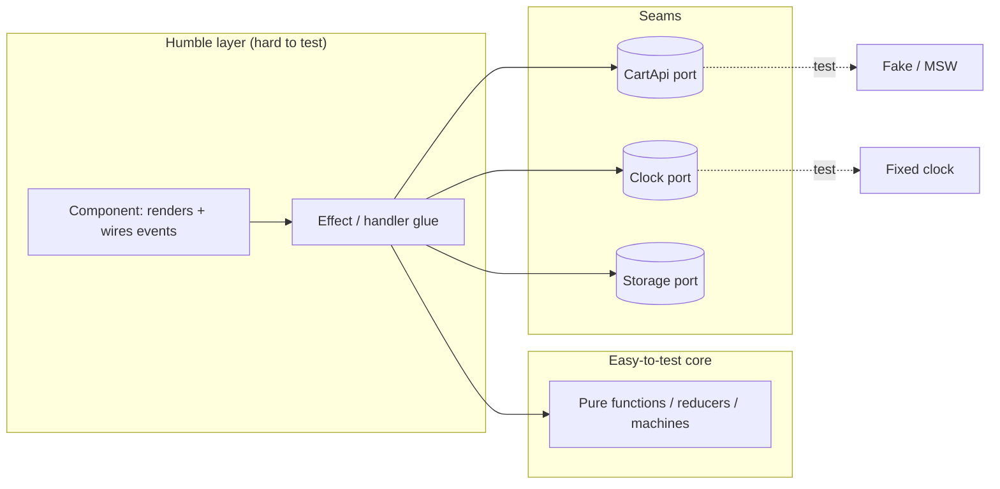
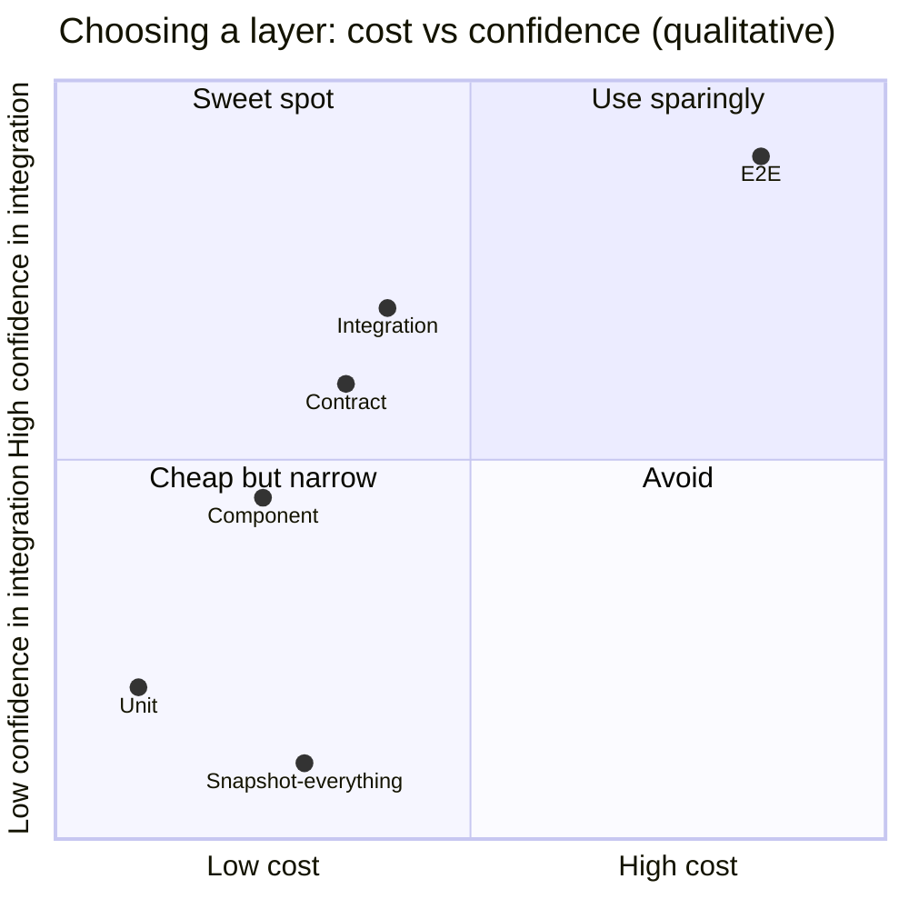

# 11 / 10 — Designing for Testability

## 1. Lesson metadata

| | |
|---|---|
| **Level** | Architect |
| **Study time** | 4–5 hours (reading 2 h, refactoring lab 1 h, exercises 1.5 h) |
| **Prerequisites** | [08/01 — Test strategy and the pyramid](../08-testing-and-quality/01-test-strategy-and-pyramid.md), [08/03 — React Testing Library](../08-testing-and-quality/03-react-testing-library.md), [08/06 — Mocking strategies and MSW](../08-testing-and-quality/06-mocking-strategies-and-msw.md), [08/08 — Integration testing](../08-testing-and-quality/08-integration-testing.md), [04/11 — Dependency inversion](../04-react-architecture/11-dependency-inversion.md), [04/13 — Application services and adapters](../04-react-architecture/13-application-services-and-adapters.md), [05/16 — Dependency injection](../05-design-patterns/16-dependency-injection.md), [11/01 — Trade-off analysis](./01-trade-off-analysis.md) |
| **Next** | [11 — Designing for accessibility](./11-designing-for-accessibility.md) |
| **Related** | [08/16 — Avoiding brittle tests](../08-testing-and-quality/16-avoiding-brittle-tests.md), [08/11 — Component contract testing](../08-testing-and-quality/11-component-contract-testing.md), [11/05 — Application boundaries](./05-application-boundaries.md), [11/16 — Supporting multiple teams](./16-supporting-multiple-teams.md) |

**Learning objectives.** After this lesson you can:
1. Define testability as a *design property* (controllability, observability, isolation, determinism, speed) rather than a tooling choice.
2. Identify and create **seams** in a React codebase: where behaviour can be substituted or observed without editing the code under test.
3. Choose, with evidence and trade-offs, the layer at which each behaviour should be tested (pure function, hook, component, integration, end-to-end, contract).
4. Eliminate the standard sources of non-determinism (time, randomness, network, ids, animations, concurrency).
5. Recognise "test-induced design damage" and distinguish it from genuine design improvement.
6. Design a test architecture that scales to many teams: shared utilities, ownership, flake policy, and CI economics.

**Concepts covered:** controllability, observability, seam, ports and adapters, composition root, humble object, test double taxonomy (dummy/stub/spy/mock/fake), determinism, test data builders, contract tests, mutation testing as a quality probe, test economics (cost, signal, maintenance), flake management.

---

## 2. Deep conceptual explanation

### 2.1 What problem is this lesson solving?

Teams frequently conclude "our code is hard to test" and respond with tooling: another mocking library, a more elaborate harness, snapshot tests. These responses treat the symptom. Hard-to-test code is almost always code with a **design** problem: hidden dependencies, tangled responsibilities, or non-determinism built into the unit. Tests are the first *client* of your module; if the first client cannot use it without heroic setup, real clients (other teams, future you) will struggle too.

At scale the cost is concrete:

- 40 % of CI time spent on tests that each boot the whole provider tree.
- A flake rate that trains engineers to press "re-run".
- Tests that break on every refactor (high maintenance, low signal), so people stop refactoring.
- Critical business rules verified only by slow end-to-end tests, so a single regression takes 45 minutes to discover.

Designing for testability is the discipline of structuring code so that **the cheap tests are also the useful tests**.

### 2.2 The five properties

| Property | Meaning | Violated by | Restored by |
|---|---|---|---|
| **Controllability** | The test can put the unit into any state/inputs it needs | Reaching for globals; `Date.now()`, `Math.random()`, `window.location`, module-level singletons | Parameters, injection, props, providers |
| **Observability** | The test can see the result | Side-effects with no output; state hidden in closures; effects that fire-and-forget | Return values, rendered output, callbacks, event emission, accessible UI |
| **Isolation** | The unit's behaviour doesn't depend on unrelated parts | Deep provider requirements; implicit global registries; shared mutable module state | Narrow props, local state, explicit dependencies |
| **Determinism** | Same input, same result, every run | Time, randomness, network, race conditions, animation, ordering of async work | Fakes for the non-deterministic edges; awaiting on observable conditions |
| **Speed** | Fast enough to run constantly | Booting browsers/servers; heavy fixtures | Putting logic where it can be tested without the heavy machinery |

A useful reframing: **every test is an experiment; testability is the cost of setting up and reading the experiment.**

### 2.3 Seams

*Seam* (Michael Feathers, in *Working Effectively with Legacy Code*): a place where you can alter behaviour without editing in that place. In React the common seams are:

| Seam | How the test uses it | Example |
|---|---|---|
| **Props** | Pass different data/callbacks | `<PriceTag amount={…} onChange={spy} />` |
| **Context / providers** | Wrap with a test provider that supplies fakes | `ApiProvider value={fakeApi}` |
| **Module boundary (adapter)** | Replace an adapter implementation | `ordersApi` interface; real `fetch` adapter vs in-memory adapter |
| **Network boundary** | Intercept requests below the app (MSW) | `http.get('/api/orders', …)` |
| **Hook boundary** | Test a hook on its own via `renderHook`, or fake the hook in a consumer | `useOrders()` |
| **Clock / randomness / ids** | Inject sources | `now: () => Date`, `newId: () => string` |
| **Storage boundary** | Provide a fake storage | `storage: Pick<Storage,'getItem'|'setItem'>` |
| **Router boundary** | `MemoryRouter`/memory history | Navigation tests without a browser |

The art is choosing **the narrowest seam that still lets the test control and observe what matters**. Too far inside (mocking an internal helper) couples the test to implementation. Too far outside (full browser end-to-end for a pure calculation) makes it slow and flaky.

### 2.4 Where logic should live (testability's strongest lever)

Behaviour that is easy to test lives in pure functions: input → output, no I/O. Behaviour that is awkward to test lives in effects, event handlers glued to the DOM, and framework lifecycles. So **move decisions out of the awkward places**:

```
UI event  ->  handler (thin)  ->  pure decision function  ->  state update / command
```

This is the **humble object** pattern: make the hard-to-test object (the component, the effect) so thin that it has almost nothing to get wrong, and put the logic in an easy-to-test collaborator ([04/12 — Domain logic vs UI logic](../04-react-architecture/12-domain-logic-vs-ui-logic.md)). Reducers ([03/03](../03-react-state-and-hooks/03-usereducer-and-reducer-architecture.md)), state machines ([05/13](../05-design-patterns/13-state-machine-pattern.md)), selectors, validators, formatters, and mappers are the usual beneficiaries.

### 2.5 Test doubles — a precise vocabulary

| Double | Behaviour | Typical use | Danger |
|---|---|---|---|
| **Dummy** | Passed but never used | Fill a required parameter | None |
| **Stub** | Returns canned answers | Provide input to the unit | Hard-coded answers diverge from the real system |
| **Spy** | Records calls, delegates or no-ops | Assert something was called | Asserting calls tests *how*, not *what* |
| **Mock** | Pre-programmed expectations that fail the test if violated | Strict interaction tests | High coupling to implementation |
| **Fake** | A working lightweight implementation (in-memory API) | Integration tests, local dev, Storybook | Fake drifts from the real system unless **contract-tested** |

The architect's preference order is usually: **real collaborators** (when cheap and deterministic) → **fakes at the boundary** (when real is expensive/non-deterministic) → **network-level interception** (MSW) → **stubs/spies for pure side-effect edges** → **mocks of internals** (last resort). Reasoning: the further a double is from the real behaviour and the more it encodes *how* the unit works, the more the test lies and the more it breaks on refactor.

### 2.6 What to assert: behaviour, not implementation

Observable behaviour from a user's perspective (Testing Library's guiding principle): what is on screen, what accessible roles/names exist, what requests are sent, what navigation occurs. Implementation details: which hooks ran, internal state variable names, child component props, number of renders ([08/16](../08-testing-and-quality/16-avoiding-brittle-tests.md)).

Heuristic — the **refactor test**: *if I rewrite the internals (replace `useState` with `useReducer`, split a component, swap a library) without changing behaviour, should any test fail?* If yes, that test is coupled to implementation.

*Nuance (not universal).* Sometimes interaction is the behaviour: "submitting the form POSTs `{ …}` exactly once", "analytics fires `purchase` with these fields". Asserting a call on a boundary adapter is legitimate there because the call *is* the externally observable outcome.

### 2.7 Test design economics

A test has a cost curve:

```
total cost = write cost + (run cost × runs) + (maintenance cost × changes) + (flake cost × flakes)
value     = probability(it catches a real defect) × impact(defect) + documentation value
```

Layers differ along these axes (qualitative; calibrate with your own data):

| Layer | Run cost | Flake risk | Maintenance | Defect localisation | Catches |
|---|---|---|---|---|---|
| Pure function/unit | Very low | ~0 | Low | Excellent | Logic errors |
| Hook / small component | Low | Low | Low–Med | Good | Behaviour of unit; a11y semantics |
| Integration (page with fake network) | Medium | Low–Med | Medium | Medium | Wiring, data-flow, state interplay |
| Contract test (consumer/provider) | Low–Med | Low | Medium | Good | Cross-team interface drift |
| E2E (real browser, real-ish backend) | High | High | High | Poor | Environment/integration failures, deployment issues |
| Visual regression | Med | Med | Med–High | Medium | Rendering/CSS regressions |

The commonly cited shapes (pyramid vs "testing trophy") are heuristics about where the best ratio of confidence to cost lies for typical apps; they are not laws. For a UI that is mostly wiring around a backend, integration tests carry much of the value; for a calculation-heavy domain (pricing, tax), unit tests dominate. Decide per area using §2.9's questions.

### 2.8 Misconceptions

| Misconception | Reality |
|---|---|
| "100 % coverage means well-tested." | Coverage shows what code *ran*, not what was *verified*. Tests without assertions give coverage. Use mutation testing or review as a probe of assertion strength. |
| "Mock everything for isolation." | Over-mocking verifies the mocks. Prefer real collaborators when deterministic and cheap. |
| "Use `data-testid` everywhere." | Query by accessible role/name first: it tests what users and assistive tech perceive and doubles as an accessibility check ([11 — Designing for accessibility](./11-designing-for-accessibility.md)). Test ids are a fallback for things with no accessible handle. |
| "Snapshot tests are cheap tests." | Large snapshots are cheap to write and expensive to review; teams approve updates blindly. Use small, intention-revealing snapshots (or none). |
| "Testability = DI frameworks everywhere." | Parameters and props are the simplest DI. Introduce containers only where function/component composition is insufficient. |
| "If it's hard to test, write an E2E test." | Often the E2E test just hides the design problem and is slow and flaky. |

### 2.9 Questions that choose the test layer

For each behaviour ask:
1. **Where does the decision happen?** (pure logic → unit; wiring → integration; browser behaviour → E2E)
2. **What is the cheapest layer that fails if this behaviour breaks?**
3. **Which failure would hurt most?** (money, data loss, security → test at multiple layers; cosmetic → maybe none)
4. **How stable is the interface at this layer?** Test at stable interfaces.
5. **Who owns the boundary?** (cross-team → contract tests)

---

## 3. Internal mechanics

### 3.1 How React Testing Library interacts with React

*Public guarantee.* `render` mounts your element into a DOM (jsdom in Vitest/Jest environments, a real DOM in browser mode); queries read the DOM; `userEvent` dispatches realistic event sequences (pointer, keyboard); updates triggered by tests must be wrapped so React flushes work and effects before assertions.

*Teaching model.* React's `act` makes React process scheduled updates (renders, effects, microtask-queued work) before returning, so assertions see a settled UI. Testing Library wraps its own helpers (`render`, `fireEvent`, `userEvent` via config, `waitFor`, `findBy*`) so you rarely call `act` directly; you do when triggering updates *outside* those helpers (e.g. calling a store's setter in the test).

*Version-sensitive.* In React 19 the recommended import is `import { act } from 'react'`; `react-dom/test-utils` still exports `act` in 19.3.1 but logs a deprecation error and forwards to `React.act`. Testing Library's `render`/`screen` already wrap `act` for you; use RTL 16+ with React 19. In React 19, tests of Suspense/`use`-based data flows and Actions (`useActionState`) involve async transitions: prefer `findBy*`/`waitFor` or awaiting `act(async () => …)` over fixed timeouts.

*Implementation detail.* Environment details (jsdom does no layout: `getBoundingClientRect` returns zeros; `IntersectionObserver`/`ResizeObserver` are absent unless polyfilled) change what is testable in unit-level tests. Layout-dependent behaviour (virtualization, truncation, sticky positioning) needs a real browser (Vitest browser mode or Playwright component tests — **verify current availability and API in each tool's docs**).

### 3.2 Why time and network are the usual sources of flakiness

An async test is a race between the test's assertions and the system's work. A test that asserts "after 100 ms" races real timers; a test that waits "until the success message appears" synchronises on an observable condition. The mechanisms:

- **Fake timers** (`vi.useFakeTimers()`) replace `setTimeout`, `setInterval`, `Date` so the test controls the clock; they do not by themselves flush promise microtasks or React updates, so combine with `await vi.advanceTimersByTimeAsync(…)` and `act`. Mixing `userEvent` with fake timers needs configuration (e.g. passing `advanceTimers`) — **verify in the `@testing-library/user-event` docs**.
- **Network interception** (MSW) operates at the request level (service worker in browser, interceptors in Node) so the app's real `fetch` code, serialization, and error handling run under test; only the server is fake.
- **Awaiting conditions** (`findBy…`, `waitFor`) poll/observe until a condition holds or a timeout elapses.

### 3.3 The composition root

A **composition root** is the single place where concrete implementations are chosen and wired (in a React app: the top-level provider tree and the module that builds service objects). Tests either (a) build their own composition (a `renderWithProviders` helper that wires fakes) or (b) override selected parts. Everything below the root depends on *abstractions* (interfaces/context values), so replacing an implementation never requires editing consumers. Keeping the root thin and exercising it with one smoke test is the pragmatic way to keep real wiring verified.

---

## 4. Step-by-step: making an untestable component testable

Starting point (bad): `CheckoutSummary` reads `Date.now()`, calls `fetch` directly in an effect, formats currency inline, reads `localStorage`, and decides discount eligibility in JSX.

1. **Characterize first.** Write a coarse integration test that renders the component with MSW handling `/api/cart`, asserts current visible behaviour. This is the safety net ([11/03 — Large-scale refactoring](./03-large-scale-refactoring.md) for the general technique).
2. **Extract the decision.** Move `isEligibleForDiscount(cart, now)` into a pure function; unit-test it exhaustively (boundaries: exactly at expiry, time zones, empty cart).
3. **Inject the clock.** `now` becomes a parameter of the decision function; the component obtains it from a `ClockContext` or a prop defaulting to real time at the composition root.
4. **Introduce a port for data.** `CartApi` interface (`getCart(): Promise<Cart>`); real adapter uses fetch; test uses fake or MSW.
5. **Move storage behind a port** (`PreferencesStore`).
6. **Thin the component.** It maps data to JSX and events to calls.
7. **Rewrite tests at the right layers**: many unit tests for the decision function; a few component tests for rendering states (loading, error, empty, full); one integration test for the flow; keep the original characterization test until the new set is trusted, then delete it if it duplicates.
8. **Verify with a refactor test and a mutation probe**: change a condition (`>=` to `>`) and confirm a test fails.

---

## 5. Code examples

### 5.1 Minimal — pure decision function and its test

```ts
// discount.ts
export type Cart = { subtotalCents: number; couponExpiresAt?: string /* ISO 8601 UTC */ };

export function discountPercent(cart: Cart, now: Date): number {
  if (!cart.couponExpiresAt) return 0;
  const expires = new Date(cart.couponExpiresAt);
  if (now >= expires) return 0;           // expired exactly at the boundary instant
  return cart.subtotalCents >= 10_000 ? 15 : 5;
}
```

```ts
// discount.test.ts  (Vitest)
import { describe, it, expect } from 'vitest';
import { discountPercent } from './discount';

const now = new Date('2026-10-22T12:00:00Z');
describe('discountPercent', () => {
  it('is 0 without a coupon', () => {
    expect(discountPercent({ subtotalCents: 20_000 }, now)).toBe(0);
  });
  it('is 0 exactly at expiry (boundary)', () => {
    expect(discountPercent({ subtotalCents: 20_000, couponExpiresAt: '2026-10-22T12:00:00Z' }, now)).toBe(0);
  });
  it('is 15 for big carts with a valid coupon', () => {
    expect(discountPercent({ subtotalCents: 10_000, couponExpiresAt: '2026-10-23T00:00:00Z' }, now)).toBe(15);
  });
  it('is 5 for small carts with a valid coupon', () => {
    expect(discountPercent({ subtotalCents: 9_999, couponExpiresAt: '2026-10-23T00:00:00Z' }, now)).toBe(5);
  });
});
```

Line notes: `now` is a parameter, so there is no fake timer anywhere — the cheapest possible determinism. Boundary tests (`>=` vs `>`, 9,999 vs 10,000) are where bugs live.

### 5.2 Practical — ports, context, and a render helper

```tsx
// ports.ts
export interface CartApi { getCart(signal?: AbortSignal): Promise<Cart>; }
export interface Clock   { now(): Date; }

// services-context.tsx
import { createContext, use, type ReactNode } from 'react';
import type { CartApi, Clock } from './ports';

export type Services = { cartApi: CartApi; clock: Clock };
const ServicesContext = createContext<Services | null>(null);

export function ServicesProvider({ services, children }: { services: Services; children: ReactNode }) {
  return <ServicesContext value={services}>{children}</ServicesContext>; // React 19: context as provider
}
export function useServices(): Services {
  const s = use(ServicesContext);   // `use` can read context conditionally; useContext also works
  if (!s) throw new Error('ServicesProvider missing');
  return s;
}
```

*Version-sensitive:* rendering `<Context value>` directly (without `.Provider`) and `use(Context)` are React 19 features; in React 18 write `<Ctx.Provider value>` and `useContext`.

```tsx
// CheckoutSummary.tsx
import { useQuery } from '@tanstack/react-query';
import { discountPercent } from './discount';
import { useServices } from './services-context';

export function CheckoutSummary() {
  const { cartApi, clock } = useServices();
  const { data: cart, status } = useQuery({
    queryKey: ['cart'],
    queryFn: ({ signal }) => cartApi.getCart(signal),
  });

  if (status === 'pending') return <p role="status">Loading cart…</p>;
  if (status === 'error')   return <p role="alert">Could not load your cart.</p>;

  const pct = discountPercent(cart, clock.now());
  const total = Math.round(cart.subtotalCents * (100 - pct) / 100);
  return (
    <section aria-labelledby="sum-h">
      <h2 id="sum-h">Order summary</h2>
      <p>Discount: {pct}%</p>
      <p>Total: {(total / 100).toLocaleString('en-US', { style: 'currency', currency: 'USD' })}</p>
    </section>
  );
}
```

```tsx
// test-utils.tsx
import { render, type RenderOptions } from '@testing-library/react';
import { QueryClient, QueryClientProvider } from '@tanstack/react-query';
import type { ReactElement } from 'react';
import { ServicesProvider, type Services } from './services-context';

export function renderWithServices(ui: ReactElement, overrides: Partial<Services> = {}, opts?: RenderOptions) {
  const services: Services = {
    cartApi: { getCart: async () => ({ subtotalCents: 0 }) },
    clock: { now: () => new Date('2026-10-22T12:00:00Z') },
    ...overrides,
  };
  // New QueryClient per test: no cache leaking between tests; retries off for determinism.
  const client = new QueryClient({ defaultOptions: { queries: { retry: false } } });
  return render(
    <QueryClientProvider client={client}>
      <ServicesProvider services={services}>{ui}</ServicesProvider>
    </QueryClientProvider>,
    opts,
  );
}
```

```tsx
// CheckoutSummary.test.tsx
import { screen } from '@testing-library/react';
import { it, expect } from 'vitest';
import { renderWithServices } from './test-utils';
import { CheckoutSummary } from './CheckoutSummary';

it('shows the discounted total', async () => {
  renderWithServices(<CheckoutSummary />, {
    cartApi: { getCart: async () => ({ subtotalCents: 20_000, couponExpiresAt: '2026-10-23T00:00:00Z' }) },
  });
  expect(await screen.findByText('Discount: 15%')).toBeInTheDocument();
  expect(screen.getByText('Total: $170.00')).toBeInTheDocument();
});

it('reports failure accessibly', async () => {
  renderWithServices(<CheckoutSummary />, {
    cartApi: { getCart: async () => { throw new Error('boom'); } },
  });
  expect(await screen.findByRole('alert')).toHaveTextContent(/could not load/i);
});
```

*Predict:* On first render, which of `status === 'pending'` branch is shown, and does `findByText` need to wait? Yes: the query resolves asynchronously, so the first render shows "Loading cart…"; `findByText` polls until the summary appears. If you used `getByText` immediately you would get a failure for the right reason (the data isn't there yet) — a common beginner error is "fixing" it with `setTimeout`.

Trade-offs: a `Services` context is a *service locator* hidden inside React. It keeps component signatures clean at the price of implicit dependencies ([05/16](../05-design-patterns/16-dependency-injection.md) discusses when props are better). Teams should keep the context's surface small and typed, and prefer props for *leaf* components that are reused in many contexts.

(`toBeInTheDocument`/`toHaveTextContent` come from `@testing-library/jest-dom`; under Vitest register them with `import '@testing-library/jest-dom/vitest'` in the setup file — run-tested with jest-dom 7. Also note that RTL only auto-cleans up between tests when the test runner exposes global `afterEach`; with Vitest's default `globals: false` call `afterEach(cleanup)` yourself or you will get "Found multiple elements" errors from earlier tests' DOM.)

### 5.3 Incorrect — testing implementation details

```tsx
// ❌ asserts internal state and child props, mocks an internal hook
vi.mock('./useCart', () => ({ useCart: () => ({ cart: fakeCart, isLoading: false }) }));
it('passes cart to <Summary/>', () => {
  const { container } = render(<CheckoutSummary />);
  expect(container.firstChild).toMatchSnapshot();                 // opaque 300-line snapshot
  expect(SummaryMock).toHaveBeenCalledWith({ cart: fakeCart }, undefined); // couples to child API (React 18 passed `{}` as 2nd arg; React 19 passes `undefined`)
});
```

Why it fails the refactor test: renaming the hook, inlining `Summary`, or changing prop names breaks the test with zero behaviour change; and the opaque snapshot gets approved without being read. It also doesn't verify the interesting behaviour (discount rules) at all — high coverage, low assurance.

### 5.4 Corrected — see 5.1/5.2.

Behaviour at the unit boundary (pure function), behaviour at the user boundary (rendered text and roles), a fake only at the true system boundary (API).

### 5.5 Advanced — deterministic time, race conditions, and contract-tested fakes

**Fake timers with debounce:**

```tsx
import { render, screen } from '@testing-library/react';
import userEvent from '@testing-library/user-event';
import { vi, it, expect, beforeEach, afterEach } from 'vitest';

beforeEach(() => { vi.useFakeTimers(); });
afterEach(() => { vi.useRealTimers(); });

it('searches 300 ms after the last keystroke', async () => {
  const search = vi.fn().mockResolvedValue([]);
  // advanceTimers wires user-event's internal delays to the fake clock (option name verified, user-event 14)
  // Vitest caveat (run-tested): RTL's async wrapper only advances fake timers via a global `jest`; without the shim
  // below, `await user.type(...)` hangs until the test times out. Put it in your setup file:
  //   globalThis.jest = { advanceTimersByTime: vi.advanceTimersByTime };
  const user = userEvent.setup({ advanceTimers: vi.advanceTimersByTime });
  render(<SearchBox search={search} debounceMs={300} />);

  await user.type(screen.getByRole('searchbox', { name: /search/i }), 'rea');
  expect(search).not.toHaveBeenCalled();

  await vi.advanceTimersByTimeAsync(299);
  expect(search).not.toHaveBeenCalled();
  await vi.advanceTimersByTimeAsync(1);
  expect(search).toHaveBeenCalledExactlyOnceWith('rea');
});
```

(`toHaveBeenCalledExactlyOnceWith` exists in Vitest 3 (run-tested); on older versions use `toHaveBeenCalledTimes(1)` plus `toHaveBeenCalledWith`.) The test pins down the *boundary* (299 vs 300) — impossible with real timers without flakiness.

**Race condition test (stale response):**

```ts
it('ignores a slow earlier response', async () => {   // needs: import { render, screen, act } from '@testing-library/react'
  let resolveFirst!: (v: string[]) => void;
  const search = vi.fn()
    .mockImplementationOnce(() => new Promise<string[]>((r) => { resolveFirst = r; })) // slow
    .mockImplementationOnce(async () => ['fast-result']);                              // fast
  render(<SearchBox search={search} debounceMs={0} />);
  const user = userEvent.setup();
  await user.type(screen.getByRole('searchbox'), 'a');   // request 1 (slow)
  await user.type(screen.getByRole('searchbox'), 'b');   // request 2 (fast)
  expect(await screen.findByText('fast-result')).toBeInTheDocument();
  await act(async () => { resolveFirst(['stale-result']); });
  expect(screen.queryByText('stale-result')).not.toBeInTheDocument();
});
```

This makes a race **deterministic** by controlling resolution order — the essence of controllability. ([06/02 — Cancellation and race conditions](../06-data-fetching-and-state-ecosystems/02-cancellation-and-race-conditions.md).)

**Contract test keeping a fake honest:** write one suite that runs against both the real adapter (against a test server/sandbox) and the fake:

```ts
// cartApi.contract.ts
export function cartApiContract(name: string, make: () => Promise<{ api: CartApi; seed(cart: Cart): Promise<void> }>) {
  describe(`CartApi contract: ${name}`, () => {
    it('returns the seeded cart', async () => {
      const { api, seed } = await make();
      await seed({ subtotalCents: 1234 });
      await expect(api.getCart()).resolves.toEqual({ subtotalCents: 1234 });
    });
    it('rejects when the request is aborted', async () => {
      const { api } = await make();
      const ac = new AbortController(); ac.abort();
      await expect(api.getCart(ac.signal)).rejects.toThrow();
    });
  });
}
// run it: cartApiContract('in-memory fake', makeFake); cartApiContract('http adapter vs sandbox', makeHttp);
```

Without this, fakes silently diverge from reality, and consumers' tests pass against behaviour the server doesn't have. For **cross-team** boundaries use consumer-driven contracts (e.g. Pact) or schema-based checks (OpenAPI/JSON Schema/Zod parsing of recorded responses) — *verify tool APIs against current docs*.

---

## 6. Visual explanations





*(The quadrant placement is illustrative, not measured.)*

```
Flake taxonomy -> typical fix
 timing (sleep/real timers)   -> fake timers or await observable condition
 shared state between tests   -> fresh QueryClient/store per test; reset modules/mocks
 order dependence             -> randomize order in CI to expose it
 real network / third party   -> MSW / fake; never hit external services in unit tiers
 animation / transitions      -> disable in test env (reduced motion / CSS), or await end state
 unawaited async              -> lint rule for floating promises; await user events
```

---

## 7. Alternative approaches and trade-offs

| Approach | Strength | Weakness | Choose when |
|---|---|---|---|
| **Props-based seams (explicit parameters)** | Most visible, easiest to reason about, no framework | Prop drilling for deep dependencies | Leaf and mid-level components; pure functions |
| **Context-based service injection** | Clean signatures; one test provider | Implicit dependencies; runtime error if missing | App-wide services (API, clock, analytics) |
| **Module mocking (`vi.mock`)** | Zero production changes; quick | Couples to module paths and import structure; hoisting subtleties; encourages hidden dependencies | Legacy code you cannot yet refactor; third-party modules with side effects at import |
| **Network-level fakes (MSW)** | Exercises real data layer; reusable in dev/Storybook | Requires realistic handlers; handlers can drift from API | Integration tests; default for HTTP |
| **In-memory fakes behind a port** | Fast, deterministic, expressive | Must be contract-tested; cost to maintain | Complex domain interactions (stateful backends) |
| **E2E-first (Playwright against real stack)** | Highest realism | Slow, flaky, poor localisation | Critical journeys (login, checkout) — a few, not most |
| **Component stories as tests (Storybook interaction tests)** | Shares fixtures with docs; visual and behavioural | Another toolchain; stories can encode too much | Design-system components and states |
| **Snapshot / visual regression** | Catches unexpected rendering change | Reviews degrade; false positives | Design systems, charts, email templates |

**A scenario where the recommended approach (ports + pure core + RTL) is NOT best.** A pixel-precise, animation-heavy charting component: nearly all of its risk is in rendering and layout, which jsdom doesn't model. The best test is **visual regression in a real browser** (plus unit tests for the *data transformation* function feeding it). Similarly, for a thin CRUD admin screen whose only logic is "call the backend", elaborate ports add ceremony: one integration test with MSW per flow is enough, and an interface with a single implementation and no variation is speculative generality ([05/02 — DRY, KISS, YAGNI](../05-design-patterns/02-dry-kiss-yagni.md)).

---

## 8. Best practices and anti-patterns

**Practices**
- **Query by role and accessible name first**; `getByRole('button', { name: /pay/i })` doubles as an accessibility assertion.
- **`userEvent` over `fireEvent`** for interactions (realistic sequences, e.g. focus + keydown + click); `await` every call.
- **A fresh world per test**: new `QueryClient`, new store, reset handlers (`server.resetHandlers()`), clean DOM.
- **Test data builders** (see the end of this section) so tests state only the facts relevant to them.
- **Fix non-determinism at the edge once** (a clock port; an id generator) rather than patching globals in every test.
- **Make failure messages useful**: use specific matchers; name tests as behaviour sentences.
- **Keep tests close to code** (colocate) but keep shared utilities in an owned package ([04/22](../04-react-architecture/22-monorepos-and-shared-packages.md)).
- **Treat flaky tests as defects with owners**: quarantine with an issue and a deadline; measure flake rate per test in CI analytics.

**Beginner mistakes**: asserting on `container.innerHTML`; `waitFor` wrapped around a non-idempotent action; sleeping; forgetting to await; sharing mutable fixtures across tests; unreset mocks (`vi.restoreAllMocks`/config `restoreMocks`).

**Experienced-developer mistakes**: building an elaborate custom harness that nobody else understands; abstracting test code so far (shared `beforeEach` mazes) that a test can't be read standalone; over-DRYing tests (tests are documentation — duplication is acceptable if it makes each test self-explanatory); testing the framework (asserting that React re-renders); dependency-injecting everything "for testability" and creating interfaces with a single implementation; mocking `fetch` globally in a way that hides serialization bugs.

**Smells**: test setup longer than assertions; `any` casts in tests to satisfy types; mocks returning mocks; tests that must run in a particular order; test names containing "should work".

**Test-induced design damage vs genuine improvement.** Damage: exposing private internals publicly just to assert on them; introducing an interface for every class; splitting a cohesive component into six pieces only to mock them. Improvement: extracting a pure function with a clear name and contract; making a hidden dependency explicit; replacing a global with a parameter. Test: *would a reader of the production code (not the tests) judge the change better?* If yes, it's design; if only the test benefits, reconsider.

**Justified exceptions**: `vi.mock` of a heavy third-party module (maps SDK, payment iframe) that cannot run in jsdom; `data-testid` for canvas/SVG regions with no accessible name; a snapshot of a serialized schema or generated code where the *text itself* is the contract.

### Test data builders (used above)

```ts
// builders.ts
let seq = 0;
export function buildCart(overrides: Partial<Cart> = {}): Cart {
  seq += 1;
  return { subtotalCents: 5_000 + seq, ...overrides };  // unique-ish but deterministic per run order
}
// A test states only what matters: buildCart({ couponExpiresAt: '2026-01-01T00:00:00Z' })
```

Note `seq` is module state — acceptable for builders, but if tests rely on a *specific* default value the order-dependence leaks; prefer constants for defaults and use sequences only for fields that must be unique.

---

## 9. Real-world application

**E-commerce checkout.** Pricing, tax, and promotion rules are pure and carry the money risk: heavy unit tests (property-based tests are valuable for monotonicity/rounding invariants — e.g. fast-check; *verify API*). The payment widget (third-party iframe) is faked at a port in integration tests; a small number of E2E tests exercise the real sandbox. Contract tests protect the interface with the pricing service owned by another team.

**Dashboards.** Data transformation functions (aggregation, bucketing, time-zone alignment) get exhaustive unit tests, because chart rendering tests are costly. Time-dependent displays ("last 24 h") use an injected clock. Virtualized lists/measurements require real-browser tests.

**Finance / regulated.** Audit requirements mean tests are evidence: traceability from requirement to test, deterministic reproduction, and retained results. Favour explicit, readable tests over clever ones; keep the *rules* in pure, reviewable modules; use mutation testing selectively on rule modules to demonstrate assertion strength.

**Forms.** Validation as pure schema functions (for example Zod schemas, see [03/21 — Forms and complex state](../03-react-state-and-hooks/21-forms-and-complex-state.md)) unit-tested; the form component tested for accessible error association (role=alert, `aria-describedby`) and submission payload; the Action/`useActionState` flow tested at integration level with a fake action.

**Auth.** Test the *authorization decision function* thoroughly (roles × resources matrix, table-driven), plus one E2E for the redirect flow. Never mock the auth check in a way that makes tests pass when the real check would deny — use a fake identity provider that issues realistic claims.

**Realtime.** Wrap WebSocket/SSE in a port with `subscribe(handler)`; the fake lets a test push events in a chosen order (including out-of-order and duplicates), verifying idempotency ([06/17](../06-data-fetching-and-state-ecosystems/17-real-time-websockets-subscriptions.md)).

**Multi-team.** Shared test utilities live in an owned package with semantic versioning; each team's tests use `renderWithProviders` from it so provider changes (theme, i18n) are done once. Constraint: that package becomes a coupling point — keep its API tiny and avoid leaking opinions about assertions. Flake policy: a central dashboard of per-test flake rate, a 48-hour SLA to fix or quarantine, and an owner derived from CODEOWNERS. CI economics: sharding and caching (affected-only test runs via the monorepo task graph — [13](./13-monorepo-vs-multirepo.md)) reduce the PR feedback loop; nightly full runs catch what "affected" analysis misses.

---

## 10. Debugging and troubleshooting

**Symptom 1: "Unable to find an element with role…" but I can see it in the browser.**
*Investigation.* Use `screen.debug()` / `screen.logTestingPlaygroundURL()`; check `getByRole` hidden-ness (elements with `aria-hidden`, `display:none` or `inert` are excluded); check the accessible name computation (label association, `aria-label`); check it's rendered *yet* (`findBy`). *Root cause example:* the button's name comes from an icon with no text, so there is no accessible name — a real accessibility bug the test correctly surfaced. *Fix:* add an accessible name in the component, not a test id.

**Symptom 2: "An update to X inside a test was not wrapped in act(…)".**
*Investigation.* Something updated state after the test's synchronous section ended: an unawaited promise, a timer, a subscription callback. *Root cause example:* a query resolved after the test finished asserting. *Fix:* await the resulting UI (`findBy`), flush with `await act(async () => …)` only if you triggered the update outside Testing Library, and ensure teardown unmounts. Don't silence the warning; it flags a test that doesn't wait for what it started.

**Symptom 3: Test passes alone, fails in the suite (order dependence).**
*Investigation.* Run with `--sequence.shuffle` (Vitest; **verify option name**) and bisect; look for module-level singletons, un-reset mocks, shared QueryClient, leaked fake timers (`useRealTimers` missing), `localStorage` not cleared. *Fix:* fresh state per test; configuration `restoreMocks`/`clearMocks`; clear storage in `afterEach`.

**Symptom 4: Flaky E2E test (fails ~5 %).**
*Investigation.* Collect traces (Playwright trace viewer — [08/09](../08-testing-and-quality/09-e2e-with-playwright.md)); look for actions on elements before they're actionable, assertions without auto-waiting, reliance on animation timing, test data collisions between parallel workers, or an actual race in the app. *Root cause example:* two parallel workers share a user account; each test's "empty cart" assumption is violated by the other. *Fix:* unique test data per worker; use auto-waiting assertions; address real app races (a flaky test is sometimes the only place a real race shows up).

**Symptom 5: Tests pass but a production bug slipped through.**
*Investigation.* Reproduce the bug as a failing test at the *cheapest layer that can express it*. If it can't be expressed anywhere cheap, that reveals a missing seam — the lesson of this chapter. Ask: did our fake diverge from the real API (contract gap)? Did the test assert behaviour or only that code ran? Run a mutation of the faulty line to see whether existing tests notice.

---

## 11. Exercises

### Level A — Knowledge
A1. List the five testability properties and give one design smell that violates each.
A2. Distinguish stub, spy, mock, and fake with one React example each.
A3. What is a seam? Name four seams available in a React + TanStack Query app.
A4. Why should queries prefer `getByRole` over `getByTestId`?
A5. What does a contract test protect that a unit test of a consumer cannot?

### Level B — Code comprehension
B1. The test below passes but the component later shipped a bug where the discount was ignored. Why did the test not catch it?
```tsx
it('renders summary', () => {
  render(<CheckoutSummary cart={cart} />);
  expect(screen.getByRole('region')).toBeInTheDocument();
});
```
B2. Predict the result and explain:
```ts
vi.useFakeTimers();
const fn = vi.fn();
setTimeout(fn, 1000);
await Promise.resolve();
vi.advanceTimersByTime(999);
console.log(fn.mock.calls.length);   // ?
vi.advanceTimersByTime(1);
console.log(fn.mock.calls.length);   // ?
```
B3. Why does `renderWithServices` create a `QueryClient` per call with `retry: false`?
B4. Identify two coupling-to-implementation problems in §5.3's incorrect example other than the snapshot.

### Level C — Implementation
C1. Refactor this for testability, listing the seams you create, then write tests:
```tsx
function Banner() {
  const [show, setShow] = useState(false);
  useEffect(() => {
    const dismissed = localStorage.getItem('banner') === '1';
    const hour = new Date().getHours();
    setShow(!dismissed && hour >= 9 && hour < 17);
  }, []);
  return show ? <div>We are open! <button onClick={() => { localStorage.setItem('banner','1'); setShow(false); }}>Close</button></div> : null;
}
```
C2. Write a `renderWithRouterAndServices` helper that supports initial route entries and per-test service overrides, and a test that navigates by clicking a link.
C3. Write a fake `CartApi` (in-memory, supports `addItem`, `getCart`, and simulated latency controlled by the test) and run `cartApiContract` against it.
C4. Write a table-driven unit test for an authorization function `can(user, action, resource)` with at least 10 cases including boundary/deny-by-default.

### Level D — Debugging
D1. A test using `findByText('Saved')` fails intermittently only in CI, passes locally. List a diagnostic plan with five hypotheses ordered by likelihood and the evidence that distinguishes them.
D2. After adding `React.StrictMode` to the test wrapper, an effect-based subscription test shows two subscribe calls and the assertion `toHaveBeenCalledTimes(1)` fails. Is the app or the test wrong? What do you change?
D3. A test passes with `vi.mock('./api')` but the app breaks in production because the real `api.getUser` returns `{ user: { id } }` while the mock returns `{ id }`. Explain the root cause class and two systemic fixes.

### Level E — Architecture and engineering decisions
E1. Your org (8 teams) has 5,000 tests, a 38-minute CI, 3 % flake rate, and low trust. Propose a 90-day plan with measurements.
E2. A team proposes snapshotting every component "to move fast". Evaluate with evidence you would gather, and give a policy.
E3. Decide whether to introduce a DI container (e.g. InversifyJS-like) to a React codebase of 200 components that currently uses props and two contexts. Criteria and recommendation.

### Level F — Expert challenge
F1. Design the testing strategy for a microfrontend platform ([12](./12-microfrontends.md)) where the checkout MFE depends on a pricing API (team B) and a shell-provided `useSession` hook (platform team). Cover test layers, seams, contracts, environments, ownership, and release gating.
F2. Critique the claim "if you need dependency injection to test it, the design is wrong." Where is it right, and where wrong?

---

## 12. Detailed answers and explanations

> Attempt the exercises first.

**A1.** Controllability — reading `Date.now()` directly in a render; Observability — an effect that fires a request and discards the result with no UI or event; Isolation — a component that only works inside a specific 6-provider tree; Determinism — `Math.random()` for ids used in assertions, or unawaited timers; Speed — logic only verifiable via browser E2E. Other valid examples accepted if they clearly violate the property.

**A2.** Stub: `getCart: async () => cart` (returns canned data); Spy: `const onSubmit = vi.fn()` passed as a prop and asserted `toHaveBeenCalledWith(...)`; Mock: a pre-programmed expectation object, e.g. `vi.mock('./api', …)` combined with strict call-order/arg expectations that fail the test if violated (in practice Vitest/Jest `vi.fn` blurs spy/mock; the distinction is about *intent*); Fake: an in-memory `CartApi` that actually stores items. Common wrong answer: "mock = anything from `vi.fn()`" — the label comes from role, not tool.

**A3.** A seam lets you change behaviour without editing at that place. In React + TanStack Query: props (callbacks/data), context providers (services, `QueryClientProvider` with a test client), the network (MSW handlers), a `queryFn` dependency (inject `cartApi`), router (memory router), clock/ids. Any four accurate.

**A4.** Roles/names reflect what assistive technologies and users perceive, so tests fail when the accessible semantics break (you test a11y for free) and survive markup refactors (div→button changes keep role queries working if semantics are kept). Test ids are invisible to users, unaffected by a11y, and persist even if the element is unusable. Exception cases: canvas, SVG regions, third-party widgets without semantics.

**A5.** Interface drift between independently changing parties: a consumer's unit tests use a stub of the provider's behaviour; if the provider changes shape, those tests keep passing. A contract test verifies the stub's assumptions against the provider (or vice versa), failing at the boundary before integration or production does.

**B1.** It asserts presence of a region, not behaviour: any rendering of the component passes, including one that ignores the discount. Coverage may be high because the code ran. Fix: assert the content the user relies on (`Discount: 15%`, total) for meaningful inputs, including boundaries. This is the "coverage ≠ verification" lesson; a mutation (changing the discount to 0) would survive this test.

**B2.** `0` then `1`. The microtask `await Promise.resolve()` does not advance fake timers; at 999 ms the callback hasn't fired; advancing 1 ms more reaches exactly 1000 and fires it. Edge: this assumes `setTimeout` is faked (it is after `useFakeTimers`) and no other timers interfere. Wrong answers: `1,1` (thinking microtask flush triggers timers) or `0,0` (forgetting that timers due at exactly 1000 fire).

**B3.** Isolation and determinism: a shared client retains cached data across tests, producing order-dependence and stale results; default retries (3 with backoff, in TanStack Query v5 defaults — verify) would make error-state tests slow or flaky because the error appears only after retries/backoff. Per-test client + `retry: false` makes error and success states immediate and independent. Edge: tests that specifically verify retry behaviour should configure retry explicitly with fake timers.

**B4.** (1) It mocks `useCart`, an internal module: renaming/moving it breaks the test; (2) it asserts that a child component mock was called with specific props — it couples to the child's prop contract and to the fact that a child exists at all. (Also: it never exercises the real data hook, so wiring bugs there go unseen.)

**C1.** *Seams:* a `Clock` (`now()`), a `Storage` port (`getItem`/`setItem`), and a pure `shouldShowBanner({dismissed, hour})`. *Sample:*
```tsx
export const isOpenHour = (hour: number) => hour >= 9 && hour < 17;
export const shouldShowBanner = (dismissed: boolean, hour: number) => !dismissed && isOpenHour(hour);

type Props = { clock?: () => Date; storage?: Pick<Storage, 'getItem' | 'setItem'> };
export function Banner({ clock = () => new Date(), storage = window.localStorage }: Props) {
  const [dismissed, setDismissed] = useState(() => storage.getItem('banner') === '1');
  if (!shouldShowBanner(dismissed, clock().getHours())) return null;
  return (
    <div role="region" aria-label="Opening hours">
      We are open!
      <button onClick={() => { storage.setItem('banner', '1'); setDismissed(true); }}>Close</button>
    </div>
  );
}
```
Notes: the effect + extra render was unnecessary (it caused a flash of nothing and a state derived from external data — [03/07 — You might not need an effect](../03-react-state-and-hooks/07-you-might-not-need-an-effect.md)); reading `localStorage` in the initializer would break SSR — in an SSR app, read after mount or use `useSyncExternalStore` ([03/20](../03-react-state-and-hooks/20-usesyncexternalstore-and-external-stores.md)); mention this trade-off. Also `getHours()` is local time: if the business hours are in a specific time zone, use an explicit zone. Tests: table test for `shouldShowBanner` (8, 9, 16, 17 with dismissed false/true); component tests with `clock={() => new Date('2026-10-22T10:00:00')}` and a fake storage (`Map`-backed), asserting Close hides it and writes `'1'`. Evaluation: seams identified, no globals patched, behaviour asserted via role/name.

**C2.** *Criteria:* uses `MemoryRouter` (or the router's test API) with `initialEntries`; composes providers; returns `user` from `userEvent.setup()`. Sample:
```tsx
export function renderWithRouterAndServices(ui: ReactElement, { route = '/', services }: { route?: string; services?: Partial<Services> } = {}) {
  const user = userEvent.setup();
  const utils = renderWithServices(<MemoryRouter initialEntries={[route]}>{ui}</MemoryRouter>, services);
  return { user, ...utils };
}
```
Test: render routes with a `<Link to="/cart">Cart</Link>`, click, assert the Cart heading by role. Router APIs differ by version: `MemoryRouter` works in react-router v6 and v7 (v7 imports it from `react-router`), and data routers use `createMemoryRouter` + `RouterProvider`; check your router's testing docs.

**C3.** *Criteria:* the fake implements the full port; controllable latency without timers (e.g. a `release()` handle returning a promise gate); passes the shared contract; the aborted-signal case is honored (`signal.aborted` → reject with `AbortError`). Sample core:
```ts
export function makeFakeCartApi() {
  let cart: Cart = { subtotalCents: 0 };
  let gate: Promise<void> = Promise.resolve();
  let release = () => {};
  return {
    api: {
      async getCart(signal?: AbortSignal) {
        await gate;
        if (signal?.aborted) throw new DOMException('Aborted', 'AbortError');
        return structuredClone(cart);   // return copies: callers cannot mutate fake state
      },
    } satisfies CartApi,
    seed: async (c: Cart) => { cart = c; },
    hold() { gate = new Promise((r) => { release = r; }); },
    release() { release(); },
  };
}
```
Edge: an abort *during* the wait should also reject — add an abort listener on the signal for completeness.

**C4.** *Criteria:* table-driven (`it.each`), deny-by-default case (unknown role/action denied), owner-vs-non-owner, resource state edge cases (archived), boundary (role hierarchy), no mutation of inputs, explicit test names. Strong answers also add a **property**: "adding a permission never removes access" or exhaustive matrix generation to ensure every (role, action) pair has an explicit expectation, so a newly added action causes a failing test until a decision is made.

**D1.** Hypotheses by likelihood: (1) CI is slower: default `findBy` timeout (1000 ms) too short for a slow runner — evidence: failure durations cluster at the timeout; fix by waiting on a condition not time, and only then raise the timeout; (2) the component's work depends on a real timer (debounce/animation) — evidence: passes with fake timers; (3) shared state/order dependence with other tests on CI's different ordering/parallelism — shuffle seed reproduction; (4) the network fake is missing a handler and a real request goes out (fails only where network is blocked) — enable MSW `onUnhandledRequest: 'error'`; (5) a real race in the app (the `Saved` message depends on two responses) — reproduce with controlled resolution order. Plan: capture artifacts (DOM dump, logs) on failure; rerun the single test 200× in CI; compare environment (CPU count, Node version, TZ/locale — a locale difference changes formatted text!); use `--repeat`-like loops.

**D2.** StrictMode in development double-invokes effects (mount → unmount → mount) to surface missing cleanup ([03/06 — Effect cleanup](../03-react-state-and-hooks/06-effect-cleanup.md)). Two subscribe calls with one unsubscribe is *correct* behaviour of a correct component. The test's assumption (`1`) is wrong for StrictMode. Better assertion: the **net** subscription count — `subscribed − unsubscribed === 1` — or assert on behaviour (events delivered once, no duplicates). If the net count is 2 after unmount/remount, the *app* lacks cleanup — the test found a real bug. Don't remove StrictMode from the wrapper to make it pass unless you also accept losing that bug-detection; a reasonable policy is to render under StrictMode by default.

**D3.** Root cause class: **mock/reality drift** — a stub encodes an assumption not verified against the real provider. Fixes: (1) type-level: define the API response type once (from OpenAPI/Zod schema) and type mocks with it so a mismatch is a compile error; (2) contract tests running the same fixtures against the real adapter/sandbox, or MSW handlers generated from the schema; (3) prefer MSW at the network layer with shared fixtures validated by the schema parser so the app's real parsing code runs. Also add an integration test that goes through the real adapter.

**E1.** *Criteria:* measure first, avoid rewriting everything, target the biggest wins, human system. *Example:* **Days 1–15 — instrument:** per-test duration, per-test flake rate (rerun-detection), per-team ownership via CODEOWNERS; produce distributions (a few tests usually dominate time). **Days 15–45:** attack the head: top 5 % slowest tests (often full-tree renders with real timers, or sleeping); quarantine tests with >1 % flake and assign owners; enforce `onUnhandledRequest: 'error'`, shuffle order in CI, ban `sleep`; shard and cache; run affected-only on PRs, full on main/nightly. **Days 45–75:** raise the floor with shared utilities and builders; convert a few brittle snapshot suites to behaviour tests; contract tests on the 3 most-changed cross-team interfaces. **Days 75–90:** policies (flake SLA; new tests must not use `testid` without justification), dashboards, and review of results against baseline targets (CI < 15 min p50; flake < 0.5 %). *Why not rewrite:* the cost is huge, and many tests have value; selection by data. *Wrong approach:* "mandate 90 % coverage".

**E2.** Gather evidence: (1) of the last 50 snapshot-test failures, what fraction signalled real regressions vs intentional change; (2) review time/approval patterns (were diffs read? approvals within seconds); (3) number of lines per snapshot; (4) whether any production bugs would have been caught by snapshots but not by behaviour tests. Policy: ban whole-component DOM snapshots in application code; allow small, inline snapshots for serialised outputs where text is the contract (generated config, error messages); use visual regression for design-system components in a real browser with reviewed baselines; require behaviour assertions for logic. *Reasoning:* snapshots optimise write cost and externalise cost to review and maintenance.

**E3.** Criteria: current pain (is there any? 200 components with props and two contexts is a healthy baseline), team familiarity, runtime/bundle cost, debuggability, and alignment with React idioms (components already compose via props/context; decorators and reflection-based containers fight tree-shaking and TypeScript's erasure — `emitDecoratorMetadata` requirements, etc.). Recommendation: **no container**. If specific pain exists (e.g. 12 services needing consistent construction), use a hand-written composition root (a `createServices(config)` function) — explicit, type-checked, tree-shakeable. Revisit only if construction graphs exceed what a function can reasonably manage.

**F1.** *Criteria:* layers per boundary, who owns what, releasable independently, no mega-E2E dependency. *Example:* **Checkout MFE internal:** unit tests for pricing display logic and reducers; component/integration tests with MSW or a fake `PricingApi` and a *test `SessionProvider`* satisfying the shell contract. **Contract with team B (pricing API):** consumer-driven contract (the MFE publishes the requests/responses it relies on; B's pipeline verifies them) or schema-based checks (OpenAPI diff in B's CI, MSW handlers generated from the schema in the MFE); failure blocks B's release. **Contract with platform (shell hook):** the platform publishes a versioned contract package: TypeScript types + a *reference fake* + a conformance test suite, so every MFE tests against the same fake and the platform verifies the real shell against the same conformance suite — keeping the fake honest. **Composition tests:** a small set of E2E tests of the *composed* shell + checkout in a staging environment (smoke: render, add to cart, pay in sandbox) run on the *shell deploy* and on the *MFE candidate deploy* (the MFE tested against the currently deployed shell and vice versa). **Release gating:** MFE deploy requires its own tests + contract verification + composed smoke; canary the composite. **Ownership:** each contract has a named owner and a deprecation policy (additive changes only; breaking changes via versioned endpoints/hooks). **Failure modes:** contract suites that become stale; shell version skew (MFE built against hook v3, shell provides v2) — add a runtime capability check and a test for it; composed E2E flakiness — keep it tiny and own it centrally.

**F2.** *Where right:* if you must monkey-patch globals or modules to test something, the unit has a hidden dependency; making it explicit usually improves clarity, reuse, and reasoning. *Where wrong:* (1) DI is a means; in React, props and context already provide it, so "needs DI" often just means "takes a prop" — trivial and fine; (2) some code is inherently boundary code (the adapter that calls `fetch`) and should be tested through fakes at a lower boundary (MSW) rather than made injectable; (3) over-injection yields interfaces with one implementation and confusing indirection ("test-induced design damage"); (4) integration with real collaborators is sometimes the *better* test, and injection would let you test with fakes you don't need. A defensible stance: *hidden non-determinism and global state are design smells; explicit dependency is not always better than a boundary-level fake.* Evaluation: nuanced answer with examples both ways.

---

## 13. Senior engineer interview questions

**Q1. "How do you decide what to unit test versus integration test versus E2E?"**
*Strong answer:* By where the decision lives and the cheapest layer that fails when it breaks. Pure rules → unit (fast, exhaustive boundaries); wiring and data flow → integration with a fake network; browser-dependent behaviour and deployment/environment risk → a few E2E on critical journeys; cross-team interfaces → contract tests. Weigh the failure's impact and the stability of the interface at each layer. Decisions are revisited using escaped-defect data: each production bug should be reproduced at the cheapest layer and reveal whether a seam or layer was missing.

**Q2. "Your tests break whenever someone refactors. What do you do?"**
*Strong answer:* Diagnose the coupling: tests mocking internals, asserting child props or hook calls, snapshotting markup. Apply the refactor test; convert to behaviour-level assertions via roles/text and boundary fakes; extract pure logic and test it directly. Measure: track the fraction of test changes in PRs with no behaviour change. Explain that coupling is a design/tests-structure issue, not a "flaky tooling" one.

**Q3. "Is mocking `fetch`/modules acceptable?"**
*Strong answer:* Sometimes, but it's the lowest-fidelity option. Prefer network-level interception (MSW), which runs the real client, parsing, and error handling; use module mocks for modules that can't run in the environment or have unwanted side effects at import. Danger: drift — keep types/contracts shared so fakes can't lie silently.

**Q4. "How do you handle flaky tests at an organisation scale?"**
*Strong answer:* Treat flake as a measurable defect: detect by reruns and dashboards, quarantine with an owner and deadline (not delete silently, not ignore), root-cause by category (timing, shared state, network, ordering, real races), prevent with defaults (fresh state per test, `retry:false`, no unhandled requests, shuffled order, lint for floating promises). Be explicit that rerun-until-green policies hide real races in the product.

**Q5. "What's wrong with 90 % coverage targets?"**
*Strong answer:* Coverage measures execution, not verification; targets invite assertion-free tests and incentivize testing trivial code. Use coverage as a *diagnostic* to find untested areas, not a goal; supplement with mutation testing on critical modules, escaped-defect analysis, and risk-based targets.

---

## 14. Further learning resources

| Resource | URL | Covers / why | Level | Study |
|---|---|---|---|---|
| Testing Library — Guiding principles | <https://testing-library.com/docs/guiding-principles/> | "Test the way users use the software" | Beginner | Whole page |
| Testing Library — Queries priority | <https://testing-library.com/docs/queries/about/#priority> | Role-first querying | Beginner | Priority section |
| React docs — Testing / `act` | <https://react.dev/reference/react/act> | Official `act` reference | Intermediate | API reference |
| Vitest docs | <https://vitest.dev/guide/> | Runner, mocking, fake timers | Intermediate | Mocking, timers *(verify options used)* |
| MSW docs | <https://mswjs.io/docs/> | Network-level mocking | Intermediate | Getting started, Node integration |
| Playwright docs | <https://playwright.dev/docs/intro> | E2E and trace viewer | Intermediate | Best practices, trace viewer |
| Pact docs | <https://docs.pact.io/> | Consumer-driven contract testing | Advanced | Introduction, consumer tests *(verify current API)* |
| fast-check | <https://fast-check.dev/> | Property-based testing in TS | Advanced | Getting started *(verify)* |
| Stryker Mutator | <https://stryker-mutator.io/> | Mutation testing | Advanced | Introduction *(verify)* |
| Michael Feathers — *Working Effectively with Legacy Code* | (book) | Seams, characterization tests | Advanced | Chapters on seams and characterization |
| Gerard Meszaros — *xUnit Test Patterns* | (book) | Test double vocabulary | Advanced | Test double chapters |

URLs not individually fetched in this session: Testing Library, Vitest, MSW, Playwright, Pact, fast-check and Stryker are well-known documentation hubs, but if a deep link has moved, use the site search.

---

## 15. Knowledge checkpoint

**You should now understand**
- Testability as controllability, observability, isolation, determinism, speed — a design property.
- Seams, ports/adapters, composition roots, humble objects, and the double taxonomy.
- Test economics and how to choose a layer; contract tests for cross-team boundaries.
- The difference between test-induced damage and design improvement.

**You should be able to explain without notes**
- Why over-mocking and snapshot-everything lower assurance.
- Why StrictMode double effects are not a test bug.
- How fakes are kept honest.

**You should be able to implement**
- A pure decision function with boundary tests; an injectable clock/service seam; a `renderWithServices` helper; deterministic race and debounce tests; a shared contract suite.

**You should be able to debug**
- Order-dependent, timing-dependent, and mock-drift failures; act warnings; role-query failures that reveal a11y bugs.

**Before moving on:** read [11 — Designing for accessibility](./11-designing-for-accessibility.md); role-first queries make accessibility and testability reinforce each other.
