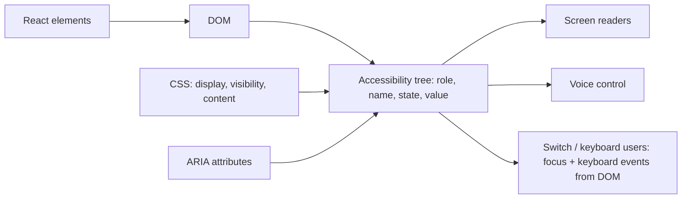
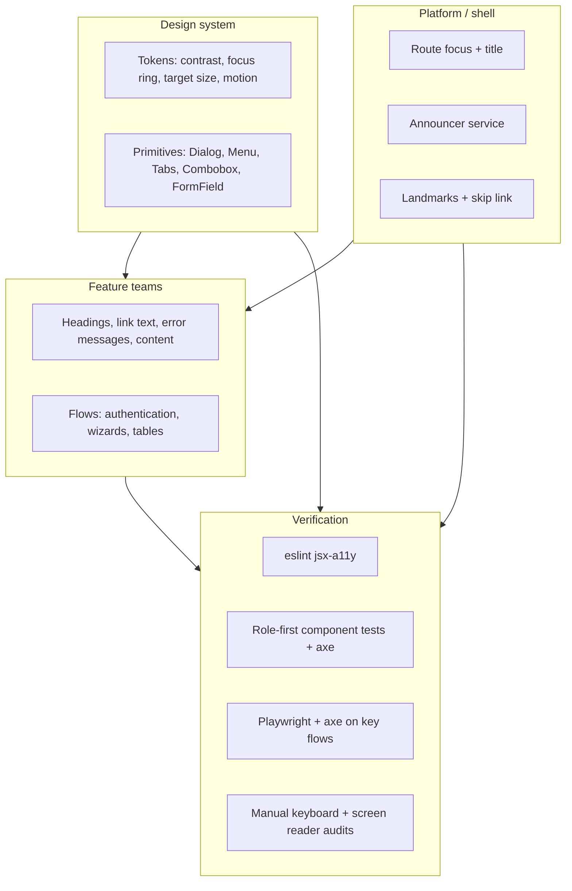

# 11 / 11 — Designing for Accessibility

## 1. Lesson metadata

| | |
|---|---|
| **Level** | Architect |
| **Study time** | 4–5 hours (reading 2 h, keyboard/screen-reader lab 1 h, exercises 1.5 h) |
| **Prerequisites** | [08/10 — Accessibility testing](../08-testing-and-quality/10-accessibility-testing.md), [09/14 — Accessibility and SEO](../09-advanced-rendering-and-ecosystem/14-accessibility-and-seo.md), [10/08 — Accessibility as architecture](../10-production-engineering/08-accessibility-as-architecture.md), [05/07 — Headless components](../05-design-patterns/07-headless-components.md), [11/07 — Design system architecture](./07-design-system-architecture.md), [11/10 — Designing for testability](./10-designing-for-testability.md) |
| **Next** | [12 — Microfrontends](./12-microfrontends.md) |
| **Related** | [04/20 — Design systems](../04-react-architecture/20-design-systems.md), [10/11 — Design system governance](../10-production-engineering/11-design-system-governance.md), [11/16 — Supporting multiple teams](./16-supporting-multiple-teams.md) |

**Learning objectives.** After this lesson you can:
1. Explain accessibility as a set of *architectural constraints* (semantics, focus, keyboard, announcement, motion, zoom/reflow, input modality) rather than a late-stage audit.
2. Decide *where in the architecture* each accessibility guarantee should be enforced (platform, design system, feature code, CI, process) and justify it.
3. Build the hard parts correctly in React 19: focus management across SPA navigation, modal dialogs, live announcements, accessible forms with Actions, and dynamic collections.
4. Quantify what automated testing can and cannot catch and design a layered verification strategy.
5. Run accessibility as an organisational capability: requirements, ownership, governance, conformance reporting, and regression prevention at multi-team scale.
6. Weigh build-vs-adopt decisions for accessible primitives with evidence.

**Concepts covered:** WCAG 2.x POUR principles and conformance levels, accessibility tree, accessible name/role/state/value computation, native-first semantics, ARIA's role and limits, focus management, roving tabindex, `inert`, `<dialog>`, live regions, reduced motion, reflow/zoom/target size, forced colors, screen-reader/browser variation, automated vs manual testing, conformance reports, legal context.

---

## 2. Deep conceptual explanation

### 2.1 What problem is this lesson solving?

Accessibility is usually introduced as a checklist applied after features are built: "run axe, fix the red items". At scale this fails in four systematic ways:

1. **Cost curve.** Retrofitting focus management, keyboard support or semantics into a built component is far more expensive than designing it in, and a design that never specified a focus order or a keyboard model has nothing to retrofit *to*.
2. **Multiplication.** In a multi-team product, one inaccessible primitive (a custom select, a modal) is replicated into hundreds of screens. The defect is then everywhere and fixing it requires coordinated change.
3. **Regression.** Accessibility regresses silently. A refactor that swaps a `<button>` for a `<div onClick>` breaks nothing visible and nothing in unit tests that query by test id.
4. **Invisible failure.** Unlike a crash, inaccessible UI produces no error logs. Affected users — people using screen readers, switch devices, voice control, magnification, keyboards only; people with cognitive, vestibular, motor, or situational impairments — simply leave or can't complete tasks.

Treat accessibility as a **quality attribute with architecture**: where is the guarantee made, who owns it, how is it verified, and what stops it regressing?

### 2.2 The model: from DOM to accessibility tree

Assistive technology (AT) does not read your pixels or your React tree. Browsers compute an **accessibility tree** from the DOM + CSS (and ARIA attributes): each exposed node has a **role**, **accessible name**, **description**, **state/properties** (checked, expanded, disabled, invalid, etc.), and **value**. AT consumes this tree through platform accessibility APIs.



Consequences:
- **React is not the unit of accessibility; the resulting DOM is.** Component APIs must make it hard to produce a bad DOM.
- `display: none`, `visibility: hidden`, `hidden`, and `inert` remove content from the tree/focus order; `aria-hidden="true"` removes it from the tree but **not** from the tab order — a classic bug: focusable content hidden from screen readers.
- Accessible names come from content, labels, `aria-label`/`aria-labelledby`, `alt`, `title` (last resort) per the Accessible Name and Description Computation spec. A `div` with a click handler has no role, no name semantics, no keyboard behaviour.

### 2.3 Standards and legal context (verify for your jurisdiction)

- **WCAG** (Web Content Accessibility Guidelines) organises success criteria under four principles — **Perceivable, Operable, Understandable, Robust (POUR)** — at levels A, AA, AAA. **WCAG 2.2** (W3C Recommendation, October 2023; the TR page now shows a republished Recommendation dated 12 December 2024) added nine criteria, among them Focus Not Obscured (Minimum) 2.4.11, Dragging Movements 2.5.7, Target Size (Minimum, 24×24 CSS px) 2.5.8, Consistent Help 3.2.6, Redundant Entry 3.3.7 and Accessible Authentication (Minimum) 3.3.8, and it removed 4.1.1 Parsing. Target Size (Minimum), Focus Not Obscured (Minimum), Dragging Movements and Accessible Authentication (Minimum) are Level AA. Level **AA** is the common legal and contractual target. (Checked 2026-10-22: WCAG 2.2 is the latest WCAG 2.x Recommendation; WCAG 3.0 is still an early draft. See <https://www.w3.org/TR/WCAG22/>.)
- **WAI-ARIA** defines roles/states/properties for cases where native HTML lacks semantics; the **ARIA Authoring Practices Guide (APG)** gives keyboard/interaction patterns for composite widgets; they are *patterns*, not normative conformance requirements.
- **Law and procurement** (not legal advice): the EU's European Accessibility Act applies to a range of consumer products and services in EU member states from 28 June 2025 (new products and services placed on the market after that date; some transitional arrangements apply to existing contracts and products); the US has ADA-based litigation and Section 508 for federal procurement; many countries have comparable rules; enterprise customers commonly request an **Accessibility Conformance Report (ACR)** based on the VPAT template. **Consult counsel and verify current requirements.** The architectural point: accessibility conformance is often a *contractual deliverable* with evidence requirements — a process concern, not just a code concern.

### 2.4 The cost-of-late-accessibility argument (evidence, carefully)

It is common to state "fixing in design is 10× cheaper than fixing in production". Treat any precise multiplier skeptically — it's repeated widely without strong primary data. What can be defended structurally: (a) defects in shared primitives are *multiplied* by usage count; (b) fixes that change semantics/focus often change **component APIs** (breaking changes across teams); (c) late fixes interact with visual design and are renegotiated with design/product. So the argument is about **blast radius and coupling**, not a magic constant. Measure your own: track a11y defects by origin (design, primitive, feature code), and time-to-fix.

### 2.5 Principles for architects

1. **Native first.** Use `<button>`, `<a href>`, `<input>`, `<label>`, `<dialog>`, `<details>`, headings, landmarks, lists, tables. They carry role, name, state, keyboard behaviour, focus, form participation, and often better cross-AT support than ARIA recreations. ARIA's first rule: *don't use ARIA if a native element or attribute provides the semantics.*
2. **ARIA is a promise, not a polyfill.** Adding `role="button"` to a `div` changes the announced role but adds *no* keyboard handling, focus, or Enter/Space activation. You must implement all of it, and bad ARIA is worse than none ("no ARIA is better than bad ARIA").
3. **Every interactive thing is reachable and operable by keyboard**, with a visible focus indicator and a logical order that follows the visual/reading order.
4. **State changes must be perceivable without sight/vision/sound** (announce, don't just paint).
5. **Don't rely on a single sensory channel** (colour only, hover only, pointer only, motion only).
6. **The UI must survive user preferences**: zoom to 200 %/400 % reflow, text spacing, forced-colors/high contrast, reduced motion, dark mode, larger default fonts.
7. **Move guarantees as low in the stack as possible**: a platform or design-system-level guarantee removes the need for every feature team to get it right.

### 2.6 Where should each guarantee live?

| Guarantee | Enforce in | Why |
|---|---|---|
| Focus ring visible, contrast tokens meet AA | Design tokens + design system | Global, visual, solved once |
| Dialog focus trap/return/Escape/background inert | Design-system primitive (or native `<dialog>`) | Complex, error-prone, identical everywhere |
| Form label/error association | Form-field primitive that *requires* a label prop (type-level) | Make mistakes unrepresentable |
| Route-change focus + title announcement | App shell / router layer | Cross-cutting, SPA-specific ([11/06](./06-cross-cutting-concerns.md)) |
| Page heading structure, meaningful link text | Feature team + design review + content guidelines | Context-dependent; can't be automated fully |
| Alt text for content images | CMS/editorial workflow + authoring UI that requires input | Meaning is human |
| Live-announcement policy (toasts, async results) | Shared announcer service | Avoid duplicate/competing live regions |
| Regression detection | CI (axe + lint + component tests) + periodic manual audits | Layered verification |

### 2.7 Misconceptions

| Misconception | Reality |
|---|---|
| "Passing axe = accessible." | Automated tools can detect only a subset of WCAG failures (commonly cited as roughly a third to half of issues depending on method; *treat any exact figure with caution and measure on your own audits*). They can't judge meaningful alt text, logical focus order, sensible reading order, usability with a screen reader, or cognitive load. |
| "ARIA makes things accessible." | ARIA only changes the accessibility tree. It doesn't add behaviour. Misused ARIA is a leading source of defects. |
| "Screen-reader users are the only audience." | Keyboard-only, voice control, switch access, magnification, low vision, cognitive, vestibular (motion), temporary and situational disabilities all matter. Keyboard operability underlies most of them. |
| "Accessibility is a design-system problem only." | The design system can guarantee primitives; page structure, content, flows, error handling, and focus choreography across routes are feature-level. |
| "`outline: none` is fine because we have a custom style." | Removing focus indication without an equally visible replacement fails WCAG focus visibility; WCAG 2.2 also adds Focus Not Obscured. |
| "We'll add a11y with an overlay widget." | Overlay products don't fix underlying semantics, can conflict with AT, and have been the subject of criticism and legal challenges. Do not treat as conformance strategy. |
| "A visually hidden label is the same as no label." | Visually hidden text (clipped, not `display:none`) stays in the accessibility tree and is a legitimate technique. `display:none` text is excluded from the tree, except that an `aria-labelledby` reference to hidden content is still used for the name by the naming algorithm. |

---

## 3. Internal mechanics

### 3.1 Accessible name computation (essentials)

*Public guarantee (spec-defined).* For a button: name from content, `aria-labelledby`, `aria-label`, or `title` (priority order is defined by the Accessible Name and Description Computation spec; **verify exact precedence** at <https://www.w3.org/TR/accname-1.2/>). For an input: associated `<label>`, `aria-labelledby`, `aria-label`, `placeholder` (fallback only, unreliable and disappears), `title`.

Implications for React:
- Use `htmlFor` (JSX for `for`) or wrap input in `<label>`. `useId()` generates stable, SSR-safe ids for association ([03/22](../03-react-state-and-hooks/22-modern-hooks-and-apis.md)). Don't use `Math.random()` or a module counter for ids (hydration mismatch risk).
- Icon-only buttons need a name: `<button aria-label="Close"><svg aria-hidden="true" focusable="false" …/></button>`.

### 3.2 Focus: what the browser does and doesn't do

- Focus moves by user input (Tab, click) or by script (`element.focus()`).
- On a **full page navigation**, the browser resets focus to the document start. On a **client-side route change** (SPA), nothing happens: focus stays on the clicked link (which may have been unmounted), and AT users get **no signal that the page changed**. This is the single most common accessibility regression introduced by SPAs.
- Elements removed from the DOM while focused drop focus to `body`. The user "loses their place".
- `tabindex="0"` places an element in the tab order; `tabindex="-1"` makes it programmatically focusable only; positive `tabindex` values should be avoided (they override DOM order, creating unmaintainable order).
- `inert` (HTML attribute) makes a subtree non-interactive and removed from the accessibility tree. *Version-sensitive:* in React 19 `inert` is a boolean prop (verified with react-dom 19.3.1 server render: `inert={true}` emits `inert=""`, `inert={false}` omits it, and `inert=""` is treated as false and omitted). React 18 did not recognise the boolean form, so the usual workaround there was `inert=""` or a ref/`setAttribute`; check your `@types/react` version for the prop type.
- `<dialog>` opened with `showModal()` renders in the **top layer**, makes the rest of the document inert, traps focus within, restores focus on close (in most current browsers), and handles Escape. It is a strong native default; verify cross-browser behaviour for your support matrix, and test with your target screen readers.

### 3.3 Live regions

A live region (`aria-live="polite"`/`"assertive"`, or roles `status`, `alert`, `log`) tells AT to announce content *changes*. Mechanics and caveats:

- The region must exist in the DOM **before** its content changes; inserting a new node already containing text is unreliably announced across AT/browser combinations. Pattern: mount an empty region at app start; set its text when needed.
- `role="alert"` is assertive (interrupts); overuse is hostile. `role="status"` is polite.
- Announcing identical text twice may be ignored; announcers commonly toggle a zero-width character or clear then set after a tick.
- Screen-reader/browser combinations differ; behaviour is *not* a public guarantee beyond the spec's intent. Always test on your target matrix (e.g. NVDA+Firefox/Chrome, JAWS+Chrome, VoiceOver+Safari, TalkBack).

### 3.4 React's contribution (and non-contribution)

React renders to DOM; JSX supports `aria-*` and `role`, `htmlFor`, `tabIndex`. React itself provides: `useId` (id association), `ref` as a prop in 19 for focus handling, form Actions + `useActionState` (state for error messages), and `<form action>` that integrates with native form semantics. React does **not** provide focus management, announcements, or keyboard patterns — those come from the platform and from libraries (React Aria, Radix Primitives, Ark UI, Headless UI, etc.). ⚠ *Library APIs and a11y coverage change; verify against each library's current docs and test with AT before adopting.*

---

## 4. Step-by-step: what a user experiences on an SPA route change (and what should happen)

Scenario: a screen-reader user activates the "Orders" link in a nav.

1. Click/Enter on `<a href="/orders">`: router intercepts, calls `history.pushState`, schedules a React transition to render `<Orders/>` (possibly suspending with a loading fallback).
2. React commits new DOM; the old page content unmounts. The link in the nav is still mounted (shell persists) and still focused.
3. **Without design:** screen reader announces nothing (the link was "activated"; some SRs announce "clicked"). The page title may be unchanged. Focus stays on the nav link; the next Tab goes to the next nav item, not into the new content. The user cannot tell whether anything happened.
4. **With design:** the shell (a) updates `document.title` to "Orders – Acme", (b) moves focus to the new page's `<h1 tabindex="-1">` or the main landmark *after* the new content is rendered (not before, or focus lands on stale content), and (c) optionally announces via a polite live region "Orders" (some guidance advises either focus move or announcement; avoid double-announcing; **test with your AT matrix**).
5. During loading, `aria-busy="true"` on the region and/or a status message ("Loading orders…") prevents silence; avoid spinners with no text alternative.
6. On back/forward navigation, restore scroll and focus sensibly (e.g. to the heading of the restored page, or the element the user came from if your router stores it).
7. On error (route-level error boundary), focus the error heading and use `role="alert"` once.

---

## 5. Code examples

### 5.1 Minimal — native semantics versus a recreated button

```tsx
// ❌ looks like a button, behaves like nothing
<div className="btn" onClick={save}>Save</div>

// ✅ role, name, focus, Enter/Space, form participation, disabled semantics — free
<button type="button" onClick={save}>Save</button>
```

*Predict:* with the `div`, can a keyboard user trigger `save`? No — it isn't focusable and has no key handlers. "Fixing" it with `role="button" tabIndex={0}` plus `onKeyDown` for Enter *and* Space (and preventing Space scrolling, and handling `disabled`) reimplements what `<button>` has. The recreated version also lacks default form-submit behaviour, `:disabled` styling hooks, and so on. When a custom element truly is required (e.g. a composite widget), you implement the APG keyboard model and test it with AT.

### 5.2 Practical — an accessible form field primitive that makes mistakes unrepresentable

```tsx
// FormField.tsx
import { useId, type ReactNode, type ComponentPropsWithRef } from 'react';

type FieldProps = {
  label: string;                         // REQUIRED: no label, no compile
  hint?: string;
  error?: string;
  required?: boolean;
  children: (a11y: {
    id: string;
    'aria-describedby'?: string;
    'aria-invalid'?: true;
    'aria-required'?: true;
  }) => ReactNode;
};

export function FormField({ label, hint, error, required, children }: FieldProps) {
  const id = useId();
  const hintId = hint ? `${id}-hint` : undefined;
  const errId  = error ? `${id}-err`  : undefined;
  const describedBy = [hintId, errId].filter(Boolean).join(' ') || undefined;

  return (
    <div>
      <label htmlFor={id}>
        {label}
        {required ? <span aria-hidden="true"> *</span> : null}
        {required ? <span className="visually-hidden"> (required)</span> : null}
      </label>
      {hint ? <p id={hintId}>{hint}</p> : null}
      {children({
        id,
        'aria-describedby': describedBy,
        'aria-invalid': error ? true : undefined,
        'aria-required': required ? true : undefined,
      })}
      {error ? <p id={errId} className="error-text">{error}</p> : null}
    </div>
  );
}

// usage
<FormField label="Email" hint="We only use this for receipts." error={state.errors?.email} required>
  {(a11y) => <input type="email" name="email" autoComplete="email" {...a11y} />}
</FormField>
```

Line notes: a render-prop is used so the field can hand the *input* the id and ARIA wiring without cloning children (`cloneElement` is brittle — [05/10 — Render props](../05-design-patterns/10-render-props.md)). `useId` gives a unique, hydration-stable id. The error text is associated through `aria-describedby`; it is not itself a live region. See §5.3 for announcing submit-time errors. `autoComplete` supports WCAG's "Identify Input Purpose" and helps all users. (`required` visible marker uses `*` hidden from AT with a text equivalent.) Trade-off: render-prop APIs are slightly less ergonomic than passing an `<Input />`; a design system can wrap common cases (`TextField`) on top of this primitive.

### 5.3 Practical — form submission with Actions, error summary, and focus

```tsx
'use client'; // only needed in an RSC framework; omit in a pure SPA
import { useActionState, useEffect, useRef } from 'react';

type State = { ok: boolean; errors?: Record<string, string> };

async function signUp(_prev: State, formData: FormData): Promise<State> {
  const email = String(formData.get('email') ?? '');
  const errors: Record<string, string> = {};
  if (!/^\S+@\S+\.\S+$/.test(email)) errors.email = 'Enter an email address like name@example.com.';
  return Object.keys(errors).length ? { ok: false, errors } : { ok: true };
}

export function SignUpForm() {
  const [state, action, pending] = useActionState(signUp, { ok: false });
  const summaryRef = useRef<HTMLDivElement>(null);

  // After a failed submit, move focus to the error summary (a ref-able container with tabIndex -1).
  useEffect(() => {
    if (state.errors) summaryRef.current?.focus();
  }, [state]);

  return (
    <form action={action} noValidate>
      {state.errors && (
        <div ref={summaryRef} tabIndex={-1} role="alert" className="error-summary">
          <h2>There is a problem</h2>
          <ul>
            {Object.entries(state.errors).map(([field, msg]) => (
              <li key={field}><a href={`#${field}`}>{msg}</a></li>
            ))}
          </ul>
        </div>
      )}
      {/* FormField from 5.2; for this link-to-field pattern the input id must equal the field key.
          Here we pass a stable explicit id via a prop on the primitive in a real design system. */}
      <button type="submit" disabled={pending} aria-disabled={pending}>
        {pending ? 'Signing up…' : 'Sign up'}
      </button>
    </form>
  );
}
```

Notes and trade-offs:
- `useActionState` returns `[state, formAction, isPending]` ([03/22](../03-react-state-and-hooks/22-modern-hooks-and-apis.md)); ⚠ verify the exact signature against the current React docs. The Action's returned errors drive both inline messages and the summary.
- `role="alert"` on a container that is *mounted with content* is the unreliable case described in §3.3; the **focus move** is the dependable mechanism here (a focused heading/container with `tabIndex=-1` is read by AT). Using both can cause duplicate announcements on some AT — choose one primary mechanism, and test. Many design systems (e.g. GOV.UK's error summary pattern) use focus movement alone.
- `noValidate` disables browser-native validation bubbles so you control messaging; keep `type="email"` and `required` semantics for mobile keyboards and autofill. This is a *choice*: native validation is more consistent and less code but has limited, less customizable messaging and variable screen-reader behaviour. The summary links `href="#field"` require inputs to have matching ids; **in the full implementation pass explicit ids** (the snippet intentionally leaves the wiring to the field primitive).
- `disabled={pending}` removes the button from the tab order and AT may lose focus context; `aria-disabled` keeps it focusable but you must then ignore activation. Choose per context: using `aria-disabled` with a guard preserves focus position; `disabled` is simpler. Be consistent and test.

### 5.4 Incorrect — SPA navigation with no focus or title management

```tsx
function App() {
  return (
    <Router>
      <nav>…links…</nav>
      <Routes>…</Routes>
    </Router>
  );
}
```
After a client-side route change nothing tells AT or keyboard users that the page changed (§4). A skip link that targets `#main` also won't work unless `#main` exists and is focusable/skip target.

### 5.5 Corrected / advanced — route announcer, skip link, and focus on navigation

```tsx
// RouteAccessibility.tsx — router-agnostic; call `useRouteKey()` from your router (pathname or match id)
import { useEffect, useRef, type ReactNode } from 'react';

export function RouteFocus({ routeKey, title, children }: { routeKey: string; title: string; children: ReactNode }) {
  const headingRef = useRef<HTMLHeadingElement>(null);
  const first = useRef(true);

  useEffect(() => {
    document.title = `${title} – Acme`;
    if (first.current) { first.current = false; return; } // don't steal focus on initial load
    headingRef.current?.focus({ preventScroll: false });
  }, [routeKey, title]);

  return (
    <main id="main" aria-labelledby="page-h">
      <h1 id="page-h" ref={headingRef} tabIndex={-1}>{title}</h1>
      {children}
    </main>
  );
}

// In the shell:
// <a className="skip-link" href="#main">Skip to main content</a>   // first focusable element in the DOM
```

```css
.skip-link { position: absolute; left: -9999px; }
.skip-link:focus { left: 8px; top: 8px; z-index: 1000; /* visible when focused */ }
:focus-visible { outline: 3px solid Highlight; outline-offset: 2px; }  /* keep a strong, visible indicator */
@media (prefers-reduced-motion: reduce) { * { animation-duration: 0.01ms !important; transition-duration: 0.01ms !important; scroll-behavior: auto !important; } }
```

Line notes: `ref` is used as a prop (React 19; in 18 it works for DOM elements via `useRef` too — the difference only matters for passing `ref` to your own function components). The focus move happens in an effect *after commit* so the heading exists. The first-render guard avoids stealing focus on initial page load, where the browser already starts at the top. `main` uses `aria-labelledby` to give the landmark a name; this duplicates the heading semantics, so labelling `main` is optional when there is only one — avoid redundant verbosity. The `preventScroll` value shown is the default; use `preventScroll: true` if your router manages scroll position itself ([09/10 — Routing and nested layouts](../09-advanced-rendering-and-ecosystem/10-routing-and-nested-layouts.md)). In framework routers, check whether a built-in route announcer already exists (some frameworks ship one) so you don't double up — **verify per framework**.

**Native modal dialog with React:**

```tsx
import { useEffect, useRef, type ReactNode } from 'react';

export function Modal({ open, onClose, title, children }: { open: boolean; onClose: () => void; title: string; children: ReactNode }) {
  const ref = useRef<HTMLDialogElement>(null);

  useEffect(() => {
    const dlg = ref.current;
    if (!dlg) return;
    if (open && !dlg.open) dlg.showModal();      // top layer, inert background, focus trap, Esc closes
    if (!open && dlg.open) dlg.close();
  }, [open]);

  return (
    <dialog
      ref={ref}
      aria-labelledby="modal-title"
      onClose={onClose}                           // fires on Esc or dlg.close(): keep React state in sync
    >
      <h2 id="modal-title">{title}</h2>
      {children}
      <button type="button" onClick={onClose}>Close</button>
    </dialog>
  );
}
```

Notes: Per the HTML spec, `showModal()` on a dialog that is already open *as a modal* is a no-op, but it throws `InvalidStateError` if the dialog is open non-modally (e.g. via `show()` or the `open` attribute) or is not connected to the document; the guard keeps the effect idempotent and avoids the non-modal case. The `onClose` prop maps to the `close` event; because Escape closes the dialog natively, state must follow the DOM (an "open" state controlled only by React would drift). Focus return to the invoking element is performed by the browser in current engines, but verify on your supported browsers and with your AT — and if the invoker unmounts while the dialog is open (e.g. a row deleted), focus is lost; restore explicitly to a sensible fallback. Initial focus location (first focusable vs. title) is a design decision: for destructive confirmations, put initial focus on the *safe* action. ⚠ In StrictMode dev, effects run twice; the `dlg.open` guards make this idempotent.

**Live-region announcer service:**

```tsx
// announcer.tsx
import { createContext, use, useCallback, useRef, useState, type ReactNode } from 'react';

type Announce = (message: string, politeness?: 'polite' | 'assertive') => void;
const AnnouncerContext = createContext<Announce>(() => {});

export function AnnouncerProvider({ children }: { children: ReactNode }) {
  const [polite, setPolite] = useState('');
  const [assertive, setAssertive] = useState('');
  const toggle = useRef(false);

  const announce = useCallback<Announce>((message, politeness = 'polite') => {
    toggle.current = !toggle.current;
    const text = toggle.current ? message : message + ' '; // make repeated identical messages a "change"
    (politeness === 'polite' ? setPolite : setAssertive)('');   // clear, then set on next tick
    setTimeout(() => (politeness === 'polite' ? setPolite : setAssertive)(text), 50);
  }, []);

  return (
    <AnnouncerContext value={announce}>
      {children}
      <div className="visually-hidden" role="status" aria-live="polite" aria-atomic="true">{polite}</div>
      <div className="visually-hidden" role="alert" aria-live="assertive" aria-atomic="true">{assertive}</div>
    </AnnouncerContext>
  );
}
export const useAnnounce = () => use(AnnouncerContext);
```

Caveats (state them in the design doc): this technique (clearing then setting; nbsp toggle) is a **community workaround**, not a guaranteed behaviour; announcements vary by AT; the `visually-hidden` utility must hide visually but keep the content in the accessibility tree (never `display:none`). Prefer fewer, clearer announcements; don't announce things the focus move already communicates.

---

## 6. Visual explanations



```
Detection coverage (qualitative):
  design review     ██ intent, flows, focus order, content design
  lint (static)     ██ missing alt, invalid roles, click handlers on non-interactive elements
  axe in unit/E2E   ███ contrast*, names, roles, ARIA validity, landmarks      (*needs real rendering)
  manual keyboard   ████ operability, focus order, traps, visible focus
  screen-reader QA  █████ announcements, reading order, widget behaviour
  user testing w/ people with disabilities  ██████ real usability
```

(Bar lengths are illustrative of cost/coverage ordering, not measurements.)

---

## 7. Alternative approaches and trade-offs

| Approach | Strength | Weakness | Choose when |
|---|---|---|---|
| **Native HTML elements (+ minimal ARIA)** | Free semantics/keyboard; robust across AT; least code | Limited styling for some controls (`<select>`, `<dialog>` quirks), feature gaps (rich comboboxes) | Default for buttons, links, forms, dialogs, disclosure |
| **Headless accessible primitives (React Aria, Radix, Ark UI, Headless UI)** | Complex patterns (combobox, menu, tabs) implemented and field-tested; styling freedom | Dependency and upgrade risk; coverage/bugs differ by library; bundle cost; AT differences remain | Custom-designed system; many composite widgets |
| **Build your own accessible primitives** | Total control; no dependency | Very high cost, long tail of AT/browser quirks; need continued AT testing | Rarely; unusual patterns, strict bundle limits, or you are a primitives vendor |
| **Pre-styled component library with a11y claims (MUI, Chakra, etc.)** | Fast; many defaults accessible | You inherit its gaps and its visual style; claims need verification | Internal tools, MVPs, small teams |
| **Overlay/"auto-fix" widgets** | Quick to deploy | Do not repair underlying semantics; can interfere with AT; reputational/legal risk | Not recommended as a conformance strategy |
| **Audit-only (annual third-party audit)** | Expert, independent evidence for ACR | Late feedback; regressions accumulate between audits | Complement to continuous verification, never alone |
| **Continuous verification in CI + periodic manual audits** | Early detection of the automatable subset; evidence trail | Needs ownership and maintenance; false confidence if treated as complete | Default at multi-team scale |

**A scenario where "native first" is NOT best.** A data-heavy **combobox/typeahead with async options, grouping, multi-select tokens, and virtualized results**: native `<select>`/`<datalist>` can't express it, and a hand-rolled version is a notorious source of defects. Adopt a vetted headless primitive ([05/07](../05-design-patterns/07-headless-components.md)) and spend your effort testing it with your AT matrix. Also, for **complex data grids**, ARIA grid semantics plus keyboard models are intricate; a mature grid library with documented accessibility support (verified in a pilot) beats custom work.

---

## 8. Best practices and anti-patterns

**Practices**
- Define accessibility acceptance criteria *per feature* in the design/ticket (keyboard flow, focus on open/close, announced states, error recovery, name/role/value for custom controls).
- Make a11y part of the **definition of done** and of the design-system component contract (each component documents keyboard model, roles, name requirements, focus behaviour).
- Prefer APIs that make the wrong thing hard: required `label`/`aria-label` props, `Icon` components default `aria-hidden`, `IconButton` requires `label`.
- Test with keyboard-only and at least one screen reader per release for key flows; keep a matrix of AT+browser combos tied to your user base.
- Use role-first queries in tests, and run axe in component and E2E tests ([08/10](../08-testing-and-quality/10-accessibility-testing.md)).
- Respect user preferences: `prefers-reduced-motion`, `prefers-color-scheme`, `forced-colors`, zoom, text spacing; don't disable pinch-zoom.
- Write meaningful link text ("View order 4832"), not "Click here"; descriptive headings; sensible `lang` attributes (also for inline foreign-language content).
- Ensure target size and spacing meet WCAG 2.2 minimums and avoid hover-only or drag-only interactions without alternatives.

**Beginner mistakes**: clickable `div`s; missing labels/placeholder-as-label; colour-only status; images without alt or with decorative images having noisy alt; positive `tabindex`; `outline: none`; autoplay motion; focus lost after deleting an item.

**Experienced-developer mistakes**: ARIA role soup (`role="menu"` for a navigation list — menus are for application-style menus); `aria-hidden` on focusable ancestors; duplicating announcements (focus move + live region + `role=alert`); custom components lacking Escape/arrow key patterns; modals built with `position: fixed` and no inertness; adopting a library and assuming its a11y without testing; treating the axe score as KPI.

**Smells**: no `main`/landmarks; heading levels chosen for size; `aria-label` identical to visible text (redundant) or contradicting it (breaks voice control, which relies on the visible label being part of the accessible name — WCAG "Label in Name"); toasts that vanish in 3 seconds with no way to review; infinite scroll with no keyboard-reachable footer.

**Justified exceptions**: purely decorative graphics get empty `alt=""`; a custom widget may legitimately use roving tabindex and `aria-activedescendant` (APG patterns); `aria-live` regions for complex apps (trading screens) where throttling announcements is a deliberate design — and must itself be user-controllable. Don't present these as universal; WCAG exceptions exist (e.g. essential motion, "equivalent alternatives") and some AAA criteria aren't expected for whole sites.

---

## 9. Real-world application

**E-commerce.** The checkout is where inaccessibility directly costs revenue and creates legal exposure: form labelling, error summary with focus, autocomplete tokens, accessible payment widgets (third-party iframes — contract requires vendor conformance evidence), cart updates announced politely ("Item added, cart has 3 items"), accessible authentication (WCAG 2.2: don't require cognitive tests like transcribing characters without alternatives; allow password managers and paste). Product image carousels need keyboard operation and pause controls; auto-rotating content needs a stop mechanism.

**Dashboards and data visualisation.** Charts need text alternatives (summary + data table), colour not the only encoding, patterns/labels, keyboard focus on data points when interactive, and reduced-motion transitions. Data grids need documented keyboard models. Real-time updates: don't announce every tick; offer an aggregated/summarised live region and a pause.

**Finance / regulated.** Strong conformance evidence needs (ACR/VPAT), audit logs of testing, time-out warnings (WCAG Timing Adjustable: allow extending sessions), accessible PDF statements, careful handling of one-time-password flows (OTP autofill, `autocomplete="one-time-code"`), and consistent help (WCAG 2.2).

**Auth flows.** Login forms: labels, error association, show-password toggles accessible by name and state (`aria-pressed` or switch semantics), no CAPTCHA without accessible alternative.

**Realtime / chat.** `role="log"` for message streams with polite announcements; don't steal focus; allow notification preferences; make unread counts perceivable beyond colour.

**Multi-team.** The platform provides the shell (landmarks, route focus, announcer, error boundaries with accessible fallbacks), the design system provides primitives and tokens with documented a11y contracts, and each feature team owns flow-level conformance. Without that, 10 teams implement 10 different focus strategies, and microfrontend boundaries break focus order and landmark structure ([12](./12-microfrontends.md): every MFE rendering its own `<main>`, duplicate ids, competing live regions, and independent skip links are classic failures). Governance: a11y champions per team (time-boxed responsibility), a central triage rota, a published conformance status per surface, and a "stop-ship" severity definition (e.g. keyboard trap, unlabeled primary controls on core flows) agreed with product ([10/11 — Design system governance](../10-production-engineering/11-design-system-governance.md)).

**Constraints to name in design docs:** target conformance level and standard version; supported AT+browser matrix; legal and contractual obligations; third-party content (CMS, vendors) accessibility responsibilities; localisation (text expansion, RTL, `lang`); performance constraints of heavy a11y libraries.

---

## 10. Debugging and troubleshooting

**Symptom 1: Keyboard users can't reach/operate a control.**
*Investigation.* Tab through; use DevTools to inspect the element (is it a native interactive element? has `tabindex`?); check the Accessibility pane for role/name; check for overlays (a transparent `div` capturing focus/clicks), `inert` ancestors, `tabindex="-1"` on children, `pointer-events: none` quirks. *Root cause example.* A "Cancel" action implemented as `<span onClick>` after a refactor from `<button>`. *Fix & validate.* Replace with `<button type="button">`; add a role-based test (`getByRole('button', {name: /cancel/i})`) and an ESLint `jsx-a11y` rule (`click-events-have-key-events`, `no-static-element-interactions` — **verify rule names in the plugin docs**).

**Symptom 2: Screen reader announces "button" with no name.**
*Investigation.* DevTools accessibility tree: name empty. Icon-only control with no label, or `aria-label` on a wrapper not on the control; an `` inside the button inadvertently decorative. *Fix.* Add `aria-label` or visually hidden text; add the `IconButton` primitive that *requires* `label`.

**Symptom 3: After closing a modal, focus jumps to the top of the page.**
*Investigation.* The invoker was unmounted/re-rendered (key change) or the dialog was a `div` implementation that didn't store `document.activeElement` before opening. *Fix.* Native `<dialog>` + stable invoker, or store the trigger ref and call `.focus()` in the close handler; if the trigger no longer exists, choose a fallback target (list heading). Validate with keyboard-only walkthrough and an automated Playwright test asserting `document.activeElement`.

**Symptom 4: Screen reader doesn't announce a toast or async result.**
*Investigation.* Is the live region present before the update (inspect DOM at load)? Is it `display:none`? Is the text identical to a previous message? Are you replacing the whole region element on each update (new node → unreliable)? Test in at least two AT/browser combos. *Fix.* Persistent announcer region (§5.5); ensure text actually changes.

**Symptom 5: axe is clean, but an audit reports 40 issues.**
This is expected; the audit includes manual checks (reading order, focus order, meaningful sequence, labels in name, error suggestions, use of colour, timing). *Action:* categorize audit findings by origin (primitive, feature, content) and add *new automated or lint rules and primitive-level fixes* for those categories that can be systematically prevented; keep manual checks as a recurring ritual for the rest.

**Symptom 6: In a microfrontend page, Tab order jumps between regions unpredictably.**
Inspect DOM order vs visual order; look for CSS `order`/absolute positioning reorderings, portals appended to `body`, multiple `<main>` landmarks, duplicate ids from independently built MFEs (e.g. two `id="title"`) breaking `aria-labelledby`. *Fix.* Shell owns landmarks; MFEs render regions; id generation via `useId` (unique within a React root — ⚠ in multiple React roots/versions on one page, `useId` can collide unless you set `identifierPrefix`; **verify in `createRoot` options**).

---

## 11. Exercises

### Level A — Knowledge
A1. State the four WCAG principles and give one success criterion example for each.
A2. Why does `aria-hidden="true"` on a focusable element create a problem?
A3. Why do SPAs need explicit focus/title management on route changes?
A4. Explain the difference between `role="alert"` and `role="status"`, and why a live region must exist before it is updated.
A5. List five user groups affected by accessibility choices beyond blind users.

### Level B — Code comprehension
B1. In §5.2, what happens to screen-reader users if `FormField` is used with an input that spreads `{...a11y}` *before* a hard-coded `id="email"`? Predict and explain.
B2. In §5.5 `RouteFocus`, why is there a `first` ref guard? What would a user experience without it on page load?
B3. In the `Modal` code, why does `onClose` need to be wired to the dialog's `close` event rather than only to the "Close" button?
B4. A teammate writes `<button aria-label="Submit order">Place order</button>`. Is this a problem? Why?

### Level C — Implementation
C1. Build an accessible disclosure ("Show details") component using the native `<details>`/`<summary>` and then using a `<button aria-expanded aria-controls>`; compare behaviour and when you would choose each.
C2. Implement a roving-tabindex toolbar (3 buttons) with arrow-key navigation, Home/End, and a single tab stop; write tests using `userEvent`.
C3. Write an ESLint + test setup (describe config files) that fails CI on `jsx-a11y` violations and runs axe in a component test of the checkout page.
C4. Implement a list where deleting an item keeps focus sensible (moves to next item, or previous, or heading if empty) and announces "Item deleted".

### Level D — Debugging
D1. A custom dropdown works with a mouse, but VoiceOver reads each option as "text" and arrow keys do nothing. List the missing pieces and sketch the fix.
D2. After a design refresh, voice-control users can't activate buttons by saying their visible labels. Cause and fix?
D3. A toast with `role="alert"` is announced twice in NVDA+Chrome. Hypothesize causes and propose an investigation plan.

### Level E — Architecture and engineering decisions
E1. You must choose between building an in-house primitive set, adopting a headless library, or using a pre-styled library for a 12-team product. Give criteria, evidence to gather, and a decision.
E2. Design the accessibility governance for 10 teams: roles, process, CI gates, exception handling, reporting.
E3. Marketing proposes an accessibility overlay product to "get compliant by next month". Respond with a memo structure and alternatives.

### Level F — Expert challenge
F1. Design the accessibility architecture for a microfrontend platform: shell responsibilities, MFE contracts, focus and landmark rules across boundaries, live region policy, testing across composed pages, and failure modes.
F2. Argue against the position "automated accessibility tests in CI are sufficient for compliance". Then argue the strongest counter that they are *necessary*.

---

## 12. Detailed answers and explanations

> Attempt the exercises first.

**A1.** Perceivable (text alternatives for images, 1.1.1; or contrast minimum 1.4.3); Operable (keyboard operable, 2.1.1; focus visible 2.4.7; target size minimum 2.5.8 in 2.2); Understandable (labels or instructions 3.3.2; error identification 3.3.1; language of page 3.1.1); Robust (name, role, value 4.1.2). Criterion numbers: **verify** against the WCAG 2.2 text; the principle mapping is the key point. Common wrong answer: treating "responsive" as a principle.

**A2.** `aria-hidden` removes the element from the accessibility tree, but not from the tab order. Keyboard/AT users can focus an element that AT cannot describe — focus lands on "nothing", causing confusion; it may also trap focus. Fix: use `inert` or `hidden`/`display:none` (which remove from both), or ensure the element isn't focusable (`tabindex=-1`, `disabled`) when hidden.

**A3.** A full page load resets focus and announces the new document's title; client-side routing doesn't — the DOM is mutated, the focused link persists, and AT receives no navigation event. Without explicit management users don't know the page changed, and the focus is in the wrong place. Solution: update title, move focus to the heading/main, optionally announce; test with AT.

**A4.** `role="alert"` ≈ `aria-live="assertive"` with `aria-atomic="true"`: interrupts current speech — for errors needing immediate attention. `role="status"` ≈ polite: announced at the next pause. Live regions need to exist beforehand because AT observes mutations of already-registered regions; a node inserted with its text may be treated as initial content and not announced (behaviour varies — it's unreliable, not impossible). Wrong answer: "assertive is better so users don't miss it" — assertive overuse interrupts and is hostile.

**A5.** Keyboard-only users (motor disabilities, power users), voice-control users, switch users, low-vision/magnification users, colour-vision-deficient users, deaf/hard-of-hearing (captions, visual alerts), people with vestibular disorders (motion), cognitive/learning/neurodivergent users (clarity, time limits), users with temporary/situational limitations (broken arm, bright sunlight, noisy environment). Any five.

**B1.** The later `id="email"` overrides the generated id (JSX props: later wins), so `label htmlFor={id}` no longer matches the input: the label is disconnected — screen readers announce the input with no name, clicking the label doesn't focus it, and voice control by label fails. Design lesson: primitive APIs should be robust to override (e.g. spread `{...a11y}` *last* or merge), and a test with `getByLabelText` would catch it.

**B2.** On initial load the browser already positions the user at the document start; programmatically focusing the `h1` would scroll/skip things, interrupt the screen reader's page-load announcement (title, landmarks), and prevent the "skip link" being the first Tab stop. The guard confines focus movement to subsequent client-side navigations. Edge: in frameworks with streaming/hydration, "first" should be tied to the document, not to hydration; and when the route changes *to the same route key* (e.g. only query changed) decide whether to move focus (usually not).

**B3.** The dialog can close without your button: Escape key, `form method="dialog"` submissions, or `dlg.close()` by other code. If React state `open` isn't updated, it believes the dialog is open while the DOM is closed; the next open request (`open` unchanged = true) wouldn't re-run the effect. Wiring `onClose` keeps React state synchronized with the DOM, i.e. the DOM is the source of truth for the dialog's open state in this implementation. Alternative: intercept `cancel` event to prevent Escape closing for unsaved-changes dialogs, then ask for confirmation.

**B4.** Yes: the accessible name `"Submit order"` differs from the visible text `"Place order"`. Voice-control users who say "click Place order" fail; some screen-reader users see/hear mismatches; it violates WCAG "Label in Name" (2.5.3). `aria-label` overrides content. Fix: remove the `aria-label` (content is the name) or include the visible text at the start of the name.

**C1.** *Criteria:* native version: `<details><summary>Show details</summary>…</details>` — built-in toggle, keyboard (Enter/Space), exposes expanded state, no JS; limitations: styling the marker, animating height, controlled state requires `onToggle` events and `open` attribute sync, historical inconsistencies in screen-reader announcement of state across AT (verify with your matrix). Button version:
```tsx
function Disclosure({ summary, children }: { summary: string; children: ReactNode }) {
  const id = useId();
  const [open, setOpen] = useState(false);
  return (
    <div>
      <button type="button" aria-expanded={open} aria-controls={id} onClick={() => setOpen(o => !o)}>{summary}</button>
      <div id={id} hidden={!open}>{children}</div>
    </div>
  );
}
```
`hidden` removes the region from AT and tab order when closed (and `aria-controls` support in AT is inconsistent — it's harmless but don't rely on it). Choose native when you don't need controlled state/animations; custom when you need controlled behaviour, coordinated groups (accordion), or animation. Wrong answer: `role="button"` on a div.

**C2.** *Criteria:* container `role="toolbar"` with `aria-label`; one button `tabIndex=0` (current), others `-1`; ArrowRight/Left move focus and update the current index (wrap or not — decide and document; APG toolbars typically allow wrap optional), Home/End; `preventDefault` on handled keys; focus() called on the new button; tests: `await user.tab()` lands on current; `await user.keyboard('{ArrowRight}')` focuses next; Tab leaves the toolbar (single tab stop); the tabindex update persists. Sample core:
```tsx
const [i, setI] = useState(0);
const refs = useRef<(HTMLButtonElement|null)[]>([]);
function onKeyDown(e: React.KeyboardEvent) {
  const last = refs.current.length - 1;
  const next = e.key === 'ArrowRight' ? Math.min(i + 1, last)
             : e.key === 'ArrowLeft'  ? Math.max(i - 1, 0)
             : e.key === 'Home' ? 0 : e.key === 'End' ? last : null;
  if (next === null) return;
  e.preventDefault(); setI(next); refs.current[next]?.focus();
}
```
Edge cases: RTL languages swap arrow semantics; disabled buttons should remain focusable per APG guidance or be skipped consistently (document); dynamic item count.

**C3.** *Criteria:* `eslint-plugin-jsx-a11y` recommended config at error level in CI (`eslint --max-warnings 0`); a component test rendering the page with providers and `await axe(container)` via `jest-axe`/`vitest-axe` (for Vitest use `vitest-axe`: `import { axe } from 'vitest-axe'`, `import * as matchers from 'vitest-axe/matchers'`, then `expect.extend(matchers)` — run-tested with `vitest-axe@0.1.0` on Vitest 3 + jsdom, where it flagged a missing `alt` and passed accessible markup; it does not work under `happy-dom`); `@axe-core/playwright` for key flows in E2E; exclusions listed with justification and expiry; failing on `serious`/`critical` first, ratcheting to all. Explain limitations: jsdom can't compute colour contrast or layout-dependent rules reliably — run those in a real browser. Reporting: store results as CI artifacts.

**C4.** *Criteria:* manage focus **imperatively after commit** using refs; compute the neighbour target before deletion; if empty move to the list heading (`tabIndex=-1`); announce via the announcer/polite status ("Item deleted. 4 items remain."); don't rely on focus staying on a removed node. Sketch: keep `refs` map by item id; in the delete handler, `const target = items[idx+1] ?? items[idx-1]` ; after state update (use `flushSync` or an effect keyed on a `pendingFocusId`) focus `refs.get(target.id)` or the heading. Why an effect rather than inline: the target must exist after the state update; `flushSync` is available but use sparingly ([02/11 — Render phase and commit phase](../02-react-rendering-and-internals/11-render-phase-and-commit-phase.md)). Edge: undo affordance for destructive deletes — a polite toast with an action that is keyboard-reachable and doesn't vanish too quickly.

**D1.** Missing: role/state semantics (`role="combobox"` with `aria-expanded`, `aria-controls`, `aria-activedescendant` or roving focus; popup `role="listbox"`; options `role="option"` with `aria-selected`), keyboard model (ArrowUp/Down, Home/End, Enter/Space to select, Escape to close, type-ahead), focus management, and an accessible name. Fix: use native `<select>` if sufficient; otherwise adopt a vetted headless combobox/listbox; if building, follow the APG combobox pattern and test on VoiceOver/NVDA. Why plausible wrong fix fails: adding `role="listbox"` only changes announcements, not behaviour.

**D2.** Likely accessible names no longer contain visible labels (e.g. icon buttons relabeled via `aria-label` that omit visible text, or text rendered via CSS `::before` content, or text inside an image). Voice control matches spoken words against accessible names. Fix: ensure the accessible name includes the visible label text (WCAG 2.5.3 Label in Name), prefer real text content to CSS-generated content. Detect with the Accessibility pane and an automated check comparing `textContent` to computed name for buttons/links in E2E.

**D3.** Hypotheses: (1) the region is both `role="alert"` and `aria-live="assertive"` plus wrapped in another live region (nested live regions double-announce); (2) the toast is announced on insert and again on a re-render that clears/sets text (the announcer's clear-then-set pattern firing twice, e.g. StrictMode double effect in dev); (3) focus move to the toast plus `role=alert` announces both; (4) two toast containers mounted (microfrontend or portal duplication). Plan: inspect DOM for duplicate live regions; reproduce with NVDA speech viewer on Chrome and Firefox; toggle each feature off; check production vs dev (StrictMode); fix by keeping a single announcer and removing one mechanism. Validate with the same AT combination and a regression test that asserts there is exactly one live region of each politeness in the document.

**E1.** *Criteria:* total cost of ownership; coverage of needed patterns (combobox, date picker, grid); evidence of accessibility (documented keyboard models, third-party audits, issue tracker responsiveness, user reports); styling flexibility; bundle size; upgrade and governance risk; team expertise; AT test cost. *Evidence to gather:* a **pilot**: implement the 5 hardest components needed (combobox, dialog, menu, tabs, date picker) with each candidate; test with the AT matrix; record defects, time spent, bundle size, and styling friction; review issue trackers for unresolved a11y bugs. *Example decision:* adopt a headless library (primitives) wrapped by the in-house design system (so the product depends on *your* component API, not the vendor's, allowing swap), keep native elements for simple controls, and reserve in-house builds for patterns the library lacks; budget AT regression testing as a recurring cost. *Why not in-house:* the long tail of AT/browser quirks takes sustained expertise; *why not pre-styled:* 12 teams want a distinct brand and the lock-in to someone else's visual design and API is costly. When the answer flips: a small internal tool or a vendor with proven conformance report matching your needs.

**E2.** *Example:* **Roles:** accessibility lead (platform), per-team champions (time-boxed 10–20 %), design system maintainers own primitives' conformance, product owns prioritization with agreed severity. **Process:** a11y requirements in design review and definition of done; component docs include keyboard/ARIA contract; quarterly manual audits of key journeys using the AT matrix; periodic external audit for the ACR. **CI gates:** lint at error; axe in component tests for new/changed components; Playwright+axe on top journeys; ratchet existing violations by baseline file with owners and dates. **Exceptions:** requires a ticket with justification, mitigation, owner, and expiry; reviewed monthly. **Severity:** blocker (keyboard trap, no name on primary controls, inaccessible auth/checkout) stops the release; others have SLAs. **Reporting:** dashboard by surface (open issues by severity and age, % of components with documented contract); annual ACR. Trade-offs: heavy process slows teams; calibrate with risk (public checkout vs internal admin).

**E3.** *Memo:* summarize the goal (reduce legal/contractual risk, serve users). Evidence: overlays operate on the rendered page and cannot fix structural issues; they can conflict with users' own AT; accessibility experts and disability organisations broadly criticise them; regulators/courts have not treated them as conformance; vendor claims need independent validation. Options: (1) triage the top defects by severity and fix at the primitive level (design system) — fastest durable improvement; (2) commission a short external audit of key journeys to establish a baseline and remediation plan; (3) publish an accessibility statement with a contact route and a realistic roadmap (honesty reduces risk and builds trust); (4) if an overlay is nonetheless requested, treat it as optional user-preferences tooling, not conformance, and never as a substitute. Include timeline realism: "compliance by next month" is not achievable by tool; achievable is "a measured plan and the worst blockers fixed". Counsel involvement for legal claims.

**F1.** *Criteria:* single owner of document-level concerns; contracts; testing at composition; honest failure modes. *Example:* **Shell owns**: `<html lang>`, document title, **one** `<main>` and landmark structure, skip link, route-change focus/announce, global announcer and toast container, focus-visible tokens, reduced-motion handling, error-boundary fallbacks. **MFE contract:** render *within* a region the shell provides (as a `section`/`div` with a heading, never another `main`), don't set document title directly (call shell API `setPageTitle`), use shell `announce()` rather than own live regions, use shell portal/dialog service (so inertness and focus return are consistent), generate ids with a namespaced `identifierPrefix` (each root gets a prefix; verify React root option), CSS scoping so focus styles aren't overridden, never use `tabindex>0`, and provide an entry heading element exposed to the shell for focus. **Focus across boundaries:** on MFE-to-MFE navigation, shell focuses the new MFE's declared heading after its `mount()` resolves (await the signal; focusing before mount lands on nothing). **Testing:** each MFE runs axe in isolation with a *shell-fake* (the platform publishes a fake shell plus a conformance suite); composed-page E2E for top journeys with axe + keyboard walkthrough scripts; manual AT passes on composed pages before big releases; lint rule banning `role="main"`/`<main>` in MFE code. **Failure modes:** duplicate landmarks/ids; competing live regions; focus race on mount; version skew of the shell API; third-party/iframes with their own focus models (iframe boundaries require explicit focus handoff and titles); an MFE on a different React version using `useId` colliding; unreadable heading hierarchy (each MFE starts at `h1`) — mitigate by the shell supplying a heading-level context. *Evaluation:* strong answers identify that the *shell* must own document-level semantics, and that the contract has to be testable.

**F2.** *Against:* automated tools detect only the machine-checkable portion of WCAG; they can't judge whether alt text is meaningful, whether focus order matches reading order, whether instructions are understandable, whether an interaction is operable with a screen reader or voice control, or whether error messages help recovery. A clean report can coexist with an unusable product; compliance claims (ACR) need manual evaluation and often user testing; legal "compliance" isn't defined by tool output. *Strongest counter that they're necessary:* manual audits are expensive and periodic; without automated gates the cheap, high-volume classes (missing labels, invalid ARIA, contrast, duplicate ids, missing landmarks) regress between audits and reach production repeatedly; automation provides consistent, immediate feedback and an evidence trail, and it frees expert time for the issues only humans find. Position: necessary but insufficient — a layered strategy with CI automation as the floor, not the ceiling.

---

## 13. Senior engineer interview questions

**Q1. "How would you make a large React app accessible when it isn't today?"**
*Strong answer:* Measure first: a baseline audit of the key journeys classified by origin (primitive, feature, content). Fix at the lowest layer to get leverage — design tokens (focus/contrast), form-field and dialog primitives, shell-level route focus/announcer — then roll out via the design system. Stop the bleeding with lint + axe gates using a ratchet. Establish ownership (champions, severity definitions) and a recurring manual AT check on key flows. Report progress by journeys, not violation counts alone.

**Q2. "When is ARIA appropriate?"**
*Strong answer:* When native HTML cannot express the semantics (composite widgets, live regions, relationships like `aria-describedby`, state like `aria-expanded`). ARIA only affects the accessibility tree, so you must supply keyboard behaviour and focus management; follow the APG patterns; prefer a vetted library for complex widgets; test with AT because support varies.

**Q3. "A designer wants a custom select and wants to remove focus outlines. Your response?"**
*Strong answer:* Explain consequences in user and compliance terms, then offer options: style native `<select>` where possible; otherwise a vetted combobox with the APG keyboard model; keep a visible focus indicator meeting contrast and not-obscured criteria — design a custom focus ring that fits the brand rather than removing it. Bring the contract into the design system so the decision is made once.

**Q4. "How do you keep accessibility from regressing across 10 teams?"**
*Strong answer:* Make the right thing the default (primitives with required names, tokens), automate what can be automated (lint/axe/E2E with ratchets), keep manual AT audits for key journeys, and tie ownership and severity to the release process. Track defects by origin to fix classes, not instances.

**Q5. "What breaks accessibility in microfrontends?"**
*Strong answer:* Duplicate landmarks and ids, independent live regions and skip links, focus races on mount, inconsistent heading hierarchy, modals that don't make siblings inert across roots, version-skewed shared APIs. Fix by having the shell own document-level semantics and by publishing a testable MFE accessibility contract.

---

## 14. Further learning resources

| Resource | URL | Covers / why | Level | Study |
|---|---|---|---|---|
| WCAG 2.2 | <https://www.w3.org/TR/WCAG22/> | Normative success criteria | Intermediate | Principles; success criteria for your target level |
| WAI — WCAG overview and Quick Reference | <https://www.w3.org/WAI/standards-guidelines/wcag/> | Entry points, "How to Meet WCAG" | Beginner | Overview |
| ARIA Authoring Practices Guide | <https://www.w3.org/WAI/ARIA/apg/> | Keyboard and ARIA patterns for widgets | Intermediate | Patterns you build (dialog, combobox, tabs) |
| Accessible Name and Description Computation | <https://www.w3.org/TR/accname-1.2/> | How names are computed | Advanced | Algorithm overview *(verify version)* |
| MDN — Accessibility | <https://developer.mozilla.org/en-US/docs/Web/Accessibility> | Practical guides, ARIA reference | Beginner | Learn, ARIA |
| React docs — Accessibility | <https://legacy.reactjs.org/docs/accessibility.html> *(legacy docs site; verify whether a current react.dev equivalent exists)* | JSX a11y attributes, forms, focus | Beginner | Whole page |
| React Aria | <https://react-spectrum.adobe.com/react-aria/> | Hooks/components for accessible primitives | Intermediate | Getting started *(verify)* |
| Radix Primitives | <https://www.radix-ui.com/primitives> | Accessible unstyled components | Intermediate | Accessibility overview *(verify)* |
| axe-core | <https://github.com/dequelabs/axe-core> | Rule engine | Intermediate | README, rules list |
| eslint-plugin-jsx-a11y | <https://github.com/jsx-eslint/eslint-plugin-jsx-a11y> | Static checks in JSX | Beginner | Rule list *(verify)* |
| web.dev Learn Accessibility | <https://web.dev/learn/accessibility> | Course covering semantics, focus, forms | Beginner–Int. | Whole course |
| GOV.UK Design System — error summary pattern | <https://design-system.service.gov.uk/components/error-summary/> | Real-world tested form-error pattern | Intermediate | Component guidance |

URLs in this table were checked for HTTP 200 on 2026-10-22; any still marked *(unverified)* could not be checked automatically (blocked or unreachable). A 200 response does not guarantee the page content still matches the description; if a link has moved, search the site for the quoted title.

---

## 15. Knowledge checkpoint

**You should now understand**
- Accessibility as architecture: the accessibility tree, native-first semantics, ARIA's limits, and where each guarantee belongs (platform, design system, feature, process).
- Focus management (SPA routes, dialogs, deletion), live regions and their caveats, forms with Actions.
- What automation can and cannot verify, and how to layer verification.
- The organisational mechanisms: contracts, governance, severity, evidence for conformance reporting.

**You should be able to explain without notes**
- Why SPAs break focus and announcements by default and how you fix it.
- Why `aria-hidden` on focusable content is harmful; why "Label in Name" matters for voice control.
- Why overlays are not a compliance strategy.

**You should be able to implement**
- A field primitive with required labels and error wiring; route focus + skip link; a native dialog wrapper; an announcer; a roving-tabindex toolbar.

**You should be able to debug**
- Missing names, lost focus, silent live regions, double announcements, composed-page landmark/id collisions.

**Before moving on:** read [12 — Microfrontends](./12-microfrontends.md) with the accessibility contract of §12 F1 in mind.
