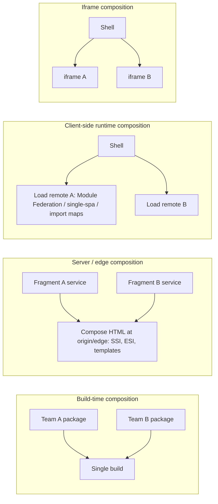
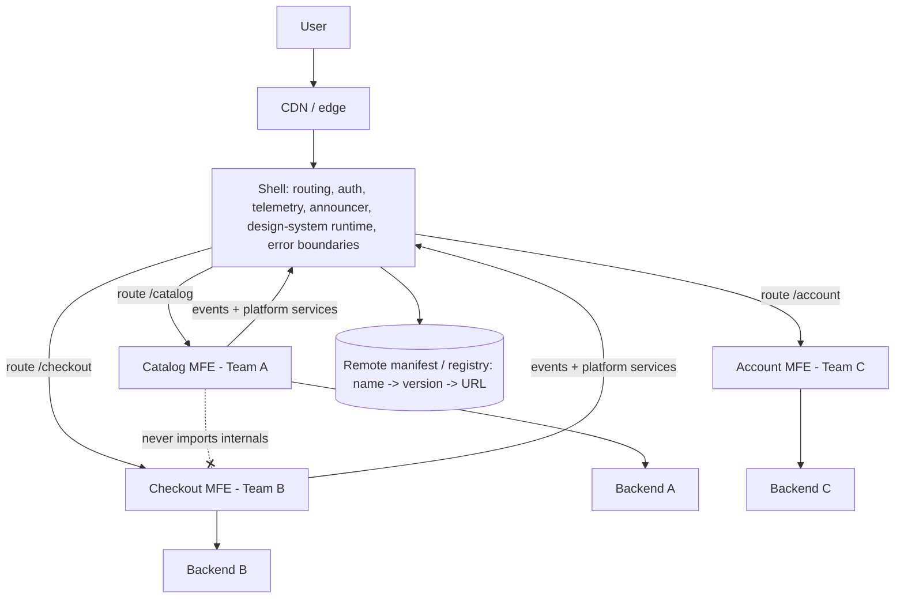
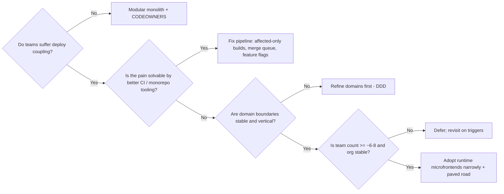

# 11 / 12 — Microfrontends: Benefits, Costs, and Failure Modes

> **Verify against current docs.** Microfrontend tooling (Module Federation and its Vite/Rspack/webpack plugins, single-spa, framework-specific integrations) changes quickly and configuration option names differ between versions and between plugin implementations. Treat every configuration snippet in this lesson as **illustrative of the concepts**; confirm option names and defaults in the tool's current documentation before use.

## 1. Lesson metadata

| | |
|---|---|
| **Level** | Architect |
| **Study time** | 5–6 hours (reading 2.5 h, worked example 1 h, exercises 2 h) |
| **Prerequisites** | [00/10 — ES modules and dependency graphs](../00-web-and-javascript-foundations/10-modules-and-dependency-graphs.md), [04/07 — Modular architecture](../04-react-architecture/07-modular-architecture.md), [04/22 — Monorepos and shared packages](../04-react-architecture/22-monorepos-and-shared-packages.md), [04/23 — Multi-team ownership](../04-react-architecture/23-multi-team-ownership.md), [11/05 — Application boundaries](./05-application-boundaries.md), [11/09 — Performance budgets at scale](./09-performance-budgets-at-scale.md), [11/11 — Designing for accessibility](./11-designing-for-accessibility.md) |
| **Next** | [13 — Monorepo vs multirepo](./13-monorepo-vs-multirepo.md) |
| **Related** | [10/12 — Backward compatibility](../10-production-engineering/12-backward-compatibility.md), [10/13 — Application migrations](../10-production-engineering/13-application-migrations.md), [10/14 — Multi-team collaboration](../10-production-engineering/14-multi-team-collaboration.md), [11/16 — Supporting multiple teams](./16-supporting-multiple-teams.md) |

**Learning objectives.** After this lesson you can:
1. State precisely what problem microfrontends solve (organisational scaling and independent deployability) and what they do **not** solve.
2. Enumerate the integration options — build-time packages, server-side composition, runtime JavaScript composition (Module Federation, single-spa, native import maps), iframes, Web Components — with the trade-offs of each.
3. Identify the costs (performance, consistency, accessibility, testing, observability, operations, cognitive) and the characteristic **failure modes** (distributed monolith, dependency duplication/singleton breakage, version skew, runtime-load failures, cross-app coupling through shared state, CSS collisions).
4. Design the contracts a healthy microfrontend platform needs: routing, shared dependencies, communication, design system, error isolation, deployment, and observability.
5. Make and defend a decision (adopt, adopt narrowly, or reject) using evidence about teams, release friction, and architecture, and describe cheaper alternatives (modular monolith in a monorepo).
6. Plan migration paths (strangler) into and out of microfrontends.

**Concepts covered:** independent deployability, team autonomy, shell/host/remote, composition time (build/server/client), Module Federation (host, remote, exposes, shared, singleton), single-spa (applications, parcels, lifecycles), import maps, iframes and `postMessage`, Web Components as integration boundary, contract testing, distributed monolith, Conway's law, strangler fig, version skew, blast radius.

---

## 2. Deep conceptual explanation

### 2.1 What problem is this lesson solving?

Microfrontends apply the microservices idea to the browser: split one large frontend into **independently developed, tested, and deployed** pieces, each owned by a team that owns a vertical slice of the product (UI + the backend it talks to). The motivating problem is almost never technical; it is **organisational**:

- 60 engineers in 8 teams commit to one repository and one deploy pipeline. A release train requires coordination, a flaky test in team A's area blocks team B's hotfix, build time exceeds 25 minutes, and merge queues are long.
- Teams want to upgrade frameworks, libraries, or design-system versions at different speeds.
- An acquisition brings a second frontend that must appear inside the first one.
- A legacy Angular/Backbone/server-rendered application must be replaced piece by piece without a big-bang rewrite.

The claim: if boundaries follow business capabilities and teams can ship without asking each other, delivery throughput scales with the number of teams. This is **Conway's law used deliberately**: the system's structure mirrors the organisation's communication structure, so shape the system to match the organisation you want.

Everything else in this lesson is the price of that claim.

### 2.2 What microfrontends are NOT (clearing the vocabulary)

| Often confused with | Difference |
|---|---|
| Code splitting / lazy loading | Same bundle graph, one build, one deploy. Splitting is a delivery optimisation; microfrontends are an organisational/deployment boundary. |
| A component library | Libraries are consumed at **build time** and versioned; changes need consumers to rebuild and redeploy. (A library *can* be a good alternative — §7.) |
| A monorepo | A repository layout. A monorepo can host a microfrontend system or a modular monolith. ([13](./13-monorepo-vs-multirepo.md)) |
| Micro-"components" | Granularity is a **business-capability / page / route region**, not a button. Component-sized microfrontends is a red flag (§8). |
| A performance feature | They almost always cost performance relative to a well-built monolith (§2.6). |

### 2.3 The independence spectrum

"Independent deployability" is not binary. Plot what is independent:

| Dimension | Monolith modules | Build-time packages | Runtime microfrontends |
|---|---|---|---|
| Independent **development** (code ownership) | yes (with boundaries) | yes | yes |
| Independent **build** | no | partially | yes |
| Independent **deploy** | no | no (consumers must rebuild) | **yes** |
| Independent **tech choices** (framework/version) | no | limited | yes (at a cost) |
| Compile-time type safety across boundary | yes | yes | **no** (contracts needed) |
| Shared-dependency efficiency | best | good | needs explicit management |

The only dimension where runtime microfrontends are *uniquely* strong is independent deploy (and its sibling, independent tech choice). If your teams do not actually suffer from deploy coupling, you are paying for something you do not need.

### 2.4 Composition: where and when the pieces are assembled



| Composition time | Mechanism | Deploy independence | Notes |
|---|---|---|---|
| Build time | npm packages, workspaces | Low | Simplest; lockstep releases or version pinning |
| Server/edge | SSI/ESI, a composing proxy, server-side includes, frameworks that stitch HTML | High | Good for SEO/first paint; weak for rich client interactivity across fragments |
| Client runtime | Module Federation, single-spa, import maps + ES modules, custom loaders | High | Most flexible; most failure modes |
| Iframe | `<iframe>`, `postMessage` | Highest isolation | Poor UX integration; some accessibility, sizing, routing and performance costs |

### 2.5 The main runtime options

#### 2.5.1 Module Federation

*Concept.* Webpack 5 introduced **Module Federation**: a build-time-configured mechanism by which one build (a **remote**) exposes modules and another (a **host**) imports them **at runtime**, with a **shared** scope negotiating common dependencies (e.g. React) so that only one copy (or compatible versions) loads. The idea has since been implemented beyond webpack (Rspack, and Vite plugins; there is also an evolving "Module Federation 2.0" family with a runtime and manifest/type-sharing tooling). ⚠ *Flag: package names, config options, and APIs differ between webpack's built-in plugin, `@module-federation/enhanced`, and Vite plugins; verify against the docs for your bundler at <https://module-federation.io/> and webpack's documentation.*

Key concepts (stable across implementations):
- **Remote**: a build that publishes a *remote entry* (a small JS file describing what it exposes and its shared requirements) at a URL.
- **Host**: an app that, at runtime, loads a remote entry and then imports exposed modules asynchronously (`import('checkout/CheckoutApp')`).
- **Exposes**: modules the remote makes importable by others (its public API).
- **Shared**: dependencies to be negotiated at runtime; options include `singleton` (exactly one instance; mandatory for React), `requiredVersion` (semver range), `strictVersion`, `eager`.
- Hosts and remotes can be **bidirectional** (every app may be both).

Strengths: fine-grained module sharing (not just whole apps); works with the same bundler toolchain; shared dependencies dedupe; supports sharing across independently deployed builds; a mature ecosystem.
Weaknesses: shared-dependency negotiation is the major source of subtle bugs (version skew, multiple React copies); runtime coupling is invisible to the compiler (types need extra tooling); remote entry load is a new network hop and failure point; SSR support is more complex ⚠ (verify current SSR story per plugin); debugging remote stack traces and source maps across builds is harder.

#### 2.5.2 single-spa

*Concept.* single-spa is a framework for composing multiple **applications** in one page, each exposing lifecycle functions (`bootstrap`, `mount`, `unmount`; optionally `update` for parcels). A **root config** registers applications with *activity functions* (usually route-based) and loads them via a module loader (SystemJS or native ESM with import maps are common). Because lifecycle is framework-agnostic, applications written in React, Angular, Vue, etc., can coexist (with helper libraries such as `single-spa-react`). ⚠ *Verify the current API and recommended loaders at <https://single-spa.js.org/>.*

Strengths: framework-agnostic; clear lifecycle and routing-driven activation; good for legacy migration and polyglot estates.
Weaknesses: you assemble much yourself (shared deps via import maps, styling, error isolation); every app pays a bootstrapping/mount cost; sharing React requires external-ising and a shared version policy; community patterns vary.

#### 2.5.3 Native import maps / ES modules

*Concept.* Browsers support **import maps** (`<script type="importmap">`) that map bare specifiers (`"react"`) to URLs. With each microfrontend built as ES modules that treat `react` as external, the browser (not a bundler runtime) enforces a single shared instance per map. Pros: standards-based, no bundler federation runtime, easy dedup. Cons: you own version governance, polyfill needs for older browsers (verify support matrix; import maps are widely supported in current evergreen browsers), no automatic tree-shaking of shared libs across boundaries (you ship the full library), and dev-tooling friction.

#### 2.5.4 Iframes

*Concept.* Each microfrontend runs in its own browsing context with its own JavaScript realm, DOM, CSS, and (with different origins) security boundary. Communication is via `postMessage` (and URL/cookies/storage subject to origin and partitioning rules).

Strengths: **hardest isolation** (CSS, JS globals, crashes, library versions, even frameworks); trivial integration of an untrusted or legacy app; strong security posture with `sandbox` and CSP `frame-ancestors`; independent release is absolute.
Weaknesses: layout (height negotiation, scroll containers, responsive behaviour), focus management and accessibility across frame boundaries (assistive tech handles iframes but focus and reading-order choreography are your problem; each frame needs a meaningful `title`), deep linking/back-button sync, duplicated bundles and memory per frame (React loaded N times), overlays/modals can't escape the frame, SSO/session sharing (cookie partitioning, third-party cookie restrictions), performance per frame, and a poor "single app" feel.

#### 2.5.5 Web Components as the integration boundary

*Concept.* Each microfrontend exposes a **custom element** (`<checkout-app>`), a framework-neutral contract using attributes/properties for input and DOM events for output; the shell composes them like HTML. Shadow DOM provides CSS isolation (optional). React 19 improved custom-element support (properties vs attributes handling) — ⚠ *verify current behaviour in React's docs on custom elements*. Pros: standard, framework-agnostic contract. Cons: styling isolation also blocks the design system's global styles unless you design for it (CSS custom properties, parts), server rendering of shadow DOM is nontrivial, and accessibility across shadow boundaries has pitfalls (ID references like `aria-labelledby` can't cross shadow roots).

### 2.6 The costs, in detail

| Cost | Mechanism | How big? | Mitigation |
|---|---|---|---|
| **Performance (bytes)** | Duplicate dependencies, per-app runtime/bootstrap code, multiple router/state libs | Frequently 10–40 % more JS than an equivalent monolith *(typical order of magnitude from industry experience; measure your own)* | Shared singletons, import maps, shared design-system runtime, budgets per composed page ([09](./09-performance-budgets-at-scale.md)) |
| **Performance (waterfalls)** | shell → remote entry → remote chunks → data; each hop is serial | Adds 1–3 round trips to critical path | Preload remote entries from the shell; manifest-driven preloading; server-side inclusion of critical fragments; HTTP caching of entries with short TTL + revalidation |
| **Runtime failure surface** | Remote host down, bad deploy, CDN partial failure, version mismatch | Per-remote availability multiplies | Error boundaries per remote with fallbacks; timeouts; last-known-good fallback URLs |
| **UX consistency** | Different layouts, spacing, loading states, error handling, interaction patterns per team | Chronic | Shared design system as a versioned *runtime* dependency; UX governance; shared patterns library |
| **Cross-app state & communication** | Cart, user, feature flags, notifications needed by many | Easy to build hidden coupling | Minimal contract: URL, events with typed schemas, platform services; avoid shared mutable stores |
| **Testing** | No compile-time cross-boundary checks; many combinations of versions | Combinatorial | Contract tests; composed smoke tests; canary the composite; version policy |
| **Observability** | Errors and perf metrics span independently deployed units | Attribution is harder | Composite release id; per-remote spans/tags in RUM; central logging conventions |
| **Accessibility** | Duplicate landmarks/ids, competing focus management/announcers, heading hierarchy | Common | Shell-owned document semantics and a testable contract ([11](./11-designing-for-accessibility.md)) |
| **Developer experience** | Local development against remote shells, mocking other teams, debugging across bundles | Moderate to high | Standardised dev harness; local "shell lite"; mock remotes; consistent tooling |
| **Operational** | N pipelines, N hosting artifacts, N on-call surfaces | Linear in N | Platform team provides paved road templates |
| **Cognitive** | Engineers must understand the composition model and contracts | Ongoing | Documentation, ADRs ([10/16](../10-production-engineering/16-architecture-decision-records.md)) |

### 2.7 Characteristic failure modes

1. **The distributed monolith.** Teams deploy independently *in name*, but changes require coordinated releases because remotes depend on each other's internals (deep imports of exposed modules, shared mutable state, undocumented event shapes). You acquired all the costs and none of the independence. Diagnostic: how often do releases of A require a simultaneous release of B? If >10–20 % of releases, boundaries are wrong or contracts are leaking.
2. **Wrong boundaries.** Slicing by technical layer ("header team", "footer team", "forms team") or by UI component rather than business capability forces every user journey through many teams. Journeys (search → product → checkout) should be mostly within one team's slice where possible; cross-team handoffs should be few and narrow.
3. **Singleton breakage.** Two copies of React in a page: hooks error ("Invalid hook call"), separate contexts that don't see each other, duplicated state. Also multiple copies of libraries with module-level singletons (a router, an i18n instance, a state store, a design-system theme context).
4. **Version skew.** Shell upgrades a shared API; remote built against old shared contract continues to run in production for weeks; subtle breakage appears only in some combinations. Or a shared dependency semver range is satisfied by *different* versions across remotes in different page loads, giving non-reproducible bugs.
5. **Runtime fetch failure.** A remote entry 404s or times out; the shell crashes or hangs on a blank region. Without error isolation, one team's deploy takes the page down. Without timeouts, loading spinners run forever.
6. **CSS collisions and leakage.** Global selectors, resets, CSS-in-JS class name collisions, differing CSS reset order, specificity wars, theme token drift.
7. **Duplicated runtime state**: each microfrontend instantiates its own React Query cache, store, auth client, websocket → duplicate requests, inconsistent data, multiple token refreshes racing.
8. **Cross-cutting concerns fragment**: i18n, auth, analytics, error reporting, feature flags implemented differently in each; inconsistent user experiences and compliance gaps ([06 — Cross-cutting concerns](./06-cross-cutting-concerns.md)).
9. **Performance regression nobody owns**: every team is within its own budget; the composed page is not ([09](./09-performance-budgets-at-scale.md)).
10. **Organisational failure**: the platform/shell team becomes a bottleneck or a bureaucracy; or has no authority to enforce contracts.

### 2.8 Misconceptions

| Misconception | Reality |
|---|---|
| "Microfrontends let every team use any framework." | They *permit* it at heavy cost (bundle duplication, inconsistent UX, a11y, hiring). Most successful setups converge on one framework and use microfrontends for deploy independence. Heterogeneity is for migration, not for taste. |
| "They make the app faster/lighter." | They make it *deployable* independently. Performance is usually worse unless engineered. |
| "Module Federation is the architecture." | It is a mechanism. The architecture is the boundaries, contracts, ownership, and operating model. |
| "We can adopt them for a 10-person team to prepare for scale." | Premature; the coordination cost you remove does not yet exist. |
| "Each microfrontend should own its own data store/design system/auth." | Cross-cutting concerns need platform-level consistency (shared services/contracts). |
| "Independent deploys mean no coordination." | Contracts (APIs, events, routes, shared deps) still require compatibility discipline — *more* explicitly than in a monolith. |

---

## 3. Internal mechanics

### 3.1 Module Federation runtime: the teaching model

*Teaching model (conceptual; names are not the bundler's real internal identifiers).*

1. The host build is configured with a map of **remote name → remote entry URL** (static or resolved at runtime).
2. The host's bundle includes a small runtime that can (a) load a remote entry script, (b) initialise the **share scope**, (c) request exposed modules from the remote.
3. When code runs `import('remoteA/Widget')`, the runtime ensures remoteA's entry is loaded (script tag or dynamic import), then **initialises sharing**: each side registers the shared modules it can provide (with versions) into the share scope; for each shared dependency requested, the runtime picks a version according to the negotiation rules (highest compatible version satisfying ranges; `singleton` forces one instance and may warn or throw if ranges conflict, depending on `strictVersion`).
4. The remote's exposed module factory runs, loading its own chunks (from its own origin/public path), and resolves with the module.

*Public guarantee:* what the configuration options (`shared`, `singleton`, `requiredVersion`, `strictVersion`, `exposes`, `remotes`) are documented to do. *Implementation detail:* the exact chunk loading, share-scope data structure, and init ordering; these are bundler/runtime internals subject to change — don't build on them.

Consequences you can reason about:
- **Sharing is decided at runtime** by *which builds actually load on this page*, not at build time. The dependency graph of the **composed page** exists only in the browser, so it can't be fully verified by any single team's CI. (This is the heart of why composed-page testing and budgets are necessary.)
- **`eager` vs async boundary:** shared modules are loaded lazily through the share scope; code that imports a shared module synchronously at the top of the entry (before the share scope initialises) fails with an error such as "Shared module is not available for eager consumption". The standard remedy is an **async boundary** (`import('./bootstrap')` in the entry file) so initialisation completes first. (The `Shared module is not available for eager consumption` message is webpack's; Rspack/enhanced builds use the same async-boundary remedy.)
- **Publicly resolvable paths:** each remote's chunks load relative to its own `publicPath`/`base`; misconfiguration here causes chunk 404s that appear only when composed.

### 3.2 single-spa lifecycle and routing

*Public guarantee:* an application registers with `registerApplication({ name, app, activeWhen })`, `start()` begins routing; the framework calls the app's `bootstrap` once, `mount` each time it becomes active, `unmount` when inactive. *Teaching model:* single-spa listens to URL changes (patches/observes history events), computes which applications should be active, and drives their lifecycle in a defined order (unmount then mount) — so two applications' mount/unmount can overlap or sequence in ways you must account for (e.g. focus management, transitions, destroying subscriptions).

The consequence for React: each React microfrontend creates its own **root** (`createRoot(domElement)`) on mount and calls `root.unmount()` on unmount; **each root has its own React tree**, so React context does not cross roots, and error boundaries don't either. Cross-root communication needs explicit channels (events, shared services, a store outside React).

### 3.3 Iframe boundaries (platform facts)

An iframe is a separate **browsing context** with its own document, global object, and event loop interactions (same-origin iframes can share a thread with the parent; cross-origin frames may be out-of-process in some browsers (site isolation) — ⚠ implementation-dependent). Communication: `postMessage(data, targetOrigin)` and a `message` event; **always** specify `targetOrigin` and **validate `event.origin`** on receipt; never use `"*"` for sensitive data. Cookies/storage access across origins is subject to browser partitioning policies that change; design authentication for them (e.g. token handoff via `postMessage`, or same-site subdomains).

### 3.4 Routing ownership

Two patterns:
- **Shell owns top-level routes**; each microfrontend owns a sub-route namespace (`/orders/*`) and its internal routing, either with a router in "basename" mode or via an exposed route object that the shell mounts.
- **Federated route configuration**: remotes publish a route manifest; the shell builds its route table from manifests.

Rules: URLs are a **public contract** (deep links, bookmarks, analytics). Never let two microfrontends listen to the same route. Browser history is shared global state: only one router instance should call `pushState` for a given namespace, or use the shell's navigation service. Cross-MFE navigation uses plain links (`<a href="/orders/42">` handled by the shell's router) or a navigation API, not imports of another team's router.

---

## 4. Step-by-step execution walkthrough: a page load in a runtime-composed system

Scenario: `/checkout` in a Module-Federation-based platform with host `shell` and remotes `checkout`, `cart-summary`.

1. Browser requests `/checkout`; CDN returns the **shell** HTML (a small static page or SSR output) with the shell's entry script.
2. Shell JS executes: initialises auth, telemetry (release id), feature flags, announcer service, router. Time: depends on shell budget.
3. Router matches `/checkout/*` → needs the `checkout` remote. The shell calls the **remote loader**: it looks up the remote's entry URL (from a *manifest* the shell fetched earlier or from build config) — e.g. `https://cdn.example.com/checkout/2026.10.3/remoteEntry.js` or a stable `latest` alias.
4. The browser fetches `remoteEntry.js` (**waterfall hop #1**; the shell could have preloaded it by hinting (`<link rel="modulepreload">`/`preload`) on route prediction).
5. The remote entry registers; share scope negotiation: React 19.x already provided by shell as singleton; the remote's `requiredVersion` range accepted. If the remote required React 18 only with `strictVersion`, negotiation fails → the shell's error boundary shows a fallback and reports an error with the remote id and versions.
6. The runtime fetches the remote's exposed module chunk(s) (**hop #2**), executes them, returns `CheckoutApp`.
7. Shell renders `<RemoteBoundary name="checkout"><CheckoutApp /></RemoteBoundary>` inside `<Suspense>`; `CheckoutApp` fetches its data (**hop #3**: API) — unless the shell or server prefetched.
8. In parallel the page includes `cart-summary` (a second remote) → repeats steps 3–6, possibly sharing already-loaded chunks.
9. First meaningful content appears after hop #3 resolves, so LCP includes ≥ 3 serial network dependencies unless mitigated.
10. RUM records metrics tagged with the composite release id (shell version + remote versions loaded).
11. If remote `checkout` fails in step 4 (404/timeout), the boundary renders a fallback (retry button, link to a degraded server-rendered page, or last-known-good version URL), reports the error with remote name/version, and the rest of the shell remains functional.

The walkthrough shows where each failure mode lives: step 4/6 (fetch failures), 5 (version negotiation), 7 (waterfall), 8 (duplicate loads), 10 (attribution).

---

## 5. Code examples

### 5.1 Minimal — Module Federation host and remote *(illustrative; verify option names)*

```ts
// remote: checkout/rspack.config.ts or webpack.config.ts  (illustrative)
import { ModuleFederationPlugin } from '@module-federation/enhanced/webpack'; // verified: @module-federation/enhanced@2.x exports ModuleFederationPlugin from this path

export default {
  // ...
  plugins: [
    new ModuleFederationPlugin({
      name: 'checkout',
      filename: 'remoteEntry.js',
      exposes: {
        './CheckoutApp': './src/CheckoutApp.tsx',   // the ONLY public API of this remote
      },
      shared: {
        react:       { singleton: true, requiredVersion: '^19.0.0' },
        'react-dom': { singleton: true, requiredVersion: '^19.0.0' },
        '@acme/design-system': { singleton: true, requiredVersion: '^4.2.0' },
      },
    }),
  ],
};
```

```ts
// host: shell config (illustrative)
new ModuleFederationPlugin({
  name: 'shell',
  remotes: {
    // Prefer runtime-resolved URLs (see 5.2) over hard-coded ones in production
    checkout: 'checkout@https://cdn.example.com/checkout/remoteEntry.js',
  },
  shared: {
    react:       { singleton: true, requiredVersion: '^19.0.0', eager: false },
    'react-dom': { singleton: true, requiredVersion: '^19.0.0', eager: false },
    '@acme/design-system': { singleton: true, requiredVersion: '^4.2.0' },
  },
});
```

```tsx
// host: using the remote
import { lazy, Suspense } from 'react';
const CheckoutApp = lazy(() => import('checkout/CheckoutApp')); // needs a type declaration, see 5.4
```

```ts
// Entry file must be an async boundary so the share scope initialises first
// src/index.ts
import('./bootstrap');   // bootstrap.tsx calls createRoot(...).render(<App />)
```

Line notes: `singleton: true` for React means one instance per page; if the versions are incompatible and `strictVersion` is set, loading fails loudly (good: fail fast over silently running two Reacts). The design system is shared as a singleton so theme context and tokens exist once. `exposes` is the public API: keep it tiny (one or two entry components), because everything exposed is a contract you must keep compatible across independent deploys.

### 5.2 Practical — a resilient remote loader with error isolation

```tsx
// RemoteBoundary.tsx — shell code
import { Component, Suspense, type ComponentType, type ErrorInfo, type ReactNode } from 'react';

type Props = { name: string; version?: string; fallback: ReactNode; children: ReactNode };
type State = { error: Error | null };

// Error boundaries still require a class component (React 19; no hook equivalent).
export class RemoteErrorBoundary extends Component<Props, State> {
  state: State = { error: null };
  static getDerivedStateFromError(error: Error): State { return { error }; }
  componentDidCatch(error: Error, info: ErrorInfo) {
    reportRemoteError({ remote: this.props.name, version: this.props.version, error, componentStack: info.componentStack });
  }
  render() {
    return this.state.error ? (
      <section role="alert" aria-label={`${this.props.name} unavailable`}>
        {this.props.fallback}
        <button type="button" onClick={() => this.setState({ error: null })}>Try again</button>
      </section>
    ) : (
      <Suspense fallback={<p role="status">Loading {this.props.name}…</p>}>{this.props.children}</Suspense>
    );
  }
}
declare function reportRemoteError(e: { remote: string; version?: string; error: Error; componentStack?: string | null }): void;

// loadRemote with timeout: don't spin forever if the remote entry hangs.
export function withTimeout<T>(p: Promise<T>, ms: number, label: string): Promise<T> {
  return new Promise((resolve, reject) => {
    const t = setTimeout(() => reject(new Error(`Timed out loading ${label} after ${ms} ms`)), ms);
    p.then((v) => { clearTimeout(t); resolve(v); }, (e) => { clearTimeout(t); reject(e); });
  });
}
```

```tsx
// usage in the shell
import { lazy } from 'react';
const Checkout = lazy(() => withTimeout(import('checkout/CheckoutApp'), 8000, 'checkout'));

<RemoteErrorBoundary name="checkout" fallback={<p>Checkout is temporarily unavailable.</p>}>
  <Checkout />
</RemoteErrorBoundary>
```

Why this matters: **error isolation is the main reliability promise** of the architecture. The "Try again" button resets the boundary state, but `React.lazy` caches a *rejected* import promise — retrying the same `lazy` component re-throws the cached rejection. The robust approach is a factory that recreates the lazy component (new `lazy(...)` instance keyed by a retry counter), and a loader that purges the failed script. ⚠ *This subtlety is a known source of "retry doesn't work" bugs; test it.* Also, the error boundary only catches errors during rendering/lifecycle of its subtree; errors in event handlers or async code inside the remote must be handled/reported by the remote itself (`window.onerror`/`unhandledrejection` reporting with remote tagging).

### 5.3 Practical — a typed, versioned cross-MFE event contract

```ts
// @acme/mfe-contracts (published package, owned by platform; versioned with semver)
export type ContractEvents = {
  'cart:item-added': { v: 1; skuId: string; quantity: number };
  'session:expired': { v: 1 };
};

export function emit<K extends keyof ContractEvents>(type: K, detail: ContractEvents[K]) {
  window.dispatchEvent(new CustomEvent(type, { detail }));
}
export function on<K extends keyof ContractEvents>(type: K, handler: (d: ContractEvents[K]) => void) {
  const listener = (e: Event) => handler((e as CustomEvent<ContractEvents[K]>).detail);
  window.addEventListener(type, listener);
  return () => window.removeEventListener(type, listener); // cleanup: return from effect
}
```

```tsx
useEffect(() => on('cart:item-added', ({ skuId }) => refetchBadge(skuId)), []);
```

Notes: events are fire-and-forget and decoupled — good for notifications ("something happened"), poor for **queries and commands** that need results (use a platform service API or the URL/server as source of truth). Version each payload (`v`) and only evolve additively; consumers must tolerate unknown fields. Types are a *build-time convenience*; at runtime the contract is only a convention, so validate at the boundary for critical events (e.g. a schema parse). Avoid a global mutable store as a communication channel — it silently couples release schedules.

### 5.4 Practical — typing federated modules

```ts
// shell/src/types/remotes.d.ts
declare module 'checkout/CheckoutApp' {
  import type { ComponentType } from 'react';
  export type CheckoutAppProps = { cartId: string; onComplete(orderId: string): void };
  const CheckoutApp: ComponentType<CheckoutAppProps>;
  export default CheckoutApp;
}
```

This manual declaration is **unverified by the compiler against the actual remote**: if the remote changes its props, the shell compiles but fails at runtime. Better: publish types from the remote's build and consume them (`@module-federation/enhanced` can do this: the producer emits `@mf-types.zip` and the consumer downloads it into `@mf-types`, controlled by the `dts` option — verified against module-federation.io, 2026-10-22) and back them with a **contract test** (§5.6). Treat the exposed props as a versioned API; additive optional props only.

### 5.5 Alternative — single-spa root config and a React app *(illustrative; verify API)*

```ts
// root-config.ts
import { registerApplication, start } from 'single-spa';

registerApplication({
  name: '@acme/orders',
  app: () => System.import('@acme/orders'),          // SystemJS or native import maps (verify loader)
  activeWhen: ['/orders'],
});
registerApplication({
  name: '@acme/legacy-reports',
  app: () => System.import('@acme/legacy-reports'),  // e.g. an Angular app being strangled
  activeWhen: ['/reports'],
});
start();
```

```tsx
// orders/src/orders.tsx (React app wrapped for single-spa)
import React from 'react';
import ReactDOMClient from 'react-dom/client';
import singleSpaReact from 'single-spa-react';
import Root from './Root';

const lifecycles = singleSpaReact({
  React,
  ReactDOMClient,
  rootComponent: Root,
  errorBoundary: () => <p role="alert">Orders failed to load.</p>,
});
export const { bootstrap, mount, unmount } = lifecycles;
```

Notes: the legacy and React apps coexist because single-spa treats both as lifecycle-bearing apps; this is its sweet spot. Verified against `single-spa-react@6.0.2`: it accepts `opts.ReactDOMClient` and, when that object has `createRoot`, uses `createRoot` automatically (otherwise legacy `render`); it also returns an `update` lifecycle for parcels.

### 5.6 Incorrect — deep imports and hidden coupling

```ts
// ❌ in the 'catalog' remote
import { useCartStore } from 'checkout/src/internal/cartStore'; // a path not in `exposes`
useCartStore.getState().addItem(sku);
```
Problems: depends on another team's **internals** (not an exposed contract), couples release schedules (rename the file → catalog breaks at runtime, no compile error), shares mutable state across deployment units, and defeats the point of independent deploys. Even if the bundler technically allows it by exposing everything (`'./*': './src/*'`), this converts the system into a distributed monolith.

### 5.7 Corrected — narrow, versioned, tested contracts

Use the event contract (§5.3) for notifications; a **platform service** (`@acme/platform-services`, provided by the shell as a singleton) for commands/queries: `cart.add(sku)` returns a promise, implemented once by the cart owner and exposed through an interface the shell injects. Verify compatibility with **consumer-driven contract tests** run in the owner's CI:

```ts
// checkout/contract/cart-service.contract.test.ts  (run in the *provider's* CI against the consumers' published expectations)
import { contracts } from '@acme/mfe-contract-registry'; // each consumer registers expectations at publish time
import { createCartService } from '../src/cartService';

describe.each(contracts.for('cart-service'))('consumer %s', (consumer) => {
  it.each(consumer.expectations)('%s', async (exp) => {
    const svc = createCartService(fakeBackend());
    await expect(svc[exp.method](...exp.args)).resolves.toMatchObject(exp.expectedShape);
  });
});
```

(Conceptual; tools such as Pact implement this idea — verify current docs. The registry is a design choice; many teams start with simple shared TypeScript types plus a conformance suite.)

### 5.8 Advanced — iframe integration with origin validation

```tsx
function IframeApp({ src, title, onMessage }: { src: string; title: string; onMessage: (d: unknown) => void }) {
  const ref = useRef<HTMLIFrameElement>(null);
  const expectedOrigin = new URL(src).origin;

  useEffect(() => {
    function handler(e: MessageEvent) {
      if (e.origin !== expectedOrigin) return;            // 1. validate origin
      if (e.source !== ref.current?.contentWindow) return; // 2. validate source window
      onMessage(e.data);                                   // 3. then validate/parse the payload with a schema
    }
    window.addEventListener('message', handler);
    return () => window.removeEventListener('message', handler);
  }, [expectedOrigin, onMessage]);

  return (
    <iframe
      ref={ref}
      src={src}
      title={title}                                        // required for accessibility
      sandbox="allow-scripts allow-same-origin allow-forms" // minimal permissions; review each flag
      referrerPolicy="strict-origin-when-cross-origin"
      loading="lazy"
    />
  );
}
```

Notes: `allow-scripts` together with `allow-same-origin` on a same-origin document **nullifies the sandbox** (the framed page can remove its own sandbox), so only combine them for a cross-origin `src`. Height negotiation needs a handshake message (`{type:'resize', height}`) with throttling; test with zoom and text-spacing. Treat all inbound messages as untrusted input ([10/06 — Security](../10-production-engineering/06-security-xss-csrf-csp.md)).

---

## 6. Visual explanations





```
Independence vs coupling budget:
  every shared singleton   = a coupling you must version
  every exposed module     = a public API you must keep compatible
  every cross-MFE event    = a schema you must evolve additively
  total contract surface   -> keep as small as the business allows
```

---

## 7. Alternative approaches and trade-offs

| Approach | Independent deploy | Perf | Type safety | Consistency | Ops cost | Best when |
|---|---|---|---|---|---|---|
| **Modular monolith (single app, enforced module boundaries, CODEOWNERS)** | No (but fast CI helps) | Best | Full | Easy | Lowest | Most orgs < ~50–100 engineers; stable cadence |
| **Monorepo with affected-only CI + merge queue + feature flags** | Pseudo (decouple deploy from release via flags) | Best | Full | Easy | Low–Med (tooling) | Pain is CI time/merge conflicts rather than release independence |
| **Shared library/packages consumed at build time** | Low | Good | Full | Good | Low | Distributing a design system or domain widgets; accept lockstep upgrades |
| **Server-side composition (edge/ESI/SSI)** | High | Good first paint | None | Medium | Medium | Content-heavy sites, SEO-critical pages, polyglot back-ends |
| **Module Federation (same-framework)** | High | Medium (needs engineering) | Weak (extra tooling) | Medium | High | Many teams, one framework, true deploy independence needed |
| **single-spa** | High | Medium–Low | Weak | Medium | High | Polyglot estate, legacy migration |
| **Native ESM + import maps** | High | Medium–Good | Weak | Medium | Medium–High | Standards-first teams; modern-browser-only |
| **Iframes** | Highest | Lowest | None | Low | Medium | Untrusted/legacy/third-party apps; hard isolation required |
| **Web Components boundary** | High | Medium | Weak | Medium | Medium | Cross-framework widgets; embeddable products |

**A scenario where microfrontends are NOT the best choice (and are commonly chosen anyway):** a 25-engineer company, 4 product teams, one React codebase, weekly releases, build time 12 minutes. The pain is "merge conflicts and flaky tests". Microfrontends would add a platform team's worth of work (shell, contracts, composed testing, observability) to solve a problem that **affected-only CI, a merge queue, feature flags, CODEOWNERS and enforced module boundaries** solve at a fraction of the cost. The decision flowchart in §6 returns "modular monolith". Conversely, a **marketplace platform** with 14 teams and mandatory regulatory-driven independent release cycles, or a **post-acquisition portal** that must host two existing products, are legitimate cases.

---

## 8. Best practices and anti-patterns

**Practices**
- **Cut by business capability / user journey**, vertically (UI + BFF + data), so most journeys are team-local.
- **Keep the contract surface tiny**: exposed modules, events, URL structure, platform services. Document it, version it, test it.
- **One framework, one major version policy** unless migrating. Move React majors with a coordinated, tooling-assisted window; define N-1 support for shared singletons.
- **Shell as thin platform**: routing, auth/session, telemetry, error isolation, announcer/focus, design-system runtime, remote registry. Resist letting business logic accumulate in the shell.
- **Design system as a versioned shared runtime** (singleton) plus tokens in CSS custom properties; enforce visual regression in the composed page.
- **Make failure local**: boundary per remote, timeouts, last-known-good fallback, feature flags to remove a broken remote without redeploy.
- **Deploy with a manifest/registry** (name → version → URL) rather than hard-coded URLs; support instant rollback by repointing; canary new remote versions with percentage rollout.
- **Test the composite**: contract tests (provider/consumer), a small composed smoke suite, composed lab performance and a11y checks, and RUM tagged with composite version.
- **Provide a paved road**: generators, shared configs, local dev harness. Autonomy without a paved road becomes divergence.
- **Measure independence**: coupled-release rate, lead time per team, change failure rate per remote, p75 composed LCP, bundle duplication ratio.

**Beginner mistakes**: slicing too fine (component-level MFEs); exposing everything; hard-coding remote URLs; forgetting `singleton` for React; no timeouts or fallbacks; each MFE bootstrapping its own router that fights over history.

**Experienced-developer mistakes**: adopting for technology diversity rather than org need; no investment in a platform team; sharing a Redux store across MFEs "for convenience"; ignoring SSR/SEO consequences until late; failing to specify ownership of cross-cutting concerns; underestimating observability needs; postponing the accessibility contract (duplicated `<main>`, ids, live regions).

**Smells**: weekly "integration release" meetings; remotes importing from each other's source paths; multiple versions of React in the network panel; a `shared` package that is growing into a second monolith; a single team that must approve every remote deploy; remote versions pinned to `latest` with no rollback story.

**Justified exceptions**: iframes for third-party/untrusted or legacy apps despite their costs; multiple frameworks during a time-boxed migration (strangler); a shared mutable service (auth/session) owned by the platform with a stable API; coarse-grained "mini-shell" fragments at page level for SEO pages rendered on the server. Don't present microfrontends as inherently good or bad; they are a trade of coordination cost for operational and runtime complexity.

---

## 9. Real-world application

**E-commerce marketplace (multi-team, high traffic).** Typical slicing: Home/Content, Search & Listing, Product Detail, Cart & Checkout, Account/Orders, Seller tools. Checkout is the highest-stakes slice: it often warrants server-rendered, minimal-dependency delivery with strict budgets and its own deploy safeguards. A common compromise: **server-compose the SEO-critical pages** (home, listing, product) via edge/templating, and use runtime composition (or even separate apps with hard navigation) for authenticated, interaction-heavy areas (account, seller tools). Hard navigations between separately deployed apps (multi-page architecture with a shared header) are a legitimate, underrated option: independence with minimal runtime coupling, at the cost of full page loads ([09/01 — SPA, SSR, SSG, streaming](../09-advanced-rendering-and-ecosystem/01-spa-ssr-ssg-streaming.md)).

**Enterprise dashboard portal.** A portal hosting product modules built by different business units, with different release cadences and compliance gates. Runtime composition with a strict shell contract fits; each module must adopt the design system and the platform's auth/telemetry; a registry with approval states (draft → staging → production) provides governance.

**Finance.** Regulatory change cycles differ by product line; independent releases with audit trails and approvals per remote. Concerns: composite-state evidence (what version combination was live at time T — retain the composite release id in logs for audits), resilience (a failing non-critical widget must not block a payment flow), and strict CSP/SRI policies for remote scripts (**subresource integrity on dynamically loaded remote entries is hard when the entry changes per deploy** — mitigate with immutable versioned URLs and a signed manifest; verify your threat model).

**Auth.** One owner (platform): session, token refresh, login UI. MFEs consume `useSession()` via a platform service and never implement token logic. Cross-origin iframes complicate cookies; design explicitly.

**Realtime.** A single shared WebSocket/SSE connection in the shell with topic subscriptions exposed as a platform service prevents N connections per page.

**Migration (strangler fig).** Put the shell in front of the legacy app (routing at the edge or in a thin shell); migrate route by route; the legacy app remains one "microfrontend" until retired ([10/13 — Application migrations](../10-production-engineering/13-application-migrations.md), [11/03 — Large-scale refactoring](./03-large-scale-refactoring.md)). Define the *exit criteria* — otherwise the interim architecture becomes permanent.

**Multi-team operating model:** platform team (shell, paved road, registry, observability) vs product teams (remotes); an architecture review process for contract changes; ADRs for any new shared singleton or exposed module. Constraints to name: team count and stability, release cadence, SEO needs, compliance needs, device/network profile (budgets), existing legacy, hiring and skills.

---

## 10. Debugging and troubleshooting

**Symptom 1: "Invalid hook call" or hooks behave oddly only in the composed app.**
*Investigation.* Network panel: how many React copies loaded (look for multiple `react-dom` chunks or two vendor chunks with React)? In the console, check for duplicate React instances (`window.__REACT_DEVTOOLS_GLOBAL_HOOK__` renderers count in dev, or add a dev check that logs `React.version` from each remote). Check the `shared` config in every build for `singleton`, matching `requiredVersion`, and whether one remote lists React under `devDependencies` only (so shared fallback bundles its own). *Root cause example.* One remote omitted React from `shared`, so it bundled React 19.1 privately while the shell provides 19.0.
*Fix and validate.* Add `singleton` sharing everywhere; add a CI check that parses each remote's share config against a platform policy; add a runtime assertion in the shell in dev that exactly one React is registered; re-run composed smoke.

**Symptom 2: Blank region where a remote should be, no visible error.**
*Investigation.* Console/Network: 404 on `remoteEntry.js` or a chunk (wrong `publicPath`/base), CORS error (remote origin lacks `Access-Control-Allow-Origin` for script loads using `crossorigin`), CSP blocking script from the remote origin, MIME type problems from SPA fallback returning HTML for a missing JS file (a classic: the CDN rewrites unknown paths to `index.html` so the "script" is HTML and throws a syntax error). *Fix.* Correct publicPath; configure CORS/CSP; make the CDN return 404 for missing assets; boundary renders a visible fallback and logs the remote name/URL/version.

**Symptom 3: Works after the remote's deploy, then breaks for users with an old tab.**
*Investigation.* Long-lived tabs hold the old shell and request a remote chunk whose hashed file was deleted by the new deploy (chunk load error). *Fix.* Keep previous versions' assets available for a retention window (immutable, versioned paths); on chunk-load errors, prompt reload or auto-reload once; the registry points *new* sessions to new versions while old sessions continue with their pinned version.

**Symptom 4: p75 LCP regressed after a remote deploy although each team's budget is green.**
*Investigation.* RUM sliced by composite release id and per-remote custom timings (`performance.mark` at remote-entry-start/end); check for new waterfall depth (the remote now loads another remote), duplicated dependency (a new library shipped privately), and change in the critical path (remote entry now fetched after route resolution rather than preloaded). *Fix.* Composed-page budget check including duplicates, preload remote entries in the shell for predicted routes, share the dependency or remove it, add waterfall-depth as a budget ([09](./09-performance-budgets-at-scale.md)).

**Symptom 5: Styles broken only when two remotes coexist.**
*Investigation.* Inspect element → winning rule's origin file; look for global selectors (`button {…}`), CSS reset order differences, same class names from different CSS Modules/hash configs, two design-system versions. *Fix.* Scope: CSS Modules with deterministic prefixing per remote, `@layer` ordering policy decided by the shell, tokens via custom properties, forbid global element selectors outside the shell (lint rule: stylelint `selector-max-type` or restrict files); consider Shadow DOM only if you accept its theming costs.

**Symptom 6: "Works on my machine" – local development is painful.**
Provide a "run my remote inside a deployed staging shell" mode (override remote URL via query string/cookie `?mfe-override=checkout@http://localhost:3001`), plus mocks for other remotes. Validate by time-to-first-run for a new engineer.

---

## 11. Exercises

### Level A — Knowledge
A1. State the single strongest justification for runtime microfrontends and two things they do not provide.
A2. Define "distributed monolith" and give two concrete symptoms.
A3. What does `singleton: true` mean in Module Federation and why is it essential for React?
A4. Name four composition mechanisms and one primary weakness of each.
A5. Why must `postMessage` receivers check `event.origin`?

### Level B — Code comprehension
B1. In §5.1, why must the entry file use `import('./bootstrap')`? What failure do you expect without it?
B2. In §5.2, a user clicks "Try again" after a network blip, but the remote still fails instantly. Why, and how would you fix it?
B3. In §5.3, what is the consequence if `on(...)` is called in an effect but the cleanup isn't returned? Predict behaviour under StrictMode in dev.
B4. In §5.8, what is wrong with `sandbox="allow-scripts allow-same-origin"` for a same-origin `src`?

### Level C — Implementation
C1. Implement a remote registry (JSON manifest + loader) that supports: per-environment URLs, a percentage canary of a new version using a stable user hash, and instant rollback by editing the manifest only.
C2. Write a Playwright test (describe, not full code if long) for the composed smoke path: shell loads, navigates to `/checkout`, remote renders, simulated remote-entry 500 shows the fallback while the shell nav remains operable.
C3. Write a lint/CI script that fails if any remote's federation config shares React without `singleton: true` or lists an `exposes` path outside an allow-list.
C4. Implement an `onRouteChange` contract: the shell calls `mount(el, props)` / `unmount()` on MFEs implementing a framework-agnostic interface; write a React adapter and a test with fake timers verifying unmount cleans up listeners.

### Level D — Debugging
D1. After the shell upgraded the design system to v5, Team C's remote renders unstyled buttons only in production. Hypothesize and investigate.
D2. Users report that the cart badge is stale after adding items on the product page (different MFEs). Event logs show the event is emitted. List causes.
D3. A remote deploy at 14:02 caused a spike of "ChunkLoadError" at 14:03–14:20, then declining. Explain and recommend prevention.

### Level E — Architecture and engineering decisions
E1. Evaluate the proposal: "Split our 30-engineer, 5-team React app into 5 microfrontends using Module Federation." Provide the evidence you need, the criteria, and a recommendation.
E2. A bank wants to embed a third-party mortgage-calculator app in its customer portal. Choose between iframe, Web Component, Module Federation, and link-out; justify.
E3. Design the migration from a legacy AngularJS (or any legacy) app to React over 18 months using a strangler approach; define milestones, risk controls, exit criteria.

### Level F — Expert challenge
F1. Design the full platform for a 12-team microfrontend system: shell responsibilities, remote contract, registry and deployment, performance and a11y governance, observability, failure isolation, and the operating model. Identify the three most likely failure modes in the first year and your mitigations.
F2. Argue **against** F1's design, proposing a cheaper architecture that delivers 80 % of the benefit, and state the conditions under which each wins.

---

## 12. Detailed answers and explanations

> Attempt the exercises first.

**A1.** Strongest justification: **independent deployability** for many autonomous teams (and, secondarily, incremental migration). They do **not** provide: better runtime performance (usually worse), simpler code or better quality by themselves, compile-time safety across the boundary, automatic UX consistency, or reduced need for coordination (they shift it to contracts). Common wrong answer: "scalability" without saying scalability of *what* (organisation, not traffic).

**A2.** A system composed of independently deployable units that must in practice be released together because of coupling. Symptoms: (1) release of unit A frequently requires a simultaneous release of unit B; (2) units import each other's internals or share mutable state/stores; (3) a "release train" or integration test environment gates all deploys; (4) a change in a shared package forces all remotes to redeploy. Any two.

**A3.** The share scope must provide exactly one instance of that module for all participants, even if multiple builds contain a copy. React relies on module-level state (the dispatcher that hooks use, context identity, scheduler); two copies mean components from one copy's `useState` run under a different dispatcher than the other copy's renderer — hooks fail ("Invalid hook call") — or contexts created in one copy are invisible to consumers using another. Singleton plus version-range checks makes mismatches fail or warn rather than silently duplicate.

**A4.** Build-time packages — lockstep releases (no independent deploy). Server/edge composition — weak client interactivity/shared state across fragments. Module Federation — runtime version negotiation complexity and weak type safety. single-spa — you assemble shared deps/styles/error isolation yourself, bootstrap overhead. Import maps — you own version governance and need modern-browser support. Iframes — poor UX integration (sizing, focus, routing, overlays) and duplicated runtime per frame. Web Components — styling isolation/theming and a11y cross-shadow-root references. Any four.

**A5.** Any window (including those hosting malicious iframes or opened windows) can send messages to your window; without origin checks, an attacker's page can send crafted messages that your code treats as commands (e.g. "set token", "navigate"). Check `event.origin` against an allow-list, `event.source` against the expected frame, and validate payload shape; also specify `targetOrigin` when sending so data goes only to the intended recipient.

**B1.** Shared modules (e.g. React) are provided through the share scope that initialises asynchronously after the runtime starts. If the entry module statically imports React and renders immediately, the code executes before the share scope exists, producing an error like "Shared module is not available for eager consumption" (message varies). The dynamic import introduces an async boundary so initialisation completes first. Exception: configuring `eager: true` for a shared dependency in the host bundles it into the initial chunk (with its own trade-offs: larger initial bundle, less flexible negotiation).

**B2.** `React.lazy` memoizes the promise from the factory; once rejected, subsequent renders of the same lazy component re-throw the same rejection without re-invoking the loader. Also the bundler's runtime may cache a failed script load. Fix: create a new `lazy()` component per retry attempt (e.g. keep `const Checkout = useMemo(() => lazy(loader), [attempt])`, increment `attempt` on retry, and pass a `key={attempt}` to the boundary), and ensure the loader bypasses cached failure (e.g. cache-busting query on retry for the remote entry, or the runtime API for retrying remote registration — verify what your plugin offers).

**B3.** Without returning the cleanup, each mount of the effect adds another listener and none are removed; in StrictMode dev, effects run twice on mount (mount → unmount → mount): the first listener remains because no cleanup ran, so the handler fires **twice** per event in dev (and in production if the component remounts, e.g. route changes) — duplicated side effects like double refetches or double analytics. Correct code (`useEffect(() => on(...), [])`) returns the unsubscribe function, as the `on` helper does.

**B4.** For a same-origin document, the framed page can access `parent` or its own `frameElement` and remove the sandbox attribute (or script the parent), so the `allow-same-origin` + `allow-scripts` combination provides no meaningful isolation. Use sandboxing meaningfully only with cross-origin framing (e.g. a separate sandbox domain) and give the minimum privileges; for strong isolation choose a different origin.

**C1.** *Criteria:* manifest schema; deterministic canary; rollback by manifest only; cache considerations; signing. Sample:
```ts
type Entry = { stable: string; canary?: { url: string; percent: number } };
type Manifest = Record<string /* env */, Record<string /* remote */, Entry>>;

function bucket(userId: string, remote: string): number {            // stable 0..99
  let h = 2166136261;
  for (const c of `${remote}:${userId}`) { h ^= c.charCodeAt(0); h = Math.imul(h, 16777619); }
  return (h >>> 0) % 100;
}
export function resolveRemote(m: Manifest, env: string, remote: string, userId: string): string {
  const e = m[env]?.[remote];
  if (!e) throw new Error(`Unknown remote ${remote} in ${env}`);
  return e.canary && bucket(userId, remote) < e.canary.percent ? e.canary.url : e.stable;
}
```
Notes: hashing per remote avoids correlated cohorts across remotes; stable per user avoids flip-flopping between versions mid-session; rollback = set `canary.percent` 0 or change `stable` to the previous immutable URL; manifest served with a short TTL and fetched at shell start (and refreshed on focus) — but pin the resolved URLs per session so an in-flight session doesn't change versions under a user. Security: serve the manifest from a trusted origin; consider signing (verify threat model). Edge: anonymous users — use a persistent anonymous id; cache layers must not cache user-specific resolution.

**C2.** *Criteria:* uses `page.route` to intercept `**/checkout/**/remoteEntry.js` and `route.fulfill({ status: 500 })`; asserts that the fallback (`getByRole('alert')` with name) appears and the nav link `getByRole('link', {name: 'Orders'})` still navigates; second test happy path; avoids fixed sleeps; runs against a staging composite. Also asserts one `<main>` landmark and no console errors (`page.on('pageerror')`) as cheap composed invariants. Why important: failure isolation is a promise that must be tested, not assumed.

**C3.** *Criteria:* parse each build config (or the emitted federation manifest) with a script; verify required shared deps and `singleton`; verify `exposes` keys against `contracts/allowed-exposes.json`; fail with a precise message and owner (from CODEOWNERS). Mention that static parsing of JS config is brittle — prefer loading the config module or reading the build's generated manifest; run in each remote's CI **and** in a nightly job over the registry to catch drift.

**C4.** *Criteria:* interface `{ mount(el: HTMLElement, props: P): void; unmount(): void; update?(props: P): void }`; React adapter holds a `Root` from `createRoot(el)`, `root.render(<App {...props} />)`; `unmount` calls `root.unmount()` and clears the reference; test creates a container, mounts, asserts rendering, triggers an event listener registered in an effect, unmounts, advances fake timers, asserts the listener/timers were cleaned (spy on `removeEventListener`, or assert no further calls). Edge: calling `mount` twice without `unmount` must be idempotent or throw a clear error; `unmount` before `mount` is a no-op. Remember `act` around render/unmount in tests.

**D1.** Hypotheses: (1) design system v5 changed class names/CSS entry; Team C's remote still depends on v4 and the singleton resolution picked v5 whose CSS isn't loaded because v4's loader is what the remote calls; (2) CSS file loaded in dev through the bundler's style injection but in production extracted to a separate CSS file whose URL isn't loaded by the remote's entry (`publicPath` / CSS extraction plugin config in the federation build); (3) CSS layer ordering changed so Team C's styles are overridden; (4) a tokens file moved. Investigation: DevTools Elements → computed styles for the button; Network → missing CSS 404; compare shared-scope resolved version via the runtime's debugging helpers or logs; reproduce with a production build of the remote locally under the staging shell. Fix: align on the version policy (N and N-1 supported), ensure CSS extraction/injection is consistent, add a visual regression test of the composed page.

**D2.** Causes: the listener is registered after the event fires (the badge MFE not mounted yet; events don't replay) — fix by reading current state on mount from the source of truth (platform service/backend) *and* subscribing; two copies of the event contract library with different event name constants/versions; event emitted on a different `EventTarget` (iframe window or different shadow root, or a per-bundle in-memory emitter singleton duplicated because the contracts package wasn't shared as a singleton); listener cleanup leak or double registration in StrictMode; payload version mismatch (`v:2` not understood); the badge state also cached in a query cache that wasn't invalidated. Investigation: log `addEventListener` registrations, dispatch in console, inspect network for duplicated contract library copies.

**D3.** Old browser tabs/clients (or CDN edge nodes) requested chunk URLs from the previous version whose files were removed or whose `remoteEntry` now references new chunk hashes; users with cached old entry + new chunks or old chunks that were purged get 404 → ChunkLoadError. The decline corresponds to cache TTL expiry and tabs reloading. Prevention: immutable versioned asset paths retained for N days; deploy assets *before* switching the manifest/entry pointer (atomic pointer swap); entry files with short TTL and `no-cache` revalidation; automatic one-time reload on chunk errors; deployment ordering in the pipeline.

**E1.** *Evaluation criteria:* demands evidence, not enthusiasm. Evidence to collect: current CI duration and flake rate; deploy frequency per team and *coupled release rate*; merge conflict frequency; lead time; incident blast radius; org plans (headcount growth), team autonomy goals; domain boundary stability; performance budgets and slack; platform capacity (is there a team to own the shell?). *Criteria:* is deploy coupling the dominant pain? Are cheaper remedies exhausted? Can we staff the platform (≥ 2–3 engineers)? *Recommendation (example):* **No, not yet** — 30 engineers/5 teams, one framework: invest in monorepo task graph with affected-only builds and tests, a merge queue, feature flags to decouple deploy from release, enforced module boundaries (lint/dependency rules) and CODEOWNERS; track the metrics for two quarters; adopt a pilot microfrontend for the one slice with a genuinely different release cadence (e.g. a partner-facing admin area) to learn the operating cost. *Triggers to revisit:* >8 teams, coupled-release friction persists after remedies, a forced acquisition/legacy integration. State uncertainty: you cannot know before measuring; the pilot is the experiment.

**E2.** *Criteria:* trust level of the third party, need for deep integration, security posture, UX integration needs, effort. *Example answer:* **Iframe** (cross-origin, `sandbox`, tight CSP) — the third party is untrusted code handling sensitive financial inputs; iframe gives the strongest isolation and a clear contract through `postMessage` with schema validation. Accept UX costs: height handshake, accessible `title`, focus and keyboard behaviour tested with AT, and design responsive behaviour. **Module Federation** would execute third-party JS in the bank's origin and shared scope — unacceptable. **Web Component** also runs in the host origin (Shadow DOM isn't a security boundary). **Link-out** is the simplest and acceptable if contractual/UX allows, but breaks the journey. Also verify vendor's accessibility conformance report and contractual obligations. When the answer flips: if the vendor is a trusted internal affiliate under the same security regime and deep integration is needed, a Web Component or federated module could be acceptable.

**E3.** *Example plan:* **Months 0–2: foundations.** Put a routing layer (edge/reverse proxy or thin shell) in front; instrument legacy (RUM, errors, route traffic) to prioritize; establish a shared design system (tokens first, usable by both stacks), auth/session sharing, and URL parity. **Months 2–4: pilot** a low-risk, self-contained route (e.g. user settings) in React at the same URL; measure parity (functionality, a11y, performance). **Months 4–14: iterative strangling** in order of (business value × migration ease), each slice behind a flag with instant rollback to legacy; ensure data contracts are shared (don't fork the backend); freeze new features in legacy slices scheduled for migration. **Months 14–18: retire:** remove legacy bundle, routing shims, duplicated libraries. **Risk controls:** shadow traffic/compare, feature flags, per-slice rollback, performance budgets on the composite (two frameworks loaded concurrently is a cost), a11y regression checks. **Exit criteria:** legacy traffic < X %, all routes migrated, legacy framework removed from bundles, metrics at or better than baseline. Without exit criteria, the interim becomes permanent — name an owner and a date.

**F1.** *Criteria:* completeness, trade-offs, explicit contracts, failure analysis. *Example outline:* **Shell/platform:** routing (namespace ownership), session/auth, feature flags, telemetry (composite release id, RUM), announcer/focus/landmarks, error boundaries and fallback UX, design-system runtime singleton, remote loader with timeouts/retry, dev override tooling. **Remote contract:** one exposed entry per remote (`mount`/component with typed props), a version field, additive-only evolution, no deep imports; events with schemas; platform services for queries/commands; a11y contract (no `<main>`, namespaced ids, heading-level context); performance budget (initial bytes, duplicate libraries, waterfall depth); security (CSP, SRI/immutable URLs). **Registry & deploy:** immutable versioned artifacts; manifest with env promotion (staging → canary → prod); automated smoke + contract + composed lab checks as gates; instant rollback; asset retention window. **Governance:** an architecture council for shared singletons and exposed modules (ADRs), platform team with a published SLA and roadmap, "paved road" templates, quarterly audits of coupling metrics. **Observability:** per-remote error budgets, distributed tracing context passed to backends (trace propagation through shell → remote → API), release annotations. **Operating model:** platform team of ~4–6 engineers; team topologies: stream-aligned teams own remotes; enabling team for a11y/performance. **Top three first-year failures:** (1) *Distributed monolith via shared state/internals* → enforce `exposes` allow-list, contract tests, coupled-release metric reviewed monthly; (2) *Composed-page performance regression nobody owns* → composite budgets, duplicates detection, waterfall budget, preload strategy; (3) *Platform bottleneck/under-investment* → staff it before onboarding teams, publish SLAs, self-service tooling, and let the platform say "no" with data. *Also acknowledge:* SSR approach not covered; decide per-route (server-composed shells for SEO).

**F2.** *Example:* A **modular monolith in a monorepo** with enforced boundaries (dependency-cruiser/Nx/Turborepo constraints — verify tooling), per-team CODEOWNERS, affected-only CI with remote caching, a merge queue, trunk-based development with feature flags, progressive delivery (canary the single artifact by percentage), and per-domain "packages" with public APIs. It gives: team ownership, fast feedback, no runtime composition, full type safety, best performance, simplest observability — losing only *independent deploy artifacts* and technology independence. Under what conditions it wins: ≤ ~8–10 teams, single framework, shared release train acceptable with flag-based decoupling, strong monorepo tooling. When F1 wins: >10 teams with *demonstrated* deploy coupling after remedies, regulatory independence per product line, acquisitions/legacy that cannot be merged into one build, or independent scaling of risk (one area must deploy hourly while another must have a quarterly certification). The decision should be made with the metrics from E1 rather than preference; a hybrid (monolith core + 1–2 federated remotes for genuinely divergent areas) is often the pragmatic answer.

---

## 13. Senior engineer interview questions

**Q1. "When would you recommend microfrontends, and when not?"**
*Strong answer:* Recommend when the dominant constraint is **organisational deploy coupling** across many teams (roughly >8) with stable, vertical domain boundaries, plus a funded platform team — or for strangling a legacy app or integrating an acquired product. Don't recommend for small orgs, unstable domains, or when the pain is CI time/merge conflicts — monorepo tooling, flags and module boundaries solve those more cheaply. Explain the costs (performance, consistency, a11y, testing, observability, operations) and ask for measured evidence (coupled-release rate, lead times) before deciding.

**Q2. "What are the ways it goes wrong?"**
*Strong answer:* Distributed monolith (coupling through internals/shared state), wrong boundaries (horizontal slices), duplicate dependencies/singleton breakage, version skew, runtime fetch failures without isolation, performance regression with no composite owner, inconsistent cross-cutting concerns, platform bottleneck. For each, give the detection signal and mitigation.

**Q3. "Module Federation vs single-spa vs iframes?"**
*Strong answer:* Module Federation shares *modules* at runtime with dependency negotiation — good for same-framework teams who want fine-grained sharing; single-spa orchestrates *applications* by route with lifecycles — good for polyglot/legacy; iframes isolate *everything* — good for untrusted/legacy at the cost of UX integration. Native import maps are a standards-based alternative with more governance burden. Choose by trust, framework homogeneity, integration depth and ops capacity.

**Q4. "How do you keep performance under control?"**
*Strong answer:* Budgets on the *composed* page, not just per remote; detect duplicates via per-remote dependency manifests; preload remote entries in the shell; avoid waterfalls (server-compose or prefetch data); share singletons; RUM with composite release ids; ratchets and a platform owner for the composed experience ([09](./09-performance-budgets-at-scale.md)).

**Q5. "How do MFEs communicate?"**
*Strong answer:* Prefer the URL and the server as sources of truth; typed, versioned events for notifications; platform-provided services for commands/queries; avoid shared mutable stores; keep the contract surface small and tested. Describe the missed-event problem (new subscribers must read current state on mount) and the evolution policy (additive only).

---

## 14. Further learning resources

| Resource | URL | Covers / why | Level | Study |
|---|---|---|---|---|
| Module Federation docs | <https://module-federation.io/> | Concepts, runtime, plugins for webpack/Rspack/Vite *(verify current structure)* | Advanced | Concepts, shared dependencies, runtime |
| webpack — Module Federation | <https://webpack.js.org/concepts/module-federation/> | Original concept and options | Advanced | Overview, options *(verify)* |
| single-spa | <https://single-spa.js.org/> | Framework for composing apps; recommended setup | Advanced | Microfrontend architecture, configuration |
| micro-frontends.org | <https://micro-frontends.org/> | Overview and integration approaches (Cam Jackson / Martin Fowler's article is also well known) | Intermediate | Overview |
| MDN — Import maps | <https://developer.mozilla.org/en-US/docs/Web/HTML/Element/script/type/importmap> | Standards-based module mapping | Intermediate | Reference *(verify)* |
| MDN — `<iframe>` and `postMessage` | <https://developer.mozilla.org/en-US/docs/Web/HTML/Element/iframe> | Iframe attributes, sandbox; `Window.postMessage` reference | Intermediate | sandbox, security sections |
| React docs — Custom elements | <https://react.dev/reference/react-dom/components#custom-html-elements> | React's custom element support | Intermediate | Custom elements section |
| Team Topologies (book) | (book) | Platform team, stream-aligned teams, interaction modes | Intermediate | Platform team and interaction modes chapters |
| *Building Microservices*, Sam Newman (book) | (book) | Coupling/cohesion and service boundaries that transfer to MFEs | Intermediate | Boundaries, coupling chapters |
| Martin Fowler — Micro Frontends | <https://martinfowler.com/articles/micro-frontends.html> | Widely cited overview of approaches and trade-offs | Intermediate | Whole article |

URLs in this table were checked for HTTP 200 on 2026-10-22; any still marked *(unverified)* could not be checked automatically (blocked or unreachable). A 200 response does not guarantee the page content still matches the description; if a link has moved, search the site for the quoted title.

---

## 15. Knowledge checkpoint

**You should now understand**
- That microfrontends are an organisational/deployment boundary trading coordination cost for runtime and operational complexity.
- The composition spectrum (build/server/runtime/iframe/Web Components) and the characteristic strengths/weaknesses of Module Federation, single-spa, import maps, iframes.
- The full cost model and the main failure modes (distributed monolith, singleton breakage, version skew, composed-page performance, fragmented cross-cutting concerns).
- The platform contracts needed: routing, shared deps, communication, design-system runtime, a11y, observability, deployment/rollback.

**You should be able to explain without notes**
- When *not* to adopt them and what to do instead.
- Why shared singletons and exposed modules are the coupling budget.
- How a page load proceeds and where waterfalls and failures occur.

**You should be able to implement**
- A resilient remote loader with boundary/timeout; a typed event contract; an origin-validating iframe bridge; a manifest-driven canary resolver.

**You should be able to debug**
- Duplicate React, blank remote regions (404/CORS/CSP/SPA-fallback), chunk errors after deploys, CSS collisions, composed-page performance regressions.

**Before moving on:** read [13 — Monorepo vs multirepo](./13-monorepo-vs-multirepo.md) — the repository decision interacts strongly with the cheaper alternative described in §7.
