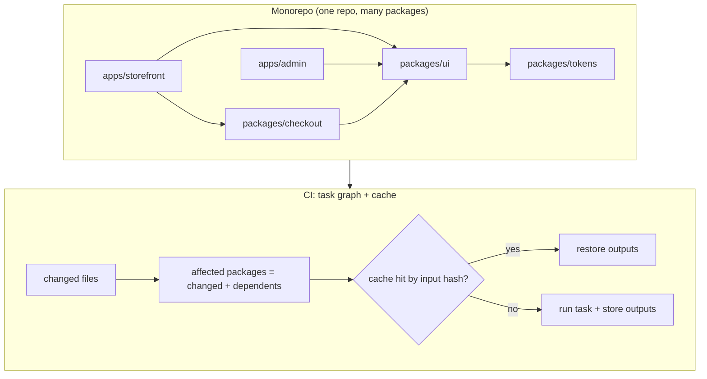
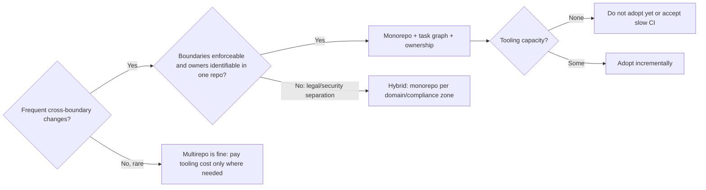

# 11 / 13 — Monorepo vs Multirepo

> **Verify against current docs.** Monorepo tooling (pnpm, Turborepo, Nx, Bazel, Rush, Changesets, Lerna) evolves quickly; config key names have changed across major versions (for example Turborepo renamed `pipeline` to `tasks` in v2). Snippets below illustrate concepts; confirm syntax in the current documentation of the version you install.

## 1. Lesson metadata

| | |
|---|---|
| **Level** | Architect |
| **Study time** | 4–5 hours (reading 2 h, hands-on workspace lab 1 h, exercises 1.5 h) |
| **Prerequisites** | [04/22 — Monorepos and shared packages](../04-react-architecture/22-monorepos-and-shared-packages.md), [10/01 — Repository organization](../10-production-engineering/01-repository-organization.md), [00/10 — Modules and dependency graphs](../00-web-and-javascript-foundations/10-modules-and-dependency-graphs.md), [04/25 — Architectural fitness and enforcement](../04-react-architecture/25-architectural-fitness-and-enforcement.md), [11/01 — Trade-off analysis](./01-trade-off-analysis.md), [11/12 — Microfrontends](./12-microfrontends.md) |
| **Next** | [14 — Build vs buy](./14-build-vs-buy.md) |
| **Related** | [10/18 — Continuous delivery](../10-production-engineering/18-continuous-delivery.md), [10/07 — Dependency security](../10-production-engineering/07-dependency-security.md), [11/16 — Supporting multiple teams](./16-supporting-multiple-teams.md) |

**Learning objectives.** After this lesson you can:
1. Separate three often-conflated decisions: **repository topology** (how code is stored), **deployment topology** (what is released independently), and **ownership topology** (who may change what).
2. Enumerate the real benefits and costs of monorepos and multirepos using mechanisms rather than slogans, and identify which costs you can buy down with tooling.
3. Explain how a monorepo build system works (task graph, caching, affected computation) and where it breaks (cache misses, phantom dependencies, huge dependency fan-in).
4. Design a package boundary and versioning strategy (internal packages, public APIs, fixed vs independent versions, changesets) that keeps a monorepo from becoming a "big ball of mud".
5. Choose a topology for a given organisation with explicit evidence and decision triggers, including hybrid options, and plan a migration in either direction.
6. Define governance: ownership, permissions, review rules, CI economics, and incident handling.

**Concepts covered:** repository topology, trunk-based development, workspaces, task graph, content-addressed caching (local/remote), affected-only builds, phantom dependencies, internal package strategies (just-in-time vs compiled), TypeScript project references, versioning (fixed/independent/none), Changesets, CODEOWNERS, merge queue, sparse checkout, dependency boundaries, polyrepo drift, diamond dependency, atomic change.

---

## 2. Deep conceptual explanation

### 2.1 What problem is this lesson solving?

"Monorepo vs multirepo" is debated as an identity question. It is an engineering trade-off with measurable costs, and the answer depends on facts about your organisation: how many teams, how coupled the code, how often cross-cutting changes occur, how heterogeneous the stacks, what compliance boundaries exist, and how much tooling capacity you have.

At architect scale the stakes are concrete:

- If **cross-cutting changes** (a design-system API change, a security patch, a TypeScript upgrade, an analytics contract change) are frequent, a multirepo turns each into N pull requests across N repos, a coordination project, and a long tail of stragglers on old versions.
- If **team autonomy and blast-radius containment** matter more (different compliance regimes, different release cadences, contractors who must not see other code), a monorepo's shared CI, shared tooling and shared visibility become liabilities.
- If you pick a monorepo but do not invest in task-graph tooling, CI time scales with repo size until the build becomes the bottleneck for everybody.
- If you pick a multirepo but do not invest in dependency automation and shared configuration, your repos drift into incompatible islands.

### 2.2 Three topologies that people conflate

| Topology | Question | Options |
|---|---|---|
| **Repository** | Where does code live? | One repo (mono), many repos (multi), or hybrid |
| **Deployment** | What ships independently? | One artifact, several artifacts, per-package artifacts |
| **Ownership** | Who can approve/change what? | Per-directory owners (CODEOWNERS), per-repo teams, platform vs product |

A monorepo does **not** imply a monolithic deploy: one repo can build and deploy fifty services/apps independently. A multirepo does not imply independence: ten repos that must be released together are a distributed monolith ([12](./12-microfrontends.md)). Architects decide each topology separately and then check they're compatible.

### 2.3 What the monorepo actually offers (mechanisms)

| Benefit | Mechanism | Condition required |
|---|---|---|
| **Atomic cross-package change** | One commit/PR changes a library and all consumers; CI verifies them together; no "published but not adopted" window | Consumers live in the same repo and CI builds them |
| **Single version of everything** | One lockfile / one policy for React, TypeScript, tooling | Willingness to upgrade everything together or maintain explicit exceptions |
| **Discoverability and reuse** | Code search across everything; copy-paste is visible; duplicate utilities noticed | Search tooling, norms |
| **Shared tooling and consistency** | One lint, format, test, CI config | Platform ownership of tooling |
| **Large-scale refactoring** | Codemods run across the whole codebase in one PR ([11/03](./03-large-scale-refactoring.md)) | Codemod tools, review capacity |
| **Easy onboarding / local integration** | One clone; dependency links are local | Repo size manageable (sparse checkout, shallow clone) |
| **Simpler dependency management** | Internal packages link by workspace protocol; no publish step | A workspace-aware package manager |

Evidence base: the best-known public account is Google's long-running single-repository practice (Potvin & Levenberg, "Why Google Stores Billions of Lines of Code in a Single Repository", *Communications of the ACM*, 2016), which also documents the **tooling investment** required (custom VCS, build system, code search, large-scale-change tooling, ownership files). Treat it as proof of possibility and of cost — not as evidence that a 40-person product org should copy it. Meta and Microsoft have also described large monorepos with significant custom infrastructure. Smaller organisations get most of the benefit with off-the-shelf tools at far lower scale; extrapolating from Google to your org in either direction is a category error.

### 2.4 What the multirepo actually offers (mechanisms)

| Benefit | Mechanism | Condition required |
|---|---|---|
| **Clear boundaries and autonomy** | A repo is a natural unit of ownership, permissions, and CI; teams choose tools and cadence | Teams are truly independent |
| **Isolated blast radius** | A broken main in repo A doesn't block repo B; CI failures local | Real independence of release |
| **Fine-grained access control** | Repo-level read/write permissions; contractors see only their repo; regulatory separation | Compliance requirement exists |
| **Small, fast repos** | Clone and CI are quick without sophisticated tooling | Repo stays small |
| **Independent versioning and publishing** | Libraries consumed by external parties via semver releases | Public contracts; external consumers |
| **Technology freedom** | Different languages/build tools | Cost accepted |

### 2.5 The costs

| Monorepo cost | Mechanism | Mitigation |
|---|---|---|
| **CI time/cost scales with repo** | Naively every PR builds/tests everything | Task graph + affected computation + remote cache + sharding |
| **Tooling investment** | Someone must own build orchestration, caching, generators, boundary rules | Platform/DevEx team; off-the-shelf tool (Nx, Turborepo, Bazel, Rush) |
| **Blast radius of a bad change** | A shared package change breaks many apps; main broken blocks all | Merge queue, required checks, staged rollouts, ownership review |
| **Coarse permissions** | Everyone can read/write everything unless restricted | CODEOWNERS, branch protections; for strict secrecy, a separate repo |
| **Git scale** | Large history, many files slow `git status`, clone, IDE indexing | Partial/shallow clone, sparse checkout, `fsmonitor`, shallow CI clones; (at extreme scale custom VCS) |
| **Dependency coupling temptation** | Easy to import across package boundaries | Enforced boundaries (lint rules, dependency-graph checks, public API entrypoints) |
| **One-version policy friction** | A team blocked by another's upgrade | Allowed exceptions with expiry; codemods; incremental adoption strategies |
| **Release tooling complexity** | Per-package versioning/changelogs/publishing | Changesets / similar |

| Multirepo cost | Mechanism | Mitigation |
|---|---|---|
| **Cross-cutting change is expensive** | N PRs across N repos; stragglers | Dependency bots (Renovate/Dependabot), codemod bots, batch-change tools (e.g. Sourcegraph batch changes — *verify*) |
| **Version drift/diamond dependencies** | Repos pin different versions of shared libraries; two consumers pull incompatible transitive versions | Compatibility policy (N-1), automated updates, contract tests |
| **Inconsistent tooling/config** | Each repo's lint/test/CI differs | Shared config packages, repo templates, shared CI workflows |
| **Discoverability** | Hard to find code or see usage | Org-wide code search; catalogs |
| **Integration testing hard** | Need cross-repo environments | Contract tests; ephemeral environments |
| **"Publish to consume" friction** | A library change needs publish → bump → merge in consumers; local linking is clumsy | Pre-release channels; workspace linking tools; or merge repos |
| **Fragmented history** | Hard to bisect cross-repo regressions | Release manifests tying versions |

### 2.6 The central trade-off, stated sharply

> **Monorepo trades *coordination cost per change* for *tooling and governance cost per repo*.** Multirepo trades the reverse.

If cross-boundary changes are frequent, the coordination cost dominates and monorepo wins. If cross-boundary changes are rare and teams are independent, the tooling cost of a monorepo buys little, and multirepo is cheaper. Measure your **cross-boundary change frequency**: in the last six months, how many changes touched ≥2 repos/packages that currently live apart? That single metric is more predictive than team size.

### 2.7 Misconceptions

| Misconception | Reality |
|---|---|
| "Monorepo = monolith." | Repo layout vs deploy architecture. A monorepo can contain independent services and apps with independent releases. |
| "Monorepos don't scale." | They scale with the right tooling; Google/Meta show the extreme end. Naive monorepos (run everything on every PR) don't scale. |
| "Multirepo gives teams real independence." | Only if the contracts between repos are stable; otherwise it gives a slow, manual monorepo. |
| "We need a monorepo to share code." | Packages can be published from a multirepo. The question is the *cost of changing* shared code. |
| "Nx/Turborepo makes builds fast." | Caching and affected computation do — *if* inputs are declared correctly and tasks are deterministic. Misconfigured caches produce wrong results (stale outputs) or no hits. |
| "One lockfile means one set of dependencies is always right." | A single policy simplifies, but hoisting can hide **phantom dependencies** (importing packages not declared), which break when layout changes. |

---

## 3. Internal mechanics

### 3.1 Workspaces and linking (teaching model)

A **workspace-aware package manager** (pnpm, npm, Yarn) treats each directory containing a `package.json` matched by a workspace glob as a package. Internal dependencies are declared using a version or a special protocol (`"workspace:*"` in pnpm/Yarn; npm uses version ranges resolved to local packages when matching). On install, the manager links the local package into dependents' `node_modules` instead of fetching from a registry.

*pnpm's* layout uses a content-addressable global store and a **symlinked, non-flat `node_modules`**, so a package can only `require` what it declares (strict; reduces phantom dependencies). npm and classic Yarn **hoist** dependencies to the root `node_modules`, which can let a package import something it didn't declare (it works until hoisting changes). ⚠ *Implementation detail; behaviour is configurable (e.g. `public-hoist-pattern` in pnpm; `nodeLinker` in Yarn). Verify for your versions.*

### 3.2 The task graph

Build orchestrators model work as a **directed acyclic graph of tasks** (`build`, `test`, `lint`, `typecheck` per package) with two kinds of edges:
- **Package edges:** `app` depends on `ui` ⇒ `app#build` depends on `ui#build` (configured as "dependsOn `^build`" in Turborepo's notation).
- **Task edges:** within a package, `test` depends on `build`.

Execution: topologically sort, run independent tasks in parallel up to a concurrency limit, skip tasks whose results are cached.

### 3.3 Caching: content-addressed memoization

For each task, the tool computes a **hash of its inputs**: the package's source files (respecting configured globs), the task's command/config, relevant environment variables, the lockfile-derived dependency versions, and the hashes of upstream tasks' outputs. If the hash matches a stored entry, outputs (files, logs) are restored instead of re-running. A **remote cache** shares entries between CI runs and developers.

*Public guarantee (when configured correctly):* same inputs ⇒ same outputs (the task is a pure function of declared inputs). *Pitfalls:*
- **Undeclared inputs** (a task reads an env var, a file outside the glob, or the current date): cache returns stale/wrong results. Symptom: "works after clearing cache".
- **Overly broad inputs** (hashing generated files, logs, `node_modules`): permanent cache misses.
- **Non-deterministic outputs** (timestamps in bundles): cache works but artifacts differ; reproducibility suffers.
- **Cache poisoning/security**: a remote cache that accepts writes from untrusted PR builds can serve malicious artifacts to others — restrict write access to trusted CI on protected branches; use signed artifacts where supported. ⚠ Verify your tool's security model.

### 3.4 Affected computation

"Affected" = packages whose source changed, plus all packages that **transitively depend** on them, computed from the package graph and a Git diff against a base (e.g. merge-base with main). CI runs tasks only for affected packages. Correctness depends on:
- an accurate graph (declared dependencies match real imports; phantom dependencies break it),
- handling of **global inputs** (root `package.json`, lockfile, base tsconfig, CI config) which should invalidate everything or the relevant subset,
- non-code dependencies (SQL migrations, generated code, shared assets) declared as inputs.

Affected-only is an **optimisation with a correctness risk**: mitigate with periodic full builds (nightly/main) as a safety net, and by running everything when global inputs change.

### 3.5 Internal package strategies

| Strategy | How | Pros | Cons |
|---|---|---|---|
| **Just-in-time (source) packages** | Package `exports` points to TypeScript source; the consuming app's bundler/transpiler compiles it | No package build step; fast dev; simple | Consumer toolchain must transpile it; non-bundler consumers (Node scripts) need loaders; inconsistent TS configs; harder to publish later |
| **Compiled packages** | Each package builds to `dist` with types (`tsc`/`tsup`/etc.) | Clear contract; consumed like an external package; publishable | Build step and watch orchestration; cache dependence; stale `dist` bugs |
| **TypeScript project references** | `tsc -b` with `composite` projects building in dependency order and emitting declarations | Incremental type-checking at scale; boundaries enforced by TS | Config overhead; interplay with bundlers and path aliases |
| **Path aliases only** (`@/pkg/*` → `../pkg/src`) | tsconfig `paths` + bundler alias | Quick | Hides package boundaries; no enforcement; breaks on publish; avoid at scale |

### 3.6 Versioning strategies

- **No versioning (internal-only, "always latest")**: all packages are built from HEAD; consumers always use workspace sources. Simplest; correct for apps and internal libs with no external consumers.
- **Fixed/locked versioning**: all published packages share a version (e.g. a design-system suite). Simple communication; unneeded bumps.
- **Independent versioning with Changesets**: each PR includes a *changeset* file declaring which packages change and the bump type; a release process aggregates them, bumps versions, generates changelogs, publishes. (Config keys used in §5.7 — `changelog`, `commit`, `access`, `baseBranch`, `updateInternalDependencies`, `ignore` — match the Changesets config docs, checked 2026-10-22.)
- **Conventional commits + automated release** tools: infer bumps from commit messages; relies on discipline.

For internal libraries consumed only inside the monorepo, versioning can be **dropped** (`workspace:*`) — a major simplification and a main benefit of the monorepo; keep semver only for packages with external consumers or those deployed as separately consumed artifacts.

---

## 4. Step-by-step walkthrough: a cross-cutting change in both topologies

Change: rename a design-system prop `variant="primary"` → `intent="primary"` across 14 consuming apps/packages.

**Monorepo**
1. Author writes the new prop with a deprecation alias in `@acme/ui` (support both) — this is still wise for staged rollout, though atomic removal is possible.
2. A codemod rewrites usages across all packages in the same PR; `pnpm turbo run typecheck test --filter=...[origin/main]` runs affected tasks (the whole dependency closure of `ui`).
3. CODEOWNERS requires approvals from the owners of each touched directory (14 teams) — a governance cost — or a pre-agreed **large-scale-change process** with a single reviewer group and owner-notification.
4. Merge queue runs final CI; one merge, one history entry; all consumers updated atomically; no stragglers.
5. Deploy: affected apps redeploy through their own pipelines.

**Multirepo**
1. Author publishes `@acme/ui@5.0.0` (or a minor with deprecation).
2. A batch-change tool or bot opens 14 PRs (one per repo) — each repo's CI differs.
3. Teams review and merge on their own schedules; 9 merge within a week, 3 within a month, 2 remain on old version and later break when the old alias is removed.
4. Maintainers must keep both versions supported for N months; support cost is paid in time and in complexity.
5. Verification is per repo; integration is validated only in production-like environments.

Observation: the monorepo concentrates the work and the risk into **one reviewed, tested change**; multirepo spreads it in time and across ownership boundaries. Which is better depends on how often this happens (§2.6) and whether teams *should* be able to refuse the change.

---

## 5. Code examples

### 5.1 Minimal — pnpm workspace

```yaml
# pnpm-workspace.yaml
packages:
  - 'apps/*'
  - 'packages/*'
```

```jsonc
// packages/ui/package.json (internal compiled package)
{
  "name": "@acme/ui",
  "version": "0.0.0",
  "private": true,
  "type": "module",
  "exports": {
    ".": { "types": "./dist/index.d.ts", "import": "./dist/index.js" }
  },
  "sideEffects": false,
  "scripts": { "build": "tsup src/index.ts --dts --format esm", "typecheck": "tsc --noEmit" },
  "peerDependencies": { "react": "^19.0.0" }
}
```

```jsonc
// apps/web/package.json
{
  "name": "@acme/web",
  "private": true,
  "dependencies": {
    "@acme/ui": "workspace:*",
    "react": "^19.0.0",
    "react-dom": "^19.0.0"
  }
}
```

Line notes: `exports` defines the **public API** — consumers cannot deep-import `@acme/ui/src/internal/...` because the `exports` map doesn't expose it (a Node/bundler-enforced boundary). `peerDependencies` for React avoids duplicate Reacts. `workspace:*` links the local package. `sideEffects: false` enables tree-shaking of unused exports ([00/10](../00-web-and-javascript-foundations/10-modules-and-dependency-graphs.md)). `tsup` is one option for building libraries — verify its current options.

### 5.2 Practical — task graph with Turborepo *(v2 syntax; config validated with turbo 2.11)*

```jsonc
// turbo.json
{
  "$schema": "https://turborepo.com/schema.json",
  "tasks": {
    "build": {
      "dependsOn": ["^build"],               // build dependencies first
      "inputs": ["src/**", "package.json", "tsconfig*.json", "!**/*.test.*"],
      "outputs": ["dist/**", ".next/**", "!.next/cache/**"]
    },
    "typecheck": { "dependsOn": ["^build"], "inputs": ["src/**", "tsconfig*.json"] },
    "test": {
      "dependsOn": ["^build"],
      "inputs": ["src/**", "vitest.config.*"],
      "env": ["CI"]                          // env vars that affect the result must be declared
    },
    "lint": { "inputs": ["src/**", "eslint.config.*"] },
    "dev": { "cache": false, "persistent": true }
  }
}
```

CI usage:

```bash
# On a PR: run tasks only for packages affected relative to main (and their dependents)
pnpm turbo run lint typecheck test build --filter="...[origin/main]"
```

*Verified with Turborepo 2.11.10: `tasks` is accepted and the old `pipeline` key is rejected with "Found `pipeline` field instead of `tasks`"; `--filter="...[origin/main]"` is valid.* The central ideas: declared `inputs`/`outputs`/`env` make tasks cacheable; `dependsOn: ["^build"]` encodes the package-graph edge; `...[origin/main]` means "changed packages and their dependents".

### 5.3 Practical — enforcing boundaries (the part that keeps a monorepo healthy)

A monorepo without enforced boundaries drifts toward a single shared codebase with random coupling. Encode rules as executable checks ([04/25](../04-react-architecture/25-architectural-fitness-and-enforcement.md)). Example with `dependency-cruiser` *(rules below run-tested with dependency-cruiser 18.7.0)*:

```js
// .dependency-cruiser.cjs (excerpt)
module.exports = {
  forbidden: [
    {
      name: 'no-app-to-app-imports',
      comment: 'Apps are deployable leaves; they must not import each other.',
      severity: 'error',
      from: { path: '^apps/([^/]+)/' },
      to:   { path: '^apps/', pathNot: '^apps/$1/' },   // $1 = the app captured in `from`; same-app imports allowed
    },
    {
      name: 'ui-must-not-depend-on-features',
      severity: 'error',
      from: { path: '^packages/ui/' },
      to:   { path: '^packages/features/' },
    },
    {
      name: 'only-public-entrypoints',
      comment: 'Import packages via their public entrypoint, never src/internal.',
      severity: 'error',
      from: { path: '^(apps|packages)/([^/]+)/' },
      to:   { path: '^packages/([^/]+)/src/internal/', pathNot: '^packages/$2/' },  // a package may use its own internals
    },
  ],
};
```

And ownership:

```
# CODEOWNERS
/packages/ui/                 @acme/design-system-team
/packages/features/checkout/  @acme/checkout-team
/apps/storefront/             @acme/storefront-team
/tools/ /.github/ /turbo.json @acme/platform-team
/packages/**/package.json     @acme/platform-team      # dependency changes need platform review
```

Notes: dependency-cruiser's native capture-group syntax is `$1`/`$2` in `to.path`/`to.pathNot`, referring to groups captured in `from.path` (verified with dependency-cruiser 18.7.0 in the sandbox). A regex backreference such as `(?!\\1/)` inside `to.path` does **not** work: it silently flags legitimate same-app imports. The earlier draft of the third rule (`pathNot: '^packages/([^/]+)/'`) also never fired, because it excluded every package path. The key design principle: **make the architecture checkable**, in CI, with owners.

### 5.4 Practical — a minimal affected-packages script (to demystify the tool)

```ts
// tools/affected.ts — conceptual; use your build tool's built-in in practice
import { execSync } from 'node:child_process';
import { readFileSync, readdirSync, existsSync } from 'node:fs';
import { join } from 'node:path';

type Pkg = { name: string; dir: string; deps: string[] };

function loadPackages(root = '.'): Pkg[] {
  const dirs = ['apps', 'packages'].flatMap((g) =>
    existsSync(g) ? readdirSync(g).map((d) => join(g, d)) : []);
  const pkgs = dirs
    .filter((d) => existsSync(join(d, 'package.json')))
    .map((dir) => {
      const j = JSON.parse(readFileSync(join(dir, 'package.json'), 'utf8'));
      return { name: j.name as string, dir, deps: Object.keys({ ...j.dependencies, ...j.devDependencies }) };
    });
  const names = new Set(pkgs.map((p) => p.name));
  return pkgs.map((p) => ({ ...p, deps: p.deps.filter((d) => names.has(d)) })); // internal edges only
}

const GLOBAL_INPUTS = ['pnpm-lock.yaml', 'package.json', 'tsconfig.base.json', '.github/'];

export function affected(base = 'origin/main'): string[] {
  const changed = execSync(`git diff --name-only $(git merge-base ${base} HEAD)`, { encoding: 'utf8' })
    .split('\n').filter(Boolean);

  const pkgs = loadPackages();
  if (changed.some((f) => GLOBAL_INPUTS.some((g) => f.startsWith(g)))) return pkgs.map((p) => p.name); // be conservative

  const direct = new Set(pkgs.filter((p) => changed.some((f) => f.startsWith(p.dir + '/'))).map((p) => p.name));
  // reverse-dependency closure
  const result = new Set(direct);
  let grew = true;
  while (grew) {
    grew = false;
    for (const p of pkgs) {
      if (!result.has(p.name) && p.deps.some((d) => result.has(d))) { result.add(p.name); grew = true; }
    }
  }
  return [...result];
}
```

Line notes: the `GLOBAL_INPUTS` branch is the **correctness safeguard** (§3.4): when the lockfile changes, you cannot know which package is affected, so test all. The reverse-dependency closure is why a change in a low-level package (`ui`) fans out to many apps — **fan-in is the monorepo's CI risk** and a reason to keep foundational packages stable and small. Real tools also handle non-package inputs, caching by hash and `exec` hash of tasks, which this script ignores.

### 5.5 Incorrect — a "monorepo" with no boundaries or tooling

```
/ (one repo)
  package.json            # 400 dependencies, hoisted
  src/                    # everything; imports like ../../../team-b/internal/util
  .github/workflows/ci.yml  # `npm test` runs all 9,000 tests on every PR
```

Symptoms: 55-minute CI; teams import each other's internals; a refactor in team A's util breaks team B's tests; PR queue backs up; cache impossible because nothing declares inputs. This is not "a monorepo failing" but **a monorepo without its essential supporting practices** — and the justification many multirepo advocates cite.

### 5.6 Corrected — see 5.1–5.4, plus CI economics

```yaml
# .github/workflows/ci.yml (illustrative)
name: ci
on: { pull_request: {}, merge_group: {} }       # merge_group = merge queue
jobs:
  verify:
    runs-on: ubuntu-latest
    steps:
      - uses: actions/checkout@v4
        with: { fetch-depth: 0 }                # need history for merge-base/affected
      - uses: pnpm/action-setup@v4
      - uses: actions/setup-node@v4
        with: { node-version-file: .nvmrc, cache: pnpm }
      - run: pnpm install --frozen-lockfile
      - run: pnpm turbo run lint typecheck test build --filter="...[origin/${{ github.base_ref || 'main' }}]"
        env:
          TURBO_TOKEN: ${{ secrets.TURBO_TOKEN }}     # remote cache; verify variable names for your setup
          TURBO_TEAM: ${{ vars.TURBO_TEAM }}
      - run: pnpm depcruise packages apps --config .dependency-cruiser.cjs
```

*(Action versions and variable names: verify in current docs; `fetch-depth: 0` is costly in huge repos — prefer targeted fetching of the base ref.)* Add: nightly full run without `--filter` as a correctness backstop; merge queue to avoid "green PR, broken main" races; remote cache writes only on trusted branches.

### 5.7 Advanced — publishing a subset with Changesets

```jsonc
// .changeset/config.json
{
  "$schema": "https://unpkg.com/@changesets/config/schema.json",
  "changelog": "@changesets/cli/changelog",
  "commit": false,
  "access": "restricted",
  "baseBranch": "main",
  "updateInternalDependencies": "patch",
  "ignore": ["@acme/web", "@acme/admin"]     // apps are deployed, not published
}
```

Workflow: a PR modifying `@acme/ui` includes `.changeset/brave-owls-sing.md` (a front-matter file such as `"@acme/ui": minor` plus a summary line "add Tooltip"); on merge, a release job runs `changeset version` (bumps versions + changelogs) then `changeset publish`. Internal-only packages can skip all of this (`workspace:*`, no versions).

---

## 6. Visual explanations





```
Cost surface (qualitative):
                    small org / few teams        large org / many teams
monorepo tooling    moderate (off-the-shelf)     high (platform team needed)
cross-repo change   low                          very high without monorepo
CI cost             low either way               explodes without affected+cache
governance          light                        essential (CODEOWNERS, boundaries)
```

---

## 7. Alternative approaches and trade-offs

| Approach | Strengths | Weaknesses | Best when |
|---|---|---|---|
| **Single monorepo (JS workspace + task graph)** | Atomic changes, shared tooling, simple internal deps | Needs tooling and governance; coarse permissions | 3–50+ engineers, one primary stack, frequent cross-cutting change |
| **Multirepo (repo per app/service/library)** | Autonomy, small repos, fine permissions | Drift, expensive cross-cutting change, integration friction | Independent teams/products; compliance isolation; external libs |
| **Hybrid: monorepo per domain/org unit + published shared packages** | Contains blast radius; moderate tooling | Cross-domain changes still multi-repo | Large org with distinct domains or compliance zones |
| **Monorepo of multiple languages with Bazel/Pants-class build** | Unified build/test across languages; strong hermeticity | Steep learning curve, high setup cost | Polyglot at scale with hermetic build requirements |
| **Multirepo + shared platform (templates, shared CI workflows, config packages, bots)** | Keeps autonomy; reduces drift | Requires platform investment too | Teams that must stay independent but want consistency |
| **Git submodules / subtree / vendoring** | Share code without registry | Poor ergonomics (submodules), version coupling confusion | Rare; embedding a dependency you must patch |
| **Package registry–centric ("publish everything")** | Clear contract and versioning | Slow feedback loop on library changes | External consumers; slow-moving shared libs |

**A scenario where the recommended approach (monorepo with task graph) is NOT best.** An agency or consultancy building bespoke apps for **different clients**, each with confidentiality obligations, different cadence and ownership of code at project end. Client A's repo must be deliverable and invisible to Client B. A monorepo's cross-visibility is a liability; one repo per client (with a shared internal template repo and a published component package) is right. Similarly, a **small, stable product team with one app** gains little from monorepo tooling (a single repo with a single package is already a "monorepo of one"; resist adding workspaces until a second consumer exists — [05/02 YAGNI](../05-design-patterns/02-dry-kiss-yagni.md)).

---

## 8. Best practices and anti-patterns

**Practices**
- Decide with the **cross-boundary change metric** and the team-independence question; document the ADR with decision triggers ([10/16](../10-production-engineering/16-architecture-decision-records.md)).
- Treat **package boundaries as APIs**: `exports` maps, public entrypoints, no deep imports, enforced by lint/graph checks.
- **Small, stable foundational packages** (tokens, utilities, types); beware of a dumping-ground `shared`/`common` package (fan-in ⇒ everything rebuilds, everything couples).
- **Declare task inputs/outputs/env**; test cache correctness (run twice, compare; clean-cache build equals cached build).
- **Merge queue + required checks**; keep `main` green; make flake handling explicit ([10/designing for testability](./10-designing-for-testability.md)).
- **CODEOWNERS and permission model** explicit; separate "can read" from "must approve".
- **One version policy** for core dependencies (React, TypeScript, test runner) with a documented exception process and expiry.
- **Codemods and large-scale change process** for cross-cutting updates; announce, batch, and track completion.
- **Developer experience:** `git sparse-checkout`/partial clone docs, a fast `dev` command for one app (`--filter`), generators/templates for new packages.
- Measure: CI p50/p95, cache hit rate, affected-set size distribution, time-to-merge, flaky rate, number of cross-package PRs.

**Beginner mistakes**: converting to workspaces without declaring dependencies correctly (phantom deps); path aliases that bypass package boundaries; hoisting surprises; committing build output; one giant `tsconfig`; no ownership.

**Experienced-developer mistakes**: assuming "affected" is perfectly accurate (global inputs missed); sharing a remote cache write token with untrusted PR builds; building a custom orchestrator instead of adopting one; over-fragmenting into hundreds of tiny packages (graph overhead, version/config sprawl) or the opposite — one mega-package; single-version policy used as a weapon that blocks teams; confusing monorepo with consolidated deployment.

**Smells**: 30-minute CI on a one-line change; "just clear the cache" folklore; imports using `../../../packages/x/src/...`; the same utility copy-pasted in many repos; shared package changes requiring 10 approvals with no process; "main is red" more than occasionally; a `utils` package depended on by everything and owned by nobody.

**Justified exceptions**: separate repos for code with different security/compliance classification; public open-source libraries (community contribution flow and release cadence differ); a vendored fork with a different lifecycle; a legacy system with an incompatible build; extremely large binary assets (use LFS/artifact storage). A multirepo is not a failure state; neither is a monorepo with a second repo for a justified boundary.

---

## 9. Real-world application

**E-commerce platform (6 teams, one React stack).** Storefront, checkout, account, admin, design system, tokens. Frequent cross-cutting changes (design tokens, analytics, i18n). Monorepo with pnpm + task-graph tool; apps deploy independently; design-system packages versioned internally by workspace; Changesets only for packages published to external partners (e.g. a payment widget SDK). CODEOWNERS per package; merge queue.

**Dashboards for multiple business units.** Each unit has different compliance and its own CI governance; shared UI components. Hybrid: one monorepo for the shared platform and design system (published to an internal registry), separate repos per business unit's app that consume the published packages with automated update PRs. Cross-cutting change cost is accepted for the apps because their cadences genuinely differ.

**Finance / regulated.** Segregation of duties may require restricted visibility and distinct approval chains. Use repo-level or group-level separation for regulated domains; use a monorepo *within* a regulated zone for velocity; audit logs from the VCS host; signed commits and provenance for build artifacts ([10/07 — Dependency security](../10-production-engineering/07-dependency-security.md)).

**Multi-team platform with microfrontends.** Monorepo (affected-only builds, shared contract packages) often delivers independent *deployment* artifacts while retaining atomic cross-cutting change and type safety across contracts — the cheaper partial substitute for [microfrontends](./12-microfrontends.md): independent ownership and independent deploy of separate apps built from the same repo, with shared types checked at compile time.

**Migration (multi → mono).** Merge repos with history preserved (`git filter-repo`/subtree merge — *verify tooling*), normalise package names and tsconfig, unify lockfile, add CODEOWNERS from the old repo ownership, move CI to a task-graph runner, migrate deploy pipelines app by app. Risks: broken links in docs/issues, lost CI customisations, one-version conflicts — stage by merging the most-coupled repos first.

**Migration (mono → multi).** Extract a package with history (`git subtree split`/`filter-repo`), publish it, replace workspace links with versions, set up bots for updates. Justified when compliance or ownership boundaries change; costly otherwise.

**Constraints to name in design docs:** number of teams and their independence, frequency of cross-boundary changes, compliance/permission boundaries, languages, repo size and history size, CI budget, platform capacity, release cadence, third-party consumers.

---

## 10. Debugging and troubleshooting

**Symptom 1: CI takes 40 minutes for a one-line change.**
*Investigation.* Is affected computation active? Print the affected set; check whether a global input (lockfile, root config) changed; check cache hit rate and which tasks miss; look at task durations (a few giant `test` tasks?). *Root cause examples.* A "shared" package that everything depends on changed (fan-in); a task reads `process.env.BUILD_ID` (undeclared input making every run unique) or includes timestamps in outputs (never cache-hit). *Fix.* Narrow the fan-in (split the package; keep stable foundations small); declare env vars properly and remove the timestamp or exclude from hashing; shard long-running tests; make `typecheck` incremental via project references. *Validate.* Cache hit rate and affected-set size over a week of PRs.

**Symptom 2: "Works locally, fails in CI" after hoisting changed.**
*Root cause:* phantom dependency — code imports `lodash` which is only available because another package pulled it into the hoisted root. *Investigation.* Reproduce with a clean install; run with pnpm strict mode or a tool that detects undeclared deps (e.g. `eslint-plugin-import` `no-extraneous-dependencies`, depcheck-style tools — verify). *Fix.* Declare the dependency in the importing package; enforce with lint in CI.

**Symptom 3: Stale build outputs (bug fixed but app still shows old behaviour).**
*Investigation.* A package consumed as compiled `dist` wasn't rebuilt (watch not running); the cache restored an old output because inputs omitted a config file; the app's bundler cached a symlinked dependency. *Fix.* Add the missing input to the task definition; use `dev` tasks that watch dependencies; clear cache once as a diagnostic, then fix the cause; prefer just-in-time packages for dev speed where viable.

**Symptom 4: Merge queue/main frequently red though PRs were green.**
Race: two PRs pass independently but conflict semantically. *Fix.* Merge queue that tests the *combined* result; require up-to-date branches or queue; run the nightly full suite to find holes in affected computation; investigate flake vs real conflict by re-running the combination.

**Symptom 5: Developers say clone/IDE is slow.**
*Investigation.* Repo size, history size, number of files, `node_modules` indexing, `git status` time. *Fix.* Partial clone (`--filter=blob:none`), sparse checkout for the packages a team uses, `core.fsmonitor`, exclude `dist`/`node_modules` from indexing; shallow clones in CI; archive large assets out of Git (LFS/artifact store).

**Symptom 6 (multirepo): Two services on different versions of the shared library produce inconsistent behaviour.**
*Investigation.* Compare resolved versions across repos (a "dependency dashboard" or `npm ls`); check changelog for behavioural change. *Fix.* Establish a supported-version policy (N and N-1), automated update PRs (Renovate/Dependabot), contract tests that run against the supported range, and deprecation windows.

---

## 11. Exercises

### Level A — Knowledge
A1. Distinguish repository, deployment, and ownership topology with one example each of how they can diverge.
A2. List four benefits of a monorepo and the condition each depends on.
A3. What is a phantom dependency, and why does pnpm's layout reduce them?
A4. What must a build tool know to compute the "affected" set, and what two global-input risks exist?
A5. What is the main security risk of a shared remote cache and how is it mitigated?

### Level B — Code comprehension
B1. In §5.1, what does the `exports` field achieve that `main` alone doesn't, and what happens if an app imports `@acme/ui/src/internal/x`?
B2. In §5.2, predict what happens to cache hits if `test` reads `process.env.API_URL` but `env` doesn't list it, and CI sets different API URLs per job.
B3. In §5.4, why does the script return all packages when the lockfile changes? Could it return fewer?
B4. In §5.3 the `ui-must-not-depend-on-features` rule: what architectural principle does it encode, and what does it prevent in the task graph?

### Level C — Implementation
C1. Convert a two-repo setup (`web` and `ui-lib`, consumed via npm version) into a monorepo layout: write the workspace files, package.json changes, and CI command.
C2. Write a script that fails CI if any internal package depends on another via a version number rather than `workspace:*` (for packages marked `private`).
C3. Write a CODEOWNERS file and a branch-protection description for a repo with 3 apps, 4 packages, and a platform team, including the policy for dependency changes.
C4. Design a Changesets-based release workflow for a design system published to a private registry while apps are not published; describe PR template, CI check, and release job.

### Level D — Debugging
D1. After enabling a remote cache, production builds occasionally ship a stale feature flag configuration. Diagnose.
D2. A TypeScript change in `packages/types` doesn't cause `apps/web` typecheck to run in CI. Give four hypotheses and how to test each.
D3. `pnpm install` works on macOS but fails on Linux CI with "cannot find module X" inside a package that doesn't declare X. Explain.

### Level E — Architecture and engineering decisions
E1. Company: 70 engineers, 9 teams, React/TypeScript, 14 repos, shared design system consumed via npm, quarterly pain with version drift (some apps 4 majors behind), Security wants a single patch process. Decide topology; provide evidence you'd gather and a migration plan.
E2. Company: 25 engineers; 2 repos (`web`, `api`); proposal to use a monorepo with Bazel "because Google does". Evaluate.
E3. A client-services agency: 12 clients, 30 engineers, shared internal component kit. Choose topology and justify.

### Level F — Expert challenge
F1. Design the repository, CI, ownership and release architecture for 120 engineers across 15 teams, with 3 compliance zones (payments, healthcare data, general), 1 design system, and a requirement that any team can deploy its app independently ≥ daily. Address permissions, caching security, affected-set scalability, large-scale change, dependency security, and failure modes.
F2. Argue the case that your F1 design is over-engineered, and propose the simplest alternative that still meets the hard requirements.

---

## 12. Detailed answers and explanations

> Attempt the exercises first.

**A1.** *Repository:* where code lives; *deployment:* what ships independently; *ownership:* who approves changes. Divergence examples: monorepo (1 repo) with 12 independently deployed apps (repo ≠ deploy); a multirepo where 5 repos must release together (many repos, one effective deploy unit — distributed monolith); one repo where directories have 6 distinct owner teams (ownership ≠ repo). Wrong answer: treating monorepo as synonymous with "one deploy".

**A2.** Any four: atomic cross-package changes (needs consumers in the repo and CI building them together); single-version policy (needs willingness to upgrade together); discoverability (needs code search/norms); shared tooling (needs a platform owner); large-scale refactors via codemods (needs codemod tooling and review capacity); simple internal dependency linking (needs workspace-aware package manager).

**A3.** A phantom dependency is a package a module imports without declaring it in its own `package.json`, working only because it was hoisted/installed for another package. Strict layouts (pnpm's symlinked non-flat `node_modules`) expose only declared dependencies to each package, so undeclared imports fail immediately at development time rather than breaking later when hoisting changes. (Configurable; some hoisting patterns relax this.)

**A4.** An accurate package dependency graph (declared deps match real imports), the base ref for the Git diff, mapping files → owning packages, and declared non-code inputs. Global-input risks: (1) lockfile/root config/tsconfig changes that affect many packages but touch no package directory — must trigger everything or a computed subset; (2) hidden inputs not represented in the graph (generated code, SQL, shared assets, env) causing under-testing.

**A5.** If untrusted builds (forks/PRs) can write cache entries, an attacker can store a malicious artifact under a hash that other builds (including production) will restore. Mitigation: restrict write access to trusted CI on protected branches; allow read-only for PR builds; use per-branch scoping or signed artifacts where supported; periodically build production artifacts with the cache disabled or verified; review tool docs for the security model.

**B1.** `exports` defines an explicit public surface and conditions (types/import/require); modern Node and bundlers refuse to resolve paths not listed, so deep imports into internals fail instead of silently coupling. With `main` only, any file path under the package is importable. An import of `@acme/ui/src/internal/x` would fail with a "package path not exported" error — which is desirable; it forces consumers to use public APIs. Caveat: some tooling (older TypeScript `moduleResolution`, some bundlers/Jest configs) may not honour `exports`; configure `moduleResolution: "bundler"`/`"node16"` appropriately and verify.

**B2.** The task hash omits `API_URL`, so jobs with different values share one cache entry: the first run's result is restored for others — tests that depend on the URL can pass/fail incorrectly, hiding failures (false green) or producing confusing failures depending on which job populated the cache. Fix: list `API_URL` under the task's `env` (or avoid env-dependent tests / inject through arguments), and verify with a deliberate change of the variable causing a miss.

**B3.** A lockfile change can alter resolved versions of *any* dependency for *any* package; the affected set can't be inferred from file paths. Conservative approach: test everything. It *could* return fewer if you diff the lockfile semantically (compute which packages' resolved dependency trees changed) — some tools do this (e.g. Nx and Turborepo have lockfile-aware hashing). That's an optimisation with correctness risk; keep a nightly full run.

**B4.** Dependency direction: a foundational/low-level package (UI primitives) must not depend on higher-level feature packages (stable-dependencies/dependency-inversion principle; [04/05](../04-react-architecture/05-composition-and-dependency-direction.md)). Without the rule, a cycle or upward dependency appears: changes in features trigger rebuilds of `ui` and everything that depends on it; the graph may become cyclic (breaking topological ordering for `^build`) and `ui` can't be reused or published independently.

**C1.** *Criteria:* correct layout; `workspace:*`; single lockfile; build ordering; removal of publish step for `ui`; CI affected command; migration of history optional. Sample:
```
/pnpm-workspace.yaml          -> packages: ['apps/*','packages/*']
/apps/web                     (moved from web repo)
/packages/ui                  (moved from ui-lib repo; "private": true)
apps/web/package.json: "@acme/ui": "workspace:*"
root package.json: scripts { "build": "turbo run build", "test": "turbo run test" }
CI: pnpm install --frozen-lockfile && pnpm turbo run lint typecheck test build --filter="...[origin/main]"
```
Considerations: preserve Git history with `git filter-repo --to-subdirectory-filter`/subtree merge; unify React/TypeScript versions (resolve conflicts first); if `ui-lib` has external consumers, keep publishing it (Changesets) rather than making it private; update docs/issue links.

**C2.** *Criteria:* iterate over workspace packages; for each `dependencies`/`devDependencies`/`peerDependencies` entry whose name is another workspace package, require `workspace:` prefix unless the package is published to external consumers; clear error messages; run in CI. Sample core: reuse `loadPackages()` from §5.4 but inspect values; fail with `process.exit(1)`. Edge: peerDependencies typically use ranges (`"^1.0.0"`) even internally — decide policy; packages that publish externally need real versions in the published manifest (pnpm rewrites `workspace:` on publish).

**C3.** *Example CODEOWNERS:* as in §5.3 with additions: `/apps/<app>/ @acme/<app>-team`; `/packages/<pkg>/ @acme/<pkg>-owners`; `/pnpm-lock.yaml @acme/platform-team`; `/.github/ @acme/platform-team`; `**/package.json` requires platform or owning team for dependency additions. *Branch protection:* PR required; ≥1 approval from code owners; required status checks (lint, typecheck, test, build, boundaries); merge queue; linear history optional; no force-push; dismiss stale approvals on new commits; admin bypass disabled. *Dependency policy:* new third-party dependencies require an ADR/PR template checkbox (license, size, maintenance, security), reviewed by platform; automated security updates allowed with auto-merge for patch-level if tests green. Why: ownership + automation balance autonomy and safety.

**C4.** *Example:* **PR template** asks "Does this change public API of a published package? Add a changeset (`pnpm changeset`)". **CI check** runs `changeset status --since=origin/main` (the command and `--since` flag exist; the Changesets docs themselves recommend the changeset bot over this check because not every PR needs a changeset) and fails if published packages changed without a changeset (apps ignored via config). **Release job** on main: if changesets exist, a bot opens/updates a "Version Packages" PR (the standard Changesets GitHub Action); merging it triggers `changeset publish` to the private registry with provenance/tokens from protected environment secrets; apps consume via `workspace:*` and don't release through Changesets. Trade-offs: independent versions give precise changelogs for external consumers but add ceremony; a fixed version across the design-system suite simplifies communication if packages change together.

**D1.** Likely the feature-flag config is read from the environment or a remote file at build time and isn't declared as a task input: the cache restored an artifact built with an older config. Verify: change the flag source and check if the task's hash changes; inspect the task's declared `env`/`inputs`; reproduce with `--force` (no cache) vs cached build and diff artifacts. Fix: declare inputs (env var, config file or fetched snapshot) or move flag resolution to **runtime** (best practice: flags shouldn't be baked into builds — [10/03 — Environment configuration](../10-production-engineering/03-environment-configuration.md)). Also consider disabling cache for production release builds or verifying artifacts via provenance.

**D2.** (1) `apps/web` doesn't declare `@acme/types` as a dependency (phantom/path alias import), so graph lacks the edge — test by `pnpm why`/graph output; (2) the file path of `packages/types` isn't included in the task's `inputs`/the filter; (3) global filter excludes `packages/*` or uses wrong base ref (shallow clone, so merge-base failed and the diff empty) — print changed files and base SHA; (4) the cache restored a typecheck result keyed without dependency hash due to missing `dependsOn: ["^typecheck"]`/`^build` — check task config. Also (5) types are consumed via path alias bypassing the package graph. Validate each by making a deliberate type-breaking change and viewing the plan (`--dry`).

**D3.** macOS file systems are typically case-insensitive and npm/Yarn hoisting may expose a transitive dependency; on Linux with a clean install (or pnpm strictness, or a different package manager/lock state) the module isn't resolvable. The code imports an undeclared dependency (phantom). Another cause: case-sensitivity differences in import paths (`./Button` vs `./button`). Fix: declare the dependency; add lint for extraneous deps; use consistent package manager version via `packageManager` field and Corepack; run CI on the same OS as production.

**E1.** *Criteria:* uses evidence to show cross-cutting cost; identifies drift as the problem; doesn't over-prescribe. *Evidence to gather:* cross-repo PR count per quarter (how many PRs touched ≥2 repos' concerns?); distribution of design-system versions in use; time to roll out a security patch across 14 repos; per-repo CI duration; team independence (do any teams need confidentiality or distinct release rhythms?); platform capacity (are there ≥2 engineers to own tooling?). *Likely decision:* consolidate the frontend repos into **one monorepo** (apps + design system + shared packages), keeping backend repos separate; reasons: version drift (4 majors behind) and single patch process point to high cross-boundary change cost; same stack; 9 teams is within monorepo comfort with off-the-shelf tooling. *Plan:* (1) Month 0–1: ADR; baseline metrics; choose pnpm + a task-graph tool; pilot with the design system + 2 apps; (2) Months 1–3: migrate remaining apps in order of coupling/most behind; use codemods to bring apps to the current design-system major *before* or *during* migration (don't import 4-majors-behind versions as-is without a plan); keep each app's deployment pipeline unchanged initially; (3) Months 3–5: boundaries enforcement, CODEOWNERS, merge queue, remote cache; (4) ongoing: metrics (CI p95, cache hits, % apps on current major). *Risks:* CI time explosion (mitigate with affected+cache), ownership friction, big-bang migration fatigue; fallback: hybrid with a monorepo for the design system + the three most coupled apps, then expand. *When it would flip:* strong confidentiality boundaries or a team that truly needs to diverge on stack.

**E2.** *Evaluation:* "because Google does" is not evidence. Bazel's strengths (hermetic, polyglot, scalable) come with significant setup and learning costs, special rules for JS/TS ecosystems (verify current maturity of `rules_js`/`aspect` tooling), and a need for dedicated build engineers. For 25 engineers with two repos (web, api), the cross-boundary pain is probably *API contract sync*, which is better solved by a shared schema (OpenAPI/GraphQL/tRPC), contract tests, or at most a simple pnpm/Nx/Turbo monorepo if web+api are both TypeScript. Recommendation: do not adopt Bazel; measure cross-repo change frequency; if high, move to a lightweight monorepo with workspaces and an off-the-shelf task graph tool; revisit Bazel only for polyglot hermetic needs at far larger scale.

**E3.** Choose **multirepo per client** plus a shared internal component kit published to a private registry (versioned), repo templates, and shared CI workflows. Reasons: confidentiality, ownership at engagement end, different cadences and stacks, per-client permissions; the cross-boundary change frequency between clients is near zero (clients don't share code except the kit). Risks: kit version drift across clients — mitigated by automated update PRs and support policy; clients on old kit versions can remain pinned deliberately. A monorepo for the *kit itself* (components + docs + examples) keeps its internal changes atomic. When it would flip: an in-house product company with shared products across "clients".

**F1.** *Criteria:* zone boundaries, permissions, cache security, independent deploy, scalability. *Example:* **Topology:** hybrid with **three monorepos** (payments, healthcare, general) aligned to compliance zones (separate permissions, audit scopes, secrets, runner pools), plus **one design-system repo** (or a monorepo sub-zone in "general") published as versioned packages to a private registry consumed by all zones (this is the single cross-zone contract; breaking changes are rare and managed with codemods and deprecation windows). **Within each monorepo:** pnpm workspaces, task graph tool with affected computation and remote cache (separate cache namespaces per zone; write-only from trusted CI on protected branches; read-only for PRs), package boundaries enforced by dependency-graph rules, CODEOWNERS per package/app, merge queue, required checks, trunk-based development with feature flags. **Deploy independence:** each app/service has its own pipeline triggered by affected changes, with canary + rollback; `main` is always releasable; deploy ≠ release (flags). **Affected-set scalability:** keep foundational packages small and stable; track affected-set size distribution; shard tests; nightly full builds; split `shared` into focused packages. **Large-scale change:** codemod framework + a defined LSC process (announce, one owning group, staged rollout by zone, tracking dashboard). **Dependency security:** single lockfile per zone, SCA scans, Renovate/Dependabot with auto-merge for patches, provenance for published packages, SBOMs per deployable ([10/07](../10-production-engineering/07-dependency-security.md)). **Developer experience:** sparse checkout recipes, `dev --filter`, templates. **Failure modes:** (1) fan-in explosion in a shared package → full CI each time (mitigate with package splitting and stable interfaces); (2) cache poisoning/incorrect cache (restrict writes; periodically verify with cache-less builds); (3) design-system lock-in blocking zones (support N-1, automated upgrade PRs); (4) cross-zone drift on core versions (shared config package and policy checks); (5) platform team bottleneck (SLAs, self-service). *Why not one repo:* compliance isolation requires different permission/audit boundaries; *why not 15 repos:* drift and cross-cutting change cost across 15 teams.

**F2.** *Example:* Three monorepos + a design-system repo + registry + remote caches is a lot of infrastructure; if the compliance zones can be satisfied by **path-level controls** inside one monorepo (CODEOWNERS with required reviews, restricted CI secrets by environment, separate deployment credentials), a **single monorepo** gives one toolchain, one lockfile policy, atomic changes everywhere, and no cross-repo publishing of the design system. Simplest alternative meeting the hard requirements (daily independent deploys; compliance): one monorepo with *environment-scoped secrets, per-zone deployment pipelines with approval gates, restricted visibility via a thin "regulated" repo only for code that legally cannot be visible to others (e.g. healthcare-specific services)*, i.e. **monorepo + one exceptional repo**. It wins when auditors accept logical separation (access to production data and secrets is what matters, not source visibility). The three-monorepo design wins when regulators or contracts require source-level segregation, distinct access reviews, or separate admin domains. Also note a cost not in F1: per-zone platform duplication (CI config, caches, dashboards) multiplies platform effort ×3. Strong answers state the decision hinges on what the *auditor* actually requires — a question to resolve with compliance before designing.

---

## 13. Senior engineer interview questions

**Q1. "Monorepo or multirepo for our company?"**
*Strong answer:* Ask what changes across boundaries and how often, how independent the teams truly are, compliance/permission boundaries, and platform capacity. Measure cross-boundary change frequency and version drift. Explain that monorepo trades per-change coordination cost for tooling/governance cost; multirepo reverses. Give the decision triggers and what you'd instrument to know if the choice was wrong.

**Q2. "Won't a monorepo make CI slow?"**
*Strong answer:* Only if run naively. Task graph + affected computation + remote cache + sharding make cost proportional to the change. The caveats are correct input declaration, global-input handling, and fan-in of foundational packages. Mention that you'd keep a nightly full build as a correctness backstop and measure cache hit rate and affected-set size.

**Q3. "How do you keep a monorepo from turning into a ball of mud?"**
*Strong answer:* Treat package boundaries as APIs: `exports` maps and public entrypoints, enforced dependency rules in CI, CODEOWNERS, a policy against dumping-ground shared packages, and visibility of the dependency graph. Review the graph periodically; ratchet violations.

**Q4. "How do you roll out a breaking change to a shared library in each topology?"**
*Strong answer:* Monorepo: codemod + atomic PR, with optional deprecation window; one CI run verifies consumers. Multirepo: publish deprecation-first minor, batch PRs via bot/codemods, support N-1 for a deadline, track stragglers, then remove. Compare effort and risk.

**Q5. "What are security concerns specific to monorepos?"**
*Strong answer:* Broader read/write access by default; CI secrets scoping; remote-cache poisoning; a single lockfile means one malicious dependency affects everything (mitigate with dependency review, provenance, minimal install scripts); path-scoped ownership and branch protections; separate repos for strict segregation requirements.

---

## 14. Further learning resources

| Resource | URL | Covers / why | Level | Study |
|---|---|---|---|---|
| Potvin & Levenberg — "Why Google Stores Billions of Lines of Code in a Single Repository" (CACM, 2016) | <https://dl.acm.org/doi/10.1145/2854146> *(unverified DOI link; search the title)* | Primary account of Google's monorepo and its tooling | Advanced | Whole paper |
| pnpm — Workspaces | <https://pnpm.io/workspaces> | Workspace protocol, linking | Intermediate | Workspace protocol, filtering |
| Turborepo docs | <https://turborepo.com/docs> *(verify domain/structure)* | Task graph, caching, filtering | Intermediate | Core concepts, caching, remote cache |
| Nx docs | <https://nx.dev/docs> *(verify)* | Project graph, affected, module boundaries, generators | Intermediate | Concepts, enforce module boundaries |
| Changesets | <https://github.com/changesets/changesets> | Versioning and changelogs in monorepos | Intermediate | README, docs folder |
| dependency-cruiser | <https://github.com/sverweij/dependency-cruiser> | Dependency rule enforcement | Intermediate | Rules reference *(verify)* |
| GitHub — CODEOWNERS | <https://docs.github.com/en/repositories/managing-your-repositorys-settings-and-features/customizing-your-repository/about-code-owners> | Ownership file semantics | Beginner | Whole page *(verify URL)* |
| Git — partial clone and sparse-checkout | <https://git-scm.com/docs/git-sparse-checkout> | Large-repo ergonomics | Intermediate | Reference |
| Bazel | <https://bazel.build/> | Hermetic polyglot builds | Advanced | Concepts *(only if your scale demands it)* |
| TypeScript — Project references | <https://www.typescriptlang.org/docs/handbook/project-references.html> | Incremental multi-project builds | Intermediate | Whole page |

URLs in this table were checked for HTTP 200 on 2026-10-22; any still marked *(unverified)* could not be checked automatically (blocked or unreachable). A 200 response does not guarantee the page content still matches the description; if a link has moved, search the site for the quoted title.

---

## 15. Knowledge checkpoint

**You should now understand**
- The difference between repository, deployment, and ownership topology.
- The mechanisms behind monorepo and multirepo benefits and costs, and which costs tooling can buy down.
- How task graphs, content-addressed caching, and affected computation work and where they fail.
- Internal package and versioning strategies and why boundaries must be enforced.

**You should be able to explain without notes**
- Why cross-boundary change frequency is the key decision metric.
- Why "affected-only" needs a global-input safeguard and a nightly full build.
- When a multirepo or hybrid is the better answer.

**You should be able to implement**
- A pnpm workspace with a public-API-only internal package, a task-graph configuration, boundary rules, CODEOWNERS, and an affected-computation sketch.

**You should be able to debug**
- Slow CI, stale caches, phantom dependencies, missing affected edges, merge-queue races, version drift.

**Before moving on:** read [14 — Build vs buy](./14-build-vs-buy.md) — tooling choices in this lesson (task graph, remote cache, CI, registry) are themselves build-vs-buy decisions.
