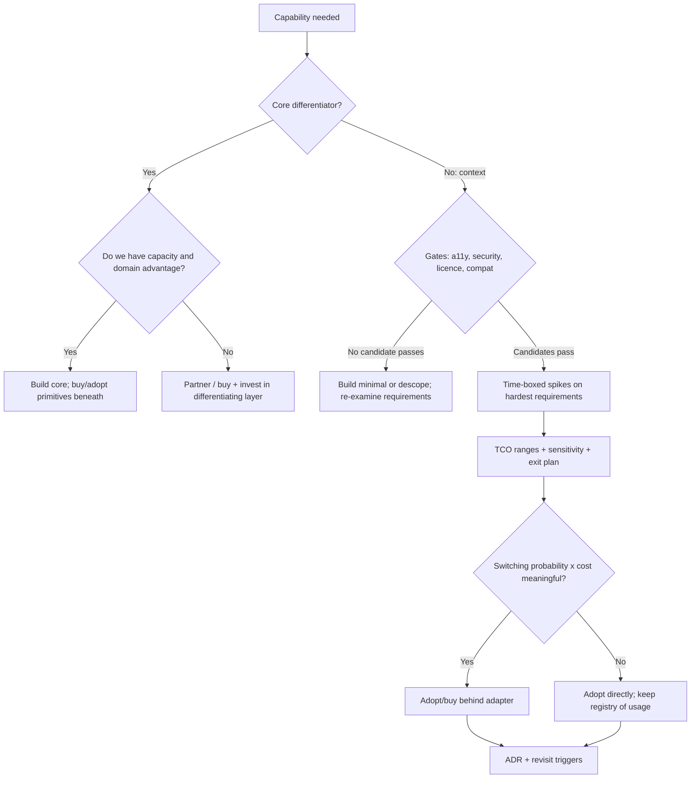

# 11 / 14 — Build vs Buy (and Adopt)

> **Verify against current docs.** Licence terms, pricing, and product capabilities named in this lesson change frequently (several widely used projects have changed licences in recent years). Treat vendor and project names as *examples of categories*, and verify licence, pricing, and capability claims against the vendor's current terms and your legal counsel's advice before deciding.

## 1. Lesson metadata

| | |
|---|---|
| **Level** | Architect |
| **Study time** | 4–5 hours (reading 2 h, worked evaluation 1 h, exercises 1.5 h) |
| **Prerequisites** | [11/01 — Trade-off analysis](./01-trade-off-analysis.md), [11/04 — Choosing abstraction level](./04-choosing-abstraction-level.md), [11/07 — Design system architecture](./07-design-system-architecture.md), [04/13 — Application services and adapters](../04-react-architecture/13-application-services-and-adapters.md), [05/15 — Adapter, strategy, factory](../05-design-patterns/15-adapter-strategy-factory.md), [10/07 — Dependency security](../10-production-engineering/07-dependency-security.md), [06/19 — Technology selection matrix](../06-data-fetching-and-state-ecosystems/19-technology-selection-matrix.md) |
| **Next** | [15 — Framework selection](./15-framework-selection.md) |
| **Related** | [11/12 — Microfrontends](./12-microfrontends.md), [11/13 — Monorepo vs multirepo](./13-monorepo-vs-multirepo.md), [11/22 — Long-term evolution](./22-long-term-evolution.md), [11/20 — Evaluating emerging features](./20-evaluating-emerging-features.md) |

**Learning objectives.** After this lesson you can:
1. Frame a build-vs-buy question as a decision about **differentiation, total cost of ownership, risk, and optionality**, not about engineering preference.
2. Distinguish the real option set: **build, buy (SaaS/commercial), adopt (open source), compose, outsource, or defer** — and the hybrid "adopt behind an adapter".
3. Build a defensible total-cost model over a 3–5 year horizon with explicit assumptions, ranges, and sensitivity analysis.
4. Evaluate vendors and open-source projects on capability fit, a11y/security/compliance, licence, community health, extensibility, and exit cost, using a time-boxed spike rather than a feature checklist.
5. Design for reversibility: anti-corruption layers, data portability, exit plans.
6. Recognise cognitive biases (not-invented-here, shiny-object, sunk cost) and organisational failure modes in these decisions, and document the decision (ADR) with revisit triggers.

**Concepts covered:** core vs context, differentiation, total cost of ownership (TCO), opportunity cost, maintenance burden, integration cost, lock-in and switching cost, reversibility (one-way vs two-way doors), anti-corruption layer, adopt-behind-adapter, licence classes, OSS health indicators, bus factor, spike/proof-of-concept, weighted decision matrix, sensitivity analysis, real options, NIH syndrome, vendor risk.

---

## 2. Deep conceptual explanation

### 2.1 What problem is this lesson solving?

Every frontend team constantly makes build-vs-buy decisions, often unconsciously: a date picker, a data grid, a rich text editor, a charting library, an auth flow, a feature-flag system, an analytics pipeline, a design system, a CMS, a form builder, an i18n platform, a visual-regression service, an error-monitoring service. Each decision creates a multi-year liability:

- **Build** creates *a product you now maintain* — features, bugs, browser quirks, accessibility conformance, security patches, onboarding docs, and the opportunity cost of what those engineers would otherwise have built.
- **Buy/adopt** creates *a dependency you now depend on* — pricing changes, roadmap divergence, outages, acquisitions, licence changes, breaking upgrades, and integration code you still maintain.

The failure modes are symmetrical and common:
- Teams **build commodity software** (a table component with sort/filter/virtualization/column resize/keyboard navigation/a11y) because "it's just a table", then spend 18 months on the long tail.
- Teams **buy/adopt without exit plan**, bind the codebase to a vendor's API at hundreds of call sites, and discover at renewal time that the price tripled or the project is abandoned.
- Teams treat the decision as a **feature checklist comparison**, ignoring TCO and organisational capacity.
- Teams decide from **enthusiasm** (an engineer wants to build it; a manager wants to avoid headcount) instead of evidence.

The architect's job is to make the decision *legible*: explicit criteria, explicit assumptions, ranges rather than point estimates, and a documented trigger for revisiting.

### 2.2 The option space is wider than "build or buy"

| Option | Meaning | Example |
|---|---|---|
| **Build** | Design and implement in-house | Bespoke pricing display engine |
| **Buy (SaaS)** | Pay a vendor who operates it | Error monitoring, feature flags, analytics, auth-as-a-service, headless CMS |
| **Buy (licensed library/component)** | Commercial library you embed | Enterprise data grid, spreadsheet component |
| **Adopt (open source)** | Use an OSS project, accept maintenance risk | Headless UI primitives, state/query libraries, charting |
| **Compose** | Assemble from several smaller libraries | Form stack = schema validator + form lib + UI kit |
| **Adopt + extend / fork** | Use OSS and carry patches or a fork | A UI library with local patches |
| **Outsource / contract** | Pay people to build it | Agency builds a marketing site |
| **Defer / don't do** | Delay or drop the capability | Postpone "advanced reporting" |
| **Adopt behind an adapter** | Any of the above, wrapped in your own interface | `GridPort` implemented by a vendor grid; swap later |

"Defer" and "don't do" are legitimate answers that teams forget; a decision that avoids a multi-year liability for a low-value feature is the cheapest option.

### 2.3 Core vs context: where differentiation lives

A useful first filter (from Geoffrey Moore's *core* vs *context* distinction):

- **Core:** the capabilities that differentiate your product and from which customers derive distinctive value. Invest your best engineers; build or tightly control.
- **Context:** necessary but undifferentiating (auth, payments plumbing, error tracking, analytics, generic UI primitives). Buy or adopt; standardise; minimise bespoke investment.

Heuristics:
- **If customers would not notice (or care) if you swapped the implementation**, it's context.
- **If competitors can buy the same thing**, it can't be a durable differentiator.
- **If it directly encodes your domain model or unique workflow** (e.g. a logistics-optimisation visualiser), build — but still buy the primitives beneath it.

Caution: **core/context shifts over time and by company.** For a spreadsheet company the grid is core; for a CRM it's context. A rich text editor is context for most products and core for a docs product. The classification must be made *per organisation*, and revisited.

### 2.4 Total cost of ownership — the real model

A decision that compares "licence price" with "initial build cost" is usually wrong by a large factor in the build direction (initial cost is the small part). Model all cost components over the horizon (3–5 years is typical for frontend components; longer for platforms).

**Cost of building**
- Initial design + implementation (include discovery, UX/design, accessibility, testing, documentation).
- **Long-tail features:** the first 80 % is quick; the last 20 % (keyboard model, RTL, mobile, undo/redo, large datasets, accessibility, browser quirks, i18n, printing, copy/paste) takes disproportionate time.
- **Maintenance:** bug fixes, dependency/browser/React upgrades, security patches. A rule of thumb quoted widely is that annual maintenance is a substantial fraction (often cited as 15–25 %) of the initial build cost *— treat as an order-of-magnitude heuristic, not a measured constant; calibrate with your own history of internal tools.*
- **Support and onboarding:** docs, internal support to consuming teams (a platform product needs a product owner).
- **Opportunity cost:** what else those engineers would have shipped.
- **Risk cost:** bus factor, attrition of the people who understand it.

**Cost of buying/adopting**
- Licence/subscription fees (watch scaling dimensions: seats, MAU, events, requests, environments) and renewal escalators.
- **Integration:** wrapping, theming, SSO, data mapping, build tooling.
- **Customisation and workarounds:** the 20 % the vendor doesn't support; escape hatches; forks.
- **Upgrade cost:** vendor/OSS major versions, breaking changes.
- **Operational cost** for self-hosted OSS (hosting, patching, on-call).
- **Governance:** security review, procurement, legal, vendor management, DPAs.
- **Lock-in/switching cost** (expected value of an eventual migration).
- **Risk cost:** vendor outage, acquisition, deprecation, licence change, data-residency changes.

**The honest approach is a range model** (optimistic/likely/pessimistic) per component, then sensitivity analysis: *which assumption, if wrong, flips the decision?* That assumption is where you spend investigation time.

### 2.5 Reversibility: one-way vs two-way doors

(Bezos's framing, widely used) A **two-way door** is cheap to reverse; decide fast with less analysis. A **one-way door** is expensive to reverse; decide carefully. Build-vs-buy decisions vary:

| Decision | Reversibility | Why |
|---|---|---|
| A small utility library (date formatting via a wrapper) | Two-way if behind a wrapper | Few call sites |
| A UI component library adopted across 200 screens | Mostly one-way | Pervasive coupling to props/markup/styling |
| A SaaS holding your customer data (CMS, feature flags) | Medium | Data export and API portability dependent |
| A custom internal framework | One-way | Becomes a product with dependents |
| A state-management library with 400 call sites | Costly | Pervasive; migration is a project |

The architect's lever: **convert one-way doors into two-way doors** via adapters (§2.7), export paths, and keeping domain logic outside the vendor's API. Cost of reversibility: some indirection; benefit: switching option value.

### 2.6 Evaluating a candidate: beyond the feature matrix

Feature checklists favour whoever has the most features and hide what hurts later. Evaluate along these axes (weights depend on context):

| Axis | Questions |
|---|---|
| **Fit** | Does it handle our hardest 3 requirements (not the average ones)? How much customisation is needed? |
| **Accessibility** | Documented conformance (ACR/VPAT) or testable behaviour with our AT matrix? (A fast way to fail a candidate: keyboard-only use of its core widget.) ([11 — Designing for accessibility](./11-designing-for-accessibility.md)) |
| **Performance** | Bundle size; runtime cost on target devices with realistic data; SSR compatibility ([09](./09-performance-budgets-at-scale.md)) |
| **Security & privacy** | Data flows, subprocessors, SOC 2/ISO 27001 reports, vulnerability history/response, supply-chain posture, CSP compatibility, data residency |
| **Compatibility** | React 19 support? RSC/SSR? TypeScript types quality? Build tool support? |
| **Extensibility** | Escape hatches; headless vs opinionated; theming; plugin API |
| **Community/vendor health** | Release cadence, maintainers/bus factor, issue response, funding, adoption by comparable companies, roadmap transparency |
| **Licence** | Permissive (MIT/Apache-2.0/BSD) vs copyleft (GPL/AGPL) vs source-available (BSL/SSPL-like) vs commercial; compatibility with how you distribute software |
| **Cost** | Direct and scaling dimension; renewal terms; exit costs |
| **Exit** | Data export; API standard; how many call sites; effort to replace |
| **Team** | Skills, learning curve, hiring market, docs quality |

*Licences and distribution.* Permissive licences (MIT, BSD, Apache-2.0) generally allow commercial use with attribution; copyleft licences (GPL/AGPL) may impose source-disclosure obligations depending on how you use/distribute/host the code — **AGPL's network clause is why many companies prohibit it for hosted software**; "source-available" licences (e.g. BUSL-style) may restrict competing commercial use or certain deployment forms. These are legal questions: involve counsel and verify current terms.

*OSS health signals* (treat as signals, not scores): recent releases and commits; number of active maintainers (bus factor > 1); response time on security issues; open-issue triage; funding (sponsorship, company backing); whether major companies depend on it (and might step in); semantic versioning discipline; migration guides for past breaking changes; test coverage and CI; **history of governance changes** (acquisitions, licence changes).

### 2.7 Adopt behind an adapter (anti-corruption layer)

The most effective hedging tool in frontend is the **adapter / anti-corruption layer** ([04/13](../04-react-architecture/13-application-services-and-adapters.md), [05/15](../05-design-patterns/15-adapter-strategy-factory.md)): define an interface in *your* domain language and implement it with the vendor; the rest of the codebase uses your interface.

Benefits: swap cost = reimplement one adapter; vendor concepts don't leak into domain code; you can test with fakes ([10](./10-designing-for-testability.md)); you can run two implementations in parallel for migration.

Costs and limits:
- You must **design an interface that's smaller than the vendor's** (lowest-common-denominator problem). If you expose all features, you've re-created the vendor API. If you expose only the common subset, you may block valuable features.
- Not every dependency is adaptable cheaply: UI component libraries have pervasive visual/behavioural coupling; the adapter for a *design system* is effectively a second design system ([07](./07-design-system-architecture.md) discusses the "wrap vs use directly" decision).
- Over-abstraction is its own cost. Apply when: (a) the switching probability × cost is meaningful, (b) the dependency is **context** with a stable concept (analytics `track(event)`, feature flag `isEnabled(key)`, error reporting `captureException`), (c) the call sites are numerous.

Rule of thumb: **wrap the capability, not the library** — design `Analytics`, `FeatureFlags`, `ErrorReporter`, `Grid` as capabilities with a minimal interface and an implementation per vendor.

### 2.8 Cognitive and organisational biases

| Bias | Manifestation | Counter |
|---|---|---|
| **Not-invented-here (NIH)** | "Our needs are special"; dismissing external solutions | Require a written list of requirements that candidates fail, tested with a spike |
| **Shiny-object / résumé-driven** | Adopting technology because it is new or career-enhancing | Require evidence of fit and adoption by comparable teams; consider support horizon |
| **Sunk cost** | Continuing to maintain a bespoke component because of past investment | Evaluate going-forward costs only; set revisit triggers |
| **Planning fallacy** | Build estimates are optimistic | Reference-class forecasting: how long did similar internal builds take? Multiply by a calibrated factor |
| **Vendor optimism** | Demos show happy paths | Test your hardest scenarios, with your data, on your devices |
| **Headcount aversion** | "We can't hire, so we must buy" (or the reverse) | Make the capacity constraint explicit in the model |
| **Anchoring on licence price** | A $100k fee feels large vs invisible salary costs | Compare fully loaded engineering time in the same units |
| **Status quo bias** | Staying with legacy solution | Quantify current maintenance cost |

### 2.9 Misconceptions

| Misconception | Reality |
|---|---|
| "Open source is free." | The licence is free; adoption cost (integration, upgrades, patching, support) is not. |
| "Building gives us control." | It gives control *and* responsibility; many teams then lack capacity to exercise it. Open source with a good extension model often provides adequate control. |
| "Buying removes risk." | It substitutes one risk set (build quality, capacity) with another (vendor viability, pricing, data). |
| "A wrapper makes switching free." | It makes switching *cheaper*; behaviours, data models, and UX differences still need migration. |
| "We'll build it small, just what we need." | Scope creep is the norm for undifferentiated components; the long tail arrives with users. |
| "Core means complex; context means simple." | Core/context is about differentiation, not complexity. Context can be very complex (payments, auth) — which is *why* to buy it. |

---

## 3. Internal mechanics

### 3.1 How lock-in forms (mechanisms)

Lock-in is not a vendor conspiracy; it's an emergent property of coupling:

1. **API coupling:** vendor types and function names appear throughout your code (call-site count × change cost).
2. **Data gravity:** data stored in vendor formats; export is lossy or rate-limited (CMS content with custom fields, analytics history, feature-flag targeting rules).
3. **Behavioural coupling:** users or processes depend on idiosyncratic behaviour (keyboard shortcuts, sort stability, formatting).
4. **Skill coupling:** teams are trained on the tool; switching has a human cost.
5. **Contractual coupling:** multi-year commitments, volume discounts, security reviews already completed.
6. **Ecosystem coupling:** plugins/extensions and integrations built around the tool.

Mitigation maps to mechanisms: adapters (1), export tests and mirrored data (2), contract tests that capture *your* expected behaviour (3), standards-based choices (OpenTelemetry, OpenFeature, OpenAPI, SCIM, OIDC, WebAuthn) (2/5/6), and contract terms (5).

*Teaching model.* Standards reduce lock-in by moving the coupling point from a vendor API to a specification: e.g. **OpenTelemetry** for telemetry, **OpenFeature** for feature flag evaluation, **OIDC/OAuth 2** for auth, **WebAuthn** for passkeys. ⚠ *Maturity varies by language/runtime, especially in browsers (e.g. client-side OpenTelemetry/OpenFeature web SDKs are less mature than server SDKs); verify current status.*

### 3.2 How build estimates go wrong (mechanism)

Component builds follow a long-tail curve: visible features are cheap; correctness at the edges is expensive, and edges are exactly where users and assistive technologies live. Illustration for a "simple" data grid:

| Capability | Appears in v1? | Cost multiplier (qualitative) |
|---|---|---|
| Render rows/columns | Yes | 1× |
| Sorting/filtering | Yes | 1× |
| Pagination | Yes | 0.5× |
| Virtualization for 100k rows | Often later | 3× |
| Column resize/reorder/pinning | Later | 3× |
| Keyboard navigation (grid pattern) + screen-reader semantics | Rarely planned | 5× |
| Copy/paste, cell editing, validation | Later | 4× |
| Row grouping/aggregation | Later | 4× |
| Export CSV/Excel | Later | 1× |
| RTL/i18n/formatting | Later | 2× |
| Mobile/touch | Later | 2× |
| Server-side data modes | Later | 3× |

*(The multipliers are illustrative, not measured; the point is that the visible 20 % of capabilities represents a small fraction of the eventual cost.)* A vendor amortises this long tail across thousands of customers; you amortise it across yourself. This amortisation argument — **economies of scale in the long tail** — is the strongest structural reason to buy context components.

### 3.3 Real options

Treat the decision as buying or selling options. *Adopting behind an adapter* buys an option to switch (premium: adapter cost). *Building* buys an option to customise indefinitely (premium: sustained engineering). *Waiting* buys information (premium: delay). Option thinking suggests: when uncertainty is high and reversibility is cheap, **start with a vendor/OSS and a thin adapter, learn from real usage, and build only if the data shows a differentiating need or an unacceptable cost.** The inverse — build first, replace later — rarely works, because internally built things attract dependents and sunk-cost attachment.

### 3.4 Time-boxed spikes: what evidence they produce

A spike answers specific questions with working code against **your hardest requirements**, not a hello-world. Design the spike like an experiment:
- **Hypotheses:** "Candidate X can render 50k rows at 60 fps scroll on our reference laptop and mid-range Android"; "X's grid supports our keyboard model (arrow nav + edit-in-place) and passes axe + a manual NVDA check"; "X's bundle adds ≤ 60 kB gz."
- **Fixtures:** realistic data, realistic theming.
- **Measures:** time to implement (a proxy for DX/learning curve), defects found, performance, a11y checks, size.
- **Stop conditions:** a candidate that fails a *must-have* is eliminated immediately (cheaper than scoring).
- **Output:** a short report with data; the spike code is thrown away or kept behind the adapter.

---

## 4. Step-by-step: a build-vs-buy decision process

1. **State the capability and the business outcome** (not the solution): "Users must analyse, sort, group and edit up to 100k rows with keyboard accessibility."
2. **Classify core vs context** with product leadership; capture the reasoning.
3. **Enumerate options** (build, 2–4 candidates, compose, defer). Include the status quo.
4. **Define must-haves (gates) vs nice-to-haves (scored).** Gates include: accessibility target, security/compliance, licence acceptability, React 19/SSR compatibility, performance floor.
5. **Quick elimination** using public information (licence, compatibility, last release, known a11y issues).
6. **Time-boxed spikes (2–5 days each)** on the hardest requirements for finalists.
7. **Build the TCO model** with ranges for each option (§5.4), including opportunity cost and exit cost.
8. **Weighted scoring** for non-gating criteria; run **sensitivity analysis** on the weights and on the most uncertain cost assumptions.
9. **Risk review** with security, legal, and procurement (DPA, subprocessors, licence).
10. **Decide and design the integration seam**: adapter interface, theming, error handling, fakes for tests ([10](./10-designing-for-testability.md)).
11. **Write the ADR** ([10/16](../10-production-engineering/16-architecture-decision-records.md)): context, options, evidence, decision, consequences, **revisit triggers** (price change > X %, vendor acquisition, a11y regression, a requirement the tool can't meet, maintenance cost above Y).
12. **Plan the exit** (what's the export path? what would the migration look like? who owns the tripwires?).
13. **Pilot** in one product area; measure; then roll out.
14. **Review** at the stated triggers and at least annually.

---

## 5. Code examples

### 5.1 Minimal — adopt behind a port (feature flags)

```ts
// capabilities/feature-flags.ts — YOUR language, not the vendor's
export type FlagContext = { userId?: string; plan?: 'free' | 'pro' | 'enterprise'; country?: string };

export interface FeatureFlags {
  isEnabled(flag: FlagKey, ctx?: FlagContext): boolean;
  variant<T extends string>(flag: FlagKey, fallback: T, ctx?: FlagContext): T;
  subscribe(listener: () => void): () => void; // for React's useSyncExternalStore
}

// A closed set of keys catches typos at compile time and enables dead-flag cleanup.
export type FlagKey = 'new-checkout' | 'search-v2' | 'dark-mode';
```

```ts
// adapters/launchdarkly.ts (or any vendor; names illustrative)
import type { FeatureFlags, FlagKey, FlagContext } from '../capabilities/feature-flags';

export function createVendorFlags(client: VendorClient): FeatureFlags {
  const listeners = new Set<() => void>();
  client.on('change', () => listeners.forEach((l) => l()));
  return {
    isEnabled: (flag, ctx) => client.boolVariation(flag, toVendorContext(ctx), false),
    variant: (flag, fallback, ctx) => client.stringVariation(flag, toVendorContext(ctx), fallback) as typeof fallback,
    subscribe: (l) => { listeners.add(l); return () => listeners.delete(l); },
  };
}
declare const toVendorContext: (c?: FlagContext) => unknown;
declare type VendorClient = { on(e: 'change', f: () => void): void; boolVariation(k: string, c: unknown, d: boolean): boolean; stringVariation(k: string, c: unknown, d: string): string };
```

```tsx
// React integration — depends only on the port
import { createContext, use, useSyncExternalStore, type ReactNode } from 'react';
const FlagsContext = createContext<FeatureFlags | null>(null);
export const FlagsProvider = ({ flags, children }: { flags: FeatureFlags; children: ReactNode }) =>
  <FlagsContext value={flags}>{children}</FlagsContext>;

export function useFlag(flag: FlagKey, ctx?: FlagContext): boolean {
  const flags = use(FlagsContext);
  if (!flags) throw new Error('FlagsProvider missing');
  return useSyncExternalStore(flags.subscribe, () => flags.isEnabled(flag, ctx), () => false /* server snapshot: safe default */);
}
```

Line notes and trade-offs: the port has three methods; vendor-specific features (percentage rollouts, experiments, targeting UI) live in the vendor and are *not* in the interface — a deliberate minimal surface. `useSyncExternalStore` ([03/20](../03-react-state-and-hooks/20-usesyncexternalstore-and-external-stores.md)) subscribes to changes; the server snapshot returns `false` (safe default) to avoid hydration mismatch — **make sure your SSR flag strategy bootstraps flags server-side to avoid a flash**. In the snippet `ctx` is an object; passing a new object every render creates a new `getSnapshot` function but not a new result if the value is boolean — still prefer memoizing. Standards note: the **OpenFeature** specification defines such a vendor-neutral API with providers — consider adopting it as the port instead of inventing yours (verify web SDK maturity).

### 5.2 Practical — a UI-capability port for a data grid (where adapters get hard)

```ts
// capabilities/data-grid.ts
export type Column<Row> = {
  id: string;
  header: string;
  accessor: (row: Row) => string | number | Date | null;
  sortable?: boolean;
  width?: number;
};

export type GridProps<Row> = {
  rows: readonly Row[];
  columns: readonly Column<Row>[];
  getRowId: (row: Row) => string;
  onSortChange?: (sort: { columnId: string; dir: 'asc' | 'desc' } | null) => void;
  onRowActivate?: (row: Row) => void;
  ariaLabel: string;                   // REQUIRED: our a11y contract
};
// The port is a React component type with a deliberately small props surface.
export type DataGridComponent = <Row>(props: GridProps<Row>) => React.ReactElement;
```

```tsx
// adapters/grid-vendor.tsx — maps our props to the vendor's
export const VendorGrid: DataGridComponent = ({ rows, columns, getRowId, onSortChange, onRowActivate, ariaLabel }) => (
  <VendorDataGrid
    aria-label={ariaLabel}
    rowData={rows as any}
    getRowId={(p: { data: any }) => getRowId(p.data)}
    columnDefs={columns.map((c) => ({ field: c.id, headerName: c.header, valueGetter: (p: any) => c.accessor(p.data), sortable: c.sortable, width: c.width }))}
    onSortChanged={(e: any) => onSortChange?.(toOurSort(e))}
    onRowDoubleClicked={(e: any) => onRowActivate?.(e.data)}
  />
);
declare const VendorDataGrid: React.ComponentType<any>;
declare const toOurSort: (e: any) => { columnId: string; dir: 'asc' | 'desc' } | null;
```

The honest limitation: this adapter only supports what the port exposes. The first time a product team needs cell editors, grouping, or pinned columns, they either extend the port (growing toward the vendor API) or bypass it (breaking the seam). Decision: **keep the port for the 80 % of grids that need only the basics (many "list/table" screens) and allow an explicit, reviewed "advanced grid" escape hatch** that uses the vendor directly in a few screens, tracked in a registry so exit cost remains estimable. Presenting this as an architectural decision (not an accident) is the point.

### 5.3 Practical — a decision matrix with sensitivity analysis

```ts
// tools/decision.ts — transparent, reproducible scoring (weights from stakeholders, scores from spikes)
type Criterion = { id: string; weight: number; gate?: boolean };
type Option = { name: string; scores: Record<string, number | 'fail'> }; // 1–5; 'fail' fails a gate

const criteria: Criterion[] = [
  { id: 'a11y',        weight: 0.25, gate: true },
  { id: 'fit',         weight: 0.25 },
  { id: 'perf',        weight: 0.15 },
  { id: 'extensibility', weight: 0.10 },
  { id: 'health',      weight: 0.10 },
  { id: 'exitCost',    weight: 0.10 },
  { id: 'tco',         weight: 0.05 }, // TCO is modelled separately; keep a small weight to avoid double counting
];

const options: Option[] = [
  { name: 'Build',    scores: { a11y: 3, fit: 5, perf: 3, extensibility: 5, health: 2, exitCost: 4, tco: 1 } },
  { name: 'VendorA',  scores: { a11y: 4, fit: 4, perf: 4, extensibility: 3, health: 4, exitCost: 3, tco: 3 } },
  { name: 'OSS-B',    scores: { a11y: 'fail', fit: 4, perf: 5, extensibility: 4, health: 3, exitCost: 4, tco: 4 } },
];

function score(o: Option, w: Criterion[]): number | null {
  let s = 0;
  for (const c of w) {
    const v = o.scores[c.id];
    if (v === 'fail' && c.gate) return null;            // gate failed: eliminated
    s += c.weight * (typeof v === 'number' ? v : 0);
  }
  return s;
}

// Sensitivity: randomly perturb weights ±30% and count how often each option wins.
function sensitivity(n = 10_000) {
  const wins: Record<string, number> = {};
  for (let i = 0; i < n; i++) {
    const w = criteria.map((c) => ({ ...c, weight: c.weight * (0.7 + 0.6 * Math.random()) }));
    const sum = w.reduce((a, c) => a + c.weight, 0);
    w.forEach((c) => (c.weight /= sum));                 // renormalise
    const ranked = options.map((o) => ({ name: o.name, s: score(o, w) })).filter((r) => r.s !== null)
      .sort((a, b) => b.s! - a.s!);
    if (ranked[0]) wins[ranked[0].name] = (wins[ranked[0].name] ?? 0) + 1;
  }
  return Object.fromEntries(Object.entries(wins).map(([k, v]) => [k, +(v / n).toFixed(3)]));
}
console.log(sensitivity());  // e.g. { VendorA: 0.78, Build: 0.22 } — "how robust is the winner to weight disagreement?"
```

Notes: the matrix does not produce truth; it **forces explicit weights and scores** and shows whether the conclusion survives disagreement. If the winner changes with small weight perturbations, the decision is genuinely close and the tiebreaker should be reversibility/risk, not the score. Scores must come from spike evidence, not opinion; record the evidence link per score. Never average away a gate failure (a11y `fail` eliminates OSS-B regardless of its other scores).

### 5.4 Practical — a TCO model with ranges

```ts
// tools/tco.ts — 3-year cost in "engineer-years" and currency, with low/likely/high
type Range = { low: number; likely: number; high: number };
const FULLY_LOADED = 180_000; // per engineer-year (assumption; substitute your own)

type Option = {
  name: string;
  upfrontEngYears: Range;      // build/integration effort
  annualEngYears: Range;       // maintenance, upgrades, support
  annualFees: Range;           // licence/hosting
  exitCost: Range;             // expected migration cost at end of horizon (probability-weighted)
};

const years = 3;
const total = (o: Option, k: keyof Range) =>
  o.upfrontEngYears[k] * FULLY_LOADED + years * (o.annualEngYears[k] * FULLY_LOADED + o.annualFees[k]) + o.exitCost[k];

const build: Option = {
  name: 'Build grid',
  upfrontEngYears: { low: 1.5, likely: 2.0, high: 4.0 },    // planning fallacy: high tail is fat
  annualEngYears:  { low: 0.3, likely: 0.5, high: 1.0 },
  annualFees:      { low: 0, likely: 0, high: 0 },
  exitCost:        { low: 0, likely: 0, high: 50_000 },
};
const buy: Option = {
  name: 'Buy grid (adapter)',
  upfrontEngYears: { low: 0.1, likely: 0.17, high: 0.4 },
  annualEngYears:  { low: 0.1, likely: 0.25, high: 0.5 },   // upgrades, workarounds
  annualFees:      { low: 25_000, likely: 40_000, high: 90_000 },
  exitCost:        { low: 20_000, likely: 60_000, high: 150_000 },
};

for (const o of [build, buy]) {
  console.log(o.name, {
    low: total(o, 'low'), likely: total(o, 'likely'), high: total(o, 'high'),
  });
}
```

Computing the "likely" case: **Build** = 2.0 × 180k = 360k upfront + 3 × (0.5 × 180k) = 270k maintenance + 0 fees + 0 exit = **630k**. **Buy** = 0.17 × 180k ≈ 30.6k + 3 × (0.25 × 180k + 40k) = 3 × 85k = 255k + 60k exit = **≈ 346k**. The "high" cases: Build = 4.0 × 180k = 720k + 3 × 180k = 540k + 0 + 50k = **1.31M**; Buy = 0.4 × 180k = 72k + 3 × (90k + 90k) = 540k + 150k = **762k**. The "low" cases: Build = 270k + 3 × 54k = 162k → **432k**; Buy = 18k + 3 × (18k + 25k) = 129k + 20k = **167k**. Reading: buying wins in all three scenarios on cost; the decision then rests on **fit, accessibility, and risks the model doesn't price** (gate failures, vendor risk). This is the expected result for a context component — and the model's value is showing *where it would flip*: break-even on annual licence fee (likely case, holding other buy inputs fixed): `630k = 30.6k + 3 × (45k + L) + 60k` → `L ≈ 134.8k/yr`. If quoted pricing exceeds that (e.g. per-seat pricing scaling with headcount), or the long tail's workaround cost is much higher, build becomes competitive. (Opportunity cost isn't in the numbers: those 2.0 engineer-years could ship other features; include a separate row if leadership needs it.)

### 5.5 Incorrect — leaking the vendor everywhere

```tsx
import { VendorGrid, useVendorGridApi, VendorColDef } from 'vendor-grid'; // imported in 140 files
const api = useVendorGridApi();
api.setFilterModel(...); // vendor concepts in domain code
```

Consequences: exit cost ∝ call sites; version upgrades require touching all; tests need the vendor's runtime; a11y fixes are blocked by vendor; code reviewers can't tell when the vendor boundary is crossed. Even if the final decision is "use this vendor everywhere", **choose that on purpose**, with a registry and a codemod strategy — don't drift into it.

### 5.6 Corrected — module boundary rule + lint

Enforce that vendor imports live only in adapters:

```js
// eslint.config.js (excerpt) — verify rule options in the ESLint docs
export default [{
  files: ['src/**/*.{ts,tsx}'],
  ignores: ['src/adapters/**'],
  rules: {
    'no-restricted-imports': ['error', {
      patterns: [{ group: ['vendor-grid', 'vendor-grid/*', 'launchdarkly-*'], message: 'Import vendor SDKs only inside src/adapters/*; depend on capabilities/* instead.' }],
    }],
  },
}];
```

### 5.7 Advanced — licence and dependency-health gates in CI

```ts
// tools/check-licenses.ts — fail on disallowed licences in production dependencies
import { execSync } from 'node:child_process';
const ALLOWED = new Set(['MIT', 'ISC', 'BSD-2-Clause', 'BSD-3-Clause', 'Apache-2.0', '0BSD', 'CC0-1.0', 'BlueOak-1.0.0']);
const report = JSON.parse(execSync('pnpm licenses list --prod --json', { encoding: 'utf8' })) as Record<string, { name: string; versions: string[] }[]>;
const bad = Object.entries(report).filter(([lic]) => !ALLOWED.has(lic));
if (bad.length) {
  for (const [lic, pkgs] of bad) console.error(`Licence ${lic}: ${pkgs.map((p) => p.name).join(', ')}`);
  process.exit(1);
}
```

*(The `pnpm licenses` command and JSON shape are version-specific — verify; many teams use dedicated licence-checker tools or SCA platforms. SPDX expressions such as `(MIT OR Apache-2.0)` need parsing. Licence policy itself is a legal decision.)* Add a **new-dependency review** step in PR templates: why not an existing dependency; size; licence; maintenance health; security posture; exit plan.

---

## 6. Visual explanations



```mermaid
quadrantChart
  title Where to invest build effort (illustrative)
  x-axis Low differentiation --> High differentiation
  y-axis Low complexity --> High complexity
  quadrant-1 Build with care or partner
  quadrant-2 Buy: complex commodity
  quadrant-3 Adopt small libraries
  quadrant-4 Build: simple and special
  Auth: [0.15, 0.85]
  Payments plumbing: [0.2, 0.9]
  Data grid generic: [0.2, 0.7]
  Date formatting: [0.1, 0.2]
  Pricing visualiser: [0.85, 0.6]
  Domain workflow UI: [0.9, 0.5]
```

```
Cost over time (qualitative):
  build  ▏██████████░░░░░░░░░░░░░░░ upfront (large) → maintenance tail (never ends)
  buy    ▏██░░░░░░░░░░░░░░░░░░░░░░ upfront small → recurring fees + integration upkeep + exit tax
  The crossover point depends on fee scaling and on how much of the long tail you truly need.
```

---

## 7. Alternative approaches and trade-offs

| Option | Control | Speed to value | Long-term cost | Risk profile | Best when |
|---|---|---|---|---|---|
| **Build in-house** | Highest | Slow | High and ongoing | Capacity, bus factor, scope creep | Core differentiator; unique needs; no adequate market solution |
| **Buy SaaS** | Low–Med | Fast | Fees scale with usage | Vendor viability, price change, data/privacy | Operational capabilities (monitoring, flags, auth), small team |
| **Buy commercial component** | Medium | Fast | Licence + upgrades | Vendor roadmap, licence terms | Complex UI components (grids, schedulers, spreadsheets) |
| **Adopt OSS (permissive)** | Medium–High (can fork) | Fast | Integration + upgrades; no fees | Maintainer burnout, governance/licence changes | Libraries with healthy communities |
| **Adopt OSS + sponsor/contribute** | Medium–High | Fast | Slightly higher (time/sponsorship) | Lower risk (influence on roadmap) | Critical dependency worth influencing |
| **Compose several libraries** | Medium | Medium | Integration glue ongoing | Version compatibility across libs | Best-of-breed needs; no single fit |
| **Outsource build** | Medium | Medium | Contracting + maintenance handover | Knowledge transfer, quality variance | Non-core, time-boxed deliverable |
| **Defer / descope** | N/A | N/A | Lowest | Missed opportunity | Low-value capability; uncertain demand |

**A scenario where the recommended approach (buy/adopt context components) is NOT best.** A company whose product *is* a collaborative spreadsheet/grid, or a data-visualisation tool whose core value is interaction fidelity. Here the grid is the product: vendor limits become product limits, the vendor may be a competitor or acquirer, and the long tail is the differentiator. Build (or deeply fork open source with a dedicated team). Another scenario: **a tiny non-differentiating widget** (e.g. a 40-line tooltip) where adopting a 25 kB library with transitive dependencies costs more (bundle, supply-chain surface, upgrade churn) than writing it — the rule is *adopt for the long tail, build for the short tail*, and "leftpad-sized" dependencies deserve scrutiny ([10/07](../10-production-engineering/07-dependency-security.md)).

---

## 8. Best practices and anti-patterns

**Practices**
- **Write the problem, gates, and success metrics before naming solutions.**
- **Spike against hardest requirements**, not demos; budget a11y testing (keyboard, screen reader) in the spike.
- **Model TCO with ranges and run sensitivity**; present the *assumptions that matter*.
- **Prefer reversible choices**: standards-based APIs, adapters for context capabilities, data export tests.
- **Create an adoption policy**: who may add dependencies, review checklist (licence, size, security, maintenance), registry of approved libraries, deprecation list.
- **Track exit cost**: maintain a vendor/library register with owner, call-site count, renewal date, data location, exit plan, health review date.
- **Contribute upstream** for critical OSS (bug fixes, sponsorship) — cheaper than long-lived forks.
- **Review annually** and at triggers; kill or consolidate redundant tools (three charting libraries).
- **Pilot before rollout**; measure real usage.
- **Negotiate**: multi-year price caps, data export rights, SLA credits, escrow for critical commercial components (consult procurement/legal).

**Beginner mistakes**: judging by GitHub stars; choosing the tool from a blog post; ignoring licence; adopting without reading open issues on a11y/SSR/React 19; underestimating upgrade churn.

**Experienced-developer mistakes**: building because "we can do it better" with no maintenance plan; abstracting everything "in case we switch" (over-engineering); hiding a vendor in a lowest-common-denominator wrapper that blocks needed features; failing to involve security/legal early; no owner for the vendor relationship; mixing evaluation with advocacy (the champion runs the spike).

**Smells**: an "internal framework" that two people understand; a library on a version three majors old because upgrading is "too hard"; renewals discovered at invoice time; engineers hot-patching `node_modules`; the same capability implemented by three different vendors in different teams; "temporary" forks that are three years old.

**Justified exceptions**: build when no candidate meets a gate (a11y at your conformance level, data residency); build when the capability is your product; adopt directly (no adapter) for UI foundations where the abstraction would be a second design system; fork when upstream is abandoned and the dependency is critical (with a plan for upstreaming or replacement). Don't present "buy" as inherently pragmatic or "build" as inherently wasteful — the decision depends on the facts in §2.4 and §2.6.

---

## 9. Real-world application

**E-commerce.** *Context:* payments (buy), search (managed service or OSS engine vs build — build only if relevance is differentiating), image optimisation (buy/CDN), A/B testing (buy or adopt), error monitoring (buy). *Core:* merchandising logic, personalised ranking, checkout UX. Constraints: PCI scope (hosted fields reduce scope — a *buy* choice with compliance value), third-party performance budgets ([09](./09-performance-budgets-at-scale.md)): every vendor script is a cost, so the budget enters the decision.

**Dashboards.** Charting: adopt (permissive OSS) for common charts, evaluate a11y (charts are notoriously weak: text alternatives, keyboard); build custom visualisations only where they are the product. Data grids: buy/adopt unless the grid is core. Realtime transport: adopt standards (WebSocket/SSE) with a managed or open-source broker.

**Finance / regulated.** Vendor due diligence (SOC 2/ISO 27001 reports, pen-test summaries, DPAs, subprocessors, data residency, audit rights, exit/escrow terms, business continuity). Buy decisions need procurement and third-party risk management; build decisions need change management and audit trails. The *cost of compliance* often tips toward buying certified services (auth, payments) and toward building thin, auditable glue.

**Auth.** Build vs buy is rarely close: auth is complex, security-critical, and not differentiating; use an established provider or a well-maintained open-source identity system with standards (OIDC), behind your own `Session` port. The cost of a mistake is high (breaches); build only with a dedicated security capability and a regulatory reason. Passkeys/WebAuthn capability is a standards-driven reason to adopt rather than reinvent.

**Forms.** Compose: schema validation library + form state library + your design-system inputs. Build a *form-field primitive* (accessibility contract) in-house — it encodes your design system's a11y and is cheap — while adopting the state/validation engines.

**Design system.** Often a hybrid: adopt a headless primitives library (a11y behaviours) and build the visual layer in-house (brand). Fully building primitives means re-solving combobox/dialog accessibility ([11](./11-designing-for-accessibility.md)); fully buying a styled kit means inheriting its look and constraints ([07](./07-design-system-architecture.md)).

**Multi-team platform.** Decision rights: platform team owns the **approved stack** (a curated list), with a lightweight process to add exceptions; each addition has an owner and a health review; shared adapters in a platform package; central vendor register so renewals and security reviews don't fall through cracks ([16](./16-supporting-multiple-teams.md)).

**Constraints to include in design docs:** compliance regimes; data classification; expected scale and scaling dimensions of pricing; target devices/browsers; team skills; hiring plan; contract timelines; existing vendors (consolidation opportunities); roadmap volatility.

---

## 10. Debugging and troubleshooting

(Here "debugging" means diagnosing a decision gone wrong.)

**Symptom 1: The "temporary" in-house component now needs a team.**
*Investigation.* List unplanned work: bug counts per quarter, a11y defects, requests from consuming teams, engineer-hours. Compare with the original estimate (planning fallacy), and with market alternatives *today* (the market moves). *Decision.* If the capability is context and maintenance exceeds the TCO of alternatives, plan a **managed migration**: introduce a port, run vendor and in-house side by side for one area, migrate incrementally, retire in-house. Beware sunk cost: evaluate forward costs only. Validate with the same TCO model using actuals.

**Symptom 2: Vendor price increases 3× at renewal.**
*Investigation.* Which scaling dimension drove the increase (MAU, seats, events)? What did the contract say about caps? What are the exit options and cost (call sites, data export)? *Response.* Immediately inventory call sites and data; get a competing quote; negotiate; if an adapter exists, estimate switch time; consider self-hosting an open-source equivalent. *Prevention:* price caps in multi-year contracts, usage dashboards with alerts, an exit plan in the ADR, adapter for context capabilities.

**Symptom 3: Adopted OSS library is abandoned; security issue unpatched.**
*Investigation.* Check repo activity, maintainer statements, fork activity (is there a maintained fork or successor?), your usage footprint (which APIs). Options: fork and patch (taking ownership), migrate to a successor, replace with a native platform feature or small internal code if usage is narrow, pay maintainers/sponsor (if viable). *Validate.* SCA scan, regression tests around usage (contract tests at the adapter).

**Symptom 4: The chosen grid fails accessibility in production audit.**
*Investigation.* Did the spike include keyboard and AT checks? What does the vendor's accessibility documentation say? Which defects are fixable via configuration or the vendor's roadmap? *Response.* Vendor escalation with reproducible cases; interim mitigations (alternate accessible table view, export); evaluate replacement; update the decision process to *gate* on a11y spikes. This is why a11y appears as a **gate**, not a weighted criterion, in §5.3.

**Symptom 5: Bundle size jumped 120 kB after adopting a "small" library.**
*Investigation.* Bundle visualiser ([07/16](../07-performance/16-bundle-analysis.md)): transitive dependencies, locale data, lack of tree-shaking (CommonJS entry, `sideEffects` not set). Options: import sub-paths, alternative library, dynamic import, build small internal helper. *Validate.* Per-route budget check ([09](./09-performance-budgets-at-scale.md)).

**Symptom 6: Three teams chose three different charting libraries.**
Governance gap. *Response.* Central evaluation; choose a supported default; a migration guide; allow exceptions with justification; add a dependency review rule in CI/PR template; consolidate gradually.

---

## 11. Exercises

### Level A — Knowledge
A1. Define "core" and "context" and give one example of each from a frontend product you know.
A2. List five cost components of building and five of buying that are commonly omitted from naive comparisons.
A3. What is an anti-corruption layer and what are two limits of using one for a UI component library?
A4. Distinguish a gate from a weighted criterion. Why is accessibility often a gate?
A5. Name four licence classes and one practical consequence of each for a company hosting a web service.

### Level B — Code comprehension
B1. In §5.3, why should a `'fail'` on a gate eliminate an option rather than score 0?
B2. In §5.4's likely case, compute Buy and Build costs again and verify the totals; then compute the break-even annual fee. State which assumption has the highest leverage.
B3. In §5.1, why does `useFlag` use `useSyncExternalStore` and what is the server snapshot protecting against?
B4. In §5.6, what class of regression does the `no-restricted-imports` rule prevent, and what does it not prevent?

### Level C — Implementation
C1. Write an `ErrorReporter` port (capture exception, set user, add breadcrumb) and two adapters (a vendor SDK and a console/no-op for dev/test), plus a React error-boundary integration test using the fake.
C2. Write a script that generates a "vendor register" table (package, version, licence, last publish date, weekly downloads is optional) from `package.json` and the npm registry, flagging packages not updated in 18 months. Describe data sources and caveats.
C3. Extend §5.4 with a Monte Carlo simulation sampling triangular distributions (low/likely/high) for each input to estimate P(Build cheaper than Buy) over 10,000 runs.
C4. Design a spike plan for evaluating two rich-text editors for a CMS product: hypotheses, fixtures, measures, a11y checks, pass/fail gates, and the artefact you'd deliver.

### Level D — Debugging
D1. Six months after adopting a UI kit, many screens look inconsistent and teams override styles with `!important`. Diagnose root causes in the decision process and propose remediation.
D2. A vendor SDK is loaded in `<head>` and regresses LCP by 400 ms at p75. List the evaluation steps you skipped and the mitigations.
D3. The team replaced Library A with Library B using an adapter, but behaviour differences (sort stability, date parsing) caused production bugs. What tests would have caught them?

### Level E — Architecture and engineering decisions
E1. A 30-engineer SaaS company needs a data grid: 50k rows, editable cells, keyboard accessibility, export. Evaluate build vs buy vs adopt and recommend, with the TCO assumptions you'd test.
E2. Decide on auth for a B2B SaaS with enterprise SSO requirements: build, buy identity-as-a-service, or adopt an open-source identity server. Provide criteria and a recommendation.
E3. Your company wants to standardise on one vendor for analytics, feature flags, and A/B testing ("one platform"). Assess consolidation vs best-of-breed.

### Level F — Expert challenge
F1. Design the organisational process (policy, roles, tooling, cadence) that governs build/buy/adopt decisions across 15 teams without creating a bottleneck. Include a tiering of decisions by reversibility and risk.
F2. A critical open-source dependency your product relies on changes its licence to a source-available licence that restricts hosted use. Plan the response over 90 days.

---

## 12. Detailed answers and explanations

> Attempt the exercises first.

**A1.** *Core:* capabilities that differentiate the product and create distinctive customer value; *context:* necessary but undifferentiating. Examples: for a design-collaboration product, the real-time canvas is core while auth and error monitoring are context; for an e-commerce site, ranking/merchandising is core while date pickers and analytics SDKs are context. Evaluation: examples must be tied to differentiation, not complexity (auth is complex but context).

**A2.** *Building:* long-tail features (keyboard/RTL/touch/a11y), maintenance and upgrades, support/docs/onboarding for internal consumers, opportunity cost, bus-factor/attrition risk, security patching, browser/React upgrade churn. *Buying:* integration and theming, customisation workarounds, upgrade/breaking-change cost, price scaling and renewal escalators, security/legal/procurement review, vendor management, lock-in/exit cost, outage risk, data-residency changes. Any five each.

**A3.** An ACL is an interface and translation layer that keeps an external system's concepts out of your domain code (the adapter implements your interface using the vendor API). Limits for UI libraries: (1) UI components are coupled through visual/DOM/behaviour concerns (styling, composition, accessibility attributes) that a props-level interface can't abstract without effectively becoming your own design system; (2) the lowest-common-denominator problem — a small port blocks needed features, while a rich port mirrors the vendor and doesn't reduce switching cost. (Also: abstraction itself costs complexity and indirection.)

**A4.** A gate is a pass/fail requirement: failing it eliminates the option regardless of other merits; a weighted criterion trades off against others on a scale. Accessibility is often a gate because (a) legal/contractual obligations (conformance level) are binary requirements, (b) failures exclude users completely rather than degrading experience slightly, (c) weighted scoring could let high feature scores mask a non-conformant core widget, and (d) retrofitting a11y into a dependency you don't control is often infeasible.

**A5.** *Permissive (MIT/BSD/Apache-2.0):* generally allows commercial/hosted use with attribution/notice (Apache adds a patent grant). *Weak copyleft (LGPL/MPL):* modifications to the covered files must be shared; linking rules vary. *Strong copyleft (GPL):* distribution of derived works requires source; for pure SaaS (no distribution) obligations may not trigger — but check. *Network copyleft (AGPL):* offering modified software over a network can trigger source-disclosure obligations — many companies ban AGPL dependencies in hosted products. *Source-available (BSL/SSPL-like/commons clause):* restrictions on competing or hosted offerings; may require commercial licence. *Commercial/proprietary:* per-seat/instance terms, audit rights. Legal advice required; the exercise tests recognising that licences have operational consequences.

**B1.** A gate encodes an invariant ("must meet our accessibility conformance"). Scoring 0 on that criterion would merely reduce the total, and strong scores elsewhere could still make the option win — violating the invariant. Elimination makes the semantics explicit and prevents the "weighted average hides a fatal flaw" error. Edge: gates should be few, measurable, and justified; too many gates produce an empty set (then revisit requirements or consider build).

**B2.** *Build likely:* upfront 2.0 × 180k = 360k; maintenance 3 × 0.5 × 180k = 270k; fees 0; exit 0 → **630k**. *Buy likely:* upfront 0.17 × 180k = 30.6k; annual: engineering 0.25 × 180k = 45k + fees 40k = 85k; ×3 = 255k; exit 60k → **345.6k ≈ 346k**. Break-even annual fee L: 630k = 30.6k + 3 × (45k + L) + 60k → 630 − 30.6 − 135 − 60 = 404.4k = 3L → **L ≈ 134.8k/yr** (vs 40k assumed — a 3.4× price margin). Highest-leverage assumptions: Build's upfront effort (planning-fallacy risk lifts it toward 4.0 engineer-years) and Buy's annual engineering workaround cost (if 0.25 becomes 1.0, annual = 180k + 40k = 220k and the buy total ≈ 30.6k + 660k + 60k = 750.6k > Build's likely 630k — flipping the likely-case decision). So the workaround/long-tail-fit assumption is as important as price: validate with the spike.

**B3.** The flags object is an *external store* with its own change notifications; `useSyncExternalStore` subscribes safely to such stores under concurrent rendering, preventing tearing (different components reading different values in one render) and re-rendering when flags change. The server snapshot (third argument) supplies the value for server rendering and the hydration pass; returning a safe default `false` ensures server and first client render match, avoiding hydration mismatches; the client then re-renders if the actual flag value differs — which may cause a flash unless flags are bootstrapped from the server ([03/20](../03-react-state-and-hooks/20-usesyncexternalstore-and-external-stores.md)).

**B4.** It prevents *accidental* new imports of vendor SDKs in application code, keeping vendor coupling inside `src/adapters`, preserving exit cost. It doesn't prevent: vendor types leaking through adapter return types into domain code, adapters becoming too thick/rich, dynamic `require` calls, third-party libraries that transitively expose the vendor's types, or *indirect* coupling (domain logic encoding vendor-specific semantics like flag key naming). Complement with code review and a periodic coupling audit.

**C1.** *Criteria:* port minimal and domain-oriented; adapters isolated; the no-op/console adapter for dev/tests; boundaries tested with a fake that records calls; error-boundary test asserts `captureException` is called once with the error and component stack, and user-visible fallback appears. Sample:
```ts
export interface ErrorReporter {
  capture(error: unknown, ctx?: { componentStack?: string; tags?: Record<string, string> }): void;
  setUser(user: { id: string } | null): void;
  breadcrumb(message: string, data?: Record<string, unknown>): void;
}
export const consoleReporter: ErrorReporter = {
  capture: (e, c) => console.error('[capture]', e, c),
  setUser: () => {}, breadcrumb: () => {},
};
export function makeFakeReporter() {
  const captured: unknown[][] = [];
  const r: ErrorReporter = { capture: (...a) => { captured.push(a); }, setUser() {}, breadcrumb() {} };
  return { r, captured };
}
```
Test: render a component that throws inside an error boundary using `onError={(e, info) => reporter.capture(e, { componentStack: info.componentStack ?? undefined })}`; assert `captured.length === 1` and fallback by role `alert`. Note: React 19 provides `onCaughtError`/`onUncaughtError` root options as additional hooks (verify in the current React docs). Edge: StrictMode/dev may double-log; test in the configuration your app uses. Evaluate: privacy (PII scrubbing belongs in the adapter or the port contract).

**C2.** *Criteria:* parse `package.json`; for each production dependency, query `registry.npmjs.org/<pkg>` for `time.modified`/latest version `time`, `license`, `maintainers`; flag > 18 months since latest publish; also flag packages with a deprecation message (`deprecated` field in version metadata), single maintainer, and licence not in the allowlist. Caveats: "last publish" ≠ "unhealthy" (a finished small library may need no updates); download counts are noisy; registry rate limits; private registries; monorepos need aggregation; use as **triage signal** for human review, not as a gate. Output a markdown table into docs; run weekly in CI, notify owners.

**C3.** *Criteria:* triangular sampler, correlated or independent inputs (state assumption), report probability and percentiles. Sample core:
```ts
function tri(low: number, mode: number, high: number): number {
  const u = Math.random(), c = (mode - low) / (high - low);
  return u < c ? low + Math.sqrt(u * (high - low) * (mode - low))
               : high - Math.sqrt((1 - u) * (high - low) * (high - mode));
}
// sample each Range with tri(r.low, r.likely, r.high); compute totals; count runs where total(build) < total(buy)
```
Interpretation: independence overstates tails if inputs are correlated (e.g. scope creep raises both upfront and maintenance in build); note and optionally model positive correlation. Report P(build cheaper), and the 90th percentile of each. Expected outcome with §5.4's inputs: build cheaper in a small minority of runs (needs both optimistic build and pessimistic buy), but verify by running. Value: shows that the decision's *risk* (fat tail in build) can matter more than the expected value.

**C4.** *Example plan.* **Hypotheses:** (H1) Candidate supports our required content model (headings, lists, tables, embeds, comments/suggestions) with JSON-serialisable document format; (H2) keyboard operability and screen-reader semantics meet WCAG 2.2 AA in a manual NVDA/VoiceOver pass for core editing tasks; (H3) 5,000-word documents remain responsive (typing latency p95 < 50 ms on reference devices); (H4) collaborative editing support (CRDT/OT) integrates with our backend or provider; (H5) bundle ≤ 150 kB gz for the editor route; (H6) data portability: export to Markdown/HTML round-trips without loss for our content. **Fixtures:** 3 real documents including tables and pasted Word content; RTL sample; 100 rapid-typing script. **Measures:** time to implement 5 representative extensions (e.g. mention, custom block) as DX proxy; defects found; a11y findings log; perf traces; licence review. **Gates:** a11y core flows, licence, document-format portability. **Artefact:** a 2-page report with data, spike code behind a port, and a recommendation with risks. Pitfall: evaluating on the vendor's demo content. Another pitfall: ignoring the document **storage format** — it's the strongest lock-in.

**D1.** Likely root causes: the kit was adopted as a *visual* solution without evaluating theming/extension model; no design-system wrapper layer, so each team fought the kit individually; the kit's design tokens/themes didn't match brand; no governance (who owns the wrapper?). Remediation: introduce a thin in-house wrapper package (design-system layer) that applies tokens and constrains props; forbid direct kit imports in app code (lint); migrate screens incrementally; in future evaluations include a "brand fit and theming" spike with 5 hardest components. This also shows the "wrap vs use directly" trade-off: wrapping solves override chaos at the cost of owning an API.

**D2.** Skipped: performance spike with realistic page and device profile; third-party script budget ([09](./09-performance-budgets-at-scale.md)); async/deferred loading assessment; vendor's own performance claims verification; alternatives (server-side SDK, edge integration, tag manager sandboxing). Mitigations: load async/after interaction or on idle; use a facade (lazy-load on first need); preconnect only if critical; evaluate server-side or edge alternatives; negotiate with vendor for a lighter snippet; budget exception with expiry if business-critical.

**D3.** Behavioural **contract tests** around the port capturing your required behaviours: sort stability and locale-aware collation for given fixtures; date parsing for specific formats and time zones; formatting; empty/null handling; error conditions. Run the same suite against both adapters (the old and new) — parity matrix — before cutover; plus shadow-mode comparison in production (execute both, compare outputs, log diffs) and a canary rollout. The lesson: adapters preserve *interfaces*, not *behaviour*; behaviour needs executable specifications.

**E1.** *Criteria:* core/context: for a typical SaaS the grid is context unless it's the product. *Gates:* keyboard + screen-reader operability for editable grids (APG grid pattern), licence, React 19/SSR compatibility, 50k rows performance (virtualization), export. *Options:* **Build** — likely 2–4 engineer-years including a11y, then 0.5–1 FTE/year; **Adopt OSS (headless table + virtualization library)** — you build UI/behaviours (editing, keyboard) on top: cheaper than from scratch but a11y/keyboard still yours; **Buy commercial grid** — high capability, licence cost, bundle weight, theming constraints. *Evidence to gather:* spike each finalist against editable-cell keyboard flow and 50k-row scroll on a mid-range device; vendor ACR; pricing at your growth (seat/developer licences vs per-deployment); roadmap and support SLAs; exit cost (call sites, column definition model). *TCO assumptions to test:* build upfront effort (reference class from past internal builds), vendor fee scaling, workaround rate, upgrade cost. *Recommendation (example):* **Buy or adopt a mature grid behind a `DataGrid` port for standard list screens**, with an explicit, registered escape hatch for the one or two advanced screens; budget a two-week a11y/perf spike per finalist first; revisit if the grid becomes product-differentiating or if pricing exceeds the break-even (e.g. ~135k/yr in the §5.4 illustration). *If the spike shows no candidate passes the keyboard gate:* either adopt a headless library and invest in a11y in-house (compose), or descope editable grids; document that decision as an accepted risk.

**E2.** *Criteria:* security criticality, enterprise SSO (SAML/OIDC, SCIM provisioning), compliance (SOC 2), time to market, scaling price (MAU vs B2B orgs), customisation of login UI/flows (a11y), data residency, exit cost (password hashes migration, user IDs), team expertise. *Analysis:* **Build** — highest risk; need security expertise, MFA/passkeys, account recovery, abuse prevention, compliance evidence; rarely justified. **Buy identity-as-a-service** — fastest, offloads security operations and enterprise SSO features; costs scale with MAU/connections ("enterprise SSO connection" pricing can be significant); lock-in via user store and proprietary flows — mitigate via OIDC standard, export of users (password hash export support varies), keeping your own user IDs as primary keys, an adapter. **Adopt open-source identity server** — control and no per-user fees but you run it (HA, patching, upgrades, on-call) and need expertise; still standards-based. *Recommendation (example):* buy managed identity with OIDC, own internal user ID mapping, adapter at the session boundary, contract terms for export and price caps; consider open-source self-hosting only if data residency or per-connection pricing makes the managed route non-viable. Always: threat model, a11y review of hosted login pages, and an exit rehearsal (export users to a test environment).

**E3.** *Pros of consolidation:* one SDK (performance), unified user identity and event schema, lower integration cost, simpler vendor management, experiment results tied to flags. *Cons:* single vendor lock-in across three capabilities (exit cost compounds), the platform may be mediocre at one (A/B stats engine quality, flag latency), pricing leverage shifts to vendor, outages affect everything. *Evidence needed:* quality of each module vs best-of-breed on your hardest scenarios; SDK size and performance; data export/portability; pricing at scale across all three; whether standards (OpenFeature for flags, OpenTelemetry/CDP for events) allow swapping modules. *Recommendation (example):* consolidate where modules are *good enough* and integration value is high (flags + experimentation share assignment logic), but keep **ports** (`FeatureFlags`, `Analytics`) so each can be replaced; keep event schema ownership in-house (tracking plan) so data is portable. Decision revisit triggers: price increases, module quality gaps, performance budget breaches.

**F1.** *Example process:* **Tier by reversibility/risk.** Tier 0 (two-way, small): utility libs under a size/health threshold — team-level decision with PR checklist (licence, size, maintenance); Tier 1 (moderate): libraries with many call sites or UI impact — lightweight RFC reviewed asynchronously by a guild within 5 working days; Tier 2 (one-way/high cost): SaaS holding data, UI framework/kit, auth, anything >$X/yr or processing personal data — formal ADR with spike evidence, security/legal/procurement review, architecture council sign-off; Tier 3 (strategic): platform/framework choices — leadership involvement. **Roles:** decision owner (team), advisory guild (a11y, security, performance, platform), approvers by tier, vendor/library register owner. **Tooling:** PR template + automated dependency checks (licence, size, health), the register with renewal dates, usage dashboards for fees, lint for vendor imports. **Cadence:** quarterly register review; annual re-evaluation of Tier 2; triggers for out-of-cycle. **Anti-bottleneck design:** SLAs for review; default-allow list of approved libraries; "paved roads" (supported defaults with adapters) so most teams don't need decisions; exception process with expiry; decisions are advice-and-consent rather than permission for Tier 0–1. **Failure modes:** process theatre, shadow IT (teams bypass), guild becomes bottleneck, stale register — mitigate with metrics (time-to-decision, number of exceptions, register freshness) and rotating guild membership.

**F2.** *90-day plan (example).* **Days 0–7: assess.** Read the new licence and its scope (hosted use? competing offering? internal use?); get legal advice about applicability to your usage (SaaS you host vs internal tooling vs embedded distribution); inventory usage (versions, call sites, deployment forms); identify the last version under the old licence (typically remains available under it). **Days 7–30: options.** (a) Freeze on the last permissively licensed version (risk: no security patches — assess exposure; consider backporting critical patches yourselves); (b) adopt a community fork if one exists with healthy governance (evaluate fork health: maintainers, foundation backing, compatibility); (c) buy a commercial licence (get a quote; assess terms and price scaling); (d) migrate to an alternative (spike + adapter); (e) replace with in-house minimal functionality if usage is narrow. Evaluate with TCO and risk (security patch exposure, legal exposure, migration effort). **Days 30–60: decide and start.** Choose (e.g. fork adoption + contribute, with an adapter established if missing), write ADR, communicate; begin migration for non-critical areas first; set up SCA monitoring for the frozen version. **Days 60–90: execute and stabilise.** Complete migration or establish the fork pipeline; add contract tests to guard behaviour; update the dependency policy (watch governance/licence changes, prefer foundation-governed projects for critical components); create a "licence change" playbook. *Evaluation:* strong answers separate legal analysis from engineering analysis, quantify security exposure of freezing, and treat the incident as a trigger to improve policy.

---

## 13. Senior engineer interview questions

**Q1. "How do you decide whether to build or buy something?"**
*Strong answer:* Start with the outcome and whether it's differentiating (core vs context). Define gates (accessibility, security, licence, compatibility), spike candidates on the hardest requirements, model TCO with ranges including maintenance/long-tail, opportunity cost and exit cost, run sensitivity analysis, and prefer reversible choices (adapter). Document in an ADR with revisit triggers. For context components, the long-tail amortisation argument usually favours buy/adopt; for core, building the differentiating layer while buying primitives beneath it.

**Q2. "What's wrong with 'let's just build a small version ourselves'?"**
*Strong answer:* Scope creep and the long tail; the cost is maintenance and opportunity cost, not the first version; internal tools acquire dependents and become products without product management; a11y and edge cases arrive later. Use reference-class forecasting (how long did similar builds take?) and count the full lifecycle. The exception: tiny, well-bounded, stable utilities.

**Q3. "How do you avoid vendor lock-in?"**
*Strong answer:* Identify the lock-in mechanisms (API coupling, data gravity, behaviour, skills, contracts) and counter each: adapters for context capabilities, standards-based interfaces (OIDC, OpenTelemetry, OpenFeature), data export tested periodically, contract tests capturing behavioural expectations, contract terms (price caps, export rights). Accept that for some dependencies (UI foundations) adapters cost more than they save; then manage exit cost via a register and codemod strategy.

**Q4. "How do you evaluate an open-source library for adoption?"**
*Strong answer:* Licence; maintenance health (bus factor, release cadence, issue triage, security response); compatibility (React 19, SSR/RSC, TypeScript quality, tree-shaking, bundle size); accessibility behaviour; extensibility; community and funding; migration history; and a spike on your hardest case. Don't rely on star counts. Consider contributing or sponsoring for critical dependencies and plan an exit.

**Q5. "Tell me about a build/buy decision you'd reverse."**
*Strong answer (shape):* Describe the original context and assumptions, the signals that changed (cost actuals, requirements, market), the evaluation of forward costs only (ignoring sunk cost), how you reversed incrementally (port, parallel run, contract tests), and what you changed in your decision process.

---

## 14. Further learning resources

| Resource | URL | Covers / why | Level | Study |
|---|---|---|---|---|
| Open Source Initiative — Licenses | <https://opensource.org/licenses> | Reference list of OSI-approved licences | Beginner | Licence summaries |
| SPDX License List | <https://spdx.org/licenses/> | Standard licence identifiers (for tooling/policies) | Intermediate | Identifier list |
| OpenFeature | <https://openfeature.dev/> | Vendor-neutral feature-flag API | Intermediate | Specification, web SDK status *(verify maturity)* |
| OpenTelemetry | <https://opentelemetry.io/docs/> | Vendor-neutral telemetry standard | Intermediate | JS/browser instrumentation status *(verify)* |
| W3C WAI — Accessibility Conformance Report / VPAT context | <https://www.w3.org/WAI/> | Understanding conformance claims when evaluating vendors | Intermediate | Evaluation resources *(verify specific page)* |
| OpenSSF Scorecard | <https://github.com/ossf/scorecard> | Automated security-health signals for OSS projects | Intermediate | README, checks |
| Thoughtworks Technology Radar | <https://www.thoughtworks.com/radar> | Opinionated survey of tools/techniques, adopt/trial/assess/hold framing | Intermediate | Browse techniques and tools quadrants *(opinionated; one source)* |
| Michael Nygard — "Documenting Architecture Decisions" | <https://www.cognitect.com/blog/2011/11/15/documenting-architecture-decisions> | Origin of ADRs | Beginner | Whole post |
| Martin Fowler — Bliki: Strangler Fig; Anticorruption Layer (Eric Evans, *Domain-Driven Design*) | <https://martinfowler.com/bliki/> | Patterns for incremental replacement and boundaries | Intermediate | Relevant entries |
| Geoffrey Moore — *Dealing with Darwin* (core vs context) | (book) | Origin of core/context | Intermediate | Core vs context chapters |
| Fred Brooks — "No Silver Bullet" / *The Mythical Man-Month* | (book/essay) | Essential vs accidental complexity; estimation realities | Advanced | Essay |

URLs in this table were checked for HTTP 200 on 2026-10-22; any still marked *(unverified)* could not be checked automatically (blocked or unreachable). A 200 response does not guarantee the page content still matches the description; if a link has moved, search the site for the quoted title.

---

## 15. Knowledge checkpoint

**You should now understand**
- The option space (build, buy, adopt, compose, outsource, defer) and the core/context filter.
- Total cost of ownership with ranges, the long-tail effect, and sensitivity analysis.
- Lock-in mechanisms and how adapters, standards, and contracts mitigate them — and their costs and limits.
- How to evaluate candidates with gates and spikes rather than feature lists, and the biases that distort decisions.

**You should be able to explain without notes**
- Why initial build cost is the smallest part of build TCO and why vendors amortise the long tail.
- Why accessibility is a gate, not a weighted score.
- When building a context capability is justified.

**You should be able to implement**
- A capability port with adapters and fakes; a weighted decision matrix with sensitivity analysis; a ranged TCO model; lint and CI gates for vendor imports and licences.

**You should be able to debug**
- A "temporary" in-house component that became a product; renewal shocks; abandoned dependencies; vendor performance regressions; behaviour drift after a swap.

**Before moving on:** read [15 — Framework selection](./15-framework-selection.md) — the largest, least reversible adopt decision, to which every principle here applies.
