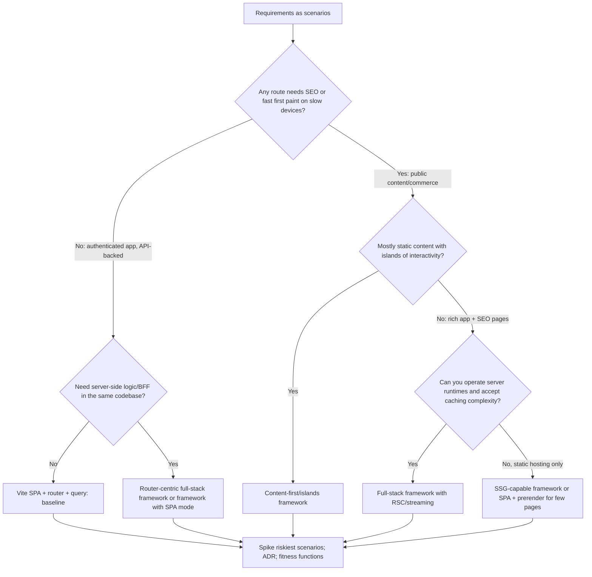
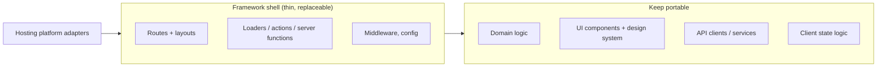

# 11 / 15 — Framework Selection

> **Verify against current docs.** Framework capabilities, defaults, APIs, hosting integrations and project health change faster than any other topic in this curriculum. This lesson teaches a **selection method** and the **architectural properties** to compare. Every statement about a specific framework is a snapshot as of the lesson's writing; confirm against the framework's current documentation, release notes, and security advisories before relying on it. Start with <https://react.dev/learn/creating-a-react-app> (React's own guidance on starting a project) and re-read it when you decide.

## 1. Lesson metadata

| | |
|---|---|
| **Level** | Architect |
| **Study time** | 4–5 hours (reading 2 h, evaluation spike 1 h, exercises 1.5 h) |
| **Prerequisites** | [09/01 — SPA, SSR, SSG, streaming](../09-advanced-rendering-and-ecosystem/01-spa-ssr-ssg-streaming.md), [09/03 — Server components in depth](../09-advanced-rendering-and-ecosystem/03-server-components-in-depth.md), [09/09 — Framework architecture](../09-advanced-rendering-and-ecosystem/09-framework-architecture.md), [09/10 — Routing and nested layouts](../09-advanced-rendering-and-ecosystem/10-routing-and-nested-layouts.md), [09/12 — Auth boundaries](../09-advanced-rendering-and-ecosystem/12-auth-boundaries.md), [11/01 — Trade-off analysis](./01-trade-off-analysis.md), [11/14 — Build vs buy](./14-build-vs-buy.md) |
| **Next** | [16 — Supporting multiple teams](./16-supporting-multiple-teams.md) |
| **Related** | [10/02 — Deployment workflows](../10-production-engineering/02-deployment-workflows.md), [10/13 — Application migrations](../10-production-engineering/13-application-migrations.md), [11/12 — Microfrontends](./12-microfrontends.md), [11/20 — Evaluating emerging features](./20-evaluating-emerging-features.md), [11/22 — Long-term evolution](./22-long-term-evolution.md) |

**Learning objectives.** After this lesson you can:
1. Explain what a React **framework** outsources on your behalf (routing, rendering strategy, data loading and mutation, bundling, deployment adapters, conventions) and what that implies for architecture, lock-in, and team skills.
2. Distinguish **requirements** that genuinely drive selection (rendering, SEO, personalisation, auth model, deployment target, team topology, longevity) from fashion.
3. Compare the main categories — build-tool-based SPA (e.g. Vite), full-stack React frameworks (Next.js App Router, React Router framework mode, TanStack Start), content-first/islands (e.g. Astro with React), and mobile (Expo/React Native) — on explicit architectural criteria.
4. Run a time-boxed, evidence-based evaluation (hard requirements, spikes on the riskiest scenarios, scoring with sensitivity analysis, ADR).
5. Reduce framework coupling where it pays (boundaries, thin adapters, portable data layer) and recognise where it doesn't.
6. Plan migration and upgrade strategy, and detect early warning signs that a framework choice is failing.

**Concepts covered:** React "framework" vs library vs build tool, rendering modes (CSR/SSR/SSG/ISR/streaming/RSC) as capabilities, server functions/actions, routing models (file-based, config-based, nested layouts, data routers), data loading ownership, deployment targets (static hosting, Node server, serverless, edge, containers), adapters, vendor optimisation vs portability, upgrade churn, escape hatches, fitness functions, decision records.

---

## 2. Deep conceptual explanation

### 2.1 What problem is this lesson solving?

React itself is deliberately small: it renders components, manages state, and (since 19) supports Actions, `use`, Suspense, and Server Components as primitives. It does **not** provide routing, data fetching conventions, bundling, server integration, code-splitting policy, deployment, or an SSR server. Those are *application architecture* concerns that someone must decide. A framework (or a hand-assembled stack) is the answer to "who owns these decisions?"

The React team's own guidance (checked 2026-10-22 at <https://react.dev/learn/creating-a-react-app> and <https://react.dev/learn/build-a-react-app-from-scratch>) recommends starting new apps with a framework that provides routing, data fetching, and code splitting, and describes building from scratch with a bundler (e.g. Vite, Parcel, Rsbuild) as a legitimate but more labour-intensive route; Create React App has been deprecated. As of 2026-10-22 that page lists Next.js (App Router), React Router (v7), and Expo for native/universal apps, plus other frameworks such as TanStack Start (labelled Beta on react.dev) and RedwoodSDK, and says Next.js App Router is "the most complete implementation" of the full-stack React architecture. *Version-sensitive: the list and wording evolve — re-read the page when deciding.*

Framework selection is among the **least reversible** frontend decisions: routing, data loading, file layout, deployment pipeline, auth integration, testing setup, and developer habits all end up shaped by it. It is also one where social proof and marketing are loud and evidence is quiet. Typical failure patterns:

- **Resume-driven or hype-driven choice:** adopting an SSR/RSC full-stack framework for an authenticated internal dashboard that needs neither SEO nor server rendering, then paying complexity tax forever.
- **Default-driven choice:** choosing the most popular framework without examining that it's tuned to a particular hosting platform you don't use.
- **Under-adoption:** hand-assembling a router + data layer + build + SSR for a content-heavy public site and reimplementing, badly, what a framework provides (prefetching, streaming, image optimisation, cache semantics).
- **Ignoring the organisation:** picking a framework whose mental model (server components, caching layers) the team cannot operate or debug.
- **Pinning on today's features** and not examining **upgrade churn, governance, and breaking-change history**.

### 2.2 What a framework outsources

A useful decomposition: for each concern, the question is *who owns this decision — us or the framework?*

| Concern | Library-only (e.g. Vite + React + chosen libs) | Framework-provided |
|---|---|---|
| **Routing** | You choose a router (React Router, TanStack Router) | File- or config-based router integrated with data and rendering |
| **Rendering strategy** | Mostly CSR; SSR requires your own server integration | Per-route or per-component choice: static, server, streaming, client |
| **Data loading** | You choose (TanStack Query, SWR, fetch-in-effect) | Loaders/server components/`fetch` integration with caching semantics |
| **Mutations** | Handlers + client library | Actions/server functions/forms integration |
| **Bundling / code splitting** | You configure (Vite/Rollup) | Preconfigured, route-based splitting |
| **Server runtime** | None (static hosting) or custom API | Node/serverless/edge adapters |
| **Caching & revalidation** | HTTP + client caches | Framework caching layers (data cache, full-route cache, ISR-like) — often the most complex part |
| **Asset optimisation** | Plugins/manual | Image/font/script components |
| **Conventions** | Yours | Strong, opinionated; shared across teams and hires |
| **Deployment** | Static files on any CDN | Platform adapters; some features need specific runtime support |

Observation: **a framework's value is mostly in concerns that cross the client–server boundary** (SSR, data loading with streaming, mutations, caching, routing integrated with data). If your app has no server-rendered surface and your backend is a separate API, the framework's value shrinks to routing/bundling conveniences you can get with a router + Vite.

### 2.3 Rendering capability, not rendering religion

Treat rendering modes as **capabilities per route**, driven by requirements ([09/01](../09-advanced-rendering-and-ecosystem/01-spa-ssr-ssg-streaming.md)):

| Requirement | Implication |
|---|---|
| **Public, crawlable, content-first** (marketing, docs, catalogues) | Needs HTML on first response: SSG/SSR/streaming; fast LCP on slow devices |
| **Personalised, authenticated, interactive app** | CSR can be fine; SSR optional (helps first paint but not SEO) |
| **Hybrid** (public pages + authenticated app) | Per-route modes; shared design system; auth boundary |
| **Frequently updated content with CDN caching** | Static generation with revalidation; cache invalidation story matters |
| **Real-time/collaborative** | Client-heavy; server for session/state/transport; SSR for shell only |
| **Offline-first/PWA** | Client-heavy; service worker; framework's compatibility with it |

A framework that **forces** one mode for all routes is a risk when requirements are mixed; one that *supports* all modes may carry complexity you never use. The architectural question is *how well the framework supports a mix and how costly it is to change a route's mode later*.

### 2.4 The candidate categories (illustrative, verify current state)

> The names below are examples of categories as of the lesson's writing. Re-evaluate with current docs; new entrants and consolidations happen often (for instance, Remix's evolution into React Router's framework mode is a recent example of consolidation — verify the current relationship at <https://reactrouter.com/>).

**A. Build-tool SPA (Vite + React + router + data library).** Client-rendered; static assets on a CDN; backend is a separate API. 
*Strengths:* simplest mental model; no server runtime to operate; portable hosting; fast dev; maximum control; smallest framework-lock surface. 
*Weaknesses:* you assemble and maintain conventions (routing, data, error handling); weaker SEO/first-paint without SSR; waterfalls if not careful ([07/17](../07-performance/17-network-waterfalls.md)). 
*Fits:* authenticated dashboards/internal tools, embedded apps, apps behind a login with a rich API.

**B. Full-stack React framework with server rendering — "Next.js App Router" style (RSC-first).** React Server Components, server functions, nested layouts, streaming, extensive caching conventions, tight integration with a specific hosting platform (but self-hostable). *Caching defaults and APIs have changed across major versions (Next.js 16 is current on npm; its docs now centre on the `"use cache"` directive and `cacheComponents`, where data not explicitly cached is treated as uncached and must sit inside `use cache` or behind `<Suspense>`). Re-read the caching docs for the exact version you adopt.* 
*Strengths:* mature ecosystem; first-class RSC and streaming; broad hiring pool; many integrations; image/font optimisation; flexible per-route rendering. 
*Weaknesses:* conceptual complexity (server/client boundaries, serialisation, caching layers); upgrade churn; features optimised for a particular hosting platform; harder local debugging of cache behaviour; some libraries need client boundaries; security surface expanded by server functions ([09/12](../09-advanced-rendering-and-ecosystem/12-auth-boundaries.md)).

**C. Router-centric full-stack framework — "React Router framework mode" style.** Config/file routes, loaders/actions, SSR or SPA mode, web-standards focus (Request/Response), adapters for multiple runtimes. *RSC support in this category has been evolving (react-router 8.x is the current major on npm as of 2026-10-22; check its docs for the current RSC status).* 
*Strengths:* simple data-loading model (loaders/actions), strong progressive-enhancement story, portable across runtimes, easier mental model than a multi-layer cache. 
*Weaknesses:* smaller ecosystem of integrations than the largest framework; RSC story may lag or differ; fewer turnkey platform features.

**D. Type-safe router + start layer — "TanStack Start" style.** Built around a type-safe router and TanStack ecosystem (Query), server functions, SSR/streaming. *Newer: `@tanstack/react-start` is at 1.x on npm (2026-10-22) although react.dev still labels it Beta; check release notes and API stability before committing.* 
*Strengths:* strong typing across routes/search params/loaders; composes with TanStack Query; flexible. 
*Weaknesses:* younger ecosystem; breaking-change risk; smaller hiring pool; fewer production references.

**E. Content-first / islands architecture (e.g. Astro with React islands).** Mostly static HTML with interactive React islands hydrated selectively. 
*Strengths:* minimal JS for content sites; great LCP; frameworks-agnostic islands. 
*Weaknesses:* app-like navigation/state across islands requires extra work; not ideal for highly interactive apps; mixed mental model.

**F. React Native / Expo (mobile).** Different platform: not a web framework choice, but a related strategic decision (shared logic/design tokens vs shared UI). Out of scope here beyond noting it: sharing code between web and native is a *domain-layer and design-token* strategy more often than a UI-component one.

**G. Custom stack (router + SSR server + bundler assembled in-house).** 
*Strengths:* total control. *Weaknesses:* you become a framework maintainer; justify only when requirements are unusual (e.g. multi-tenant edge rendering with bespoke caching) and the capacity exists ([14 — Build vs buy](./14-build-vs-buy.md)).

### 2.5 The decision is multi-dimensional — criteria that matter

1. **Rendering and SEO needs** (per route; §2.3).
2. **Data and mutation model** fit: Where does data live? Existing API/BFF/GraphQL? Do you need server functions or a clear API boundary ([06/14](../06-data-fetching-and-state-ecosystems/14-server-side-data-loading.md))? How does it interplay with TanStack Query/Redux (client caches vs framework caches)? 
3. **Deployment and operations:** static CDN only? Node servers? serverless? edge runtimes? Container platforms? Is the framework's full feature set available on your platform, or only on the vendor's? (Examples of platform-dependent features: image optimisation, ISR-like caches, middleware/edge functions.)
4. **Auth and security model:** session handling, middleware, CSRF for mutations, server-function exposure ([10/06](../10-production-engineering/06-security-xss-csrf-csp.md), [09/12](../09-advanced-rendering-and-ecosystem/12-auth-boundaries.md)). Track framework security advisories — server-side React features have had serious advisories; ensure you can **patch quickly** (upgrade path, dependency pinning, automated update PRs).
5. **Team and organisation:** skills, mental-model load, hiring market, number of teams, microfrontend requirements ([12](./12-microfrontends.md)) — some frameworks compose poorly across independently deployed units.
6. **Performance model:** bundle baseline, hydration approach, streaming support, partial prerendering, edge latency; measured with *your* pages ([09](./09-performance-budgets-at-scale.md)).
7. **Developer experience and tooling:** dev server speed, HMR, TypeScript integration, testing story (component tests with Vitest/RTL, E2E with Playwright, mocking server code), debugging cache behaviour.
8. **Ecosystem compatibility:** UI libraries, CSS-in-JS (often need client-side runtime/SSR support — [04/27](../04-react-architecture/27-styling-architecture.md)), auth providers, analytics, i18n, CMS integration.
9. **Governance and longevity:** who funds and steers it (a company, a foundation, a community)? Release cadence, deprecation policy, breaking-change history, LTS commitments, upgrade tooling (codemods).
10. **Lock-in and exit cost:** how many of your files import framework-specific APIs? Can routes/components be moved? What's the cost to move to another framework or to a SPA?
11. **Accessibility defaults:** route announcements, focus management, link semantics, form behaviour (progressive enhancement helps) ([11](./11-designing-for-accessibility.md)).
12. **Cost:** hosting model (server vs static), per-invocation/edge charges, build minutes, team time.

### 2.6 Misconceptions

| Misconception | Reality |
|---|---|
| "SSR/RSC is the modern default for everything." | They solve specific problems (first paint, SEO, data colocation near servers, smaller client bundles). For authenticated, API-backed apps with little SEO need, they add operational and cognitive cost without proportional benefit. |
| "A framework's popularity guarantees fit." | Popularity correlates with ecosystem and hiring, not with fit to your constraints. |
| "SPA is obsolete." | SPAs remain a rational choice for a large class of applications; their weaknesses (first load, SEO) matter only if you need what they weaken. |
| "A framework protects me from architecture decisions." | It makes some; you still own domain boundaries, state ownership, error handling, testing, and security. |
| "We can switch frameworks later." | Possible but costly; routing and data loading are pervasive. Plan for it only to the degree it's likely and valuable. |
| "RSC means no client state management needed." | Client interactivity still needs client state; RSC reduces some data-fetching/state needs, not all ([04/16](../04-react-architecture/16-server-vs-client-state.md)). |
| "Self-hosting a full-stack framework is the same as hosting on its home platform." | Some features depend on platform-specific infrastructure; self-hosting requires you to provide caches, image optimisation, and scaling behaviour. Verify per feature. |

---

## 3. Internal mechanics

### 3.1 What a full-stack React framework does at request time (teaching model)

Conceptually (details vary):

1. **Router matches the URL** to a route tree (nested layouts, params).
2. **Data requirements are determined** per route/segment (loaders, server components, `fetch` calls) — in parallel when the framework can, avoiding waterfalls.
3. **The server renders** the route to HTML/stream (possibly with RSC payload) while resolving data; Suspense boundaries allow streaming of ready parts first ([09/05](../09-advanced-rendering-and-ecosystem/05-suspense-architecture.md)).
4. **Response streams** to the browser with scripts for hydration; client components hydrate ([09/02](../09-advanced-rendering-and-ecosystem/02-hydration-internals-deep-dive.md)).
5. **Client navigation** after hydration: the client router fetches *data/RSC payloads or loader data* for the next route and updates the tree, with prefetching on hover/viewport depending on config.
6. **Mutations** go through actions/server functions/forms, followed by **revalidation** of relevant data.
7. **Caching** layers (CDN, framework data cache, router cache, browser) determine freshness.

*Public guarantee:* documented behaviours of routing, loaders/actions, and rendering modes. *Implementation detail:* bundler plugin architecture, the RSC wire format, internal cache keys, how the router stores prefetched data — these change between versions, and the RSC bundler integration is explicitly framework-specific ([09/03](../09-advanced-rendering-and-ecosystem/03-server-components-in-depth.md)). ⚠ *Don't depend on implementation details; rely on documented APIs and test behaviour at upgrade time.*

### 3.2 Where lock-in actually lives

| Layer | Coupling | Escape cost |
|---|---|---|
| **Routing definitions and navigation APIs** (`useRouter`, `<Link>`, route files) | Broad; every page and many components | Medium–high (but mechanical; codemods) |
| **Data loading conventions** (server components/loaders/server functions) | Pervasive; shapes component boundaries | High: restructures data flow |
| **Server/client boundary** (RSC directives, serialisation limits) | Component design | High |
| **Caching semantics** | Hidden behaviours; performance/regressions | High (behavioural) |
| **Platform features** (image optimiser, edge middleware, ISR) | Deployment | Medium (replace with CDN/image service) |
| **Build config / plugins** | Moderate | Low–medium |
| **Pure UI components, hooks, domain logic, design system** | None (if kept framework-agnostic) | None |

Architectural conclusion: **invest in keeping the bulk of code (domain logic, UI components, design system, API clients, state logic) framework-agnostic**, and accept coupling concentrated in a **thin shell layer** (routes, loaders, server functions, layouts). That's the "framework as a plugin to your app" posture ([04/10 — Clean and hexagonal architecture](../04-react-architecture/10-clean-and-hexagonal-architecture.md)). It has costs: some framework features (data colocation via server components) *are* the point, and abstracting them away negates their benefit. The practical compromise is to keep **domain and UI** portable but let the **route/data layer** be idiomatic.

### 3.3 Upgrade and security mechanics

Frameworks release majors regularly and have shipped security advisories affecting server-rendering features. Key mechanics:
- **Semver + deprecation policy**: check how long deprecated APIs remain, whether codemods exist, and whether major upgrades have historically been smooth.
- **React version coupling**: frameworks pin or peer-depend on specific React versions (especially for RSC, which requires matching bundler integration); verify supported React versions.
- **Patch latency**: how quickly you can adopt a security patch depends on how far behind you are — an app two majors behind can't take an urgent patch quickly. Policy: stay within N-1, automate update PRs, have E2E smoke coverage to upgrade confidently.
- **Supply chain**: framework installs bring many transitive dependencies; apply dependency security controls ([10/07](../10-production-engineering/07-dependency-security.md)).

---

## 4. Step-by-step: a framework evaluation process

1. **Write the requirements as testable scenarios**, not features. E.g. "A product page loads with LCP ≤ 2.5 s p75 on a mid-range Android on 4G, indexed correctly by search engines, showing personalised pricing for logged-in users, updating price without full reload." "An authenticated report page renders 20k rows with sorting in < 200 ms interaction latency."
2. **Classify routes** by rendering needs (static/ISR/SSR/CSR), auth, and traffic. Count how many routes need SEO at all.
3. **List hard constraints**: hosting platform and operations capacity, compliance (data residency, air-gapped), team skills, existing backend contracts, microfrontend plans, supported browsers, budget.
4. **Shortlist 2–3 candidates** (always include the *boring* option — e.g. Vite SPA or the framework you already use — as the baseline; justify any move away from it).
5. **Eliminate by hard constraints** (e.g. cannot operate Node servers; need self-hosting in a private network with no vendor-specific services).
6. **Design spikes on the riskiest scenarios** (not a to-do app): auth + SSR + personalisation; one data-heavy page; one mutation flow with optimistic UI; deployment to the *real* target environment; local debugging and test setup; a11y of navigation; observability/tracing; a deliberate failure (API down) and streaming error boundary behaviour.
7. **Measure**: Lighthouse/RUM-like lab metrics on throttled profiles, TTFB, JS shipped per route, build times, dev server cold start/HMR, cache behaviour (does a revalidation really update?), complexity (lines/concepts needed for the scenario), and defects/friction logged.
8. **Evaluate lock-in and upgrade/security posture** from release history and docs: last 3 majors' migration guides, advisories, response times.
9. **Score with gates + weights + sensitivity** ([14 §5.3](./14-build-vs-buy.md)); document *why* each score.
10. **Decide and write the ADR** with explicit assumptions, rejected alternatives, consequences, a *fitness function* set (§5.4), and revisit triggers.
11. **Pilot** with one product area or a vertical slice before committing the whole organisation; define success criteria (time to ship a feature, defects, performance).
12. **Plan adoption**: conventions doc, starter template, lint rules (framework boundaries), upgrade cadence, training, ownership of the platform layer ([16](./16-supporting-multiple-teams.md)).

---

## 5. Code examples

### 5.1 Minimal — the SPA baseline (Vite + router + query), showing what you own

```tsx
// src/main.tsx — Vite SPA baseline (illustrative; router API per your version)
import { StrictMode } from 'react';
import { createRoot } from 'react-dom/client';
import { QueryClient, QueryClientProvider } from '@tanstack/react-query';
import { createBrowserRouter, RouterProvider } from 'react-router';   // package name/version: verify
import { routes } from './routes';

const queryClient = new QueryClient();
const router = createBrowserRouter(routes);

createRoot(document.getElementById('root')!).render(
  <StrictMode>
    <QueryClientProvider client={queryClient}>
      <RouterProvider router={router} />
    </QueryClientProvider>
  </StrictMode>,
);
```

What you **own** in this baseline and a framework would otherwise provide: route-based code splitting policy (`lazy` per route), data-loading convention (loaders vs hooks), error boundaries per route, SEO tags (none: CSR), auth redirects, deployment (static hosting with SPA fallback to `index.html`), prefetching. This is not a criticism — for an authenticated dashboard this is a feature: very little hidden behaviour.

### 5.2 Practical — a thin framework boundary

Keep framework-specific code in a **shell** and let features depend on a narrow interface:

```ts
// features/orders/routes.ts — framework-agnostic *description* of the feature's pages
export type RouteDef = { path: string; load: () => Promise<{ default: React.ComponentType }> };
export const ordersRoutes: RouteDef[] = [
  { path: '/orders', load: () => import('./pages/OrderList') },
  { path: '/orders/:id', load: () => import('./pages/OrderDetail') },
];
```

```ts
// platform/router-adapter.ts — the ONLY file that knows the framework's route format
import type { RouteDef } from '../features/orders/routes';
export function toFrameworkRoutes(defs: RouteDef[]) {
  return defs.map((d) => ({ path: d.path, lazy: async () => ({ Component: (await d.load()).default }) }));
}
```

Trade-offs (be honest): this keeps feature pages portable between routers *if* they don't use route-specific hooks (`useLoaderData`, `useParams`) directly. To make them portable, pages receive params and data via props from a framework-specific wrapper:

```tsx
// features/orders/pages/OrderDetailView.tsx — portable: pure props
export function OrderDetailView({ order, onCancel }: { order: Order; onCancel(id: string): Promise<void> }) { /* … */ }

// app-shell/routes/orders.$id.tsx — framework-specific wrapper (the thin layer)
export default function Route() {
  const order = useLoaderData<typeof loader>();           // framework API lives here only
  return <OrderDetailView order={order} onCancel={cancelOrderAction} />;
}
```

This is a **container/presentational split at the route level** ([05/04](../05-design-patterns/04-container-presentational.md)). Cost: more files; benefit: the framework-specific surface is the thin route layer, which is mostly mechanical to rewrite. When *not* worth it: small apps, or where the framework's server components/data colocation (fetching inside the component on the server) is exactly the benefit you want — abstracting it away throws away that benefit, and you might as well choose the SPA baseline.

### 5.3 Practical — server function boundary and validation (any full-stack framework)

```ts
// A framework-agnostic *service* (pure TS) keeps business rules testable
// server/services/orders.ts
export async function cancelOrder(deps: { db: Db; clock: Clock }, user: SessionUser, orderId: string) {
  const order = await deps.db.orders.find(orderId);
  if (!order || order.userId !== user.id) throw new ForbiddenError();      // authorization IN the service
  if (order.status !== 'pending') throw new ConflictError('Order cannot be cancelled');
  await deps.db.orders.update(orderId, { status: 'cancelled', cancelledAt: deps.clock.now() });
}
```

```ts
// framework-specific entry (illustrative server function/action wrapper)
'use server';                                       // Next-style directive; other frameworks differ
import { z } from 'zod';
const Input = z.object({ orderId: z.string().uuid() });

export async function cancelOrderAction(formData: FormData) {
  const { orderId } = Input.parse({ orderId: formData.get('orderId') });   // validate untrusted input
  const user = await requireSession();                                     // authenticate on EVERY call
  await cancelOrder({ db, clock: systemClock }, user, orderId);            // delegate to service
  revalidate(`/orders/${orderId}`);                                        // framework-specific cache API (verify)
}
declare const db: Db; declare const systemClock: Clock; declare function requireSession(): Promise<SessionUser>; declare function revalidate(p: string): void;
```

Key principle: **server functions are public HTTP endpoints** regardless of how convenient the syntax is — authenticate, authorise, and validate inside every one ([09/12](../09-advanced-rendering-and-ecosystem/12-auth-boundaries.md)). Keeping business rules in a framework-agnostic service makes them unit-testable ([10](./10-designing-for-testability.md)) and portable. The thin action wrapper is the framework-specific piece.

### 5.4 Practical — fitness functions that protect the decision

Encode the architectural intent as automated checks ([04/25](../04-react-architecture/25-architectural-fitness-and-enforcement.md)):

```ts
// tools/fitness/framework-coupling.test.ts — run in CI
import { globSync } from 'glob';
import { readFileSync } from 'node:fs';

const FRAMEWORK_IMPORTS = /from ['"](next\/|@remix-run\/|react-router|@tanstack\/react-start)/;
const ALLOWED = ['app-shell/', 'platform/', 'app/']; // directories allowed to import the framework

it('framework APIs are imported only in the shell/platform layer', () => {
  const offenders = globSync('src/**/*.{ts,tsx}')
    .filter((f) => !ALLOWED.some((a) => f.includes(a)))
    .filter((f) => FRAMEWORK_IMPORTS.test(readFileSync(f, 'utf8')));
  expect(offenders).toEqual([]);
});

it('client bundle for the home route stays within budget', async () => { /* see 11/09 */ });
```

Also: a check that `'use client'`/`'use server'` directives appear only where allowed; a check that **no secrets** appear in client bundles (scan build output for env var names/patterns); an E2E smoke that each route's rendering mode matches the ADR (e.g. "pricing page is statically generated: response has no per-request headers and TTFB < X ms").

### 5.5 Incorrect — choosing by demo and starting without a deployment target

```
Day 1: "Let's use <hot framework>." (chosen from a conference talk)
Day 30: Feature work in full swing using server components + platform-specific image optimisation + edge middleware.
Day 60: Security requires self-hosting in a private cloud with no edge runtime and a corporate proxy.
Day 61: Half the features don't work; caching behaves differently; the team debates a rewrite.
```

Root cause: deployment constraints are *hard requirements* and weren't tested in a spike. The fix would have cost two days in week 1.

### 5.6 Corrected — a spike matrix for the riskiest scenarios

| Scenario | Why risky | Pass criteria | Evidence artefact |
|---|---|---|---|
| Deploy to real target (private cloud, Node 22 container, behind proxy) | Platform features may not exist | App runs; image optimisation/ISR-like features behave or are replaced | Deployed URL + runbook |
| Auth: SSO session in middleware + server function; logout invalidation | Security boundary | Unauthorised mutation attempts fail; session expiry handled | Test suite + threat checklist |
| Personalised price on SEO page | Mixes static caching with per-user data | Cacheable shell; personalised island loads without layout shift | Lighthouse + RUM-like trace |
| 20k-row editable grid | Client-heavy; hydration cost | Interaction latency target met; no hydration mismatch | Performance trace |
| Failure: API down / slow | Streaming + error boundaries | Partial page with accessible fallback; no blank screen | Playwright test |
| Local DX: debug, test, mock server code | Productivity | Vitest + RTL + MSW work for server/client code; sourcemaps usable | Repo with tests |
| Upgrade drill: bump a minor + last major's migration | Churn risk | Time and defects recorded | Upgrade log |

---

## 6. Visual explanations





```
Complexity budget (qualitative):
  SPA baseline:           concepts = components, hooks, router, query            ops = static hosting
  Router-centric fullstack: + loaders/actions, SSR runtime                         ops = server/serverless
  RSC-first fullstack:      + server/client boundary, serialisation, multi-layer cache ops = server + cache infra
  Each added concept must buy a requirement you actually have.
```

---

## 7. Alternative approaches and trade-offs

| Approach | Best at | Weak at | Ops burden | Lock-in | Pick when |
|---|---|---|---|---|---|
| **Vite SPA + router + query** | Simplicity, portability, internal apps | SEO, first load on slow devices | Lowest (static hosting) | Low | Authenticated apps; strong separate API |
| **Router-centric full stack (loaders/actions, SSR optional)** | Web-standards data flow, progressive enhancement, portability | Smaller ecosystem; RSC maturity varies | Medium | Medium | Mixed apps wanting SSR without heavy cache layers |
| **RSC-first full stack (App Router style)** | Data colocation, streaming, smaller client bundles, ecosystem | Complexity, caching surprises, churn, platform affinity | Medium–High | Medium–High | Content + app hybrids with strong team capacity |
| **Type-safe router + start layer** | End-to-end typing, composing with query | Maturity, ecosystem | Medium | Medium | Teams prioritising type safety, comfortable with newer tech |
| **Islands/content-first** | Content sites, minimal JS | Rich app interactions | Low–Medium | Medium | Marketing/docs/blog/commerce catalogues |
| **Custom stack** | Unusual requirements | Maintenance burden | High | None (but you own it) | Very specific needs; mature platform team |
| **Multiple frameworks (marketing site vs app)** | Right tool per surface | Duplication of design system, divergent practices | Medium | Per-surface | Distinct teams/requirements; shared tokens/design system |

**A scenario where the recommended approach (match the framework to requirements; prefer the simplest) is NOT best.** An organisation with **eight product teams** and a mix of public and authenticated surfaces may prefer **one full-stack framework everywhere** even though some surfaces would be simpler as SPAs — because the benefit of *shared conventions, hiring, tooling, platform team leverage, and cross-team mobility* outweighs per-app optimality. Standardisation is itself a requirement (§9). The inverse: a company-wide mandate of a heavyweight framework for a tiny internal admin tool is a net loss; allow a documented SPA "paved road" for such cases.

---

## 8. Best practices and anti-patterns

**Practices**
- **Requirements before candidates; scenarios before features.** Include a baseline candidate.
- **Spike the risky 20 %:** deployment to the real environment, auth, personalisation, failure modes, upgrade drill.
- **Pin and plan upgrades:** stay within N-1 major; automate update PRs; maintain E2E smoke coverage; subscribe to security advisories; know your emergency patch path.
- **Keep domain/UI portable; concentrate framework coupling** in a shell layer and enforce with lint/fitness functions.
- **Treat server functions as public endpoints**; centralise authz and input validation; keep business logic in framework-agnostic services.
- **Make caching explicit:** document each route's rendering/caching mode (a table in the repo), test it, and observe it in production (cache hit ratios, stale rates).
- **Provide a starter template and conventions** so teams get the same paved road ([16](./16-supporting-multiple-teams.md)).
- **Set performance budgets per route** from day one ([09](./09-performance-budgets-at-scale.md)).
- **Document in an ADR** with revisit triggers (e.g. "revisit if two consecutive majors require >2 engineer-weeks migration" or "if a security patch took >5 days to roll out").

**Beginner mistakes**: choosing by tutorial popularity; adopting server rendering for an app with no SEO need; ignoring hosting constraints; mixing data-fetching paradigms (loaders + effects + query cache) without a policy; leaking secrets to client components.

**Experienced-developer mistakes**: over-abstracting the framework away (making an in-house framework on top of the framework); under-testing cache invalidation; ignoring the upgrade treadmill; assuming server components remove the need for an API boundary; allowing each team to adopt a different framework without a platform strategy; ignoring operational cost (observability for server rendering, cold starts, memory leaks in long-running Node processes).

**Smells**: nobody can explain why a given route is dynamic; a "magic" fix of `revalidate` calls scattered through code; features that work in dev but not in production (caching, edge runtime differences); client components importing server-only modules; `use client` at the root of every page ("we turned it off"); the team is a major version behind and afraid to upgrade; the build requires a vendor account to reproduce production behaviour.

**Justified exceptions**: choosing a heavier framework than needed to standardise across teams; choosing a SPA despite SEO needs when SEO is served by a separate static marketing site; staying on an older major with a documented backport/patch plan due to a blocking dependency; a custom server layer for unusual multi-tenant requirements. Do not present any framework as universally correct.

---

## 9. Real-world application

**E-commerce.** SEO and LCP drive revenue on listing/product pages: static/ISR-like + streaming personalisation for price/stock; checkout is often a *separate, leaner* surface with strict budgets and security isolation (PCI), possibly a different rendering model than the catalogue. Framework choice must support **per-route modes**, robust caching/invalidation for price changes, and image optimisation (platform feature or CDN). Be wary of cache layers that cause stale prices: define invalidation events (price updates → purge keys) and test them.

**Dashboards.** Authenticated, interactive, data-heavy: a SPA (or SPA-mode of a framework) is typically sufficient; SSR adds little unless first paint on slow devices matters or you want server-side data colocation to cut waterfalls. If your org standardises on a full-stack framework, use it in SPA-like mode with careful client boundaries rather than forcing server rendering.

**Finance / regulated.** Self-hosting, strict network zones, audit requirements, penetration testing. Prefer frameworks and runtimes you can run in your environment with minimal vendor-specific services; verify dependency provenance and patch latency; server functions require rigorous authz and rate limiting; change management for upgrades. Edge runtimes may be prohibited by data-residency rules.

**Auth-heavy apps.** Middleware/session handling differ by framework; ensure the framework supports your IdP flow (OIDC), CSRF protection for mutations, and **uniform authorisation** across server rendering, server functions, and API routes ([09/12](../09-advanced-rendering-and-ecosystem/12-auth-boundaries.md)).

**Realtime.** Long-lived connections (WebSocket/SSE) often don't fit serverless/edge platform models; a framework that assumes ephemeral functions may force a separate realtime service. Decide the transport architecture first ([06/17](../06-data-fetching-and-state-ecosystems/17-real-time-websockets-subscriptions.md)).

**Multi-team.** Standardise on one **paved road** (a primary framework + template + platform team) and one or two **documented alternatives** for justified cases (e.g. a SPA template, a static/islands template for content). Microfrontend plans ([12](./12-microfrontends.md)) constrain the choice: server-rendered frameworks with runtime composition across independently deployed apps are hard; frameworks optimised for a single-app model may fight composition. Upgrade management at scale: a platform team publishes the supported framework version and migration guides, and measures adoption.

**Migration.** From CRA/legacy SPA: move to a Vite-based SPA first (low risk), then adopt a framework route-by-route if SSR is needed (strangler, [10/13](../10-production-engineering/13-application-migrations.md)). From one framework to another: isolate by route groups; share the portable core; run both behind a proxy during migration; set exit criteria.

**Constraints to name in design docs:** hosting/operations capacity, compliance and data residency, SEO needs, team skills, number of teams, performance targets, third-party integrations, upgrade capacity, security response SLA.

---

## 10. Debugging and troubleshooting

(Diagnosing a framework choice that is failing.)

**Symptom 1: Stale data in production but fresh in development.**
*Investigation.* Framework caching differs in dev vs prod. Identify cache layers (CDN, full-route cache, data cache, client router cache); check response headers; reproduce with a production build locally (`build` + `start`); trace which layer serves stale content (add cache-status headers/logging). *Root cause example.* A route is statically rendered at build time because no dynamic API (cookies/headers) was read; a mutation didn't revalidate the specific tag/path. *Fix.* Make the route explicitly dynamic or add targeted revalidation; document the cache policy per route; add an E2E test that mutates then reads. *API names and defaults are version-specific; read the docs for your exact version.*

**Symptom 2: Hydration mismatch errors in production only.**
*Investigation.* Compare server HTML vs client first render; typical causes: `Date.now()`/`Math.random()`/locale formatting differences, browser-only APIs in render, extension-injected DOM, CDN HTML transformations (minification, injected scripts), invalid HTML nesting ([09/02](../09-advanced-rendering-and-ecosystem/02-hydration-internals-deep-dive.md)). Use React's development error output and diff; reproduce with production build. *Fix.* Make render deterministic; defer client-only values to effects/`useSyncExternalStore` server snapshot; fix HTML structure.

**Symptom 3: TTFB high / slow server rendering under load.**
*Investigation.* Server profiling; waterfall of data fetches inside server components/loaders (sequential awaits); cold starts for serverless; memory growth; missing caching of upstream calls; heavy dependencies loaded at module top-level. *Fix.* Parallelise fetches; cache upstream where safe; move to streaming with Suspense so the shell flushes early; right-size runtime; consider static generation for stable pages; add tracing (OpenTelemetry) around data calls ([10/04](../10-production-engineering/04-observability-and-logging.md)).

**Symptom 4: Build works locally, fails on CI/production host.**
*Investigation.* Node/runtime version mismatch, environment variables at build vs runtime, platform-specific adapters, filesystem write assumptions (read-only deployments), edge-runtime incompatible Node APIs. *Fix.* Pin runtime versions; separate build-time/runtime env handling ([10/03](../10-production-engineering/03-environment-configuration.md)); test deployment to the real target in CI (preview environments).

**Symptom 5: Upgrade to the next major takes weeks and keeps breaking.**
*Investigation.* Coupling analysis: how many files use framework-specific APIs? Which deprecated APIs remain? Are tests covering routing/data behaviours? *Fix.* Use codemods; upgrade incrementally (one minor/major at a time); strengthen E2E smoke; reduce coupling via the shell pattern; set an upgrade cadence (quarterly) so deltas stay small. *Signal:* if each major costs more than your ADR's threshold, trigger the revisit.

**Symptom 6: Security advisory in the framework's server runtime.**
*Response.* Identify exposure (are the affected features used?), apply the vendor's patch/mitigation immediately, add WAF rules if recommended, rotate secrets if applicable, review logs. *Process lesson.* Measure time-to-patch; ensure you can ship an upgrade in hours (automated PRs, smoke tests, ability to deploy). If you cannot, that is a decisive input for framework and version policy.

---

## 11. Exercises

### Level A — Knowledge
A1. List six concerns a React framework takes over compared with Vite + React alone.
A2. What does "rendering mode as a per-route capability" mean, and why does it matter for mixed apps?
A3. Why are server functions "public endpoints" and what three controls must every one include?
A4. Name four places framework lock-in accumulates and rank them by escape cost.
A5. What is a fitness function in this context? Give two examples.

### Level B — Code comprehension
B1. In §5.2, what is the benefit and the cost of the `OrderDetailView` / route wrapper split? When is it not worth it?
B2. In §5.3, what would go wrong if authorisation were done only in the UI (hiding the Cancel button) and not in `cancelOrder`?
B3. In §5.4, the allow-list check uses `f.includes('app/')` style substring matching. Give two concrete file paths that would be wrongly permitted to import the framework, and explain how to tighten the check.
B4. §5.1's baseline renders `RouterProvider` on the client only. Predict what a crawler (that doesn't execute JavaScript) sees for `/orders/42`, and what changes if the framework prerenders.

### Level C — Implementation
C1. Write the ADR for choosing between Vite SPA and an SSR framework for an authenticated B2B dashboard (use the template: context, options, decision, consequences, revisit triggers).
C2. Implement a script that scans the production build output for accidental inclusion of server-only env var names or secret-looking strings in client bundles.
C3. Implement a route-mode registry (`routes.manifest.ts`) with each route's rendering mode, cache policy and owner, plus a test that fails if a route file isn't listed.
C4. Build a small spike harness: a Playwright script measuring TTFB, LCP, and JS bytes for three routes across two candidate frameworks and outputting a comparison table.

### Level D — Debugging
D1. After deploying to a self-hosted Kubernetes cluster, image optimisation is slow and CPU spikes. Diagnose and propose options.
D2. Users see another user's personalised content briefly after login in production (never in dev). Hypothesise causes involving caching and propose an investigation.
D3. A team reports that after adopting server components their bundle shrank but INP worsened on a data-heavy page. Explain how both can be true and what you'd examine.

### Level E — Architecture and engineering decisions
E1. A 60-engineer company, 6 teams: public marketing + docs (SEO critical), a customer portal (authenticated), an internal admin (authenticated). All React. Propose a framework strategy.
E2. A startup (8 engineers) building a consumer web app with SEO-critical content pages, user-generated content, and rich editing. Choose and justify, including what you'd defer.
E3. A bank must self-host in an air-gapped network. The team wants the framework with the most advanced RSC features. Evaluate.

### Level F — Expert challenge
F1. Design the framework-governance model for an organisation with 20 teams: supported frameworks, paved roads, upgrade policy, security response, exceptions, metrics, and deprecation.
F2. Argue **against** adopting any full-stack framework for your organisation and in favour of a SPA-only + separate static site strategy. Then identify the conditions that would falsify your argument.

---

## 12. Detailed answers and explanations

> Attempt the exercises first.

**A1.** Routing and nested layouts; rendering strategy (SSR/SSG/streaming) with a server runtime; data loading conventions and caching; mutations (actions/server functions) and revalidation; code splitting/bundling configuration; asset optimisation (images, fonts, scripts); deployment adapters; conventions/folder structure; dev server and tooling integration; middleware/session handling. Any six.

**A2.** Different routes have different needs: marketing pages need static generation and SEO; product pages need cached-but-revalidated content with personalised fragments; the account area needs authenticated dynamic rendering or CSR. A framework that lets you choose per route (or per segment/component) allows each surface to use the cheapest viable mode; a framework that forces a single mode makes some surfaces pay for capabilities they don't need or lack ones they do. It matters architecturally because changing a route's mode later should be cheap, and the framework's abstractions should not entangle modes (e.g. cache semantics leaking across routes).

**A3.** Because they compile to HTTP endpoints callable by anyone who can craft the request — the function call syntax doesn't make them internal. Controls: **authentication** (valid session), **authorisation** (is this user allowed to do this to this resource), **input validation** (schema parse of untrusted data); plus CSRF protection where applicable (frameworks may provide it — verify), rate limiting, and output filtering (don't return more data than needed). Common wrong answer: "framework handles it" — it handles transport, not your authorisation logic.

**A4.** (1) Data-loading conventions / server-client boundary — highest escape cost (restructures component trees and data flow); (2) caching semantics — high (behaviour and performance regressions, hard to test); (3) routing definitions and navigation APIs — medium (mechanical and codemod-friendly, but broad); (4) platform features (image optimiser, edge middleware) — medium; (5) build config/plugins — low-medium; pure UI/domain code — none if portable. Ranking justification matters more than exact order.

**A5.** An automated, repeatable check that verifies an architectural characteristic (from the "evolutionary architecture" concept): e.g. a test that framework imports occur only in the shell layer; a bundle budget per route; a test that every route is registered with a declared rendering mode; a scan that server-only secrets don't appear in client bundles; E2E checks that revalidation updates content after a mutation.

**B1.** Benefit: the framework-specific API (`useLoaderData`, route module exports) is confined to a thin wrapper; `OrderDetailView` takes plain props so it is testable without a router, reusable across routes/frameworks/Storybook, and easier to migrate. Cost: extra files and indirection, prop plumbing, risk of duplicating route logic; juniors may be confused about where to put things. Not worth it when the app is small, when the framework's colocated data fetching (e.g. async server components) *is* the intended design (the component is the route), or when migration probability is low and you accept the coupling. Judge by switching probability × cost versus ongoing indirection cost.

**B2.** An attacker (or a curious user) can call the server function directly (crafted request) and cancel orders they shouldn't — hiding a button is not security. Also race conditions: UI state could be stale; the service must enforce invariants (status check). `cancelOrder` verifies ownership and state, so even a forged request fails with `ForbiddenError`/`ConflictError`. Test: write a unit test that calls the service with another user's id and expects rejection ([10](./10-designing-for-testability.md)).

**B3.** Substring matching is too loose: `src/features/webapp/pages/Orders.tsx` contains `app/` (inside `webapp/`) and `src/features/mapping/platform/utils.ts` contains `platform/`, so both would be allowed to import framework APIs although they are feature code. Tighten with anchored prefixes (`f.startsWith('src/app-shell/')`), or use an import-boundary tool (dependency-cruiser, or ESLint `no-restricted-imports` with per-directory overrides) that matches on resolved paths. Also test the check itself with a deliberately violating fixture file so a silent regression of the rule is detected.

**B4.** A crawler that doesn't run JS fetches `index.html` — essentially an empty `<div id="root">` plus script tags (and whatever static `<head>` is in the HTML) — so it sees no product/order content or route-specific metadata. (Many modern crawlers do execute JavaScript, with delays/limits — don't rely on it for critical content.) If the framework prerenders (SSG/SSR), the HTML response contains the rendered content and route-specific meta tags, so non-JS crawlers and link previews work; hydration then attaches interactivity. For `/orders/42` (authenticated), SEO is irrelevant — the example shows when SSR gives nothing.

**C1.** *Example ADR (condensed).* **Title:** ADR-0012 Frontend framework for customer analytics dashboard. **Context:** B2B authenticated app, 40 customers, behind SSO, REST/GraphQL API owned by another team, 12 routes with data-heavy tables/charts, no SEO need, deployment to company-managed static hosting + CDN, 5 frontend engineers, 2-year horizon. **Decision drivers/gates:** no new server runtime to operate; strong a11y; interaction latency; upgrade simplicity; hiring. **Options:** (A) Vite SPA + React Router + TanStack Query; (B) Full-stack SSR framework (server rendering, server functions); (C) Router-centric framework in SPA mode. **Evidence:** spike results (bundle 180 kB, INP p75 160 ms on grid; SSR variant added ~110 ms TTFB and a Node service with no measurable LCP benefit behind login); ops capacity (no on-call for Node services). **Decision:** A. **Consequences:** we own conventions (route-level code splitting, error boundaries, auth redirects), have no server-rendered SEO surface (marketing site is separate), simple hosting and rollback; weakness: waterfalls risk (mitigated by route loaders/prefetch and query prefetching), no server functions (all mutations go through the API). **Revisit triggers:** a public SEO-relevant surface in the app; need for server-side aggregation (BFF) owned by this team; framework offering SPA-mode with materially better DX; hosting platform change. **Evaluation criteria:** concrete context, gates, evidence, alternatives, consequences including negatives, triggers.

**C2.** *Criteria:* defines a list of server-only env var names and secret patterns (AWS key regex `AKIA[0-9A-Z]{16}`, private key headers, JWT-like strings, known internal hostnames); scans client output directories (excluding server bundles) including source maps; fails with file and match; avoid false positives with allowlists; run on every build; complement with framework-provided separation of public env vars (prefix conventions — verify) and a secret scanner (e.g. gitleaks) on the repo. Sample:
```ts
import { globSync } from 'glob'; import { readFileSync } from 'node:fs';
const patterns = [/AKIA[0-9A-Z]{16}/, /-----BEGIN (RSA |EC )?PRIVATE KEY-----/, new RegExp(process.env.SECRET_NAMES_REGEX ?? 'DATABASE_URL|SESSION_SECRET')];
const files = globSync('dist/client/**/*.{js,css,map,html}');   // path is framework-specific; verify
const hits = files.flatMap((f) => { const t = readFileSync(f, 'utf8'); return patterns.filter((p) => p.test(t)).map((p) => `${f}: ${p}`); });
if (hits.length) { console.error(hits.join('\n')); process.exit(1); }
```
Edge: minifiers may inline env values — scan for *values* (derive from the server env) in addition to names, but never print secret values in CI logs.

**C3.** *Criteria:* single source of truth (`manifest`) typed with union of modes; test enumerates route files via glob and compares to manifest keys; includes cache policy and owner (CODEOWNERS reconcile); optionally generates docs; fails on unlisted or stale entries. Sample:
```ts
export const routeManifest = {
  '/':               { mode: 'static',  revalidateSeconds: 3600, owner: '@acme/web-marketing' },
  '/products/:id':   { mode: 'static+personalized', revalidateSeconds: 60, owner: '@acme/catalog' },
  '/account/*':      { mode: 'dynamic', owner: '@acme/account' },
} as const satisfies Record<string, { mode: 'static'|'static+personalized'|'dynamic'|'client'; revalidateSeconds?: number; owner: string }>;
```
Test: derive route patterns from file names (framework-specific) and assert set equality. Value: makes rendering/caching decisions explicit and reviewable — the manifest is where debates about "why is this dynamic?" are answered.

**C4.** *Criteria:* same data/fixtures and throttling profiles across candidates; repeated runs with median; TTFB via `performance.getEntriesByType('navigation')`, LCP via `PerformanceObserver`, JS bytes via response sizes (`page.on('response')`); Playwright with CPU/network throttling through CDP (Chromium only); output table; note that lab spikes compare *relative* behaviour not absolute production numbers. Key caveat: candidates must be configured idiomatically (a poorly configured candidate invalidates the comparison), preferably by someone with experience or following official guides; disclose configuration.

**D1.** Likely: the image optimiser is a platform feature that runs in-process on the Node server (CPU-bound, sharp/libvips) without CDN caching in front; on the home platform it's offloaded to managed infra. Diagnose: CPU profile, cache hit ratio, request rate of image URLs, whether responses have long-lived cache headers, and whether a CDN is in front. Options: place a CDN with caching in front of the optimiser; use a dedicated image service (self-hosted imgproxy, or a managed CDN service); pre-generate image variants at build time for static content; scale optimiser separately; limit allowed sizes/formats to reduce variants. Prevention: the deployment spike (§5.6) should have included image-heavy page load testing.

**D2.** Hypotheses: (1) a shared cache (CDN/full-route cache) caches a response that varied by cookie but the `Vary`/cache key doesn't include session, so the first user's HTML is served to others; (2) framework data cache memoises a user-specific fetch because the request didn't read `cookies()`/headers in a way that marks it dynamic; (3) a module-level variable (singleton) in server code holds per-request user data (shared across concurrent requests); (4) client router cache retains prior user's RSC payload after logout/login without a hard refresh. Investigation: reproduce with two sessions in parallel; inspect `Cache-Control`/`Vary`/`Age`/cache-status headers; search for module-level mutable state in server code; test logout/login flows; add an E2E with two users alternately. Fix: mark such routes dynamic/private (`Cache-Control: private, no-store` for personalised responses), include session in cache keys or don't cache; remove module-level request state (use per-request context, e.g. AsyncLocalStorage-based request scoping); invalidate client caches on auth change. Severity: **security incident** — treat as data leak, notify per policy.

**D3.** Bundle size and INP measure different things. Server components can reduce shipped JS (smaller bundle, faster load), but INP measures responsiveness after load: if a data-heavy interaction (filtering, sorting) now triggers a **server round trip** (re-fetch/re-render RSC payload) instead of a client-side computation, interaction latency rises; or hydration of large client islands blocks the main thread; or heavy client components still dominate. Examine: interaction trace (input delay, processing, presentation delay), network timing of the interaction (does it call the server?), long tasks around hydration, transitions usage (`useTransition` to keep UI responsive), whether the interaction should be client-side with data already present. Fix: move interactive filtering to a client component operating on loaded data (or paginate server-side with optimistic UI), colocate state appropriately ([04/16](../04-react-architecture/16-server-vs-client-state.md)), use transitions and prefetching.

**E1.** *Criteria:* surface-by-surface analysis; standardisation vs optimality; platform capacity. *Example strategy:* **Marketing + docs:** content-first or SSG-capable framework (islands or full-stack in static mode) for minimal JS and best LCP; content from a headless CMS; owned by marketing-eng. **Customer portal & admin:** authenticated, API-backed — default to the **same full-stack framework** as marketing only if the org values single-stack mobility and the platform team can support it; otherwise a **Vite SPA paved road** with shared design system and auth SDK. *Recommended:* two paved roads — (1) *content/commerce* template (SSG/SSR framework); (2) *app* template (SPA, router, query). Both share design tokens/components, auth integration, observability, CI; a platform team (3–4 engineers) maintains templates and upgrade guides. Rationale: with 6 teams, a single mega-framework mandate would add server-runtime cost for surfaces that don't benefit; the two-road model keeps variety bounded. Revisit if SEO needs enter the portal or if two templates diverge costing >X engineer-weeks/quarter in maintenance. Evidence to collect: share of traffic on SEO surfaces, team skills, hosting capabilities. *Wrong answer:* "use the most popular framework everywhere" without analysing surfaces; or "each team decides" without platform support.

**E2.** *Example:* SEO-critical content pages and UGC → server rendering required for content routes; rich editing → client-heavy islands; small team → minimise operational surface. Recommend a **full-stack framework with SSR/SSG per route and a well-supported hosting platform**, choosing the one the team can *operate and debug* (skills matter); use managed hosting to avoid running servers initially (accepting some platform affinity, mitigated by keeping domain logic and API clients portable). Defer: microfrontends, custom caching layers, edge personalisation, multi-region; keep the rich editor behind a port (build vs buy: adopt an editor library — [14](./14-build-vs-buy.md)) and load it lazily on edit routes (budget). Spikes: UGC page indexing and caching with moderation changes; editor a11y/perf; deploy preview environments; upgrade drill. Revisit triggers: infrastructure cost > threshold; need for features unavailable on chosen platform; framework major migration cost.

**E3.** *Evaluation:* "most advanced RSC features" isn't a requirement; air-gapped self-hosting is. Evidence needed: can the framework run fully offline (no external fonts/images/telemetry calls, no vendor APIs at build/run time)? Does image optimisation, caching, and middleware work in a self-hosted Node/container setup without platform-specific services? Can the team patch quickly in an air-gapped supply chain (internal registry mirroring, SBOM, provenance)? Is the RSC bundler integration stable enough for long-lived deployments? Operations: observability and scaling in-house. Likely recommendation: prefer a framework with first-class self-hosting (Node adapter) and fewer platform-dependent caches — possibly router-centric or a SPA for authenticated surfaces — adopting RSC only if spikes in the *actual* environment succeed and the security response process can handle server-side React advisories. Explicitly record the risk (patch latency in an air-gapped network) and revisit triggers. The point: requirements, not feature novelty, decide.

**F1.** *Example governance model.* **Supported set:** Tier 1 (paved roads): one full-stack framework template, one SPA template; Tier 2 (supported with caveats): content/islands framework for marketing; Tier 3 (unsupported/experimental): everything else with explicit risk acceptance. **Platform team** owns templates, shared libraries (auth, telemetry, i18n, design system adapters), upgrade guides, and automation (codemods, update PRs). **Upgrade policy:** support current and N-1 majors; quarterly upgrade windows; teams must be within N-1 within 90 days of a new major's release; automated dependency PRs; shared E2E smoke suite. **Security response:** advisory monitoring, SLA (critical patch within 72 hours for exposed services), emergency channel, ability to deploy centrally-managed patch PRs across repos ([13](./13-monorepo-vs-multirepo.md)). **Exceptions:** request via short RFC with owner, justification, exit plan, expiry; reviewed quarterly. **Metrics:** % teams on supported versions, median patch time, time-to-first-deploy for new apps, template adoption, incident count by cause, upgrade effort (engineer-weeks per major). **Deprecation:** announce 2 quarters ahead; migration tooling; sunset date. **Anti-bottleneck:** self-service templates; platform office hours; transparent roadmap; platform measured on team satisfaction. **Failure modes:** platform becomes a gatekeeper; templates ossify; exceptions proliferate; upgrade debt accumulates; metrics gamed. Mitigations: SLOs for platform responsiveness; rotating architecture reviews; making upgrades cheap.

**F2.** *Argument.* SPAs plus a separate static marketing site split concerns cleanly: the app is authenticated, API-backed, hosted on static CDN (cheap, simple rollback, no server runtime to secure), and the marketing/docs site uses a static-site generator optimised for content. Benefits: lower operational and cognitive load; fewer server-side security surfaces; fewer upgrade shocks; portability; each surface optimised. Costs: duplicated design system integration; two build pipelines; SEO-critical pages inside the app (e.g. public product pages) are awkward. *Falsifiers:* (1) significant SEO/first-paint requirements inside the app (public catalogue pages with personalisation); (2) measured p75 LCP on target devices failing budgets due to client-rendered critical content; (3) need for server-side data aggregation/BFF colocated with UI to reduce waterfalls and API surface; (4) org evidence that teams repeatedly reimplement framework features (prefetching, streaming, routing data) at higher cost than adopting a framework; (5) hiring/skills market strongly favouring a specific framework. Strong answers state conditions under which they'd change their position and name measurable thresholds.

---

## 13. Senior engineer interview questions

**Q1. "How do you choose a React framework?"**
*Strong answer:* Requirements-first: per-route rendering needs (SEO/first paint/personalisation), data and mutation model, deployment target and operational capacity, auth/security model, team skills and number of teams, upgrade/security posture and governance. Include a baseline option (SPA) and spike the riskiest scenarios in the real deployment environment; score with gates and sensitivity; record an ADR with revisit triggers; keep domain/UI portable and framework coupling in a thin shell.

**Q2. "Why not just use the most popular framework?"**
*Strong answer:* Popularity provides ecosystem and hiring benefits, which are real criteria, but it doesn't establish fit: operational model, platform affinity, cache semantics, and team capacity may not match. A mismatch's cost (complexity, incidents, slow upgrades) accumulates for years. Use popularity as one input weighted explicitly.

**Q3. "When is a SPA the right answer?"**
*Strong answer:* Authenticated, API-backed apps with no SEO requirement where first-load can be managed via code splitting and caching; when operating server runtimes is costly or prohibited; when portability and simplicity dominate. Acknowledge limits: first-load/LCP on slow devices, waterfalls, SEO — and describe mitigations (prerender a few public pages, separate static site).

**Q4. "What are the risks of server components / server functions?"**
*Strong answer:* Cognitive load (boundary and serialisation rules), cache complexity and stale-data bugs, debugging/observability gaps, upgrade churn and coupling to bundler integration, an expanded security surface (functions are public endpoints; advisories require rapid patching), ecosystem gaps for client-only libraries, and performance trade-offs (server round trips for interactions). Benefits (data colocation, smaller bundles, streaming) must outweigh these for your requirements.

**Q5. "How do you de-risk a framework decision?"**
*Strong answer:* Time-boxed spikes on the hardest requirements in the real target environment; an upgrade drill; fitness functions to protect boundaries; portable domain/UI layers; paved-road templates; explicit caching documentation; security patch SLAs; a pilot; revisit triggers in the ADR.

---

## 14. Further learning resources

| Resource | URL | Covers / why | Level | Study |
|---|---|---|---|---|
| React — Creating a React app | <https://react.dev/learn/creating-a-react-app> | React team's guidance on frameworks | Beginner | Whole page |
| React — Build a React app from scratch | <https://react.dev/learn/build-a-react-app-from-scratch> | What a framework provides, from the other side | Intermediate | Whole page |
| React — Server Components reference | <https://react.dev/reference/rsc/server-components> | Official RSC documentation | Intermediate | Overview, bundler integration notes *(verify path)* |
| Next.js documentation | <https://nextjs.org/docs> | App Router concepts, caching, deployment | Intermediate | Routing, rendering, caching, self-hosting |
| React Router documentation | <https://reactrouter.com/> | Framework mode, data APIs | Intermediate | Framework mode, data loading *(verify current structure)* |
| TanStack Start / Router | <https://tanstack.com/start> *(verify)* and <https://tanstack.com/router> | Type-safe routing and full-stack layer | Intermediate | Overview, status |
| Vite | <https://vite.dev/guide/> | Build tool baseline for SPAs | Beginner | Guide *(verify domain)* |
| Astro | <https://docs.astro.build/> | Islands architecture and React integration | Intermediate | Islands, React integration |
| Evolutionary architecture (Ford, Parsons, Kua) | (book) | Fitness functions concept | Advanced | Fitness function chapters |
| web.dev — Rendering on the Web | <https://web.dev/articles/rendering-on-the-web> | Trade-offs of SSR/SSG/CSR | Intermediate | Whole article |

URLs in this table were checked for HTTP 200 on 2026-10-22; any still marked *(unverified)* could not be checked automatically (blocked or unreachable). A 200 response does not guarantee the page content still matches the description; if a link has moved, search the site for the quoted title.

---

## 15. Knowledge checkpoint

**You should now understand**
- What a framework outsources and where lock-in concentrates (data loading, server/client boundary, caching).
- Rendering modes as per-route capabilities, driven by requirements rather than trend.
- A repeatable selection method: scenarios, gates, spikes on risk, TCO/score with sensitivity, ADR, pilot, fitness functions.
- The upgrade and security-response implications of server-side React features.

**You should be able to explain without notes**
- When a SPA is the right answer and when it is not.
- Why deployment constraints must be spiked early.
- How to keep a framework coupling thin without negating its benefits.

**You should be able to implement**
- A framework-boundary lint/fitness check; a route-mode manifest; an ADR; a secure server-function wrapper delegating to a portable service; a spike measurement harness.

**You should be able to debug**
- Stale-cache and personalisation-leak incidents, hydration mismatches, slow server rendering, platform-feature gaps when self-hosting, and upgrade pain.

**Before moving on:** read [16 — Supporting multiple teams](./16-supporting-multiple-teams.md) — framework choice becomes a platform-product problem once more than a few teams depend on it.
