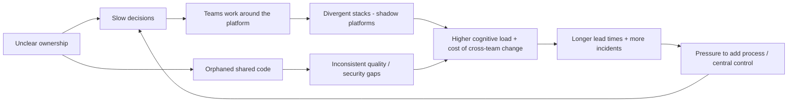
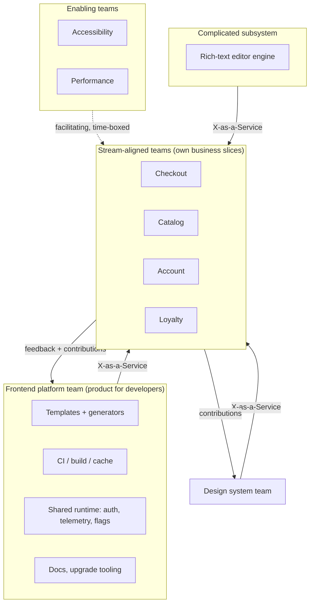
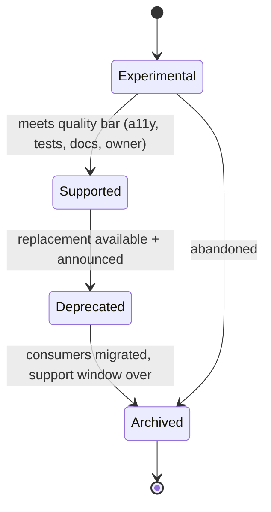

# 11 / 16 — Supporting Multiple Teams

## 1. Lesson metadata

| | |
|---|---|
| **Level** | Architect |
| **Study time** | 4–5 hours (reading 2 h, case analysis 1 h, exercises 1.5 h) |
| **Prerequisites** | [04/23 — Multi-team ownership](../04-react-architecture/23-multi-team-ownership.md), [10/11 — Design system governance](../10-production-engineering/11-design-system-governance.md), [10/14 — Multi-team collaboration](../10-production-engineering/14-multi-team-collaboration.md), [10/16 — Architecture decision records](../10-production-engineering/16-architecture-decision-records.md), [11/01 — Trade-off analysis](./01-trade-off-analysis.md), [11/07 — Design system architecture](./07-design-system-architecture.md), [11/12 — Microfrontends](./12-microfrontends.md), [11/13 — Monorepo vs multirepo](./13-monorepo-vs-multirepo.md), [11/15 — Framework selection](./15-framework-selection.md) |
| **Next** | [17 — Code review and standards](./17-code-review-and-standards.md) |
| **Related** | [10/15 — Technical debt](../10-production-engineering/15-technical-debt.md), [10/18 — Continuous delivery](../10-production-engineering/18-continuous-delivery.md), [11/18 — Technical leadership](./18-technical-leadership.md), [11/22 — Long-term evolution](./22-long-term-evolution.md) |

**Learning objectives.** After this lesson you can:
1. Diagnose why delivery slows as team count grows, using communication-structure and cognitive-load reasoning (Conway's law, coordination cost) rather than blaming individuals.
2. Design a **team and platform topology**: stream-aligned product teams, a platform team treated as a product, enabling and specialist teams, and explicit interaction modes between them.
3. Create "paved roads" (templates, shared libraries, CI, observability, design system) that make the right thing the easy thing, and know when mandates versus incentives are appropriate.
4. Establish decision rights and mechanisms: RFCs/ADRs, ownership registries, code ownership, contribution models (inner source), deprecation and versioning policies, dependency management between teams.
5. Measure the health of the multi-team system with evidence (DORA-style delivery metrics, developer-experience measures, platform adoption/satisfaction) and avoid metric gaming.
6. Recognise the characteristic failure modes (platform bottleneck, ivory-tower architecture, shadow platforms, shared-library tyranny, ownership gaps) and select countermeasures.
7. Adapt the operating model to organisational scale (1 team → 3 → 8 → 20+), including when *not* to add structure.

**Concepts covered:** Conway's law and the inverse Conway manoeuvre, Team Topologies (stream-aligned, platform, enabling, complicated-subsystem teams; collaboration, X-as-a-service, facilitating), cognitive load, platform as a product, paved/golden road, inner source, ownership model, decision rights (DACI/RAPID-like), RFC process, shared package governance, semantic versioning and deprecation policy, large-scale change, DORA metrics, developer experience, coordination cost, Brooks's law, bus factor, guilds/communities of practice.

---

## 2. Deep conceptual explanation

### 2.1 What problem is this lesson solving?

Everything in the previous lessons — budgets, testability, accessibility, microfrontends, repositories, buy-vs-build, frameworks — is decided or undone by **people working in teams**. A technically excellent architecture fails in an organisation that cannot operate it; a mediocre architecture can succeed in one that coordinates well. At 1–2 teams, architecture is mostly code. At 8+ teams, **architecture is mostly coordination design**:

- Two teams independently build a date-range picker; neither is accessible; both diverge.
- The design system team ships a breaking change; nine teams learn from production errors.
- A platform team decides on a new build tool; product teams were not consulted and delay adoption for a year.
- A critical shared library has no clear owner; a security patch waits three weeks for someone to claim it.
- Every cross-team feature requires a four-team planning meeting; lead time for a small change is six weeks.
- The "architecture review board" becomes the single choke point for all decisions; teams route around it.

These are **system** problems — structure, incentives, interfaces — not people problems. Architects at scale design the *organisation's interfaces* with the same care as code interfaces.

### 2.2 Conway's law and the inverse Conway manoeuvre

> *Organisations which design systems … are constrained to produce designs which are copies of the communication structures of these organisations.* — Melvin Conway (1968)

Mechanism, not mysticism: two components can only be integrated smoothly if the people owning them communicate; where communication is expensive (different teams, time zones, priorities), interfaces become rigid, coarse, and defensively designed. So system structure **follows** organisational structure — and deliberately shaping the organisation to match the desired architecture is the **inverse Conway manoeuvre**.

Implications for frontend:
- A "frontend team" and a "backend team" per feature produces horizontal slices and hand-off queues; a **stream-aligned** team owning a business capability end to end (UI + BFF/API + data) produces vertical slices ([12 — Microfrontends](./12-microfrontends.md): boundaries should follow business capabilities for this reason).
- Shared code with no owner reflects a missing team interface.
- If you want a modular monolith with enforced boundaries, assign boundary ownership to teams in CODEOWNERS and make cross-boundary change an explicit interaction.

### 2.3 Coordination cost grows faster than headcount

The number of pairwise communication channels among n people is n(n−1)/2: 5 people → 10 channels; 10 → 45; 50 → 1,225. Real organisations don't communicate pairwise, but the *potential* dependencies grow quadratically unless structure bounds them. Brooks's law ("adding people to a late project makes it later") is a corollary: onboarding and communication overhead can exceed the added capacity. The architect's lever is to **limit the number of teams any one team must coordinate with** (the **dependency fan-in/fan-out** per team), using clear boundaries and self-service interfaces.

Practical measure: for each team, count (a) teams it must wait on to ship a typical feature (blocking dependencies), and (b) teams that depend on it. High (a) means the team isn't truly stream-aligned; high (b) means it's becoming a bottleneck (and should become a platform with a self-service interface, or be split).

### 2.4 Team Topologies (a vocabulary for team types and interactions)

From Skelton & Pais, *Team Topologies* (2019). The model is influential but not scripture; adopt its vocabulary where it helps and verify fit.

| Team type | Purpose | Frontend example |
|---|---|---|
| **Stream-aligned** | Delivers a continuous flow of value for a business stream; owns a vertical slice | Checkout team, Search team |
| **Platform** | Provides internal services/tools that reduce stream-aligned teams' cognitive load; treated as a product | Frontend platform: templates, build/CI, shared runtime, observability, auth SDK |
| **Enabling** | Specialists who help other teams adopt practices/tools, then step back | Accessibility enablement, performance enablement, testing coaches |
| **Complicated-subsystem** | Owns a part requiring deep specialist knowledge | Rich-text editor engine, real-time collaboration core, charting engine |

Interaction modes:
- **Collaboration:** two teams work closely for a bounded time to discover something (high bandwidth, high cost).
- **X-as-a-Service:** one team provides, the other consumes with minimal coordination (low overhead; requires good docs, stable APIs, support).
- **Facilitating:** one team helps another improve capabilities (coaching).

Architect's rule: **make most interactions X-as-a-Service; reserve collaboration for discovery; time-box facilitation.** An organisation where everything is "collaboration" has no scalable interface.

### 2.5 Cognitive load as the design constraint

A team can hold only so much in its head: its domain, its code, its tools, its operations. Teams Topologies distinguishes **intrinsic** load (the domain/problem), **extraneous** (accidental: arcane build setup, flaky CI, unclear ownership), and **germane** (learning that improves performance). The platform's mission is to **reduce extraneous load** so stream-aligned teams spend their capacity on intrinsic and germane load.

Use as a sizing heuristic: if a team owns more services/apps/domains than it can reason about (frequent "nobody remembers how this works", on-call pain, slow onboarding), reduce scope or provide platform abstractions. Conversely, don't pile operational concerns (CI, release, infra) on product teams without a paved road.

### 2.6 Platform as a product

A **frontend platform** (often 3–8 engineers at larger scale) typically provides:
- **Starter templates / generators** for new apps and packages with CI, lint, test, observability, a11y checks, budgets pre-wired.
- **Shared runtime concerns:** auth/session SDK, telemetry/RUM, error reporting adapter, feature-flag port, i18n, analytics ports ([14](./14-build-vs-buy.md): wrap capabilities).
- **Build and CI tooling:** task graph, caching, merge queue, preview environments ([13](./13-monorepo-vs-multirepo.md)).
- **Design-system integration** (often a sibling team).
- **Docs, golden paths, runbooks**, upgrade guides and codemods.
- **Governance mechanisms** (lint rules, fitness functions, dependency policy).

"Product" means: **users** (internal developers), **discovery** (interviews, usage data, surveys), **roadmap** driven by the problems teams actually face, **adoption** measured, **support** with SLAs, **documentation** as a first-class deliverable, **deprecation** managed. A platform without product thinking becomes an ivory tower: it builds what it finds interesting, mandates adoption, and is resented.

**Paved road (golden path):** a supported, opinionated, well-integrated way to do common things, that teams *may* leave with justification ("you build it, you run it" applies to off-road choices). The trade: the paved road reduces cognitive load and variance; forcing everyone onto it removes legitimate innovation and creates bottlenecks. Healthy equilibrium: the paved road is so much easier that most teams choose it (**pull, not push**), with a documented exception path.

### 2.7 Decision rights and mechanisms

At scale, ambiguity about *who decides* is more costly than deciding "wrong". Make decision rights explicit:

| Decision class | Examples | Who decides | Mechanism |
|---|---|---|---|
| **Team-local** (reversible, local blast radius) | Internal component structure, a small library inside the team's package | The team | None beyond code review; ADR optional |
| **Cross-team interface** | Public package API, event contract, route namespace, design tokens | Owning team, with consuming teams consulted | RFC with comment period; contract tests; deprecation policy |
| **Cross-cutting/platform** | New framework, CI migration, state-management standard, TypeScript policy | Platform/architecture group with stream team representation | RFC → ADR; pilot; migration plan with support |
| **Strategic/irreversible** | Microfrontend adoption, language/framework change, vendor lock-in | Engineering leadership with architects | Formal evaluation ([14](./14-build-vs-buy.md), [15](./15-framework-selection.md)), ADR, budget |

Use a clear framework for roles (DACI: Driver, Approver, Contributors, Informed; or RAPID). The key properties: **one accountable decider**, **consultation, not consensus** (consensus on everything yields lowest-common-denominator and delay), **time-boxed** (RFC comment windows, default-to-proceed after N days), **written** (decisions discoverable later).

### 2.8 Ownership: every artefact has a home

Ownership failures are the most common source of multi-team incidents: unowned packages, orphaned dashboards, "shared" components nobody maintains. Ownership model:

- **Code ownership**: CODEOWNERS entries per directory/package (required reviewers), with teams not individuals.
- **Service/asset catalogue**: a registry (e.g. Backstage-style or a plain `catalog.yaml`/README table) listing each app, package, pipeline, dashboard, runbook, on-call rotation, Slack channel, tier (criticality), and **owner**. ⚠ *Backstage is one popular open-source developer-portal; verify current status/docs if considering.*
- **Lifecycle states**: experimental → supported → deprecated → archived, each with expectations (SLA, support).
- **Orphan handling**: an unowned asset triggers an explicit process: assign, archive, or delete — never "someone will".
- **Bus factor ≥ 2** for every critical asset.

### 2.9 Shared code governance

Shared libraries are where team boundaries become code. Policies that make them sustainable:

- **Contribution model.** *Centralised* (only the owning team changes it; consumers file requests) — high consistency, bottleneck; *federated/inner-source* (any team may contribute via PR under owner review, with contribution guidelines, tests, and docs) — scales better, needs owner capacity for review; *no-owner* — decays. Typical healthy hybrid: owning team defines the API and quality bar, accepts contributions, and owns releases.
- **API stability and versioning:** semver for published packages (or an internal compatibility policy in a monorepo); **deprecation policy** (announce, warn at runtime/lint, codemod, remove after N releases/months); a changelog; a support window (N and N-1).
- **Design-system contribution**: components needed by ≥2 teams are candidates; incubation in product code → promotion criteria (a11y verified, docs, tests, visual regression) ([10/11](../10-production-engineering/11-design-system-governance.md)).
- **Avoid dumping grounds**: a `common`/`shared` package that anyone adds to without ownership increases coupling and fan-in ([13](./13-monorepo-vs-multirepo.md)); require each shared package to have a coherent purpose and an owner.
- **Cost transparency**: when a shared package change forces work on N consumers, the cost is N × effort; the owner should reduce it with codemods and compatibility shims.

### 2.10 Communication mechanisms (and their costs)

| Mechanism | Purpose | Cost | When it fails |
|---|---|---|---|
| **RFC / design doc** | Async consultation on cross-team decisions | Writing time; review time | RFCs without decision deadlines → drift; too many RFCs for local decisions |
| **ADR** | Durable record of a decision and rationale | Low | Never revisited; not discoverable |
| **Guild / community of practice** | Cross-team learning (a11y, performance, testing) | Meeting time | Becomes talk-shop; no authority or outcomes |
| **Architecture review board** | Consistency for strategic decisions | Latency; bottleneck risk | Reviews everything; teams bypass |
| **Office hours** | Support with low friction | Platform capacity | Used for problems that docs should solve |
| **Roadmap sharing / dependency mapping** | Surface cross-team dependencies early | Planning overhead | Stale; no negotiation |
| **Internal tech talks / newsletters** | Awareness | Low | Passive; not acted on |
| **Embedded/rotating engineers** | Transfer knowledge, build empathy | Capacity disruption | Used as backfill |
| **Incident reviews (blameless)** | Learn across teams | Time | Blame culture; action items not tracked |

Principle: **prefer asynchronous, written, discoverable communication; use synchronous time for high-bandwidth collaboration and relationship building.**

### 2.11 Measuring the system

You cannot improve what you do not observe, but measuring people is dangerous. Measure the **system's flow and experience**.

- **Delivery performance** (DORA research programme): DORA's current model (checked at dora.dev/guides/dora-metrics, 2026-10-22) has **five** metrics in two groups: *throughput* — change lead time, deployment frequency, failed deployment recovery time (formerly "time to restore service"/MTTR) — and *instability* — change fail rate and deployment rework rate (the newer fifth metric). The original "four keys" are the older framing. Use them as *team-improvement* signals, not cross-team rankings: contexts differ (a regulated product vs a marketing site).
- **Developer experience:** time to first PR for new hires; CI duration and flake rate; build times; time to create a new app from the template; survey measures (satisfaction, friction points); frameworks such as SPACE (Satisfaction, Performance, Activity, Communication, Efficiency) caution against single-metric views (Forsgren et al., 2021, "The SPACE of Developer Productivity").
- **Platform adoption and satisfaction:** % of apps on the paved road; template version spread; support ticket volume and time-to-resolution; NPS-like score from internal users.
- **Coordination health:** number of cross-team blocking dependencies per feature; PR review wait time across teams; lead time for cross-team changes; incident count attributed to ownership gaps.
- **Quality of shared assets:** a11y defects in the design system, bug aging, API breaking-change frequency, deprecation backlog.

**Goodhart's law applies:** measure outcomes and pair metrics to catch gaming (e.g. deployment frequency + change failure rate; PR throughput + escaped defects). Never use metrics for individual performance evaluation in this context.

### 2.12 Scaling stages: do not over-structure

| Stage | Typical shape | What to add | What NOT to add |
|---|---|---|---|
| **1 team (≤ ~8)** | One codebase, shared context | ADRs when useful; basic CI; coding standards | Platform team, RFC bureaucracy, microfrontends |
| **2–4 teams** | Shared repo or few repos; first friction | CODEOWNERS; shared lint/config; a design-system owner (part-time); monthly sync of architects/leads | Heavy governance, separate platform team (a rotating platform "duty" or a 1–2 person group may suffice) |
| **5–10 teams** | Cross-team dependencies bite | Dedicated platform/DX capacity; RFC process with deadlines; service/asset catalogue; paved road; design-system team; guilds | Mandating every tool; architecture board reviewing everything |
| **10–25 teams** | Multiple domains; platform at scale | Platform product management; enabling teams (a11y, perf); upgrade/deprecation automation; metrics programme; tiered decision framework | Central control of local decisions |
| **25+ teams / multiple orgs** | Business units, compliance zones | Federated platform groups; inner-source across units; formal architecture community; internal developer portal | A single monolithic standard for all contexts |

The wrong move at any stage is adopting the *next* stage's structure prematurely — it adds coordination overhead without the problems it solves ([12 §7](./12-microfrontends.md): microfrontends for a 25-engineer company; [13](./13-monorepo-vs-multirepo.md): Bazel for 25 engineers).

### 2.13 Misconceptions

| Misconception | Reality |
|---|---|
| "More process = better coordination." | Process has overhead; match it to the dependency structure. Reduce the need to coordinate (boundaries, self-service) before adding meetings. |
| "A platform team should mandate the standards." | Mandates without value create resentment and shadow platforms. Pull (paved road superiority) with minimal, justified mandates (security, a11y, compliance). |
| "Architecture is decided by architects." | Architects shape decision frameworks and cross-cutting choices; most decisions belong to teams. Ivory-tower architecture is ignored. |
| "Shared components reduce duplication, so share everything." | Premature sharing couples teams; share when ≥2 consumers exist and a stable abstraction is evident ([05/02 — DRY, KISS, YAGNI](../05-design-patterns/02-dry-kiss-yagni.md)). |
| "Consensus is the goal." | Consultation is; one accountable decision-maker avoids paralysis. |
| "DORA metrics rank teams." | They are diagnostic for each team's trend within its context. |
| "Remote/async teams can't coordinate." | They can — but need explicit written interfaces; implicit hallway coordination disappears. |

---

## 3. Internal mechanics

### 3.1 How friction compounds (a causal model)



The reinforcing loop (I → B) is why heavy central control often *worsens* the situation: it slows decisions, which drives workarounds, which drives more control. Breaking the loop requires **clear ownership, self-service interfaces, and fast, bounded decisions** — not more gates.

### 3.2 Adoption dynamics of a paved road

A platform offering succeeds when for a typical team: (benefit of adopting) − (cost of adopting) > (benefit of staying off-road) − (cost of maintaining a bespoke solution) *plus* any mandated minimum. Costs of adopting include migration effort, learning, loss of local flexibility, and perceived risk. Therefore adoption is a **product problem**: lower migration costs (codemods, incremental adoption, compatibility shims), raise benefits (visible time savings, built-in budgets and a11y checks), reduce perceived risk (SLAs, reference teams, escape hatches). Early adopters (champion teams) provide references and feedback; the platform co-develops with them.

### 3.3 The shape of dependency between teams

Dependencies come in kinds with different mitigation strategies:

| Kind | Example | Mitigation |
|---|---|---|
| **Code/API dependency** | Team B imports Team A's package | Versioned API, contract tests, deprecation policy |
| **Data/contract dependency** | Shared API schemas, events | Schema registry, additive changes, contract tests |
| **Capacity dependency** | Needs Team A to build something first | Roadmap alignment; inner-source contributions; reduce by making A self-service |
| **Knowledge dependency** | Only Team A understands subsystem | Docs, pairing, enabling team, rotation |
| **Release dependency** | Must deploy together | Decouple (flags, backward compatibility) — if unavoidable, explicit release coordination |
| **Decision dependency** | Waiting for approval | Decision rights, SLAs, default-to-proceed |

Architects should map dependencies per team and track which kind dominates; the dominant kind suggests the intervention (e.g. capacity dependencies → inner-source and self-service; knowledge dependencies → enabling team and docs).

### 3.4 Deprecation as a protocol

A healthy deprecation is a protocol with state and timing, not an announcement:
1. **Announce** (RFC/changelog) with rationale, replacement, timeline.
2. **Provide the replacement and a migration path** (docs, codemod) before deprecating.
3. **Warn in tooling** (TypeScript `@deprecated` JSDoc, ESLint rule, runtime dev-only warning) so consumers see it where they work.
4. **Track consumer usage** (dependency graph in monorepo; usage telemetry or code search elsewhere).
5. **Support window** with SLA.
6. **Remove** after the window; block removal if critical consumers remain without a plan (escalate).
7. **Retrospective** on migration effort.

---

## 4. Step-by-step: onboarding a new team to the platform and operating model

Scenario: Team "Loyalty" (6 engineers) is formed to build a new loyalty area inside an organisation of 12 teams.

1. **Charter:** define the business stream, boundaries (routes/APIs owned), on-call expectations, and tier of services; register in the catalogue (owner, Slack channel, runbook).
2. **Generate the app/package** from the paved-road template: repo/package scaffolding, CI (lint, typecheck, test, build, a11y, budgets), preview deployments, RUM/error-reporting wired, feature-flag port, auth SDK, design-system dependency.
3. **Orientation:** a 90-minute session covering architecture ADRs, conventions, where to ask for help, how to propose changes (RFC), and the exception process; assign a buddy from a neighbouring team.
4. **First slice:** ship a thin vertical slice (e.g. "view points balance") to production within the first 2 weeks to validate the pipeline end to end. Measure time-to-first-deploy.
5. **Interfaces:** document consumed interfaces (auth session, design system, user profile API) and provided interfaces (routes, events); add contract tests; declare dependencies in the planning board.
6. **Enabling support:** schedule an accessibility and performance enablement session on the team's first feature; add its budgets.
7. **Governance participation:** nominate a representative for the architecture community; subscribe to deprecation/upgrade channels.
8. **Feedback loop:** after 6 weeks, a retrospective with the platform team (what slowed us down?), captured as platform backlog items.
9. **Off-road decisions:** if Loyalty needs something not on the paved road (e.g. a different charting lib), they write a short RFC with justification and exit plan; platform decides within the SLA (e.g. 5 working days) or defaults to approve with conditions.
10. **Ongoing:** quarterly dependency/ownership review; included in upgrade waves with codemods.

---

## 5. Code examples

### 5.1 Minimal — ownership as code (CODEOWNERS + catalogue)

```
# .github/CODEOWNERS  (teams, not people)
/apps/checkout/                 @acme/team-checkout
/apps/loyalty/                  @acme/team-loyalty
/packages/design-system/        @acme/team-design-system
/packages/platform-*/           @acme/team-frontend-platform
/packages/*/package.json        @acme/team-frontend-platform @acme/security-champions
/tools/ /.github/               @acme/team-frontend-platform
/docs/adr/                      @acme/architecture-community
```

```yaml
# catalog/assets.yaml  (consumed by a docs site or developer portal)
- name: "@acme/design-system"
  type: package
  tier: 1                      # critical: affects every product
  owner: team-design-system
  oncall: "#ds-support"
  lifecycle: supported
  support: { versions: [5, 4], deprecationPolicy: "docs/policy/deprecation.md" }
  runbook: docs/runbooks/design-system.md
- name: "@acme/loyalty-app"
  type: app
  tier: 2
  owner: team-loyalty
  lifecycle: supported
```

Notes: required-reviewer ownership is cheap and visible; a catalogue converts ownership into data you can lint ("every package in the repo appears here with an owner") — see §5.5.

### 5.2 Practical — a golden-path generator (scaffolding that encodes decisions)

```ts
// tools/create-app/index.ts — minimal template generator (use a real generator such as Plop/Nx generators in practice; verify)
import { cpSync, readFileSync, writeFileSync, mkdirSync } from 'node:fs';
import { join } from 'node:path';

const [, , name, ownerTeam] = process.argv;
if (!name || !ownerTeam) throw new Error('Usage: create-app <name> <owner-team>');

const dest = join('apps', name);
mkdirSync(dest, { recursive: true });
cpSync('tools/create-app/template', dest, { recursive: true });

// Parameterise template files
for (const f of ['package.json', 'README.md', 'catalog-info.yaml']) {
  const p = join(dest, f);
  writeFileSync(p, readFileSync(p, 'utf8').replaceAll('__NAME__', name).replaceAll('__OWNER__', ownerTeam));
}

// Register ownership and catalogue entries so the new app is born owned
appendLine('.github/CODEOWNERS', `/apps/${name}/  @acme/${ownerTeam}`);
appendLine('catalog/assets.yaml', `- name: "@acme/${name}"\n  type: app\n  tier: 3\n  owner: ${ownerTeam}\n  lifecycle: experimental\n`);

function appendLine(file: string, line: string) {
  writeFileSync(file, readFileSync(file, 'utf8').trimEnd() + '\n' + line + '\n');
}
console.log(`Created apps/${name}. Next: pnpm install && pnpm --filter ${name} dev`);
```

What the template should *encode* (the real value): lint/format config; TypeScript strictness; test setup with role-first RTL and MSW ([10](./10-designing-for-testability.md)); a11y checks ([11](./11-designing-for-accessibility.md)); per-route bundle budgets ([09](./09-performance-budgets-at-scale.md)); RUM and error reporting wired to the adapters ([14](./14-build-vs-buy.md)); CI workflow reuse; preview deploys; the boundary lint rules ([13 §5.3](./13-monorepo-vs-multirepo.md)); a README with "where to ask for help". Every default is a decision made *once* instead of N times. Keep templates versioned and provide **upgrade paths for apps generated from older template versions** (codemods or a template-diff tool) — otherwise templates ossify the first version everywhere.

### 5.3 Practical — deprecation as code (TypeScript + runtime dev warning + lint)

```ts
// @acme/design-system/src/Button.tsx
import type { ComponentPropsWithRef } from 'react';

type ButtonProps = ComponentPropsWithRef<'button'> & {
  intent?: 'primary' | 'secondary' | 'danger';
  /** @deprecated Use `intent`. Removal planned in v6 (see docs/deprecations/button-variant.md). */
  variant?: 'primary' | 'secondary' | 'danger';
};

const warned = new Set<string>();
function warnOnce(key: string, message: string) {
  if (process.env.NODE_ENV !== 'production' && !warned.has(key)) {
    warned.add(key);
    // eslint-disable-next-line no-console
    console.warn(`[design-system] ${message}`);
  }
}

export function Button({ intent, variant, ...rest }: ButtonProps) {
  if (variant !== undefined) warnOnce('Button.variant', '`variant` is deprecated; use `intent`. Run: npx @acme/codemods button-variant-to-intent');
  const resolved = intent ?? variant ?? 'secondary';
  return <button data-intent={resolved} {...rest} />;
}
```

Notes: the `@deprecated` JSDoc tag gives editors a strikethrough and (with `@typescript-eslint/no-deprecated` or equivalent — verify rule name) lint reporting; a **dev-only, once-per-session** warning avoids console spam and production overhead; the message names the *codemod* so migration is one command. The resolved precedence (`intent ?? variant`) preserves old behaviour during the support window. Remove only when consumer-usage tracking shows zero (or an agreed set of exceptions). In React 19 `ref` is a normal prop, so `ComponentPropsWithRef` includes it — no `forwardRef` needed.

### 5.4 Practical — RFC and ADR templates as repository files

```md
<!-- docs/rfc/0000-template.md -->
# RFC NNNN: <title>
- **Driver:** @name  **Approver:** @name  **Contributors:** @teams  **Informed:** #channel
- **Status:** Draft | In review (ends YYYY-MM-DD) | Accepted | Rejected | Superseded
- **Decision deadline:** YYYY-MM-DD (default: proceed if no blocking objection)

## Problem (what hurts, for whom, with evidence)
## Goals / non-goals
## Options considered (include "do nothing")
## Proposal
## Impact on teams (who must do what, effort estimate, migration path, codemod?)
## Risks and mitigations (including a11y, performance, security)
## Rollout plan and success metrics
## Open questions
```

```md
<!-- docs/adr/0000-template.md -->
# ADR NNNN: <decision>
- Status: Accepted | Superseded by ADR-XXXX
- Context: ...
- Decision: ...
- Consequences (positive and negative): ...
- Revisit triggers: ...
```

Design points: a **decision deadline with default-to-proceed** prevents RFCs becoming a veto mechanism; "Impact on teams" forces the proposer to cost the change *for other people*; "do nothing" as an option keeps discipline; ADR "revisit triggers" prevent zombie decisions ([10/16](../10-production-engineering/16-architecture-decision-records.md)).

### 5.5 Advanced — a platform scorecard (data-driven conversations)

```ts
// tools/scorecard.ts — compute per-app health from repo data (illustrative; adapt data sources)
import { readFileSync } from 'node:fs';
import { globSync } from 'glob';

type Check = { id: string; weight: number; run(appDir: string): boolean };

const checks: Check[] = [
  { id: 'has-owner',         weight: 3, run: (d) => ownerFor(d) !== undefined },
  { id: 'on-template-v>=4',  weight: 2, run: (d) => templateVersion(d) >= 4 },
  { id: 'a11y-ci-enabled',   weight: 3, run: (d) => readFileSync(`${d}/package.json`, 'utf8').includes('"test:a11y"') },
  { id: 'budgets-defined',   weight: 2, run: (d) => globSync(`${d}/budgets.json`).length > 0 },
  { id: 'rum-enabled',       weight: 2, run: (d) => readFileSync(`${d}/src/telemetry.ts`, 'utf8').includes('initTelemetry') },
  { id: 'no-deprecated-api', weight: 2, run: (d) => deprecatedUsageCount(d) === 0 },
];

for (const dir of globSync('apps/*')) {
  const total = checks.reduce((a, c) => a + c.weight, 0);
  const got = checks.reduce((a, c) => a + (safe(() => c.run(dir)) ? c.weight : 0), 0);
  console.log(`${dir.padEnd(24)} ${Math.round((got / total) * 100)}%  failing: ${checks.filter((c) => !safe(() => c.run(dir))).map((c) => c.id).join(', ') || '—'}`);
}
function safe(f: () => boolean) { try { return f(); } catch { return false; } }
declare function ownerFor(dir: string): string | undefined;
declare function templateVersion(dir: string): number;
declare function deprecatedUsageCount(dir: string): number;
```

How to use it responsibly: the scorecard is a **conversation tool and a roadmap input for the platform** ("12 apps lack RUM — can we auto-add it?"), not a league table for shaming teams. Publish it openly with the *platform's own* scorecard (is the platform meeting its SLAs?). Prefer checks that reflect *outcomes* (does the app have budgets and are they met?) to checks that count artefacts. Scorecards are subject to Goodhart's law: if a score becomes a target, teams add the file without the substance; mitigate by sampling real behaviour (e.g. verifying the a11y job actually ran on the last 10 PRs).

### 5.6 Incorrect — platform mandate without product thinking

```
Decision memo (from the architecture board):
"Effective next quarter, all teams must migrate to <new build system>. 
 Teams that don't comply by Q3 will lose deploy access."
```

Why it fails: no evidence of the problem it solves for teams; no migration tooling; no support plan; no exceptions path; no consultation; adoption becomes compliance; teams spend sprint capacity on migration instead of customer value; shadow tooling appears to avoid the mandate; relationships suffer. Contrast with §5.7.

### 5.7 Corrected — pull-based adoption with a migration programme

```
Proposal (RFC 0042): Adopt <new build system> as the paved road.
Evidence: median CI time 31 min vs 9 min in pilot (3 apps); 60% of PR wait is build/test;
          developer survey: top-3 pain.
Offer: codemod + migration PRs opened by the platform team for each app (reviewed by owners);
       weekly office hours; rollback plan; compatibility period of two quarters with both systems supported;
       teams may opt out with a documented reason (compliance, blockers) and revisit date.
Mandates (limited): security patch SLAs and a11y CI checks apply to all, regardless of build system.
Success metrics: CI time, adoption %, satisfaction survey delta, incident count.
```

Mechanism: lower cost of adopting (platform does the migration work), prove benefit with pilot data, bound the mandate to what must be uniform (security/accessibility), and preserve legitimate exceptions with expiry. This is **platform as a product** in practice.

---

## 6. Visual explanations





```
Dependency health per team (illustrative table the architect maintains):
Team       blocks-on    blocked-by-this-team   dominant kind          action
Checkout   Platform,DS  (none)                 code/API               stable APIs; contract tests
DS         (none)       10 teams               capacity               inner-source + codemods
Loyalty    Catalog,Acct (none)                 data/contract          event schemas; reduce coupling
Platform   (none)       10 teams               capacity+knowledge     self-service docs; office hours
```

---

## 7. Alternative approaches and trade-offs

| Operating model | Strengths | Weaknesses | Best when |
|---|---|---|---|
| **Single team owns everything** | Minimal coordination | Doesn't scale beyond ~8–10 engineers | Early-stage product |
| **Shared monorepo + CODEOWNERS + light platform (2–4 people)** | Atomic changes, shared tooling, low overhead | Platform capacity limits; governance needs discipline | 3–12 teams, one stack |
| **Dedicated platform team with paved roads + enabling teams** | Reduces cognitive load; consistent quality; scalable | Requires investment and product thinking; bottleneck/ivory-tower risk | 8–25 teams |
| **Centralised architecture board approves all significant decisions** | Consistency; risk control | Latency, bottleneck, bypass | Highly regulated contexts for specific decision classes (security) — not for all decisions |
| **Federated governance (teams decide within guardrails; guild sets guardrails)** | Autonomy with alignment | Requires mature teams and clear guardrails | Large orgs with strong engineering culture |
| **Inner-source model for shared code** | Scales contribution; reduces bottlenecks | Needs owner review capacity and contribution guidelines | Shared libraries with many consumers |
| **Microfrontends with team-owned deploy units** | Independent deploys | Heavy platform/contract costs ([12](./12-microfrontends.md)) | Many teams with proven deploy coupling |
| **Embedded specialists (a11y/perf/security in teams)** | Context-rich help; knowledge spreads | Specialist scarcity; inconsistent practice | Large teams with ongoing specialist work |
| **Enabling/consulting teams** | Scales expertise via coaching | Needs time-boxed engagements and clear exit | Capability uplift programs |

**A scenario where a dedicated platform team is NOT the best answer.** A 14-engineer company with three teams on one codebase. A dedicated platform team of 3 would consume 20 % of engineering capacity to solve problems that two part-time "tooling owners" (rotating quarterly) and a good shared config package can handle. Premature platform teams invent work, create gatekeepers, and starve product delivery. The right move is **platform as a role** (rotating or part-time ownership of CI/templates/design-system) until measured friction (CI waits, onboarding time, duplicated tooling) justifies dedicated headcount. The inverse failure — 40 engineers with no platform capacity — manifests as each team maintaining bespoke CI and drifting stacks.

---

## 8. Best practices and anti-patterns

**Practices**
- **Design team interfaces, not just code interfaces:** each team publishes what it owns, what it provides, how to engage (Team API: docs, SLAs, channels, roadmap, how to contribute).
- **Make the paved road the easiest road;** measure adoption and satisfaction; treat low adoption as a product problem first.
- **Limit mandates to what must be uniform** (security, accessibility, privacy, compliance, observability baselines); everything else is guidance with an exception path.
- **Decide quickly and in writing:** RFC deadlines, default-to-proceed, ADRs with revisit triggers.
- **Make ownership explicit and visible:** CODEOWNERS, catalogue, on-call; fix orphans.
- **Invest in migration tooling** (codemods, compat shims, automated PRs): the cost of change is borne by the changer, not N consumers.
- **Prefer inner source** for shared libraries, with contribution guidelines and fast review SLAs.
- **Track coordination health** (cross-team dependencies per feature, wait times) and attack the biggest contributors.
- **Rotate and embed:** short rotations between product and platform/DS teams to build empathy and spread knowledge.
- **Run blameless incident reviews with cross-team action tracking** ([10/19](../10-production-engineering/19-incident-debugging.md)).
- **Scale structure to size** (§2.12); remove structure that no longer pays.

**Beginner mistakes**: assuming alignment happens by itself; leaving ownership implicit; sharing code without a contribution model; announcing changes in Slack only (not discoverable); skipping consumer migration support.

**Experienced-developer mistakes**: building the "perfect" platform without user research; central control of local decisions; creating a shared library prematurely; leaving the platform team without product management or an adoption strategy; measuring individuals via team-level DORA metrics; ignoring knowledge dependencies and bus factor; neglecting the platform's own on-call/support burden.

**Smells**: "ask Priya, she knows" is the architecture; more than one in three PRs touch another team's code with no inner-source process; teams maintain private forks of shared packages; RFCs stay open for months; the architecture board has a backlog; platform backlog is driven by the platform's preferences; a 'common' package with 40 contributors and no owner; each team has its own CI.

**Justified exceptions**: a team deviates from the paved road for a legitimate technical reason (a real-time collaboration core needing a different runtime); a regulated product line with distinct approval flows; a temporary mandate during a security incident; an acquired company's stack retained during a long migration; central control of design-system tokens to maintain brand consistency. Do not present any operating model as universally correct — context (size, regulation, stability, culture) decides.

---

## 9. Real-world application

**E-commerce platform (12 teams).** Streams: Home/Content, Search/Listing, Product, Cart/Checkout, Account/Orders, Loyalty, Seller tools, Marketing experiments. Platform: templates, CI, RUM, auth, flags, performance budgets (composed page), a11y checks. Design system team with federated contributions. Enabling teams: a11y (2 specialists), performance (1–2). Cross-team contracts: price/stock events, cart API, route namespaces. Governance: RFCs for cross-team interfaces; ADRs; quarterly "architecture community" review. Constraint: peak-season freeze — platform upgrades scheduled around it.

**Enterprise dashboards (multiple business units).** Different compliance regimes and cadences. Federated platform groups per unit sharing an inner-sourced core (design system, auth, telemetry). Decision rights: BU-level for local stacks within guardrails; enterprise-level for security/a11y/data classification. A developer portal (catalogue) increases discoverability; "tier" levels determine support SLAs.

**Finance / regulated.** Segregation of duties, audit trails: RFC/ADR evidence doubles as audit artefacts; change management integrates with CI/CD; platform provides compliant pipelines as a paved road (signed builds, SBOMs, approvals); teams get speed through standardisation within controls. Heavier mandates are justified (security, audit) but should still be delivered as tooling (a compliant pipeline template) rather than paperwork.

**Forms/auth/realtime cross-cutting.** Auth SDK, form-field primitives (a11y contract), and realtime transport belong with the platform/design system — areas where inconsistency is costly. A single owner team, stable API, extensive docs, contract tests, and inner-source for contributions.

**Mergers and acquisitions.** Two orgs with distinct stacks: don't force uniformity immediately; define an *integration interface* (shared auth, design tokens, analytics ports), then converge by strangler migrations ([12 §9](./12-microfrontends.md)) as the business case justifies; maintain explicit exit criteria.

**Remote/async organisations.** Written interfaces dominate: RFCs, ADRs, runbooks, recorded demos; time zones argue for X-as-a-Service over collaboration; follow-the-sun platform support; SLAs measured in working hours.

**Constraints to name in design docs:** number and maturity of teams, regulation, release cadence, stack heterogeneity, geographic distribution, platform capacity, current pain metrics, hiring plans, planned reorganisations (Conway's law means a reorg changes your architecture).

---

## 10. Debugging and troubleshooting

(Diagnosing an organisation-level problem with evidence.)

**Symptom 1: Cross-team features take 6+ weeks; teams say "we're blocked on others".**
*Investigation.* Instrument: sample the last 20 cross-team features; for each, record waiting time per hand-off and the kind of dependency (capacity, decision, knowledge, release — §3.3). Build a dependency matrix. *Root cause example.* 70 % of wait time is capacity dependency on two teams (DS and Platform) because every change requires their implementation. *Intervention.* Inner-source contribution guidelines + self-service patterns + SLA for review, codemods; possibly staff the bottleneck team. *Validate.* Track lead time for cross-team changes quarterly; expect distribution shift left.

**Symptom 2: Teams ignore the platform; each has a different CI and build setup.**
*Investigation.* Interview 6 teams (and non-adopters): why not? Collect adoption cost estimates, missing features, trust issues (past breaking changes, poor support). Quantify duplicated effort. *Root cause example.* The template is two majors old and the migration path is manual; platform support is slow. *Intervention.* Treat as a product failure: invest in upgrade automation, SLAs, reference teams; reduce mandates; publish a roadmap built from feedback; measure satisfaction. *Validate.* Adoption % and satisfaction trend; reduction in bespoke setups.

**Symptom 3: A security patch to a shared package takes 3 weeks to reach production in all apps.**
*Investigation.* Time each stage: advisory awareness → fix → release → consumer PRs → deploy. *Root causes.* No owner on call; consumer apps pin old versions; no automated update PRs; no confidence tests. *Intervention.* Ownership + on-call for Tier 1 packages; automated update PRs (Renovate/Dependabot) with auto-merge for patches when tests pass; platform-driven emergency patch PRs across repos/monorepo; track *time-to-patch* as an SLO. *Validate.* Drill: simulate an advisory and measure.

**Symptom 4: Architecture board backlog of 40 items; teams bypass it.**
*Investigation.* Categorise decisions by class (§2.7); what fraction are team-local or reversible? *Intervention.* Narrow the board's scope to strategic/irreversible decisions; delegate others with guardrails and RFC/ADR documentation; set SLAs and default-to-proceed. *Validate.* Board backlog size, decision latency, bypass incidents, team survey.

**Symptom 5: A shared UI component is inaccessible in 12 apps.**
*Investigation.* Root cause in the component, not 12 apps; check design-system contribution and a11y gates ([11 — Designing for accessibility](./11-designing-for-accessibility.md)). *Intervention.* Fix in the component, release patch, communicate; add a11y tests to the DS CI; add an enabling-team review for new complex components; audit other components of the same class. *Validate.* Axe/E2E checks across apps; track a11y defect origin distribution.

**Symptom 6: Platform team burnout; support load overwhelms roadmap.**
*Investigation.* Categorise support tickets (docs gaps, bugs, how-to, feature requests); measure time spent. *Intervention.* Improve docs and examples for top 10 questions; add self-service diagnostics (`doctor` CLI); office hours with rotation; "you build it, you run it" for off-road decisions; hire/rotate; protect roadmap capacity (e.g. 30 % reserved for strategic work). *Validate.* Ticket volume per team, time-to-resolution, platform satisfaction and engineer retention.

---

## 11. Exercises

### Level A — Knowledge
A1. State Conway's law and explain why it implies an "inverse Conway manoeuvre".
A2. Name the four Team Topologies team types and the three interaction modes, with one frontend example of each team type.
A3. What does "platform as a product" require beyond building tools?
A4. Distinguish a paved road from a mandate. When is a mandate justified?
A5. List the stages of a healthy deprecation protocol.

### Level B — Code comprehension
B1. In §5.3, why is the deprecation warning once-per-session and dev-only, and why does the component still honour `variant`?
B2. In §5.5, explain two ways a team could game the scorecard and propose countermeasures.
B3. In §5.2, why does the generator write to CODEOWNERS and the catalogue at creation time?
B4. In §5.1, why is the `**/package.json` pattern owned by the platform team *and* security champions? What risk does that address, and what cost does it introduce?

### Level C — Implementation
C1. Write a CI script that fails if any directory in `apps/` or `packages/` lacks a CODEOWNERS entry and a catalogue entry.
C2. Write a codemod (jscodeshift-style pseudocode or TypeScript with ts-morph) migrating `<Button variant="x">` to `<Button intent="x">`, handling spread props and string-literal-only cases safely.
C3. Design the RFC lifecycle as a state machine (states, transitions, timers) and write the GitHub Actions/automation outline that enforces the decision deadline and default-to-proceed.
C4. Design a Team API page template (what each team publishes) and fill it for a "Design System" team.

### Level D — Debugging
D1. DORA-style metrics show Team A with 3× the deployment frequency of Team B; leadership wants Team B "fixed". Describe what you'd examine before drawing conclusions.
D2. After a platform CI migration, two teams report slower pipelines; platform's metrics show median CI time decreased. Reconcile.
D3. A shared package's maintainers reject most external PRs; teams fork instead. Diagnose and propose a fix.

### Level E — Architecture and engineering decisions
E1. 9 teams, one monorepo, rising friction: CI waits, inconsistent a11y, duplicated components. Propose a 2-quarter plan with metrics and staffing.
E2. Leadership proposes splitting frontend engineers into a "UI team" (components) and a "logic team" (data/state) across all products. Evaluate with Conway's law and cognitive load.
E3. Decide whether to introduce a formal architecture review board for a 20-team organisation; if yes, define scope, composition, SLAs; if no, define alternatives.

### Level F — Expert challenge
F1. Design the end-to-end operating model for a 30-team frontend organisation after an acquisition (stack heterogeneity, three time zones, regulated and non-regulated products). Cover structure, decision rights, platform strategy, shared code governance, metrics, migration, and risks.
F2. Argue that all of F1's structure is excessive and the organisation should instead run as three autonomous "business unit" frontends with a minimal shared contract. State the conditions under which that is the better answer.

---

## 12. Detailed answers and explanations

> Attempt the exercises first.

**A1.** Conway's law: systems mirror the communication structure of the organisations that build them. The mechanism: integration quality depends on communication bandwidth between owners; where communication is costly, interfaces get coarse and rigid. The *inverse Conway manoeuvre* uses this deliberately: design team boundaries and interactions to produce the target architecture (e.g. create vertical, stream-aligned teams if you want vertical-slice modules). Wrong answer: "your org chart is your architecture, so never reorganise" — the point is the opposite: reorganise intentionally.

**A2.** Types: stream-aligned (e.g. Checkout team), platform (frontend platform), enabling (accessibility enablement), complicated-subsystem (rich-text editor engine team). Interaction modes: collaboration (two teams jointly prototype a new real-time feature for a quarter), X-as-a-service (product teams consume the design system via versioned packages and docs), facilitating (an a11y enabling team coaches a stream team through an audit, then steps back).

**A3.** Users and discovery (research with internal developers), a roadmap driven by user problems, adoption and satisfaction metrics, support with SLAs, documentation as a deliverable, versioning/deprecation discipline, marketing/communication (internal), and willingness to deprecate what isn't used. Without these, tools are built but not adopted; the platform becomes a cost centre or a gatekeeper.

**A4.** A paved road is a supported, opinionated path that's easier than alternatives; teams adopt it by choice and may deviate with justification and own the cost. A mandate requires compliance regardless of preference. Mandates are justified for properties that must be uniform for the organisation's safety or obligations: security baselines, privacy/legal compliance, accessibility conformance, audit requirements, and perhaps interoperability contracts. Even then, deliver them as tooling that makes compliance easy.

**A5.** Announce with rationale and timeline → provide replacement and migration path (docs, codemod) → warn in tooling (types, lint, dev runtime) → track consumer usage → support window with SLA → remove (or escalate if blockers) → retrospective. Skipping the replacement/migration step is the classic failure.

**B1.** Once-per-session dev-only warnings provide discoverability without flooding logs or imposing production cost; repeated warnings train people to ignore the console. The component still honours `variant` (with `intent ?? variant`) because deprecation is a **protocol with a support window**: consumers must be able to keep working while they migrate; breaking immediately turns a deprecation into a breaking change. The warning names the codemod to make migration cheap.

**B2.** Gaming: (1) adding an `a11y-ci-enabled` script stub that does nothing (`"test:a11y": "echo ok"`) to satisfy the check; (2) adding an `initTelemetry` string in a comment, or a call that's never executed. Countermeasures: verify behaviour (CI logs show the a11y job executed with ≥N assertions on recent PRs; telemetry events observed in the backend for the app); sample deeper than file existence; make the platform's template own the implementation so apps inherit real behaviour; publish the scorecard methodology and check outcomes (defects/regressions) not artefacts. Treat gaming as a signal that the metric's incentive or the platform's usability is wrong.

**B3.** To make ownership a property of existence: assets are born owned and listed, avoiding the orphan problem later. Retrofitting ownership to existing unowned code is far harder than defaulting at creation. It also enforces catalog completeness automatically and sets the default tier/lifecycle (experimental, tier 3), which can be promoted as the app matures.

**B4.** Dependency changes are a supply-chain and consistency risk: new dependencies introduce licence, size, security, and duplication issues ([14](./14-build-vs-buy.md), [10/07](../10-production-engineering/07-dependency-security.md)); platform and security review keeps a coherent policy. Cost: review bottleneck on every PR touching a package.json, including harmless script edits. Mitigation: narrow the rule (e.g. require review only when dependency lists change, via a CI check that comments/requires approval conditionally), automate low-risk updates, SLAs for review, and a pre-approved allow-list for common packages.

**C1.** *Criteria:* enumerates directories; parses CODEOWNERS with last-match-wins semantics (GitHub's rule: the last matching pattern takes precedence) or uses an existing library; reads catalog YAML; reports gaps with actionable output; runs in CI as a required check; handles `packages/*` glob patterns. Sample outline:
```ts
import { globSync } from 'glob'; import { readFileSync } from 'node:fs'; import { parse } from 'yaml';
const dirs = [...globSync('apps/*/'), ...globSync('packages/*/')].map((d) => d.replace(/\/$/, ''));
const owners = readFileSync('.github/CODEOWNERS', 'utf8').split('\n').filter((l) => l && !l.startsWith('#'));
const catalog = parse(readFileSync('catalog/assets.yaml', 'utf8')) as { name: string; owner: string }[];
const catalogNames = new Set(catalog.map((c) => c.name));
const missing: string[] = [];
for (const d of dirs) {
  const pkg = JSON.parse(readFileSync(`${d}/package.json`, 'utf8')).name as string;
  const hasOwner = owners.some((l) => matchesPattern(l.split(/\s+/)[0], `/${d}/`)); // implement CODEOWNERS glob semantics or use a library
  if (!hasOwner) missing.push(`${d}: no CODEOWNERS entry`);
  if (!catalogNames.has(pkg)) missing.push(`${d}: ${pkg} missing from catalog`);
}
if (missing.length) { console.error(missing.join('\n')); process.exit(1); }
declare function matchesPattern(pattern: string, path: string): boolean;
```
Edge: wildcard-only fallback entries (`*`) shouldn't count as ownership; consider requiring a team (not a person); handle archived assets.

**C2.** *Criteria:* use an AST tool (jscodeshift or ts-morph); transform JSX attribute `variant` → `intent` only on elements whose tag resolves to the design-system `Button` import (follow import aliases: `import { Button as DSButton } …`); handle string literal values and simple expression containers; skip spread props (`{...props}`) where the attribute may be hidden — log them for manual review; handle both attributes present (leave and report); preserve formatting; dry-run mode; tests with fixtures. Pseudocode:
```ts
// find JSXOpeningElement where name matches local binding of '@acme/design-system' Button
// for attribute 'variant' without existing 'intent': rename identifier to 'intent'
// if any JSXSpreadAttribute exists on the element: record "manual review" and still rename explicit variant
```
Why this matters: a naive regex `variant=` would rewrite unrelated components (e.g. MUI `Typography variant`) — a false-positive risk that can cause production bugs. Validation: run on the whole monorepo, then type-check and run tests; produce a report of manual-review sites.

**C3.** States: Draft → In Review (start date set; deadline = start + 10 business days) → {Accepted, Rejected, Needs Revision, Withdrawn}; Needs Revision → In Review (restart/extend timer). Accepted → Implemented → Superseded. Automation outline: PR-based RFCs (files in `docs/rfc/`); labels for state; a scheduled workflow (daily) lists RFCs In Review with deadlines ≤ 2 days (reminders to Approver/Contributors), and on deadline: if no *blocking* objections (a label `blocking-objection` added by reviewers with required justification) and the Approver has not decided, the bot comments "default-to-proceed" and moves to Accepted-pending-approver-confirmation (or auto-accepts for low-impact categories); requires an Approver sign-off for high-impact classes. Include metrics: time-in-review, number of RFCs by class. Design considerations: objections must be *specific and actionable* to block; the approver breaks ties; deadlines extend only with justification. Risk: default-to-proceed can ship unreviewed decisions; mitigate with impact classification and mandatory consultation lists for specific areas (security, a11y).

**C4.** *Template fields:* Mission; Services provided (components, tokens, docs, support) with SLAs; How to engage (channels, office hours, issue templates, how to propose components); Contribution model (inner-source rules, review SLA, promotion criteria); Roadmap link; Versioning and deprecation policy; Support matrix (React/TS/browser versions); Quality bar (a11y, tests, visual regression); Dependencies on other teams; On-call and escalation; Metrics (adoption, defects, satisfaction); Known limitations. *Filled example (Design System):* Mission: reusable accessible UI for all products; SLAs: P1 bug response 4 business hours, PR review ≤ 2 business days; engagement: `#ds-help`, weekly office hours Tue/Thu; contribution: components used by ≥2 teams eligible; need a11y checklist (keyboard, names, focus, forced-colors), docs and stories, tests; deprecation: 2 minors warning + codemod, removal in next major; support: current and previous major; quality: axe + manual AT check for complex widgets; metrics: % apps on supported versions, a11y defects/quarter, time-to-merge of contributions. Evaluation: completeness, actionability, SLAs measurable.

**D1.** Examine: context differences (product maturity, regulatory constraints, release process, architecture age, test infrastructure), dependency structure (Team B blocked by approvals/other teams?), change size and type, what's counted as a deployment (feature flags, config?), change failure rate and restore time (high frequency + high failure rate isn't "good"), staffing and on-call load, quality of CI/CD tooling, team cognitive load. Compare each team against its own trend and the *constraints* limiting it (e.g. release approval boards). Intervene by removing systemic constraints (self-service deploy, flags, test reliability) rather than "fixing" the team. Don't use DORA metrics to rank teams or individuals.

**D2.** Median can hide the tail and composition shifts: platform's median across all apps decreased because many small apps got faster (caching), while two large apps with many affected packages regressed (cache misconfiguration, fan-in). Examine per-app distributions and p90/p95; cache hit rates; whether the two teams' workloads include non-cacheable tasks (e2e); check for remote cache permission/network issues; compare PR wait time (queue time) vs execution time (the merge queue might add waiting). Fix per-team regressions, publish per-segment metrics. Lesson: segment before aggregating ([09 §3.3](./09-performance-budgets-at-scale.md)), and treat team-reported pain as data.

**D3.** Diagnose: owners lack review capacity or have a different quality bar than contributors know; contribution guidelines missing; PRs are large, unsolicited, or lack tests/docs; design disagreements raised late; incentives (owners measured on roadmap, not contributions). Fix: write CONTRIBUTING with a proposal-first step (issue/RFC for new APIs), a quality checklist, small-PR norms, review SLA, "contributor office hours", recognition for maintainers/contributors, and a rotation of "review duty" for owners; if capacity is the bottleneck, staff it or narrow scope. Monitor fork count, PR acceptance rate and time-to-first-review. Forking is a symptom that the owner's interface (contribution) is broken — treat it as product feedback.

**E1.** *Example plan.* **Diagnose (weeks 1–3):** measure CI wait/flake rates, a11y defect origins, duplication (component inventory), onboarding time; interview teams. **Q1:** form a **platform group of 3–4** (rotating one engineer from product teams quarterly to keep empathy) with a charter: CI speed, templates, ownership catalogue; a **design-system working group** (2 engineers + designer) with inner-source contribution rules and an a11y bar (axe + manual AT for complex widgets); an **a11y enablement** engagement (1 specialist for 2 sprints per team, time-boxed). Implement affected-only CI + remote cache + merge queue ([13](./13-monorepo-vs-multirepo.md)); CODEOWNERS + catalogue; RFC process with deadlines. **Q2:** migrate to the paved road via codemods and automated PRs; component convergence plan (retire duplicates, consolidate top 5 duplicated components); performance budgets per route; developer survey. **Metrics:** CI p50/p95, flake rate, time to first PR for new hires, % apps on template vN, DS adoption %, a11y defects/quarter, cross-team lead time; targets stated up front (e.g. CI p50 < 12 min). **Staffing:** platform 3–4, DS 3, a11y 1 specialist; funded by leadership explicitly (not "20% time"). **Risks:** platform becomes gatekeeper → pull-based adoption, SLAs; DS bottleneck → inner source; metrics gaming → pair metrics and sample outcomes. **Don't:** introduce microfrontends or a heavy architecture board. Evaluation: structure matched to problem, measurable outcomes, bounded mandates, capacity explicit.

**E2.** A split into "UI team" and "logic team" across products creates **horizontal slices**: every feature requires hand-offs between two teams; Conway's law then yields a UI layer and logic layer with a rigid interface and slow evolution; cognitive load per team is low in breadth but high in cross-product context (each team must understand all products); accountability for outcomes diffuses (who owns checkout conversion?). Counter-proposal: vertical stream-aligned teams owning UI + logic for their domain, with a design system/platform serving as horizontal enablers via X-as-a-service. Exceptions: a *complicated-subsystem* team for something genuinely specialised (editor engine) or a design-system team for shared UI. Evidence to request: current hand-off delays, defects at the UI/logic boundary, duplication, and the leadership's actual goal (consistency? skill specialisation?) — alternatives like guilds and shared libraries may achieve consistency without horizontal teams.

**E3.** *Recommended:* a **narrow, strategic architecture community** rather than a gatekeeping board. *Scope:* strategic/irreversible decisions (framework change, repository strategy, microfrontend adoption, vendor lock-in above a cost threshold, security-impacting architecture); maintain the paved-road definition; steward ADR quality; *not* team-local decisions. *Composition:* architects/senior engineers elected or appointed from stream teams, platform and DS (rotating terms), with a chair managing agenda. *Mechanisms:* RFCs with deadlines; a tier system (Tier 0 team-local no review; Tier 1 async guild review in 5 days; Tier 2 board review in 10 days; Tier 3 leadership). *SLAs:* decision within the stated window or default-to-proceed for Tier 1; publish decisions as ADRs. *Metrics:* decision latency, number of bypasses, team satisfaction, ADR coverage. *Alternatives if not a board:* an RFC process with named approvers per domain (DS, platform, security), plus quarterly architecture reviews. A board is warranted when irreversible, cross-cutting decisions are frequent and costly; otherwise it's overhead. Provide a revisit trigger (e.g. latency > 3 weeks or bypass rate > 20 %).

**F1.** *Example operating model.* **Structure:** group into 4–5 **business-unit clusters** (≈6 teams each) with stream-aligned teams; **federated platform**: a core platform group (cross-BU) providing identity, observability, design tokens/primitives, CI templates, and security baselines; BU-level platform engineers adapting for local needs; **enabling teams**: accessibility, performance, security/privacy (2–3 specialists each, time-boxed engagements); **complicated-subsystem teams** where warranted. **Decision rights:** tiered framework (§2.7): team-local; cluster-level (within guardrails); organisation-level (security, a11y, data classification, shared runtime); strategic (leadership + architecture community). RFC/ADR across clusters with 10-business-day windows and time-zone-friendly async review; regulated products have additional compliance sign-off embedded in templates (not manual process). **Platform strategy:** paved roads per context (regulated/non-regulated; SPA/full-stack); pull adoption with limited mandates; migration programme for acquired stacks using strangler and shared interface contracts (auth, tokens, telemetry); developer portal for discoverability; golden paths for common tasks. **Shared code governance:** inner source with ownership; semver and deprecation policy; Tier 1 package on-call; consumer-usage telemetry; codemods. **Metrics:** DORA per team (trend, not rank), CI and onboarding metrics, platform adoption/satisfaction, coordination health, security patch time, a11y defect trends; quarterly business-review with leadership. **Migration:** consolidate on a shared design token layer first, then primitives, then apps; stack convergence only where ROI is positive; sunset criteria. **Risks:** federated platforms diverge (mitigate with a shared core and architecture community); time-zone latency (async-first interfaces, follow-the-sun support); regulatory drag spreading to non-regulated products (separate paved roads); attrition/knowledge loss (docs, bus factor ≥2); platform bottlenecks (SLAs, self-service). *Evaluation:* the answer should show restraint (not mandating uniformity), explicit interfaces, and measurable outcomes.

**F2.** *Argument.* Three autonomous BU frontends (own repos, own frameworks if needed, own release cadence) with a **minimal shared contract** — design tokens, auth/identity, analytics event schema, and a security/a11y baseline — minimise cross-BU coordination. Benefits: fewer meetings, no central bottleneck, stack choices tuned to each business (regulated vs consumer), faster local decisions, reduced blast radius. The cost of uniformity (migrations, central governance) may exceed its benefit if cross-BU feature work is rare and products have little UI overlap. *When it wins:* low cross-BU change frequency (measured, as in [13 §2.6](./13-monorepo-vs-multirepo.md)), distinct compliance regimes, divergent user bases, separate P&Ls and leadership, and a short horizon for integration. *When F1 wins:* shared customers/journeys across BUs, shared design language mandated by brand, frequent cross-BU features, need for talent mobility, duplicated spend on platform capabilities that clearly dominate integration cost. The decision should be driven by measured cross-BU dependency and duplication cost; a staged approach (start with the minimal contract, add shared capabilities where duplication costs are demonstrated) is often best.

---

## 13. Senior engineer interview questions

**Q1. "How do you keep ten teams aligned without a central bottleneck?"**
*Strong answer:* Reduce the need for alignment through clear ownership and stable, self-service interfaces (X-as-a-Service); make decision rights explicit by class with time-boxed RFCs and default-to-proceed; provide paved roads so alignment is the path of least resistance; limit mandates to security/accessibility/compliance; measure coordination health (dependencies per feature, wait times). Keep the architecture board narrow and strategic.

**Q2. "What makes a platform team succeed or fail?"**
*Strong answer:* Succeeds when run as a product: user research, adoption metrics, SLAs, great docs, migration tooling, a roadmap from user pain, and willingness to deprecate. Fails as an ivory tower or bottleneck: mandates without value, no support, capacity mismatch, building for itself. Early reference teams and low-cost adoption matter.

**Q3. "How do you roll out a breaking change to a package used by twenty teams?"**
*Strong answer:* Treat deprecation as a protocol: announce with rationale; provide the replacement and codemod first; warn in tooling; track usage; support window with SLA; automate PRs for consumers; escalate for blockers; remove after the window; retrospective. In a monorepo, run the codemod atomically; in multirepo, use batch PRs and update bots.

**Q4. "Describe Conway's law in practice and how you've used it."**
*Strong answer:* The architecture mirrors communication structure; use it by aligning teams to business capabilities so vertical slices emerge; avoid component-layer teams that produce hand-offs; where shared components exist, give them a platform/DS team with X-as-a-Service interactions; when architecture and org are misaligned (e.g. a microfrontend boundary across teams that don't talk), expect friction and adjust either the boundary or the org.

**Q5. "How do you measure whether your multi-team system is healthy?"**
*Strong answer:* Flow and experience metrics: DORA-style delivery metrics per team trend; CI/onboarding/developer-experience measures; platform adoption and satisfaction; cross-team lead time and blocking dependencies; patch-time SLO; quality of shared assets. Use them for improvement, not ranking; pair metrics to avoid gaming; combine quantitative data with qualitative interviews.

---

## 14. Further learning resources

| Resource | URL | Covers / why | Level | Study |
|---|---|---|---|---|
| *Team Topologies* — Skelton & Pais | <https://teamtopologies.com/> | Team types, interaction modes, cognitive load | Intermediate | Key concepts section *(verify site structure)* |
| Conway — "How Do Committees Invent?" (1968) | <http://www.melconway.com/Home/Committees_Paper.html> | Origin of Conway's law | Intermediate | Original paper |
| DORA — research and capabilities | <https://dora.dev/> | Delivery performance metrics and capabilities | Intermediate | Research, capabilities *(five-metric model, checked 2026-10-22)* |
| *Accelerate* — Forsgren, Humble, Kim | (book) | Evidence linking capabilities to delivery performance | Intermediate | Metrics and capabilities chapters |
| SPACE of Developer Productivity (Forsgren et al., 2021) | <https://queue.acm.org/detail.cfm?id=3454124> *(unverified)* | Multi-dimensional developer productivity framing | Advanced | Whole article |
| *Fearless Change* / *Switch* (adoption patterns) | (books) | Change management and adoption | Intermediate | Selected patterns |
| Backstage | <https://backstage.io/> | Open-source developer portal / catalogue | Intermediate | Software catalog docs *(verify current docs)* |
| InnerSource Commons | <https://innersourcecommons.org/> | Inner-source patterns | Intermediate | Patterns/learning path *(verify)* |
| Google SRE Book — Embracing Risk / Eliminating Toil | <https://sre.google/sre-book/table-of-contents/> | Error budgets and toil reduction ideas applicable to platforms | Advanced | Selected chapters |
| *An Elegant Puzzle* — Will Larson | (book) | Engineering management at scale: teams, sizing, migrations | Intermediate | Org design and migrations chapters |
| *Staff Engineer* — Will Larson | (book) | Technical leadership and influence without authority | Intermediate | Operating at staff scope |

URLs in this table were checked for HTTP 200 on 2026-10-22; any still marked *(unverified)* could not be checked automatically (blocked or unreachable). A 200 response does not guarantee the page content still matches the description; if a link has moved, search the site for the quoted title.

---

## 15. Knowledge checkpoint

**You should now understand**
- Why coordination cost, not code, limits multi-team delivery, and how Conway's law and cognitive load guide structure.
- Team types and interaction modes, platform-as-a-product, paved roads, and the balance between mandates and incentives.
- Decision rights, RFC/ADR mechanics, ownership registries, shared-code governance, and deprecation as a protocol.
- How to measure and diagnose the multi-team system, and how structure should scale (and not over-scale) with size.

**You should be able to explain without notes**
- Why heavy central control can worsen delivery, and what to do instead.
- Why a platform team can be wrong for a small organisation.
- How to run a breaking change across many consumers.

**You should be able to implement**
- Ownership as code (CODEOWNERS + catalogue + checks), a golden-path generator, deprecation tooling with codemods, RFC/ADR templates with deadlines, a responsibly used scorecard.

**You should be able to debug**
- Cross-team lead-time bloat, low platform adoption, slow security patching, board bottlenecks, shared-component defects, platform burnout.

**Before moving on:** read [17 — Code review and standards](./17-code-review-and-standards.md) — review practices and standards are the day-to-day mechanisms through which the operating model in this lesson is enforced and experienced.
