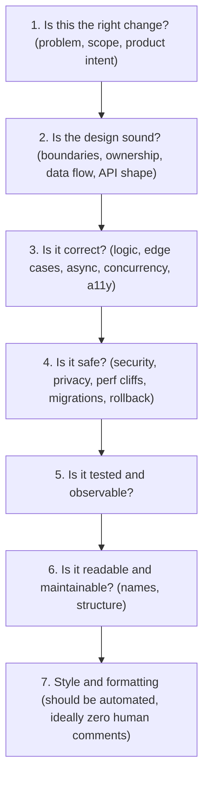
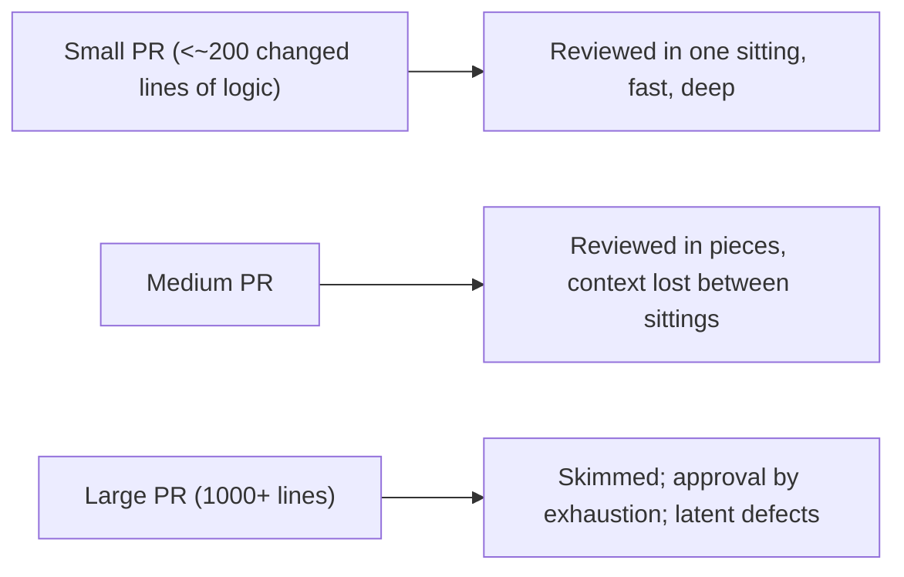
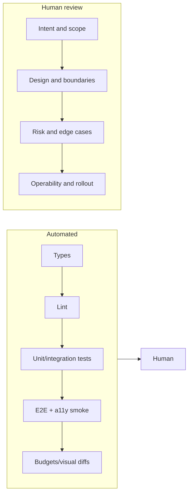
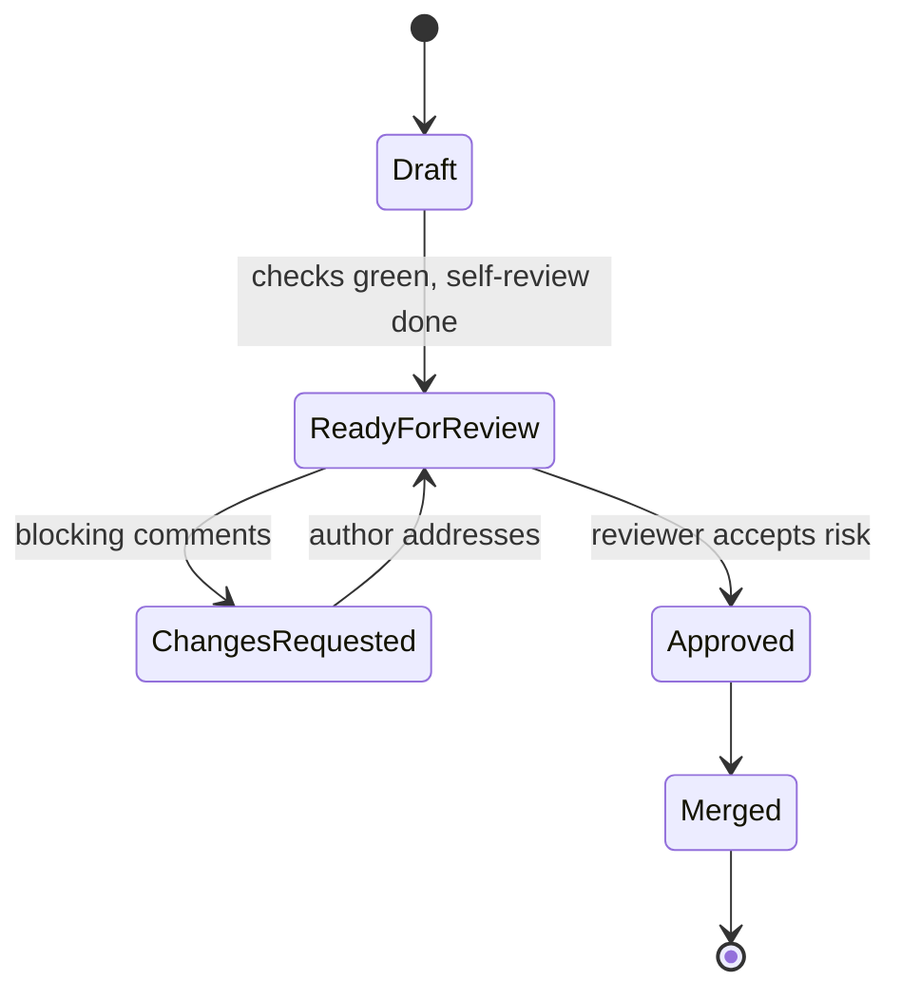
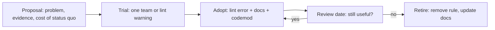

# 11 / 17 — Code Review and Engineering Standards

## 1. Lesson metadata

| | |
|---|---|
| **Level** | Professional |
| **Study time** | 4–5 hours (reading 2 h, review practice 1.5 h, exercises 1.5 h) |
| **Prerequisites** | [16 — Supporting multiple teams](./16-supporting-multiple-teams.md), [Phase 4 / 25 — Architectural fitness and enforcement](../04-react-architecture/25-architectural-fitness-and-enforcement.md), [Phase 8 / 14 — Linting and static analysis](../08-testing-and-quality/14-linting-and-static-analysis.md), [Phase 3 / 23 — Hooks anti-patterns](../03-react-state-and-hooks/23-hooks-anti-patterns.md), [Phase 2 / 12 — Why rendering must be pure](../02-react-rendering-and-internals/12-why-rendering-must-be-pure.md) |
| **Next** | [18 — Technical leadership](./18-technical-leadership.md) |
| **Related** | [Phase 10 / 16 — Architecture decision records](../10-production-engineering/16-architecture-decision-records.md), [Phase 10 / 17 — Documentation](../10-production-engineering/17-documentation.md) |

**Learning objectives.** After this lesson you can:
1. Explain what code review is *for* (and what it is not for), and design a review process around those goals.
2. Review a React pull request in a fixed order of concerns, prioritising correctness and risk over style.
3. Recognise the highest-yield React-specific defects in a diff: impure render, effect misuse, stale closures, identity/key bugs, boundary violations, accessibility regressions, and unjustified memoization.
4. Write review comments that are specific, actionable, proportionate and kind, and that distinguish blocking from non-blocking feedback.
5. Decide which standards to automate (lint, types, CI), which to document, and which to leave to judgment.
6. Evolve standards: propose, trial, adopt and retire a rule without turning it into dogma.

**Concepts covered:** review goals, review order, risk-based review, PR size and structure, blocking vs non-blocking feedback, review comment taxonomy, automation first, standards vs conventions vs guidelines, codeowners, review SLAs, review of AI-generated code, anti-bikeshedding, standard lifecycle.

---

## 2. Deep conceptual explanation

### 2.1 What problem does code review solve?

A team of engineers changes a shared codebase concurrently. Three things go wrong without a checkpoint on change:

1. **Defects ship** that the author could not see (authors are blind to their own assumptions).
2. **Knowledge concentrates** in whoever wrote the code, creating bus-factor and onboarding problems.
3. **The codebase drifts**: ten locally reasonable decisions produce an incoherent whole.

Code review is the lightweight, human checkpoint that addresses all three. Notice the ordering: defect detection is the *least* efficient of the three goals. Empirical studies of review in industry (e.g. the widely cited analyses of Microsoft and Google review practices) repeatedly find that review finds fewer defects than people expect and delivers more value as knowledge transfer, shared ownership and design feedback. Treat that as a *tendency reported in the literature*, not a law; the practical implication is stable, though: **do not rely on review as your primary correctness mechanism**. Types, tests, linting and CI are cheaper and more reliable at catching the mechanical defects. Reviewers should spend scarce attention on what machines cannot judge.

### 2.2 The review hierarchy: what a human should spend attention on



The top of the pyramid is the most expensive to fix late and the least automatable. The bottom is the cheapest to automate and the most commonly (over-)commented. A healthy review culture inverts the typical comment distribution: many comments on levels 1–4, almost none on 7.

### 2.3 Standards: what they are and are not

| Term | Meaning | Enforcement | Example |
|---|---|---|---|
| **Rule / invariant** | Violating it causes bugs or security issues | Automated; blocks merge | `react-hooks/rules-of-hooks`; no `dangerouslySetInnerHTML` with unsanitized input |
| **Standard** | Team-wide decision made for consistency | Automated where feasible; reviewed otherwise | Feature-folder layout; data fetching only through the query layer |
| **Convention** | Habit that lowers cognitive load | Formatter or linter; low review priority | File naming, import order |
| **Guideline** | Advice with known exceptions | Judgment; explained when deviated from | "Prefer composition over boolean-prop variants" |
| **Preference** | Individual taste | None | Arrow function vs function declaration (unless the team has set a standard) |

The senior skill is *classification*: noticing that a comment is a preference being dressed as a rule, or that a real invariant is being left to reviewer memory. Anything in the "rule" row that relies on humans spotting it will eventually be missed.

### 2.4 Why React code needs specific review lenses

React has a few failure modes that are invisible to type checkers and look fine in a diff skim:

- **Render purity violations** (mutating props or module state during render, `Date.now()`/`Math.random()` in render). Strict Mode double-invocation exposes some in development; others only show under concurrent rendering. See [Phase 2 / 12](../02-react-rendering-and-internals/12-why-rendering-must-be-pure.md).
- **Effects used for derived state or event responses** (“you might not need an effect”). See [Phase 3 / 07](../03-react-state-and-hooks/07-you-might-not-need-an-effect.md).
- **Stale closures and missing cleanup** in effects and subscriptions. See [Phase 3 / 05](../03-react-state-and-hooks/05-effect-dependencies-and-stale-closures.md) and [06](../03-react-state-and-hooks/06-effect-cleanup.md).
- **Identity bugs**: index keys on reorderable lists, components defined inside components, `key` misuse that resets or preserves state unexpectedly. See [Phase 2 / 07](../02-react-rendering-and-internals/07-identity-keys-and-reconciliation.md).
- **State in the wrong place**: server state copied into local state, derived state stored, global state for local concerns. See [Phase 4 / 15](../04-react-architecture/15-state-ownership.md).
- **Accessibility regressions**: clickable `div`s, missing labels, focus management lost on route or modal change.
- **Boundary violations**: UI importing infrastructure, features importing each other's internals, `use client` creeping upward.

These are the "React-shaped" bugs a reviewer should be specifically trained to see.

### 2.5 Common misconceptions

| Misconception | Reality |
|---|---|
| "Review is for catching bugs." | It is also for sharing context and keeping design coherent; bug catching is the least reliable function. |
| "More reviewers means a better review." | Diffusion of responsibility: each assumes another looked. One or two accountable reviewers beat five skimmers. |
| "A review must be exhaustive." | Review is risk-based. A one-line copy change and a change to the auth boundary do not deserve equal scrutiny. |
| "Nitpicking improves quality." | Unautomated style comments burn goodwill and turn review into a status contest. Automate or drop. |
| "Approving means I agree with every line." | Approving means: *I have understood the change, I believe it is safe to ship, and I accept shared responsibility.* |
| "Standards make everyone write identical code." | Good standards constrain *interfaces and invariants*, leaving local implementation free. |
| "If CI is green, review can be light." | Green CI means the *tested* behavior holds. It says nothing about design, missing tests, or untested paths. |

---

## 3. Internal mechanics

There is no React internals content here, but review itself has "mechanics": the social-technical system in which diffs flow. Using the course convention:

- **Public guarantee** (team policy you can rely on): every change to protected branches has at least N approvals, required status checks pass, and CODEOWNERS paths require owner approval. These are enforceable in the hosting platform (branch protection rules; GitHub, GitLab and others provide equivalents; ⚠ specific setting names vary by platform and plan, verify in your platform docs).
- **Teaching model**: the "review budget". A reviewer has roughly 60–90 focused minutes of effective attention per day for deep review, and effectiveness drops with diff size. This is a heuristic, widely reported, not a measured constant. Use it to justify small PRs, not to compute schedules.
- **Implementation detail** (varies by org): who the reviewers are, SLA values, whether "approve with comments" is allowed.

### 3.1 The cost curve of a PR



The relationship between size and review quality is monotone and well-attested anecdotally and in studies, but the thresholds are team- and language-specific. Mechanical changes (rename, codemod output, generated files, formatting) are exempt from the size heuristic *if reviewed as a mechanical change* (review the codemod, spot-check output).

### 3.2 What a reviewer actually does, in order

1. Read the description and linked ticket/ADR. Decide whether the *problem* is understood.
2. Read the diff *structure* first (file list, new modules, deleted modules, changed public types) before reading line details.
3. Read tests first when they exist: they state the intended behavior.
4. Read the production code with specific lenses (section 5.3).
5. Run it when risk justifies (UI changes with interaction, a11y, perf). A preview deployment or a checkout and manual pass is part of review for user-facing changes.
6. Write comments, label blocking vs non-blocking, and give an explicit verdict.

---

## 4. Step-by-step walkthrough: reviewing a real PR

**PR title:** "Add saved-searches dropdown to orders page". Author: mid-level engineer. Size: 340 lines.

**Step 1 — Context (2 min).** Description says: "Adds dropdown, persists to localStorage, filters list." Linked ticket asks for per-user saved searches *synced across devices*. The reviewer notices a mismatch: localStorage is device-local. This is a level-1 finding ("is this the right change?"). Raise it before reading code. A thirty-second question saves the author days.

**Step 2 — Structure (3 min).** Files: a new `useSavedSearches` hook in `features/orders/`, a new `SavedSearchMenu` component, an edit to `OrdersPage.tsx`, and an import from `features/customers/internal/format.ts`. The last is a boundary violation (reaching into another feature's `internal`). Note it.

**Step 3 — Tests (3 min).** One test: renders menu, clicks item, asserts list filtered. No test for persistence failure (localStorage full or disabled) or for an empty state.

**Step 4 — Code with lenses (15 min).** Findings (see 5.3 for the code):
- Derived `filteredOrders` stored in `useState` and synchronized in an effect (derived state).
- Storage read in render (impure, and throws in some privacy modes).
- Menu items keyed by array index while items are deletable (identity bug).
- Delete button is a `<div onClick>` (a11y).

**Step 5 — Run it (5 min).** Open the preview, open the menu with keyboard only: cannot reach delete. Add a search, reload: persisted. Open in a second profile: absent (confirms step 1).

**Step 6 — Comments and verdict (10 min).** Group by severity; lead with the one blocking design question; make each comment actionable; suggest rather than demand where it is taste. Verdict: "Request changes: scope question (1) and correctness issues (2, 3, 4). Everything else is optional."

Total: about 40 minutes for a 340-line PR. This is typical and is the actual price of review; budget for it in planning.

---

## 5. Code examples

### 5.1 Minimal example — a review-worthy defect in five lines

```tsx
function Total({ items }: { items: { price: number }[] }) {
  const [total, setTotal] = useState(0);
  useEffect(() => { setTotal(items.reduce((s, i) => s + i.price, 0)); }, [items]);
  return <span>{total}</span>;
}
```

**Predict:** What is rendered on first paint, and how many renders occur on mount with three items?

**Answer:** First render shows `0`; the effect runs after commit, calls `setTotal`, and React renders again with the correct total. That is two renders (four invocations of the component body in Strict Mode development, since Strict Mode double-invokes render, and also re-runs effects once on mount). Users on slow devices may see a flash of `0`. The state is *derived*; compute it during render.

**Review comment (good):**
> **[blocking]** `total` is derived from `items`; storing it in state plus an effect adds a render and a flash of `0`. Compute during render: `const total = items.reduce(...)`. If the reduce becomes expensive in profiling, wrap in `useMemo` then. See Phase 3 / 17 (derived state).

### 5.2 Practical example — the PR from the walkthrough (as submitted)

```tsx
// features/orders/SavedSearchMenu.tsx (as submitted)
import { formatCustomerName } from '../customers/internal/format'; // (A)

type Saved = { id: string; label: string; query: string };

export function SavedSearchMenu({ orders, onPick }: Props) {
  const [saved, setSaved] = useState<Saved[]>(
    JSON.parse(localStorage.getItem('saved') ?? '[]')            // (B)
  );
  const [filtered, setFiltered] = useState(orders);               // (C)
  const [query, setQuery] = useState('');

  useEffect(() => {
    setFiltered(orders.filter(o => o.title.includes(query)));     // (C)
  }, [orders, query]);

  useEffect(() => {
    localStorage.setItem('saved', JSON.stringify(saved));         // (D)
  }, [saved]);

  return (
    <ul>
      {saved.map((s, i) => (
        <li key={i}>                                              {/* (E) */}
          <span onClick={() => onPick(s.query)}>{s.label}</span>
          <div onClick={() => setSaved(saved.filter(x => x.id !== s.id))}>x</div> {/* (F) */}
        </li>
      ))}
    </ul>
  );
}
```

Line-by-line review notes:

- **(A)** Imports another feature's `internal` module. Public surface of `customers` should be an `index.ts`; an ESLint boundary rule (see [Phase 4 / 25](../04-react-architecture/25-architectural-fitness-and-enforcement.md)) should have caught this. Comment *and* file a follow-up to automate.
- **(B)** `useState(JSON.parse(...))` evaluates `localStorage.getItem` and `JSON.parse` on **every render** (only the first result is used). It can throw (corrupt JSON, blocked storage). Use a lazy initializer with try/catch, or better `useSyncExternalStore` or a storage hook shared across the app. Also: during SSR `localStorage` is undefined; check whether this component can render on the server.
- **(C)** `filtered` is derived from `orders` and `query`. Remove the state and effect.
- **(D)** Persisting from an effect is acceptable (synchronizing with an external system). But the first effect run on mount writes the value it just read: harmless but redundant. A bigger issue: two tabs overwrite each other. Mention as non-blocking unless multi-tab is a requirement.
- **(E)** Index keys on a list that supports deletion: after deleting item 0, React reuses item-0's DOM/state for what was item 1. Here there is no local state in `li`, so the visible bug is nil today, but it becomes real the moment someone adds an input or animation. Use `s.id`.
- **(F)** `div` with `onClick`: not focusable, no role, not keyboard operable. Use `<button type="button" aria-label={`Delete ${s.label}`}>`. Same for the `span`.

### 5.3 The review checklist as code-shaped questions

| Lens | Question to ask of the diff |
|---|---|
| Purity | Does render read anything mutable (`Date.now`, `Math.random`, refs, module variables, storage)? Does it write anything? |
| Derived state | Is any `useState` value always computable from other state or props? |
| Effects | For each `useEffect`: what external system is it synchronizing with? Could this be an event handler, a derived value or a key reset instead? Does it clean up? |
| Closures | Are values captured in timers/subscriptions/async callbacks current when they fire? Is the dependency array truthful? |
| Identity | Are keys stable and unique? Are components declared at module scope? Do inline objects/functions flow into memoized children or effect deps? |
| State placement | Who owns this state? Could it be lower, or in the URL, or server state in the query cache? |
| Async | Race conditions, unmount-after-await, cancellation, error and empty and loading states? |
| Boundaries | Do imports point in the allowed direction? Are server-only modules kept off the client? |
| Accessibility | Semantic elements, labels, focus, keyboard, announcements, contrast, reduced motion? |
| Types | `any`, assertions (`as`), non-null (`!`), widened unions, unsound generics? |
| Security | Unsanitized HTML, URL injection (`javascript:`), secrets in client bundles, token storage? |
| Performance | New large dependency? Unbounded lists? Work in render proportional to data size? Context value identity? |
| Tests | Do tests assert user-visible behavior and edge cases, or implementation details? |
| Operability | Logging, error reporting, feature flag, rollback path, migration order? |

### 5.4 Incorrect example — a bad review comment set

> - "nit: rename `data` to `orderData`"
> - "why not use a ternary here"
> - "I would've done this differently"
> - "LGTM" (on a 1,200-line PR, after 4 minutes)

Problems: preference presented without a reason; no severity; no actionable alternative; an approval with no evidence of understanding. The one comment that matters (scope mismatch) is absent.

### 5.5 Corrected — comment taxonomy and templates

Use explicit prefixes so authors can triage. A widely used scheme (inspired by "Conventional Comments"; ⚠ the exact labels are a community convention, not a standard):

```text
blocking:   Must change before merge. Explain the risk and propose a fix.
question:   I need to understand; may or may not lead to a change.
suggestion: An improvement I think is worthwhile; author may decline with reason.
nit:        Trivial and optional. Prefer to automate; omit if a formatter could fix it.
praise:     Specific positive reinforcement; reinforces desired patterns.
thought:    Longer-term idea; not for this PR.
```

Template for a blocking comment:

```text
blocking: <observation, with file/line anchor>.
Risk: <what breaks, for whom, when>.
Suggestion: <concrete alternative, ideally a code snippet>.
Happy to pair if useful.
```

Example, applied to (B):

> **blocking:** `useState(JSON.parse(localStorage.getItem(...)))` runs the read+parse on every render, and throws on corrupt JSON or blocked storage, which would crash the page (we have no error boundary above this menu).
> Suggestion: lazy initializer plus try/catch, or reuse `useLocalStorage` from `shared/hooks`:
> ```tsx
> const [saved, setSaved] = useLocalStorage<Saved[]>('saved-searches', []);
> ```

### 5.6 Advanced example — encoding standards as automation

Standards that matter should be machine-checked. Examples (ESLint 9 flat config; run-tested with ESLint 9.39, typescript-eslint 8.72, eslint-plugin-react-hooks 7.1; plugin names and options change, so re-check them):

```ts
// eslint.config.ts
import reactHooks from 'eslint-plugin-react-hooks';
import tseslint from 'typescript-eslint';
import { defineConfig } from 'eslint/config'; // tseslint.config() still works but is deprecated in favour of this

export default defineConfig(
  tseslint.configs.recommendedTypeChecked,
  {
    // Required by the type-checked rules; without it ESLint aborts with
    // "You have used a rule which requires type information..." (run-tested).
    languageOptions: { parserOptions: { projectService: true, tsconfigRootDir: import.meta.dirname } },
    plugins: { 'react-hooks': reactHooks },
    rules: {
      'react-hooks/rules-of-hooks': 'error',
      'react-hooks/exhaustive-deps': 'error', // promote from default 'warn'
      '@typescript-eslint/no-floating-promises': 'error',
      '@typescript-eslint/no-explicit-any': 'error',
      // Feature boundary: only import another feature through its index.
      'no-restricted-imports': ['error', {
        patterns: [{
          group: ['@/features/*/internal/*', '@/features/*/*/*'],
          message: 'Import from the feature public API (@/features/<name>).',
        }],
      }],
    },
  },
);
```

Complement with:

- A **PR template** with prompts (what/why, risk, how tested, screenshots, a11y checked, rollout/rollback).
- **CODEOWNERS** for sensitive areas (auth, payments, design-system tokens, build config).
- **CI gates**: typecheck, lint, tests, bundle-size budget, a11y smoke (axe), visual regression for the design system.
- **Formatter** (Prettier or equivalent) auto-applied in pre-commit or CI so formatting is never a human concern.

---

## 6. Visual explanations

### 6.1 Where each kind of defect should be caught



Mechanical defects flow left to right through automation. Judgment calls reach humans. If a human repeatedly writes the same comment, that comment is a missing automation.

### 6.2 Review lifecycle and states



Self-review is an explicit step: the author reads their own diff in the review UI before requesting anyone. This reliably removes a class of embarrassing defects (debug code, unrelated changes).

---

## 7. Alternative approaches and trade-offs

| Approach | Strengths | Weaknesses | Best when |
|---|---|---|---|
| Synchronous pre-merge review (default) | Gate on quality; shared context | Latency; queueing; bottleneck on a few seniors | Most product teams |
| Pair / mob programming as review | Immediate feedback; knowledge transfer | Costly in people-hours; no written record unless captured | Risky or novel work, onboarding |
| Post-merge (trunk-based, review after) | Fast flow, small changes | Requires strong tests, flags, fast rollback, high trust | Mature teams with feature flags and strong CI |
| Stacked small PRs | Each easy to review | Tooling overhead; rebase pain | Large features |
| Automated review (linters, bots, AI assistants) | Immediate, tireless, consistent | False positives; shallow on intent; may create false confidence | First-pass screening; mechanical rules |
| Design review before code (RFC/TDD/ADR) | Cheap to change course | Process overhead; can become ceremony | Cross-team or costly-to-reverse decisions ([Phase 10 / 16](../10-production-engineering/16-architecture-decision-records.md)) |

**Scenario where the recommended approach (pre-merge, human-reviewed) is not best.** A two-person startup shipping behind feature flags with extensive end-to-end tests and a one-click rollback can reasonably prefer post-merge review of what shipped, because waiting hours for approval costs more than the occasional revert. Conversely, a regulated environment (payments, medical) may *require* two-person pre-merge review for audit reasons regardless of ergonomics. Policy follows risk and context.

**On AI-assisted review and AI-authored code.** Treat AI-generated diffs as *code from a fast, confident, context-poor junior*: plausible, often correct locally, and prone to hallucinated APIs, over-engineering, and missing edge cases. Practical stance (an opinion informed by common practice, not a universal rule): the human author remains fully accountable and must understand every line; reviewers should not lower their bar because "the tool wrote it"; AI review bots are useful as an extra first pass but their approval is never a substitute for human accountability. ⚠ Tooling in this area changes quickly; verify capabilities rather than assuming.

---

## 8. Best practices and anti-patterns

### 8.1 Author practices

- Keep PRs small, single-purpose and reviewable in one sitting; split refactors from behavior changes ("make the change easy, then make the easy change").
- Write the description for a reviewer with zero context: problem, approach, alternatives considered, risk, test plan, screenshots or recordings for UI.
- Self-review first. Comment on your own diff where something is non-obvious ("this looks odd because...").
- Respond to every comment (resolve, or explain why not). Disagree with reasons, not with silence.
- Do not push unrelated changes into an approved PR.

### 8.2 Reviewer practices

- Review promptly; a team-agreed SLA (e.g. first response within one business day) matters more than any rule about depth. Slow review is a hidden tax on lead time.
- Say what you reviewed and what you did not ("did not run it locally; reviewed logic and types only").
- Separate blocking from non-blocking. If everything is a nit, nothing is.
- Offer alternatives. "This is confusing" is weaker than "consider extracting X; it would make Y testable".
- Praise specifically; it teaches as effectively as criticism.
- When a thread exceeds two round-trips, move to a call or pairing; summarize the outcome in the PR.

### 8.3 Anti-patterns

| Anti-pattern | Why it hurts | Instead |
|---|---|---|
| Rubber-stamp LGTM | False safety; no learning | Approve only what you understood; say what you checked |
| Gatekeeping hero | One person is the bottleneck and ego center | Distribute ownership; document criteria |
| Style wars in review | Wastes attention, erodes trust | Formatter + lint config; change rules via proposal, not in PR threads |
| Review by diff-only | Misses what is *not* in the diff (callers, missing tests, missing edge) | Open the surrounding code; search usages |
| "Rewrite it my way" | Demoralizes; ignores that multiple designs work | Distinguish defect from alternative; defer to the author on taste |
| Drive-by mega-refactors | Unreviewable; high regression risk | Separate PRs; codemods with reviewed scripts |
| Unreviewed generated code | Bugs slip in | Review the generator/prompt and spot-check output; require tests |
| Standards without owners | Rot; conflicting rules | Every standard has an owner, a rationale and a review date |
| Blanket "100% coverage" | Rewards trivial tests | Risk-based coverage; mutation or behavior-focused review |

### 8.4 Justified exceptions

- A hotfix during an incident may merge with one approval and retrospective review; record it and follow up within a day.
- Breaking a guideline is fine with a written reason in the PR or a code comment ("not using `useQuery` here because X"). Breaking an invariant requires an explicit exception process.
- A "nit" may be worth blocking on if it repeats a pattern the team is actively trying to remove (deprecations). Say so.

### 8.5 Lifecycle of a standard



Standards should *expire unless renewed*. A rule written for React 16 class components may be noise in React 19 function-and-Actions code. Examples worth revisiting in a React 19 codebase: rules forbidding or mandating `useCallback`/`useMemo` everywhere (⚠ the React Compiler changes this calculus; verify current compiler guidance in [Phase 9 / 08](../09-advanced-rendering-and-ecosystem/08-react-compiler.md)), `forwardRef` wrappers (ref is a regular prop in React 19), `defaultProps`, and PropTypes.

---

## 9. Real-world application

**E-commerce checkout team.** Changes to cart, pricing and payment require CODEOWNERS approval from a payments owner plus a second engineer. Review checklist adds: idempotency of submit, double-click protection, price calculated server-side, analytics events not firing twice under Strict Mode, error states for declined cards. Constraint: audit trail of approvals for PCI-adjacent change management.

**Trading/finance dashboard.** Reviewers focus on render cost per tick (are updates batched? is the subscription cleaned up? is the context value stable?), numeric formatting and rounding, time zones, and stale-data indications. Constraint: a regression that adds 20 ms per message is a production incident at 50 messages/second.

**Design system (multi-team consumers).** Review is also *API review*: prop naming, defaults, a11y contract, breaking-change classification (semver), and codemods for migrations. A change is judged by its blast radius across consumers, not by its diff size ([Phase 10 / 11](../10-production-engineering/11-design-system-governance.md)).

**Multi-team monorepo.** Cross-team changes use CODEOWNERS and a "review across boundaries" protocol: the owning team approves their path; the changing team is responsible for running affected tests and communicating. Automated affected-project test selection keeps CI affordable ([Phase 4 / 22](../04-react-architecture/22-monorepos-and-shared-packages.md)).

Engineering constraints common to all: review latency (target hours not days), reviewer load balancing (rotations rather than always the senior), timezone distribution (asynchronous-friendly descriptions), and compliance requirements.

---

## 10. Debugging and troubleshooting the review process

| Symptom | Likely root cause | Investigation | Fix |
|---|---|---|---|
| PRs wait days | Too few reviewers; huge PRs; unclear ownership | Measure time-to-first-review and PR size distribution from your platform's API | SLA, rotation, size guidance, CODEOWNERS |
| Production bugs pass review | Review expected to be the safety net | Postmortems: which gate should have caught it? | Add test/lint/type rule; update checklist |
| Heated comment threads | Taste vs rule confusion | Read threads for "I prefer" language | Move to a standards proposal; automate |
| Author stops responding to feedback | Comments feel personal or unclear | Ask authors; check comment tone and volume | Comment taxonomy; praise; pair on first reviews |
| Same comment repeated across PRs | Missing automation or documentation | Search PR comments for repeated phrases | Lint rule, codemod, or doc snippet |
| Approvals without engagement | Large diffs; reviewer overload | Compare approval time to diff size | Smaller PRs; reviewer capacity |
| Standards ignored | Unenforced, unknown, or disliked | Check lint/CI coverage; ask developers | Automate; involve team in revisions |

Metrics to watch (use as diagnostics, never as individual performance targets, since Goodhart's law makes them gameable): time to first review, time to merge, PR size, review rounds, reopened/reverted PRs, change-failure rate (the DORA delivery metrics are a common frame: five in the current model — change lead time, deployment frequency, failed deployment recovery time, change fail rate, deployment rework rate; see dora.dev).

---

## 11. Exercises

### Level A — Knowledge
A1. List the three primary goals of code review and rank them by how reliably review achieves each.
A2. Distinguish a rule, a standard, a convention and a guideline. Give one React example of each.
A3. What does an approval mean, in one sentence?
A4. Name five React-specific defect categories that type checkers cannot catch.
A5. When is a "nit" worth blocking on?

### Level B — Code comprehension
B1. Review this snippet. List every issue and classify each as blocking or non-blocking.

```tsx
function Cart({ items, user }: { items: Item[]; user: User }) {
  const [count, setCount] = useState(items.length);
  useEffect(() => {
    fetch('/api/cart/' + user.id).then(r => r.json()).then(setCart);
  }, []);
  const Row = ({ item }: { item: Item }) => <li>{item.name}</li>;
  return <ul onClick={() => track('cart_click')}>
    {items.map((it, i) => <Row key={i} item={it} />)}
  </ul>;
}
```

B2. A teammate writes `useCallback` around every handler and `React.memo` around every component and asks you to approve. What do you check, and what do you say?

B3. A diff changes a prop type from `string` to `string | undefined` on a design-system `Button`. What do you ask?

### Level C — Implementation
C1. Write a PR template (Markdown) for a React product team that surfaces risk, test plan, accessibility and rollout.
C2. Write an ESLint `no-restricted-imports` configuration enforcing that `features/*` modules can only be imported via their root `index.ts`, plus a second rule forbidding `features/*` from importing `app/*`.
C3. Rewrite the three bad comments from 5.4 as good comments for a hypothetical diff of your choosing.

### Level D — Debugging
D1. Your team's median time-to-first-review is 3 days, and developers complain about both slow reviews and shallow ones. List a diagnosis plan with data you would collect, three hypotheses, and an intervention for each.
D2. A bug reached production: a list component showed the wrong user's draft text after deleting an item. The PR was approved by two reviewers. Identify the likely code defect, the review lens that would have caught it, and the process change.

### Level E — Architecture and engineering decisions
E1. You are introducing a rule that all server state must go through TanStack Query (no `fetch` in components). Write the proposal: rationale, enforcement, migration for 200 existing violations, and exception process.
E2. Decide whether a 40-engineer organization should require two approvals on every PR. Provide criteria and a recommendation with the strongest counter-argument.

### Level F — Expert challenge
F1. Design a review policy for AI-assisted authorship: what is required of authors, what of reviewers, what automation, how you measure whether it works, and what failure modes you expect. Keep it to one page.
F2. Design a "standards council" that prevents both anarchy and bureaucracy for 12 product teams sharing a design system. Specify membership, decision rights, cadence, and how a standard is retired.

---

## 12. Detailed answers and explanations

> Attempt the exercises first.

**A1.** (1) Share knowledge and context, (2) maintain design coherence, (3) detect defects. Reliability: knowledge sharing and design feedback are the most consistent benefits; defect detection is the least reliable because humans skim and miss mechanical errors, which is why we automate those. *Wrong-answer trap:* listing "enforce style" as a goal; style should be automated and is not what review is for.

**A2.** *Rule:* Rules of Hooks (violating it breaks React). *Standard:* all server data accessed via the query layer. *Convention:* `ComponentName.tsx` file naming, import order. *Guideline:* prefer composition over boolean-prop variants. Evaluation: examples must differ in enforcement strength and consequence of violation.

**A3.** "I understand this change, I believe it is safe to ship and I share responsibility for it." Anything weaker (a vague "looks fine") misrepresents the contract.

**A4.** Any five of: impure render; derived state in state/effects; stale closures/missing cleanup; unstable identity/keys; state in the wrong place; accessibility regressions (partially lintable via jsx-a11y but not fully); race conditions in async effects; unnecessary context re-render fan-out; client/server boundary leaks.

**A5.** When the "nit" is part of an active deprecation or migration (e.g. a new use of a banned API) that, if tolerated, undermines the migration. Label it as blocking and cite the migration. Otherwise nits are optional.

**B1.** Issues:
1. `useState(items.length)`: copies props into state; goes stale when `items` changes (derived state). Compute `items.length` directly. *Blocking.*
2. `setCart` is undefined (no such state). Compile error; also the component fetches cart data it already receives via `items`: unclear data ownership. *Blocking* (question the data flow).
3. Fetch in effect with `[]` deps: no cancellation, no error handling, no loading state, race when `user.id` changes, missing dependency (`user.id`). Prefer the project's data layer (TanStack Query). *Blocking.*
4. `Row` defined inside `Cart`: new component identity each render, so React unmounts and remounts all rows every render (state loss, DOM churn). Move to module scope. *Blocking.*
5. `key={i}`: index keys on a list that may reorder/filter. Use `it.id`. *Blocking if reorderable, else suggestion.*
6. `onClick` on `ul` for analytics: event delegation is legitimate, but it fires for clicks on any part; confirm intent and a11y (not an interaction target). *Question.* Also `track` in handler is fine (event handler, not render).
7. `Row` has no `key` collision problem but also inline; no styling concerns. Skip.
Sample comment ordering: lead with 3 and 4, group 1/2 as data-ownership design question.

**B2.** Check whether memoization is *justified*: does it prevent measurable re-renders (profiler evidence), or is it noise? Blanket memoization adds dependency-array maintenance, hides bugs, and often does nothing, because `memo` is defeated by any new object/function prop that isn't itself memoized. Say: "Please remove where unmeasured; keep where the profiler shows wasted renders in expensive subtrees. If we adopt the React Compiler, much of this becomes automatic (verify current guidance)." See [Phase 7 / 04](../07-performance/04-memoization-trade-offs.md). Wrong answer: "memoize everything, it's free" (it has memory, comparison and cognitive costs).

**B3.** Is it a breaking change for consumers (callers that previously could assume `string`; TypeScript consumers with `strict`)? Which consumers are impacted (search the monorepo/usage analytics)? What is the runtime behavior for `undefined` (a default? a crash?)? Is there a changeset/semver bump and migration note? Is the a11y contract preserved (a button with no label)? Also, whether the widening was needed or the call site should have been fixed.

**C1.** Example template:

```markdown
## What and why
<!-- Problem, link to ticket/ADR. -->

## Approach
<!-- What you did, alternatives considered. -->

## Risk
- [ ] Touches auth/payments/shared package?  Blast radius:
- [ ] Data migration or breaking API change?

## How I tested
- [ ] Unit/integration:  - [ ] Manual:  - [ ] E2E:

## UI changes
<!-- Screenshots/video, light+dark, mobile. -->

## Accessibility
- [ ] Keyboard only  - [ ] Labels/roles  - [ ] Focus management  - [ ] Reduced motion

## Rollout
- [ ] Feature flag  - [ ] Rollback plan  - [ ] Monitoring/alerts
```

Evaluation: includes risk, test evidence, a11y, and rollout; short enough that people fill it in.

**C2.** Example (flat config):

```ts
{
  files: ['src/**/*.{ts,tsx}'],
  rules: {
    'no-restricted-imports': ['error', {
      patterns: [{ group: ['@/features/*/*'], message: 'Import via @/features/<name>' }],
    }],
  },
},
{
  files: ['src/features/**/*.{ts,tsx}'],
  rules: {
    'no-restricted-imports': ['error', {
      patterns: [
        { group: ['@/features/*/*'], message: 'Import via @/features/<name>' },
        { group: ['@/app/*'], message: 'Features must not depend on the app shell.' },
      ],
    }],
  },
},
```

Edge cases: a later config block overriding `no-restricted-imports` *replaces* the earlier option for matching files (it is not merged), which is why the second block repeats the first pattern. Also within a feature, relative imports of its own files must still work (the pattern only matches alias imports). For richer rules use `eslint-plugin-boundaries` or `dependency-cruiser` (verify current docs).

**C3.** Example: "question: Why do we keep `filtered` in state instead of deriving it from `orders` and `query`? Deriving would remove the effect and the one-render lag. Is there a reason I'm missing?" Evaluation: specific, reasoned, labelled, actionable.

**D1.** Collect: time-to-first-review, PR size, reviewers per PR, review comments per PR by category, bounced PRs. Hypotheses: (1) PRs too large, so reviewers procrastinate: enforce size guidance and stacking. (2) Review load concentrated on 2 seniors: rotation, CODEOWNERS distribution, train mid-levels. (3) No SLA/visibility: daily review block, dashboard, bot reminders. Shallow review arises from (1) and (2). Validate via before/after metrics over 4–6 weeks, using metrics as team diagnostics.

**D2.** Likely cause: index keys (`key={i}`) on an editable list whose items hold uncontrolled input state; after deleting item 0, the inputs keep their DOM state by position, showing the wrong draft. Lens: identity (keys). Process change: lint rule against index keys (`react/no-array-index-key` from `eslint-plugin-react`), a regression test that deletes the first item and asserts remaining drafts, and a review checklist line. See [Phase 2 / 07](../02-react-rendering-and-internals/07-identity-keys-and-reconciliation.md).

**E1.** Evaluation criteria: states problem (inconsistent caching, duplicated loading logic, race conditions), evidence (audit counts), enforcement (lint rule with ratcheting baseline: new violations error, existing ones tracked with `eslint-disable` plus a ticket or a bulk suppression file), migration (codemod where patterns are regular, team-by-team schedule, "leave it better" policy), exceptions (non-GET fire-and-forget analytics, third-party SDK calls; exception recorded with rationale), retirement date for review. Example strong answer includes ratcheting to avoid a "big bang" and explicitly names the cost (learning curve, query-key discipline).

**E2.** Criteria: risk profile (regulated vs not), team maturity, test strength, size distribution, reviewer availability, timezone spread. Recommendation: one required approval by default plus CODEOWNERS second approval for high-risk paths; two-for-everything adds latency and encourages diffusion of responsibility. Strongest counter-argument: compliance or past incidents may demand two-person integrity; then adopt it but reduce cost via small PRs and rotations. Credit answers that state the criteria and recommend conditionally.

**F1.** Evaluation criteria: author accountability (must be able to explain every line; disclose substantial AI generation if team policy requires), tests required, reviewers apply same standards, extra attention to hallucinated APIs, dependency additions, security-sensitive code, over-engineering; automation (types, lint, tests, secret scanning, dependency review); measurement (defect escape rate, review time, revert rate, with before/after comparison and caution about confounders); failure modes (large unreviewable diffs, reviewer fatigue, skill atrophy in juniors, license/provenance concerns, leaking proprietary code into external tools). One page, concrete.

**F2.** Strong answer: small council of rotating representatives from consuming teams plus design-system owners; decision rights: they decide *shared* standards only, teams own local ones; RFC process with 1–2 week comment window; decisions recorded as ADRs with an owner and review date; trial period as lint warning; retirement upon review date unless renewed; escape hatch for justified deviations; cadence biweekly, with metrics on adoption and friction. Anti-bureaucracy guard: any standard without a demonstrated recurring problem is declined.

---

## 13. Senior engineer interview questions

**Q1. How do you decide how deeply to review a PR?**
*Strong answer:* By risk and reversibility: blast radius (shared package vs one screen), data/security sensitivity, novelty, author context, test strength, and rollback ease. A copy change gets a skim; an auth boundary change gets a local run, threat thinking and a second reviewer. Reasoning: attention is finite, defects aren't uniformly distributed, and uniform depth under-reviews the dangerous and over-reviews the trivial.

**Q2. A senior colleague keeps leaving style nits that contradict the formatter. What do you do?**
*Strong answer:* Make the formatter authoritative (run in CI/pre-commit), discuss privately and kindly, propose a rule change through the standards process if they dislike the style, and remove the comments' standing by automating. The cause is unspecified expectations; the cure is making them explicit and mechanical.

**Q3. What are the most common React defects you catch in review?**
*Strong answer:* Derived state in effects/state, effects used where handlers belong, missing cleanup/stale closures, index keys and components defined inside components, boundary violations, a11y gaps (clickable divs), and over-memoization. Explain the *mechanism* for each (e.g. inline component redefinition changes element type each render, so reconciliation unmounts and remounts the subtree).

**Q4. How do you review when you disagree with the design but it works?**
*Strong answer:* Distinguish defect from alternative. If it works, is maintainable and within standards, approve and note the alternative as a suggestion or thought. Block only for correctness, risk, or violated invariants. Preserve the author's ownership; if the disagreement is systemic, take it to an ADR/standards discussion rather than relitigating in a PR.

**Q5. How would you roll out a new lint rule that has 400 existing violations?**
*Strong answer:* Introduce it as a warning, measure, ratchet (error for new violations via baseline/suppression), fix by codemod or team-by-team, set a deadline to flip to error, document rationale and exceptions. Reason: big-bang enforcement blocks everyone and breeds disabling comments; gradual enforcement preserves trust.

**Q6. How do you keep review from becoming a bottleneck?**
*Strong answer:* Small PRs, review SLAs, rotations, CODEOWNERS limited to high-risk paths, automation for mechanical checks, async-friendly descriptions, trust in authors for low-risk changes (and possibly post-merge review there). Track time-to-first-review as a team diagnostic.

**Q7. How should AI-generated code change your review?**
*Strong answer:* It shouldn't lower the bar. Look harder for hallucinated APIs, version mismatches (e.g. deprecated `forwardRef` or `defaultProps` patterns generated from old training data), unnecessary abstraction, missing edge cases and tests; require that the author can explain it. Treat AI review comments as hints, not approvals.

---

## 14. Further learning resources

| Resource | URL | Covers / why | Level | Study |
|---|---|---|---|---|
| Google Engineering Practices: Code Review | <https://google.github.io/eng-practices/review/> | Public guide to reviewing and being reviewed; "the standard of code review" | Intermediate | Reviewer guide, author guide |
| React docs: Rules of React | <https://react.dev/reference/rules> | Authoritative statement of purity and hook rules reviewers enforce | All | Entire page |
| React docs: You Might Not Need an Effect | <https://react.dev/learn/you-might-not-need-an-effect> | The canonical source for effect-related review comments | Intermediate | Entire page |
| React docs: Keeping Components Pure | <https://react.dev/learn/keeping-components-pure> | Purity rationale | Beginner–Int. | Entire page |
| eslint-plugin-react-hooks | <https://react.dev/reference/eslint-plugin-react-hooks> | Official lint rules for hooks | Intermediate | Rule list |
| ESLint docs | <https://eslint.org/docs/latest/> | Configuration, flat config, `no-restricted-imports` | Intermediate | Configure ESLint |
| Conventional Comments | <https://conventionalcomments.org/> | Community comment-label convention | Beginner | Whole site |
| DORA research | <https://dora.dev/> | Delivery metrics and capabilities frame | Intermediate | Research / capabilities |
| WAI-ARIA Authoring Practices | <https://www.w3.org/WAI/ARIA/apg/> | Reference patterns for a11y review | Intermediate | Patterns relevant to your components |

URLs in this table were checked for HTTP 200 on 2026-10-22; any still marked *(unverified)* could not be checked automatically (blocked or unreachable). A 200 response does not guarantee the page content still matches the description; if a link has moved, search the site for the quoted title.

---

## 15. Knowledge checkpoint

**You should now understand**
- Review's real goals, its limits as a defect filter, and the hierarchy of concerns.
- The React-specific lenses and the mechanism behind each.
- How to separate rules, standards, conventions and guidelines, and why standards should be owned, automated and retired.

**You should be able to explain without notes**
- What an approval means and why PR size matters.
- Why style comments should be automated away.

**You should be able to implement**
- A PR template, a boundary lint rule, a labelled review comment set, a standards proposal with ratcheting enforcement.

**You should be able to debug**
- A slow or shallow review process using data and hypotheses; a production bug backwards to the missed review lens.

**Before moving on:** read [18 — Technical leadership](./18-technical-leadership.md), which extends review into influence, mentoring and decision-making across a team.
