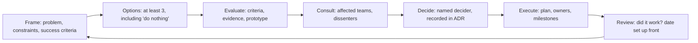
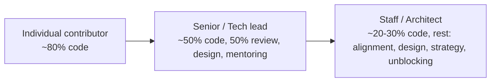
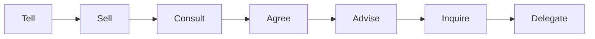

# 11 / 18 — Technical Leadership for Frontend Engineers

## 1. Lesson metadata

| | |
|---|---|
| **Level** | Architect |
| **Study time** | 4–5 hours (reading 2 h, case exercises 2–3 h) |
| **Prerequisites** | [17 — Code review and standards](./17-code-review-and-standards.md), [01 — Trade-off analysis](./01-trade-off-analysis.md), [02 — Technical design documents](./02-technical-design-documents.md), [16 — Supporting multiple teams](./16-supporting-multiple-teams.md), [Phase 10 / 15 — Technical debt](../10-production-engineering/15-technical-debt.md), [Phase 10 / 16 — ADRs](../10-production-engineering/16-architecture-decision-records.md) |
| **Next** | [19 — Debugging with incomplete information](./19-debugging-with-incomplete-information.md) |

**Learning objectives.** After this lesson you can:
1. Describe what technical leadership is and how it differs from management and from individual excellence.
2. Make and communicate decisions under uncertainty: reversible vs irreversible, who decides, how to disagree and commit.
3. Translate technical risk, debt and architecture into business terms for non-engineers.
4. Mentor and grow engineers, including delegating without abandoning.
5. Lead a migration or standard adoption across teams without authority over them.
6. Recognise leadership anti-patterns (hero, ivory tower, resume-driven development) and your own tendencies toward them.

**Concepts covered:** staff/principal archetypes, influence without authority, decision rights, reversibility, RFC/ADR facilitation, written communication, stakeholder management, risk communication, mentoring and sponsorship, delegation, technical strategy, roadmap negotiation, saying no, conflict, psychological safety, on-call and incident leadership, scaling yourself.

---

## 2. Deep conceptual explanation

### 2.1 What problem is this lesson solving?

Up to this point the curriculum has taught you to *decide well*: which state management, which rendering strategy, which boundaries. In an organization, a correct decision that nobody understands, adopts or funds has no effect. Technical leadership is the discipline of converting good technical judgment into **organizational outcomes**: shipped systems that other people can build on, decisions that stay made, and a team that gets stronger.

Leadership here does not mean a title. It means taking responsibility for outcomes beyond your own tickets.

### 2.2 Three axes: technical depth, scope, and people

| Axis | Junior | Mid | Senior | Staff / Architect |
|---|---|---|---|---|
| **Scope of ownership** | A task | A feature | A system or domain | Multiple teams/systems; the seams between them |
| **Time horizon** | Days | Sprint | Quarter | Year(s) |
| **Ambiguity handled** | Defined by others | Some | Defines the problem | Finds the problems worth solving |
| **Primary output** | Code | Features | Reliable designs and mentoring | Aligned decisions and force multiplication |
| **Success measured by** | Own delivery | Own delivery + quality | Team's delivery | Org's delivery |

⚠ These are illustrative; career ladders differ by company. The pattern that holds across ladders: as level rises, a larger share of your impact comes through *other people's* work.

Common staff-level archetypes (a classification popularised in the engineering-leadership literature; names vary): the **Tech Lead** (guides one team's technical direction), the **Architect** (owns cross-cutting design and quality attributes), the **Solver** (parachutes into hard problems), and the **Right Hand** (extends an executive's reach). A frontend architect most often blends Tech Lead and Architect.

### 2.3 Authority vs influence

Most cross-team technical work happens without formal authority. Influence is built from:

1. **Credibility**: a track record of being right, and of being honest when wrong.
2. **Context**: understanding the other team's constraints before proposing anything.
3. **Evidence**: prototypes, data, benchmarks, incident histories rather than appeals to taste.
4. **Low-friction adoption**: codemods, templates, docs, office hours. If the standard costs teams time, its sponsors should pay it down.
5. **Relationships**: trust built before it is needed.

The leading indicator of weak leadership is a decision that must be *enforced* because no one *chose* it.

### 2.4 Decisions: reversibility and decision rights

A useful lens (popularised as "one-way and two-way doors"): classify decisions by cost of reversal.

| Type | Examples (frontend) | Approach |
|---|---|---|
| **Two-way door** (cheap to reverse) | Naming conventions, a utility library, a component's internal structure, which chart lib for one page | Decide fast, locally, by the person closest. Document lightly. |
| **One-way door** (expensive to reverse) | Framework/meta-framework choice, routing and data-loading model, auth architecture, monorepo vs multirepo, microfrontend adoption, design-system public API | Slow down: write a design doc/ADR, solicit dissent, prototype, set a review date. |

Applying rigorous process to a two-way door is waste; applying none to a one-way door is negligence. The architect's job includes *classifying correctly*, and encouraging teams to convert one-way doors into two-way doors (adapters, facades, strangler patterns, feature flags; see [Phase 5 / 15](../05-design-patterns/15-adapter-strategy-factory.md) and [Phase 10 / 13](../10-production-engineering/13-application-migrations.md)).

**Decision rights** answer "who decides?". Make them explicit (for example using a lightweight RACI or the DACI variant: Driver, Approver, Contributors, Informed). Ambiguous rights produce either paralysis (everyone must agree) or surprise (someone decides alone and others discover it).

**Disagree and commit.** After a decision, dissent is recorded (in the ADR's "alternatives considered / dissent" section) and the team executes. Revisit on the stated review date or on new evidence, not on every grumble.

### 2.5 Communication as the primary tool

- **Write things down.** A design doc or ADR scales; a hallway conversation does not. Writing also exposes fuzzy thinking before it is expensive.
- **Lead with the decision and the ask.** Executives and partner teams need: what are you proposing, why now, what does it cost, what are the risks, what do you need from me, by when.
- **Adjust abstraction to audience.** Engineers: mechanisms and trade-offs. Product: user impact, timelines, options. Executives: risk, cost, strategic alignment. Same facts, different framing.
- **Quantify where honest.** "Our checkout bundle is 480 KB gzipped; each +100 KB costs roughly X% conversion on mid-range devices in our own A/B history" persuades more than "performance matters". Never invent numbers; say "estimate" and show assumptions.

### 2.6 Translating technical work to business value

| Engineering statement | Business translation |
|---|---|
| "We need to upgrade React and the router." | "Our current stack stops receiving security fixes in N months; upgrading now costs ~3 engineer-weeks, deferring risks a rushed 3-month migration under incident pressure." |
| "Tech debt in the checkout." | "Checkout changes take 3x longer than other areas, and 4 of the last 6 payment incidents originated there. A 6-week investment should cut change lead time and incident rate; we'll measure both." |
| "We need a design system." | "Teams rebuild buttons/forms ~N times; inconsistent a11y exposes us to compliance risk; a shared system reduces duplicated effort and accelerates new product surfaces." |
| "We should adopt RSC/SSR." | "Our largest pages' LCP is 4.1 s on mid-range mobile; server rendering plus streaming is the most credible lever on our measured bottleneck; alternatives are X, Y." |

Always pair the claim with a **measure** and a **way to know if it worked**.

### 2.7 Common misconceptions

| Misconception | Reality |
|---|---|
| "The best engineer should make all the decisions." | The best engineer builds a system in which good decisions are made *without* them. |
| "Leadership means writing the hardest code." | Sometimes; but a leader who is the bottleneck for hard code has failed to grow others. |
| "Consensus is the goal." | Informed *buy-in* is; unanimity is not. Seek disagreement early, decide, commit. |
| "Say yes to be helpful." | Unexamined yes creates overcommitment. A good no explains trade-offs and offers alternatives. |
| "Architecture is a document." | It is the set of decisions *that are hard to change*, plus the practices that keep them coherent. |
| "Technical debt is always bad." | It is a financing decision. Deliberate debt with a repayment plan can be right ([Phase 10 / 15](../10-production-engineering/15-technical-debt.md)). |
| "Mentoring is giving answers." | Mentoring builds the mentee's judgment; answers that skip the reasoning create dependence. |

---

## 3. Internal mechanics

Leadership has "mechanics" in the sense of repeatable processes. Using the course convention:

- **Public guarantee**: nothing external guarantees leadership outcomes. The nearest equivalents are your organization's formal processes (RFC process, ADR repository, on-call rota, CODEOWNERS).
- **Teaching model**: the *decision loop* below, and the *influence ladder*.
- **Implementation detail**: your company's specific rituals (guilds, architecture review boards, RFC templates). Adapt these; do not cargo-cult another company's.

### 3.1 The decision loop



Failure modes by step: framing too narrow ("which library?" when the problem is a data-flow boundary); options that are straw men; evaluation by seniority instead of criteria; consultation after the decision; decider unnamed; execution without owners; review never scheduled.

### 3.2 The influence ladder (low-cost to high-cost mechanisms)

1. **Share** knowledge (docs, talks, examples).
2. **Make the right thing easy** (templates, generators, lint autofixes, shared components).
3. **Make the wrong thing visible** (lint warnings, dashboards, size budgets).
4. **Make the wrong thing hard** (lint errors, CI gates, CODEOWNERS).
5. **Mandate** (policy). Use sparingly and only for true invariants.

Climb only when lower rungs fail and the issue justifies the cost. Most standards should live on rungs 2–3.

---

## 4. Step-by-step execution walkthrough: leading a cross-team migration

**Situation.** Five product teams share one React 17 + class components + Redux codebase layout in a monorepo. The goal: move to React 19 function components, Actions and TanStack Query for server state. You are the frontend architect; no team reports to you.

**Week 0 — Establish the why and the boundary.**
- Write a one-page problem statement: security-support horizon, hiring friction, a measured 35% of bug tickets involving data-fetching races, new React features blocked.
- Identify stakeholders: five engineering managers, product leads, QA, platform/infra.
- Define success metrics (percent of routes on the new data layer, incident rate, lead time) and non-goals ("not rewriting UI components that work").

**Week 1 — RFC.**
- Draft the RFC/design doc ([02](./02-technical-design-documents.md)): options (incremental strangler within the monorepo, big-bang rewrite, new app shell with microfrontends, do nothing), evaluated on cost, risk, reversibility, team load. Recommend incremental ([Phase 4 / 24](../04-react-architecture/24-refactoring-legacy-react.md)).
- Circulate to each team's tech lead *individually first* ("pre-wiring"): learn their objections before the meeting so the meeting ratifies rather than discovers.

**Week 2 — Decide.**
- Review meeting: 45 minutes, objections ranked, decider named (the director of engineering as approver; you as driver). Outcome recorded as an ADR with dissent and a review date at +3 months.

**Weeks 3–6 — Pave the road.**
- Build codemods for mechanical conversions, a template for new features, lint rules (new class components error; baseline existing), and a migration guide with before/after examples.
- Pilot on one team with a friendly, capable tech lead. Pair with them. Fix the friction. Publish what you learned ("pilot report").

**Weeks 7+ — Scale.**
- Teams migrate on their own schedule within a quarter; office hours twice a week; a Slack channel for questions; a public dashboard of progress (informational, not shaming).
- Monthly check-in with managers: blockers, capacity. Adjust the plan; communicate changes.

**Month 3 — Review.**
- Compare metrics with baseline; revisit the ADR; retire the migration scaffolding; document the new standard. Acknowledge teams that did the hard work.

Note what the architect did *not* do: rewrite everyone's code. They created the conditions and the tools, and measured results.

---

## 5. Code examples

Leadership artifacts are mostly prose, but they have concrete forms.

### 5.1 Minimal example — an ADR (Architecture Decision Record)

```markdown
# ADR-0042: Adopt TanStack Query for server state

Status: Accepted (2026-03-12) · Review: 2026-06-12
Decider: J. Alvarez (Director of Engineering) · Driver: B. Todorov

## Context
Server data is fetched ad hoc in effects across 5 teams. Audit (see appendix)
found 212 fetch-in-effect sites; 31 have no cancellation; 19 bug tickets in Q4
cite stale or racing data. We need a standard cache/invalidation model.

## Options considered
1. TanStack Query (chosen)
2. Redux Toolkit Query
3. Framework loaders only (not available in our SPA)
4. Status quo with a `useFetch` wrapper

## Decision
Use TanStack Query for all new server-state reads. Existing code migrated opportunistically.

## Consequences
+ Cancellation, dedupe, retries, cache invalidation standardized.
- Team learning curve; query-key discipline required.
- Adds ~13 KB gzipped (measure; verify against current version).
Reversibility: Moderate. Access hidden behind `shared/data` hooks.

## Dissent
M. Chen preferred RTK Query given existing Redux investment; accepted because
non-Redux teams are the majority. Revisit if Redux consolidation happens.
```

See [Phase 10 / 16](../10-production-engineering/16-architecture-decision-records.md). The key features: named decider, alternatives, consequences including negatives, reversibility, dissent, review date.

### 5.2 Practical example — stating a risk to a non-engineer

Incorrect:

> "Our dependency tree has several CVEs and the bundler config is brittle, so we really should refactor the build."

Corrected:

> **Ask:** 3 engineer-weeks in Q2 for a build and dependency upgrade.
> **Why:** 2 dependencies have known high-severity advisories that touch code paths we use (details in the security review). Deploys currently fail about 1 in 12 times for reasons unrelated to our code, costing roughly half a day each.
> **If we do not:** exposure to the advisories continues; a forced emergency upgrade later would likely cost more and land at a worse time.
> **How we'll know:** zero high-severity advisories; deploy failure rate under 1 in 50.
> **Alternative:** patch only the two advisories (1 week) and defer the build work; leaves deploy flakiness.

Notice: ask first, evidence, consequence of inaction, measurable outcome, an alternative. Numbers are placeholders for your own data; never fabricate them.

### 5.3 Incorrect — the hero / ivory-tower pair

```text
HERO:   "I'll just fix it myself tonight." (Fixes the shared form library alone,
        ships without review, nobody else understands the change; next incident,
        only they can fix it.)

IVORY:  Publishes a 40-page architecture guide, mandates it, never looks at team
        code, and cannot answer questions about the build. Teams quietly route
        around it.
```

### 5.4 Corrected — pair with the team, keep a hand in the code

- Hero → "I'll fix it *with* Priya, and we'll write the runbook; she is on-call next."
- Ivory tower → The architect spends regular time in the codebase (reviews, pairing, small fixes), and validates guidance by dogfooding it in a real feature.

### 5.5 Advanced example — a technical strategy one-pager

A strategy is a **diagnosis, guiding policy, and coherent actions** (the "kernel" popularised by Richard Rumelt's *Good Strategy / Bad Strategy*). For a frontend platform:

```markdown
## Diagnosis
- Five teams, four routing/data approaches; onboarding takes 6 weeks.
- 60% of Core Web Vitals regressions in 2 quarters trace to un-budgeted dependencies.
- Design system adoption is 40% by component usage; a11y defects cluster in custom controls.

## Guiding policy
1. One paved road: framework X, query layer Y, design system Z.
2. Constrain at the boundary (lint/CI/budgets), freedom inside it.
3. Measure outcomes, not compliance.

## Coherent actions (next 2 quarters)
- Q1: Ship template + codemods; pilot with Team A; enforce bundle budgets in CI.
- Q2: Migrate teams B–D; deprecate legacy data layer; a11y audit on shared controls.
- Not doing: microfrontends (cost > benefit at our size, see ADR-0038); rewriting working screens.
```

"Not doing" is a feature: strategy is mostly saying what you will not do.

---

## 6. Visual explanations

### 6.1 Where leadership time goes as scope grows



Approximate and varies enormously by org; the direction is what matters.

### 6.2 Reversibility vs process weight

```mermaid
quadrantChart
  title Decision process weight
  x-axis Cheap to reverse --> Expensive to reverse
  y-axis Low impact --> High impact
  quadrant-1 Heavy process (RFC, prototype, ADR)
  quadrant-2 Moderate (design note, review)
  quadrant-3 Just decide
  quadrant-4 Careful (staged rollout, flags)
  Naming conventions: [0.1, 0.2]
  Chart library for one page: [0.2, 0.3]
  Design-system public API: [0.75, 0.8]
  Framework choice: [0.9, 0.9]
  Auth architecture: [0.85, 0.85]
```

### 6.3 Delegation spectrum



Move right as the delegate's competence and context grow; move left for novel, high-risk work or new team members. State which mode you are in ("I'm consulting, the decision is yours") to avoid mismatched expectations.

---

## 7. Alternative approaches and trade-offs

### 7.1 Governance models

| Model | Strengths | Weaknesses | Best when |
|---|---|---|---|
| **Central architecture board** | Consistency; clear authority | Bottleneck; ivory-tower risk; slow | Regulated orgs; very high coupling |
| **Guild / community of practice** | Voluntary, bottom-up, knowledge sharing | No enforcement; depends on volunteers | Many teams with shared tech, collaborative culture |
| **Embedded architects per team + syncs** | Context-rich; fast | Inconsistency across teams; requires many seniors | Large orgs with strong seniors |
| **Platform team with paved road** | Reduces cognitive load; scalable | Platform may build what nobody wants; needs product thinking | 5+ teams with common needs |
| **No governance, full team autonomy** | Speed; ownership | Fragmentation; duplicated work; hiring/mobility friction | Few teams, early stage, or truly independent products |

### 7.2 Making a decision

| Mode | Speed | Buy-in | Risk of bad decision | When |
|---|---|---|---|---|
| Autocratic (decider alone) | Fast | Low | Higher | Emergencies; trivial reversible choices |
| Consultative (decider after input) | Medium | Medium-high | Lower | Default for most technical decisions |
| Consensus | Slow | High | Compromise-driven mediocrity | Rare; shared values or deeply coupled decisions |
| Voting | Fast | Variable | Tyranny of the majority | Taste decisions among peers |

**Scenario where the recommended approach (consultative with a named decider) is not best.** During a production incident, the incident commander decides immediately with minimal consultation; debating options in the moment extends the outage. Post-incident, switch back to consultative mode for the follow-up decisions (see [Phase 10 / 19](../10-production-engineering/19-incident-debugging.md)). Another case: a trivial choice (tabs or spaces) is better settled by a coin flip and a formatter than by an RFC.

---

## 8. Best practices and anti-patterns

### 8.1 Best practices

- **Be the person who writes things down**: decisions, rationales, runbooks, onboarding.
- **Make your reasoning visible**: reviewers and juniors learn from *how* you evaluate, not just conclusions.
- **Disagree early, in private first, with evidence**; praise in public.
- **Own the outcome of recommendations**: if your standard causes pain, fix it or retract it.
- **Grow successors**: your goal is to be replaceable at your current scope so you can take on more.
- **Sponsor, not just mentor**: mentoring gives advice; sponsorship gives opportunities (visibility, stretch assignments, credit).
- **Protect focus**: shield the team from churn; negotiate scope; say no with options.
- **Stay technical**: review code, read incident timelines, prototype risky ideas. Credibility decays without contact with reality.
- **Treat people's time as budget**: meetings need purpose and outcomes; default to async writing.
- **Model failure well**: in postmortems, blameless analysis; admit your own mistakes first.

### 8.2 Anti-patterns

| Anti-pattern | Smell | Remedy |
|---|---|---|
| **Hero** | Everyone waits for one person | Pair; document; rotate on-call; delegate |
| **Ivory tower** | Policies from someone who no longer ships | Dogfood; embed with teams; seek feedback |
| **Resume-driven development** | New tech chosen for novelty | Require problem statement and alternatives; spike with criteria |
| **Not-invented-here** | Building what a mature tool provides ([14 — Build vs buy](./14-build-vs-buy.md)) | Total-cost-of-ownership comparison |
| **Bikeshedding** | Long debates on trivial matters | Time-box; delegate; automate |
| **Architecture astronaut** | Abstractions with no concrete need | YAGNI; require two real use cases |
| **Perfect-is-enemy** | Waiting for the ideal design | Ship thin slices; plan to revisit |
| **Silent disagreement** | Visible compliance, quiet resistance | Create safe channels; ask directly; record dissent |
| **Metric worship** | Gaming dashboards | Use metrics as diagnostics; pair with qualitative signals |
| **Rewrite fantasy** | Proposing a big rewrite for ordinary debt | Strangler approach; quantify cost; keep shipping |

### 8.3 Justified exceptions

- Heroics are right during a genuine incident, if followed by a blameless review and knowledge transfer.
- Mandates are right for security and compliance invariants.
- A rewrite can be right when the platform is end-of-life and the domain is small. Say so explicitly and measure.
- Deciding alone is right for reversible choices within your own scope.

### 8.4 Mentoring mechanics

A practical sequence for developing an engineer:

1. **Calibrate**: where are they strong, where do they want to go? Ask before assuming.
2. **Set a stretch**: a task slightly beyond comfort with a clear safety net.
3. **Coach during, not rescue**: ask "what have you tried, what do you expect?" before answering.
4. **Review reasoning, not just output**: "Walk me through why you chose X."
5. **Feedback**: specific, timely, behavior-focused, with impact ("when you X, Y happened; consider Z").
6. **Give credit publicly and assign ownership** of the next, larger piece.

Example mentoring prompt on a React bug: instead of "you need `useRef` there", ask "what value does the timer callback see when it fires, and when was that value captured?" which teaches the stale-closure mental model ([Phase 3 / 05](../03-react-state-and-hooks/05-effect-dependencies-and-stale-closures.md)).

---

## 9. Real-world application

**Scaling a design system (multi-team).** The architect's leadership work: establish governance ([Phase 10 / 11](../10-production-engineering/11-design-system-governance.md)), publish the contribution model, support teams migrating, measure adoption and a11y defects, handle the "my team needs a special variant" negotiation by asking what *problem* the variant solves and whether it generalizes.

**E-commerce replatform under deadline.** Black-Friday freeze looming; a migration is half done. Leadership is scoping: what is the minimal safe cut-over, what gets frozen, what is the rollback plan, who is on call, how are executives informed. Constraint: trading perfect architecture for risk reduction, with an ADR recording the compromise and a debt ticket with an owner and date.

**Finance dashboard with real-time data.** A performance regression appears after a feature merge. Leadership: running a blameless review, setting a budget gate in CI, coaching the authoring team on measuring before optimizing ([Phase 7 / 01](../07-performance/01-measure-before-optimizing.md)), and making the budget a shared standard rather than a one-off fix.

**Auth boundary change.** Security-sensitive; a decision that is a one-way door. Process: RFC, security review, staged rollout with feature flags, runbook, and drills. Constraint: cross-team coordination (mobile, web, backend), and a clear owner for each system.

**Merger of two frontend codebases.** Politics and identity dominate. Leadership: define neutral criteria (maintainability, hiring, performance), evaluate both with a fair rubric, and decide transparently; keep what is better from each; invest in relationships.

---

## 10. Debugging and troubleshooting organizational problems

| Symptom | Likely root cause | Investigation | Fix |
|---|---|---|---|
| Standard is widely ignored | Unknown, costly, or perceived irrelevant | Interview three teams; check tooling friction | Make it easy; revise it; remove if unneeded |
| Decisions keep being reopened | No named decider or no recorded rationale | Check ADRs; ask who decided | Name deciders; write ADRs; set review dates |
| Same incidents recur | Actions without owners or follow-up | Audit postmortem action completion | Owners, deadlines, tracking, leadership attention |
| Architect seen as blocker | Reviews on the critical path; unclear criteria | Measure review wait; ask teams | Publish criteria; delegate; async RFCs |
| Teams fork the design system | Contribution too slow or maintainers unresponsive | Interview; look at fork reasons | Faster contribution path; inner-source model |
| Junior engineers stall | Unclear expectations; fear of asking | 1:1s; look at PR patterns | Pairing, explicit expectations, safe channels |
| Migration stalls at 70% | Remaining routes are hardest or lowest priority | List remaining by blocker type | Dedicated sprint, tooling for hard cases, or decide to accept a long tail |
| "We don't have time for tech debt" | Debt not translated to business impact | Compute lead-time and incident costs | Business-framed proposal with measures |

Validate fixes by the metric you set at the start. If nothing was measured, say so and add a measure now.

---

## 11. Exercises

### Level A — Knowledge
A1. Define one-way and two-way door decisions with two frontend examples of each.
A2. List the elements of an ADR and why "alternatives" and "dissent" are included.
A3. What distinguishes mentoring from sponsorship?
A4. Name the five rungs of the influence ladder.
A5. What are the three parts of the strategy kernel?

### Level B — Code comprehension (artifact comprehension)
B1. Critique this ADR excerpt: "Decision: We will use Redux. Rationale: It's the industry standard. Status: Accepted." List at least six deficiencies.
B2. A tech lead says: "I reviewed all 14 PRs this week and rewrote most of them to be cleaner." Diagnose the leadership pattern and the consequences.
B3. Read the one-pager in 5.5. Identify the "not doing" item and explain what it protects.

### Level C — Implementation
C1. Write an RFC outline (headings plus one-line guidance for each) for introducing a micro-frontend architecture.
C2. Draft a three-paragraph message to a VP of Product requesting two sprints for accessibility remediation of shared controls. Use the ask-first structure.
C3. Write a 30-60-90 day plan for a new frontend architect joining a company with four product teams and a legacy codebase.

### Level D — Debugging (organizational)
D1. Teams complain "architecture review slows us down". The review board meets weekly; the queue is 3 weeks; 90% of reviews approve without changes. Diagnose and propose a redesign.
D2. A staff engineer's proposed lint rule produced 900 violations; teams disabled it with inline comments. Diagnose and recover.

### Level E — Architecture and engineering decisions
E1. Choose between (a) one shared Next.js app and (b) separate apps per team with shared packages, for 6 teams. Frame it as a decision: criteria, reversibility, evidence needed, and a recommendation with conditions. (Use [12](./12-microfrontends.md), [13](./13-monorepo-vs-multirepo.md), [15](./15-framework-selection.md).)
E2. You must justify a 2-quarter investment in the design system to executives with a flat headcount. Build the argument and a measurement plan.

### Level F — Expert challenge
F1. You inherit a team where two senior engineers are in persistent conflict over testing philosophy (heavy E2E vs unit/integration), splitting the team. Design a resolution process that produces a durable decision and repairs working relationships.
F2. Write the "disagree and commit" protocol for your org: when it applies, how dissent is recorded, how decisions are revisited, and what protects people who were right but overruled.

---

## 12. Detailed answers and explanations

> Attempt the exercises first.

**A1.** Two-way: renaming conventions, choosing a date library for one feature (swappable behind a wrapper). One-way: framework/router choice, design-system public API and package boundaries, auth/token architecture. Reasoning criterion: cost and blast radius of reversal. Trap: "important" is not the same as "irreversible"; an important but easily reversible decision still deserves speed.

**A2.** Title/status/date, context, options considered, decision, consequences (positive and negative), reversibility, decider, review date, dissent. "Alternatives" proves other options were weighed and prevents re-litigation; "dissent" preserves minority reasoning so it can be revisited with new evidence and signals that disagreement was heard.

**A3.** Mentoring is advice and skill development; sponsorship is advocating for someone, creating opportunities and spending your own capital (nominating for projects, promotions, visibility).

**A4.** Share; make the right thing easy; make the wrong thing visible; make the wrong thing hard; mandate.

**A5.** Diagnosis, guiding policy, coherent actions.

**B1.** Missing: context/problem, options and alternatives, evidence, consequences/negatives, reversibility, named decider, review date, dissent, scope (what it applies to), migration plan, relation to current stack. "Industry standard" is an appeal to popularity rather than fit. Status "Accepted" without who accepted it. Good rewrite includes a problem statement ("shared global state across 5 teams has no conventions") and compares against alternatives (Zustand, Context, RTK Query for server state).

**B2.** Pattern: bottleneck/micromanager hero. Consequences: authors learn nothing (their reasoning replaced), review latency, resentment, the lead's own work suffers, the team's bus factor worsens, code reflects one person's taste. Fix: review for correctness/risk, give suggestions, pair on hard cases, accept different-but-sound code, build checklists and automation for consistency.

**B3.** "Not doing: microfrontends." It protects the team's capacity and coherence from a high-cost architecture that doesn't address the diagnosed problems at current scale, and signals that the strategy has priorities.

**C1.** Outline: Summary/ask; Problem & goals (measured); Non-goals; Current state; Options (monolith modularization, module federation microfrontends, iframe/portal-based composition, separate apps behind a router, do nothing) each with cost, risk, reversibility; Recommended option and why; Architecture (ownership, routing, shared deps/versioning, design-system sharing, state/auth sharing, error boundaries, testing); Team impact and Conway considerations; Migration/rollout (strangler, flags); Operational concerns (observability, perf budgets, versioning, CI); Risks and mitigations; Open questions; Success metrics; Decision log/dissent; Review date. Evaluation: includes "do nothing" and a "why not just modularize the monolith" option, performance costs of duplicated dependencies, and organizational ownership.

**C2.** Example:
> **Ask:** two sprints of the platform team (and ~20% of two product engineers) in Q3 to fix accessibility defects in our 14 shared controls.
> **Why it matters:** an external audit (summarize) found N critical keyboard/screen-reader issues in controls used by every product surface; fixing at the source resolves them everywhere once, rather than team by team. It reduces legal/compliance exposure and improves usability for all keyboard users.
> **If deferred:** each product team must separately patch or accept risk; the issues compound as new surfaces ship.
> **Measure:** automated axe violations on shared components to zero critical; manual screen-reader pass on top 5 flows; no new critical defects over the next quarter.
> **Options:** (a) full remediation (2 sprints), (b) top-5 controls only (1 sprint) leaving residual risk. I recommend (a).
Evaluation: ask first, business-relevant framing, measurable, options.

**C3.** Strong plan: 30 days: listen (1:1s with tech leads, PMs, ops), read ADRs/incidents, run the build, ship a small fix, map dependencies and pain points, publish a "what I learned" doc. 60 days: choose 1–2 high-leverage problems with sponsors, prototype, write RFCs, set up a lightweight architecture sync; establish metrics baselines (lead time, CWV, bundle size, flake rate). 90 days: deliver a visible win (e.g. CI budget gate or template), publish a strategy draft with diagnosis/policy/actions, define review cadence. Avoid: announcing a rewrite in week 2.

**D1.** Diagnosis: process is rubber-stamp (90% approve) yet slow: it's gating low-risk decisions; no classification by reversibility. Redesign: tiering (two-way doors skip the board; one-way doors require review), async written review with 3-day SLA, office hours for consult, board focuses on cross-team and irreversible items, publish criteria, track queue time and outcomes (changes made). Validate: queue under a week; ratio of reviews that change a design rises (they're now adding value).

**D2.** Diagnosis: rule imposed without ratcheting, tooling or rationale; cost exceeded perceived benefit. Recovery: acknowledge; check whether the rule is right (does it find real defects?); if yes, implement baseline-ratchet, provide autofix/codemod, explain rationale with examples, pilot with a team, and revisit the deadline. If the rule fails the "finds real defects" test, retire it publicly: credibility is regained by retracting cheaply.

**E1.** Criteria: team autonomy and deployment independence; consistency of UX; performance (shared vs duplicated deps); build/CI time; ownership clarity; reversibility; tooling maturity. Evidence: how often teams need to deploy independently; actual coupling in features; incident blast radius; build times. Recommendation (conditional): start with one app with enforced feature boundaries and independent ownership (CODEOWNERS), as it is reversible toward separate apps, and move to separate apps only if deploy coupling or build time becomes the measured bottleneck. Counter-case: if teams have different release cadences/compliance needs from day one, separate deployables win. State assumptions.

**E2.** Argument: duplicated effort (count component forks), inconsistency and a11y risk, onboarding cost, and speed gains for new surfaces. Measurement: adoption (% usage by component), time to build a standard page (before/after), a11y defects, visual-diff regressions, designer-developer handoff cycle time, consumer satisfaction survey. Be honest about benefits lagging (J-curve) and set quarterly checkpoints with a stop/adjust criterion. Include opportunity cost and a smaller alternative (core components only).

**F1.** Process: separate 1:1s to understand underlying concerns (likely different failures each experienced: flaky E2E vs missed integration bugs); reframe as a shared goal (confidence per cost); gather data (flake rate, escaped defects by layer, CI time); run a time-boxed experiment with explicit success criteria; produce a testing strategy ([Phase 8 / 01](../08-testing-and-quality/01-test-strategy-and-pyramid.md)) that allocates layers by risk; named decider (you or the EM); record in ADR including each person's concerns addressed; assign each of them ownership of part of the outcome (e.g. one owns E2E stability, one owns integration test tooling); follow up on the relationship. Avoid: picking a winner by seniority; ignoring the human conflict.

**F2.** Protocol: applies after a named decider decides on a recorded RFC with a comment period closed; dissent recorded in the ADR with the dissenter's strongest argument in their words; explicit "what evidence would change this decision" and a review date; dissenters are not penalised and may be asked to lead the review; the decision is revisited early only on new evidence or incident; everyone executes the decision in good faith, including dissenters (no sabotage, no "I told you so"); the decider owes a post-hoc acknowledgement if dissent was proven right.

---

## 13. Senior engineer interview questions

**Q1. Tell me about a technical decision you influenced without authority.**
*Strong answer structure:* situation and stakes; how you built the case (evidence, prototype); how you handled dissent (pre-wiring, listening to objections); how you reduced adoption cost; outcome measured; what you would do differently. Look for ownership of outcomes, not just of the proposal.

**Q2. How do you decide when to rewrite vs refactor?**
*Strong answer:* Default to incremental (strangler) because rewrites defer value, lose embedded knowledge and have notorious schedule risk; rewrite only when the platform is end-of-life, the domain is small, or the architecture fundamentally blocks required qualities, and even then in slices. Quantify with change lead time, defect rate, and cost to reach target. See [Phase 4 / 24](../04-react-architecture/24-refactoring-legacy-react.md) and [03 — Large-scale refactoring](./03-large-scale-refactoring.md).

**Q3. How do you handle a team that wants to adopt a trendy technology you think is a bad fit?**
*Strong answer:* Ask for the problem statement and success criteria; run a time-boxed spike with agreed evaluation criteria; evaluate total cost (learning curve, hiring, ecosystem, maintenance, exit cost); make it a two-way door via an adapter if possible; if not a fit, explain with evidence and offer an alternative addressing the underlying problem. Respect autonomy within guardrails.

**Q4. How do you explain technical debt to a product manager?**
*Strong answer:* Frame as a financing decision with interest: concrete slowdowns and risk (lead time, incident rate), the cost of paying now vs later, options at different scales, and measurable outcomes. Avoid jargon; use their goals (roadmap velocity, reliability).

**Q5. What do you do when you were overruled and you still think you were right?**
*Strong answer:* Ensure dissent is recorded; commit to execution; define what evidence would reopen the decision; monitor those signals without sniping; if proven right, avoid victory laps and focus on the fix; if wrong, say so. Reason: preserves trust and learning.

**Q6. How do you keep your skills sharp as your role becomes less hands-on?**
*Strong answer:* Regular code review, pairing, prototyping risky parts, reading incident timelines, taking small production tasks, reading source/RFCs of tools in use ([21 — Reading framework source](./21-reading-framework-source.md)), and staying close to on-call data. Credibility and judgment depend on current contact with the system.

**Q7. Describe how you grow senior engineers on your team.**
*Strong answer:* Identify gaps against next level (scope, ambiguity, influence), give stretch assignments with support, coach reasoning, sponsor visibility, rotate responsibilities (on-call lead, design doc owner), give specific feedback. Measure by their independence and the quality of their decisions.

---

## 14. Further learning resources

| Resource | URL | Covers / why | Level | Study |
|---|---|---|---|---|
| *Staff Engineer* by Will Larson (book) / staffeng.com | <https://staffeng.com/> | Staff archetypes, stories, guides on operating at scope | Advanced | Guides and archetypes |
| *The Staff Engineer's Path* by Tanya Reilly (book) | <https://www.oreilly.com/library/view/the-staff-engineers/9781098118723/> | Big-picture thinking, leading without authority | Advanced | Parts on leading big projects |
| *Good Strategy / Bad Strategy* by Richard Rumelt (book) | <https://www.penguinrandomhouse.com/books/> | The strategy kernel | Advanced | Kernel chapters |
| *An Elegant Puzzle* by Will Larson (book) | <https://lethain.com/elegant-puzzle/> | Systems thinking for engineering organizations | Advanced | Chapters on migrations and technical strategy |
| Michael Nygard — "Documenting Architecture Decisions" | <https://www.cognitect.com/blog/2011/11/15/documenting-architecture-decisions> | The original ADR proposal | Intermediate | Whole post |
| adr.github.io | <https://adr.github.io/> | ADR templates and tooling index | Intermediate | Templates |
| DORA | <https://dora.dev/> | Delivery performance research | Intermediate | Capabilities |
| Google SRE Book — Postmortem Culture | <https://sre.google/sre-book/postmortem-culture/> | Blameless postmortems | Intermediate | Whole chapter |
| React Team RFCs repository | <https://github.com/reactjs/rfcs> | A real example of public RFC process | Intermediate | A few accepted RFCs |

URLs in this table were checked for HTTP 200 on 2026-10-22; any still marked *(unverified)* could not be checked automatically (blocked or unreachable). A 200 response does not guarantee the page content still matches the description; if a link has moved, search the site for the quoted title.

---

## 15. Knowledge checkpoint

**You should now understand**
- The shift from output to outcomes and force multiplication.
- Reversibility as the organizing principle for decision process weight.
- Influence mechanisms, from sharing to mandating, and when each is justified.
- How to translate technical issues into measurable business terms.

**You should be able to explain without notes**
- The decision loop and the consultative decision mode.
- Why a standard without adoption support fails.

**You should be able to implement**
- An ADR, an RFC outline, a strategy one-pager, a risk request to non-engineers, and a migration leadership plan.

**You should be able to debug**
- Organizational symptoms (reopened decisions, ignored standards, bottleneck reviews) with data and hypotheses.

**Before moving on:** read [19 — Debugging with incomplete information](./19-debugging-with-incomplete-information.md): leadership under uncertainty applied to production problems.
