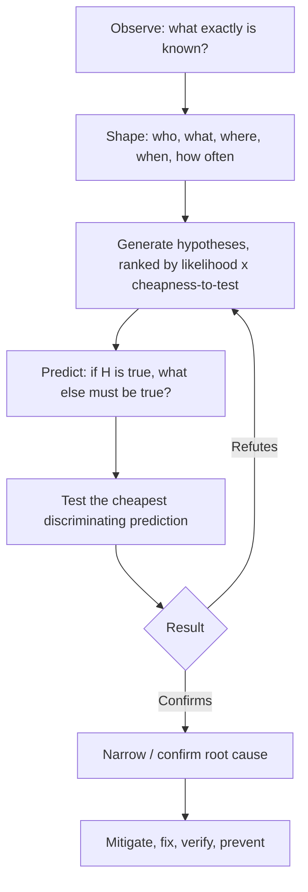
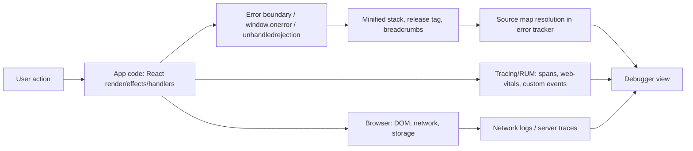
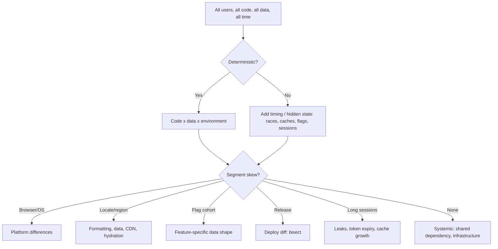
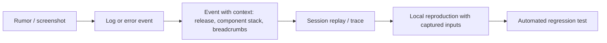

# 11 / 19 — Debugging with Incomplete Information

## 1. Lesson metadata

| | |
|---|---|
| **Level** | Architect |
| **Study time** | 5 hours (reading 2 h, case studies 1.5 h, exercises 1.5 h) |
| **Prerequisites** | [Phase 10 / 04 — Observability and logging](../10-production-engineering/04-observability-and-logging.md), [Phase 10 / 05 — Error monitoring](../10-production-engineering/05-error-monitoring.md), [Phase 10 / 19 — Incident debugging](../10-production-engineering/19-incident-debugging.md), [Phase 2 / 30 — DevTools Profiler](../02-react-rendering-and-internals/30-react-devtools-profiler.md), [Phase 2 / 28 — Strict Mode behavior](../02-react-rendering-and-internals/28-strict-mode-behavior.md), [Phase 2 / 25 — Hydration](../02-react-rendering-and-internals/25-hydration-and-selective-hydration.md), [Phase 7 / 22 — Production performance investigations](../07-performance/22-production-performance-investigations.md) |
| **Next** | [20 — Evaluating emerging features](./20-evaluating-emerging-features.md) |

**Learning objectives.** After this lesson you can:
1. Apply a hypothesis-driven debugging method when you cannot reproduce the problem, cannot access the user's machine, or have only a vague report.
2. Extract maximum signal from sparse evidence: error reports, source maps, breadcrumbs, session traces, metrics, and the shape of the failure (who, where, when, how often).
3. Narrow a failure space with bisection (in code, time, configuration, data and population).
4. Recognise React-specific classes of "works on my machine" bugs and which evidence distinguishes them.
5. Design instrumentation *before* the next incident so the next one is debuggable.
6. Communicate uncertainty honestly during an incident and decide when to mitigate before understanding.

**Concepts covered:** scientific method for debugging, differential diagnosis, failure-space bisection, minimal reproduction, heisenbugs, population analysis, source maps, error boundaries and breadcrumbs, release correlation, feature flags as probes, mitigation vs root cause, dev-vs-prod differences, environment-dependent bugs (hydration, Strict Mode, minification, browser/device, extensions, network), race conditions and ordering bugs, observability design, five whys and blameless analysis.

---

## 2. Deep conceptual explanation

### 2.1 What problem is this lesson solving?

Textbook debugging assumes you can run the program, see the failure and inspect state. Senior-level debugging more often looks like:

- "Some users on checkout see a blank page, occasionally. Support has two screenshots."
- A metrics dashboard shows INP regressions on one device class after Tuesday's deploy.
- Error monitoring shows `Cannot read properties of undefined (reading 'map')` from a minified bundle with 6,000 events a day and no repro.
- A hydration warning appears in production logs but only for users in one region.

You must reason from **partial, noisy, second-hand evidence** to a cause, then verify the cause, then fix it without making things worse. The skill is not cleverness; it is disciplined narrowing.

### 2.2 The core method: hypothesis-driven narrowing



The pivotal step is **prediction**: a hypothesis is only useful if it implies something you can check *that you have not yet looked at*. "It's probably a race condition" predicts nothing. "If it's a race between the profile fetch and the cart fetch, then the error rate should correlate with slow `/profile` responses and should not occur when the cart is empty" predicts two checkable things.

### 2.3 What do you actually know? Separating evidence from inference

Write down three columns before theorizing:

| Known (observed fact) | Reported (second-hand, unverified) | Inferred (your reasoning) |
|---|---|---|
| Error `TypeError` at `Cart.tsx:88` in release 4.12.1 (via source map) | Support says "customers on iPhones" | "Probably Safari-specific" |
| 6,100 events/day, 2,900 distinct users | "Started Tuesday" | "Caused by the Tuesday deploy" |

Most wasted debugging time is spent proving an inference that was never evidence. Convert reports and inferences into facts by checking them: filter the events by browser, find the first-seen timestamp per release, and so on.

### 2.4 The "shape" of a failure

Characterizing the failure often solves half the problem:

| Dimension | Questions | Typical discriminators |
|---|---|---|
| **Who** | All users, a segment, or a few? Logged-in? New accounts? Locale? Feature flag cohort? | Cohort-specific data (null fields, locale formatting, permissions) |
| **What** | Which route, component, action, API call? | Local to one feature vs systemic (shared dependency) |
| **Where** | Which browsers, OS, devices, networks, regions, CDNs? | Browser API differences; CDN/stale-cache problems; region-specific data |
| **When** | First seen? Releases? Time of day? After idle? Session age? | Deploy correlation; token expiry; cron jobs; cache TTL; daylight-saving boundaries |
| **How often** | Every time or intermittent? Rate vs traffic? | Deterministic = logic/data; intermittent = timing/race/cache/environment |
| **How bad** | Crash, wrong data, slowness, silent? | Priority and mitigation urgency |

An intermittent failure with a *stable rate* suggests a probabilistic cause (race, cache hit ratio, A/B bucket). A failure that began at an exact timestamp suggests a discrete change (deploy, flag change, upstream API change, certificate/token expiry, third-party script update).

### 2.5 Bisection: halve the space

Bisection works on any ordered or partitionable space:

| Space | How to bisect |
|---|---|
| Code history | `git bisect` between last known good and first known bad release (needs a reproducible test, even a manual one) |
| Time | Plot the metric; find the inflection; list every change near it (deploys, flags, upstream, infrastructure, third-party scripts) |
| Configuration | Toggle half the feature flags / env variables / experiments |
| Population | Split error events by one dimension at a time: browser, release, locale, plan, flag cohort. The dimension with the most skewed ratio is the lead |
| Dependency graph | Disable third-party scripts/extensions; pin back a dependency |
| Component tree | Comment out or stub half of a subtree to see if the failure persists |
| Data | Replay with a sanitized/synthetic copy of the problem payload; remove fields until it passes |

Beware **confounding**: two things changed at once (deploy plus flag plus upstream). Bisect the *changes*, not just the code.

### 2.6 React-specific "can't reproduce" classes

These are the recurring explanations for works-locally-fails-in-production in React applications. Each lists the evidence that discriminates it.

| Class | Mechanism | Discriminating evidence |
|---|---|---|
| **Data shape differences** | Production data has `null`, missing fields, empty arrays, huge arrays, unexpected enums, unusual Unicode | Error occurs for specific entities/accounts; reproduces with captured payload; type definitions trusted without runtime validation ([Phase 4 / 14](../04-react-architecture/14-api-boundaries-and-data-access.md)) |
| **Timing / race conditions** | Out-of-order responses, effects racing, unmount-after-await, stale closures | Correlates with slow network or high latency; fixed by cancellation/latest-wins; reproducible with throttling in DevTools ([Phase 6 / 02](../06-data-fetching-and-state-ecosystems/02-cancellation-and-race-conditions.md)) |
| **Dev vs prod build differences** | Minification, dead-code elimination, `process.env.NODE_ENV` branches, no Strict Mode double-invocation in prod, different warnings, different bundling/chunking, tree-shaken side effects | Reproduces with the production build locally (`vite build && vite preview` or the framework's equivalent); not in dev server |
| **Strict Mode masking or exposing** | Dev double-invokes render and re-runs mount effects once. This *exposes* impure render and missing cleanup in dev, but production lacks that exposure; the bug may appear in prod only under real remounts (Suspense, Activity (stable since 19.2), navigation) | Bug disappears when Strict Mode is disabled, or appears only in dev: suspect impurity/cleanup. See [Phase 2 / 28](../02-react-rendering-and-internals/28-strict-mode-behavior.md) |
| **Hydration mismatch** | Server HTML differs from the first client render (time, locale, random IDs, `window` checks, user-agent branching, extension-injected DOM) | Console hydration error text; reproduces with JS disabled to view server HTML; differs by locale/timezone/region; check streaming SSR fallback boundaries ([Phase 2 / 37](../02-react-rendering-and-internals/37-scenario-f-hydration-mismatch.md)) |
| **Stale deploy / cache skew** | Old HTML references chunks that no longer exist; CDN serves mixed versions; service worker pins an old shell | `ChunkLoadError` / dynamic import failures spike after deploys; affects long-lived tabs; resolves after hard reload |
| **Browser / device differences** | Missing APIs, engine bugs, memory limits, IME/input quirks, iOS Safari viewport behavior | Concentrated in a UA/OS segment; feature-detect and polyfill; test on real devices or a cloud device lab |
| **Extensions and third-party scripts** | Translate extensions mutate DOM so React's removeChild/insertBefore fails; ad blockers drop requests; tag managers inject scripts | Errors like "Failed to execute 'removeChild' on 'Node'" concentrated in particular browsers; fixed when extension disabled |
| **Environment/config** | Wrong API base URL, missing env var, feature flag mismatch, CSP blocking, CORS | Network tab shows blocked request; only in one environment/region |
| **Auth/session state** | Expired tokens, concurrent tab logout, cookie partitioning | Occurs after idle; fixed by re-login; correlates with 401/403 in network logs |
| **Memory/perf cliffs** | Leaks, huge lists, unbounded caches | Degrades with session length; worst on low-memory devices; heap snapshots show growth ([Phase 7 / 19](../07-performance/19-memory-leaks.md)) |
| **Time/locale/zone** | Date parsing, DST, week start, number formats | Occurs on specific dates/locales; reproduce by changing system TZ/locale |

### 2.7 Mitigate first or understand first?

During an incident, the order is: **stabilize → understand → fix → prevent.** If a flag rollback or a deploy revert restores service in minutes, do that before you have a root cause; the evidence (logs, traces, reports) persists, and the incident clock stops. Exceptions: when mitigation destroys evidence you cannot recapture (then capture first: snapshot, session replays, heap, logs) or when the rollback is itself risky (database migrations already applied).

### 2.8 Common misconceptions

| Misconception | Reality |
|---|---|
| "If I can't reproduce it, it isn't real." | Production telemetry is evidence. Real users hit paths you did not. |
| "It must be the most recent deploy." | Correlation is a lead, not a verdict. Check upstream, flags, data, certs, and third parties. |
| "More logging solves it." | Unstructured logs drown signal. Log *decisions and state transitions* with correlation IDs. |
| "The minified stack trace is useless." | Source maps (uploaded to your error tracker, not publicly served if sensitive) restore it. Releases must be tagged to match. |
| "It's a React bug." | Occasionally; far more commonly app impurity, stale closure, or data shape. Rule out your code first; then reduce to a minimal repro to prove a library bug. |
| "Adding a `try/catch` fixes the crash." | It hides the symptom and maybe corrupts state. Fix the invariant violation or handle the error meaningfully. |
| "A heisenbug means the bug is mystical." | It means observation changes timing or state; use non-invasive tools (tracing, sampling, replays). |

---

## 3. Internal mechanics

### 3.1 How evidence is produced, and where it distorts



Each arrow can lose or distort information:

- **Error boundaries** catch errors thrown while rendering, in lifecycle/effects *within the tree they wrap*, but **not** errors in event handlers, async callbacks (promises, timers), SSR, or errors thrown in the boundary itself. Those must be caught by try/catch, `window.onerror`, or `unhandledrejection`. This is documented behavior; see [react.dev error boundaries](https://react.dev/reference/react/Component#catching-rendering-errors-with-an-error-boundary). React 19 added the `onCaughtError` and `onUncaughtError` root options (`onRecoverableError` dates from 18) to centralize error reporting; verified on react.dev and run on react-dom 19.3.1 (`onCaughtError` gets `{ componentStack, errorBoundary }`, `onUncaughtError` gets `{ componentStack }`).
- **Recoverable errors**: during hydration or concurrent rendering, React may retry rendering (for example by falling back to client rendering for a Suspense boundary) and report a *recoverable* error rather than crashing. A user may see nothing wrong while your telemetry sees a stream of recoverable errors, which still indicate a real mismatch and a perf cost.
- **Sampling** in RUM and tracing: low-rate sampling can miss rare errors; tail-based sampling that always keeps errors helps.
- **Source maps** map generated code back to source. They depend on exact release correspondence and on the bundler's mapping quality; inline `eval`-style dev source maps differ from production maps. Names of functions in production stack traces may be mangled; component display names (`displayName`) can be lost to minification in React DevTools production profiling builds unless names are preserved.
- **Ordering/time**: client timestamps rely on user clocks; correlate with server time and use monotonic `performance.now()` for durations.

### 3.2 What determinism tells you

A program's observable behavior is a function of **code, data, environment and timing**. If a failure is deterministic given (code, data, environment), you can in principle reproduce it by recreating the three. If it's nondeterministic, the extra variable is timing (races, scheduling, network latency) or hidden state (caches, sessions, storage, randomness). React's render purity ([Phase 2 / 12](../02-react-rendering-and-internals/12-why-rendering-must-be-pure.md)) matters here: a pure component given the same props/state always renders the same output, so a bad render can be reproduced from the captured props/state; an impure one cannot.

Teaching model: **capture inputs, not just outputs.** Breadcrumbs, state snapshots (sanitized), and request/response metadata at the moment of failure convert nondeterministic reports into deterministic reproductions.

*Version-sensitive:* React's root error-handling options (`onCaughtError`, `onUncaughtError`) are React 19 additions, and the format of React's error messages (which link to react.dev error code pages in production builds) has evolved across 18 and 19.

---

## 4. Step-by-step execution walkthrough: a case study

**Report (Monday 09:10).** "Checkout page goes blank for some users since the weekend." Two screenshots from support showing a white screen. No console output.

**Step 1: Pin down what is known (09:15).** Open the error tracker. Filter to checkout route, last 7 days. Fact: 1,840 events of `TypeError: Cannot read properties of undefined (reading 'currency')` in release `5.3.0`. First seen Saturday 02:11 UTC. Also: no such events in `5.2.4`. Facts, not guesses.

**Step 2: Resolve the stack (09:20).** Source map shows `PriceSummary.tsx:41`: `order.shipping.currency`. So `order.shipping` is `undefined` at render. Why would it be undefined *only for some users*?

**Step 3: Shape (09:25).** Break down events by dimension:
- Browser: evenly distributed (rules out browser-specific).
- Country: 91% from `NO`, `SE`, `DK`.
- Flag cohort: all in the `pickup-points` experiment (enabled Saturday 02:00 UTC).
- Release: `5.3.0` is Friday's deploy; flag turned on Saturday. The first-seen timestamp aligns with the **flag**, not the deploy. (A lesson: "since the weekend" pointed at the deploy; the data said otherwise.)

**Step 4: Hypotheses with predictions (09:30).**
- H1: With pickup points, shipping is `null`, and `PriceSummary` assumes a shipping object. *Prediction:* the order payload for these users has `shipping: null` and `pickupPoint: {...}`. Cheap to test: inspect a failing request in the tracker's captured breadcrumbs or the API logs.
- H2: A backend change. *Prediction:* errors also in `5.2.4` for flagged users — but flag cohort only exists for new code; low likelihood. Skip.

**Step 5: Test (09:40).** A support-provided order ID shows `shipping: null`, `pickupPoint: { currency: "NOK", ... }`. H1 confirmed. The TypeScript type claimed `shipping: Shipping` (non-null); the type was optimistic about the API (a **boundary validation** gap; see [Phase 4 / 14](../04-react-architecture/14-api-boundaries-and-data-access.md)).

**Step 6: Mitigate (09:45).** Turn off the `pickup-points` flag for all users. Verify: error rate drops to zero within five minutes; support confirms recovery. Incident stabilized at 09:50 without a code change; users in the cohort could not complete pickup orders for ~31 hours (acknowledged in the postmortem).

**Step 7: Fix (11:00).** Model the data honestly:

```ts
type Delivery =
  | { kind: 'shipping'; address: Address; currency: string; cost: Money }
  | { kind: 'pickup'; point: PickupPoint; currency: string; cost: Money };
```

and validate at the boundary (runtime schema, e.g. Zod) so a payload mismatch becomes a typed error at the edge, not a `TypeError` deep in render. Add an error boundary around the price summary with a recoverable fallback and reporting.

**Step 8: Verify and prevent (afternoon).** Add a regression test with a pickup payload; add the flag-cohort dimension to the error dashboard; require a staging pass of any flag cohort with real-shaped fixtures; add a check that flag-enablement is recorded as an annotation on dashboards (change correlation). Write a blameless postmortem.

Observe the pattern: facts → shape → hypotheses with predictions → cheapest test → mitigate → fix → prevent.

---

## 5. Code examples

### 5.1 Minimal example — a root-level error reporter (React 19)

```tsx
import { createRoot } from 'react-dom/client';
import { App } from './App';
import { reportError } from './observability';

const root = createRoot(document.getElementById('root')!, {
  // React 19 root options (verified on react-dom 19.3.1).
  onCaughtError(error, errorInfo) {
    reportError(error, { handled: true, componentStack: errorInfo.componentStack });
  },
  onUncaughtError(error, errorInfo) {
    reportError(error, { handled: false, componentStack: errorInfo.componentStack });
  },
  onRecoverableError(error, errorInfo) {
    reportError(error, { recoverable: true, componentStack: errorInfo.componentStack });
  },
});
root.render(<App />);
```

Notes: the component stack is gold for incomplete-information debugging: it tells you *which component subtree* failed even when the JS stack is shallow. These handlers do not replace global handlers for async errors:

```ts
window.addEventListener('error', e => reportError(e.error ?? e.message, { source: 'window.onerror' }));
window.addEventListener('unhandledrejection', e => reportError(e.reason, { source: 'unhandledrejection' }));
```

### 5.2 Practical example — a boundary that adds context

```tsx
import { Component, type ErrorInfo, type ReactNode } from 'react';

type Props = { name: string; fallback: ReactNode; children: ReactNode; context?: () => Record<string, unknown> };
type State = { error: Error | null };

// Error boundaries still require a class component in React 19 (no hook equivalent).
export class FeatureBoundary extends Component<Props, State> {
  state: State = { error: null };
  static getDerivedStateFromError(error: Error): State { return { error }; }
  componentDidCatch(error: Error, info: ErrorInfo) {
    reportError(error, {
      boundary: this.props.name,
      componentStack: info.componentStack,
      ...this.props.context?.(),      // sanitized, small, non-PII state snapshot
    });
  }
  render() { return this.state.error ? this.props.fallback : this.props.children; }
}

// Usage
<FeatureBoundary name="checkout.price-summary" fallback={<PriceUnavailable />}
  context={() => ({ orderId, deliveryKind: order.delivery?.kind })}>
  <PriceSummary order={order} />
</FeatureBoundary>
```

Why: named boundaries convert "blank page" into "failure in `checkout.price-summary` with `deliveryKind: undefined`" — a *localized, annotated* signal. Trade-off: too many boundaries add noise and complexity; place them at feature or independently failing sub-UI granularity ([Phase 4 / 19](../04-react-architecture/19-error-boundaries.md)). Be careful not to log PII.

### 5.3 Incorrect example — hiding the symptom

```tsx
function PriceSummary({ order }: { order: Order }) {
  const currency = order?.shipping?.currency ?? 'USD'; // "fixed" the crash
  return <span>{format(order.total, currency)}</span>;
}
```

**Predict:** What is wrong, though the crash disappears?
**Answer:** For pickup orders it now silently displays **USD** instead of NOK: a wrong price display, which is worse than a crash because it is silent and potentially a legal/financial issue. The optional chaining and default answer *"what do I do if the data is missing?"* with a guess. The right answer comes from understanding the domain (currency lives on the order or the delivery variant) and modeling it.

### 5.4 Corrected — model, validate, fail visibly

```ts
import { z } from 'zod'; // run-tested with zod 4.6 (objects, discriminatedUnion, safeParse and error.issues all behave as shown; same calls exist in zod 3)

const Money = z.object({ amount: z.number().int(), currency: z.string().length(3) });

const Delivery = z.discriminatedUnion('kind', [
  z.object({ kind: z.literal('shipping'), address: Address, cost: Money }),
  z.object({ kind: z.literal('pickup'), point: PickupPoint, cost: Money }),
]);

const Order = z.object({ id: z.string(), total: Money, delivery: Delivery });
export type Order = z.infer<typeof Order>;

export async function fetchOrder(id: string, signal?: AbortSignal): Promise<Order> {
  const res = await fetch(`/api/orders/${id}`, { signal });
  if (!res.ok) throw new HttpError(res.status);
  const parsed = Order.safeParse(await res.json());
  if (!parsed.success) {
    reportError(new ContractViolation('order', parsed.error.issues.slice(0, 5)));
    throw new ContractViolation('order');
  }
  return parsed.data;
}
```

```tsx
function PriceSummary({ order }: { order: Order }) {
  // order.total.currency is part of the contract; no guessing.
  return <span>{formatMoney(order.total)}</span>;
}
```

Benefits: the failure becomes a *named, reported contract violation at the boundary* with a reduced payload shape; render code stays simple. Trade-off: runtime validation costs CPU/bundle size and must be kept consistent with backend contracts (see schema sharing/OpenAPI codegen as alternatives; [Phase 4 / 14](../04-react-architecture/14-api-boundaries-and-data-access.md)).

### 5.5 Advanced example — probes: breadcrumbs, correlation IDs, and flag annotations

```ts
// observability/breadcrumbs.ts
type Crumb = { t: number; type: string; data?: Record<string, unknown> };
const MAX = 50;
const crumbs: Crumb[] = [];

export function crumb(type: string, data?: Record<string, unknown>) {
  crumbs.push({ t: performance.now(), type, data });
  if (crumbs.length > MAX) crumbs.shift();
}
export const snapshotCrumbs = () => crumbs.slice();

// Wrap key decision points, not every render.
crumb('route', { to: location.pathname });
crumb('flag', { name: 'pickup-points', on: flags.pickupPoints });
crumb('query:start', { key: 'order', id });
```

```ts
// A correlation ID shared across client logs and server traces
const sessionId = crypto.randomUUID();
export function apiFetch(input: RequestInfo, init: RequestInit = {}) {
  const headers = new Headers(init.headers);
  headers.set('x-session-id', sessionId);
  headers.set('x-request-id', crypto.randomUUID());
  return fetch(input, { ...init, headers });
}
```

These let you join "a user's blank screen" to "the exact failing API response in server logs". Be mindful of privacy law and PII; keep payloads minimal and scrub. Observability tools (OpenTelemetry web instrumentation, Sentry, Datadog RUM, etc.) provide such capabilities; ⚠ browser OpenTelemetry support is evolving, verify maturity before committing.

### 5.6 Advanced example — making a race reproducible

```tsx
// Suspected: a stale response overwrites a newer one.
// Reproduce deterministically: delay responses by input value in a test harness.
import { http, HttpResponse, delay } from 'msw';

export const handlers = [
  http.get('/api/search', async ({ request }) => {
    const q = new URL(request.url).searchParams.get('q')!;
    await delay(q === 'ab' ? 500 : 50);        // older query answers *later*
    return HttpResponse.json({ q, items: [`result for ${q}`] });
  }),
];
// Test: type "a", "ab", "abc" quickly -> assert UI shows results for "abc", not "ab".
```

The point: if you form a hypothesis about timing, *engineer the timing* instead of waiting for luck (see [Phase 8 / 06](../08-testing-and-quality/06-mocking-strategies-and-msw.md) and [Phase 6 / 02](../06-data-fetching-and-state-ecosystems/02-cancellation-and-race-conditions.md)). Also use DevTools network throttling and CPU throttling to emulate slow devices.

---

## 6. Visual explanations

### 6.1 Narrowing the failure space



### 6.2 Evidence quality ladder



Move rightward. Each step increases confidence and reduces ambiguity.

---

## 7. Alternative approaches and trade-offs

| Approach | Strengths | Weaknesses | Best when |
|---|---|---|---|
| **Hypothesis-driven (this lesson)** | Efficient; teaches; avoids flailing | Needs discipline; wrong hypotheses cost time | Default |
| **Bisection (git/flags/population)** | Guaranteed convergence in log N steps | Needs a reliable good/bad test; confounders | Regression with known good point |
| **Session replay** (e.g. rrweb-based tools) | See what the user saw; fast on UI bugs | Privacy, cost, overhead; replays miss non-DOM state | UI/UX failures, support escalations |
| **Distributed tracing (RUM + server)** | Joins client to backend; finds slow spans | Instrumentation effort; sampling | Latency, cross-service failures |
| **Heavy logging** | Simple | Volume, cost, noise; PII risk | Rare, targeted, time-limited (verbose flag for one user) |
| **Add assertions / invariant checks** | Fail at the edge with context | Overhead; risk of crashing prod | Contract boundaries |
| **Canary / dark launch** | Detect early on small population | Requires infrastructure | Risky releases |
| **Record and replay API traffic in tests** | Deterministic repro | Maintenance; stale fixtures | Data-shape bugs |
| **Remote debugging a user's session (screen share)** | Direct visibility | Slow; privacy; single sample | High-value customers, last resort |

**Scenario where the recommended approach (hypothesis-driven narrowing) is not best.** When you have a reliable test and a known-good commit, skip theorizing: run `git bisect` mechanically; it converges faster than any reasoning and avoids anchoring on the wrong hypothesis. Similarly, when the cause is likely obvious and cheap to check (a flag flipped 3 minutes before the spike), check it before constructing a hypothesis tree.

---

## 8. Best practices and anti-patterns

### 8.1 Best practices

- **Write the timeline** (deploys, flags, upstream changes, incidents) *first*. Annotate dashboards with deploys and flag changes so correlation is a lookup, not archaeology.
- **Tag every event with the release (git SHA), environment, flag cohort, route, locale, device class and a session/correlation ID.**
- **Upload source maps per release to your error tracker; restrict public access** if source exposure is a concern.
- **Validate untrusted data at the boundary**; make contracts explicit; report violations as named errors.
- **Keep reproduction recipes**: a doc of "how to reproduce class X" (throttling, locale changes, production build preview, MSW scenarios).
- **Create a minimal reproduction** when you suspect a library bug: strip the app until the failure persists in a few dozen lines; if it vanishes, the cause was in what you removed ([Phase 11 / 21](./21-reading-framework-source.md) for reading source in this scenario).
- **Prefer reversible mitigations** (flags, rollbacks) and make them rehearsed.
- **Change one thing at a time** when testing hypotheses.
- **Record the investigation** in the incident channel/notebook (timestamps, evidence, decisions). It prevents loops and supports the postmortem.
- **Verify the fix with the same evidence that revealed the failure** (error rate back to baseline, not just "it works on my machine").
- **After fixing, ask: why did we not catch it earlier?** and add the missing test, type, validation, alert or review lens.

### 8.2 Anti-patterns

| Anti-pattern | Why it hurts | Instead |
|---|---|---|
| Shotgun debugging (random changes) | Introduces new bugs; no learning | Predict, then test |
| Confirmation bias | Looking only for evidence supporting favorite theory | Seek disconfirming evidence; assign a "devil's advocate" |
| Blaming the last deployer | Wrong half the time; cultural damage | Blameless; check timeline of all changes |
| "Fix" by suppressing errors | Silent wrong behavior | Fix invariant; handle meaningfully; keep reporting |
| Debugging only in dev mode | Misses prod differences | Reproduce on a production build, throttled |
| Logging secrets/PII | Compliance and security incidents | Scrub; allowlist fields |
| Giant PR "fix" during an incident | Unreviewed, risky | Minimal fix; follow-up refactor |
| Ignoring recoverable errors | Hidden hydration mismatches, perf cost | Alert on rate changes |
| Declaring root cause too early | Stops investigation at first plausible story | "Five whys" until a systemic, actionable cause |

### 8.3 Justified exceptions

- Shotgun-ish *mitigation* is fine in an incident (restart, flush CDN, roll back) as long as you record what you changed.
- Swallowing an error is justified for truly non-critical, best-effort features (analytics beacons) with reporting at lower severity.
- Logging verbose data is acceptable temporarily, scoped to a test account, with a removal date.

---

## 9. Real-world application

**E-commerce checkout.** Blank-page reports on a subset (case study above). Constraints: revenue per minute, PCI scoping limits what you may log, A/B cohorts complicate reproduction. Practice: dashboards segmented by flag cohort, contract validation on payment/delivery payloads, error boundaries around independent checkout sections to preserve the ability to complete a purchase.

**Trading/finance dashboard.** A bug where a table shows stale prices for some users. Evidence: WebSocket reconnects correlated with corporate proxies; subscription cleanup order in an effect meant that after reconnect the old handler wrote to a replaced store. Mitigation: force reconnection with a version counter; fix: key subscriptions by connection ID and discard stale messages; test with a fake socket that reorders events ([Phase 6 / 17](../06-data-fetching-and-state-ecosystems/17-real-time-websockets-subscriptions.md)). Constraint: latency budgets; you cannot add expensive logging per tick, so sample and aggregate.

**Forms and auth.** Users report being logged out while editing. Hypotheses: token expiry; multi-tab logout; clock skew. Evidence: 401s correlate with session length ~60 minutes; refresh token race between two tabs invalidating each other. Fix: cross-tab coordination (BroadcastChannel/locks), draft autosave. Constraint: security requirements limit token handling choices ([Phase 9 / 12](../09-advanced-rendering-and-ecosystem/12-auth-boundaries.md)).

**Realtime collaboration.** "Cursor jumps" only on slow networks: out-of-order operations; you need deterministic replay of operation logs to reproduce; design ops to be idempotent and ordered.

**Multi-team platform.** A shared library upgrade causes an INP regression in one product only. Bisect by dependency version and by feature flags; use the profiler to compare flame graphs from before/after in a controlled build; coordinate across teams with a clear incident owner.

---

## 10. Debugging and troubleshooting: a playbook of tools

| Question | Tool / technique |
|---|---|
| What exactly crashed, where? | Error tracker + source maps; component stack from error info |
| Did the failure start at a deploy or at something else? | Annotated timeline: deploys, flag changes, upstream status, certificates, third-party script versions |
| Which segment is affected? | Group-by across release, browser, OS, locale, flag, route, plan |
| Can I see what the user did? | Breadcrumbs, session replay (privacy-aware), network logs |
| Is it dev-vs-prod? | `build` + `preview` locally; disable Strict Mode to test impurity theories; compare bundles |
| Is it a race? | Network/CPU throttling in DevTools; MSW delays; React DevTools Profiler to see re-render ordering; AbortController to test cancellation |
| Is it hydration? | View source vs rendered DOM; run with JS disabled; vary locale/timezone; search for `Date`, `Math.random`, `typeof window` in render paths |
| Is it memory? | Chrome DevTools Memory: heap snapshots, allocation timeline; compare snapshots across repeated actions |
| Is it performance? | Performance panel traces with CPU throttling; React Profiler commit durations; Web Vitals attribution (INP, LCP) ([Phase 7 / 21](../07-performance/21-web-vitals-and-budgets.md)) |
| Is it a dependency? | Lockfile diff; pin previous version; check changelogs; reproduce minimal case |
| Is it an extension/third-party script? | Test in a clean profile/incognito with extensions off; look for foreign DOM nodes; error messages about `removeChild`/`insertBefore` |
| Is it stale deploy/cache? | Chunk load error rates after deploys; asset hashing; `Cache-Control` and service worker versioning ([Phase 0 / 15](../00-web-and-javascript-foundations/15-http-caching-and-navigation.md)) |
| How do I verify the fix? | Same query/dashboard that revealed the issue; regression test; canary |

**Verification discipline.** After a fix ships: (1) the specific error signature's rate drops to baseline *for the affected cohort*, (2) no new error signatures introduced, (3) related metrics unchanged or improved, (4) the regression test fails without the fix. Keep monitoring for at least one full usage cycle (a day, or a week for weekly patterns).

**Five whys example (checkout case).** Why blank? `shipping` undefined → why? pickup orders have none → why did the UI assume it? Types claimed it was always present → why were the types wrong? Hand-written types not validated against API → why was the flag enabled for production cohort without catching it? Staging fixtures lacked pickup orders and there was no flag-enablement checklist. Actions address *systemic* causes: schema validation, fixture coverage, flag rollout checklist, cohort-segmented alerts.

---

## 11. Exercises

### Level A — Knowledge
A1. List the six dimensions of a failure's "shape" and give a discriminating example for each.
A2. What kinds of errors do React error boundaries *not* catch?
A3. Why should you mitigate before root-causing in an incident, and when is that wrong?
A4. Explain why a hydration mismatch might appear only for users in certain regions.
A5. What is a heisenbug and which tools avoid perturbing it?

### Level B — Code comprehension
B1. Predict the behavior and find the bug:

```tsx
function Search() {
  const [q, setQ] = useState('');
  const [results, setResults] = useState<string[]>([]);
  useEffect(() => {
    fetch('/api/search?q=' + q).then(r => r.json()).then(setResults);
  }, [q]);
  return <>
    <input value={q} onChange={e => setQ(e.target.value)} />
    <ul>{results.map(r => <li key={r}>{r}</li>)}</ul>
  </>;
}
```
Users report "sometimes results don't match what's typed". Explain the mechanism, why it's intermittent, and why it can't be reproduced on localhost.

B2. This renders fine in development but production shows a hydration warning for some users. Why?

```tsx
function Greeting() {
  const hour = new Date().getHours();
  return <p>{hour < 12 ? 'Good morning' : 'Good afternoon'}</p>;
}
```

B3. An error tracker shows `TypeError: e is not a function` at `main.8f3a1.js:1:48213`. List the steps to make this actionable.

### Level C — Implementation
C1. Implement a `useLatestRequest` hook or fetch wrapper that ignores stale responses and aborts superseded requests, with a test using fake delays that reproduces the race.
C2. Implement a bounded breadcrumb recorder and attach its contents to errors reported from an error boundary. Ensure it avoids PII (design the allowlist).
C3. Write an MSW-based scenario matrix (`slow`, `out-of-order`, `500`, `malformed payload`, `empty`) and a test harness that renders a component against each.

### Level D — Debugging
D1. After deploy, `ChunkLoadError: Loading chunk 214 failed` spikes for ~30 minutes and then subsides. Diagnose and propose fixes (client, CDN, deploy process).
D2. A table slows down after 20 minutes of use on low-end laptops; reload fixes it. Describe your investigation plan with concrete DevTools steps and three candidate causes.
D3. INP p75 regressed from 180 ms to 340 ms on Android only starting Tuesday; no deploy occurred Tuesday. Build a hypothesis list and the order you would test them.

### Level E — Architecture and engineering decisions
E1. Design the observability baseline for a new React application with 4 teams: what to capture, how to tag, privacy constraints, sampling, ownership, and alerting. Name the trade-offs.
E2. Decide whether to adopt session replay. Criteria, risks (privacy, performance), mitigations and alternatives.

### Level F — Expert challenge
F1. A production-only bug appears roughly once per 10,000 sessions: a list shows items in the wrong order after a rapid sequence of actions. You cannot reproduce it. Design a program (instrumentation, hypotheses, experiments, safe rollout) that finds the cause within two weeks.
F2. Two teams each blame the other's code for a regression: shared library vs consuming app. Describe how you would adjudicate with evidence, build a minimal reproduction, and structure the conversation.

---

## 12. Detailed answers and explanations

> Attempt the exercises first.

**A1.** Who (e.g. only accounts with null `middleName`), What (single route vs shared component), Where (iOS Safari only), When (starts at a timestamp matching a flag change), How often (every request vs 1 in 500: timing), How bad (crash vs silent wrong data). Evaluation: each has a *discriminating* example, implying a different class of cause.

**A2.** Errors in event handlers, asynchronous code (promises, `setTimeout`), server-side rendering (separate handling), and errors thrown in the error boundary itself. Also errors outside the React tree. Use try/catch, global handlers, and root-level reporting hooks. (Documented on react.dev.) Note that errors thrown in effects are caught by boundaries as they occur during React's work; but errors in async continuations spawned by effects are not.

**A3.** Stabilizing stops user harm and the incident clock; evidence persists (logs, events), so investigation can continue. Wrong when mitigation destroys evidence not otherwise captured (e.g. a memory-leaking process that you restart before taking a heap snapshot) or when the mitigation has its own risk (rollback across a destructive migration). Then capture first, or choose a different mitigation.

**A4.** The server renders HTML using server time/locale/data, and the client's first render uses the client's. Differences by timezone (`new Date()`), locale formatting (`toLocaleString` default locales), geo-based content, A/B bucketing computed differently, CDN-cached HTML varying by region, or user-agent branching all cause mismatches that appear only in specific regions. Fix: render time/locale-dependent content after mount, or pass explicit locale/timezone from server to client, or `suppressHydrationWarning` only for unavoidable single text differences. See [Phase 2 / 37](../02-react-rendering-and-internals/37-scenario-f-hydration-mismatch.md).

**A5.** A bug that changes or disappears when observed (adding logging/breakpoints alters timing). Use low-overhead tools: sampling profilers, tracing with timestamps, session replay, event logs written asynchronously, and deterministic simulation of timing (fake timers, MSW delays), avoiding breakpoints that pause the event loop.

**B1.** Race condition: no cancellation or ordering guard. Typing "a", "ab" sends two requests; if the first response arrives *after* the second, `setResults` is called with stale results ("a") last, so the UI shows results for "a" while the input shows "ab". Intermittent because it depends on response order (server latency variance, caching, load balancing). On localhost, latency is ~1 ms and ordered, so it's hidden. Also: no error handling, no loading state, no encoding (`encodeURIComponent(q)`), and keys by `r` may collide if duplicates. Fix:

```tsx
useEffect(() => {
  const ac = new AbortController();
  fetch('/api/search?q=' + encodeURIComponent(q), { signal: ac.signal })
    .then(r => { if (!r.ok) throw new Error(String(r.status)); return r.json(); })
    .then(setResults)
    .catch(e => { if (e.name !== 'AbortError') setError(e); });
  return () => ac.abort();
}, [q]);
```
Or use TanStack Query, which keys by `q` and handles this ([Phase 6 / 08](../06-data-fetching-and-state-ecosystems/08-tanstack-query.md)). In Strict Mode dev the effect also runs, cleans up, runs again on mount: a good cancellation test.

**B2.** Server renders at server time zone/time (e.g. UTC at 14:00 -> "Good afternoon"); the client renders using the user's local hours (e.g. 07:00 -> "Good morning"). Text differs: hydration mismatch for users whose local time is on the other side of noon. Also cached HTML makes it worse (rendered hours ago). Development may not show it if server and browser share a machine and timezone. Fix: render a neutral value on server and compute after mount (`useEffect` + state, or `useSyncExternalStore` with distinct server snapshot), or pass the client's timezone via cookie/header; or accept a text mismatch with `suppressHydrationWarning` on that single element (documented use, shallow, text only).

**B3.** (1) Check the release tag on the event; confirm it matches the deployed bundle. (2) Ensure source maps for that release were uploaded; resolve line/column to the original file, symbol and line. (3) Retrieve breadcrumbs, route, component stack. (4) Segment events by browser, release, flag. (5) Inspect the original code at that location for what could be non-function (callback prop missing, wrong export shape, interop issue with default/named imports from CommonJS). (6) Reproduce with a production build. If source maps are missing, fix the pipeline first: this is a debuggability defect.

**C1.** Sample:

```ts
export function createLatest<T>() {
  let controller: AbortController | null = null;
  return async function run(fn: (signal: AbortSignal) => Promise<T>): Promise<T | undefined> {
    controller?.abort();
    controller = new AbortController();
    const mine = controller;
    try {
      const value = await fn(mine.signal);
      return mine.signal.aborted ? undefined : value;
    } catch (e) {
      if (mine.signal.aborted) return undefined;
      throw e;
    }
  };
}
```
Test: call with a slow first and fast second `fn`; assert the first resolves `undefined` and the second returns its value; with React, assert the rendered result equals the latest input after resolving both in reverse order. Edge cases: abort doesn't stop servers; non-abortable promises still need the `aborted` check. Evaluation: tests demonstrate failing behavior without the guard.

**C2.** Evaluate for: ring buffer bounded; capture event *types* and non-PII identifiers (route pattern not full URL with IDs/tokens, flag names, query *keys* not values); redaction function with allowlist; attach to error reports; clear on logout; limit size; no capturing inputs' values. Example allowlist: `{route, flag, queryKey, httpStatus, durationMs}`.

**C3.** Evaluation: handlers parametrized by scenario (e.g. via query string or `server.use` overrides in tests); tests assert on user-visible fallbacks (loading, error with retry, empty state, contract violation fallback) and on no unhandled errors; ensures no real network. Sample structure: `describe.each(scenarios)(...)`.

**D1.** Cause: old tabs/pages hold references to hashed chunk URLs from the previous release; the deploy removed old assets (or CDN purge) so lazy imports fail. Subsides as stale tabs reload/close. Also possible: CDN partially propagating new assets. Fixes: keep previous release's assets available for a retention window (don't delete immediately); immutable hashed assets with long cache; on `ChunkLoadError`/dynamic import failure, show "new version available" and reload once (guard against loops); version-check endpoint; atomic deploys (assets before HTML); service worker update strategy. Verify via chunk error rate per deploy. See [Phase 10 / 02](../10-production-engineering/02-deployment-workflows.md), [Phase 7 / 15](../07-performance/15-code-splitting-and-lazy-loading.md).

**D2.** Plan: reproduce with a long session and CPU/memory throttling; Performance Monitor: watch JS heap, DOM nodes, event listeners over time; Memory panel: take heap snapshot after warmup, perform the cycle 10 times (open/close a dialog, navigate), GC, snapshot again, use "comparison" view for objects allocated between snapshots; look at detached DOM trees. Candidates: (1) subscriptions/listeners without cleanup (WebSocket, resize, `setInterval`); (2) unbounded caches or arrays (accumulating messages, query cache without `gcTime`, memoization map); (3) closures retaining large objects, or detached DOM nodes held by refs/global stores. Validate by fixing and re-running the comparison with flat growth. See [Phase 7 / 19](../07-performance/19-memory-leaks.md), [Phase 0 / 16](../00-web-and-javascript-foundations/16-memory-management-and-gc.md).

**D3.** No deploy, so look for non-code changes: (1) third-party script/tag manager change (new tag), (2) feature flag or experiment change, (3) backend/API latency or payload size change, (4) data growth (accounts with more items), (5) Android/Chrome version rollout or OS update, (6) CDN/config change (compression, caching), (7) seasonal traffic (device mix). Order by cheapness: change logs for tag manager/flags/infrastructure, segment INP by interaction target and by device model/Chrome version, long-animation-frame/INP attribution data for culprit scripts, compare payload sizes. Predictions: a third-party tag shows long tasks from its origin; a Chrome rollout correlates with version distribution; data growth correlates with list size.

**E1.** Evaluation: captures errors (with component stacks, release SHA, source maps), performance (Web Vitals with attribution), key business events, traces/correlation IDs; tags (env, release, route pattern, flag cohort, device class, locale); privacy (scrub PII, consent, retention, regional rules); sampling (always keep errors, sample performance traces, tail sampling); ownership (platform provides SDK wrapper; teams own dashboards/alerts for their routes); alerting (SLOs on error rate and INP, rate-of-change alerts, paging only for user-impacting); trade-offs (cost, bundle size, overhead, vendor lock-in vs OpenTelemetry portability). Good answers specify what is *not* collected.

**E2.** Criteria: debugging value vs privacy risk; legal basis; masking defaults (mask inputs and sensitive text by default, block selectors for PCI/PII areas); performance overhead (DOM mutation observer cost, network); cost and retention; whether bugs are mostly visual/interaction (replay valuable) or data/logic (traces/logs better). Mitigations: sample sessions, only record on error, mask-by-default, restricted access/audit. Alternatives: breadcrumbs, structured events, support-initiated screen share. Recommendation: adopt in limited form with strong masking if UI bugs dominate and legal approves; otherwise rely on breadcrumbs.

**F1.** Evaluation criteria: concrete plan. Example: Week 1 — add low-overhead instrumentation: record the last N list operations (action types, item IDs, timestamps, sequence numbers, response arrival order) in a ring buffer attached to reports; add an invariant check ("sorted by X after settle") that reports violations with the buffer (no user-visible effect). Hypotheses: (H1) out-of-order responses, (H2) optimistic update + refetch race, (H3) non-stable sort or key collision, (H4) concurrent tabs. Predictions for each (e.g. H1: response arrival order differs from request order in violation reports). Week 2 — analyse violations; deterministically reproduce with MSW delays and fake timers matching the pattern; fix (sequence numbers/latest-wins or merge by version); ship behind a flag to 10% and compare violation rate; then full. Safety: invariant checks sampled, PII-free, kill switch. Credit: statistical thinking (10,000-session rate needs enough traffic to see change), pre-registered success criterion.

**F2.** Process: define the failing scenario precisely with a measurement (e.g. render time of component X); build a minimal reproduction (strip app code until it still fails; replace the library version in isolation); run a matrix: {old lib, new lib} x {app A, bare app}; if the regression persists in the bare app, it's the library; if only in the app, it's an interaction (misuse, unstable props now amplified). Use profiler flame graphs to attribute. Structure: share the repro in a neutral place, agree on the metric, assume good faith, write conclusions in the incident doc; the decision on who fixes follows evidence (maybe both: library fixes performance cliff, app fixes unstable prop). Avoid blame; set ownership via the ADR/process ([16](./16-supporting-multiple-teams.md)).

---

## 13. Senior engineer interview questions

**Q1. Walk me through how you debug a production error you cannot reproduce.**
*Strong answer:* Establish facts vs inference; resolve stack via source maps; characterize shape (who/what/where/when/how often); generate hypotheses with testable predictions; bisect by release/flag/segment; capture inputs; mitigate if harm; reproduce with a production build and engineered timing; fix; verify with the same telemetry; add prevention. Emphasize reasoning over tools.

**Q2. A bug only appears in production, not in development. What are your first suspects?**
*Strong answer:* Data differences (shape/volume), build differences (minification, dead-code elimination, env flags, Strict Mode absent), timing (real latency), environment (CSP, CDN caching, config), SSR/hydration (server vs client), third-party scripts/extensions, browser/device. Tell how to discriminate each, e.g. production build preview locally, throttling, comparing server HTML.

**Q3. Why might Strict Mode make a bug appear in development that you can't see in production, and is it fixable?**
*Strong answer:* Strict Mode (dev only) double-invokes render and re-mounts effects once to expose impure render and missing cleanup. A production run mounts once, so impure code seems fine until a real remount (Suspense, navigation, Activity) hits. The bug is real: fix purity and cleanup rather than disabling Strict Mode.

**Q4. What would you instrument in a React app before the next incident?**
*Strong answer:* Release/source maps, error boundaries with names and component stacks, root error callbacks, breadcrumbs, flag cohort tags, correlation IDs, Web Vitals with attribution, contract validation at API boundaries, deploy/flag annotations; privacy and sampling constraints.

**Q5. How do you avoid anchoring on the wrong cause?**
*Strong answer:* Separate facts from inference; list multiple hypotheses with predictions; seek disconfirming evidence; time-box; have someone else challenge; use mechanical bisection where possible; avoid declaring root cause until the prediction that *only* that cause implies is confirmed.

**Q6. Explain the difference between mitigation, fix and prevention.**
*Strong answer:* Mitigation reduces impact now (rollback, flag off); fix removes the defect; prevention changes systems (tests, types, validation, alerts, process) so the class of defect is caught earlier. A good postmortem has all three, with owners and dates.

**Q7. A teammate says "It's a React bug." How do you respond?**
*Strong answer:* Possible but unlikely; ask for a minimal reproduction in a fresh project with the same version; check release notes/issues; verify impurity, stale closures, keys, versions; if the repro holds, file an issue with the repro and workaround. Evidence over assertion.

---

## 14. Further learning resources

| Resource | URL | Covers / why | Level | Study |
|---|---|---|---|---|
| React docs — Error boundaries (Component reference) | <https://react.dev/reference/react/Component> | `componentDidCatch`, `getDerivedStateFromError` and limitations | Intermediate | "Catching rendering errors with an error boundary" |
| React docs — `createRoot` | <https://react.dev/reference/react-dom/client/createRoot> | Root options including error callbacks | Intermediate | Parameters / options |
| React docs — `hydrateRoot` | <https://react.dev/reference/react-dom/client/hydrateRoot> | Hydration and mismatch handling | Intermediate | "Handling different client and server content" |
| React docs — Keeping Components Pure | <https://react.dev/learn/keeping-components-pure> | Why impure code produces irreproducible bugs | Beginner–Int. | Entire page |
| Chrome DevTools docs | <https://developer.chrome.com/docs/devtools> | Performance, Memory, Network panels | Intermediate | Performance, Memory |
| MDN — `AbortController` | <https://developer.mozilla.org/en-US/docs/Web/API/AbortController> | Cancellation for races | Intermediate | Examples |
| `git bisect` docs | <https://git-scm.com/docs/git-bisect> | Mechanical regression search | Intermediate | Examples |
| Sentry docs (source maps, releases) | <https://docs.sentry.io/> | One vendor's docs; concepts transfer | Intermediate | Source maps; releases |
| OpenTelemetry docs | <https://opentelemetry.io/docs/> | Vendor-neutral tracing/metrics | Intermediate | Concepts; JS/browser notes (⚠ maturity varies) |
| Google SRE Book — Effective Troubleshooting | <https://sre.google/sre-book/effective-troubleshooting/> | Hypothetico-deductive troubleshooting | Intermediate | Whole chapter |
| Web Vitals | <https://web.dev/articles/vitals> | INP/LCP/CLS definitions | Intermediate | Metrics pages |
| MSW docs | <https://mswjs.io/docs/> | Network mocking for deterministic races | Intermediate | Getting started, handlers |

All URLs above are well-known hubs; deep pages may have moved, use site search.

---

## 15. Knowledge checkpoint

**You should now understand**
- The difference between evidence, reports and inference, and the hypothesis-driven loop.
- How to characterize failure shape and bisect code, time, configuration and population.
- The recurring React-specific "can't reproduce" classes and their discriminating evidence.
- Why mitigation precedes root cause during incidents, and the exceptions.

**You should be able to explain without notes**
- Why type-checked code can still crash on production data, and how boundary validation helps.
- What error boundaries do and do not catch.

**You should be able to implement**
- Named boundaries with context, breadcrumbs, correlation IDs, a contract validator, and deterministic race reproduction.

**You should be able to debug**
- A blank-screen incident from error event to verified fix; a race, a hydration mismatch, a chunk-load skew, and a slow leak, each with the right tools.

**Before moving on:** read [20 — Evaluating emerging features](./20-evaluating-emerging-features.md), which applies the same evidence-based discipline to deciding what to adopt.
