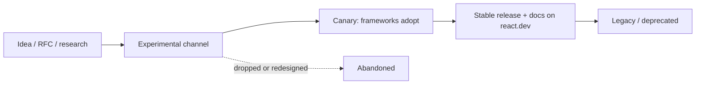
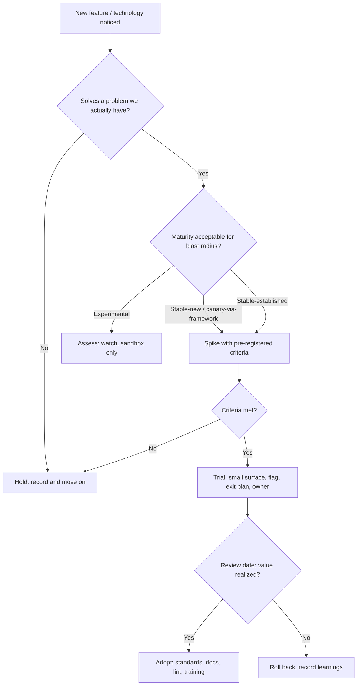
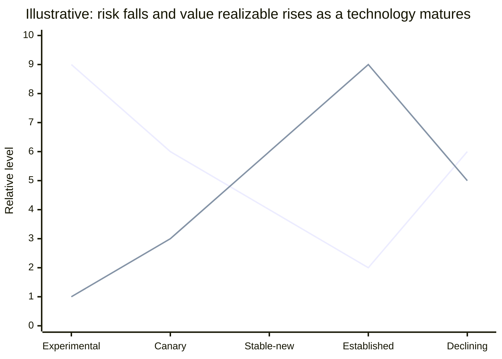

# 11 / 20 — Evaluating Emerging Features and Technologies

## 1. Lesson metadata

| | |
|---|---|
| **Level** | Architect |
| **Study time** | 4 hours (reading 1.5 h, evaluation exercises 2.5 h) |
| **Prerequisites** | [01 — Trade-off analysis](./01-trade-off-analysis.md), [15 — Framework selection](./15-framework-selection.md), [Phase 9 / 08 — React Compiler](../09-advanced-rendering-and-ecosystem/08-react-compiler.md), [Phase 9 / 15 — React API changes across versions](../09-advanced-rendering-and-ecosystem/15-react-api-changes-across-versions.md), [Phase 3 / 22 — Modern hooks and APIs](../03-react-state-and-hooks/22-modern-hooks-and-apis.md), [Phase 10 / 13 — Application migrations](../10-production-engineering/13-application-migrations.md) |
| **Next** | [21 — Reading framework source](./21-reading-framework-source.md) |

**Learning objectives.** After this lesson you can:
1. Classify any new React/ecosystem feature by maturity, stability signal and blast radius.
2. Run a time-boxed evaluation (spike) with explicit hypotheses, success criteria and an exit decision.
3. Distinguish a feature's *documented contract* from its *current implementation* and from *community lore*.
4. Decide adoption timing (never / watch / trial / adopt / migrate) and communicate it as a technology radar entry.
5. Design adoption so that it is reversible: feature flags, adapters, codemods, isolation.
6. Recognise hype patterns, resume-driven development and the opposite failure (stagnation).

**Concepts covered:** release channels (stable/canary/experimental), RFCs, semver and deprecation policy, technology radar, spike design, proof of value, adoption curve, sunk cost, hype-cycle, evaluation rubric, vendor/framework coupling, ecosystem readiness, migration cost, exit cost, "boring technology" principle, examples (React Compiler, `useEffectEvent`, `<Activity>`, View Transitions, RSC/Server Actions, `use`, Actions hooks), and ⚠ the volatility of all of them.

---

## 2. Deep conceptual explanation

### 2.1 What problem is this lesson solving?

React's ecosystem moves continuously: new hooks, new rendering modes, new compilers, new meta-frameworks, new state libraries every few months. Two opposite failure modes are expensive:

- **Chasing**: adopting unstable features in production code because they are exciting, ending up with rework when APIs change, or with a codebase only one person understands.
- **Stagnating**: avoiding all change until the platform is end-of-life, then paying for a multi-year migration under pressure while competitors ship faster.

A senior or architect's job is to *manage the rate of change*: adopt what pays for itself, at the point where its risk has fallen below its value, in a way that can be undone.

### 2.2 Source of truth hierarchy

When evaluating, weight claims by reliability:

| Tier | Source | Reliability |
|---|---|---|
| 1 | Official docs and release notes/blog for the *version you use* (react.dev, framework docs, changelogs) | Highest for documented behavior |
| 2 | Official RFCs, GitHub issues/discussions, maintainers' statements | Good for intent and status; may be outdated |
| 3 | The source code and tests (see [21](./21-reading-framework-source.md)) | Ground truth for current implementation, not guarantee of future behavior |
| 4 | Your own measured experiment on your own app | Ground truth for *your* trade-offs |
| 5 | Conference talks, blog posts by credible practitioners | Useful framing; check date and version |
| 6 | Social media, hype, benchmark charts, AI-generated summaries | Treat as leads only. AI answers in particular often mix versions and invent APIs |

Date everything. A 2022 article about "the new React" may describe behavior that changed in 18.x or 19.x. Always ask: *which version, which channel, and what has changed since?*

### 2.3 Maturity classification

For React and its ecosystem, classify before evaluating:

| Maturity | Signals | Production guidance |
|---|---|---|
| **Experimental** | In experimental/canary-only channels; docs marked experimental; APIs explicitly subject to change | Explore in a sandbox; never in production unless you accept breakage and control upgrades |
| **Canary / framework-integrated** | Available via frameworks (e.g. meta-frameworks pinning canary React) with documented intent to stabilise | Accept via the framework's supported path only; understand you are on the framework's release train |
| **Stable but new** (just released) | In a stable release, documented on react.dev; limited ecosystem/lint/test/devtool support; known issues list is short but growing | Trial in non-critical surfaces; read open issues; watch point releases |
| **Stable, established** | Multiple minor releases; ecosystem support (lint rules, testing libs, DevTools); published migration experience | Adopt per team readiness |
| **Legacy / deprecated** | Documented as legacy; removal planned or done | Plan migration; do not add new usage |

React's own release practice: stable releases follow semver for documented APIs; features may ship in Canary first (the React team describes Canary as the channel intended for frameworks and similar consumers that want stable-ish new features) and Experimental for unstable ideas. The channel definitions are documented at <https://react.dev/community/versioning-policy> (checked 2026-10-22: stable releases follow semver; Canary and Experimental prereleases carry hash-and-date versions such as `19.3.0-canary-<hash>-<date>`, and Experimental is documented as not for user-facing apps).

### 2.4 The cost model

Adoption cost has more terms than the headline benefit:

```
Net value = (benefit × probability it materializes × duration)
          − (adoption cost + learning cost + tooling gaps + ongoing maintenance
             + upgrade churn + risk of reversal + exit cost + opportunity cost)
```

Common underestimated terms:

- **Learning cost** across the whole team and *future hires*.
- **Tooling gaps**: linters, type definitions, testing support, DevTools, error messages, and docs for the new feature may lag.
- **Upgrade churn**: unstable APIs break on minor upgrades.
- **Coupling**: features tied to a specific framework or bundler lock you in (e.g. RSC integration is bundler- and framework-specific; see [Phase 9 / 03](../09-advanced-rendering-and-ecosystem/03-server-components-in-depth.md)).
- **Exit cost**: how hard is it to remove? A compiler flag is cheap to turn off; a data-fetching architecture is not.
- **Opportunity cost**: the three other things the team could have done with the same weeks.

### 2.5 Example classes (status checked against react.dev on 2026-10-22; re-date in your own notes)

The following illustrate the *method*, not a current-status report. Status changes quickly; every row requires a fresh check on react.dev and the relevant release notes before you rely on it.

| Feature | What it is (conceptually) | Classification guidance | Key evaluation questions |
|---|---|---|---|
| **React Compiler** | A build-time tool that analyses components and hooks and auto-memoizes where it can prove safe, assuming the Rules of React hold | Released as stable 1.0 on 2025-10-07 (react.dev/blog/2025/10/07/react-compiler-1; `babel-plugin-react-compiler@1.0.0` on npm; the post recommends pinning an exact version); still requires build integration and rule-compliant code | How much of our code violates Rules of React (the compiler skips or bails out)? What is the measured render/INP delta? Does our testing/Profiler workflow still make sense? Can we adopt incrementally by directory/annotation? Is the ESLint integration reporting violations? |
| **`useEffectEvent`** | A hook for effect-only callbacks that read the latest props/state without being reactive dependencies | Stable since React 19.2 (2025-10-01); must be called only from Effects, and the returned function has no stable identity (enforced by `eslint-plugin-react-hooks`) | Are we using it to hide missing dependencies, or to express "event within effect" semantics? Does the linter plugin version match? |
| **`<Activity>`** (formerly Offscreen) | Lets you hide parts of the UI while preserving state and deprioritizing their work | Stable since React 19.2; react.dev documents it as hiding/restoring UI *and internal state* (`mode` is `"visible"` or `"hidden"`) | What happens to effects of hidden subtrees? Memory implications of keeping state? Is a plain `display: none` or unmount enough? |
| **View Transitions (`<ViewTransition>`)** | React integration with the browser View Transitions API | Experimental/canary through React 19.2; **stable in React 19.3 (2026-09-09)** per the React 19.3 blog post (together with Fragment Refs). The adapter example in §5.2 is therefore a pattern for *any* feature that is still unstable in your version, not a statement that `ViewTransition` is unstable today | Browser support matrix? Accessibility with reduced motion? Does the framework support it? |
| **React Server Components / Server Functions** | Components that run only on the server and a protocol to call server functions from the client | Stable as a React feature but requires a framework/bundler integration; framework-specific APIs | Do we have the server runtime? What data/security model (serialization boundaries, auth in server functions)? Team readiness? Observability? Vendor/framework lock-in? |
| **`use`, Actions, `useActionState`, `useOptimistic`, `useFormStatus`** | React 19 primitives for async data in render and form mutations | Stable in 19 | Do they displace parts of our existing data layer? Where does TanStack Query/Redux still win? |
| **Signals-style fine-grained reactivity (outside React)** | Alternative reactive primitives (Solid, Preact Signals, etc.) | Not React; evaluate as an ecosystem trend | What problem (render granularity) is solved, and does the Compiler/concurrent features cover our case? |

**A critical habit:** write the *status date and source* next to each classification in your notes: "Status as of 2026-10, source react.dev/blog". Without a date, the classification is untestable.

### 2.6 Common misconceptions

| Misconception | Reality |
|---|---|
| "New means better." | New means *different*; better is a measured claim about your context. |
| "Stable means safe for our app." | Stable means the API contract is stable; your usage, tooling and team may not be ready. |
| "Benchmarks prove it's faster." | Benchmarks measure benchmark workloads. Measure your own critical paths. |
| "Everyone's adopting it." | Social proof is weak evidence; check who and what scale; look for post-adoption reports and regrets. |
| "We can adopt later, it'll be easy." | Sometimes (compiler flag); sometimes not (architectural features). Estimate exit and late-entry cost. |
| "The experimental feature will become stable as designed." | Experimental APIs change shape or are dropped. |
| "A feature from the React team is automatically mature." | Official features also go through experimental/canary stages; maturity is explicit in the docs and channel. |

---

## 3. Internal mechanics

### 3.1 How a React feature moves toward stable (teaching model)



*Teaching model.* The React team has described the Canary and Experimental channels and the idea that features graduate after real-world use by frameworks. Individual features skip stages or take years; some are redesigned (e.g. the shift in naming from "Offscreen" to "Activity" is an example of a concept being renamed and re-scoped). Use release notes and docs, not this diagram, to establish where a given feature sits.

### 3.2 How to read stability signals

| Signal | Where | Interpretation |
|---|---|---|
| Docs page exists on react.dev without "Experimental"/"Canary" banner | react.dev | Documented stable API |
| Banner "Canary"/"Experimental" | react.dev | Not stable in the stable channel; may require framework |
| Release notes ("React 19.x") | react.dev/blog | Feature shipped in stable channel in that version |
| Changelog `CHANGELOG.md` of packages | github.com/facebook/react | Fixes and behaviour changes per version |
| Open issues labelled with the feature | GitHub issues | Known problems; volume vs severity |
| ESLint plugin rules and type definitions availability | `eslint-plugin-react-hooks`, `@types/react` | Tooling readiness |
| Framework docs (Next.js, React Router, etc.) | respective docs | Whether and how the framework exposes it |
| RFC status | github.com/reactjs/rfcs | Intent and rationale, not necessarily present state |

### 3.3 Dependency on host environments

Many "React features" are really **React + build tool + framework + runtime**. Examples: RSC requires a bundler plugin and server runtime integration; React Compiler requires a Babel (or equivalent) plugin integrated into your bundler; View Transitions need browser support. When evaluating, enumerate the *whole stack* that must cooperate and their versions. Upgrading React alone does not buy you the feature.

*Public guarantee vs implementation detail:* React documents the semantics of its APIs; the compiler's heuristics for what it can optimise, the exact scheduling used for `<Activity>`, and how a framework wires RSC are implementation or integration details that can change in minor versions. Pin and test.

---

## 4. Step-by-step execution walkthrough: evaluating the React Compiler for a mature app

**Context.** A 400-component dashboard app, React 19, heavy use of `useMemo`/`useCallback` added over years; INP is mediocre on lower-end devices. A teammate suggests enabling the React Compiler. The steps below are the *method*; the installation details (Babel plugin `babel-plugin-react-compiler`, `compilationMode`, `"use memo"` / `"use no memo"` directives) are on react.dev/learn/react-compiler.

**Step 1 — Frame the question (1 h).** Not "should we use the Compiler?" but "does the Compiler reduce wasted re-render work in our hot screens at acceptable risk and cost?" Success criteria: (a) ≥ X% reduction in commit duration for the three heaviest interactions in the Profiler; (b) no functional regressions in the existing test suite; (c) bundle size change within budget; (d) rollout reversible within a deploy.

**Step 2 — Read the primary sources (2 h).** react.dev Compiler docs: what it does, requirements (Rules of React), how to opt in/out per component or directory, how it interacts with existing memoization, known limitations; the ESLint rules for compiler-compat; release notes; open issues.

**Step 3 — Static readiness check (half day).** Run the compiler's diagnostic tooling (the React team provides a health-check tool, `react-compiler-healthcheck`, published on npm at 1.0.0; it is not prominently documented on react.dev, so also rely on the `eslint-plugin-react-hooks` compiler-powered rules) and the lint rules to see how much of the codebase the compiler can process and which components it skips. Violations of Rules of React (mutating props, reading refs in render, impure render) are real bugs regardless of compiler; fix them.

**Step 4 — Baseline measurement (half day).** Profile the three hot interactions with the React DevTools Profiler (production-like build), record commit durations, number of component renders and INP in a lab (CPU throttled 4x) and in field RUM data. Save traces.

**Step 5 — Spike on a branch (1–2 days).** Enable the compiler on one feature directory only (per the docs' incremental adoption mechanisms). Re-run tests. Re-profile. Compare to baseline with the same scripts. Watch for: behavioral changes where code *relied* on re-renders (e.g. effects with unstable dependencies firing as a side effect), DevTools labels ("Memo ✨" badge), and bundle diff.

**Step 6 — Interpret results honestly.** Suppose: commit durations drop 18% in two of three flows; no change in the third because the cost is a large list (needs virtualization, not memoization); five components bailed out due to rule violations; tests pass; bundle +2 KB. Conclusion: *worthwhile in part*; the third problem needs a different fix ([Phase 7 / 09](../07-performance/09-windowing-and-virtualization.md)).

**Step 7 — Decide and shape the rollout.** Decision recorded in an ADR: "Trial: enable per-directory, starting with `features/dashboard`; keep existing `useMemo`/`useCallback` (do not remove en masse); add lint rule; review in 3 months; kill switch via build flag." Communicate: what changes for developers (less manual memoization in new code, still must follow the Rules of React; debugging tips).

**Step 8 — Monitor and review.** Field INP and error rates by release; look for regressions in effect-dependent behavior; schedule the review; update the technology radar.

Notice what was *not* done: a repo-wide switch based on a blog post, or removing every `useMemo` in the same PR.

---

## 5. Code examples

### 5.1 Minimal example — a technology radar entry (data as code)

```ts
// radar/entries.ts
export type Ring = 'adopt' | 'trial' | 'assess' | 'hold';

export interface RadarEntry {
  name: string;
  ring: Ring;
  statusAsOf: string;          // ISO date — a classification without a date is untestable
  source: string[];            // links to primary sources
  rationale: string;
  owner: string;
  reviewBy: string;            // ISO date
  exitPlan?: string;
}

export const entries: RadarEntry[] = [
  {
    name: 'React Compiler',
    ring: 'trial',
    statusAsOf: '2026-10-22',
    source: ['https://react.dev/learn/react-compiler'],
    rationale: 'Pilot on features/dashboard; measured -18% commit time on two flows (see ADR-0051).',
    owner: 'frontend-platform',
    reviewBy: '2027-01-22',
    exitPlan: 'Disable via build flag; no source changes required.',
  },
];
```

The format forces the fields that make an evaluation auditable: date, sources, owner, review date and exit plan. (`https://react.dev/learn/react-compiler` resolves, checked 2026-10-22.)

### 5.2 Practical example — incremental adoption behind an adapter

Adopting an unstable or framework-specific API through a project-owned wrapper keeps the blast radius small:

```tsx
// shared/ui/ViewTransitionBoundary.tsx
import type { ReactNode } from 'react';

// <ViewTransition> is stable from React 19.3; on 19.2 or earlier it is canary/experimental only.
// Our abstraction: the app imports THIS module only.
type Props = { name?: string; children: ReactNode };

// Today: a safe pass-through. When the trial starts, ONLY this file changes, e.g.
//   import { ViewTransition } from 'react';   // stable export in react >= 19.3
//   return <ViewTransition name={name}>{children}</ViewTransition>;
export function ViewTransitionBoundary({ children }: Props) {
  return <>{children}</>;
}
```

The principle is what matters: the rest of the app depends on *your* interface; if the underlying API changes or is dropped, you update one file, and the exit plan is "make it a pass-through again". A build-time flag can select between the two implementations through static imports so that experimental code stays out of the main dependency graph when disabled.

### 5.3 Incorrect example — adopting by announcement

```ts
// package.json (after reading a tweet)
{
  "dependencies": {
    "react": "canary",          // floating tag
    "react-dom": "canary",
    "some-new-state-lib": "latest"
  }
}
```

```tsx
// scattered through 60 files:
import { unstable_someExperimentalApi } from 'react';
```

**Predict:** What goes wrong over six months?
**Answer:** Floating tags make builds non-reproducible: a transitive update changes behavior between two CI runs; `unstable_`-prefixed APIs have no semver guarantees and may be renamed or removed; scattered usage means each change touches dozens of files; new hires and tools (linters, TypeScript types) lag; incident debugging is harder because no one knows which exact build is deployed. Pin exact versions, confine experimental imports to one module, and upgrade deliberately.

### 5.4 Corrected — pin, isolate, test, document

```jsonc
{
  "dependencies": {
    "react": "19.x.y",        // exact version chosen deliberately; use lockfile; verify current version
    "react-dom": "19.x.y"
  }
}
```

```ts
// A contract test that fails loudly if an assumption about the feature changes.
import { expect, it } from 'vitest';
import { renderToString } from 'react-dom/server';

it('Activity preserves hidden subtree state (assumption our feature relies on)', async () => {
  // Written as an executable assumption; run on every React upgrade.
  // Exact API usage depends on the current React version; adapt after verifying docs.
});
```

**Executable assumptions** are the architect's tool for volatile features: each dependency on behavior that is not a firm guarantee gets a small test that will fail first when it changes.

### 5.5 Advanced example — evaluation spike harness with a decision record

A spike is an experiment with *pre-registered* criteria. Template:

```markdown
# Spike: <feature> — <date> — owner: <name> — timebox: 3 days

## Hypothesis
Enabling X will reduce Y on flows A, B, C by >= N% without increasing Z.

## Out of scope
Anything not needed to test the hypothesis (styling, edge cases...).

## Method
- Baseline: <how measured: tool, throttling, build type, N runs, variance>
- Variant: <exact config, versions, commits>
- Compare: median and p95; report variance, not a single run.

## Success criteria (decided before running)
- Must: no test regressions; bundle <= +X KB; works with <framework version>
- Should: >= N% improvement on flows A, B
- Kill: any data-loss/security issue; > Y hours integration cost

## Results
(table of measurements)

## Decision
Adopt | Trial | Assess later | Hold — with reasons, owner, review date, exit plan.
```

Pre-registering criteria prevents motivated reasoning ("it's 7% faster, that's great!") after the fact.

A tiny measurement helper for repeated lab runs (illustrative; real work should use proper tools like Lighthouse CI, Playwright traces or the React Profiler):

```ts
export function summarize(samples: number[]) {
  const s = [...samples].sort((a, b) => a - b);
  const q = (p: number) => s[Math.min(s.length - 1, Math.floor(p * s.length))];
  const mean = s.reduce((a, b) => a + b, 0) / s.length;
  const sd = Math.sqrt(s.reduce((a, b) => a + (b - mean) ** 2, 0) / (s.length - 1));
  return { n: s.length, median: q(0.5), p95: q(0.95), mean, sd };
}
// If |delta of medians| is smaller than ~2 * sd, you may be measuring noise.
```

---

## 6. Visual explanations

### 6.1 Evaluation funnel



### 6.2 Adoption timing relative to risk and value



Purely illustrative; it expresses the trade-off shape (early adopters pay risk and tooling-gap costs for early benefit; late adopters risk being on declining platforms), not measured data.

---

## 7. Alternative approaches and trade-offs

| Strategy | Advantages | Disadvantages | Best when |
|---|---|---|---|
| **Early adopter** | Competitive/perf gains; shapes the tool; talent attraction | Rework, tooling gaps, instability | Feature addresses a core pain; team has capacity and expertise; framework vendor supports it |
| **Fast follower (trial after stable + first fixes)** | Lower risk, ecosystem formed, still timely | Slightly later benefits | Default for most product teams |
| **Late majority** | Maximum stability; abundant docs | Migration debt may accumulate; recruiting/skills drift | Highly regulated or small teams with low change tolerance |
| **Boring technology by default, innovation tokens** (a concept from Dan McKinley's "Choose Boring Technology") | Limits operational novelty; spends novelty on what matters | Can rationalise stagnation | Organizations with limited ops capacity |
| **Prototype in a sandbox app / hack week** | Zero production risk; builds team skill | Findings may not transfer to production scale | Assessment phase |
| **Framework-delegated adoption** | Framework vendor handles integration and upgrades | Coupling to the vendor's timeline | You already chose a meta-framework ([15](./15-framework-selection.md)) |

**Scenario where the recommended approach (fast follower) is not best.** When a feature directly removes a major cost that is hurting you *now* and is cheaply reversible (for example a build-time compiler that can be toggled off, or a polyfill-style API behind an adapter), adopting earlier in a contained pilot can be right: waiting a year costs more than the small risk. Conversely, a highly regulated product with stringent change control may rationally stay on an LTS-like stack and upgrade on a yearly cadence regardless of how interesting new features are.

---

## 8. Best practices and anti-patterns

### 8.1 Best practices

- **Start from the problem, not the feature.** A feature without a named problem and a measure goes to "Assess".
- **Time-box spikes** and pre-register criteria, including a kill criterion.
- **Test on your workload**: your biggest screens, your devices, your data, your build.
- **Prefer reversible adoption**: flags, wrappers, per-directory opt-in, codemods; avoid sprawling usage of unstable imports.
- **Pin versions**; upgrade deliberately; read changelogs; keep an "upgrade day" cadence.
- **Executable assumptions**: tests that encode non-guaranteed behavior you rely on.
- **Budget novelty**: limit the number of significant new technologies per team per quarter.
- **Track radar entries with owners and review dates**; retire entries.
- **Share learnings**: a short writeup of the spike (even negative results) saves other teams the work.
- **Watch the React team's channels** (react.dev blog, GitHub releases, RFCs) and your framework's release notes on a regular cadence rather than ad hoc.
- **Keep fundamentals strong**: engineers who understand rendering, identity and effects evaluate features better; most "new" features are applications of those mechanics ([Phase 2](../02-react-rendering-and-internals/01-what-triggers-a-render.md)).

### 8.2 Anti-patterns

| Anti-pattern | Why it hurts | Instead |
|---|---|---|
| Resume-driven development | Tech chosen for career value | Require problem statement + alternatives; review incentives |
| Hype-driven migration | Rework; fragmentation | Spike with criteria |
| Cargo-culting a big company's stack | Different scale, constraints and staffing | Understand *why* they chose it; check fit |
| "Not invented here" resistance to everything new | Stagnation | Regular radar review; explicit adoption path |
| Big-bang adoption | Irreversible, high risk | Per-feature/per-directory rollout |
| Sunk-cost persistence | Continuing a failing adoption | Pre-agreed kill criteria and review dates |
| Benchmark worship | Misleading | Measure your workload |
| Relying on AI-generated claims about new APIs | Hallucinated or outdated APIs | Verify against docs and source; run code |
| Unowned adoption | Rot, inconsistent usage | Owner + docs + lint + training |
| Ignoring deprecation notices | Forced migration later | Track deprecations in the radar; schedule migrations ([Phase 10 / 13](../10-production-engineering/13-application-migrations.md)) |

### 8.3 Justified exceptions

- Early adoption is justified when your product *is* the evidence (a company building tools for React) or when the problem is acute and the escape hatch is cheap.
- Skipping a spike is justified for tiny, well-understood, reversible changes (a minor-version upgrade within semver with passing tests).
- Using an experimental feature in a throwaway prototype or internal tool is fine; the rules above are about production code with long lifetimes.

---

## 9. Real-world application

**E-commerce storefront on a meta-framework.** Server Components and streaming can improve LCP and reduce client JS, but they depend on the framework's integration and a server runtime, plus caching and personalization strategy. Evaluation hinges on measured LCP/INP by device class, the personalization model (cacheability), team skills, and hosting cost. Likely path: adopt through the framework's supported APIs on new routes first (strangler) rather than migrating the whole app.

**Trading dashboard.** Render cost per update dominates. The Compiler might reduce unnecessary re-renders of rows but won't fix an update rate problem that needs batching, selective subscriptions and virtualization. Evaluation outcome: use as a complement; do not expect it to substitute for architecture (state colocation, store selectors).

**Design-system team.** Wants to adopt `ref` as a prop (stable in 19) and remove `forwardRef` wrappers, but must keep supporting consumers on React 18. Evaluation: peer dependency ranges, codemods, a compatibility test matrix, and a deprecation timeline ([Phase 10 / 12](../10-production-engineering/12-backward-compatibility.md)). The "new feature" decision is constrained by the oldest supported consumer.

**Form-heavy internal app.** React 19 Actions (`useActionState`, `useFormStatus`) simplify mutation flows. The evaluation compares against existing form libraries (React Hook Form) for validation, dynamic fields, performance with many fields. Likely hybrid: Actions for submission and pending state; a form library where complex client-side state is needed ([Phase 9 / 13](../09-advanced-rendering-and-ecosystem/13-forms-actions-and-mutations.md)).

**Multi-team platform.** A platform team evaluates a new state library; the cost includes *every* team's retraining. They use a trial in one product with an adapter at the data boundary, and publish the evaluation write-up with criteria and results.

---

## 10. Debugging and troubleshooting adoption problems

| Symptom | Likely root cause | Investigation | Fix |
|---|---|---|---|
| New feature behaves differently in CI vs local | Version skew; floating tags; different build flags | Compare lockfile, `react` version, bundler plugin config | Pin; reproducible builds |
| "Works in dev, breaks in production build" for a compiler/transform | Dev vs prod pipeline differences; minification; DCE; env-specific transforms | Reproduce with production build; compare transformed output | Align pipelines; add prod-mode tests |
| Tests fail after enabling a feature | Tests relied on implementation details (render counts, call counts of memoized functions) | Inspect failures: behavior vs implementation coupling | Rewrite tests around behavior ([Phase 8 / 16](../08-testing-and-quality/16-avoiding-brittle-tests.md)) |
| Perf didn't improve | Bottleneck isn't where the feature acts (e.g. network, layout, huge DOM) | Profile: Performance panel vs React Profiler ([Phase 7 / 18](../07-performance/18-react-vs-browser-bottlenecks.md)) | Address the actual bottleneck |
| Performance got worse | Overhead (hidden subtrees retained, extra work), misuse | Compare traces; check memory | Narrow scope; revert |
| Team confusion/inconsistent usage | No docs, no lint, no examples | Review PRs for divergent patterns | Write guide; add lint rule; pair sessions |
| Library incompatibility | Third-party lib not rule-compliant or not ready | Search issues; bisect dependencies; isolate with per-directory opt-out | Opt out; contribute fix; replace lib |
| Upgrade broke the feature | Reliance on unstable/internal behavior | Read changelog; check executable assumption tests | Fix usage; pin; report upstream with a minimal repro |
| Feature abandoned upstream | Experimental never stabilised | Monitor RFC/issue status | Execute exit plan |

Validation: re-run the baseline spike measurements in the new state; confirm via field metrics.

---

## 11. Exercises

### Level A — Knowledge
A1. Name five tiers of source reliability and give an example of each. Which is the ground truth for *your* app's performance?
A2. Define the difference between a feature's documented contract and its current implementation. Give a React example of each.
A3. What fields belong in a technology radar entry, and why?
A4. List four costs of adoption that teams commonly underestimate.
A5. Why is "date and version" the first question to ask of any claim about a React API?

### Level B — Code comprehension
B1. A colleague proposes `import { unstable_Activity as Activity } from 'react'` across 40 components. Identify the problems and propose the minimum-risk way to experiment.
B2. A PR removes all `useMemo`/`useCallback` from the codebase because "we turned on the compiler". What do you check before approving?
B3. Read this effect and evaluate whether `useEffectEvent` is appropriate:

```tsx
useEffect(() => {
  const conn = createConnection(roomId);
  conn.on('message', msg => showNotification(msg, theme));
  conn.connect();
  return () => conn.disconnect();
}, [roomId, theme]);
```
Describe the behavior problem, the proposed fix with `useEffectEvent`, and the failure mode if misused.

### Level C — Implementation
C1. Write a spike plan (using the template in 5.5) for evaluating Server Components on one route of a Vite-based SPA. Include measurable criteria and a kill criterion.
C2. Write a radar entry set (5 entries across rings) for a team using React 19 with TanStack Query and Zustand.
C3. Write an executable-assumption test suite description (names and assertions, not necessarily runnable code) for three behaviors you rely on from a new React feature.

### Level D — Debugging
D1. After enabling a compiler on one directory, a component's `useEffect` now fires less often and a feature breaks. Hypothesize the root causes and how to investigate.
D2. A team adopted a canary-channel React through their framework and, after a patch update, form submissions fail intermittently. Investigate and propose process changes.
D3. Spike results: median improvement 6%, standard deviation across runs 5%, n = 5. A manager wants to announce a win. What is your response and what additional data do you request?

### Level E — Architecture and engineering decisions
E1. Your organization has 8 teams on React 18 with class and function components. React 19 features (Actions, `use`) are attractive; some teams have no capacity. Propose an adoption/upgrade strategy and a compatibility policy.
E2. Decide whether to adopt a meta-framework's RSC support for a logged-in B2B dashboard with highly personalized, real-time data. Provide criteria, risks, and a recommendation.

### Level F — Expert challenge
F1. Design an "innovation budget" governance model for a 60-engineer frontend organization: how novelty is proposed, evaluated, funded, tracked and retired, avoiding both chaos and bureaucracy.
F2. A new rendering feature promises 30% fewer renders. Write the methodology to validate the claim for your product, including confounders, instrumentation, statistical treatment, and decision thresholds. Explain why "render count" may be the wrong metric.

---

## 12. Detailed answers and explanations

> Attempt the exercises first.

**A1.** Tiers (see 2.2): official docs/release notes; RFCs/issues/maintainers; source and tests; your own measurements; talks/blogs; social/hype/AI summaries. For your app's performance, tier 4: your own measurements. Trap: citing a benchmark chart (tier 6) as evidence for your workload.

**A2.** Contract: documented semantics, e.g. "state updates in event handlers are batched" or "`useEffect` cleanup runs before the next effect run", or `ref` as a prop in 19. Implementation: how React schedules lanes, exact function names, the compiler's specific memoization granularity, internal data structures. Reason: contract is what you may rely on; implementation can change in a minor release.

**A3.** Name, ring, status-as-of date, sources, rationale, owner, review-by date, exit plan. Each ensures the entry is verifiable (date, sources), accountable (owner), temporary by default (review date), and reversible (exit plan).

**A4.** Learning cost for the team/hires, tooling gaps, upgrade churn, coupling/lock-in, exit cost, opportunity cost, testing changes, observability gaps.

**A5.** React APIs and recommended practices changed substantially across versions (class lifecycle to hooks; `ReactDOM.render` to `createRoot`; `forwardRef` to ref-as-prop; Offscreen to Activity naming). Advice for one version can be wrong or harmful for another. See [Phase 9 / 15](../09-advanced-rendering-and-ecosystem/15-react-api-changes-across-versions.md).

**B1.** Problems: `unstable_` prefix means no semver guarantee; may not exist under that name in your React channel/version (and a stable `Activity` may exist instead; check docs); using it in 40 files multiplies the change cost; not pinned; no tests; undefined behavior for effects and state of hidden subtrees might surprise. Minimum-risk: confirm whether a stable API exists in your version; if experimenting, wrap in one module; use on one screen; pin versions; write an assumptions test; feature-flag; prepare an exit by replacing the wrapper with a pass-through.

**B2.** Check: that the compiler is actually enabled for those directories and compiles those components (health check, DevTools badge); that existing code follows the Rules of React; whether some memoization has *semantic* purpose rather than perf (stable identity for effect dependencies, third-party libs comparing references, `useMemo` for expensive computation that the compiler may or may not preserve; react.dev says existing `useMemo`/`useCallback` remain valid as escape hatches, e.g. to control values used as effect dependencies, and that for new code you can rely on the compiler; for existing code the docs advise leaving memoization in place unless you can test the change); measure with Profiler before/after; run full tests; do the removal incrementally and keep a rollback. Say: memoization removal is a separate PR per area with measured evidence, not a blanket change. The documentation (verify) recommends caution about removing existing manual memoization in existing code; for new code you can rely on the compiler.

**B3.** Problem: `theme` is in the dependency array because the effect reads it inside the message callback; when the user toggles theme, the effect re-runs: the connection is torn down and re-established (reconnect), which is not the intent. Fix with an effect event (stable since 19.2):

```tsx
const onMessage = useEffectEvent((msg: Message) => showNotification(msg, theme));

useEffect(() => {
  const conn = createConnection(roomId);
  conn.on('message', onMessage);
  conn.connect();
  return () => conn.disconnect();
}, [roomId]);   // onMessage is not a dependency (per docs; the lint plugin knows effect events)
```
Failure mode: using `useEffectEvent` to silence the linter for *reactive* values that should re-synchronize (e.g. `roomId`), which produces stale-behavior bugs; also calling the effect event from render or passing it to child components, which the docs restrict. Rule: only for logic that is conceptually an *event* fired by the effect.

**C1.** Evaluation criteria: states a hypothesis tied to a pain (e.g. route's JS payload 380 KB and LCP 3.6 s p75); out of scope; method including that a Vite SPA needs a framework/bundler integration for RSC (the current supported paths are framework integrations such as Next.js; Vite has an RSC plugin, `@vitejs/plugin-rsc`, published at 0.x on npm as of 2026-10-22, so treat it as early; it may require a different framework or the Vite RSC plugin), variant and baseline; measurable success (LCP, JS KB, TTFB, INP, server cost); kill criteria (integration > 4 days; auth/session handling impossible; observability gaps); results table; decision with review date. Good answers also compare with cheaper alternatives (code-splitting, preloading, SSR through an existing framework).

**C2.** Sample: Adopt — TanStack Query (server state); Adopt — React 19 `ref` as prop; Trial — React Compiler (dashboard); Assess — View Transitions (stable in React 19.3; browser-support caveats remain); Hold — new global state library without a problem statement. Each with date/owner/review. Evaluation: entries tie to problems; Hold has justification rather than dismissal.

**C3.** Example: "Activity hidden subtree keeps local state across hide/show"; "Effects in hidden subtrees are cleaned up (or not) as documented"; "Compiler-compiled component still re-renders when context value changes". Each as a named test with the assertion that depends on documented behavior; failing tests on upgrade signal changes to review.

**D1.** Likely: the effect depended on an unstable dependency (object/function recreated each render) and relied on the resulting re-fires, i.e. a latent bug; the compiler stabilised the value so the effect no longer fires. Investigate: log dependency changes; compare before/after compile output; inspect the effect's purpose ("synchronize with what?"). Fix: make dependencies and intent explicit (derive the correct trigger; use an event handler for event-driven work), not by disabling the compiler. If it's a library incompatibility, opt out the component. Reference: [Phase 3 / 04–05](../03-react-state-and-hooks/04-useeffect-synchronization.md).

**D2.** Investigate: exact React/React-DOM/framework versions before/after (lockfile diff); changelogs of the canary update; reproduce in a minimal project; check whether the form Action/server function integration changed; search framework issues. Process changes: do not use floating tags; upgrade canary deliberately with a staging soak; run contract tests; maintain a rollback; subscribe to framework release notes; limit canary use to teams with capacity.

**D3.** The effect (6%) is comparable to noise (sd 5% with n=5), so the claim is not supported. Ask for more runs (e.g. 30+), controlled conditions (CPU throttling, same machine, warm/cold), medians and confidence intervals, field data, and a pre-registered threshold. Also check practical significance: does 6% matter for users? Do not announce a win; label "inconclusive".

**E1.** Evaluation criteria: policy that libraries/shared packages support the oldest supported React (peer ranges) until a date; staged upgrade path (first to 18 stable, then 19, using codemods; address removed APIs listed in the React 19 upgrade guide on react.dev); a compatibility test matrix; platform team supports teams with capacity gaps; adopt new APIs in *new* code first; no mandatory rewrite of old code; deprecation timeline; communication; metrics (percentage of apps on 19). Counter: forcing all teams simultaneously causes disruption; leaving it open-ended causes fragmentation; time-boxed support windows resolve both.

**E2.** Criteria: personalization (cache-ability), real-time needs (RSC is not a push mechanism; you still need client subscriptions), existing API architecture, team server experience, observability, hosting, security model (server functions are public endpoints needing auth), SEO (irrelevant for logged-in?), performance gains (JS bundle, waterfalls), ecosystem libraries compatibility (client-only libs), lock-in. Likely recommendation: partial adoption at most (server components for static shells, data prefetch) if bundle/waterfall pain is measured; real-time widgets remain client components; otherwise stay with SPA + TanStack Query and revisit. Reasoning: benefits for logged-in, highly interactive dashboards are often smaller than for content sites, and cost is significant. State assumptions.

**F1.** Elements: lightweight proposal (one-page problem/benefit/cost); "innovation tokens" per team per quarter; a platform or architecture guild evaluates with the spike template; trial funded explicitly (capacity allocated); radar maintained with owners and review dates; deprecation/retirement path; transparency (public radar); fast lane for low-risk reversible experiments; escalation for one-way-door choices; metrics (time to decision, adoption outcomes, regret rate). Anti-bureaucracy: time limits on reviews; default yes for sandbox experiments.

**F2.** Methodology: define the user-relevant outcome (INP, interaction latency, commit duration, battery) rather than render count; select hot flows; build identical builds differing only in the feature; automate interaction scripts (Playwright) and profile (Chrome tracing; React Profiler in profiling builds); randomize order of runs, warm up, throttle CPU, many runs per variant, report medians with confidence intervals (bootstrap) and effect sizes; also field A/B (canary percentage) comparing INP and error rates with enough power; confounders (data differences, machine noise, GC, background processes, caches, build differences, tree-shaking); thresholds decided beforehand. Why render count may mislead: fewer renders doesn't imply less time (cheap renders), added overhead may offset (comparison/memoization costs), commits/layout/paint dominate, and user-perceived latency may be dominated by non-React work.

---

## 13. Senior engineer interview questions

**Q1. How do you decide whether to adopt a new React feature?**
*Strong answer:* Start with the problem and its measure; check maturity and sources (docs, release notes, issues); estimate the full cost model including tooling, learning, exit; run a time-boxed spike with pre-registered criteria; adopt behind an adapter with flags and review dates; communicate through ADR/radar. Mention that adoption timing depends on blast radius and reversibility.

**Q2. The team wants to use a canary feature in production. Your response?**
*Strong answer:* Ask what problem, whether a stable alternative exists, whether we're consuming it through a framework's supported path, who owns upgrades, what the exit plan is, and whether we pin versions; propose a contained trial; refuse floating tags and scattered `unstable_` imports.

**Q3. How would you evaluate the React Compiler?**
*Strong answer:* Read docs; check Rules-of-React compliance with lint/health tools; baseline profile hot interactions; pilot per-directory; compare measured commit time/INP; keep existing manual memoization at first; verify tests; decide with an ADR; monitor field metrics; note that it does not fix architectural render problems (large lists, state placement). Flag version-sensitivity.

**Q4. Why can't you just trust benchmarks or blog posts?**
*Strong answer:* Different workload, hardware, versions, methodology and incentives; results not transferable. Use them to form hypotheses, then measure your app with variance reporting. Dated claims may be obsolete.

**Q5. What does "boring technology" mean, and does it conflict with growth?**
*Strong answer:* Spend limited novelty on differentiators; prefer well-understood tools elsewhere; not an argument against change but for deliberate, budgeted novelty. Combined with a radar and review dates, avoids both chaos and stagnation.

**Q6. How do you keep a team current without churning the codebase?**
*Strong answer:* Regular, scheduled radar reviews; learning time; sandbox experiments; incremental upgrades in new code first; codemods for mechanical changes; lint rules to prevent new legacy usage; clear deprecation timelines.

**Q7. How do you handle a feature that was adopted and turned out to be a mistake?**
*Strong answer:* Use the exit plan; communicate transparently; blameless review of what evidence was missing; extract learnings into the evaluation template; avoid sunk-cost; migrate incrementally if usage spread.

---

## 14. Further learning resources

| Resource | URL | Covers / why | Level | Study |
|---|---|---|---|---|
| React blog | <https://react.dev/blog> | Official release announcements and roadmap posts | All | Latest release posts; React 19 and later |
| React versioning policy | <https://react.dev/community/versioning-policy> | Semver and release channel definitions | Intermediate | Channels |
| React Compiler docs | <https://react.dev/learn/react-compiler> | Introduction, installation, incremental adoption | Intermediate | All; check status banner |
| `useEffectEvent` reference | <https://react.dev/reference/react/useEffectEvent> | Effect events semantics and restrictions | Intermediate | All |
| `<Activity>` reference | <https://react.dev/reference/react/Activity> | Hidden UI with preserved state | Intermediate | All |
| `use` reference | <https://react.dev/reference/react/use> | Reading promises/context in render | Intermediate | All |
| React Server Components docs | <https://react.dev/reference/rsc/server-components> | Server Components reference | Advanced | Overview |
| React RFCs repository | <https://github.com/reactjs/rfcs> | Design rationale for features | Advanced | RFCs matching features you evaluate |
| React repository (releases/changelog) | <https://github.com/facebook/react> | Changelog, issues, source | Advanced | CHANGELOG.md; releases |
| Dan McKinley — Choose Boring Technology | <https://boringtechnology.club/> | Innovation tokens | Beginner | Whole deck |
| Thoughtworks Technology Radar | <https://www.thoughtworks.com/radar> | Radar format example | Intermediate | How to read the radar |
| Can I use | <https://caniuse.com/> | Browser support for platform features (View Transitions etc.) | Beginner | Feature search |

URLs in this table were checked for HTTP 200 on 2026-10-22; any still marked *(unverified)* could not be checked automatically (blocked or unreachable). A 200 response does not guarantee the page content still matches the description; if a link has moved, search the site for the quoted title.

---

## 15. Knowledge checkpoint

**You should now understand**
- Why evaluation requires source hierarchy, maturity classification and a full cost model.
- Why many "React features" depend on build tools, frameworks and browsers.
- How to design adoption to be incremental, pinned, isolated and reversible.

**You should be able to explain without notes**
- The difference between contract and implementation, and why executable assumptions help.
- Why benchmark and blog evidence must be treated as hypotheses.

**You should be able to implement**
- A spike plan with pre-registered criteria; a radar entry set; an adapter that isolates an unstable API; a summary of measurement variance.

**You should be able to debug**
- Post-adoption regressions: version skew, hidden reliance on re-renders, tooling gaps, and "no perf change" outcomes.

**Before moving on:** read [21 — Reading framework source](./21-reading-framework-source.md): tier 3 of the source hierarchy, and the skill that lets you verify claims yourself.
