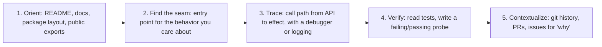
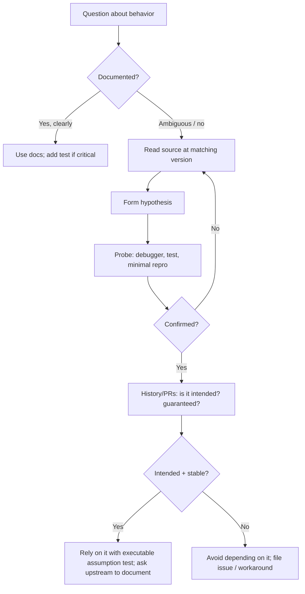
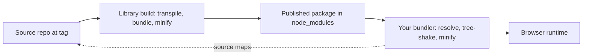
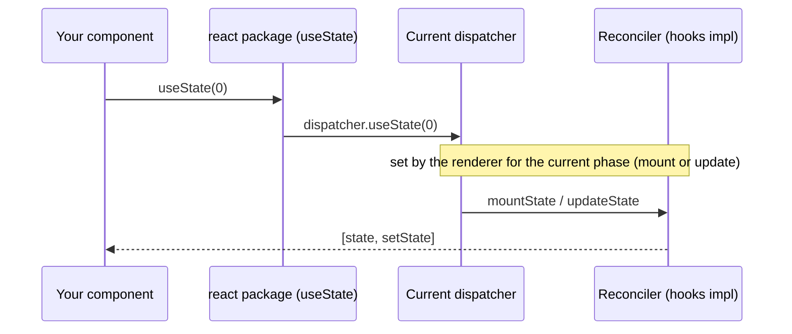

# 11 / 21 — Reading Framework and Library Source Code

## 1. Lesson metadata

| | |
|---|---|
| **Level** | Architect |
| **Study time** | 5–6 hours (reading 1.5 h, hands-on source tours 3 h, exercises 1.5 h) |
| **Prerequisites** | [Phase 2 / 31 — Reading React's source code](../02-react-rendering-and-internals/31-reading-react-source.md), [Phase 2 / 09 — Fiber nodes and units of work](../02-react-rendering-and-internals/09-fiber-nodes-and-units-of-work.md), [Phase 2 / 17 — Hooks and Fiber state](../02-react-rendering-and-internals/17-hooks-and-fiber-state.md), [Phase 3 / 20 — useSyncExternalStore](../03-react-state-and-hooks/20-usesyncexternalstore-and-external-stores.md), [Phase 0 / 20 — Tooling, transpilation, bundling](../00-web-and-javascript-foundations/20-tooling-transpilation-and-bundling.md), [20 — Evaluating emerging features](./20-evaluating-emerging-features.md) |
| **Next** | [22 — Long-term evolution](./22-long-term-evolution.md) |

**Learning objectives.** After this lesson you can:
1. Choose when reading source is the right tool (and when docs, tests or a repro are better).
2. Navigate an unfamiliar codebase efficiently: entry points, public API surface, data structures, control flow, tests, history.
3. Run library code under a debugger, with source maps, inside your own application, to observe real behavior.
4. Read React's repository structure and the shape of its reconciler, scheduler and hooks implementation without over-claiming specifics.
5. Read small ecosystem libraries (state stores, query caches, routers) and reimplement their core to confirm understanding.
6. Distinguish what source tells you (current behavior) from what it does not (guarantees, intent, future).

**Concepts covered:** code-reading strategy, top-down vs bottom-up, call-graph tracing, tests as executable specification, `git log`/`git blame`/PR archaeology, distribution vs source, source maps, development vs production builds, monorepo layout, public vs internal API, feature flags in source, reimplementation as verification, upstream contribution and minimal repros.

---

## 2. Deep conceptual explanation

### 2.1 What problem is this lesson solving?

Documentation answers the question "what is promised?". Sometimes you need to answer a different question: "what actually happens?" Examples:

- The docs say a `useSyncExternalStore` subscription is "resubscribed if `subscribe` changes", and you need to know precisely when relative to commit.
- A library throws an opaque error from deep inside; the message does not map to your code.
- You are evaluating two state libraries and need to know how each avoids tearing.
- You suspect a bug in a dependency, and a maintainer asks for a root-cause analysis in your issue.
- You want to understand a React Server Components integration in your framework, because the integration is poorly documented.

An architect who cannot read source depends on others' summaries (including AI-generated ones, which can be confidently wrong). Reading source is the **ground truth for current behavior**, tier 3 in the source hierarchy from [20](./20-evaluating-emerging-features.md).

### 2.2 What source can and cannot tell you

| Source reveals | Source does not reveal |
|---|---|
| Current behavior in that version | Whether the behavior is a *guarantee* (public contract) |
| Edge cases handled (and not handled) | Intent (why); check PRs, issues, RFCs, commit messages |
| Data structures and algorithms | Performance characteristics under *your* workload (measure) |
| Internal invariants (assertions, invariants, error messages) | How the library will behave next version |
| Dependency on platform APIs | Behavior of build-time transforms unless you read the plugin too |

**Implementation detail warning.** The most dangerous outcome of reading source is *depending on what you read*. If your code relies on an internal ordering that is not documented, you have created an undocumented contract with a project that did not agree to it. Use source to *understand and verify*, then program against the documented API. If the behavior matters and is undocumented, ask upstream to document it or write an executable assumption test ([20](./20-evaluating-emerging-features.md)).

### 2.3 Reading strategy: the five passes



1. **Orient.** Open the README and package manifest (`package.json`: `main`, `module`, `exports`, `types`, `sideEffects`). The `exports` map tells you the *public* surface; anything not exported is internal by definition.
2. **Find the seam.** Identify the one function that begins the behavior you care about: the exported `useStore`, the `createRoot` function, the router's `navigate`. Use "find references", text search for the exported name, and the test files that import it.
3. **Trace.** Follow calls downward, but time-box. Do not read everything; follow *one* path for *one* question. Prefer running the code under a debugger (section 5) to reading statically; the debugger resolves dynamic dispatch and shows real values.
4. **Verify.** A hypothesis from reading is not knowledge until confirmed: write a probe (small script/test) that makes the library show the behavior. Tests in the repo are executable specifications; search them for the scenario.
5. **Contextualize.** `git blame` the lines, find the commit and PR, read the discussion. This is where *intent* lives.

### 2.4 Top-down vs bottom-up

- **Top-down** (start at the public API): best for "what does this function do?" and for evaluating libraries.
- **Bottom-up** (start at a leaf like a data structure or error message): best for debugging a specific failure. Search the error text in the source; the throw site and its surrounding conditions tell you which invariant you broke.
- **Middle-out** (start at a core abstraction like the store, the cache or the work loop): best for building a mental model of the whole.

Choose by question, and switch freely.

### 2.5 Distribution vs source

What is in `node_modules` is **not** the source. It is a built artifact:

| Layer | What you see | Implication |
|---|---|---|
| Source repo | Original TypeScript/Flow, comments, tests, history | Best for reading; may be ahead of or behind your installed version |
| Published package | Compiled CJS/ESM (and `.d.ts`), maybe minified; separate development/production files | Matches what runs in your app; harder to read |
| Your bundle | Further transformed, minified, tree-shaken, possibly different build flags | What users run; map back via source maps |

**React publishes separate development and production builds** (for example the `react-dom` package contains `.development.js` and `.production.js` files selected by `process.env.NODE_ENV` via a small entry file; verify the layout in your installed version). The development build has extra warnings, checks and (in dev) Strict Mode behavior; production strips them. When you step into React with a debugger, you are in the development build unless you configure otherwise, and its readable names and invariants are very helpful.

**Version matching.** Always read the source at the tag matching your installed version (`git checkout v19.x.y` or the GitHub tag UI). Reading `main` while running an older version is a common source of false conclusions.

---

## 3. Internal mechanics

### 3.1 The shape of React's repository (conceptual map)

*Everything in this section is a conceptual map, not a guarantee. File names, folders and module boundaries change between versions. The function and file names below were checked on 2026-10-22 against `facebook/react` `main` (`ReactVersion` 19.3.0) and against the installed `react-dom@19.3.1` development bundle (`cjs/react-dom-client.development.js`); re-check at the tag you care about.*

React is a monorepo. Conceptually it contains packages such as:

| Package (conceptual role) | What lives there |
|---|---|
| `react` | The public API surface that is renderer-independent: element creation, hooks' *entry points* (which delegate to a dispatcher), context, Suspense/lazy types, etc. |
| `react-dom` | The browser renderer's public API (`createRoot`, `hydrateRoot`, `flushSync`, portals...), plus its host config (DOM operations) and server-rendering entry points. |
| `react-reconciler` | The renderer-agnostic engine: Fiber data structures, the render/commit work loop, hooks implementations, lanes, Suspense handling. Renderers plug in through a "host config". |
| `scheduler` | The cooperative scheduler used to time-slice work (priority queue; the macrotask used to yield is `setImmediate` when it exists (Node, jsdom), otherwise `MessageChannel`, otherwise `setTimeout` — see `packages/scheduler/src/forks/Scheduler.js`). |
| `react-server` and the `react-server-dom-*` packages (e.g. `react-server-dom-webpack`) | Server side of the Flight protocol, client reference handling, bundler integration helpers. Volatile. |
| `shared` | Constants and utilities shared across packages. |
| `react-devtools-*` | DevTools frontend/backend. |
| `compiler/` (top-level folder, not under `packages/`) | The React Compiler implementation, e.g. `compiler/packages/babel-plugin-react-compiler`. |

A key architectural pattern is **dispatcher indirection**: calling `useState` from the `react` package does not itself implement state; it asks a "current dispatcher" (set by the reconciler during render) to do it. Conceptually, this is why hooks outside render throw ("Invalid hook call"), and why different phases (mount vs update vs the server renderer) can supply different implementations of the same hook API. Teaching model: `react` exports *names*; the active renderer injects *behavior* while it renders. See [Phase 2 / 17](../02-react-rendering-and-internals/17-hooks-and-fiber-state.md).

### 3.2 Where to start for common questions about React

Conceptual starting points (search by name in the repo; do not rely on exact paths from memory):

| Question | Where to look conceptually | Search terms to try |
|---|---|---|
| How do hooks store state? | The reconciler's hooks implementation: separate mount-time and update-time dispatchers; a linked list of hook objects on the fiber's `memoizedState` | `renderWithHooks`, `mountState`, `updateState`, `dispatchSetState` (all in `react-reconciler/src/ReactFiberHooks.js`; the installed bundle also has `HooksDispatcherOnMount` / `HooksDispatcherOnUpdate`, and `react` reaches the active dispatcher via `ReactSharedInternals.H`) |
| What happens on `setState`? | Update object creation, lane assignment, enqueue, scheduling the root | `dispatchSetState` (calls `requestUpdateLane` then `dispatchSetStateInternal`), `scheduleUpdateOnFiber` and `requestUpdateLane` (`ReactFiberWorkLoop.js`), `ensureRootIsScheduled` (`ReactFiberRootScheduler.js`) |
| How does the render loop work? | The work loop: perform unit of work (begin, complete), shouldYield checks, and the sync vs concurrent variants | `performUnitOfWork`, `workLoopSync`, `workLoopConcurrent` / `workLoopConcurrentByScheduler` (`ReactFiberWorkLoop.js`; the loop condition calls `shouldYield()`, which is imported from the scheduler), `beginWork` (`ReactFiberBeginWork.js`), `completeWork` (`ReactFiberCompleteWork.js`) |
| How are children reconciled and keys applied? | Child reconciliation functions; array diffing with maps by key; single-element paths | `reconcileChildFibers` (created by `createChildReconciler`, which also holds `reconcileChildrenArray`), both in `ReactChildFiber.js` |
| How does the commit phase run effects? | Commit passes: before-mutation, mutation, layout, then passive effects scheduled after | `commitRoot`, `flushPassiveEffects` (`ReactFiberWorkLoop.js`); `commitBeforeMutationEffects`, `commitMutationEffects`, `commitLayoutEffects` (`ReactFiberCommitWork.js`) |
| How do lanes prioritize work? | Lane bitmask utilities | `Lane`/`Lanes` types, `getNextLanes`, `markRootUpdated` (`ReactFiberLane.js`) |
| How does Suspense work? | Throwing a thenable, handling in `throw` logic, fallback/retry | `throwException` (`ReactFiberThrow.js`, which calls `attachPingListener`), the `SuspenseComponent` work tag |
| How does hydration compare server HTML? | Hydration context in the reconciler, DOM host config's hydration helpers | `prepareToHydrateHostInstance` (present in both); `tryToClaimNextHydratableInstance` exists in `ReactFiberHydrationContext.js` on `main` but was **not** found in the installed 19.3.1 bundle, which is a reminder to read the tag you run |

These names are *search seeds*, not API: confirm them by searching the repo at your tag. If a name has changed, search by the behavior or by the error message strings (stable anchors).

### 3.3 Read error messages as anchors

React's development builds print error and warning messages that link to documentation, and the repository stores these strings (historically in a central error-codes map used to produce short production error messages). Searching the exact message text finds the throw site and the conditions that trigger it. This is the single most efficient bottom-up technique and works for most libraries.

### 3.4 Reading libraries with small cores

Most ecosystem libraries have a small essential core wrapped in API surface and edge-case handling. Examples (repo contents and sizes change):

| Library | Core idea to find | Why read it |
|---|---|---|
| **Zustand** | A vanilla `createStore` with `getState/setState/subscribe` and a React binding using `useSyncExternalStore` | Shows how external stores avoid tearing; small enough to read in an hour |
| **TanStack Query** | A framework-agnostic *query core* (QueryClient, QueryCache, Query, Observer) with framework adapters | Shows the cache/observer/invalidation model; informs [Phase 6 / 08](../06-data-fetching-and-state-ecosystems/08-tanstack-query.md) |
| **Redux / Redux Toolkit** | A store with reducer, dispatch, middleware composition; RTK adds Immer-based reducers | Shows middleware chain and subscription notification |
| **React Router** | Route matching, history/navigation abstraction, data routers (loaders/actions) | Shows how routing interacts with rendering and data loading |
| **Immer** | Proxy-based draft and patch generation | Shows how "mutating syntax" produces immutable updates |
| **Zod / validation libs** | Parser combinators and error aggregation | Shows type inference mechanics (advanced) |

---

## 4. Step-by-step execution walkthrough: answering a real question from source

**Question.** "When a Zustand-style store updates, and a component selects a slice with a selector, does the component re-render if the selected value is unchanged?" Docs suggest "no", but you need to know how, and what is the role of `useSyncExternalStore`.

**Step 1 — Orient (10 min).** Find the library's repo; open `package.json` for the `exports` map and entry files; skim the README for the intended semantics. Identify the two layers: a vanilla store module and a React binding module.

**Step 2 — Find the seam (10 min).** The React binding exports a hook (`useStore`/`create`'s returned hook). Open it. You expect (and find, conceptually) a call to React's `useSyncExternalStore(subscribe, getSnapshot, getServerSnapshot)`.

**Step 3 — Trace the snapshot function (15 min).** The hook passes a `getSnapshot` that calls `selector(store.getState())`. React compares the snapshot with the previous using `Object.is` (documented behavior of `useSyncExternalStore`: it re-renders when the snapshot changes by `Object.is` comparison; see react.dev). So whether a re-render occurs depends on whether the *selector's returned value* is `Object.is`-equal across calls.

**Step 4 — Notice the trap (10 min).** If the selector returns a new object each call (`s => ({ a: s.a })`), `getSnapshot` returns a different reference on every call; React may warn about `getSnapshot` not being cached and can loop or re-render constantly. (React documents that `getSnapshot` must return a cached/stable value for unchanged data; in react 19.3.1 the dev warning is "The result of getSnapshot should be cached to avoid an infinite loop".) Many libraries provide `shallow` equality helpers or `useShallow`-style wrappers that return the previous reference when shallow-equal (Zustand 5 exports `useShallow` from `zustand/react/shallow`).

**Step 5 — Verify with a probe (15 min).** Write a minimal component with a render counter and test two selectors: a primitive selector and an object-returning selector, mutating an unrelated slice. Observe counts. (The probe is code in section 5.2.)

**Step 6 — Contextualize (10 min).** `git log -S"useSyncExternalStore" -- <file>` shows when the library adopted it and why. The PR explains tearing issues in concurrent rendering that motivated it ([Phase 2 / 15](../02-react-rendering-and-internals/15-interruptible-restartable-abandoned-rendering.md)).

**Answer, derived:** Re-render occurs only if the selected snapshot changes by `Object.is`; a primitive or stable reference slice does not re-render on unrelated updates; an object-literal selector breaks that unless wrapped in an equality helper. And you learned *where* the guarantee comes from: the React documentation for `useSyncExternalStore` plus the library's selector contract, *not* from the store internals.

Total: about 70 minutes, producing knowledge you can defend in a design review, and a probe you can keep as an executable assumption.

---

## 5. Code examples

### 5.1 Minimal example — locate the source for what actually runs

```bash
# What versions are really installed (and from where)?
npm ls react react-dom           # or: pnpm why react
node -e "console.log(require.resolve('react-dom/client'))"

# What does the package export publicly?
node -e "console.log(JSON.stringify(require('react-dom/package.json').exports, null, 2))"
```

Reading the `exports` field answers "which files are public entry points?". Anything not listed is not importable in Node/modern bundlers that respect `exports`, and not part of the supported surface.

### 5.2 Practical example — probe the selector behavior

```tsx
import { useSyncExternalStore, useRef } from 'react';

// A tiny external store, enough to probe semantics.
function createStore<T>(initial: T) {
  let state = initial;
  const listeners = new Set<() => void>();
  return {
    getState: () => state,
    setState(next: (s: T) => T) {
      state = next(state);
      listeners.forEach(l => l());
    },
    subscribe(l: () => void) { listeners.add(l); return () => listeners.delete(l); },
  };
}

type S = { a: number; b: number };
export const store = createStore<S>({ a: 0, b: 0 });

function useSelector<R>(selector: (s: S) => R): R {
  return useSyncExternalStore(store.subscribe, () => selector(store.getState()));
}

function useRenderCount() { const r = useRef(0); r.current += 1; return r.current; } // dev probe only

export function PrimitiveSelector() {
  const a = useSelector(s => s.a);              // returns a number
  return <p>a={a} renders={useRenderCount()}</p>;
}
```

**Predict:** After `store.setState(s => ({ ...s, b: s.b + 1 }))`, does `PrimitiveSelector` re-render?

**Answer:** React calls `getSnapshot` after the store notifies; `s.a` is unchanged (`Object.is(0, 0)`), so React bails out of re-rendering this component (run-tested: the render count stayed at 1 after the unrelated update). Under `<StrictMode>` in development, the render body is invoked twice, so a ref-based render counter showed 2 after mount (run-tested); for a clean probe, count in a `useEffect` or use the Profiler. Note also that `useRenderCount` mutates a ref during render, which violates purity: acceptable as a throwaway probe, never in production code.)

Now the trap:

```tsx
export function ObjectSelector() {
  const pair = useSelector(s => ({ a: s.a }));   // new object every call
  return <p>a={pair.a}</p>;
}
```

**Predict:** What happens?

**Answer:** `getSnapshot` returns a fresh object on each call. React's `useSyncExternalStore` expects `getSnapshot` to return a cached value when the store hasn't changed; with a fresh object each time React sees a changing snapshot, which (run-tested on react 19.3.1 + RTL/jsdom) logs the development error "The result of getSnapshot should be cached to avoid an infinite loop" and then throws "Maximum update depth exceeded" during the initial render. The fix is a stable result: select primitives separately, memoize the derived object keyed on inputs, or use the library's shallow-equality wrapper. This is a perfect example of something the *docs of React* warn about and *source reading confirms* with the exact comparison and warning conditions.

### 5.3 Incorrect example — reading the wrong thing

```text
# Investigating a bug in v18.2.0 production behavior:
git clone https://github.com/facebook/react && cd react   # default branch = main
# Searching main, citing line numbers in a bug report.
```

**Predict:** What is wrong?
**Answer:** `main` is ahead of the version you run; implementations (and even file names) differ. Conclusions drawn from `main` may not apply to 18.2.0, and line numbers in your report will be meaningless to maintainers. Also, you are reading source while the bug occurs in the *production build of a bundle*, whose behavior includes dead-code elimination and different branches.

### 5.4 Corrected — read the version you run, run what you read

```bash
git clone https://github.com/facebook/react && cd react
git checkout v18.2.0                       # tag matching your lockfile
git log --oneline -n 5                     # confirm you are where you think

# Link a local build of the library into your app only when you must modify it.
# For read-only investigation, prefer the debugger approach below.
```

In your app (Vite example), make source navigable and keep dev builds so React's warnings and readable names exist:

```ts
// vite.config.ts
import { defineConfig } from 'vite';
import react from '@vitejs/plugin-react';

export default defineConfig({
  plugins: [react()],
  build: { sourcemap: true },        // production source maps for your code
  // Dependencies are prebundled in dev; to step into a dependency with readable code,
  // you can exclude it from prebundling (⚠ may require deeper config for CJS packages):
  // optimizeDeps: { exclude: ['some-small-lib'] },
});
```

### 5.5 Advanced example — debugger-driven tracing of `setState`

Goal: observe the real call path from `setCount` to commit in React's development build.

1. Build your app in dev mode (`npm run dev`). Open DevTools, **Sources** panel.
2. Find `react-dom` in the file tree (`node_modules/.vite/deps/react-dom_client.js` in Vite dev, or the bundled chunk). Search (Ctrl/Cmd+Shift+F) across loaded sources for the function you expect (for example `dispatchSetState`). Names may differ by version (verified for `dispatchSetState` in 19.3.1); if no hits, search for a string in the dev warning you know.
3. Set a breakpoint inside it. Click the button that calls `setCount`.
4. Inspect **Call Stack** (upward: your handler, React's event dispatch) and **Scope** (arguments: fiber, queue, action).
5. Step over to see the update being enqueued and the root being scheduled. Then add a breakpoint in the render function of your component to see it later invoked from the work loop. Use "Continue to here" and watch the stack: frames such as `performWorkOnRoot` (via a scheduler task or microtask) lead to `renderWithHooks`, which calls your component; exact intermediate frames vary by version.
6. Use **Async** stack traces (DevTools setting) to see scheduler task boundaries.

What you observe (conceptually, consistent with [Phase 2 / 02](../02-react-rendering-and-internals/02-render-reconcile-commit-paint.md)): the update is *enqueued synchronously inside the event handler*, and rendering happens *after the handler returns* (batched), in a separate stack started by the scheduler or a microtask for discrete events. That you saw the stack split is itself the verification of batching semantics.

For Node-side code (SSR), run with `node --inspect-brk` and attach DevTools or the IDE debugger, then `debugger;` statements or breakpoints in `node_modules` files (use `--enable-source-maps` for TypeScript-built libs that ship maps).

### 5.6 Advanced example — verify understanding by reimplementing the core

After reading Zustand-like store code, write the core yourself, without peeking, then compare:

```tsx
import { useSyncExternalStore } from 'react';

type Listener = () => void;
type SetState<T> = (partial: Partial<T> | ((s: T) => Partial<T>)) => void;

export function createStore<T extends object>(
  init: (set: SetState<T>, get: () => T) => T,
) {
  let state: T;
  const listeners = new Set<Listener>();

  const get = () => state;
  const set: SetState<T> = (partial) => {
    const next = typeof partial === 'function' ? partial(state) : partial;
    if (!Object.is(next, state)) {
      const merged = { ...state, ...next };      // shallow merge semantics
      // Skip notify if nothing actually changed shallowly
      const changed = (Object.keys(next) as (keyof T)[]).some(k => !Object.is(state[k], merged[k]));
      if (!changed) return;
      state = merged;
      listeners.forEach(l => l());
    }
  };
  state = init(set, get);

  const subscribe = (l: Listener) => { listeners.add(l); return () => { listeners.delete(l); }; };

  function useStore<R>(selector: (s: T) => R): R {
    return useSyncExternalStore(subscribe, () => selector(state), () => selector(state));
  }
  return Object.assign(useStore, { getState: get, setState: set, subscribe });
}

// Usage
export const useCounter = createStore<{ n: number; inc: () => void }>((set) => ({
  n: 0,
  inc: () => set(s => ({ n: s.n + 1 })),
}));
// const n = useCounter(s => s.n);
```

Line notes:
- `subscribe` is created once (stable identity): if it changed each render, React would unsubscribe/resubscribe every render (documented behavior of `useSyncExternalStore`).
- The third argument (server snapshot) is the same function here; in SSR with per-request state, it must return the *server's* initial state to avoid hydration mismatch. A global singleton store on the server is a **cross-request state leak** hazard; real frameworks create stores per request ([Phase 9 / 01](../09-advanced-rendering-and-ecosystem/01-spa-ssr-ssg-streaming.md)).
- The merge/compare logic is simplified. Differences from the real library (found by reading its source) are the learning: middleware, `replace` flag, equality helpers, devtools integration, persistence.

Compare your version with the library's core and write down three differences and why each exists. That exercise converts passive reading into usable understanding.

---

## 6. Visual explanations

### 6.1 From a source question to a verified answer



### 6.2 Layers between "source" and "what runs"



### 6.3 React dispatcher indirection (teaching model)



Conceptual; the function names in the diagram exist in `ReactFiberHooks.js` (checked on `main`).

---

## 7. Alternative approaches and trade-offs

| Approach | Strengths | Weaknesses | Best when |
|---|---|---|---|
| **Read the docs** | Fast; stable guarantees | May be silent on edge cases or outdated | First stop, always |
| **Read tests in the repo** | Executable spec; shows intended scenarios | May not cover your case; indirect | Understanding intended behavior |
| **Read source** | Ground truth for current behavior | Slow; can mislead about guarantees | Ambiguity, bug diagnosis, evaluating libraries |
| **Debugger tracing** | Real values, dynamic dispatch resolved | Needs setup; dev build differs from prod | Understanding runtime flow |
| **Write a minimal repro/probe** | Verifies *your* case; shareable | Takes time to isolate | Before filing issues; to confirm hypotheses |
| **Ask maintainers / read issues & RFCs** | Intent and roadmap | Slow; maintainers' time is limited | Guarantees and future plans |
| **Ask an AI assistant to summarize** | Fast orientation | Can hallucinate or mix versions | Orientation only; verify against source |
| **Treat as black box; wrap with adapter** | No dependency on internals | Cannot diagnose deeper bugs | Stable APIs where behavior is well-documented |

**Scenario where reading source is not best.** If the behavior you care about is well-documented and has a test in your suite, reading source is wasted time and invites dependence on internals. Likewise for *performance* questions: reading code predicts algorithmic complexity but not your real cost; profile instead. And when the library is huge and your question is about *your usage* being wrong, a minimal repro is usually faster than a source tour.

---

## 8. Best practices and anti-patterns

### 8.1 Best practices

- **Match versions.** Check out the tag of your lockfile version; record the commit when citing code.
- **Frame one question.** Reading "to understand the library" has no stopping condition; reading "to learn whether X happens when Y" does.
- **Use tools, not scrolling.** Go-to-definition, find-references, text search for exports and error strings, `git grep`, `git log -S`, `git blame`.
- **Read tests next to code.** Tests show inputs and expected outputs; names reveal intent.
- **Run and probe.** Verify every hypothesis experimentally.
- **Note provenance.** In design docs write "per source at v19.x.y, `file`:line (internal; not a documented guarantee)".
- **Prefer public APIs.** If you must rely on internals, isolate and test.
- **Contribute back.** Documentation fixes, minimal repros and tests are valuable to maintainers.
- **Keep a reading log.** A short markdown file per library: entry points, key data structures, gotchas. It accelerates the next investigation and onboarding.
- **Learn the language of the codebase**: Flow/TypeScript annotations, naming conventions, feature flags (React's source contains many compile-time feature flags that gate code per build), and macros-like patterns (e.g. `__DEV__` conditions).

### 8.2 Anti-patterns

| Anti-pattern | Why it hurts | Instead |
|---|---|---|
| Depending on internals (`__SECRET_INTERNALS...`, private fields, fiber properties) | Breaks across versions; unsupported | Public APIs; DevTools hooks only for tooling |
| Monkey-patching library internals | Fragile; hides bugs | Upstream fix, fork with documentation, or adapter |
| Reading `main` for an old version | Wrong conclusions | Tag-matched source |
| Reading everything linearly | Time sink | Question-driven tracing |
| Trusting a summary (blog, AI) over source for edge behavior | Often outdated/incorrect | Verify with probe |
| Treating source as spec | Bugs and accidents become "features" | Distinguish guarantee vs implementation |
| Debugging minified output only | Unreadable | Source maps, dev builds |
| Forking without a maintenance plan | Permanent divergence | Patch via `patch-package`/package-manager patches with a tracked upstream issue (`patch-package`, `pnpm patch`, `yarn patch`; use the one your package manager supports) |

### 8.3 Justified exceptions

- Depending on an undocumented behavior is acceptable when: it has been stable for years, upstream tests cover it, you have an executable assumption test, and a fallback exists. Document the dependency.
- Patching a dependency is acceptable for urgent security or correctness fixes pending an upstream release; track and remove.
- Reading production-minified code is a last resort for third-party scripts you cannot rebuild.

---

## 9. Real-world application

**Evaluating a state library for a trading dashboard.** You need updates at high frequency with minimal re-render fan-out. Reading the candidate library's selector and subscription code shows whether it uses `useSyncExternalStore` (tearing-safe under concurrent rendering) or custom subscription hooks, how it batches notifications, and whether selectors run on every store update for every subscriber (cost proportional to subscriber count). That analysis informs the benchmark you then write ([Phase 6 / 19](../06-data-fetching-and-state-ecosystems/19-technology-selection-matrix.md)).

**Diagnosing a hydration warning in a framework integration.** The warning text points at a tag/attribute difference. Searching the error string in the framework's source shows the condition (e.g. a particular `Date` branch in its head component), and the debugger shows server vs client values. You report a precise issue upstream with a minimal repro instead of "SSR is broken".

**Auth boundary in a framework.** You must know whether a layout's data fetching runs for every nested route navigation. Docs are ambiguous; reading the router's matching and loader execution code plus its tests clarifies; you confirm with a logging probe and then write an integration test that fails if the behavior changes ([Phase 9 / 12](../09-advanced-rendering-and-ecosystem/12-auth-boundaries.md)).

**Multi-team design system.** A consumer reports that a headless library's focus management breaks in a portal. Reading the library's focus-trap implementation reveals reliance on `document.activeElement` semantics and a specific DOM ordering. You fix by adjusting portal container placement and file a documentation PR.

**Security review.** Reading how a markdown/HTML sanitization dependency treats certain URL schemes (e.g. `javascript:`) and verifying with probes feeds directly into [Phase 10 / 06](../10-production-engineering/06-security-xss-csrf-csp.md) decisions.

Constraints across cases: time-boxing (an investigation that is not converging after a few hours should produce a minimal repro and an issue), licensing awareness when copying code (read the license before copying; reading is fine, copying may impose obligations), and confidentiality (do not paste proprietary code into public issues).

---

## 10. Debugging and troubleshooting while reading source

| Symptom | Likely cause | Investigation | Resolution |
|---|---|---|---|
| Debugger "can't find" the function you read | Different version or bundled/renamed code | Check installed version vs tag; search by string literal | Match version; use string anchors |
| Breakpoint hits in unexpected file | Multiple copies of the library (duplicated React) | `npm ls react`, inspect bundle for two copies | Dedupe; peerDependency fix ("Invalid hook call" is a classic duplicate-React symptom) |
| Stack traces unreadable | Minified, no maps | Enable source maps; upload maps; use dev build | Pipeline fix |
| Behavior differs between dev and prod | Dev-only warnings/checks, Strict Mode, env-gated branches | Run production build; compare `NODE_ENV` branches | Test in prod mode |
| Source says X but runtime does Y | Different version, feature flag, or build target | Check flags (e.g. `__DEV__`, experimental flags), package `exports` conditions (`browser`, `node`, `development`, `production`) | Verify which entry point resolves; `require.resolve` / bundler stats |
| Cannot find definition (dynamic dispatch) | Indirection (dispatcher, plugin/registry) | Debugger step-in; search registration points | Trace at runtime |
| Local fork behaves differently from published | Build/transform differences | Diff built output; check build config | Use published build for testing |
| TypeScript types disagree with runtime | Types hand-written or out of date | Read `.d.ts` and runtime; test | Fix types or add runtime validation |

**Validate**: after you learn something from source, write a *test* or *probe* that encodes it and passes, and check it fails when the behavior changes (mutation check: alter the assumption to confirm the test detects it).

---

## 11. Exercises

### Level A — Knowledge
A1. List the five passes of the reading strategy and what each produces.
A2. Why is it risky to depend on behavior you observed only in source?
A3. What does a package's `exports` map tell you? What are `sideEffects` and `module` fields for?
A4. Explain dispatcher indirection in one paragraph and what error it explains.
A5. Why must you read source at the tag matching your installed version?

### Level B — Code comprehension
B1. Given the `createStore` in 5.6, explain what happens if `subscribe` were defined inside `useStore` (recreated each render). Predict the symptoms.
B2. In the probe 5.2, why can the render counter show 2 per real render in development, and how would you get an accurate count?
B3. A teammate reads the library source and concludes "effects run synchronously after DOM mutation, so I can rely on layout being measured there". What is wrong with reasoning from one source reading, and what would you check?

### Level C — Implementation
C1. Implement a minimal `useSyncExternalStore`-based store with `subscribe`, `getSnapshot`, a `useShallow`-style selector wrapper that returns the previous reference when shallow-equal, and tests proving no extra re-renders.
C2. Write a minimal `QueryCache` with `fetch(key, fn)`, in-flight deduplication, `staleTime`, and subscribers, then compare to the TanStack Query core's concepts (read its source to find three features you omitted).
C3. Write a debugging guide (markdown) for tracing `setState` in your own app: exact steps to set breakpoints, what to look for in the stack, and how to confirm batching.

### Level D — Debugging
D1. You get "Invalid hook call" after adding a UI library in a monorepo. Describe an investigation (including reading `package.json` fields and resolving paths) and fixes.
D2. A library works in dev, but in production a feature throws `x is not a function`. Walk through reading approach to identify whether it is a tree-shaking/`sideEffects` problem, a CJS/ESM interop issue, or a dev-only code path.
D3. You suspect a library re-renders too often. Compare three ways to find the cause (profiler, source reading, bisect) and the order you'd use.

### Level E — Architecture and engineering decisions
E1. Draft a policy: when are engineers permitted to patch or fork a dependency? Cover criteria, process, tracking and removal.
E2. Decide whether a team should adopt a library whose source you have found to rely on React internals. Provide evaluation criteria and a recommendation.

### Level F — Expert challenge
F1. Without looking at the library, implement a tiny router core (`navigate`, `subscribe`, route matching with params) and its React binding via `useSyncExternalStore`. Then read a real router's matching and history code and write a one-page comparison of omitted concerns.
F2. Trace how React decides whether a component re-renders after `setState` with an unchanged value (the "eager bailout" idea). Using the source at your installed tag and the debugger, document the sequence, the conditions, and what is documented vs implementation detail. State clearly what you verified and what you could not.

---

## 12. Detailed answers and explanations

> Attempt the exercises first.

**A1.** (1) Orient: manifest, README, exports -> map of public surface. (2) Find the seam: the function where the behavior begins -> an entry point. (3) Trace: call path with a debugger -> a sequence of real calls and values. (4) Verify: tests/probe -> confirmed or refuted hypothesis. (5) Contextualize: history/PRs -> intent and stability.

**A2.** Source shows what *is*, not what is *promised*. Internals change without notice (even in patch/minor versions); undocumented behavior may be an accident. Dependence couples your code to a version and will cause upgrade failures. Mitigate with executable assumption tests, isolation, and upstream documentation requests.

**A3.** `exports` defines which subpaths are importable and may vary by condition (`import`, `require`, `browser`, `node`, `development`, `production`, `types`), thus the *public API surface and which build you get*. `module` (legacy ESM entry used by some bundlers) and `sideEffects` (tells bundlers whether unused modules can be dropped) affect tree-shaking: a wrong `sideEffects: false` can cause required side-effect imports (like CSS or polyfills) to be dropped in production.

**A4.** `react` exports hook functions but they delegate to a "current dispatcher" object installed by the renderer for the duration of rendering a component; at mount the dispatcher supplies mount implementations, at update the update implementations, and outside render a dispatcher that errors. This explains "Invalid hook call" when hooks are called outside render, or when two copies of React exist (the component's React and the renderer's React differ so the dispatcher is null/unset in the copy you called). ⚠ Teaching model; verify details in source.

**A5.** Implementations change, files move, bugs get fixed; `main` is ahead of releases and may contain unreleased changes or feature flags. Matching the tag ensures your observations apply to the code you run, and citations are meaningful.

**B1.** `useSyncExternalStore` resubscribes whenever the `subscribe` function identity changes (documented). A fresh `subscribe` each render means unsubscribe and resubscribe on every render; this can work but wastes effort and can cause missed notifications between unsubscribing and resubscribing if the implementation isn't careful (React checks for changes after subscribing to cover that gap, per its design). Symptoms: extra work on each render, unexpected re-subscriptions visible in profiling, possible performance problems. Fix: stable `subscribe` defined once (module scope or memoized).

**B2.** Strict Mode (dev only) intentionally double-invokes component function bodies to surface impurities, so a render counter incremented during render counts both invocations (and refs mutated during render are exactly the kind of impurity it exposes). To count accurately: use the React Profiler `onRender` callback or React DevTools Profiler, count commits in an effect, or run a production build for the counting probe.

**B3.** Reasoning from a single reading of a particular version/path can miss: that layout effects vs passive effects differ (`useLayoutEffect` runs synchronously after DOM mutation before paint; `useEffect` typically runs after paint, though it may be flushed earlier in some cases); that behaviors depend on discrete events vs transitions; and that the documentation specifies the contract: use `useLayoutEffect` to measure layout before paint ([Phase 2 / 19](../02-react-rendering-and-internals/19-layout-vs-passive-effects.md)). Check the docs for the guarantee and write a test; do not infer guarantees from implementation.

**C1.** Evaluation criteria: stable `subscribe`; `getSnapshot` returns cached state; `useShallow` implemented by `useRef` holding the previous value and returning it if shallow-equal; tests with render counters measured via Profiler or effect counts showing: unrelated updates don't re-render; object selector with shallow wrapper re-renders only when a field changes; without the wrapper, the object selector warns/loops (test by asserting console error in dev). Sample wrapper:

```ts
function shallowEqual(a: any, b: any) {
  if (Object.is(a, b)) return true;
  if (typeof a !== 'object' || typeof b !== 'object' || !a || !b) return false;
  const ka = Object.keys(a), kb = Object.keys(b);
  return ka.length === kb.length && ka.every(k => Object.prototype.hasOwnProperty.call(b, k) && Object.is(a[k], b[k]));
}
export function useShallow<S, R>(selector: (s: S) => R): (s: S) => R {
  const prev = useRef<R | undefined>(undefined);
  return (s) => {
    const next = selector(s);
    if (prev.current !== undefined && shallowEqual(prev.current, next)) return prev.current;
    prev.current = next;
    return next;
  };
}
```
Note: mutating a ref inside the selector (which runs during render/snapshot reading) is a pragmatic memoization pattern libraries use; mention the purity caveat and that real libraries structure it carefully.

**C2.** Core: `Map<key, {data, error, updatedAt, promise, subscribers}>`; `fetch` returns existing in-flight promise (dedupe); if fresh (`now - updatedAt < staleTime`) return cached; subscribers notified on change. Omitted features typically include: garbage collection (`gcTime`), retries with backoff, refetch on focus/reconnect, structural sharing of results, query key hashing, mutations/invalidations with partial key matching, observers per component, devtools, cancellation. Evaluation: identifies at least three real omissions found in source.

**C3.** Steps as in 5.5; evaluation: includes dev server (not prod), where to find react-dom code, search terms with caveat, what the stack shows, how to verify batching (handler returns before render; two `setState` calls produce one render), how to avoid Strict Mode confusion, and how to use async stack traces.

**D1.** Likely duplicate React copies (monorepo hoisting; the UI library bundles its own React or has it as a dependency instead of a peerDependency; linked packages resolving to different `node_modules`). Investigation: `npm ls react` / `pnpm why react`; in the browser, check how many React copies are in the bundle; in Node, `require.resolve('react')` from each package directory; inspect the library's `package.json` (`peerDependencies` vs `dependencies`, bundled output including React). Fixes: make React a peer dependency; dedupe/alias in bundler (`resolve.alias`/`resolve.dedupe`); align versions; for linked packages use package manager workspace protocol; verify one copy. Other causes of the error: calling hooks outside components, mismatched `react`/`react-dom` versions, breaking Rules of Hooks. Mention the three official causes listed on react.dev for "Invalid hook call".

**D2.** Steps: reproduce with the production build; locate the failing line via source maps; open the library's published `package.json` (`main`, `module`, `exports`, `sideEffects`); check how it's imported (named vs default; CJS interop `default` wrapping); look at the bundler's stats/graph to see whether a module was dropped (side effect registration missing because of `sideEffects:false`); check conditional exports (`production` vs `development` files) for differences; check dev-only code (`process.env.NODE_ENV`) that defines something only in dev; resolve by correcting import style, adding the module to the bundler's side-effect list, upgrading/patching the library, or reporting upstream with repro.

**D3.** Order: (1) Profiler first (cheapest, shows *which* components render and why, "why did this render" in DevTools), (2) read source to understand the library's subscription/selector semantics once you know which path triggers renders, (3) bisect (version, or code in your usage) to confirm. Source reading is not first: it is slow and may not reflect your usage. See [Phase 7 / 02](../07-performance/02-profiler-workflows.md).

**E1.** Evaluation criteria: patch only when (a) correctness/security issue, (b) upstream unresponsive or release too slow, (c) change small and isolated; process: open upstream issue/PR first, record in ADR, use the package manager's patch mechanism or a pinned fork with automation to rebase, owner assigned, expiry date, tests that fail when the patch becomes unnecessary, license compliance; removal when upstream releases a fix. Forks for larger divergence require a maintenance budget and executive awareness.

**E2.** Criteria: how stable are the internals used (history of breakage across React versions), maintainers' track record and responsiveness, size/importance of usage in your app, alternatives, whether the library is a leaf (replaceable) or foundational (embedded), test coverage on upgrade matrix, whether React team has communicated plans (breaking changes in concurrent features/Compiler). Recommendation: avoid for foundational use; allow if isolated behind an adapter, version-pinned, with a replacement plan. Provide reasoning for risk acceptance.

**F1.** Evaluation: store holds `{pathname, search}`; `navigate` uses `history.pushState` and notifies; listens to `popstate`; route matching compiles patterns (`/users/:id`) into regexes, decodes params, handles trailing slashes; React binding via `useSyncExternalStore` with `getSnapshot` returning a stable object (cache by href), server snapshot from a request URL; omitted concerns found in a real router: nested routes and layouts, ranking of routes, relative links, scroll restoration, blocking navigations, data loaders and actions, error boundaries per route, transitions integration, base paths, hash routing, memory history for tests, prefetching, SSR handoff.

**F2.** Evaluation criteria for the write-up: states the documented behavior (React docs say that if the new state is identical per `Object.is`, React will skip re-rendering children and may still render the component once more before bailing out; verify wording at react.dev `useState` reference) distinct from implementation (an eager state comparison when the fiber has no pending updates may let React avoid scheduling; otherwise the component may render once then bail out of children). The write-up should include breakpoints/trace evidence and a clear statement of which version and what was not verified. The exact conditions are an implementation detail; do not code against them. See [Phase 3 / 01](../03-react-state-and-hooks/01-usestate-internals-and-update-semantics.md).

---

## 13. Senior engineer interview questions

**Q1. When is it appropriate to read a library's source rather than rely on its documentation?**
*Strong answer:* When docs are ambiguous or silent on behavior you depend on, when diagnosing a bug that crosses the library boundary, when evaluating libraries for properties like tearing safety or subscription cost, or when preparing a precise upstream report. Not when docs and tests already answer it, or for performance questions (profile instead). Emphasize verifying guarantee vs implementation.

**Q2. How would you find out what happens inside React when `setState` is called?**
*Strong answer:* Read docs for the contract (batching, queued updates), then use the dev build in a debugger: breakpoint in the dispatch function found by searching source at the matching tag; inspect the stack; observe the update being enqueued and render happening after the handler. Cross-check with the Profiler. Caveat: names are version-specific; I'd verify them in the repo.

**Q3. What's the danger of reading `main` instead of the tag you run?**
*Strong answer:* Divergent implementation, unreleased changes, wrong conclusions, unusable citations. Always check out the tag matching the lockfile.

**Q4. How do you tell a documented guarantee from an implementation accident?**
*Strong answer:* Docs, RFCs, release notes, tests that name the behavior, maintainers' statements, and stability across versions in the history. If only source shows it, treat as implementation detail; if you must depend on it, add executable assumption tests and ask upstream to document it.

**Q5. You find a bug in a dependency during an incident. What do you do?**
*Strong answer:* Mitigate first (pin/rollback/flag), build a minimal repro, read the code at the matching version for root cause, check existing issues, propose a fix upstream, apply a tracked patch locally if urgent, add a regression test and an expiry on the patch.

**Q6. Why does the same hook call behave differently on server vs client?**
*Strong answer:* Different renderers supply different implementations through dispatcher indirection; the server renderer doesn't run effects and has a server snapshot concept for external stores; effects and refs don't exist in server rendering. So server output must not depend on client-only state and hydration must match.

**Q7. How do you make source reading a team capability rather than a hero skill?**
*Strong answer:* Reading logs per library, "source club" sessions on small libraries, onboarding tasks that trace a behavior, templates for repro/upstream issues, and encouraging reimplementation exercises. Record findings in ADRs/docs with version and provenance.

---

## 14. Further learning resources

| Resource | URL | Covers / why | Level | Study |
|---|---|---|---|---|
| React repository | <https://github.com/facebook/react> | The source; tags and changelog | Advanced | `packages/` overview at your tag; `CHANGELOG.md` |
| React `useSyncExternalStore` reference | <https://react.dev/reference/react/useSyncExternalStore> | Contract for external stores, caching `getSnapshot`, resubscription | Intermediate | Caveats and Troubleshooting sections |
| React `useState` reference | <https://react.dev/reference/react/useState> | Documented bailout/batching behavior | Beginner–Int. | Caveats |
| React docs — Rules of Hooks / Invalid hook call | <https://react.dev/warnings/invalid-hook-call-warning> | Common causes (duplicate React) | Intermediate | Whole page |
| Zustand repository | <https://github.com/pmndrs/zustand> | Small store; vanilla + React binding | Intermediate | `src/vanilla` and React binding |
| TanStack Query repository | <https://github.com/TanStack/query> | Query core and adapters | Advanced | `query-core` package |
| Redux repository | <https://github.com/reduxjs/redux> | Store, middleware composition | Intermediate | `createStore`, `applyMiddleware` |
| Immer repository | <https://github.com/immerjs/immer> | Proxy drafts | Advanced | Core |
| Node.js ESM/package `exports` docs | <https://nodejs.org/api/packages.html> | `exports`, conditions | Intermediate | "Package entry points" |
| Chrome DevTools — debug JavaScript | <https://developer.chrome.com/docs/devtools/javascript> | Breakpoints, call stack, async stacks, source maps | Beginner–Int. | Breakpoints and call stack |
| MDN — Source maps in DevTools | <https://developer.mozilla.org/en-US/docs/Tools> | Tools overview | Beginner | Debugger docs |
| Git docs — `git blame`, `git log -S` | <https://git-scm.com/docs> | Archaeology | Beginner–Int. | `git-blame`, `git-log` |

URLs in this table were checked for HTTP 200 on 2026-10-22; any still marked *(unverified)* could not be checked automatically (blocked or unreachable). A 200 response does not guarantee the page content still matches the description; if a link has moved, search the site for the quoted title.

---

## 15. Knowledge checkpoint

**You should now understand**
- What source can and cannot tell you; guarantee vs implementation; version matching.
- The distribution layers between source and runtime, and how `exports`, `sideEffects` and dev/prod builds matter.
- React's conceptual repository map and dispatcher indirection (with the caveat to verify names).

**You should be able to explain without notes**
- The five-pass reading strategy and when not to read source.
- Why an object-returning selector breaks `useSyncExternalStore` stores and how libraries address it.

**You should be able to implement**
- A minimal store, a shallow-selector wrapper, a query cache sketch, and a debugger-based trace of `setState`.

**You should be able to debug**
- Duplicate-React errors, dev-vs-prod divergences, and version mismatches by reading `package.json`, resolving paths and stepping through code.

**Before moving on:** read [22 — Long-term evolution](./22-long-term-evolution.md) to apply these skills to keeping a codebase healthy over years.
