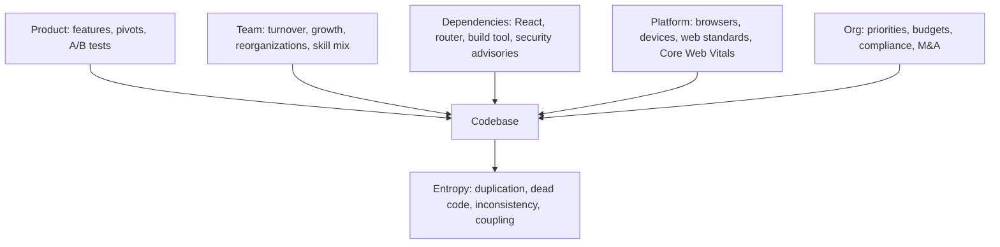
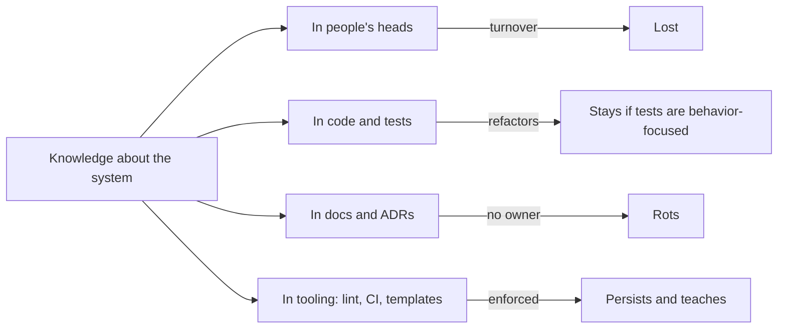
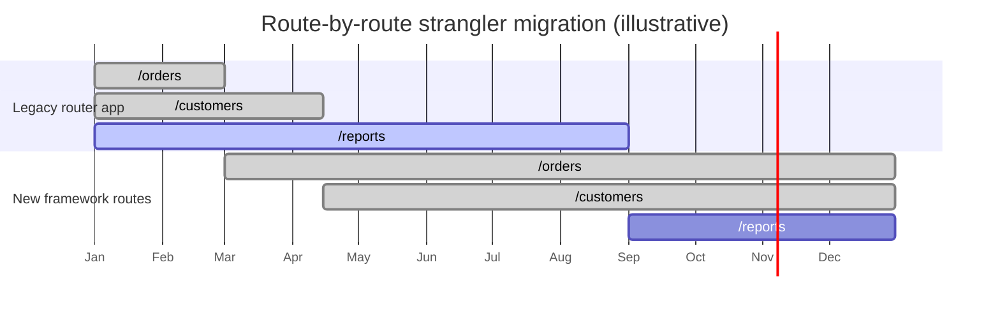
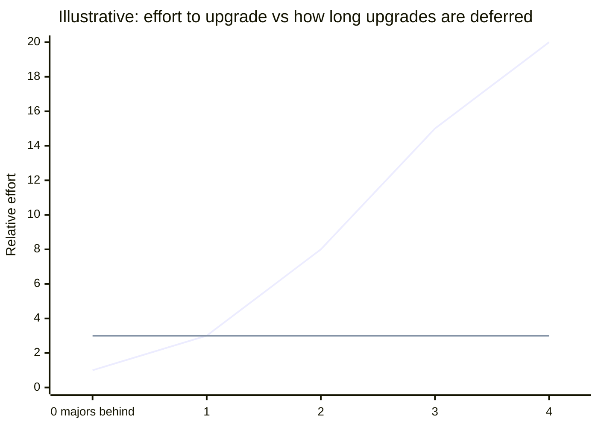
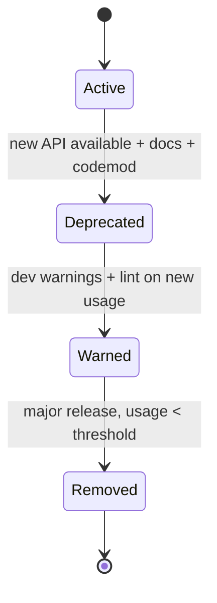

# 11 / 22 — Long-Term Evolution of a React Codebase

## 1. Lesson metadata

| | |
|---|---|
| **Level** | Architect |
| **Study time** | 4–5 hours (reading 2 h, exercises 2–3 h) |
| **Prerequisites** | [03 — Large-scale refactoring](./03-large-scale-refactoring.md), [08 — State architecture at scale](./08-state-architecture-at-scale.md), [Phase 4 / 24 — Refactoring legacy React](../04-react-architecture/24-refactoring-legacy-react.md), [Phase 4 / 25 — Architectural fitness and enforcement](../04-react-architecture/25-architectural-fitness-and-enforcement.md), [Phase 10 / 12 — Backward compatibility](../10-production-engineering/12-backward-compatibility.md), [Phase 10 / 13 — Application migrations](../10-production-engineering/13-application-migrations.md), [Phase 10 / 15 — Technical debt](../10-production-engineering/15-technical-debt.md), [20 — Evaluating emerging features](./20-evaluating-emerging-features.md) |
| **Next** | [23 — System design interviews](./23-system-design-interviews.md) |

**Learning objectives.** After this lesson you can:
1. Explain why codebases decay and which forces (change, people, dependencies, platform, product) drive evolution over 3–10 years.
2. Distinguish what is durable in a React codebase (domain model, contracts, boundaries) from what is perishable (library choices, build tooling, idioms).
3. Design for replaceability: seams, adapters, narrow dependencies on the framework, and ownership boundaries.
4. Run continuous upgrades as routine work (cadence, automation, codemods, canaries), instead of rare heroic migrations.
5. Manage deprecations and breaking changes in internal and external APIs with explicit lifecycles.
6. Maintain architectural integrity with fitness functions, debt budgets, documentation and knowledge continuity.
7. Read the history of React itself as a case study in API evolution and apply the lessons to your own platform.

**Concepts covered:** entropy and Lehman's laws, Conway's law over time, bus factor, continuous upgrade, dependency freshness, strangler fig, branch by abstraction, expand/contract (parallel change), semver and deprecation windows, codemods, fitness functions, ADR hygiene, tech radar, code ownership decay, dead code and feature-flag debt, documentation rot, evolution of React (class → hooks → concurrent → server components → compiler), "evolutionary architecture", rewrites.

---

## 2. Deep conceptual explanation

### 2.1 What problem is this lesson solving?

Earlier lessons focus on designing a good system now. But a production React application commonly lives longer than the framework version, the team, the design language and the business model it was built for. The interesting engineering question is not "what is the best architecture?" but "**what architecture stays cheap to change** while everything around it changes?"

In years 1–2 most codebases feel fast. By years 4–6 the same codebase often shows: slow builds, fear of upgrading, three ways to fetch data, a graveyard of feature flags, a design system that diverged from the product, and developers who avoid certain folders. None of that results from a single bad decision. It results from accumulated, individually reasonable shortcuts and from the ecosystem moving while the code stood still.

### 2.2 Laws and forces

Software evolution research (Lehman's laws, formulated in the 1970s–80s for long-lived systems) is a useful vocabulary. In plain terms, and as *tendencies* observed in many long-lived systems rather than guarantees:

| Tendency | Meaning for a React app |
|---|---|
| **Continuing change** | A used system must keep changing or it becomes progressively less useful (browsers, security fixes, business needs). Standing still is a decision with a cost. |
| **Increasing complexity** | Without deliberate work to reduce it, complexity grows with each change. Refactoring and consolidation are maintenance, not luxury. |
| **Declining quality** (perceived) | Unless rigorously adapted to its environment, quality appears to decline: the code didn't get worse, the environment moved. |
| **Conservation of familiarity** | The team's understanding limits how much can change per release; large jumps overwhelm. Prefer many small changes. |

Forces acting on a codebase over time:



### 2.3 Durable vs perishable

Not all parts of a codebase age at the same rate. Classify and invest accordingly:

| Layer | Typical lifetime | Examples | Strategy |
|---|---|---|---|
| **Domain knowledge** (concepts, rules, invariants, data contracts) | Longest (as long as the business) | Pricing rules, order states, permissions model | Keep in framework-independent modules with tests ([Phase 4 / 12](../04-react-architecture/12-domain-logic-vs-ui-logic.md)) |
| **Contracts and boundaries** | Long | API schemas, design tokens, event names, module public APIs | Version explicitly; change by expand/contract |
| **Application architecture** | Medium (years) | Data layer pattern, routing model, state ownership rules | ADRs; fitness functions; planned evolution |
| **Framework/library choices** | Short–medium (2–5 years each) | Router, data fetching lib, CSS approach, test runner | Isolate behind seams; make replaceable |
| **Build/tooling** | Short (1–3 years) | Bundler, transpiler, lint config, CI | Treat as replaceable infrastructure; keep config small |
| **Idioms and syntax** | Shortest | Class components, HOCs, `forwardRef`, patterns superseded by newer APIs | Migrate opportunistically with codemods |

A strategy that follows from this: **put your best-protected, best-tested code in the longest-lived layer**. If your pricing logic is tangled in `useEffect` calls inside components, it dies with the framework idiom. If it is pure TypeScript functions with tests, it survives three router migrations.

### 2.4 Evolution of React as a case study

React's own history shows which kinds of change the ecosystem absorbed well, and how (dates and details are summarised; the React 18.3/19 rows were checked against react.dev/blog on 2026-10-22):

| Era (approx.) | Change | How migration was supported | Lesson |
|---|---|---|---|
| Early | `createClass` → ES6 classes | Codemods; deprecation warnings across releases | Long deprecation windows with warnings work |
| 16.x | Error boundaries, portals, Fiber rewrite under the same public API | Internal rewrite; public API largely unchanged | Replace internals while preserving the public contract |
| 16.3 → 17 | New context API, legacy lifecycle renames (`UNSAFE_`) | Gradual: add new, warn on old, prefix old as unsafe, remove later | Expand/contract applied to a public API |
| 16.8 | Hooks | Additive: classes continued to work; no forced migration | Additive change with coexistence beats forced migration |
| 17 | "No new features" release enabling gradual upgrades (multiple React versions on a page) | Event delegation moved to the root | Sometimes the best release is a *bridge* |
| 18 | `createRoot`, concurrent features, automatic batching | Opt-in via a new root API; `ReactDOM.render` kept in legacy mode | Opt-in new semantics via new entry point |
| 19 | `ref` as a prop, Actions, `use`, removal of long-deprecated APIs (e.g. `propTypes` checks, `defaultProps` on function components; the full removal list is in the React 19 upgrade guide) | Codemods and a published upgrade guide; deprecation warnings in 18.3 | Warn in the last minor, remove in the next major |
| Ongoing | Server Components, Compiler | Introduced through frameworks and tooling; opt-in | Large capability shifts come with a "paved road" via frameworks |

Observe the repeated pattern: **additive first, coexistence period, warnings, codemods, then removal**. Your internal platform APIs deserve the same lifecycle.

### 2.5 Evolutionary architecture: guided by fitness functions

*Evolutionary architecture* (a term from Ford, Parsons and Kua's book of that name) means architecture that supports incremental, guided change, with **fitness functions** that automatically check architectural characteristics. In frontend terms, fitness functions are tests/CI checks for qualities you care about:

| Characteristic | Fitness function (automated) |
|---|---|
| Modularity | No import from `features/*/internal` outside the feature (lint or dependency-cruiser) |
| Layering | `domain/` imports no React and no `app/` modules |
| Performance | Bundle size budget per route; Lighthouse CI/field INP thresholds |
| Accessibility | axe checks in CI on key flows |
| Dependency freshness | Max age or "N majors behind" alert; zero high-severity advisories |
| Cohesion/ownership | Every directory has a CODEOWNERS entry |
| Deprecation | No new usage of deprecated APIs (lint rule with ratcheting baseline) |
| Test health | Flake rate < threshold; no quarantined tests older than 30 days |

These replace "we agreed to keep it clean" (which decays) with "the build fails if we don't" (which does not). See [Phase 4 / 25](../04-react-architecture/25-architectural-fitness-and-enforcement.md).

### 2.6 Common misconceptions

| Misconception | Reality |
|---|---|
| "We'll do a big rewrite when it gets bad." | Rewrites are high-risk and often recreate old problems in new code; incremental replacement keeps shipping. Rewrites can be right in narrow cases (tiny domain, dead platform) but are not a default plan. |
| "Don't touch what works." | A stable-looking system with frozen dependencies accrues security and compatibility debt invisibly. |
| "Upgrade only when we must." | Deferred upgrades compound: each skipped major makes the next harder. Small frequent upgrades are cheaper in total. |
| "Documentation fixes knowledge loss." | Docs rot unless owned and tested; ADRs and executable examples age better than prose. |
| "A good architecture is permanent." | A good architecture is *changeable*. Optimise for cost of change. |
| "Technical debt is anything I dislike." | Debt is a deliberate or accidental trade-off with a measurable interest rate ([Phase 10 / 15](../10-production-engineering/15-technical-debt.md)). |
| "Framework independence is free." | Total abstraction over the framework costs complexity and velocity. Isolate the *volatile* parts and accept coupling on stable ones. |

---

## 3. Internal mechanics

The "mechanics" of evolution are the techniques that make change incremental and safe. Using the course convention: the *public guarantees* below are the documented semantics of tools (semver, package manager behavior); the *teaching model* is the set of named migration patterns; *implementation details* are your org's tooling choices.

### 3.1 Migration patterns

| Pattern | Idea | Frontend example |
|---|---|---|
| **Strangler fig** | Build the new system around the old, routing traffic to new pieces gradually; delete old pieces when unused | New routes in the new router/framework; old routes served until migrated |
| **Branch by abstraction** | Introduce an interface over the old implementation, move callers to it, then swap implementation | `shared/data/useResource` wraps `useEffect+fetch`, later swapped to TanStack Query |
| **Expand / contract (parallel change)** | (1) Expand: add the new API alongside old; (2) migrate callers; (3) contract: remove old | Add `<Button variant>` alongside `<Button type>`; migrate; remove `type` |
| **Feature flags / dark launch** | Ship dormant code; enable gradually | New checkout behind a flag with percentage rollout |
| **Adapter / anti-corruption layer** | Translate between old and new models at a seam | Map legacy API shapes to a clean domain model |
| **Codemod** | Automated AST rewrite | Convert `defaultProps` to default parameters; `forwardRef` removal |
| **Parallel run / shadow** | Run old and new, compare outputs without exposing new | Compute pricing in both engines; log differences |
| **Module Federation / islands / microfrontends** | Embed independently deployed slices | Migrate one product area at a time ([12 — Microfrontends](./12-microfrontends.md)) |

### 3.2 Why continuous upgrades are cheaper (the mechanism)

Upgrade cost has a *fixed* component per release (review, test, deploy) and a *conflict* component that grows with the number of simultaneous changes. Skipping releases batches many breaking changes into one event: the conflicts interact, debugging becomes ambiguous ("which of the 14 changes broke checkout?"), and knowledge of each change's rationale fades. Frequent small upgrades keep the conflict term near zero and make failures attributable. This is the same principle as small PRs and continuous integration, applied to dependencies.

⚠ Counter-consideration: each upgrade also has overhead and risk (supply chain, regressions). Cadence should reflect risk: security patches fast; minor/patch regularly in batches; majors planned.

### 3.3 Semver and what it can and cannot promise

Semantic versioning (semver.org) states that MAJOR increments signal incompatible API changes, MINOR add backward-compatible functionality, PATCH fix backward-compatible bugs. Caveats relevant to evolution:

- It is a **convention maintained by humans**; a minor release can still break *you* (relying on undocumented behavior, a subtle bug fix you depended on, TypeScript type changes).
- `^` ranges in `package.json` allow minor/patch updates; **lockfiles** pin the actual resolved versions so builds are reproducible; automated update tools (Renovate, Dependabot) propose changes as PRs.
- Pre-1.0 (`0.x`) packages commonly treat minor bumps as potentially breaking (see semver FAQ).
- Peer dependencies are where major-version coordination bites (React 19 vs libraries that declare peer ranges).

### 3.4 Where knowledge lives (and leaves)



The most durable knowledge is **encoded as tests and tooling** (executable), then ADRs/docs with owners and review dates, and least durable is memory. Design the platform so new engineers learn the rules from the tools.

---

## 4. Step-by-step execution walkthrough: five-year evolution of a product app

**Year 0.** A React 16 SPA, class components, Redux with hand-rolled thunks, CSS modules, Webpack 3, one team of 5.

**Year 1.** Growth to 15 engineers, three teams. Duplication appears: three modal implementations, two date pickers. Decision: introduce a design-system package ([Phase 4 / 20](../04-react-architecture/20-design-systems.md)); ADR records scope. *Evolution mechanism:* branch by abstraction: new components added to the package; old usages migrated opportunistically; lint rule forbids creating new modals in app code.

**Year 2.** Hooks arrive; the team adopts function components for new code; class components remain. Codemods convert simple lifecycle patterns. A rule: "no new class components" (warning, then error with a baseline). Data fetching duplicates and bugs (races) lead to ADR "server state via query library" and `shared/data` wrapper. *Mechanism:* expand/contract on data access.

**Year 3.** Build times at 6 minutes; React minor upgrades lag two years behind; two security advisories force an emergency upgrade that takes three weeks. Retrospective: *the cost of deferral showed up as an incident.* New policy: Renovate with weekly grouped PRs for minors/patches, monthly "upgrade day" for majors, CI canary job against the next React version ([5.5](#55-advanced-example--upgrade-canary-in-ci)), and a dependency-freshness fitness function. Bundler migration planned as a strangler: new feature packages build with the new tool; the legacy app shell is migrated last.

**Year 4.** Routing coupled to the old router's data APIs becomes the bottleneck for adopting server rendering. The team creates a routing seam (`app/routes` abstraction), migrates route by route to a new framework router behind a reverse-proxy path-based split. Parallel run: SSR responses are compared with CSR renders in staging for key pages. Teams reorganize (Conway): ownership of features aligned to product areas via CODEOWNERS; platform team formalized.

**Year 5.** React 19 and Compiler adoption: `forwardRef` removal codemod runs in the design system with a compatibility window for consumers on 18; compiler trial per directory; legacy HOCs and render props in the old areas are left (not worth the churn) unless touched. Domain logic in `domain/` packages is unchanged through all migrations; that stability is the payoff of the Year 1–2 decisions.

**What did *not* happen:** a rewrite freeze, a 12-month "v2" project, or a heroic weekend upgrade. Change was continuous, owned, and reversible.

---

## 5. Code examples

### 5.1 Minimal example — expand/contract on a component API

```tsx
// Step 1 (expand): support both the old and new props; mark old as deprecated.
type ButtonProps = React.ComponentProps<'button'> & {
  /** @deprecated Use `variant`. Will be removed in v4.0 (2027-03). */
  kind?: 'primary' | 'secondary';
  variant?: 'primary' | 'secondary' | 'ghost';
};

export function Button({ kind, variant, ...rest }: ButtonProps) {
  if (process.env.NODE_ENV !== 'production' && kind !== undefined) {
    warnOnce('Button: `kind` is deprecated; use `variant`. See /docs/migrations/button-variant');
  }
  const resolved = variant ?? kind ?? 'primary';
  return <button data-variant={resolved} {...rest} />;
}
```

```ts
// A tiny, deduplicating warn helper (dev only).
const seen = new Set<string>();
export function warnOnce(msg: string) {
  if (process.env.NODE_ENV === 'production' || seen.has(msg)) return;
  seen.add(msg);
  console.warn(msg);
}
```

Line notes: `@deprecated` JSDoc makes editors strike through usages and lets lint rules find them (`@typescript-eslint/no-deprecated` in typescript-eslint v8; the older `eslint-plugin-deprecation` package is superseded by it); the warning includes *what to do instead* and *where to read more*; deduplication prevents console floods. Steps 2 and 3: run a codemod that renames `kind` to `variant` across consumers, then remove `kind` in the next major with release notes.

### 5.2 Practical example — a codemod (jscodeshift-style) for a deprecation

```ts
// codemods/button-kind-to-variant.ts  (run-tested with jscodeshift 17.4: renames `kind` to `variant` and typechecks under `strict`)
import type { API, FileInfo } from 'jscodeshift';

export default function transform(file: FileInfo, api: API) {
  const j = api.jscodeshift;
  const root = j(file.source);
  let changed = false;

  root.find(j.JSXOpeningElement, { name: { type: 'JSXIdentifier', name: 'Button' } })
    .forEach(path => {
      for (const attr of path.node.attributes ?? []) {
        if (attr.type === 'JSXAttribute' && attr.name.name === 'kind') {
          attr.name.name = 'variant';
          changed = true;
        }
      }
    });

  return changed ? root.toSource() : file.source;
}
// Run: npx jscodeshift -t codemods/button-kind-to-variant.ts "src/**/*.tsx" --parser=tsx
```

**Caveats (verify in review):** it renames *any* `Button` element, including a different `Button` imported from another library (false positives); spread props (`<Button {...props} />`) are invisible to a static codemod; dynamic values pass through. Mitigations: check the import source in the AST, run on a branch, review the diff by sampling, run the test suite and typecheck. Never run a codemod with commit and push in one step.

### 5.3 Incorrect example — the "freeze and big-bang" plan

```text
Plan:
 - Freeze React/router/build at current versions for 2 years ("stability").
 - Then do a "v2 rewrite" in a separate repo while v1 continues receiving features.
```

**Predict:** What happens?
**Answer:** The freeze accumulates security advisories and ecosystem incompatibility (libraries drop support for your old React peer range), so *forced* upgrades arrive at inconvenient times. The parallel rewrite chases a moving target: every v1 feature must be rebuilt in v2, the team splits attention, knowledge of v1 edge cases (the real requirements) isn't captured, and the cutover is a single high-risk event. Typical results: rewrite late, over budget, with regressions in behavior nobody remembered. The alternative is incremental strangler migration where every merged slice ships to users.

### 5.4 Corrected — continuous upgrade configuration

```jsonc
// renovate.json (Renovate config keys are version-specific; validate with `npx --package renovate renovate-config-validator`)
{
  "extends": ["config:recommended"],
  "schedule": ["before 6am on monday"],
  "packageRules": [
    { "matchUpdateTypes": ["minor", "patch"], "groupName": "non-major", "automerge": false },
    { "matchPackageNames": ["react", "react-dom", "@types/react", "@types/react-dom"],
      "groupName": "react", "automerge": false, "reviewers": ["team:frontend-platform"] },
    { "matchUpdateTypes": ["major"], "dependencyDashboardApproval": true }
  ],
  "vulnerabilityAlerts": { "labels": ["security"], "schedule": ["at any time"] }
}
```

Reasoning: group related updates so one PR upgrades `react`+`react-dom`+types together; require approval for majors so they are scheduled work; let security alerts bypass schedules; keep human review on (automerge false) until your tests earn trust. Dependabot offers similar features with different config.

### 5.5 Advanced example — upgrade canary in CI

Test the *next* version continuously so you learn about breakage while it's cheap.

```yaml
# .github/workflows/react-canary.yml  (illustrative; adapt to your CI)
name: React next-version canary
on:
  schedule: [{ cron: '0 3 * * 1' }]   # weekly
  workflow_dispatch:
jobs:
  canary:
    runs-on: ubuntu-latest
    continue-on-error: true            # informational: does not block main
    steps:
      - uses: actions/checkout@v4
      - uses: actions/setup-node@v4
        with: { node-version: 22, cache: npm }
      - run: npm ci
      - run: npm install react@canary react-dom@canary @types/react@latest @types/react-dom@latest --no-save
        # Pick the dist-tag deliberately and check it: on 2026-10-22 `npm view react dist-tags` showed latest 19.3.1,
        # canary 19.3.0-canary-…-20261020, next 19.3.0-canary-…-20260507, but `rc` still pointed at the OLD 19.0.0-rc.1,
        # so `react@rc` would have *downgraded* the canary job. Run `npm dist-tag ls react` before choosing.
      - run: npm run typecheck && npm test && npm run build
```

Why: you find out in March that a library breaks on the next React, not in the week you must upgrade. Route failures to a channel with an owner. The job is *informational* to avoid blocking unrelated work, but failures must be triaged on a schedule, or the signal rots.

### 5.6 Advanced example — fitness functions as tests

```ts
// architecture.test.ts — uses dependency-cruiser's API or a simple import scan (illustrative)
import { readdirSync, readFileSync, statSync } from 'node:fs';
import { join } from 'node:path';
import { describe, expect, it } from 'vitest';

function walk(dir: string): string[] {
  return readdirSync(dir).flatMap(f => {
    const p = join(dir, f);
    return statSync(p).isDirectory() ? walk(p) : [p];
  });
}

describe('architecture fitness functions', () => {
  it('domain layer does not import React or app code', () => {
    const offenders = walk('src/domain')
      .filter(f => /\.(ts|tsx)$/.test(f))
      .filter(f => /from ['"](react|react-dom|@\/app|@\/features)/.test(readFileSync(f, 'utf8')));
    expect(offenders).toEqual([]);
  });

  it('no new usage of deprecated Button.kind prop beyond the baseline', () => {
    const baseline = JSON.parse(readFileSync('architecture/button-kind-baseline.json', 'utf8')) as string[];
    const usages = walk('src').filter(f => /\.tsx$/.test(f) && /<Button[^>]*\bkind=/.test(readFileSync(f, 'utf8')));
    const newOnes = usages.filter(f => !baseline.includes(f));
    expect(newOnes).toEqual([]);   // ratchet: the baseline may only shrink
  });
});
```

The *ratchet* is the key idea: existing violations are tolerated and enumerated; new ones fail the build; the baseline file shrinks over time as teams migrate. Regex scanning is crude; production-grade tools (dependency-cruiser, ESLint rules, TypeScript-aware checks) are more robust. Treat this as a teaching sketch.

### 5.7 Seam example — keeping domain logic framework-independent

```ts
// src/domain/pricing/computeTotal.ts — pure TypeScript, no React imports.
export type LineItem = { sku: string; unitCents: number; qty: number };
export type Discount = { kind: 'percent'; value: number } | { kind: 'fixed'; cents: number };

export function computeTotalCents(items: LineItem[], discount?: Discount): number {
  const subtotal = items.reduce((s, i) => s + i.unitCents * i.qty, 0);
  if (!discount) return subtotal;
  return discount.kind === 'percent'
    ? Math.max(0, Math.round(subtotal * (1 - discount.value / 100)))
    : Math.max(0, subtotal - discount.cents);
}
```

```tsx
// UI binds it; swapping React idioms or frameworks never touches the rules.
function CartTotal({ items, discount }: { items: LineItem[]; discount?: Discount }) {
  return <output>{formatCents(computeTotalCents(items, discount))}</output>;
}
```

This function survives class components → hooks → server components → whatever comes next, because it depends on none of them.

---

## 6. Visual explanations

### 6.1 Strangler migration over time



Each route moves independently; both stacks serve traffic; the old stack shrinks until it can be removed.

### 6.2 Cost of deferring upgrades



Illustrative shape only: continuous upgrading has a steady small cost; deferral has a convex cost curve and incident risk. Your actual numbers will differ; measure your own history.

### 6.3 Deprecation lifecycle



---

## 7. Alternative approaches and trade-offs

| Strategy | Strengths | Weaknesses | Best when |
|---|---|---|---|
| **Continuous evolution** (strangler, continuous upgrades) | Always shipping; low risk per step; builds skills | Requires discipline and sustained capacity; long tail | Default for products with ongoing delivery |
| **Periodic modernization sprints** ("upgrade quarters") | Focused; clear scope | Competes with roadmap; can slip; batch costs | Teams that can't do continuous work yet |
| **Big-bang rewrite** | Clean slate; can fix fundamental flaws | Highest risk, long time-to-value, knowledge loss, double maintenance | Small domain, EOL platform, strong tests, executive commitment |
| **Freeze and maintain** | Minimal cost short-term | Security and compatibility debt; talent attrition | Sunsetting products |
| **Platform/Framework outsourcing** (adopt a meta-framework and follow its upgrade path) | Offloads integration and conventions | Coupled to its roadmap and constraints | Teams without capacity for bespoke platform ([15](./15-framework-selection.md)) |
| **Microfrontends for decomposition** | Independent deploys; incremental tech change per slice | Operational and performance overhead; governance | Many teams, genuinely independent domains ([12](./12-microfrontends.md)) |
| **Inner source / platform team** | Consistency; shared effort | Bottleneck risk; needs product thinking | 4+ teams ([16](./16-supporting-multiple-teams.md)) |

**Scenario where the recommended approach (continuous incremental evolution) is not best.** A small internal tool used by 20 people, with a well-bounded domain, no ongoing feature work and a build that no longer runs on modern Node, may be more cheaply *rewritten in a weekend with modern tooling* than incrementally migrated. And a product being sunset in 12 months should be frozen with security patches only. Incrementalism has overhead (seams, coexistence); don't pay it when the whole thing is small or short-lived.

---

## 8. Best practices and anti-patterns

### 8.1 Best practices

- **Protect the durable layer**: pure domain logic, contracts, tests, ADRs. Invest disproportionately here.
- **Make upgrades routine**: automation (Renovate/Dependabot), weekly small batches, a monthly deeper upgrade slot, a canary against the next version.
- **Narrow your dependency surface**: wrap third-party libs in your own thin modules for the *volatile* ones (date libs, charting, data fetching, analytics); leave stable primitives (React itself) used directly.
- **Expand/contract everything public**: components, hooks, API clients, events, tokens. State deprecation windows in writing.
- **Provide codemods and docs with every breaking change**; the cost of migration is the platform team's to reduce.
- **Ratchet, don't mandate**: baselines that only shrink; lint warnings → errors on a published schedule.
- **Track dependency health** (age, advisories, maintainers, downloads trend) in a dashboard; include "bus factor" for critical dependencies.
- **Delete aggressively**: dead code, stale flags, unused dependencies. Deleting is the most undervalued refactor. Tools: `knip` (current on npm) and similar analyzers (`ts-prune` is the older tool), coverage-based dead code detection, flag expiry dates.
- **Flag hygiene**: every feature flag has an owner and expiry date; removal is part of the definition of done.
- **Keep ADRs alive**: supersede rather than delete; link to successors; review dates.
- **Plan knowledge continuity**: pairing, rotation, onboarding projects, runbooks, recorded architecture walkthroughs, and "why" comments for non-obvious code.
- **Align ownership with structure** (CODEOWNERS and team topology): orphaned code decays fastest.
- **Measure evolution health**: lead time for change, time to upgrade, dependency age, flag count, flake rate, build time, incident rate by area (use as diagnostics).
- **Revisit decisions on schedule** (radar and ADR review dates), not only when they hurt.

### 8.2 Anti-patterns

| Anti-pattern | Symptom | Instead |
|---|---|---|
| **Frozen dependencies** | "We can't upgrade; everything breaks" | Continuous upgrade; canary CI; seams |
| **Resume-driven rewrites** | New stack every 18 months | Evolution policy; radar; adoption criteria |
| **Abstraction hoarding** | Generic wrappers for everything, harder than the original | Wrap volatile dependencies only; two real consumers rule |
| **Flag graveyard** | 200 flags, no one knows which matter | Ownership, expiry, cleanup in definition of done |
| **Shadow standards** | Different teams, different conventions, no migration path | Paved road; ratchets; standards lifecycle ([17](./17-code-review-and-standards.md)) |
| **Orphaned packages** | Shared packages with no owner | CODEOWNERS; sunset policy |
| **Documentation as afterthought** | Rot, mistrust | Docs next to code; examples tested; owner and review date |
| **"Temporary" workarounds** | Permanent hacks | Debt register with owner/date; ratchet |
| **Premature framework independence** | Elaborate hexagonal layers for a CRUD app | Match effort to volatility and size |
| **Upgrade as a heroic project** | Burnout, delays, risk | Automation and cadence |
| **Hidden coupling to internals** | Upgrades break on minors | Public APIs only; executable assumptions ([21](./21-reading-framework-source.md)) |

### 8.3 Justified exceptions

- Freezing is right for sunsetting software or tightly certified environments (with documented security mitigation).
- Rewriting is right for tiny, well-understood, low-risk components, or when the platform is truly end-of-life.
- Deep abstraction over the framework is right for a product that *must* run on multiple renderers/platforms (web + native + embedded) or for a library intended to outlive frameworks.
- Leaving legacy idioms in untouched, stable modules (e.g. class components in a rarely edited screen) is often the economically right choice: "migrate when touched".

### 8.4 Evolution policy template

```markdown
# Frontend platform evolution policy (v1, review: 2027-04)

1. Cadence: patch/minor dependencies weekly (automated PRs); majors scheduled monthly "upgrade day".
2. Support window: we support the current and previous major of React/router for shared packages.
3. Deprecation: announce -> codemod + docs -> dev warnings -> removal at next major; minimum 2 minor releases / 90 days.
4. New usage of deprecated APIs is blocked by lint (ratchet baseline in /architecture).
5. Flags: owner + expiry mandatory; expired flags fail CI.
6. Seams: third-party libs in [date, charts, analytics, data] must be imported only via /shared wrappers.
7. Domain code (src/domain) is framework-free; enforced by tests.
8. Radar and ADRs reviewed quarterly by the architecture guild.
9. Ownership: every top-level directory has CODEOWNERS; orphaned code is triaged each quarter.
```

---

## 9. Real-world application

**E-commerce platform (8 years old).** Class components + Redux sagas + Webpack; business wants faster pages. Strategy: introduce a routing seam; migrate product detail and category pages first (highest traffic, best SEO payoff) to SSR/streaming in the new framework behind path-based routing; keep checkout stable until payments team capacity exists. Domain pricing and promotion logic extracted to pure modules with property-based tests to guarantee identical behavior across implementations. Constraints: seasonal freezes (peak sales), regulatory (PCI) scope, A/B testing continuity.

**Trading/finance dashboard.** Long-lived, high correctness stakes. Evolution emphasis: parallel run of new calculation modules against old with diff logging; strict versioning of data contracts; slow-changing UI shell with fast-changing widget modules; upgrade cadence aligned with low-volatility windows. Performance fitness functions (render budget per tick) prevent regression over years.

**Design system with many consumers.** Evolution is dominated by semver discipline, codemods, deprecation windows, and a support policy for consumer React versions ([Phase 10 / 11](../10-production-engineering/11-design-system-governance.md), [12](../10-production-engineering/12-backward-compatibility.md)). Telemetry on component usage (by consumer app and version) guides what to deprecate and who to help.

**Forms/auth/enterprise internal suite.** Many small apps share an auth layer; changing the auth architecture is a one-way door. Evolution through an adapter (`AuthProvider` interface) so token strategy can change from cookies to another mechanism with one adapter swap, and a compatibility period where both are accepted by the backend.

**Realtime collaboration product.** Protocol versioning is the key durable contract: clients and servers of different versions coexist; the evolution strategy is backward-compatible protocol evolution and graceful degradation (unknown message types ignored) so deploys don't need lockstep.

**Multi-team organization after reorg.** Conway's law: when teams reorganize, module boundaries should follow, or ownership gaps appear. A "boundary review" aligns directories and CODEOWNERS with new team missions, and transfers knowledge via pairing and ADR walkthroughs.

---

## 10. Debugging and troubleshooting evolution problems

| Symptom | Likely root cause | Investigation | Fix |
|---|---|---|---|
| "Upgrade is impossible; hundreds of errors" | Deferred majors; coupling to internals; no seams | Count breaking changes by category; find shared root causes; try bisecting by package | Upgrade stepwise (one major at a time), codemods, adapter for a hot dependency, parallel branch with canary CI |
| Build time grows each quarter | Dependency/graph growth; no module boundaries; slow transformations; no caching | Build profile (bundler analyzer, timing plugin); module count; cache hit rates | Boundaries, caching (remote cache), faster transpiler, split packages |
| Same bug fixed in multiple places | Duplicate implementations | Search for duplicates; ownership map | Consolidate behind seam; delete copies |
| New devs take months to be productive | Hidden conventions, no paved road, docs rot | Onboarding retros; time-to-first-PR | Templates, scripts, docs-as-code with tests, mentoring |
| Teams ignore deprecations | Warnings noisy/unactionable; no deadline | Check warning volume, docs, codemods | Fix tooling; publish schedule; support teams |
| Feature flags everywhere | No cleanup process | Flag inventory (age, owner, state) | Expiry, ownership, CI check, cleanup sprints |
| Architecture drift | Rules not enforced | Fitness function results; dependency graph | Add checks; ratchet; ADR refresh |
| Dependency abandoned upstream | Maintainer burnout, no releases | Repo activity, issue backlog, bus factor | Replace, fork with plan, or sponsor; seam makes it cheaper |
| Big upgrade caused regressions | Insufficient tests at the seam; batching many changes | Review what changed together; flake/coverage | Smaller steps, canary, feature flags, visual regression, E2E on critical flows |
| Migration stalled at 70% | Long tail of hard cases; ownership gaps | List remaining items by blocker | Dedicated push, tooling for hard cases, or accept long tail with a policy |

**Validate** with trend metrics over quarters (dependency age, upgrade lead time, flag count, build time, incident rate) rather than anecdotes.

---

## 11. Exercises

### Level A — Knowledge
A1. Explain "expand/contract" and give a frontend example other than a component prop.
A2. List four fitness functions for a React codebase and what each protects.
A3. Why is deferring dependency upgrades more expensive in total? Give the mechanism.
A4. Which layer of a React app has the longest lifetime, and why does that affect where you put tests?
A5. Name the stages of a healthy deprecation lifecycle.

### Level B — Code comprehension
B1. Review the `Button` expand/contract code in 5.1. Find two gaps that would cause trouble in a large monorepo and how to close them.
B2. The codemod in 5.2: list three situations it will get wrong and how to detect them.
B3. The ratchet test in 5.6: explain how a developer could accidentally bypass it, and propose a more robust version.

### Level C — Implementation
C1. Write a branch-by-abstraction wrapper `useResource<T>(key, fetcher)` that initially uses `useEffect` + `fetch`, with an interface that can later be backed by TanStack Query without changing callers. Include a test that runs the same contract suite against both implementations.
C2. Design a feature-flag registry in TypeScript with owner, expiry, and a CI check that fails when a flag is expired and still referenced.
C3. Write a migration guide (markdown, 1 page) for the `Button` `kind` → `variant` change: audience, steps, codemod usage, timeline, FAQ.

### Level D — Debugging
D1. Your app is two majors behind React; a library you need requires the latest. Create a stepwise upgrade plan with verification at each step, handling peer dependency conflicts.
D2. Build time doubled in 6 months after adding `src/shared/index.ts` that re-exports 300 modules. Diagnose and fix (consider bundling, test runner, and dev server effects).
D3. A deprecated internal hook `useLegacyAuth` is still used in 120 files, and your deadline is next month. Plan the end game.

### Level E — Architecture and engineering decisions
E1. Your organization debates a rewrite of a 6-year-old 400k-line React app. Produce a decision framework with criteria, evidence to gather, options (rewrite, strangler, freeze, hybrid) and a recommended path under stated assumptions.
E2. Decide the support policy for a design system used by 15 apps on React 17/18/19. Define supported versions, deprecation windows, and migration support.

### Level F — Expert challenge
F1. Design an "evolution dashboard" with ten metrics for a frontend platform, including how each is collected, what thresholds trigger action, and how you avoid gaming.
F2. Propose a ten-year-survivable architecture for a core domain (e.g. insurance quoting UI): what is constant, what is replaceable, how you test replaceability regularly (e.g. an annual "swap drill" replacing the router or state library in a sandbox).

---

## 12. Detailed answers and explanations

> Attempt the exercises first.

**A1.** Expand/contract (parallel change): add the new interface alongside the old, migrate consumers, remove the old. Other examples: API clients: add `/v2` endpoint support, migrate callers, retire v1; design tokens: add `--color-surface-1`, migrate usages, delete `--bg-light`; event names in analytics; database column rename (backend analog).

**A2.** Examples: boundary lint (modularity), domain-layer purity test (framework independence), bundle budget per route (performance), axe tests in CI (accessibility), dependency freshness/advisory checks (security/maintainability), deprecated API ratchet (migration), CODEOWNERS completeness (ownership). Evaluation: each is *automated*, fails the build or alerts, and protects a stated characteristic.

**A3.** Skipping releases batches many breaking changes; their interactions make debugging non-attributable and rationale fades; ecosystem libraries drop old peers, forcing coupled upgrades; emergency security upgrades happen under pressure. Frequent upgrades hold the conflict term near zero. Counter: each upgrade has overhead; mitigate with automation and batching minors.

**A4.** Domain logic and data contracts (business rules). Therefore put the most rigorous tests (unit, property-based) there, framework-independent, so that they act as a safety net across framework migrations; UI tests should focus on behavior and be replaceable.

**A5.** Active → deprecated (replacement + docs + codemod available) → warned (dev warnings, lint for new usage) → removed (in a major, after usage is below threshold and the window has elapsed), with communication throughout.

**B1.** Gaps: (1) Both `kind` and `variant` passed with different values: precedence is implicit (`variant` wins) but undocumented and untested; add types that forbid the combination (a discriminated union with `never`) or document it. (2) No telemetry on who still uses `kind`; add usage reporting in dev/test (or a lint rule/codemod census) to know when removal is safe; also `process.env.NODE_ENV` checks depend on bundler replacement; libraries need a clear approach (verify bundler behavior for libraries). (3) The warning lacks component location (stack) so consumers can't find call sites; include `new Error().stack` in dev or rely on lint. Also design-system consumers on older TypeScript may not see `@deprecated` strike-through; verify tooling.

**B2.** (1) A `Button` from a different import (e.g., `@mui/material`) gets renamed incorrectly: check import source via the AST. (2) Spread props `{...{kind:'primary'}}` and wrappers like `const Primary = (p) => <Button kind="primary" {...p}/>` (this one it handles) but `React.createElement(Button, {kind: ...})` isn't handled. (3) Aliased imports (`import { Button as Btn }`) missed. (4) Usage in `.js`/`.mdx`/Storybook stories/docs not covered by the glob. Detect by search for remaining `kind=` and by TypeScript errors after removing the deprecated prop in a dry-run branch; run codemod on a sample with before/after review.

**B3.** Bypass: moving the file renames its path so it looks "new"; regex missing multi-line JSX attributes (`<Button\n kind=`) since `[^>]*` does match newlines but `>` inside an arrow function prop breaks matching; renaming the component alias; adding the baseline entry in the same PR without review. More robust: use an AST-based ESLint rule with an auto-generated baseline keyed by file+count; require CODEOWNERS review for baseline growth; fail CI if the baseline increases; track by usage count not path.

**C1.** Interface:

```ts
export type ResourceState<T> =
  | { status: 'pending' }
  | { status: 'success'; data: T }
  | { status: 'error'; error: unknown };

export function useResource<T>(key: readonly unknown[], fetcher: (signal: AbortSignal) => Promise<T>): ResourceState<T> { /* impl A */ }
```
Impl A: `useEffect` + `AbortController`, keyed by `JSON.stringify(key)`, with latest-wins and cleanup. Impl B: wraps `useQuery({ queryKey: key, queryFn: ({signal}) => fetcher(signal) })` and maps status. Contract tests (parametrized over implementations): initial pending; success renders data; error maps; changing key refetches and ignores stale responses; unmount aborts. Edge cases: Strict Mode double effects; key serialization of non-JSON values. Evaluation: shared test suite proving substitutability, and callers depend only on the interface.

**C2.** Sketch:

```ts
type Flag = { key: string; owner: string; expires: string /* ISO */; description: string };
export const flags = {
  newCheckout: { key: 'newCheckout', owner: 'team-pay', expires: '2026-12-01', description: '...' },
} satisfies Record<string, Flag>;
```
A CI script loads the registry, checks `expires < today` and greps for usage of expired keys (`flags.newCheckout` or `useFlag('newCheckout')`); fails with owner mention. Also check every usage refers to a registered flag (types handle that). Evaluation: includes owner, expiry, enforced removal, and an escape hatch (extend expiry with PR review).

**C3.** Evaluation criteria: audience (app developers), why (consistency/new variants), before/after snippets, automated steps (`jscodeshift` command), manual cases (spread props), timeline (deprecated now, warnings in X, removal in v4.0 on date), how to get help, FAQ ("can I use both?" "what if I have a wrapper?"). One page, actionable.

**D1.** Plan: audit current versions and peer ranges (`npm ls`, `npm explain`); read upgrade guides for each major; step 1: upgrade to the latest minor of the current major (to see deprecation warnings), fix warnings; step 2: upgrade React 17→18 (use `createRoot`, handle automatic batching, Strict Mode effects) with test suite + canary; step 3: 18→19 (run official codemods; remove deprecated API usage; update `@types/react`); upgrade libraries in dependency order (types, router, UI libs); use `overrides`/`resolutions` only temporarily; verify at each step with unit/integration/E2E, bundle size, performance; ship each step to production before the next if possible (smaller blast radius). Peer conflicts: check library releases supporting the target; if not available, pin the highest compatible version, or replace/patch. Evaluation: stepwise, verification, rollback, communication.

**D2.** Barrel files (`index.ts` re-exporting hundreds of modules) force bundlers/test runners/dev servers to load and analyze all of them for any import, defeating tree-shaking in some setups and slowing module graph resolution and test startup (in tools that don't prune barrel imports). Diagnose: build/timing profile; module graph analysis; test runner timing; check how many modules are pulled for a single import. Fix: import from specific module paths; split barrels per feature; use `sideEffects:false` where correct; use lint rule to forbid deep barrels; for libraries consider `exports` map subpaths. Validate: build time and test startup before/after.

**D3.** End game: a census (script listing usages and owners), codemod for the 80% mechanical cases, per-team issue tickets with estimates, a lint rule at error with baseline, a compatibility shim `useLegacyAuth` that delegates to the new hook to eliminate duplicate logic and allow later removal, office hours, a daily burndown chart, and a decision: if the deadline can't be met, extend with a *scheduled* new date and communicate impact (security risk?). Consider removing the deprecated hook only after usage is zero. Evaluation: acknowledges the shim, ownership, risk-based deadline, and communication.

**E1.** Criteria: product roadmap pressure, platform end-of-life risk, defect rate attributable to architecture, hiring impact, test coverage of existing behavior, team size/skills, domain complexity, cost of parallel maintenance, availability of seams. Evidence: change lead time by area, incident causes, dependency health, upgrade feasibility spike. Options: rewrite (high risk), strangler by route/domain (default), freeze (if sunsetting), hybrid (rewrite small leaf modules, strangle the rest). Recommendation: strangler with a seam-first phase, domain extraction, measured milestones, and a re-evaluation checkpoint at 6 months; rewrite only for components where cost is clearly smaller than migration. State assumptions (e.g. >2 years of expected life).

**E2.** Policy: support current and previous major React for new design-system releases; maintain 18-compatible builds until a stated date; deprecation window of two minors/90 days; codemods for breaking changes; telemetry to measure consumer versions; LTS branch for security only; peerDependencies `^17 || ^18 || ^19` only if a CI matrix tests all; avoid React-19-only features in the public API until 17 support ends (or provide conditional entry points); migration help office hours. Trade-off: supporting three majors slows innovation; set sunset dates and help the slowest consumers.

**F1.** Example metrics: dependency age (median majors behind), advisories open > 30 days, upgrade lead time (days from release to production), % code under fitness checks, flag count and median age, build time p50/p95, flake rate, change lead time by area, incident rate per area, onboarding time-to-first-PR, deprecated-API usage trend, ownership coverage. Collection: CI jobs, package manager APIs, git history, incident tracker. Thresholds trigger reviews not punishments. Anti-gaming: use trends, pair metrics (speed + quality), qualitative checks, avoid individual targets.

**F2.** Constant: domain model and rules (pure TS packages with exhaustive tests and property-based tests), data contracts (schemas with versioning), design tokens, accessibility requirements, analytics event schema. Replaceable: router, state/data libraries (behind seams), UI framework layer (if the investment justifies), build tooling. Swap drills: yearly time-boxed exercise replacing one replaceable (e.g. the data-fetching library for one feature) in a branch to measure the seam's quality; record gaps as backlog; track "time to swap" as a metric. Good answer includes governance (ADRs, ownership), documentation tests, and honest statement of which parts are *not* meant to be replaceable.

---

## 13. Senior engineer interview questions

**Q1. How do you keep a five-year-old React codebase healthy?**
*Strong answer:* Protect the durable layer (domain logic, contracts, tests); make dependency upgrades routine with automation and canary CI; use seams for volatile dependencies; expand/contract for public APIs with codemods and deprecation windows; fitness functions with ratchets; delete dead code and flags; align ownership; measure health trends. Mention that it's continuous work with allocated capacity.

**Q2. When would you approve a rewrite?**
*Strong answer:* Small, well-understood domain; platform EOL with no migration path; strong characterization tests to define behavior; executive commitment for dual-maintenance; short time to cutover. Otherwise strangler. Explain the specific risks of rewrites (knowledge loss, moving target, big-bang cutover).

**Q3. How do you roll out a breaking change in a shared component library?**
*Strong answer:* Additive change first; deprecation notice with replacement; dev warnings; codemod; docs and office hours; usage telemetry; remove only in a major after the window; communicate via changelog and migration guide; keep a compatibility shim if cheap.

**Q4. What do you make framework-independent and what do you leave coupled to React?**
*Strong answer:* Domain rules, validation, formatting, data contracts and API clients go framework-free; UI composition, state binding and effects stay in React. Coupling to React for UI is fine because React is the chosen stable core; isolate volatile layers (router, data cache) behind seams where the cost of swapping is meaningful.

**Q5. How do you decide the upgrade cadence?**
*Strong answer:* By risk and cost: security patches immediately; minors/patches weekly in grouped PRs; majors monthly scheduled slots with canary CI; align with release notes; measure upgrade lead time; adjust by team capacity. Explain why continuous beats batched.

**Q6. How do you handle dependencies that are abandoned upstream?**
*Strong answer:* Monitor health; wrap behind a seam in advance; evaluate alternatives; fork or patch with a plan if critical; contribute or sponsor if strategic; migrate when risk justifies; document in the radar.

**Q7. What lessons does React's own API evolution offer for internal platforms?**
*Strong answer:* Additive first (hooks coexisted with classes), long deprecation windows with warnings (`UNSAFE_` lifecycles), bridge releases (React 17), new entry points for new semantics (`createRoot`), codemods, internal rewrites that preserve public contracts (Fiber). Apply the same lifecycle to internal APIs.

---

## 14. Further learning resources

| Resource | URL | Covers / why | Level | Study |
|---|---|---|---|---|
| React blog (version announcements, upgrade guides) | <https://react.dev/blog> | Primary record of React's evolution and migration guidance | All | Posts for 16.3, 17, 18, 19 |
| React 19 upgrade guide | <https://react.dev/blog/2024/04/25/react-19-upgrade-guide> | Breaking changes and codemods | Intermediate | Whole post |
| Semantic Versioning | <https://semver.org/> | Specification and FAQ | Beginner | Spec; FAQ |
| *Building Evolutionary Architectures* (Ford, Parsons, Kua) | <https://www.oreilly.com/library/view/building-evolutionary-architectures/9781492097532/> | Fitness functions and incremental change | Advanced | Fitness function chapters |
| Martin Fowler — Strangler Fig | <https://martinfowler.com/bliki/StranglerFigApplication.html> | The pattern's origin | Intermediate | Whole article |
| Martin Fowler — Parallel Change | <https://martinfowler.com/bliki/ParallelChange.html> | Expand/contract | Intermediate | Whole article |
| Martin Fowler — Branch By Abstraction | <https://martinfowler.com/bliki/BranchByAbstraction.html> | Seam-based replacement | Intermediate | Whole article |
| Renovate docs | <https://docs.renovatebot.com/> | Automated dependency updates | Intermediate | Configuration options; grouping |
| Dependabot docs | <https://docs.github.com/en/code-security/dependabot> | GitHub's dependency update service | Beginner–Int. | Version updates |
| jscodeshift | <https://github.com/facebook/jscodeshift> | Codemod toolkit | Intermediate | README; recipes |
| react-codemod | <https://github.com/reactjs/react-codemod> | Official React codemods | Intermediate | README; transform list |
| dependency-cruiser | <https://github.com/sverweij/dependency-cruiser> | Dependency rules and visualization | Intermediate | Rules reference |
| Lehman's laws (overview) | <https://en.wikipedia.org/wiki/Lehman%27s_laws_of_software_evolution> | Background on software evolution | Intermediate | Overview |

URLs in this table were checked for HTTP 200 on 2026-10-22; any still marked *(unverified)* could not be checked automatically (blocked or unreachable). A 200 response does not guarantee the page content still matches the description; if a link has moved, search the site for the quoted title.

---

## 15. Knowledge checkpoint

**You should now understand**
- The forces that change a codebase and why durable layers deserve disproportionate protection.
- Why continuous, small, automated upgrades beat batched heroic ones.
- The core migration patterns: strangler, branch by abstraction, expand/contract, parallel run.
- How React's own evolution models good API lifecycle practice.

**You should be able to explain without notes**
- Fitness functions and ratchets; the deprecation lifecycle; durable vs perishable layers.

**You should be able to implement**
- A deprecation with warning and codemod; a ratchet test; a flag registry with expiry; a seam with contract tests across two implementations; an upgrade canary.

**You should be able to debug**
- "Upgrade is impossible" situations, build time growth, stalled migrations and architectural drift using metrics and stepwise plans.

**Before moving on:** read [23 — System design interviews](./23-system-design-interviews.md), where you apply the full toolkit of the curriculum to open-ended frontend design problems.
