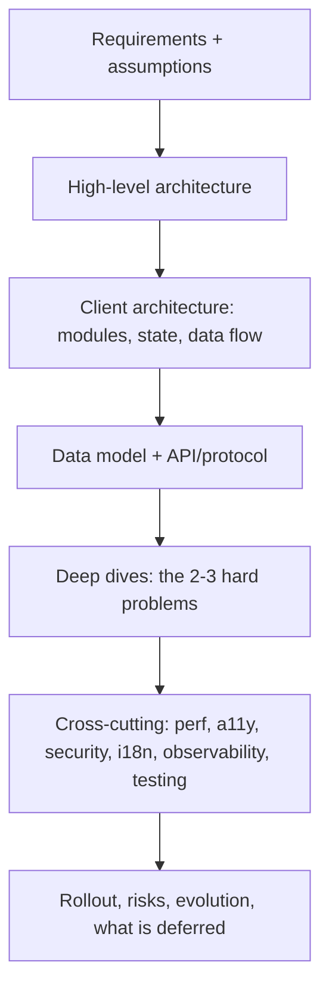
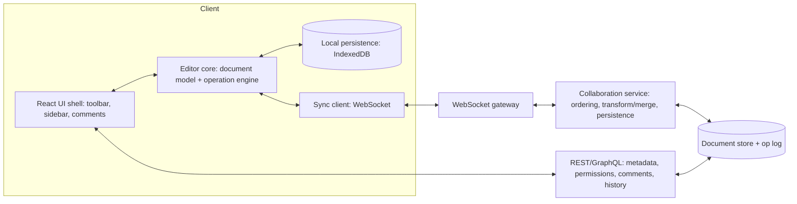
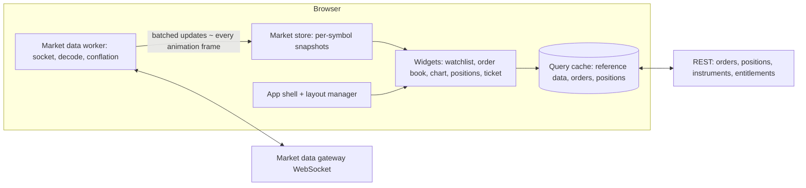
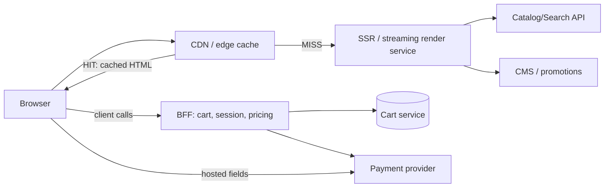
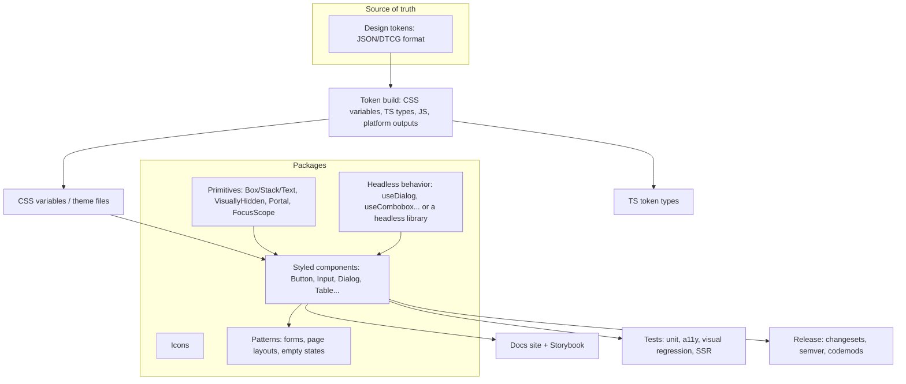
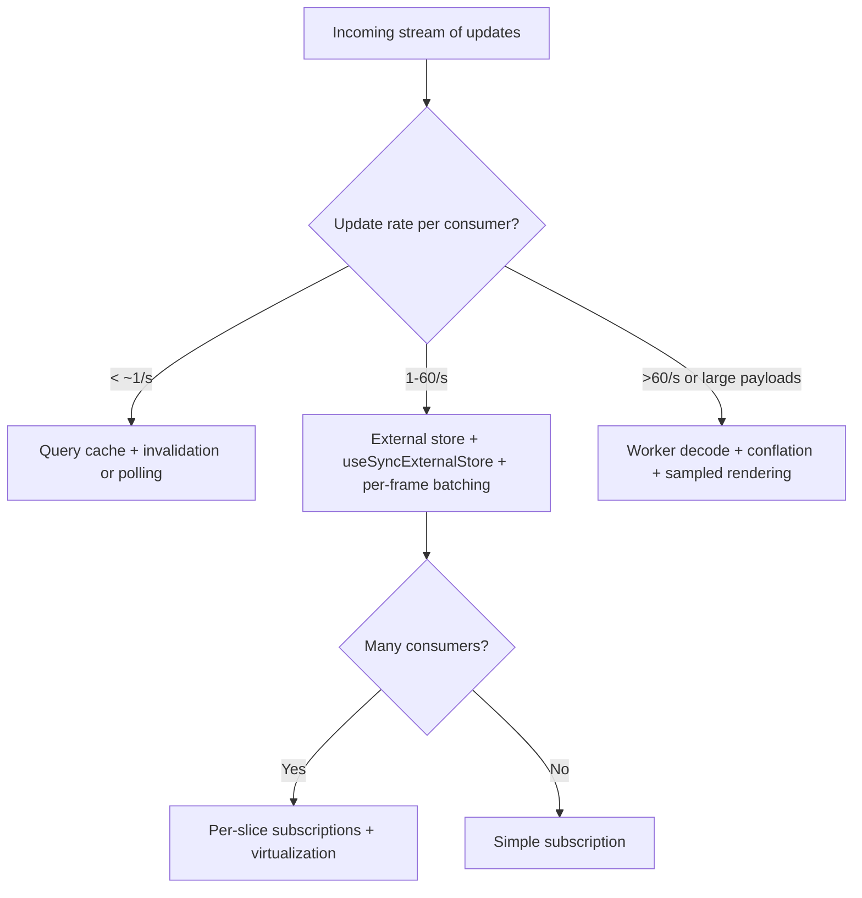
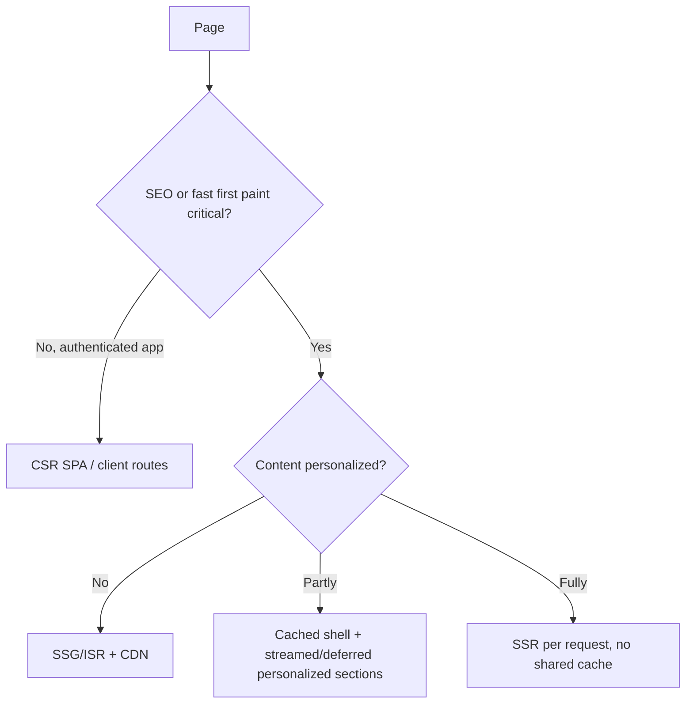
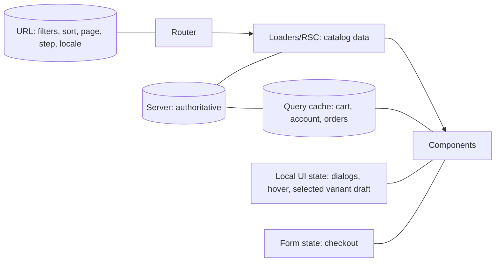
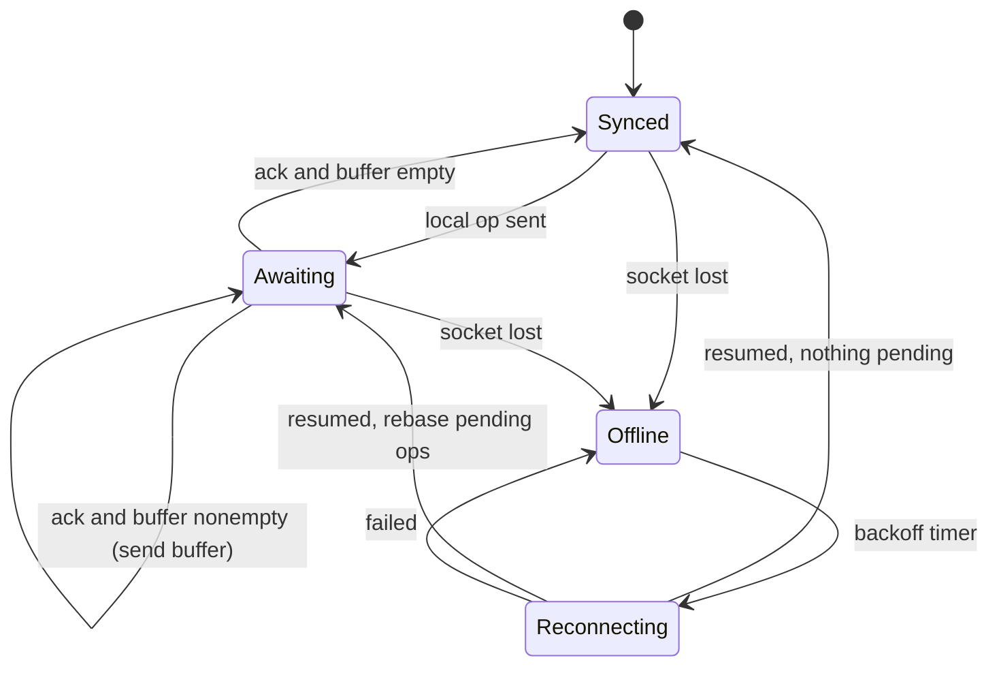

# 11 / 23 — Frontend System Design Interviews

## 1. Lesson metadata

| | |
|---|---|
| **Level** | Architect |
| **Study time** | 8–10 hours (reading 3 h, worked designs 3 h, timed practice 3 h) |
| **Prerequisites** | All earlier Phase 11 lessons, especially [01 — Trade-off analysis](./01-trade-off-analysis.md), [05 — Application boundaries](./05-application-boundaries.md), [07 — Design system architecture](./07-design-system-architecture.md), [08 — State architecture at scale](./08-state-architecture-at-scale.md), [09 — Performance budgets at scale](./09-performance-budgets-at-scale.md); [Phase 6 / 17 — Real-time](../06-data-fetching-and-state-ecosystems/17-real-time-websockets-subscriptions.md), [Phase 6 / 05 — Optimistic updates](../06-data-fetching-and-state-ecosystems/05-optimistic-updates.md), [Phase 9 / 01 — SPA/SSR/SSG/streaming](../09-advanced-rendering-and-ecosystem/01-spa-ssr-ssg-streaming.md), [Phase 7 / 09 — Windowing](../07-performance/09-windowing-and-virtualization.md) |
| **Next** | [24 — Final assessment](./24-final-assessment.md) |

**Learning objectives.** After this lesson you can:
1. Run a 45–60 minute frontend system design interview with a repeatable structure, managing time and ambiguity.
2. Elicit functional and non-functional requirements and turn them into measurable constraints.
3. Produce component architecture, data model, state and data-flow design, API contracts, rendering strategy, performance plan, accessibility plan and failure handling for an open-ended product.
4. Design four canonical systems end to end: a **collaborative editor**, a **real-time trading dashboard**, an **e-commerce storefront**, and a **design system**.
5. Justify trade-offs explicitly, state assumptions, and say what you would *not* build.
6. Evaluate your own and others' designs with a rubric.

**Concepts covered:** requirement elicitation, scope and prioritization, RADIO-style structure, back-of-envelope estimation, component and module boundaries, state taxonomy, data fetching and caching, real-time sync (OT/CRDT concepts, WebSocket, backpressure, batching), optimistic UI and conflict resolution, rendering strategy (CSR/SSR/SSG/streaming/RSC), virtualization, performance budgets, accessibility, error handling and resilience, observability, security, testing and rollout strategy, design tokens, semver for components.

---

## 2. Deep conceptual explanation

### 2.1 What is a frontend system design interview?

An open-ended conversation in which you design a user-facing product or platform ("design a collaborative document editor", "design a trading dashboard", "design a design system"). It is not a coding exercise and has no single correct answer. Interviewers evaluate:

| Signal | What they look for |
|---|---|
| **Structured thinking** | You clarify before designing, state assumptions, and move from requirements to architecture in a logical order. |
| **Breadth** | You cover rendering, state, data, performance, accessibility, security, resilience, testing, observability, team/ownership. |
| **Depth where it matters** | You identify the two or three hard problems of *this* product and go deep there (e.g. conflict resolution for the editor; update-rate management for the dashboard). |
| **Trade-off reasoning** | Each decision comes with alternatives and reasons; you can say when your choice would be wrong. |
| **Pragmatism** | You size the solution to constraints; you phase delivery (MVP → scale); you avoid over-engineering. |
| **Communication** | Clear diagrams, precise vocabulary, concise answers, receptiveness to hints and pushback. |
| **Seniority** | You consider teams, migration, operations and cost, not only components. |

### 2.2 A repeatable structure

A widely used mnemonic is **RADIO** (Requirements, Architecture, Data model, Interface/API, Optimizations); variants exist and the exact acronym is a convention, not a standard. A lightly extended version used in this course:

| Step | Time (60-min interview) | Output |
|---|---|---|
| **1. Clarify requirements** | 5–8 min | Functional scope, non-functional goals (numbers), constraints, out-of-scope list |
| **2. Users, scale, estimations** | 3–5 min | Concurrency, data volumes, update rates, device/network assumptions |
| **3. High-level architecture** | 8–10 min | Boxes: client app(s), BFF/API, real-time channel, storage, CDN; rendering strategy |
| **4. Client architecture** | 10–12 min | Component tree, module boundaries, state taxonomy, data flow |
| **5. Data model and API contracts** | 5–8 min | Entities, normalization, REST/GraphQL/WebSocket messages, pagination, versioning |
| **6. Deep dives (2–3 hard problems)** | 12–15 min | Algorithms/patterns, failure modes, code-level detail where useful |
| **7. Cross-cutting: perf, a11y, security, i18n, observability, testing** | 5–8 min | Budgets, checklists |
| **8. Rollout, risks, evolution** | 2–3 min | Phasing, feature flags, metrics, what you'd defer |

Adapt to the interviewer: if they probe a specific area, follow them; keep a mental checklist to cover what remains.

### 2.3 Requirements: functional and non-functional

Ask about **users and use cases first**, not technology. Typical clarifying questions:

- *Who are the users? How many concurrently? Which devices and networks?* (A trader on a desk with a 4K monitor vs a shopper on mid-range Android over 4G changes everything.)
- *What is the core flow and what is explicitly out of scope?* (Rich text formatting vs plain text; comments; offline.)
- *What are the quality attributes with numbers?* Time to interactive, input latency target (e.g. INP < 200 ms at p75, a commonly cited "good" threshold from web.dev ⚠ verify current thresholds), update frequency, consistency needs (strong vs eventual), availability, accessibility conformance level (e.g. WCAG 2.2 AA), browser support, localization, SEO needs.
- *What are the constraints?* Existing backend/APIs, team size, deadlines, compliance (PCI, GDPR), technology mandates.

State the resulting contract: "I'll assume 50k DAU, up to 10 concurrent editors per document, evergreen browsers, WCAG 2.2 AA, and eventual consistency with convergence within ~1 s. Please correct me." Assumptions voiced early prevent wasted design effort and demonstrate judgment.

### 2.4 The state taxonomy (use it every time)

Classify each piece of state; each class has a home ([Phase 4 / 15–16](../04-react-architecture/15-state-ownership.md), [Phase 3 / 19](../03-react-state-and-hooks/19-ui-server-url-and-shared-state.md)):

| State class | Examples | Home |
|---|---|---|
| **Server state** (remote truth, cached) | Products, orders, documents list | Query cache (TanStack Query) / framework loaders; RSC for server-rendered data |
| **Real-time/stream state** | Price ticks, presence, operations | External store fed by a socket, read via `useSyncExternalStore` |
| **Client domain state** | Cart before checkout, document buffer with unsynced ops | Store/reducer scoped to the feature; persisted if needed |
| **URL state** | Filters, sort, page, selected item | Router search params |
| **UI state** | Open dialogs, hover, focus, input drafts | Local component state |
| **Form state** | Field values, validation, submission status | Form library / `useActionState` |
| **Derived state** | Totals, filtered lists, selectors | Computed, never stored |

Mismatched placement is the single most common architecture flaw in interviews and in production.

### 2.5 Back-of-envelope estimation for frontends

Frontend estimates are about **rates and sizes in the browser**, not server capacity:

- *Update rate × work per update*: 500 symbols × 10 ticks/s = 5,000 messages/s; at 0.05 ms each that is 250 ms of main thread work per second (25% of a core) before rendering. Batch and sample.
- *Payload size and parse cost*: JSON parse is roughly proportional to size; a 2 MB initial payload costs hundreds of ms on mid-range mobile.
- *DOM size*: tens of thousands of nodes make layout/style recalculation slow; virtualize lists beyond a few hundred rows (a rule of thumb, measure).
- *Bundle size*: per-route budgets (e.g. initial JS ≤ 170 KB gzipped on mobile storefronts as a *rule of thumb*; derive your own budget from target devices; [Phase 7 / 21](../07-performance/21-web-vitals-and-budgets.md)).
- *Memory*: object counts × bytes; unbounded histories (undo stack, tick history) must be capped.

Always label numbers as assumptions.

### 2.6 Common misconceptions in interviews

| Misconception | Reality |
|---|---|
| "I should name as many technologies as possible." | Name few, justify each, compare alternatives. |
| "Start with the component tree." | Start with requirements; the tree is the *result*. |
| "There's a right answer the interviewer wants." | They evaluate reasoning; different good designs exist. |
| "Backend design is out of scope." | You need the API contract and consistency model that the client depends on; don't design the database, but define what the client needs. |
| "Performance/accessibility are extras at the end." | They shape architecture (virtualization, rendering strategy, focus management) and should appear in the design. |
| "More architecture shows seniority." | Appropriately sized architecture shows seniority; defend what you leave out. |
| "Never say 'I don't know'." | Saying what you'd verify (a benchmark, a doc) is a strength. |

---

## 3. Internal mechanics

The "mechanics" of a design interview: what you reach for to reason precisely.

### 3.1 Mapping requirements to architecture levers

| Requirement | Architectural lever |
|---|---|
| Fast first paint, SEO | SSR/SSG/streaming, RSC, edge caching, critical CSS, image optimization |
| Low input latency under heavy updates | Batching, `useTransition`/`useDeferredValue`, virtualization, off-main-thread work, selective subscriptions |
| Real-time collaboration | WebSocket/SSE, operation log, OT or CRDT, presence, reconnect with replay |
| Offline | Service worker, IndexedDB, mutation queue, conflict resolution |
| High consistency | Server-authoritative writes, version numbers, rejects/rebases |
| Resilience | Retries with backoff, circuit breakers, graceful degradation, error boundaries |
| Team scale | Module boundaries, ownership, design system, independent deployability if needed |
| Accessibility | Semantic HTML first, ARIA patterns, focus management, live regions, reduced motion |
| Security | CSP, sanitization, auth boundary, CSRF strategy, secrets handling |
| Observability | RUM, error tracking, tracing, feature-flag metrics |

### 3.2 React-specific levers worth naming precisely

- **Identity and keys** determine state preservation; list reordering and editor blocks depend on stable keys ([Phase 2 / 07](../02-react-rendering-and-internals/07-identity-keys-and-reconciliation.md)).
- **Render purity and batching**: external events (socket messages) should update an external store; React reads it through `useSyncExternalStore` for tearing-safe subscriptions ([Phase 3 / 20](../03-react-state-and-hooks/20-usesyncexternalstore-and-external-stores.md)).
- **Transitions**: mark expensive, non-urgent updates (filtering a big list, switching a chart range) as transitions so typing and clicking stay responsive ([Phase 7 / 12](../07-performance/12-usetransition-in-practice.md)). A transition does not make work cheaper; it makes it interruptible and lower priority.
- **Suspense boundaries** shape loading granularity and streaming SSR ([Phase 9 / 05](../09-advanced-rendering-and-ecosystem/05-suspense-architecture.md)).
- **Server vs client components** shape bundle size and data access ([Phase 9 / 03–04](../09-advanced-rendering-and-ecosystem/03-server-components-in-depth.md)); ⚠ framework-specific details evolve.
- **Effects** synchronize with external systems (sockets, DOM measurement); they should not compute derived data ([Phase 3 / 07](../03-react-state-and-hooks/07-you-might-not-need-an-effect.md)).
- **Compiler** may remove manual memoization for rule-compliant code ⚠ verify; architecture choices (state placement, subscriptions) still dominate.

### 3.3 The shape of a good answer (visual)



---

## 4. Step-by-step execution walkthrough: how to run the interview

**Prompt:** "Design a collaborative document editor."

**Minute 0–6: clarify.** You ask: rich text or plain? How many concurrent editors per doc? Offline? Comments/presence? Doc size? Latency expectations? Mobile? Assume answers: rich text with basic formatting, up to 20 concurrent editors, documents up to 100 pages, offline-tolerant, presence cursors, desktop+tablet. State the quality targets: local input latency < 50 ms regardless of network (local-first typing), remote edits visible < 500 ms p95, convergence guaranteed.

**Minute 6–12: high-level architecture.** Draw: browser editor client ⇄ WebSocket gateway ⇄ collaboration service (sequences operations, persists) ⇄ storage; REST for doc metadata, permissions, comments; CDN for static assets.

**Minute 12–25: client architecture and hard problems.** Editor model separated from React (the document is an external, mutable-by-operation data structure; React renders views of it). Local operation pipeline: apply locally first → send to server → rebase over remote operations → acknowledge. Explain OT vs CRDT trade-offs briefly and pick one with reasons.

**Minute 25–40: deep dives.** Rendering of large documents (block virtualization), selection/cursor mapping, presence, undo/redo semantics with collaboration, offline queue and reconnect.

**Minute 40–50: cross-cutting.** Accessibility (screen reader semantics for contenteditable or custom model; keyboard shortcuts; announcements for remote edits), security (permissions on ops, sanitizing pasted content), performance (long tasks, memory), observability, testing (property-based convergence tests; deterministic fuzzing), rollout.

**Minute 50–60: wrap-up.** Summarize decisions and trade-offs, list what you deferred (comments, suggestions mode, version history), and name the risks.

The four worked designs below follow this arc.

---

## 5. Worked designs

Each worked design is written as a model answer: requirements, architecture, data/protocol, deep dives, cross-cutting, trade-offs. Treat numbers as assumptions. Use the structure; do not memorize the content.

### 5.1 Design A — Collaborative document editor

#### A.1 Requirements

**Functional (in scope):** create/open/edit rich-text documents (paragraphs, headings, lists, bold/italic, links); multiple users editing simultaneously; presence (who is here, their cursors/selections); basic comments anchored to ranges (phase 2); offline edits that sync on reconnect; permissions (view/comment/edit); version history (phase 2).
**Out of scope:** real-time audio/video, advanced tables, third-party plugins marketplace.
**Non-functional (assumed):** ≤ 20 concurrent editors/doc; docs ≤ ~100k characters typical, up to 1M; local keystroke → paint < 50 ms always (local-first); remote edit visible p95 < 500 ms; no lost edits; all clients converge to the same document; WCAG 2.2 AA; evergreen desktop browsers plus tablets; SSR not needed for the editor (authenticated), but the shell should load fast.

#### A.2 High-level architecture



Key decision: **the editor core is not React state.** The document is a data structure with its own operation engine; React renders views of it and reacts to change notifications. Reasons: keystroke latency (avoid re-rendering the whole tree via React state per key), correctness of selection/composition (IME) handling, and testability of the sync logic in isolation (pure TypeScript, deterministic tests).

#### A.3 Choosing the consistency algorithm

| Option | Idea | Pros | Cons |
|---|---|---|---|
| **Operational Transformation (OT)** | Server orders operations; clients transform concurrent ops against each other | Mature in production (e.g. long used in collaborative editors); compact ops; central server simplifies | Transform functions are intricate and hard to get right for rich ops; needs a central server |
| **CRDT** (e.g. sequence CRDTs such as RGA/Logoot/Yjs-style) | Operations/elements carry identifiers so concurrent edits commute | Works peer-to-peer/offline-first; convergence by construction | Metadata overhead and tombstones need garbage collection; rich-text semantics (formatting spans) are subtle |
| **Last-writer-wins on blocks** | Treat each paragraph as a unit | Simple | Loses concurrent edits within a paragraph; poor UX |
| **Locking** | One editor per section | Simple, no conflicts | Poor collaboration UX |

**Recommendation for this interview:** use an existing, well-tested CRDT or OT library (e.g. Yjs for CRDT, ProseMirror or similar for the editor model; ⚠ verify current maturity and licensing) rather than inventing an algorithm; explain concepts and integration, because correctness bugs in homemade convergence algorithms are subtle. If the product already has a central authoritative server and needs strict ordering/permissions per operation, OT with server sequencing is a reasonable alternative. State that this is the **build-vs-buy** decision ([14](./14-build-vs-buy.md)): building an editor core is multi-year work.

**Consistency requirement to state precisely:** *strong eventual consistency*: replicas that have applied the same set of operations converge to the same state, regardless of order; plus *intention preservation* (an edit does what the user intended in context).

#### A.4 Client architecture

```text
src/
  app/                  shell, routing, providers
  features/
    editor/
      core/             framework-free: document model, operations, transform/CRDT adapter, undo manager
      sync/             websocket client, op queue, reconnect, ack handling, persistence adapter
      view/             React components: <EditorSurface/>, node views, selection overlay, presence cursors
      commands/         formatting commands, keymaps
    comments/           anchored comments (phase 2)
    presence/           presence store + avatars + remote cursors
    sharing/            permissions UI
  shared/               design system, api client, a11y utils
```

**State placement:**
- *Document state*: inside the editor core (not React state). Changes emit transactions; the view subscribes.
- *Pending operations / sync status*: sync module state (external store) exposed with `useSyncExternalStore`: `{ status: 'synced' | 'syncing' | 'offline' | 'error', pendingCount }` for a "Saved" indicator.
- *Presence*: ephemeral store keyed by clientId; updated at limited rate (e.g. throttle cursor broadcasts to ~10–20 Hz and interpolate).
- *Server state* (doc metadata, permissions, comments list, history): query cache.
- *UI state*: toolbar menus, dialogs: local.

**Rendering model.** Two broad options: (1) `contenteditable` managed by a library (ProseMirror-style: the library owns the DOM inside the editable region; React renders only around it); (2) fully custom rendering (as Google Docs/others reportedly do with canvas-like custom layouts; ⚠ vendor details vary). Use (1): browser-native selection, IME, accessibility semantics come mostly for free. **React should not re-render editor content from React state per keystroke**; use the library's node views (React portals for custom blocks) and keep React out of the hot path.

**Large documents.** Typing latency depends on DOM size and layout cost. Techniques: (a) block-level virtualization or lazy rendering of off-screen blocks (careful with find-in-page, selection across virtualized regions, and accessibility; many editors avoid virtualization until documents are huge and use `content-visibility: auto` for cheap off-screen skipping ⚠ verify browser support), (b) avoid layout thrash in node views, (c) limit decoration recomputation to changed ranges.

#### A.5 Operation pipeline and the sync protocol

Pseudo-types and flow for an OT-style, server-sequenced client (CRDT libraries hide much of this, but the client-side states remain: local apply, pending, acknowledged):

```ts
type Op = { id: string; clientId: string; baseVersion: number; payload: unknown };
type ServerMsg =
  | { t: 'ack'; opId: string; version: number }
  | { t: 'remote'; op: Op; version: number }
  | { t: 'presence'; clientId: string; selection: unknown; name: string }
  | { t: 'snapshot'; version: number; doc: unknown };

type ClientState =
  | { s: 'synced'; version: number }                                   // no in-flight op
  | { s: 'awaiting'; version: number; inflight: Op; buffer: Op[] };    // one op in flight, rest buffered

// Local op: apply immediately to the local doc (optimistic).
// - if synced: send op, go to awaiting.
// - if awaiting: compose into buffer (to keep exactly one op in flight).
// Remote op arrives: transform it against inflight then buffer; apply transformed remote to local doc; transform inflight/buffer against remote.
// Ack arrives: inflight acknowledged; if buffer nonempty, send it as the new inflight.
```

This "one in-flight op + buffer" client state machine is the classic OT client design (as used in several open OT implementations; ⚠ details vary by library). Points to say aloud:
- **Local apply first** gives zero perceived latency.
- **Idempotency & dedupe**: ops carry unique ids; the server ignores duplicates after reconnect retries.
- **Reconnect**: client sends last known server version; server replies with missing ops or a snapshot if too far behind; the client rebases its pending buffer.
- **Backpressure & batching**: coalesce keystrokes (e.g. combine consecutive inserts within 50–100 ms) to reduce message rate.
- **Ordering**: WebSocket preserves order per connection; but reconnects and multiple tabs break assumptions: use per-client sequence numbers and a leader tab (BroadcastChannel/Web Locks) for the socket or a SharedWorker ⚠ support varies.

**Presence.** Separate channel semantics from the document log: ephemeral, lossy, high-frequency, not persisted. Send cursor positions as *document-relative anchors* (e.g. CRDT relative positions or OT-transformed positions) so remote edits shift cursors correctly. Render remote cursors in an overlay layer (absolutely positioned elements) that doesn't mutate the editable DOM.

**Undo/redo.** Local-user undo must only undo *your* operations, transformed against others' later operations ("selective undo"). Libraries provide an undo manager scoped by origin; do not implement it naively with snapshots (that would revert others' edits).

#### A.6 Data model and API

- Document: `{ id, title, ownerId, version, acl, createdAt, ... }`; content stored as op log + periodic snapshots (compaction) server-side.
- Comments: `{ id, docId, anchor(relative range), authorId, thread[], resolved }`, anchored via relative positions so they survive edits.
- REST: `GET /docs/:id/meta`, `GET /docs/:id/snapshot?at=`, `POST /docs/:id/comments`, permissions endpoints. WebSocket: `join(docId, lastVersion)`, `op`, `ack`, `presence`.
- Auth: short-lived token for the socket; permission checks per op server-side (never trust the client: a viewer must not be able to send edit ops).

#### A.7 Offline and resilience

- Persist pending ops and the local doc state to IndexedDB (write-behind); on reload, restore and replay.
- Network states: `online → degraded (high latency) → offline`; UI shows "Saved / Saving… / Offline—changes will sync". Announce state changes via an `aria-live="polite"` region, not toasts only.
- Conflicts on reconnect are handled by the algorithm, not by dialogs; for *semantic* conflicts (deleted block someone else edited), surface a non-blocking notice.
- Failure modes: socket flapping (exponential backoff with jitter), server version mismatch (client prompts reload), corrupt local state (fallback to server snapshot, keep a local backup for support).

#### A.8 Accessibility, security, performance, testing

- **Accessibility:** native contenteditable gives caret/selection semantics; add ARIA roles (`role="textbox" aria-multiline="true"`) and labelled toolbar (`role="toolbar"` with roving tabindex); keyboard shortcuts documented and non-conflicting; live announcements for collaborator join/leave (polite, rate-limited); focus never stolen by remote updates; color is not the only indicator for cursors (names/labels); high-contrast and reduced-motion support. Screen reader support for collaborative editing is genuinely hard; state this honestly and plan user testing.
- **Security:** sanitize pasted HTML to an allowlist schema; permissions server-enforced per op; rate-limit messages; protect against op-size abuse; avoid executing embedded content; CSP.
- **Performance budget:** keystroke-to-paint < 50 ms (verify with Performance panel and `event timing` RUM); initial editor chunk lazy-loaded (the editor library is large; load after shell); long tasks < 50 ms; memory cap on undo stack and tombstones (CRDT GC).
- **Testing:** deterministic simulation: N simulated clients with random ops and random network delays/reordering; assert convergence; property-based tests on the core ([Phase 8](../08-testing-and-quality/01-test-strategy-and-pyramid.md)); E2E with two browser contexts (Playwright) for realtime; chaos tests for reconnect.
- **Observability:** op latency (local→ack), reconnect counts, divergence detector (periodic document hash comparison between clients and server; alert on mismatch), error tracking with doc id and version.

#### A.9 Trade-offs and phasing

- Phase 1: single-user editor with autosave and permissions; Phase 2: real-time collaboration with presence; Phase 3: comments, suggestions, history, offline.
- *Where this design would be wrong:* if collaborators are always ≤2 and conflicts are rare (e.g. a notes app), a simpler "last write wins per block with version check and merge prompt" plus polling may suffice at a fraction of the complexity. If you need peer-to-peer without servers, CRDT is clearly better.

---

### 5.2 Design B — Real-time trading dashboard

#### B.1 Requirements

**Functional:** watchlists of up to ~200 symbols with live bid/ask/last/volume; order book depth for the selected symbol (top 20 levels); intraday price chart; positions and P&L; order ticket (place/cancel); alerts; multiple resizable/dockable widgets; user-saved layouts.
**Non-functional (assumed):** up to ~1,000 incoming messages/s per user at peak (market open) after server-side conflation; price update to screen p95 < 200 ms; UI stays responsive (INP < 200 ms p75) during bursts; correctness over prettiness (never show a price as current when it's stale: show staleness); desktop-first, multi-monitor; accessible (keyboard-first workflows, WCAG 2.2 AA where feasible); authenticated, regulated environment (audit trails, entitlements); resilient to disconnects.

#### B.2 Architecture



**Key decisions:**
1. **Market data is not React state.** It's an external store updated off the render path. Widgets subscribe to *exactly the slices they show* (a symbol's last price) with `useSyncExternalStore` and selectors. A top-level `useState` holding all prices would re-render the whole dashboard 1,000 times per second.
2. **Conflation and batching.** Messages for the same symbol arriving within one frame are collapsed (keep latest) before rendering; flush to subscribers at most once per animation frame (or at a coarser 10–20 Hz for non-focused widgets). Nobody can read faster than that; rendering faster only burns CPU. *Exception:* correctness-critical tick-by-tick consumers (a time-and-sales tape) append all ticks to a ring buffer and render the last N.
3. **Optional Web Worker.** Decode (binary/JSON), checksum order-book sequence numbers, and conflate in a worker; post batched updates to the main thread (structured clone or `SharedArrayBuffer` only if cross-origin isolation is in place; ⚠ requires COOP/COEP headers). Trade-off: worker complexity vs main-thread headroom; start on the main thread, move when profiling shows decode/merge cost.
4. **Rendering strategy:** CSR SPA behind login; no SEO need. Code-split widgets and the charting library.

#### B.3 The market store (code sketch)

```ts
// market/store.ts — framework-free, testable
export type Quote = { bid: number; ask: number; last: number; ts: number; seq: number };

type Listener = () => void;

class MarketStore {
  private quotes = new Map<string, Quote>();
  private listeners = new Map<string, Set<Listener>>();   // per-symbol subscriptions
  private pending = new Map<string, Quote>();             // conflation buffer
  private scheduled = false;

  // Called by the socket handler for every message (hot path: keep it cheap).
  ingest(symbol: string, q: Quote) {
    const prev = this.pending.get(symbol) ?? this.quotes.get(symbol);
    if (prev && q.seq <= prev.seq) return;                // drop out-of-order/duplicate
    this.pending.set(symbol, q);                          // keep latest per symbol
    if (!this.scheduled) {
      this.scheduled = true;
      requestAnimationFrame(() => this.flush());          // ≤ 1 notification per symbol per frame
    }
  }

  private flush() {
    this.scheduled = false;
    for (const [symbol, q] of this.pending) {
      this.quotes.set(symbol, q);                         // new object reference => snapshot changes
      this.listeners.get(symbol)?.forEach(l => l());
    }
    this.pending.clear();
  }

  get = (symbol: string) => this.quotes.get(symbol);

  subscribe = (symbol: string, l: Listener) => {
    let set = this.listeners.get(symbol);
    if (!set) this.listeners.set(symbol, (set = new Set()));
    set.add(l);
    return () => { set!.delete(l); if (set!.size === 0) this.listeners.delete(symbol); };
  };
}
export const market = new MarketStore();
```

```tsx
// market/useQuote.ts
import { useSyncExternalStore, useCallback } from 'react';

export function useQuote(symbol: string): Quote | undefined {
  const subscribe = useCallback((l: () => void) => market.subscribe(symbol, l), [symbol]);
  return useSyncExternalStore(subscribe, () => market.get(symbol));
}

// A row re-renders only when ITS symbol changes:
const PriceCell = memo(function PriceCell({ symbol }: { symbol: string }) {
  const q = useQuote(symbol);
  return <td className={flashClass(q)}>{q ? q.last.toFixed(2) : '—'}</td>;
});
```

Line notes: `subscribe` is memoized per symbol (a changing `subscribe` identity would resubscribe); `getSnapshot` returns a stable object reference until the symbol changes (required by `useSyncExternalStore`); the `seq` check handles out-of-order or duplicated messages after reconnects; `requestAnimationFrame` batches notifications and pauses in background tabs (so also handle tab visibility: on return, render the latest state; do not replay backlog). ⚠ In background tabs timers/rAF are throttled; the data layer must still ingest messages, but conflation naturally bounds memory.

**Number formatting.** Prices: use integer minor units or decimal strings from the server to avoid float error, format with `Intl.NumberFormat` (cache formatter instances; creating them per render is slow).

**Flash on change.** Visual flashing for up/down ticks should use CSS animations toggled via a data attribute or a class derived from comparing the new and previous price *at store flush* (store the direction in the quote), not via effects that read previous state in render. Respect `prefers-reduced-motion`.

#### B.4 Order book

- Maintain a local book from a snapshot + incremental updates with sequence numbers; on a sequence gap, discard and resync (request a snapshot) — a classic correctness requirement.
- Render top-N levels (20); a table with fixed row count: stable DOM, update text nodes, no virtualization needed. Aggregate visual depth bars with CSS `transform: scaleX()` (compositor friendly) instead of width changes (layout).
- The book store provides a derived, per-frame immutable snapshot; the widget subscribes to the snapshot.

#### B.5 Watchlist at scale

- 200 rows × 6 columns × frequent updates: per-cell subscriptions (as above) limit work to changed cells; if rows grow into the thousands, **virtualize** ([Phase 7 / 09](../07-performance/09-windowing-and-virtualization.md)) and subscribe only for visible rows (subscribe on mount, unsubscribe on unmount; the server also needs subscribe/unsubscribe messages to reduce traffic).
- Sorting by a live-changing column causes row jumping; throttle re-sorting (e.g. every 1–2 s) or sort on user action.

#### B.6 Charts

- Use a canvas-based chart for high-frequency series (SVG with thousands of nodes is slow). Append points to a typed-array buffer; draw in rAF; keep a bounded window (e.g. last 5,000 points) with downsampling for long ranges (LTTB or min/max per pixel bucket).
- Range switches (1D→1M) are non-urgent: wrap in `startTransition` so the UI remains responsive while data loads; show previous chart dimmed rather than blanking.

#### B.7 Orders and positions (server state + optimistic UI with care)

- Orders are financial actions: **no optimistic "filled" states.** Show `submitting → accepted → partially filled → filled/rejected` driven by server events; optimistic UI is limited to *pending* indicators, never outcomes.
- Idempotency keys on order submission to prevent duplicates on retry; disable double-submit; confirm dialogs for risky orders (fat-finger protection: price/size sanity checks with warnings).
- Positions/P&L: compute from server positions × live prices on the client for display, label as indicative; reconcile with server values periodically. Derived values computed in selectors, not stored.
- Use the query cache for orders/positions with push-based invalidation (server events) rather than polling when available.

#### B.8 Resilience, staleness and correctness

- **Connection state is a first-class UI element:** connected/degraded/disconnected; on disconnect, mark all prices as stale (dim, show timestamp/“delayed”) and *disable the order ticket's market-order button* or require confirmation. Showing a stale price as live is the worst failure for this product.
- Reconnect with exponential backoff + jitter; resubscribe symbols; resync books; reconcile orders via REST.
- Clock: display exchange timestamps vs local; avoid trusting client clock for ordering.
- Error boundaries per widget so one failing widget doesn't crash the workspace; widget-level fallback with retry.

#### B.9 Layout manager and persistence

- Docking/resizable panels (use a mature library, e.g. a docking layout library; ⚠ evaluate: [14 — Build vs buy](./14-build-vs-buy.md)); layout stored as JSON server-side per user with versioning and migration; multi-window support via `BroadcastChannel`/shared worker for data feed sharing (one socket per browser, not per window).
- Keyboard-first: command palette, hotkeys (documented, remappable), focus management between widgets.

#### B.10 Performance budget and verification

- Targets: dashboard shell JS ≤ ~250 KB gzipped (lazy-load charts); main-thread long tasks < 50 ms during bursts; INP < 200 ms p75; memory stable after 8 hours (leak test: heap snapshots after a long soak; [Phase 7 / 19](../07-performance/19-memory-leaks.md)).
- Load-test the client: replay captured market-open traffic at 1×, 2×, 5× speed against a production build with 4× CPU throttle; track dropped frames and commit durations (React Profiler); alert in CI on regressions in a synthetic benchmark.
- Observability: per-widget render time (Profiler `onRender` sampled), message lag (server timestamp vs receive), stale-data duration, reconnect counts.

#### B.11 Security and compliance

Entitlements enforced server-side (a user must not subscribe to symbols they aren't entitled to; the client hides, the server enforces); audit logging of order actions; short-lived tokens and re-auth for sensitive actions; CSP; no sensitive data in localStorage; session timeouts compatible with trading workflows.

#### B.12 Trade-offs

- Rendering at every tick vs frame-batched conflation (batch; exception tape).
- Worker vs main thread (measure first).
- Full per-cell subscriptions vs table-level subscription with memoized rows (per-cell is more precise and more code; row-level subscription is often enough).
- *Where this design would be wrong:* a dashboard that shows 20 slowly changing numbers updated every few seconds does not need conflation machinery, a worker or custom stores; a polling query hook suffices. Do not build an HFT-grade pipeline for a low-frequency dashboard.

---

### 5.3 Design C — E-commerce storefront (and checkout)

#### C.1 Requirements

**Functional:** home, category listing with filters/sorting/pagination (or infinite scroll), search with suggestions, product detail page (images, variants, price, stock, reviews), cart, checkout (address, shipping, payment), order confirmation, account/orders, promotions, internationalization (multiple locales/currencies), analytics, A/B tests.
**Non-functional (assumed):** 2M monthly visitors; 70% mobile on mid-range Android over 4G; SEO critical (organic traffic); **LCP < 2.5 s p75, INP < 200 ms p75, CLS < 0.1** (Core Web Vitals "good" thresholds; ⚠ verify current definitions at web.dev); seasonal spikes 10×; PCI-DSS scope minimization (use hosted payment fields/payment provider SDKs); WCAG 2.2 AA (legal exposure in many jurisdictions); multi-region CDN; localization in 12 languages with RTL.

#### C.2 Rendering strategy per page type

| Page | Strategy | Rationale |
|---|---|---|
| Home, category, PDP (public, cacheable) | SSR/ISR or SSG with edge caching, streaming for slow parts; client hydration of interactive islands | SEO, LCP; most visitors are anonymous so pages are highly cacheable |
| Search results | SSR with cacheable queries; client navigation for refinements | SEO for popular queries; instant refinement UX |
| PDP personalized bits (price tier, stock, recommendations) | Static shell + streamed/deferred personalized sections (Suspense) or client fetch | Keep the cacheable HTML cacheable; personalize without blocking LCP |
| Cart, checkout, account | CSR or SSR without shared caching; no SEO needs; strict security | Personalized, sensitive, interactive |

Implement with a meta-framework providing SSR/streaming and routing (⚠ evaluate per [15 — Framework selection](./15-framework-selection.md)); React Server Components can reduce client JS on listing/PDP content; ensure the framework handles caching semantics (stale-while-revalidate, tag-based invalidation) ⚠ framework-specific.



#### C.3 Client architecture

```text
src/
  app/                       routes, layouts, providers, error pages
  features/
    catalog/                 listing, filters, product card, PDP sections
    search/                  search box, suggestions, results
    cart/                    cart store, mini-cart, line items
    checkout/                steps, address, shipping, payment, review
    account/
    promotions/
  domain/                    pricing, tax display rules, variant resolution, money (framework-free)
  shared/                    design system, api client, i18n, analytics, a11y, feature flags
```

**State placement:**
- *Catalog/search results*: server state (framework loaders / query cache); **filters, sort, page in the URL** (shareable, SEO-friendly, back-button correct).
- *Cart*: authoritative on the server (survives devices); client holds a cache and **optimistic mutations** for add/remove/quantity; the cart badge reads from the cache.
- *Checkout form*: form state in a form library or Actions (`useActionState`) with server validation as the source of truth; step progress in the URL or server session.
- *Variants selection on PDP*: local UI state derived from product data (`domain/variantResolver`), reflected in the URL (`?color=red`) for shareability.
- *Auth/session*: cookie-based (HttpOnly) session; client reads minimal profile via an endpoint.
- *i18n*: locale in the URL path (`/de-de/...`), messages loaded per route (code-split), `Intl` APIs for number/date/currency formatting.

#### C.4 Product listing

- **Pagination vs infinite scroll:** For SEO and accessibility prefer paginated URLs (`?page=2`) with "load more" as progressive enhancement; infinite scroll harms keyboard users/footers and complicates back-navigation unless scroll restoration and URL syncing are done well.
- **Filters:** URL-driven; server computes facets; client applies optimistic UI (selected state) while results load; use `useTransition` so the previous results stay visible (dimmed) during fetch rather than flashing a spinner.
- **Virtualization:** unnecessary for 24–48 cards per page; images dominate cost.
- **Images:** responsive `srcset`/`sizes`, modern formats (AVIF/WebP) via image CDN, explicit width/height or `aspect-ratio` to prevent CLS, `loading="lazy"` below the fold, `fetchpriority="high"` on the LCP image, preload hero images ([Phase 7 / 17](../07-performance/17-network-waterfalls.md)).

#### C.5 Search

- Typeahead: debounce (≈150–250 ms; tune), cancel in-flight requests (AbortController), cache recent queries, show recent searches, keyboard navigation per the ARIA combobox pattern (`role="combobox"`, `aria-expanded`, `aria-controls`, `aria-activedescendant`, results `role="listbox"`; announce result count via live region), highlight matches safely (no `dangerouslySetInnerHTML` with unsanitized input).
- Race protection: ignore stale responses (latest-wins); `useDeferredValue` for rendering heavy suggestion lists if needed.

#### C.6 Cart with optimistic updates (code sketch)

```tsx
// features/cart/useAddToCart.ts (TanStack Query v5-style API; verify against your version)
export function useAddToCart() {
  const qc = useQueryClient();
  return useMutation({
    mutationFn: (line: { sku: string; qty: number }) => api.cart.addLine(line, { idempotencyKey: crypto.randomUUID() }),
    onMutate: async (line) => {
      await qc.cancelQueries({ queryKey: ['cart'] });
      const prev = qc.getQueryData<Cart>(['cart']);
      qc.setQueryData<Cart>(['cart'], c => c ? addLineLocally(c, line) : c);   // pure domain function
      return { prev };
    },
    onError: (_e, _line, ctx) => { if (ctx?.prev) qc.setQueryData(['cart'], ctx.prev); toastError('Could not add item'); },
    onSettled: () => qc.invalidateQueries({ queryKey: ['cart'] }),            // reconcile with server (prices, stock, promos)
  });
}
```

Notes: the **server** is the truth for price, stock and promotions; the optimistic update only adds the line; `onSettled` refetches to reconcile. If the item turns out to be unavailable, the reconciled cart shows it and a message explains. Concurrency: serialize cart mutations per cart (queue) to avoid out-of-order responses; idempotency keys guard retries. See [Phase 6 / 05](../06-data-fetching-and-state-ecosystems/05-optimistic-updates.md).

#### C.7 Checkout

- **Multi-step flow** (address → shipping → payment → review) with URL-per-step, resumable after refresh, server-validated at each step, accessible error summaries (focus moves to the summary on submit failure; fields have `aria-describedby` for errors).
- **Payment:** use the provider's hosted fields/redirect (reduces PCI scope: card data never touches your JS/servers; ⚠ confirm with your compliance team and provider); handle 3-D Secure/SCA redirects and returns; idempotent order creation; duplicate-submit prevention; webhook-driven order confirmation (don't rely on the client redirect alone).
- **Resilience:** payment pending states, retry guidance, timeouts; save cart and form progress; show clear error states; degrade optional features (recommendations) without blocking checkout.
- **Performance/security:** minimal third-party scripts on checkout (each is a risk and a latency cost); CSP with nonces/hashes; Subresource Integrity where applicable; separate bundle for checkout.

#### C.8 Performance plan

- Budgets per route (e.g. PLP/PDP initial JS ≤ 150–200 KB gzipped as a *starting hypothesis*), enforced in CI.
- LCP: server-render the hero/product image with preload; cache HTML at the edge; avoid client-only rendering of above-the-fold content; defer third-party tags (analytics, A/B testing tools can block rendering: use server-side or edge assignment of experiments to avoid flicker/CLS).
- INP: keep handlers short; `useTransition` for filter changes; avoid hydrating the entire page at once (selective hydration, islands, or RSC to reduce JS).
- CLS: reserved space for images, banners, and late-loading widgets; font loading strategy (`font-display`, preloaded subsets).
- Monitor with RUM segmented by page type, device class and country; synthetic checks for critical journeys.

#### C.9 Accessibility, i18n, SEO

- Semantic landmarks, headings hierarchy, product images with meaningful `alt`, color/size selectors as radio groups with labels, focus-visible, skip links, accessible modals (focus trap and return), price announcements on variant change via live region, form error handling, keyboard-operable filters; test with axe in CI plus manual screen reader passes on the core journeys.
- i18n: ICU message formatting, plural rules, RTL layout (logical CSS properties), currency formatting with `Intl.NumberFormat`, locale-specific URLs and `hreflang`.
- SEO: unique titles/meta, canonical URLs for filtered pages, structured data (JSON-LD `Product`/`Offer`), sitemap, handling out-of-stock without 404 churn, faceted navigation crawl control.

#### C.10 Resilience and rollout

- Graceful degradation: if recommendations or reviews fail, hide the section; if search is down, fall back to category browsing; error boundaries around non-critical widgets; stale-while-revalidate for catalog data; circuit breakers in the BFF.
- Peak traffic: cache aggressively, shed non-essential personalization, queue/waiting room if necessary (server-side), pre-warm caches before campaigns.
- Rollout: feature flags, progressive delivery (1% → 10% → 100%), A/B tests with guardrail metrics (conversion, error rate, Core Web Vitals), instant rollback.

#### C.11 Trade-offs

- SSR everywhere vs static + client personalization (the latter often wins for caching).
- RSC adoption: bundle savings vs framework coupling and team learning ([20](./20-evaluating-emerging-features.md)).
- Microfrontends for large organizations (checkout vs catalog teams) vs a modular monolith ([12](./12-microfrontends.md)): choose microfrontends only if independent deployability is a proven need.
- *Where this design would be wrong:* a small shop with 500 SKUs, low traffic and a SaaS platform (e.g. a hosted commerce platform) is better off with the platform's themes/APIs and minimal custom code: build vs buy ([14](./14-build-vs-buy.md)).

---

### 5.4 Design D — A design system (platform for many teams)

#### D.1 Requirements

**Functional:** a library of accessible, themable UI components (buttons, inputs, selects, dialogs, menus, tables, date pickers, toasts, layout primitives), design tokens (color, spacing, typography, motion, elevation), documentation site with live examples, icons, patterns and guidelines, Figma kit parity, versioned releases, migration tooling.
**Consumers:** 12 product teams, 20 apps (React 18 and 19; some Next.js, some Vite SPAs), plus 2 legacy apps (vanilla/Angular) wanting tokens.
**Non-functional (assumed):** WCAG 2.2 AA by default; tree-shakable (apps pay only for what they import); theming (light/dark/high-contrast, brand variants); RTL; SSR-safe (no `window` at import time; no hydration mismatches); performance (no runtime CSS-in-JS cost on critical paths unless justified); stable APIs with semver; contribution model; adoption ≥ 80% of UI surface within 18 months; consumers can upgrade in minutes (codemods).

#### D.2 Architecture



**Layers (and why):**
1. **Tokens**: the platform-agnostic source of truth (a JSON format such as the Design Tokens Community Group (DTCG) format, first stable version 2025.10; tools like Style Dictionary transform tokens into CSS variables, TypeScript, Android/iOS formats). Two tiers: *primitive* tokens (`blue-500`) and *semantic* tokens (`color-action-primary`) that themes remap; components consume only semantic tokens. This makes dark mode and rebranding token changes, not code changes.
2. **Headless behavior** (state, keyboard interactions, ARIA wiring) separated from **styling**: either build with a headless foundation (e.g. Radix/React Aria/Headless UI style libraries; ⚠ evaluate maturity and licenses; [Phase 5 / 07](../05-design-patterns/07-headless-components.md)) or implement your own. *Build vs buy* ([14](./14-build-vs-buy.md)): accessible complex widgets (combobox, date picker, menu, dialog) are expensive to get right; adopting a proven headless layer is usually the right default.
3. **Styled components**: thin wrappers applying tokens to headless behavior. Styling approach: CSS variables + CSS Modules/vanilla-extract/Tailwind-based or zero-runtime CSS; avoid runtime CSS-in-JS in hot paths and ensure SSR/streaming compatibility ⚠ evaluate per React version constraints ([Phase 4 / 27](../04-react-architecture/27-styling-architecture.md)).
4. **Patterns**: opinionated compositions (form layout, page header, data table with filtering) built from components; versioned separately because they change more often.

#### D.3 Component API principles

```tsx
// Button.tsx — React 19 style: ref is a regular prop (⚠ for React 18 consumers, forwardRef is still required;
// see compatibility section D.7).
import type { ComponentProps, ReactNode } from 'react';

type Variant = 'primary' | 'secondary' | 'ghost' | 'danger';
type Size = 'sm' | 'md' | 'lg';

export type ButtonProps = Omit<ComponentProps<'button'>, 'color'> & {
  variant?: Variant;
  size?: Size;
  /** Shows a spinner and sets aria-busy; the button stays focusable and does not change its width. */
  loading?: boolean;
  leadingIcon?: ReactNode;
};

export function Button({
  variant = 'primary', size = 'md', loading = false, leadingIcon,
  type = 'button', disabled, children, onClick, ...rest
}: ButtonProps) {
  return (
    <button
      {...rest}
      type={type}                                 // default 'button' prevents accidental form submits
      data-variant={variant}
      data-size={size}
      aria-busy={loading || undefined}
      aria-disabled={loading || undefined}        // loading blocks actions without removing focus
      disabled={disabled}
      onClick={loading ? undefined : onClick}
    >
      {leadingIcon && <span aria-hidden="true" data-slot="icon">{leadingIcon}</span>}
      {children}
    </button>
  );
}
```

Principles to articulate:
- **Extend native elements** (`ComponentProps<'button'>`) so consumers get `aria-*`, `data-*`, handlers, and `ref` without wrapper boilerplate; forward `...rest` *before* controlled attributes you must own.
- **Small, composable API** over prop explosion: prefer composition (compound components, slots) to dozens of boolean props ([Phase 5 / 05](../05-design-patterns/05-compound-components.md), [20](../05-design-patterns/20-slot-patterns.md)).
- **Controlled and uncontrolled** support for stateful components (`value`/`defaultValue`/`onChange`) ([Phase 5 / 11](../05-design-patterns/11-controlled-component-pattern.md)).
- **Accessibility by default** (labels required via types where feasible: e.g. an `IconButton` requires `aria-label` in its prop type), keyboard behaviors per WAI-ARIA Authoring Practices, focus management in overlays, reduced motion.
- **Styling hooks**: data-attributes for states (`data-state="open"`), CSS variables for tokens, a limited, documented override story (`className` merge, no deep selectors on internals). Define what is **public**: documented props, CSS variables, `data-*` hooks. Everything else is private.
- **SSR safety**: no DOM access at module scope; `useId` for ids (hydration-safe); portals mount only on the client; no layout effects that warn on the server.
- **Polymorphism** (`as`/`asChild`) sparingly: typing is hard and a11y can be broken by swapping elements ([Phase 5 / 19](../05-design-patterns/19-polymorphic-components.md)).

#### D.4 Tokens and theming (code sketch)

```json
{
  "color": {
    "blue": { "500": { "$value": { "colorSpace": "srgb", "components": [0.145, 0.388, 0.922], "hex": "#2563eb" }, "$type": "color" } },
    "action": {
      "primary": { "$value": "{color.blue.500}", "$type": "color" }
    }
  },
  "space": { "2": { "$value": { "value": 0.5, "unit": "rem" }, "$type": "dimension" } }
}
```
(Follows the DTCG 2025.10 format: colour and dimension values are objects; older drafts and some tools used strings such as `"#2563eb"` and `"8px"`. Check which your token tool accepts.)

```css
/* generated */
:root { --color-action-primary: #2563eb; --space-2: 0.5rem; }
[data-theme='dark'] { --color-action-primary: #60a5fa; }
@media (prefers-color-scheme: dark) { :root:not([data-theme='light']) { --color-action-primary: #60a5fa; } }

.btn[data-variant='primary'] { background: var(--color-action-primary); color: var(--color-on-action-primary); }
.btn:focus-visible { outline: 2px solid var(--color-focus-ring); outline-offset: 2px; }
```

Why CSS variables: runtime theming without re-rendering React; legacy (non-React) apps can consume the same tokens; works with SSR (no flash if the theme attribute is set before paint via an inline script reading the stored preference).

#### D.5 Quality system

| Layer | Practice |
|---|---|
| **Unit/behavior tests** | Testing Library: user-level interactions, keyboard flows, controlled/uncontrolled |
| **Accessibility** | axe checks per component story in CI; manual screen reader checks for complex widgets; WAI-ARIA APG pattern conformance checklists |
| **Visual regression** | Storybook snapshots per story, themes (light/dark/RTL) matrix; review diffs |
| **SSR/hydration tests** | Render to string and hydrate in tests to catch mismatches |
| **Type tests** | `tsd`/`expectTypeOf` for public types |
| **Bundle checks** | Per-component size budgets; tree-shaking verification (`sideEffects: false`, ESM output, per-entry `exports`) |
| **Performance** | Render benchmarks for heavy components (table, tree) |
| **Docs as tests** | Examples compiled and run in CI so docs don't rot |

#### D.6 Distribution and versioning

- **Packaging:** monorepo ([13](./13-monorepo-vs-multirepo.md)) with packages: `tokens`, `primitives`, `components` (or per-component entries), `icons`, `patterns`, `codemods`, `eslint-plugin`. Output ESM (and CJS only if needed), `exports` map, `sideEffects` correctly set (CSS imports flagged), types bundled, no bundled React (peer dependency `react` ranges).
- **Semver discipline:** define precisely what is breaking (prop removal/rename, changed default behavior, DOM structure changes that affect consumer CSS if documented as public, token removal, a11y semantics change). Use changesets/automated release notes; a **deprecation policy** (two minors / 90 days, dev warnings, codemods) ([22](./22-long-term-evolution.md), [Phase 10 / 12](../10-production-engineering/12-backward-compatibility.md)).
- **Release trains:** minor releases weekly; majors at most once or twice a year, with migration guides and codemods; a canary channel for early adopters.
- **Telemetry (build-time or opt-in runtime):** which components and props are used by which app, enabling deprecation decisions and support.

#### D.7 React version compatibility

Supporting React 18 and 19 simultaneously means: peer range `^18 || ^19`, a CI matrix testing both, and care with APIs that changed (e.g. `ref` as a prop is React 19; for 18 consumers `forwardRef` is needed. A compatibility wrapper layer or conditional approach is required; or ship 19-only features in a major version with an announced cut-off date) ⚠ verify current guidance. Avoid depending on React 19-only primitives in the public API until your support window drops 18.

#### D.8 Governance and adoption

- **Ownership:** a core team (2–5 engineers + designer + a11y specialist) owns the system; **federated contribution**: consumers can propose/implement components via a documented process (RFC → API review → implementation → a11y review → release), with SLAs for review ([Phase 10 / 11](../10-production-engineering/11-design-system-governance.md), [16](./16-supporting-multiple-teams.md)).
- **Adoption strategy:** *make the right thing easy* (templates, codemods, lint rules that flag hand-rolled buttons), measure adoption by usage telemetry, run office hours, and track pain points; mandates only for accessibility- or brand-critical parts.
- **Metrics:** adoption % (components by usage), time to build standard pages, a11y defects in consumer apps, visual consistency audits, consumer NPS, upgrade lag (median versions behind), contribution count, bundle impact.

#### D.9 Trade-offs and phasing

- Phase 1 (3 months): tokens, 10 foundational components, docs, CI for a11y/visual; pilot with 2 teams. Phase 2: complex widgets (select/combobox, date picker, table), patterns; contribution model. Phase 3: codemods, telemetry, deprecation flow, multi-framework tokens.
- Build on a headless foundation vs from scratch (foundation: faster, accessible; constraints on customization and dependency risk) — mitigate via an adapter layer so the foundation is swappable.
- Strictness vs flexibility: strict APIs drive consistency but create "escape hatch" pressure; provide *documented* escape hatches (slots, `className`) and track their use as a signal for API gaps.
- *Where this design would be wrong:* a single-product startup with one team and a short runway should adopt an existing open-source system (and customize tokens) rather than building one; the governance and quality system above would exceed the product's needs.

---

## 6. Visual explanations

### 6.1 Choosing where real-time data goes (decision diagram)



### 6.2 Rendering-strategy decision per page



### 6.3 Where state lives in the e-commerce design



### 6.4 Collaboration client state machine



---

## 7. Alternative approaches and trade-offs

### 7.1 Interview strategies

| Strategy | Strengths | Weaknesses | When |
|---|---|---|---|
| **Structured framework (RADIO-like)** | Ensures coverage; calm under pressure | Can feel mechanical; may miss depth | Default |
| **Depth-first on the hardest problem** | Shows expertise | Risk of neglecting breadth | After brief coverage, when interviewer signals interest |
| **Draw first, talk second** | Shared artifact; clarity | Time-consuming if over-polished | Whiteboard/virtual canvas |
| **Dialogue-driven (ask, propose, check)** | Collaborative; handles hints | Can lose structure | When interviewer is conversational |
| **Reciting a memorized architecture** | Feels safe | Misses the prompt's specifics; brittle to follow-ups | Never |

### 7.2 Design alternatives (summary table across the four cases)

| Problem | Option 1 | Option 2 | Pick when |
|---|---|---|---|
| Editor sync | CRDT library | OT with server sequencing | CRDT: offline/p2p, simpler server; OT: strict central control, mature ecosystem needs |
| Realtime updates | Per-message React state | External store + frame batching | Always latter beyond trivial rates |
| Storefront rendering | SSR everywhere | Static/ISR + streamed personalization | Static/ISR for cacheable catalog |
| Design system styling | Runtime CSS-in-JS | CSS variables + zero-runtime CSS | Zero-runtime for SSR/perf; runtime if dynamic theming per component is essential and cost acceptable |
| Org structure | Monolith modular app | Microfrontends | Microfrontends only with proven independent deploy need |

**Scenario where a framework-first answer is not best.** In an interview about a *small* internal tool (e.g. "design a simple admin CRUD UI for 5 users"), a long architecture answer with workers, CRDTs and microfrontends signals poor judgment. Right-size: server-rendered or SPA with a query library and a component library; mention what you'd add *if* scale or requirements grew.

---

## 8. Best practices and anti-patterns

### 8.1 Best practices

- **Spend the first five minutes on requirements and numbers**; restate them as a contract.
- **Name the two or three hard problems** and say you will go deep there.
- **Draw simple diagrams**: system context, client module diagram, data flow, state machine for the core flow.
- **Classify state** and justify each home.
- **State trade-offs with a recommendation**: "I choose X because Y; it would be wrong if Z."
- **Address failure modes explicitly**: offline, errors, stale data, partial failure, retries, race conditions.
- **Include accessibility, security, performance, observability, testing and rollout in the design,** briefly if time-limited.
- **Phase the delivery**: MVP → scale; show what you defer and why.
- **Use precise React vocabulary** where it matters (Suspense boundaries, transitions, external stores, server/client components, keys, effects as synchronization), without drifting into trivia.
- **Quantify**: even rough numbers improve credibility; label them as assumptions.
- **Invite feedback**: "Does this match your expectation? Shall I go deeper on sync or on rendering?"

### 8.2 Anti-patterns

| Anti-pattern | Why it hurts | Instead |
|---|---|---|
| Jumping into component trees | No grounding in requirements | Clarify first |
| Technology name-dropping | No reasoning | Compare 2 options, choose, justify |
| Ignoring non-functional requirements | Misses the point of senior design | Elicit and measure |
| Designing a backend instead | Off-target | Define the API contract client needs |
| Overengineering | Wasteful, signals poor judgment | Right-size; phase |
| Never mentioning failure | Naive | Add failure and degradation |
| Monologue | No collaboration | Check in at milestones |
| Hand-waving hard parts ("we'll use WebSockets") | No depth | Go into protocol, ordering, reconnect |
| Claiming certainty about volatile tools | Risky | State version/verification caveats |
| Treating a11y as an add-on | Architecture implications missed | Integrate (focus, semantics, announcements) |

### 8.3 Justified exceptions

- If the interviewer fixes the stack ("assume Next.js and Redux"), adapt and note the trade-offs of that choice rather than fighting it.
- If time is very short (30 min), cover breadth thinly and pick one deep dive.
- If the prompt is a *component-level* design ("design an autocomplete"), spend more time on component API, accessibility, and edge cases than on system architecture.

### 8.4 A scoring rubric (for practice and for interviewers)

| Dimension | 1 (weak) | 3 (solid) | 5 (excellent) |
|---|---|---|---|
| Requirements | Starts designing immediately | Clarifies main flows and some NFRs | Quantifies NFRs; states assumptions and out-of-scope; confirms |
| Architecture | Box soup | Sensible components and data flow | Clear layering, boundaries, ownership, evolution path |
| State and data | Everything global or local | Reasonable placement | Complete taxonomy with justified homes; cache/sync/consistency reasoning |
| Depth | Generic | One deep area correct | Multiple deep areas with failure modes and alternatives |
| Performance/a11y/security | Mentioned late | Integrated partly | Integrated into decisions with numbers and tests |
| Trade-offs | None | Some alternatives | Explicit criteria, when-wrong statements |
| Communication | Disorganized | Clear | Structured, collaborative, adapts to feedback |
| Pragmatism | Overbuilt or underbuilt | Reasonable | Right-sized, phased, risk-aware |

---

## 9. Real-world application

Interview designs are compressed versions of real engagements. Map them to real constraints:

- **Collaborative editor:** real products rely on mature libraries (rich-text editor frameworks + CRDT/OT engines). Real constraints: conflict semantics for rich formatting, permissions per operation, compliance (retention/legal hold), enormous documents, mobile, offline, search indexing, export fidelity. Teams spend most time on edge cases (IME composition, paste handling, selection across nodes), not on the happy path.
- **Trading dashboard:** real constraints: entitlements and market data licensing (display fees depend on entitlements), regulatory audit trails, latency SLOs, multi-monitor/pop-out windows, keyboard-driven workflows, and heavy QA with replayed market data. Some desks use native or WebAssembly-based rendering for extreme throughput (⚠ vendor/product specifics vary); a React design is credible when data handling is outside React's render path.
- **E-commerce:** real constraints: campaign calendars, merchandising teams editing content in a CMS, third-party tags that dominate performance, payment provider and fraud tooling, tax/shipping complexity, multi-region legal requirements (accessibility law, consent banners), and A/B testing platforms.
- **Design system:** real constraints: heterogeneous consumers, legacy apps, designer-developer workflows (Figma tokens sync), organizational politics of adoption, and the long tail of component requests. The most common failure is not technical: low adoption due to poor contribution paths or breaking changes without migration help.

For each, practice naming the **single biggest risk** (data divergence; stale price shown as live; third-party script bloat harming LCP and conversion; low adoption) and the mitigation you would put in place first.

---

## 10. Debugging and troubleshooting your interview performance

| Symptom | Cause | Fix |
|---|---|---|
| Running out of time before deep dives | Too long on requirements or boilerplate | Time-box each phase; use a visible agenda |
| Interviewer keeps redirecting | You are solving a different problem | Re-clarify requirements; ask what they care about |
| Answers feel generic | No product-specific hard problems identified | Before designing, list 3 hardest problems for this product |
| Trade-offs sound hollow | Lack of criteria | State criteria first (latency, consistency, cost, complexity, team skill), then compare |
| Freezing on unknowns | Perfectionism | State assumption, proceed, flag for verification |
| Overreliance on buzzwords | Shallow understanding | Practice explaining mechanisms (e.g. why `useSyncExternalStore` avoids tearing) |
| Weak React specifics | Gap in fundamentals | Revisit Phases 2, 3, 7, 9; articulate re-render causes, state placement, transitions |
| Poor diagrams | No practice | Practice 3 reusable diagram types: context, client modules, state machine |

**Practice protocol.** Pick a prompt; set a 45-minute timer; talk aloud (or record); sketch; then self-grade with the rubric in 8.4; list the three biggest gaps; revisit the relevant lessons; repeat with another prompt after two days. Review one worked design per week and *modify its requirements* (e.g. "now it must work offline" or "now 10× users") to practice adaptation.

---

## 11. Exercises

Attempt each as a timed design (45 minutes), then compare with the answers in section 12. Self-grade with the rubric.

### Level A — Knowledge
A1. List the eight steps of the interview structure and approximate timings.
A2. List the seven state classes and an example for each in the e-commerce design.
A3. Explain why market data should not be held in a top-level `useState` in the trading dashboard.
A4. Explain "intention preservation" and "strong eventual consistency" in the context of collaborative editing.
A5. Name four things that must be public in a design system's API contract and four that must be private.

### Level B — Code comprehension
B1. In the `MarketStore` (5.2 B.3), what happens if two messages for the same symbol arrive in one frame with `seq` 10 then 11? With 11 then 10? What if the tab is hidden for 30 seconds?
B2. In the `Button` (D.3), why is `aria-disabled` used for loading instead of `disabled`? What accessibility trade-off exists? What breaks if `...rest` is spread after `onClick`?
B3. In the cart mutation (C.6), what race conditions remain, and how would you handle them?

### Level C — Implementation
C1. Implement a per-symbol throttled subscription helper `useThrottledQuote(symbol, ms)` on top of the market store, with tests using fake timers.
C2. Implement the one-in-flight-plus-buffer client state machine (without the transform function: assume ops commute) and a deterministic simulation test with randomly delayed acks.
C3. Implement an accessible `Combobox` skeleton for search suggestions (roles, keyboard, live region) and list the tests you'd write.

### Level D — Debugging
D1. The dashboard's CPU spikes to 100% at market open and INP degrades. Describe your investigation path (tools, measurements) and three candidate causes with fixes.
D2. Two collaborators see slightly different documents after reconnecting from offline. List possible causes in the client sync design and a detection strategy.
D3. After a design-system minor release, three apps report layout shifts in buttons. Diagnose likely causes and the process failures that allowed it.

### Level E — Architecture and engineering decisions
E1. Design a **news feed with infinite scroll** (social timeline): requirements, rendering/pagination, state, virtualization, real-time insertion without scroll jumps, accessibility.
E2. Design a **notification center and toast system** used across a multi-team product: API, delivery channels (in-app, push), state, persistence, accessibility, rate limiting.
E3. Design a **file upload manager** (large files, multiple concurrent, resumable, progress, cancel, retries) for a cloud-drive web app.

### Level F — Expert challenge
F1. Design a **real-time multiplayer whiteboard** (shapes, freehand, cursors, 50 users per board): rendering (canvas vs SVG vs DOM), sync (CRDT), performance, undo, export.
F2. Design a **micro-frontend platform** for a bank with 8 teams: composition model, shared dependencies, auth, design system, routing, performance budgets, testing, release, and governance. Include when you would advise *against* it.
F3. Conduct a mock interview: pick any of the four worked designs and write a 10-question interviewer follow-up list with the strong answers (include at least three "what if requirements change" questions).

---

## 12. Detailed answers and explanations

> Attempt the exercises first.

**A1.** (1) Clarify requirements (5–8 min), (2) users/scale/estimates (3–5), (3) high-level architecture (8–10), (4) client architecture (10–12), (5) data model and API (5–8), (6) deep dives (12–15), (7) cross-cutting concerns (5–8), (8) rollout/risks/evolution (2–3). Trap: omitting steps 2 and 8 (numbers and evolution), which signal seniority.

**A2.** Server state: product lists via loaders/query cache; real-time state (inventory live updates, if any): external store/subscription; client domain state: cart draft before sync/checkout progress; URL state: filters/sort/page/locale; UI state: mini-cart open; form state: checkout address; derived state: cart totals, filtered facet counts (computed from data; not stored).

**A3.** A top-level `useState` map updated per message forces React to re-render the component and its children at message rate (1,000/s); even with memoization, reconciliation and prop comparisons accumulate; batching in React 18 coalesces updates within a task but not across thousands of tasks; main thread saturation hurts INP. External store with per-symbol subscriptions limits work to the components whose data changed, and frame-level batching bounds notification frequency.

**A4.** Strong eventual consistency: replicas that received the same set of operations hold equivalent state, regardless of order of delivery. Intention preservation: each operation's effect on the document matches what the user intended given the context in which it was issued (e.g. inserting a character after "Hello" stays after "Hello" even if others inserted text earlier). Convergence alone is insufficient: both replicas could converge to garbage.

**A5.** Public: documented props and types, CSS custom properties/tokens, documented `data-*` state attributes, documented keyboard/ARIA behavior, exported entry points. Private: internal DOM structure and class names, undocumented props, internal hooks/utilities, implementation of state management/headless dependency, CSS specificity/selector internals. Rule: anything consumers can depend on and you won't break without a major version must be intentionally public.

**B1.** `seq` 10 then 11 in the same frame: `ingest(10)` sets `pending` = 10; `ingest(11)`: `prev = pending(10)`, 11 > 10 so replaces; flush notifies once with 11. Order 11 then 10: after 11, `prev=11`; 10 ≤ 11 is dropped; flush shows 11. Hidden tab for 30 s: rAF doesn't run (throttled/paused) so `pending` holds the latest per symbol only (bounded by symbol count, not message count), and `scheduled` remains true; on return, rAF fires and flushes the latest state: no backlog replay, memory bounded. Caveat: if `seq` resets after a server restart or a new session, the `seq` check would drop valid messages: handle with epoch/session ids or reset on resubscribe. Another caveat: dropping lower `seq` assumes seq per symbol; document the contract.

**B2.** `disabled` removes the button from the tab order and from interaction, so keyboard/screen reader users lose their place (focus can be lost if the focused button becomes disabled) and the "loading" state is not discoverable in some AT; `aria-disabled` keeps it focusable and announces unavailability, but the component must itself prevent activation (done by removing `onClick` while loading; also should block form submission via `type=submit` default: `aria-disabled` doesn't stop native submit! A `type="submit"` loading button would still submit on click/Enter, so for submit buttons the component should call `preventDefault` on click when loading. This is a real gap in the sample: mention it). If `...rest` is spread after `onClick`, a consumer-provided `onClick` in `rest` is already extracted so no issue there, but spreading `...rest` after `aria-busy`/`data-variant` would let consumers override controlled attributes; in the sample `...rest` is first so the component's own attributes win. If `onClick` were not destructured and `rest` came last, the loading guard would be bypassed. Good answer notes the submit-button gap.

**B3.** Remaining races: (1) two quick additions: responses may arrive out of order and `onSettled` invalidations may overwrite newer optimistic state with an older server response (mitigate: cancel in-flight queries in `onMutate` (done), serialize mutations per cart via a mutation scope/queue, or use server-returned cart versions and ignore stale responses). (2) Optimistic rollback restoring `prev` can discard later optimistic changes made by other in-flight mutations (use per-line inverse operations or refetch rather than snapshot restore when concurrent). (3) Price/stock changes between add and settle: reconcile and notify. (4) Multi-tab: cart changes in another tab: refetch on window focus or BroadcastChannel. (5) Network failure with retries: idempotency key reuse across retries (the sample generates a new key per mutation call; TanStack retries reuse the same `variables`, but `crypto.randomUUID()` is evaluated inside `mutationFn` each attempt so retries would generate new keys. Better to generate the key in `onMutate`/variables). Excellent: noticing that idempotency key should be created once per user action, not per attempt.

**C1.** Sketch:

```tsx
export function useThrottledQuote(symbol: string, ms: number): Quote | undefined {
  const [q, setQ] = useState<Quote | undefined>(() => market.get(symbol));
  useEffect(() => {
    let last = 0; let timer: ReturnType<typeof setTimeout> | null = null;
    const push = () => { last = Date.now(); timer = null; setQ(market.get(symbol)); };
    const unsub = market.subscribe(symbol, () => {
      const wait = ms - (Date.now() - last);
      if (wait <= 0) push();
      else if (!timer) timer = setTimeout(push, wait);   // trailing update
    });
    setQ(market.get(symbol));
    return () => { unsub(); if (timer) clearTimeout(timer); };
  }, [symbol, ms]);
  return q;
}
```
Tests (Vitest fake timers): emits first immediately, coalesces bursts into one trailing update, latest value wins, cleanup clears timers, symbol change resubscribes. Note: this uses state + effect because the throttling introduces intentionally stale values; `useSyncExternalStore` requires snapshots consistent with the store, so intentionally lagging views are better built with state or by throttling at the store level. Evaluation: correct cleanup, trailing edge, tests.

**C2.** Evaluation criteria: states `synced | awaiting{inflight, buffer}`; local op: apply, if synced send & move to awaiting else compose into buffer (for commuting ops, concatenate); ack: if buffer empty -> synced else send buffer as new inflight; remote op: apply to doc (commuting so no transform), keep states. Simulation test: N clients; a fake server that orders ops, delivers acks/remote ops after random delays/reordering across clients (but in-order per client); at quiescence assert all docs equal (e.g. documents as multisets/sets of ops). Fuzz with seeds for reproducibility; log the seed on failure.

**C3.** Roles: input `role="combobox"` with `aria-expanded`, `aria-controls` listbox id, `aria-autocomplete="list"`, `aria-activedescendant` pointing to the active option id; listbox `role="listbox"`, options `role="option"` with `aria-selected`; keyboard: ArrowDown/Up move, Enter selects, Escape closes (and clears on second press), Home/End optional, Tab closes; live region (`role="status"`) announcing "N suggestions available" (debounced) ; focus remains in the input. Tests: roles/attributes, keyboard flows, announcements, stale response ignored, IME composition (don't trigger search mid-composition), screen-reader manual checks. Evaluation: adheres to the ARIA APG combobox pattern ⚠ verify the current pattern text at w3.org/WAI/ARIA/apg.

**D1.** Investigation: record a Performance trace at market open (production build, realistic data replay, CPU throttling); look at main thread: are long tasks JS (socket decode, store updates) or React commits or layout? Use the React Profiler to see commit frequency and which components render. Candidate causes: (1) per-message React state updates (fix: external store + rAF batching), (2) rendering the entire watchlist per update due to unstable props or context (fix: per-slice subscriptions, memoization), (3) layout thrash from width-animating depth bars or measuring in effects (fix: transform/opacity animations, batch DOM reads/writes), (4) JSON decode cost (worker/binary protocol), (5) unbounded history arrays causing GC pressure. Validate with before/after traces and field INP.

**D2.** Possible causes: lost ack handling causing duplicated ops on retry (missing idempotency/dedupe); op ordering bug on reconnect (rebase applied twice or in the wrong order); version mismatch (client resumed from the wrong version); non-deterministic transform (e.g. dependence on local clock or random); schema divergence (formatting attributes handled differently by client versions); persisted local state corruption; tombstone GC (CRDT) removing metadata needed by an offline peer; multiple tabs sharing IndexedDB doubling ops. Detection: periodic content hash/version vector comparison with the server (divergence detector), logging of op sequences with ids for forensics, deterministic replay tooling to reproduce from logs, fuzz tests for reconnect scenarios.

**D3.** Likely: a changed default (size/padding/font-line-height or `box-sizing`), a changed icon slot or loading spinner affecting width, token updates altering line-height, CSS specificity changes, CSS load-order differences, or removal of `type="button"` default. Process failures: no visual regression tests across consumer contexts; no changeset classification marking visual changes as breaking; no canary release testing with consumers; no consumer CSS-overrides awareness (public styling hooks undefined). Fixes: visual regression matrix, consumer canary channel, define what visual change is breaking, release notes, rollback by patch release.

**E1 (News feed).** Requirements: personalized infinite feed, mixed media posts, reactions, comments preview, new-post indicator, offline tolerance low; NFRs: smooth scrolling (60 fps on mid-range mobile), first content < 2.5 s, accessible. Architecture: SSR initial page (first N posts) for fast first paint (if public) or CSR for authenticated; cursor-based pagination (`after=cursor`, stable under insertions; offset pagination duplicates items when new posts arrive). Client: query cache with infinite query pages; **windowing** to keep DOM bounded (variable-height items require measurement caching, e.g. a virtualization library supporting dynamic sizes; keep scroll position stable while images load by reserving aspect-ratio space); prefetch next page when within ~2 viewports of the end (IntersectionObserver sentinel), cancel/avoid duplicate loads. **Real-time insertion:** never insert above the viewport silently (scroll jump); buffer new posts and show "N new posts" pill; on click, prepend and scroll to top; if the user is at top, optionally auto-insert. **Dedupe** by id when merging pages. **Reactions:** optimistic with rollback and idempotent toggle endpoints; counts reconciled by server. Media: lazy loading, poster frames, autoplay muted only in view, one video at a time, data-saver mode. **Accessibility:** infinite scroll is hard for keyboard/screen reader users: provide `role="feed"` pattern (ARIA APG feed pattern with `aria-posinset`/`aria-setsize` where known ⚠ verify), a "Load more" button alternative, preserve focus on reflow, announce new content politely; ensure footer reachable. **State:** server state in cache, scroll position and expanded posts in memory with restoration on back navigation (cache pages and restore scroll offset), URL not updated per scroll except for deep links. **Failures:** page load failure shows inline retry; stale cache revalidation; rate limits. **Trade-off:** virtualization breaks Ctrl+F and anchor navigation; accept with search provided in-app; alternatively use `content-visibility: auto` for cheaper skipping ⚠ verify support and a11y behavior. Evaluation: cursor pagination, scroll stability, windowing with variable heights, a11y of infinite scroll, new-item handling.

**E2 (Notifications/toasts).** API: a `notify({ id?, severity, title, body, actions, ttl, dedupeKey })` function from a platform package backed by a store; `<NotificationHost/>` renders toasts in a fixed region. Distinguish **ephemeral toasts** (action feedback; auto-dismiss ≥ 5–8 s or persist for errors; pause on hover/focus), **banners** (persistent system-wide messages), and the **notification center** (persistent server-backed inbox with unread counts). Accessibility: toasts in a live region (`role="status"`/`aria-live="polite"`; errors `role="alert"` sparingly), not focus-stealing; must be dismissible and keyboard reachable (a hotkey to jump to notifications), avoid disappearing before they can be read (WCAG timing guidance), respect reduced motion; never use toasts for critical information that requires action. State: in-memory queue with limits, dedupe by key, stacking; the inbox: server state with real-time push (WebSocket/SSE) → cache invalidation/insertion, pagination, mark-read optimistic with idempotency; badge from unread count query. Push channels (Web Push) via service worker with permission prompt strategy (ask in context, not on first load). Multi-team: single provider at the app shell, typed notification catalog to prevent inconsistent copy, telemetry (shown/dismissed/clicked), rate limiting to avoid storms (coalesce repeated notifications), feature flags per category and user preferences. Failure: if push fails, inbox is truth; cross-tab dedupe (BroadcastChannel leader). Evaluation: separation of toast/banner/inbox, a11y live regions, dedupe/rate limiting, governance.

**E3 (File upload manager).** Requirements: files up to 10 GB, 5 concurrent uploads, resumable after network failure/tab reload, progress, pause/cancel, folder uploads, quota/validation, background continuation as the user navigates (SPA-wide manager). Architecture: upload manager as a framework-free service with a state machine per file (`queued → hashing? → uploading(chunks) → completing → done | failed | canceled`), exposed via external store + hook; UI components subscribe. **Chunked/resumable protocol:** split in 5–16 MB chunks (tune), request pre-signed URLs per chunk (S3-style multipart) or use a resumable protocol (e.g. tus ⚠ verify spec/status); persist upload session id and completed parts in IndexedDB to resume after reload (user must re-select the file unless File System Access API handles are available; ⚠ support varies); parallelize chunks per file (e.g. 3–4) with global concurrency limit; retries with exponential backoff and jitter; per-chunk checksums for integrity; abort via `AbortController`; progress: XHR `upload.onprogress` (fetch upload streaming progress is not broadly supported for request bodies; ⚠ verify) aggregated from chunk progress, throttled UI updates. Hashing large files on the main thread blocks the UI: do it in a Web Worker streaming through chunks. Memory: avoid reading whole file into memory (`Blob.slice()` is lazy). **UX:** persistent upload tray, per-file status, pause/resume, error messages with retry, warn on navigation away (`beforeunload`) while uploads are in progress; keep uploads alive across route changes by hosting the manager above the router. **Accessibility:** progress with `role="progressbar"` and `aria-valuenow`, announce completion/failure via live region (not per-percent). **Security:** validate type/size client-side for UX and server-side for enforcement; virus scanning pipeline; pre-signed URLs short-lived; CORS configuration. Evaluation: chunking, resumability, concurrency control, worker hashing, state machine, persistence, a11y.

**F1 (Whiteboard).** Requirements: shapes, text, freehand, images, selection/transform, multi-user cursors, 50 users, infinite canvas with zoom/pan, export PNG/SVG/PDF, undo. **Rendering:** DOM/SVG per element simplifies hit-testing, accessibility and CSS but struggles beyond a few thousand elements; **canvas 2D** scales better (draw only visible, cache layers: static layer vs interactive layer, offscreen canvas); WebGL/WebGPU for extreme scale (⚠ complexity). Choose layered canvas: (1) static scene layer redrawn on changes in dirty regions, (2) interaction layer for selection handles and in-progress strokes, (3) DOM overlay for text editing and cursors/labels. Spatial index (R-tree/quadtree) for hit-testing and culling. **Data/sync:** scene as a CRDT map of element id → properties (last-writer-wins per property with logical clocks) plus ordered z-index via fractional indexing; freehand strokes as append-only point arrays sent in batches; presence via ephemeral channel at ~20–30 Hz with interpolation. **React's role:** UI chrome (toolbars, panels, comments) in React; the canvas engine is framework-free with an imperative API; React subscribes to selection/tool state via external store; avoid per-pointermove React state. **Performance:** `requestAnimationFrame` render loop, only when dirty; pointer events with `getCoalescedEvents()` for smooth strokes ⚠ verify support; OffscreenCanvas in a worker for heavy rendering ⚠ support varies; viewport culling; level-of-detail for zoomed-out; image decoding via `createImageBitmap`. **Undo:** per-user undo over CRDT operations (inverse ops scoped by origin). **Export:** render scene to an offscreen canvas at target scale; SVG export by serializing the model; PDF via library. **Accessibility:** canvas is opaque to AT: maintain a parallel accessible representation (an offscreen DOM tree or list of objects with labels and keyboard navigation) and keyboard-operable tools; be honest about limits. **Testing:** deterministic scene rendering snapshots, fuzz sync, performance benchmarks with 10k elements. Evaluation: layered rendering, framework-free engine, CRDT choice, presence, perf techniques, a11y honesty.

**F2 (Micro-frontends for a bank).** Composition: choose per requirement: (a) build-time composition (npm packages in a monorepo; simplest, couples releases), (b) runtime composition via module federation or import maps (independent deploys; shared dependency/version risks ⚠ tooling evolves), (c) route-level composition at the edge/reverse proxy (each team owns routes; full page loads between domains; simplest isolation), (d) iframes (strongest isolation, worst UX/perf). Recommend **route-level ownership with a shared shell** and runtime module composition only for a few shared widgets. Shared: design system as a versioned package (single major per quarter), auth (shell owns session; remotes receive tokens via a defined contract; BFF holds secrets), routing contract (shell owns top-level routes; teams own subtrees), error isolation (error boundaries and a fallback per remote), telemetry (common trace/session ids), performance budgets per remote enforced in CI plus a global budget; dependency policy (React singleton shared; version ranges; drift detection), testing (contract tests between shell and remotes, E2E smoke across composed app, visual regression), release (independent pipelines with canary, version registry/manifest, rollback by manifest pointer), governance (architecture guild, API for remote contracts, deprecation policy). Security/compliance: CSP across origins, SRI, audit logs, change management. **When to advise against:** < ~4 teams, tightly coupled domains, shared state heavy, no platform team to own the shell, strict performance budgets (duplicated dependencies and waterfalls cost), or when organizational friction (not deployment coupling) is the real problem. A modular monolith with CODEOWNERS and fast CI is often cheaper ([12](./12-microfrontends.md)). Evaluation: states composition options with criteria, singleton dependencies, failure isolation, governance, and explicit "when not".

**F3.** Evaluation criteria for the mock interview: ten questions spanning requirements, depth, failure, scale change, and organization. Example for the trading dashboard: (1) "Why not Redux for ticks?" — per-message dispatch cost and subscription fan-out; selector cost proportional to subscribers; an external store with per-key subscriptions avoids it; Redux can hold slow-changing data. (2) "How do you prove the UI stays responsive?" — replay market-open traces at 2–5× with CPU throttling; measure long tasks, INP, commit durations; CI synthetic budget. (3) "A symbol's price freezes while others update; how do you detect and handle it?" — per-symbol last-update timestamps, staleness indicators, heartbeat/sequence gaps, resubscribe. (4) "Requirements change: 20k rows." — virtualization with subscribe-on-visible, server-side filtering/sorting, snapshot + delta protocol, worker. (5) "Support multi-window?" — a single socket in a shared worker/leader tab, BroadcastChannel fan-out. (6) "How would you secure entitlements?" — server-enforced subscription authorization. (7) "How do you roll out a new order ticket safely?" — feature flag, internal dogfood, shadow mode, canary desks, kill switch. (8) "What if the exchange sends binary data?" — decode in worker, typed arrays, schema versioning. (9) "How do you test the layout manager's persistence migrations?" — versioned layout schema with migration functions and fixtures. (10) "What would you not build in v1?" — saved alerts engine, advanced charting studies, pop-out windows. Strong answers give mechanism and measurement.

---

## 13. Senior engineer interview questions

**Q1. Walk me through how you'd approach an open-ended frontend system design prompt you've never seen.**
*Strong answer:* Clarify users, scope and NFRs with numbers; state assumptions; identify the 2–3 hardest problems; sketch architecture and rendering strategy; classify state and design data flow and contracts; deep dive on the hard parts with failure modes; cover a11y/perf/security/observability/testing; phase delivery and name risks. Mention checking in with the interviewer.

**Q2. How do you decide between SSR, SSG, CSR and streaming for a given page?**
*Strong answer:* By SEO needs, personalization, cacheability, interactivity, and infrastructure: public cacheable → SSG/ISR; personalized + SEO → cached shell + streamed/deferred personalization; authenticated app → CSR or SSR without public cache; slow data → streaming with Suspense boundaries. Support with Core Web Vitals implications and the complexity cost.

**Q3. What are the biggest risks in real-time UIs and how do you mitigate them?**
*Strong answer:* Render storms (update rate × work): external store, per-slice subscriptions, frame batching, conflation; stale data presented as live: staleness indicators, disconnect handling; ordering/gaps: sequence numbers and resync; memory growth: bounded buffers; reconnect storms: backoff with jitter; correctness vs optimism for financial actions.

**Q4. How would you choose between OT and CRDT for collaborative editing?**
*Strong answer:* Offline/peer-to-peer and server simplicity favor CRDT; centralized control, mature rich-text OT implementations, and smaller metadata favor OT. Prefer a proven library; verify rich-text semantics, GC of tombstones, and ecosystem. Always mention testing for convergence with fuzzing.

**Q5. How do you design a component library API that survives years?**
*Strong answer:* Small public surface, composition over prop explosion, native-element extension, controlled/uncontrolled patterns, a11y built-in, tokens for theming, documented public styling hooks, semver with deprecation policy and codemods, telemetry, and governance for contributions.

**Q6. How do you ensure performance and accessibility aren't afterthoughts in your designs?**
*Strong answer:* Make them requirements with numbers (budgets, WCAG level), choose architecture accordingly (virtualization, rendering strategy, focus management), automate checks (CI budgets, axe, visual regression), and measure in production (RUM). Show an example: the combobox pattern or the stale-price indicator.

**Q7. What do you do when the interviewer pushes back on your design?**
*Strong answer:* Treat it as new requirements or information; restate the concern; evaluate trade-offs openly; adapt if their point is better; defend with reasoning if not; avoid defensiveness. Show how the design changes under the new constraint.

**Q8. How do you right-size a design?**
*Strong answer:* Tie each component of the architecture to a requirement or risk; remove what has no justification; phase advanced mechanisms (workers, CRDTs, microfrontends) behind measured need; state when you would not use the pattern.

---

## 14. Further learning resources

| Resource | URL | Covers / why | Level | Study |
|---|---|---|---|---|
| web.dev — Core Web Vitals | <https://web.dev/articles/vitals> | LCP, INP, CLS definitions and thresholds | Intermediate | Metrics pages |
| web.dev — Optimize INP | <https://web.dev/articles/optimize-inp> | Responsiveness techniques | Intermediate | Whole article |
| WAI-ARIA Authoring Practices Guide | <https://www.w3.org/WAI/ARIA/apg/> | Patterns: combobox, dialog, feed, menu, listbox | Intermediate | Patterns you use |
| WCAG 2.2 | <https://www.w3.org/TR/WCAG22/> | Conformance criteria | Intermediate | Understanding docs for relevant SC |
| React docs — `useSyncExternalStore` | <https://react.dev/reference/react/useSyncExternalStore> | External store integration | Intermediate | Whole page |
| React docs — `useTransition` | <https://react.dev/reference/react/useTransition> | Non-urgent updates | Intermediate | Whole page |
| React docs — Suspense | <https://react.dev/reference/react/Suspense> | Loading boundaries and streaming | Intermediate | Whole page |
| TanStack Query docs | <https://tanstack.com/query/latest> | Caching, optimistic updates, infinite queries | Intermediate | Guides: optimistic updates, infinite queries |
| TanStack Virtual | <https://tanstack.com/virtual/latest> | Virtualization for variable-size lists | Intermediate | Introduction/examples |
| Yjs docs | <https://docs.yjs.dev/> | A widely used CRDT framework | Advanced | Introduction; document structure |
| ProseMirror guide | <https://prosemirror.net/docs/guide/> | Editor framework with collaboration module | Advanced | Document, transforms, collab |
| Design Tokens Community Group | <https://www.w3.org/community/design-tokens/> | Token format spec (2025.10 stable; designtokens.org) | Intermediate | Spec overview |
| Style Dictionary | <https://styledictionary.com/> | Token transformation pipeline | Intermediate | Getting started |
| Radix Primitives / React Aria | <https://www.radix-ui.com/primitives>, <https://react-spectrum.adobe.com/react-aria/> | Headless accessible components | Intermediate | Docs for primitives you consider |
| MDN — WebSocket API | <https://developer.mozilla.org/en-US/docs/Web/API/WebSockets_API> | Protocol basics for client | Intermediate | Overview |
| MDN — Web Workers | <https://developer.mozilla.org/en-US/docs/Web/API/Web_Workers_API> | Off-main-thread work | Intermediate | Using web workers |
| MDN — IndexedDB | <https://developer.mozilla.org/en-US/docs/Web/API/IndexedDB_API> | Local persistence | Intermediate | Overview |
| *Designing Data-Intensive Applications* (Kleppmann) | <https://dataintensive.net/> | Consistency, replication, CRDT background | Advanced | Replication and consistency chapters |
| GreatFrontEnd — front end system design | <https://www.greatfrontend.com/system-design> | Interview framework (RADIO) and sample prompts | Intermediate | Framework overview |

URLs in this table were checked for HTTP 200 on 2026-10-22; any still marked *(unverified)* could not be checked automatically (blocked or unreachable). A 200 response does not guarantee the page content still matches the description; if a link has moved, search the site for the quoted title.

---

## 15. Knowledge checkpoint

**You should now understand**
- The structure and signals of a frontend system design interview and how to time-box it.
- How requirements and numbers drive architecture, rendering strategy and state placement.
- The hard problems and canonical solutions in four systems: collaborative sync, high-frequency data rendering, SEO/perf-critical commerce, and platform-scale component libraries.

**You should be able to explain without notes**
- Why real-time data belongs outside React state and how frame batching bounds work.
- The client-side operation pipeline for collaborative editing and why convergence is not enough.
- Per-page rendering strategies for a storefront and where optimistic UI is unsafe.
- What belongs in a design system's public contract and how semver and codemods sustain it.

**You should be able to implement**
- An external market store with `useSyncExternalStore`, an optimistic cart mutation with reconciliation, a token-driven themable component, and a sync client state machine with deterministic simulation tests.

**You should be able to debug**
- Render storms, divergence after reconnect, layout shifts after component releases, and your own interview performance via the rubric.

**Before moving on:** read [24 — Final assessment](./24-final-assessment.md), which covers the entire curriculum and answers the master success-criteria questions.
