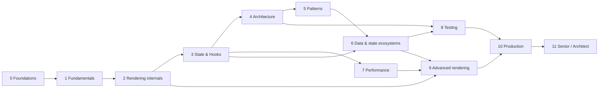

# ROADMAP — Curriculum Architecture

This document is the single source of truth for the **planned** curriculum: directory layout, full lesson inventory, prerequisites, projects, assessments, and effort estimates. A lesson listed here is *planned* unless [PROGRESS.md](./PROGRESS.md) says otherwise.

## 0. Version baseline

| Item | Target | Notes |
|---|---|---|
| React / React DOM | **19.x** | Check the current minor at <https://react.dev/versions>. Behavior that differs in 18 is flagged `⚠ Version-sensitive`. |
| TypeScript | 5.x | |
| Build tool | Vite (current major) | Used for SPA examples. |
| Testing | Vitest, React Testing Library, Playwright, MSW | |
| Server state | TanStack Query v5 | |
| Client state | Redux Toolkit 2.x, Zustand 5.x, XState v5 | |
| Framework | Next.js App Router (RSC reference implementation), plus alternatives (React Router framework mode, TanStack Start) | Framework APIs change quickly. Framework lessons carry a "verify against current docs" banner. |

Conventions: ⚠ marks version-sensitive behavior; every lesson separates **public guarantee** / **teaching model** / **implementation detail** (the latter may change between releases).

## 1. Directory layout

Numbering follows the phases (the data-fetching phase is its own directory, so performance is `07`, not `06`).

```text
react-mastery/
├── README.md  ROADMAP.md  PROGRESS.md  GLOSSARY.md  RESOURCES.md
├── 00-web-and-javascript-foundations/
├── 01-react-fundamentals/
├── 02-react-rendering-and-internals/
├── 03-react-state-and-hooks/
├── 04-react-architecture/
├── 05-design-patterns/
├── 06-data-fetching-and-state-ecosystems/
├── 07-performance/
├── 08-testing-and-quality/
├── 09-advanced-rendering-and-ecosystem/
├── 10-production-engineering/
├── 11-senior-and-architect-mastery/
└── projects/
```

Each phase directory ends with `NN-phase-assessment.md` (see §5).

## 2. Lesson inventory

Format: `file` — title *(level)*. Levels: B beginner, I intermediate, A advanced, P professional, X architect. "Needs" lists prerequisites beyond the previous lesson in the same directory.

### Phase 0 — Web and JavaScript foundations (`00-…`) ≈ 40 h
| File | Title | Level | Needs |
|---|---|---|---|
| 01-how-the-browser-works | How the browser works: processes, threads, and where React runs | B | — |
| 02-html-parsing-dom-cssom-render-tree | HTML parsing, DOM, CSSOM, and the render tree | B | 01 |
| 03-browser-rendering-pipeline | Style → layout → paint → composite | I | 02 |
| 04-dom-structure-and-mutation | DOM structure, mutation, and the cost of touching it | B | 02 |
| 05-execution-contexts-and-call-stack | Execution contexts and the call stack | B | — |
| 06-lexical-scope-and-closures | Lexical scope and closures | I | 05 |
| 07-functions-and-referential-identity | Functions as values; referential identity | I | 06 |
| 08-objects-references-immutability | Objects, references, and immutable updates | I | 07 |
| 09-prototypes-and-object-model | Prototypes, `this`, classes | I | 08 |
| 10-modules-and-dependency-graphs | ES modules, dependency graphs, tree shaking | I | 05 |
| 11-event-loop-tasks-microtasks | Event loop, tasks, microtasks, rendering opportunities | I | 01, 05 |
| 12-promises-and-async-await | Promises and async/await | I | 11 |
| 13-browser-events-and-propagation | Events: capture, target, bubble, delegation | I | 04, 11 |
| 14-web-apis-and-network-requests | fetch, AbortController, Web APIs | I | 12 |
| 15-http-caching-and-navigation | HTTP, caching, navigation | I | 14 |
| 16-memory-management-and-gc | Memory, garbage collection, leaks | A | 06, 08 |
| 17-javascript-performance-fundamentals | JS performance: long tasks, profiling | A | 03, 11, 16 |
| 18-typescript-fundamentals-and-narrowing | TypeScript fundamentals and narrowing | I | 08 |
| 19-typescript-generics-and-utility-types | Generics, utility types, discriminated unions | A | 18 |
| 20-tooling-transpilation-and-bundling | Transpilers, bundlers, dev server, source maps | I | 10 |
| 21-phase-assessment | Phase 0 assessment | — | all |

### Phase 1 — React fundamentals (`01-…`) ≈ 45 h
| File | Title | Level | Needs |
|---|---|---|---|
| 01-what-is-react | React's purpose and philosophy | B | P0 |
| 02-declarative-vs-imperative-ui | Declarative vs imperative UI | B | 00/04 |
| 03-ui-as-a-function-of-state | UI as a function of state | B | 02 |
| 04-elements-components-instances | Elements, components, instances | B | 03 |
| 05-jsx-explained | JSX and its transformation | B | 04, 00/20 |
| 06-props-and-one-way-data-flow | Props and one-way data flow | B | 05 |
| 07-composition-and-children | Composition, `children`, slots | I | 06 |
| 08-conditional-rendering | Conditional rendering | B | 06 |
| 09-lists-keys-and-identity | Lists, keys, identity | I | 08 |
| 10-event-handling | Event handling and synthetic event system | I | 00/13 |
| 11-controlled-and-uncontrolled-inputs | Controlled and uncontrolled inputs | I | 10 |
| 12-component-purity | Component purity | I | 06 |
| 13-rendering-mental-model | The rendering mental model | I | 12 |
| 14-state-as-a-snapshot | State as a snapshot | I | 13, 00/06 |
| 15-update-queues-and-batching | Update queues and batching (first look) | I | 14 |
| 16-state-preservation-and-reset | State preservation and reset | I | 09, 15 |
| 17-lifecycle-concepts | Mount/update/unmount concepts (class history included) | I | 16 |
| 18-react-devtools | React Developer Tools | B | 06 |
| 19-project-setup-vite-typescript | Project setup: Vite, TS, ESLint | B | 00/20 |
| 20-phase-assessment | Phase 1 assessment | — | all |
| project | Project 1 — Interactive fundamentals app | | |

### Phase 2 — Rendering, reconciliation, DOM, internals (`02-…`) ≈ 70 h
| File | Title | Level |
|---|---|---|
| 01-what-triggers-a-render | What actually triggers a render | I |
| 02-render-reconcile-commit-paint | Invocation vs render vs reconcile vs commit vs layout vs paint | A |
| 03-initial-mount-and-updates | Initial mount and subsequent updates | A |
| 04-virtual-dom-what-it-means | The "virtual DOM": what it is and is not | A |
| 05-elements-vs-dom-nodes | React elements vs DOM nodes | I |
| 06-reconciliation-fundamentals | Reconciliation: the diffing heuristics | A |
| 07-identity-keys-and-reconciliation | Component identity and keys, revisited | A |
| 08-why-fiber | Why Fiber exists (stack reconciler history) | A |
| 09-fiber-nodes-and-units-of-work | Fiber nodes and units of work | A |
| 10-current-and-work-in-progress-trees | Current and work-in-progress trees, double buffering | A |
| 11-render-phase-and-commit-phase | Render phase vs commit phase | A |
| 12-why-rendering-must-be-pure | Why rendering must be pure | A |
| 13-scheduler-and-priorities | Scheduling and update priorities | P |
| 14-lanes | Lanes: conceptual purpose | P |
| 15-interruptible-restartable-abandoned-rendering | Interruptible, restartable, abandoned renders | P |
| 16-concurrent-react-misconceptions | Concurrent React and common misconceptions | P |
| 17-hooks-and-fiber-state | How hooks attach to Fiber | P |
| 18-effects-and-their-timing | Effects and their timing | A |
| 19-layout-vs-passive-effects | Layout vs passive effects | A |
| 20-commit-and-dom-mutation | Commit work and DOM mutations | A |
| 21-browser-paint-and-react-updates | Browser paint vs React updates | A |
| 22-automatic-batching | Automatic batching | A |
| 23-transitions-and-deferred-rendering | Transitions and deferred rendering | A |
| 24-suspense-conceptual-internals | Suspense and thrown thenables | P |
| 25-hydration-and-selective-hydration | Hydration and selective hydration | P |
| 26-ssr-and-client-rendering | SSR vs client rendering | A |
| 27-react-server-components-intro | React Server Components: model | P |
| 28-strict-mode-behavior | Strict Mode development behavior | A |
| 29-reasoning-about-unnecessary-renders | Reasoning about unnecessary renders | A |
| 30-react-devtools-profiler | DevTools Profiler | A |
| 31-reading-react-source | Reading React's source code | P |
| 32-scenario-a-parent-rerender | Scenario A: parent rerenders, child props unchanged | A |
| 33-scenario-b-text-update | Scenario B: update only text in one element | A |
| 34-scenario-c-list-reorder | Scenario C: list reorder with/without stable keys | A |
| 35-scenario-d-transition-vs-urgent | Scenario D: transition vs urgent interaction | P |
| 36-scenario-e-suspend | Scenario E: component suspends | P |
| 37-scenario-f-hydration-mismatch | Scenario F: hydration mismatch | P |
| 38-phase-assessment | Phase 2 assessment | — |

### Phase 3 — State and Hooks (`03-…`) ≈ 55 h
01-usestate-internals-and-update-semantics · 02-functional-state-updates · 03-usereducer-and-reducer-architecture · 04-useeffect-synchronization · 05-effect-dependencies-and-stale-closures · 06-effect-cleanup · 07-you-might-not-need-an-effect · 08-uselayouteffect · 09-useinsertioneffect · 10-useref-and-mutable-references · 11-usememo-and-usecallback · 12-react-memo · 13-usecontext-and-propagation · 14-context-performance · 15-custom-hooks · 16-rules-of-hooks-and-composition · 17-derived-state · 18-state-colocation-and-lifting · 19-ui-server-url-and-shared-state · 20-usesyncexternalstore-and-external-stores · 21-forms-and-complex-state · 22-modern-hooks-and-apis (`use`, `useTransition`, `useDeferredValue`, `useActionState`, `useOptimistic`, `useId`, `useEffectEvent` ⚠) · 23-hooks-anti-patterns · 24-phase-assessment · project: Project 2 — Task manager (state ownership), Project 4 — Complex form system

### Phase 4 — Architecture (`04-…`) ≈ 60 h
01-architecture-fundamentals · 02-separation-of-concerns · 03-component-responsibility · 04-presentational-vs-container · 05-composition-and-dependency-direction · 06-feature-vs-layer-structure · 07-modular-architecture · 08-domain-driven-frontend · 09-feature-sliced-design · 10-clean-and-hexagonal-architecture · 11-dependency-inversion · 12-domain-logic-vs-ui-logic · 13-application-services-and-adapters · 14-api-boundaries-and-data-access · 15-state-ownership · 16-server-vs-client-state · 17-data-flow-architecture · 18-routing-architecture · 19-error-boundaries · 20-design-systems · 21-component-libraries · 22-monorepos-and-shared-packages · 23-multi-team-ownership · 24-refactoring-legacy-react · 25-architectural-fitness-and-enforcement · 26-phase-assessment · project: Project 3 — Multi-page dashboard, Project 8 — Enterprise modular app

### Phase 5 — Design patterns (`05-…`) ≈ 45 h
01-solid-in-react · 02-dry-kiss-yagni · 03-composition-over-inheritance · 04-container-presentational · 05-compound-components · 06-custom-hook-patterns · 07-headless-components · 08-provider-pattern · 09-higher-order-components · 10-render-props · 11-controlled-component-pattern · 12-reducer-pattern · 13-state-machine-pattern · 14-observer-and-subscription · 15-adapter-strategy-factory · 16-dependency-injection · 17-facade-and-command · 18-behavior-vs-presentation · 19-polymorphic-components · 20-slot-patterns · 21-error-handling-patterns · 22-patterns-for-reusable-libraries · 23-patterns-made-less-necessary · 24-oop-patterns-in-functional-react · 25-comparative-refactoring-labs · 26-phase-assessment · project: Project 7 — Reusable component library

### Phase 6 — Data fetching and state ecosystems (`06-…`) ≈ 50 h
01-fetch-lifecycle · 02-cancellation-and-race-conditions · 03-loading-and-error-states · 04-api-normalization · 05-optimistic-updates · 06-cache-consistency-and-invalidation · 07-server-state-management · 08-tanstack-query · 09-redux-toolkit · 10-zustand · 11-context-vs-external-stores · 12-state-machines-and-xstate · 13-suspense-data-loading · 14-server-side-data-loading · 15-error-recovery-and-retries · 16-offline-considerations · 17-real-time-websockets-subscriptions · 18-url-state-management · 19-technology-selection-matrix · 20-phase-assessment · project: Project 6 — E-commerce with server-state caching

### Phase 7 — Performance (`07-…`) ≈ 50 h
01-measure-before-optimizing · 02-profiler-workflows · 03-why-components-rerender · 04-memoization-trade-offs · 05-referential-equality · 06-context-propagation-cost · 07-state-colocation-for-perf · 08-rendering-large-collections · 09-windowing-and-virtualization · 10-expensive-computations · 11-scheduling-and-perceived-responsiveness · 12-usetransition-in-practice · 13-usedeferredvalue-in-practice · 14-debounce-and-throttle · 15-code-splitting-and-lazy-loading · 16-bundle-analysis · 17-network-waterfalls · 18-react-vs-browser-bottlenecks · 19-memory-leaks · 20-long-tasks-and-main-thread · 21-web-vitals-and-budgets · 22-production-performance-investigations · 23-counterproductive-optimizations · 24-phase-assessment · project: Project 5 — Data-heavy interface; **Project 11 — Broken app (deliberate architectural + performance bugs)**

### Phase 8 — Testing and quality (`08-…`) ≈ 40 h
01-test-strategy-and-pyramid · 02-unit-testing-with-vitest · 03-react-testing-library · 04-testing-async-updates · 05-testing-custom-hooks · 06-mocking-strategies-and-msw · 07-testing-api-interactions · 08-integration-testing · 09-e2e-with-playwright · 10-accessibility-testing · 11-component-contract-testing · 12-visual-regression · 13-typescript-correctness · 14-linting-and-static-analysis · 15-ci-checks · 16-avoiding-brittle-tests · 17-phase-assessment

### Phase 9 — Advanced rendering and ecosystem (`09-…`) ≈ 55 h
01-spa-ssr-ssg-streaming · 02-hydration-internals-deep-dive · 03-server-components-in-depth · 04-client-server-boundaries-and-serialization · 05-suspense-architecture · 06-concurrent-rendering-in-practice · 07-modern-react-apis · 08-react-compiler · 09-framework-architecture · 10-routing-and-nested-layouts · 11-progressive-enhancement · 12-auth-boundaries · 13-forms-actions-and-mutations · 14-accessibility-and-seo · 15-react-api-changes-across-versions · 16-phase-assessment · project: Project 9 — SSR/streaming app

### Phase 10 — Production engineering (`10-…`) ≈ 45 h
01-repository-organization · 02-deployment-workflows · 03-environment-configuration · 04-observability-and-logging · 05-error-monitoring · 06-security-xss-csrf-csp · 07-dependency-security · 08-accessibility-as-architecture · 09-internationalization · 10-resilience-and-degradation · 11-design-system-governance · 12-backward-compatibility · 13-application-migrations · 14-multi-team-collaboration · 15-technical-debt · 16-architecture-decision-records · 17-documentation · 18-continuous-delivery · 19-incident-debugging · 20-phase-assessment

### Phase 11 — Senior and architect mastery (`11-…`) ≈ 55 h
01-trade-off-analysis · 02-technical-design-documents · 03-large-scale-refactoring · 04-choosing-abstraction-level · 05-application-boundaries · 06-cross-cutting-concerns · 07-design-system-architecture · 08-state-architecture-at-scale · 09-performance-budgets-at-scale · 10-designing-for-testability · 11-designing-for-accessibility · 12-microfrontends · 13-monorepo-vs-multirepo · 14-build-vs-buy · 15-framework-selection · 16-supporting-multiple-teams · 17-code-review-and-standards · 18-technical-leadership · 19-debugging-with-incomplete-information · 20-evaluating-emerging-features · 21-reading-framework-source · 22-long-term-evolution · 23-system-design-interviews · 24-final-assessment · project: Project 10 — Capstone

**Total planned:** ≈ 300 lesson/assessment files, ≈ 500+ h.

## 3. Dependency graph (phase level)



Phase 2 deliberately comes *before* the Hooks deep-dive, but Phase 1 introduces `useState` and `useEffect` at a usage level; Phase 2 lesson 17 revisits their internals, and Phase 3 builds on both.

## 4. Project roadmap

| # | Project | Phase gate | Architectural focus |
|---|---|---|---|
| 1 | Interactive fundamentals app | after P1 | Components, props, events |
| 2 | Task manager | after P3 | State ownership, rendering behavior |
| 3 | Multi-page dashboard | after P4 | Routing, API boundary, feature folders |
| 4 | Complex form system | after P3/P5 | Reducers, validation, controlled inputs |
| 5 | Data-heavy management UI | after P7 | Virtualization, transitions |
| 6 | E-commerce with caching | after P6 | Server-state cache, optimistic updates |
| 7 | Reusable component library | after P5 | Headless/compound, a11y, API design |
| 8 | Enterprise modular app | after P4/P8 | Boundaries, dependency rules, tests |
| 9 | SSR + streaming app | after P9 | Server/client boundary, hydration |
| 10 | Capstone | after P11 | Full production constraints |
| 11 | **Broken app** (refactor/diagnose) | after P7 | Diagnosing real defects |

Each project file contains: requirements, objectives, architecture, folder structure, milestones, design decisions, testing/perf expectations, common mistakes, review checklist, reference solution guidance, extensions.

## 5. Assessment strategy

Every phase ends with an assessment file: conceptual questions, output-prediction tasks, debugging challenges, implementation exercises, architecture questions, answer key, scoring rubric, and promotion criteria. Rubric: ≥80% overall *and* ≥70% in each of explanation, implementation, debugging, and reasoning categories to advance. A learner who only passes the conceptual part does not advance.

## 6. Validation review of this plan (Step 2)

Issues found in the first draft and how they were handled:

- **Missing: JS event delegation vs React's event system.** Added Phase 1 lesson 10 and Phase 0 lesson 13 cross-link.
- **Missing: Accessibility as a thread.** Now has Phase 8/10/11 lessons plus an a11y section mandatory in every component-focused lesson.
- **Ordering risk: hooks internals (P2) before hooks usage (P3).** Mitigated by P1 using `useState`/`useEffect` at usage level and P2/17 labelled as requiring those.
- **Duplication risk: keys covered in P1/09, P2/07, P1/16.** Rule: P1 teaches behavior, P2 teaches mechanism, others cross-reference.
- **Gap: TypeScript for React specifically (props typing, generics in components).** Covered in P0/19 and reinforced in P5/19 and P8/13.
- **Gap: styling approaches.** Added to the Phase 4 design-system and Phase 7 CSS-in-JS runtime cost lessons; a dedicated `04-…/27-styling-architecture` lesson is added to the plan.
- **Obsolete risk:** class components, `defaultProps` on function components, `forwardRef` (React 19 `ref` as a prop), legacy Context, `ReactDOM.render` — taught only as history, labelled "legacy".
- **Volatile areas flagged:** React Compiler, `useEffectEvent`, framework APIs, RSC bundler integration. Each lesson on these must state a verification date.
