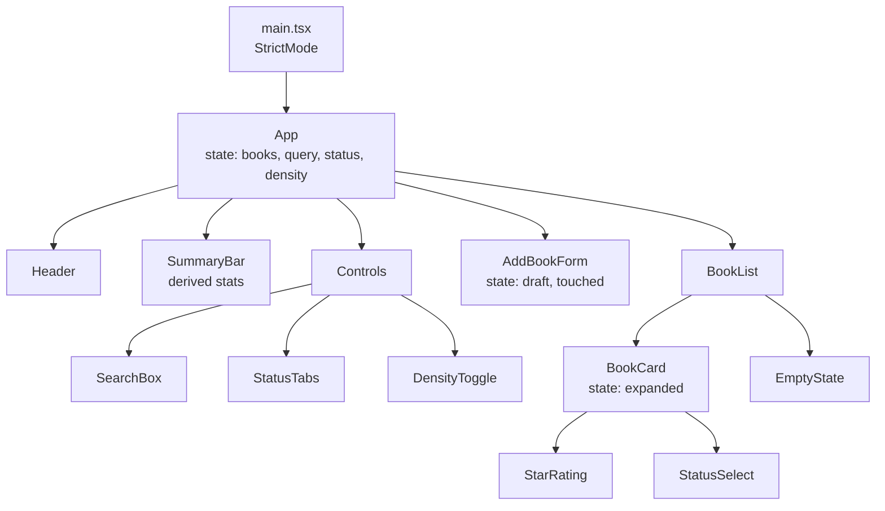

# Project 1 — Interactive Fundamentals App ("Reading List Explorer")

| | |
|---|---|
| **Phase gate** | After [Phase 1 — React fundamentals](../01-react-fundamentals/20-phase-assessment.md) |
| **Architectural focus** | Components, props, events, controlled inputs, lists and keys, state as a snapshot |
| **Estimated effort** | 8–12 hours |
| **Stack** | React 19.x, TypeScript 5.x, Vite, ESLint, Vitest + React Testing Library |
| **Allowed hooks** | `useState`, `useId`, `useRef` (focus only). No `useEffect`, no `useReducer`, no context, no router, no UI or state libraries. |

This project consolidates everything from Phase 1 into one small but non-trivial application. It deliberately forbids the tools of later phases so that you must solve problems with the fundamentals: props, one-way data flow, composition, derived values, keys and state identity. The constraint is the lesson; resist the urge to "just add a library".

> Version note: examples target React 19.x (verified 2026-10-22 against React 19.3, TypeScript 5.9, Vite 8, Vitest 3, React Testing Library 16: the reference code in §8 and the three tests in §9 typecheck under `strict` + `noUncheckedIndexedAccess` and pass; the `key`-by-index regression test fails as described when you switch to index keys). Where React 19 differs from 18 (for example `ref` as an ordinary prop, `<Context>` as a provider) the difference is flagged. Verify the current minor at <https://react.dev/versions>.

---

## 1. Product description

**Reading List Explorer** is a single-screen app in which a reader tracks books they want to read, are reading, or have finished.

The reader can:

- see a list of books (seeded with ~12 entries held in a constant module),
- search by title/author (live filtering as they type),
- filter by status via tabs (All / Want to read / Reading / Finished),
- change the status of a book, rate it (1–5 stars), and expand a card to see notes,
- add a new book through a form with validation,
- remove a book,
- see summary statistics ("7 books, 3 finished, average rating 4.1"),
- toggle a compact/comfortable density preference.

There is no backend and no persistence. Data lives in memory in the root component's state. (Persistence is Project 2's concern.)

---

## 2. Requirements

### 2.1 Functional requirements

| ID | Requirement | Phase 1 concept exercised |
|---|---|---|
| F1 | Render the book list from an array of `Book` objects | [Lists, keys, identity](../01-react-fundamentals/09-lists-keys-and-identity.md) |
| F2 | A text input filters books by case-insensitive match on title or author; the input is **controlled** | [Controlled and uncontrolled inputs](../01-react-fundamentals/11-controlled-and-uncontrolled-inputs.md) |
| F3 | Status tabs (`all`, `want`, `reading`, `finished`) filter the list; the active tab is visually and semantically indicated (`aria-selected`) | [Conditional rendering](../01-react-fundamentals/08-conditional-rendering.md) |
| F4 | Each `BookCard` receives data and callbacks via props and never mutates them | [Props and one-way data flow](../01-react-fundamentals/06-props-and-one-way-data-flow.md) |
| F5 | A star rating widget (`StarRating`) is reusable, accessible, and works in **read-only** and **interactive** modes | [Composition and children](../01-react-fundamentals/07-composition-and-children.md) |
| F6 | A card can be expanded/collapsed to show notes; expansion state is **local to the card** | [State preservation and reset](../01-react-fundamentals/16-state-preservation-and-reset.md) |
| F7 | "Add book" form with title (required), author (required), status (select), initial rating (optional). Inline error messages; submit disabled until valid, or errors shown on submit (your choice, justify it in the README) | [Event handling](../01-react-fundamentals/10-event-handling.md) |
| F8 | Removing a book removes it from the list and from the statistics immediately | [State as a snapshot](../01-react-fundamentals/14-state-as-a-snapshot.md) |
| F9 | Summary bar shows total, finished count, average rating of **rated** books. These values are **derived**, never stored | [UI as a function of state](../01-react-fundamentals/03-ui-as-a-function-of-state.md) |
| F10 | Empty states: no books at all, and no books matching the current filter, must render different, helpful messages | [Conditional rendering](../01-react-fundamentals/08-conditional-rendering.md) |
| F11 | A density toggle (compact/comfortable) changes layout via a `data-density` attribute on the root; it must not re-create the list (verify with DevTools) | [React Developer Tools](../01-react-fundamentals/18-react-devtools.md) |
| F12 | Pressing `Escape` in the search input clears it | [Event handling](../01-react-fundamentals/10-event-handling.md) |

### 2.2 Non-functional requirements

- **Strict TypeScript** (`"strict": true`, `noUncheckedIndexedAccess` recommended). No `any`, no non-null assertions (`!`) except with a written justification.
- **Pure components.** Rendering must not mutate props, module-level variables, or call `Math.random()`/`Date.now()`/`crypto.randomUUID()`. See [Component purity](../01-react-fundamentals/12-component-purity.md). IDs for new books are generated in the **event handler**.
- **StrictMode on.** The app must behave identically in development with `<StrictMode>`.
- **Accessibility baseline.** Every control has an accessible name; tabs use `role="tablist"`/`role="tab"`; keyboard operation works for every action; error messages are linked with `aria-describedby`.
- **No console warnings or errors** (including key warnings and controlled/uncontrolled warnings).
- **ESLint** with `eslint-plugin-react-hooks` and `typescript-eslint` clean at zero warnings.

### 2.3 Explicit non-goals

Persistence, routing, network calls, global state, animation libraries, CSS-in-JS runtimes. Plain CSS (a single `styles.css` or CSS Modules) is sufficient.

---

## 3. Learning objectives

By completing this project you will be able to:

1. **Decompose** a UI into a component tree and justify each boundary by responsibility, not by file size. ([Elements, components, instances](../01-react-fundamentals/04-elements-components-instances.md))
2. **Choose the owner** of each piece of state using "lift to the lowest common ancestor" and explain why `expanded` stays in `BookCard` while `books` lives in `App`.
3. **Distinguish state from derived data** and eliminate redundant state (filtered list, counts, averages).
4. **Predict re-renders** after an event by tracing the snapshot model, and confirm with the React DevTools Profiler. ([The rendering mental model](../01-react-fundamentals/13-rendering-mental-model.md), [State as a snapshot](../01-react-fundamentals/14-state-as-a-snapshot.md))
5. **Write immutable updates** for arrays and objects (`map`, `filter`, spread) and explain why mutation fails.
6. **Use stable keys** and demonstrate the bug that index keys cause with local state. ([Lists, keys, identity](../01-react-fundamentals/09-lists-keys-and-identity.md))
7. **Build a controlled form** with validation and understand the boundary between controlled and uncontrolled. 
8. **Set up** a Vite + TypeScript + ESLint project from scratch. ([Project setup](../01-react-fundamentals/19-project-setup-vite-typescript.md))
9. **Write behavior-focused tests** with React Testing Library at an introductory level (full treatment arrives in Phase 8).

### Lessons to review before you start

| Topic | Lesson |
|---|---|
| Declarative thinking | [02 Declarative vs imperative UI](../01-react-fundamentals/02-declarative-vs-imperative-ui.md) |
| JSX | [05 JSX and its transformation](../01-react-fundamentals/05-jsx-explained.md) |
| Props | [06 Props and one-way data flow](../01-react-fundamentals/06-props-and-one-way-data-flow.md) |
| Composition | [07 Composition, `children`, slots](../01-react-fundamentals/07-composition-and-children.md) |
| Keys | [09 Lists, keys, identity](../01-react-fundamentals/09-lists-keys-and-identity.md) |
| Events | [10 Event handling and synthetic event system](../01-react-fundamentals/10-event-handling.md) |
| Controlled inputs | [11 Controlled and uncontrolled inputs](../01-react-fundamentals/11-controlled-and-uncontrolled-inputs.md) |
| Purity | [12 Component purity](../01-react-fundamentals/12-component-purity.md) |
| Rendering | [13 The rendering mental model](../01-react-fundamentals/13-rendering-mental-model.md) |
| Snapshots / batching | [14 State as a snapshot](../01-react-fundamentals/14-state-as-a-snapshot.md), [15 Update queues and batching](../01-react-fundamentals/15-update-queues-and-batching.md) |
| Identity | [16 State preservation and reset](../01-react-fundamentals/16-state-preservation-and-reset.md) |
| Tooling | [18 React Developer Tools](../01-react-fundamentals/18-react-devtools.md), [19 Project setup](../01-react-fundamentals/19-project-setup-vite-typescript.md) |

---

## 4. Recommended architecture

### 4.1 Component tree



### 4.2 State ownership table

This table is the heart of the project. Write your own version in your README and defend every row.

| State | Owner | Why there | Alternatives rejected |
|---|---|---|---|
| `books: Book[]` | `App` | Read by `SummaryBar`, `BookList`; written by `AddBookForm` and `BookCard` (through callbacks) | Colocating in `BookList` would make `SummaryBar` and the form unable to reach it |
| `query: string` | `App` | Needed to compute the visible list in `App`; the input is a controlled view of it | Keeping it in `SearchBox` would force syncing upward (an anti-pattern) |
| `statusFilter` | `App` | Same as `query` | — |
| `density` | `App` | Applied on the root element | Could be a CSS-only `:has()` toggle, but state is clearer here |
| `expanded` (per card) | `BookCard` | Nobody else needs it; losing it on removal is correct | Lifting to `App` as `expandedIds: Set<string>` couples every card to global state for no gain |
| `draft` form fields | `AddBookForm` | Only meaningful until submit; on submit the finished `Book` is lifted via `onAdd` | Lifting each keystroke to `App` re-renders the list on every key press |
| `touched` flags | `AddBookForm` | Pure UI concern of the form | — |

**Derived (never stored):** `visibleBooks`, `stats.total`, `stats.finished`, `stats.averageRating`.

### 4.3 Data flow rules

1. Data flows down as props; changes flow up as **callback props named for intent** (`onStatusChange(id, status)`, not `setBooks`).
2. Child components never receive `setBooks` or any raw setter. The parent exposes domain-level handlers.
3. Domain types live in `src/types.ts`. Pure functions that operate on `Book[]` live in `src/books.ts` and are unit-testable without React.
4. Components do not import each other sideways except through the tree they compose (`BookCard` imports `StarRating`; `StarRating` imports nothing from the app).

---

## 5. Folder structure

At this size a layer-by-kind layout is fine. Feature folders (Phase 4) would be overkill here, and it is worth understanding *why* before moving on. See [Feature vs layer structure](../04-react-architecture/06-feature-vs-layer-structure.md) after Phase 4.

```
reading-list/
├── index.html
├── package.json
├── tsconfig.json
├── tsconfig.app.json
├── vite.config.ts
├── eslint.config.js
├── src/
│   ├── main.tsx
│   ├── App.tsx
│   ├── types.ts                 # Book, ReadingStatus, StatusFilter
│   ├── data/
│   │   └── seedBooks.ts         # initial data
│   ├── lib/
│   │   ├── books.ts             # pure functions: filterBooks, computeStats, updateBook...
│   │   ├── books.test.ts
│   │   └── validation.ts        # validateBookDraft
│   ├── components/
│   │   ├── Header.tsx
│   │   ├── SummaryBar.tsx
│   │   ├── Controls/
│   │   │   ├── SearchBox.tsx
│   │   │   ├── StatusTabs.tsx
│   │   │   └── DensityToggle.tsx
│   │   ├── BookList.tsx
│   │   ├── BookCard.tsx
│   │   ├── StarRating.tsx
│   │   ├── AddBookForm.tsx
│   │   └── EmptyState.tsx
│   ├── styles.css
│   └── test/
│       ├── setup.ts
│       └── App.test.tsx
└── README.md                    # state ownership table + decisions
```

### Setup commands

```bash
npm create vite@latest reading-list -- --template react-ts
cd reading-list
npm install
npm install -D vitest jsdom @testing-library/react @testing-library/user-event @testing-library/jest-dom
```

> Template contents change between Vite majors (Vite 8 is current; it needs Node 20.19+ or 22.12+), so check the generated files against <https://vite.dev/guide/>. Confirm `react` and `react-dom` resolve to 19.x with `npm ls react`. `@types/react` 19 types `useRef<T>(null)` as `RefObject<T | null>`.

`vite.config.ts` with Vitest:

```ts
/// <reference types="vitest/config" />
import { defineConfig } from "vite";
import react from "@vitejs/plugin-react";

export default defineConfig({
  plugins: [react()],
  test: {
    environment: "jsdom",
    setupFiles: ["./src/test/setup.ts"],
    globals: true,
  },
});
```

`src/test/setup.ts`:

```ts
import "@testing-library/jest-dom/vitest";
```

---

## 6. Milestones

Each milestone ends in a working app and a commit. Do not skip ahead; later milestones deliberately expose the weaknesses of earlier shortcuts.

### M0 — Skeleton (≈ 45 min)
Vite project, strict TS, ESLint, StrictMode, empty `App` rendering a heading. One passing smoke test. **Exit:** `npm run build`, `npm run lint`, `npm test` all pass.

### M1 — Static tree (≈ 1.5 h)
Define `Book` and `ReadingStatus`. Render seed data through `BookList` → `BookCard`. `StarRating` read-only. No state. **Exit:** the UI is a pure function of a constant; you can describe the element tree for one card on paper.

### M2 — Filtering (≈ 1.5 h)
Controlled `SearchBox`, `StatusTabs`. `visibleBooks` is computed during render by a pure function. Empty-state variants. **Exit:** no `useEffect` anywhere; no `filteredBooks` state variable.

### M3 — Mutations (≈ 2 h)
`onStatusChange`, `onRate`, `onRemove` with immutable updates. Interactive `StarRating`. `SummaryBar` derived stats. **Exit:** Profiler shows which components re-render when you rate one book; you can explain each.

### M4 — Local state and identity (≈ 1 h)
`expanded` in `BookCard`. Deliberately switch the list key to `index`, reproduce the bug (expand card 2, remove card 1, observe the wrong card expanded), write it up in the README, then fix with `book.id`. **Exit:** a regression test covers the bug.

### M5 — Add-book form (≈ 2 h)
Controlled form, validation module, `useId` for label association, `aria-describedby` errors, focus returns to title input after a successful add (via `ref`). **Exit:** invalid submit is impossible; valid submit adds the book at the top of the list and clears the form.

### M6 — Polish and verification (≈ 1.5 h)
Density toggle, `Escape` to clear, keyboard pass, accessibility pass with a screen-reader or the browser's accessibility tree, final test suite, README with the ownership table and a "What I'd do differently with Phase 3 tools" section.

---

## 7. Design decisions you must make and document

| Decision | Options | Guidance |
|---|---|---|
| **Where does the ID come from?** | `crypto.randomUUID()` in the submit handler; an incrementing counter held in `useRef`; `Date.now()` | Generate in the **handler**, never in render. `crypto.randomUUID()` is available in secure contexts (HTTPS/localhost) in current browsers and in Node 19+ / jsdom setups with Node's global `crypto`; confirm in your test environment. |
| **Filter in `App` or in `BookList`?** | Compute `visibleBooks` in `App` and pass it down vs pass `books` + `query` + `status` to `BookList` | Either is defensible. Passing the already-filtered list keeps `BookList` simple but forces `App` to know about filtering; passing the criteria keeps `App` thin but makes `BookList` less reusable. Pick one and explain. |
| **Validation timing** | On every change, on blur, on submit | A reasonable default: show an error only after the field has been touched or a submit was attempted. This needs a `touched` record. |
| **Status as string union vs enum** | `type ReadingStatus = "want" \| "reading" \| "finished"` vs `enum` | Prefer the string-literal union: erasable, no runtime artifact, works with `satisfies` and exhaustive `switch`. |
| **Controlled `<select>`** | `value` + `onChange` | In React the `value` prop on `<select>` selects the matching option; do not put `selected` on `<option>`. |
| **Callback shape** | `onRate(id, rating)` vs `onChange(updatedBook)` | The first is intent-revealing. The second pushes update logic into the child. Prefer the first. |

---

## 8. Reference solution guidance

The code below is **guidance**, not a copy-paste answer key. It demonstrates the shape of each key module. Your solution should differ in naming, styling and details. Read it after attempting each milestone.

### 8.1 Types

```ts
// src/types.ts
export type ReadingStatus = "want" | "reading" | "finished";
export type StatusFilter = ReadingStatus | "all";
export type Rating = 1 | 2 | 3 | 4 | 5;

export interface Book {
  readonly id: string;
  readonly title: string;
  readonly author: string;
  readonly status: ReadingStatus;
  /** undefined means "not rated yet" */
  readonly rating?: Rating;
  readonly notes?: string;
}

export interface BookDraft {
  title: string;
  author: string;
  status: ReadingStatus;
  rating: Rating | undefined;
}

export interface BookStats {
  total: number;
  finished: number;
  ratedCount: number;
  /** null when there are no rated books (avoid NaN) */
  averageRating: number | null;
}
```

`readonly` fields document intent and make accidental mutation a compile error (`book.rating = 5` fails). It does not freeze at runtime; it is a type-level guard.

### 8.2 Pure domain functions

```ts
// src/lib/books.ts
import type { Book, BookDraft, BookStats, Rating, ReadingStatus, StatusFilter } from "../types";

export function filterBooks(
  books: readonly Book[],
  query: string,
  status: StatusFilter,
): Book[] {
  const q = query.trim().toLowerCase();
  return books.filter((book) => {
    const matchesStatus = status === "all" || book.status === status;
    const matchesQuery =
      q === "" ||
      book.title.toLowerCase().includes(q) ||
      book.author.toLowerCase().includes(q);
    return matchesStatus && matchesQuery;
  });
}

export function computeStats(books: readonly Book[]): BookStats {
  let finished = 0;
  let ratedCount = 0;
  let ratingSum = 0;
  for (const book of books) {
    if (book.status === "finished") finished += 1;
    if (book.rating !== undefined) {
      ratedCount += 1;
      ratingSum += book.rating;
    }
  }
  return {
    total: books.length,
    finished,
    ratedCount,
    averageRating: ratedCount === 0 ? null : ratingSum / ratedCount,
  };
}

export function setStatus(books: readonly Book[], id: string, status: ReadingStatus): Book[] {
  return books.map((b) => (b.id === id ? { ...b, status } : b));
}

export function setRating(books: readonly Book[], id: string, rating: Rating | undefined): Book[] {
  return books.map((b) => (b.id === id ? { ...b, rating } : b));
}

export function removeBook(books: readonly Book[], id: string): Book[] {
  return books.filter((b) => b.id !== id);
}

export function addBook(books: readonly Book[], id: string, draft: BookDraft): Book[] {
  const book: Book = {
    id,
    title: draft.title.trim(),
    author: draft.author.trim(),
    status: draft.status,
    rating: draft.rating,
  };
  return [book, ...books];
}
```

**Why separate these?** Each function is pure and takes the whole list. They are testable with plain Vitest and carry all the "business" behavior, leaving components to wire events. In Phase 3 these become the natural payloads of a reducer ([`useReducer` and reducer architecture](../03-react-state-and-hooks/03-usereducer-and-reducer-architecture.md)). Note that unchanged books keep their **object identity** (`b` is returned as is); this will matter when you study `React.memo` ([Phase 3 / `React.memo`](../03-react-state-and-hooks/12-react-memo.md)).

### 8.3 Validation

```ts
// src/lib/validation.ts
import type { BookDraft } from "../types";

export type DraftErrors = Partial<Record<"title" | "author", string>>;

export function validateDraft(draft: BookDraft): DraftErrors {
  const errors: DraftErrors = {};
  if (draft.title.trim() === "") errors.title = "Title is required.";
  else if (draft.title.trim().length > 120) errors.title = "Title must be 120 characters or fewer.";
  if (draft.author.trim() === "") errors.author = "Author is required.";
  return errors;
}

export function isValid(errors: DraftErrors): boolean {
  return Object.keys(errors).length === 0;
}
```

### 8.4 `App` — the state owner

```tsx
// src/App.tsx
import { useState } from "react";
import type { Book, BookDraft, Rating, ReadingStatus, StatusFilter } from "./types";
import { seedBooks } from "./data/seedBooks";
import { addBook, computeStats, filterBooks, removeBook, setRating, setStatus } from "./lib/books";
import { SummaryBar } from "./components/SummaryBar";
import { SearchBox } from "./components/Controls/SearchBox";
import { StatusTabs } from "./components/Controls/StatusTabs";
import { DensityToggle } from "./components/Controls/DensityToggle";
import { BookList } from "./components/BookList";
import { AddBookForm } from "./components/AddBookForm";

type Density = "comfortable" | "compact";

export function App() {
  const [books, setBooks] = useState<readonly Book[]>(seedBooks);
  const [query, setQuery] = useState("");
  const [statusFilter, setStatusFilter] = useState<StatusFilter>("all");
  const [density, setDensity] = useState<Density>("comfortable");

  // Derived during render: no extra state, no effect, cannot go stale.
  const visibleBooks = filterBooks(books, query, statusFilter);
  const stats = computeStats(books);

  function handleAdd(draft: BookDraft) {
    // Impure call (random id) lives in the EVENT HANDLER, not in render.
    const id = crypto.randomUUID();
    setBooks((current) => addBook(current, id, draft));
  }

  function handleStatusChange(id: string, status: ReadingStatus) {
    setBooks((current) => setStatus(current, id, status));
  }

  function handleRate(id: string, rating: Rating | undefined) {
    setBooks((current) => setRating(current, id, rating));
  }

  function handleRemove(id: string) {
    setBooks((current) => removeBook(current, id));
  }

  return (
    <div className="app" data-density={density}>
      <h1>Reading List Explorer</h1>
      <SummaryBar stats={stats} />
      <div className="controls">
        <SearchBox value={query} onChange={setQuery} />
        <StatusTabs value={statusFilter} onChange={setStatusFilter} />
        <DensityToggle value={density} onChange={setDensity} />
      </div>
      <AddBookForm onAdd={handleAdd} />
      <BookList
        books={visibleBooks}
        hasAnyBooks={books.length > 0}
        onStatusChange={handleStatusChange}
        onRate={handleRate}
        onRemove={handleRemove}
      />
    </div>
  );
}
```

Code notes:

- `useState<readonly Book[]>` prevents `books.push(...)` at compile time.
- Updater functions (`current => ...`) are used even though a plain value would work here; this habit matters when multiple updates are queued in one event ([Update queues and batching](../01-react-fundamentals/15-update-queues-and-batching.md)).
- `setQuery` and `setStatusFilter` are passed directly as `onChange` because their signature `(value: T) => void` matches (a `Dispatch<SetStateAction<T>>` is assignable to `(value: T) => void`). That is acceptable for **simple controlled values** and is the one exception to "don't pass raw setters". Never pass `setBooks`.

### 8.5 `SearchBox`

```tsx
// src/components/Controls/SearchBox.tsx
import { useId, type KeyboardEvent } from "react";

interface SearchBoxProps {
  value: string;
  onChange: (value: string) => void;
}

export function SearchBox({ value, onChange }: SearchBoxProps) {
  const inputId = useId();

  function handleKeyDown(event: KeyboardEvent<HTMLInputElement>) {
    if (event.key === "Escape") onChange("");
  }

  return (
    <div className="searchbox">
      <label htmlFor={inputId}>Search title or author</label>
      <input
        id={inputId}
        type="search"
        value={value}
        onChange={(event) => onChange(event.target.value)}
        onKeyDown={handleKeyDown}
        autoComplete="off"
      />
    </div>
  );
}
```

`event.target.value` is read synchronously inside the handler. With a controlled input, React re-renders after the event with the new `value`; if you ever wanted to *reject* a keystroke, you would simply not call `onChange`, and React would restore the DOM value to the prop. Predict what the user sees if `onChange` is omitted but `value` is set (answer: read-only input and a dev warning).

### 8.6 `StatusTabs`

```tsx
// src/components/Controls/StatusTabs.tsx
import type { StatusFilter } from "../../types";

const TABS: ReadonlyArray<{ value: StatusFilter; label: string }> = [
  { value: "all", label: "All" },
  { value: "want", label: "Want to read" },
  { value: "reading", label: "Reading" },
  { value: "finished", label: "Finished" },
];

interface StatusTabsProps {
  value: StatusFilter;
  onChange: (value: StatusFilter) => void;
}

export function StatusTabs({ value, onChange }: StatusTabsProps) {
  return (
    <div role="tablist" aria-label="Filter by status">
      {TABS.map((tab) => (
        <button
          key={tab.value}
          role="tab"
          type="button"
          aria-selected={tab.value === value}
          className={tab.value === value ? "tab tab--active" : "tab"}
          onClick={() => onChange(tab.value)}
        >
          {tab.label}
        </button>
      ))}
    </div>
  );
}
```

A full WAI-ARIA tabs pattern also expects roving `tabindex` and arrow-key navigation, and a `tabpanel`. Implementing that is an optional extension (E3). If you do **not** implement it, a plain group of toggle buttons with `aria-pressed` is the more honest semantics. Decide and document. Using `role="tab"` without arrow-key support is a common accessibility mismatch.

### 8.7 `StarRating` (reusable, two modes)

```tsx
// src/components/StarRating.tsx
import type { Rating } from "../types";

const STARS: readonly Rating[] = [1, 2, 3, 4, 5];

type StarRatingProps =
  | { value: Rating | undefined; readOnly: true; label: string }
  | {
      value: Rating | undefined;
      readOnly?: false;
      label: string;
      onChange: (rating: Rating | undefined) => void;
    };

export function StarRating(props: StarRatingProps) {
  const { value, label } = props;

  if (props.readOnly) {
    return (
      <span role="img" aria-label={value ? `${label}: ${value} out of 5` : `${label}: not rated`}>
        {STARS.map((n) => (value !== undefined && n <= value ? "★" : "☆"))}
      </span>
    );
  }

  const { onChange } = props;
  return (
    <div role="group" aria-label={label} className="stars">
      {STARS.map((n) => {
        const selected = value === n;
        return (
          <button
            key={n}
            type="button"
            aria-pressed={selected}
            aria-label={`${n} star${n > 1 ? "s" : ""}`}
            // Clicking the current rating clears it: a deliberate, documented behavior.
            onClick={() => onChange(selected ? undefined : n)}
          >
            {value !== undefined && n <= value ? "★" : "☆"}
          </button>
        );
      })}
    </div>
  );
}
```

Code notes:

- The **discriminated union** on `readOnly` makes `onChange` required exactly when the widget is interactive. TypeScript narrows on `props.readOnly`.
- Destructuring `props` early would break narrowing in older TS patterns; reading from `props` after the narrowing check is the safest form.
- `STARS.map(...)` in the read-only branch returns an array of strings. React renders array children of strings fine, and since strings have no key warnings, this is OK, but if you convert them to elements you must add keys.

### 8.8 `BookCard` — local state and callbacks

```tsx
// src/components/BookCard.tsx
import { useId, useState } from "react";
import type { Book, Rating, ReadingStatus } from "../types";
import { StarRating } from "./StarRating";

interface BookCardProps {
  book: Book;
  onStatusChange: (id: string, status: ReadingStatus) => void;
  onRate: (id: string, rating: Rating | undefined) => void;
  onRemove: (id: string) => void;
}

const STATUS_LABELS: Record<ReadingStatus, string> = {
  want: "Want to read",
  reading: "Reading",
  finished: "Finished",
};

export function BookCard({ book, onStatusChange, onRate, onRemove }: BookCardProps) {
  const [expanded, setExpanded] = useState(false);
  const detailsId = useId();
  const statusId = useId();

  return (
    <li className="card">
      <div className="card__main">
        <h3>{book.title}</h3>
        <p>{book.author}</p>
        <StarRating
          label={`Rating for ${book.title}`}
          value={book.rating}
          onChange={(rating) => onRate(book.id, rating)}
        />
      </div>

      <div className="card__actions">
        <label htmlFor={statusId}>Status</label>
        <select
          id={statusId}
          value={book.status}
          onChange={(event) => onStatusChange(book.id, event.target.value as ReadingStatus)}
        >
          {(Object.keys(STATUS_LABELS) as ReadingStatus[]).map((s) => (
            <option key={s} value={s}>
              {STATUS_LABELS[s]}
            </option>
          ))}
        </select>

        <button
          type="button"
          aria-expanded={expanded}
          aria-controls={detailsId}
          onClick={() => setExpanded((e) => !e)}
        >
          {expanded ? "Hide notes" : "Show notes"}
        </button>
        <button type="button" onClick={() => onRemove(book.id)}>
          Remove
        </button>
      </div>

      {expanded && (
        <section id={detailsId}>
          <p>{book.notes ?? "No notes yet."}</p>
        </section>
      )}
    </li>
  );
}
```

Code notes and a trap:

- `event.target.value as ReadingStatus` is a type assertion; the DOM only knows `string`. It is safe here because every `<option>` value comes from `STATUS_LABELS`. A stricter alternative is a type-guard function `isReadingStatus(value)`; consider it and decide.
- `aria-controls` points to an element that does not exist when collapsed. That is tolerated in practice but many reviewers prefer always rendering the region with `hidden`. Decide and document.
- **Predict:** with `key={index}` in `BookList`, you expand card #2 and remove card #1. Which card shows expanded? Answer: the card now at index 1 (previously #3), because React matches by position+type, and the `expanded` state belongs to the fiber at that position. This is the bug M4 reproduces.

### 8.9 `BookList` and empty states

```tsx
// src/components/BookList.tsx
import type { Book, Rating, ReadingStatus } from "../types";
import { BookCard } from "./BookCard";
import { EmptyState } from "./EmptyState";

interface BookListProps {
  books: readonly Book[];
  hasAnyBooks: boolean;
  onStatusChange: (id: string, status: ReadingStatus) => void;
  onRate: (id: string, rating: Rating | undefined) => void;
  onRemove: (id: string) => void;
}

export function BookList({ books, hasAnyBooks, ...handlers }: BookListProps) {
  if (books.length === 0) {
    return hasAnyBooks ? (
      <EmptyState title="No matches" message="Try a different search or status filter." />
    ) : (
      <EmptyState title="Your list is empty" message="Add your first book above." />
    );
  }

  return (
    <ul className="book-list" aria-label="Books">
      {books.map((book) => (
        <BookCard key={book.id} book={book} {...handlers} />
      ))}
    </ul>
  );
}
```

`{...handlers}` spreads three props. It is concise but hides the contract at the call site; for a student project prefer explicit props if you find yourself confused about what flows where.

### 8.10 `AddBookForm` — controlled form, touched, focus

```tsx
// src/components/AddBookForm.tsx
import { useId, useRef, useState, type FormEvent } from "react";
import type { BookDraft, Rating, ReadingStatus } from "../types";
import { isValid, validateDraft } from "../lib/validation";

interface AddBookFormProps {
  onAdd: (draft: BookDraft) => void;
}

const EMPTY_DRAFT: BookDraft = { title: "", author: "", status: "want", rating: undefined };

export function AddBookForm({ onAdd }: AddBookFormProps) {
  const [draft, setDraft] = useState<BookDraft>(EMPTY_DRAFT);
  const [touched, setTouched] = useState({ title: false, author: false });
  const [submitAttempted, setSubmitAttempted] = useState(false);
  const titleRef = useRef<HTMLInputElement>(null);

  const titleId = useId();
  const authorId = useId();
  const titleErrorId = `${titleId}-error`;
  const authorErrorId = `${authorId}-error`;

  const errors = validateDraft(draft); // derived each render
  const showTitleError = (touched.title || submitAttempted) && errors.title !== undefined;
  const showAuthorError = (touched.author || submitAttempted) && errors.author !== undefined;

  function update<K extends keyof BookDraft>(key: K, value: BookDraft[K]) {
    setDraft((d) => ({ ...d, [key]: value }));
  }

  function handleSubmit(event: FormEvent<HTMLFormElement>) {
    event.preventDefault();
    setSubmitAttempted(true);
    if (!isValid(errors)) return;

    onAdd(draft);
    setDraft(EMPTY_DRAFT);
    setTouched({ title: false, author: false });
    setSubmitAttempted(false);
    titleRef.current?.focus();
  }

  return (
    <form onSubmit={handleSubmit} noValidate aria-label="Add a book">
      <div>
        <label htmlFor={titleId}>Title</label>
        <input
          ref={titleRef}
          id={titleId}
          value={draft.title}
          onChange={(e) => update("title", e.target.value)}
          onBlur={() => setTouched((t) => ({ ...t, title: true }))}
          aria-invalid={showTitleError}
          aria-describedby={showTitleError ? titleErrorId : undefined}
        />
        {showTitleError && (
          <p id={titleErrorId} role="alert">
            {errors.title}
          </p>
        )}
      </div>

      <div>
        <label htmlFor={authorId}>Author</label>
        <input
          id={authorId}
          value={draft.author}
          onChange={(e) => update("author", e.target.value)}
          onBlur={() => setTouched((t) => ({ ...t, author: true }))}
          aria-invalid={showAuthorError}
          aria-describedby={showAuthorError ? authorErrorId : undefined}
        />
        {showAuthorError && (
          <p id={authorErrorId} role="alert">
            {errors.author}
          </p>
        )}
      </div>

      <label>
        Status
        <select
          value={draft.status}
          onChange={(e) => update("status", e.target.value as ReadingStatus)}
        >
          <option value="want">Want to read</option>
          <option value="reading">Reading</option>
          <option value="finished">Finished</option>
        </select>
      </label>

      <label>
        Rating (optional)
        <select
          value={draft.rating ?? ""}
          onChange={(e) =>
            update("rating", e.target.value === "" ? undefined : (Number(e.target.value) as Rating))
          }
        >
          <option value="">No rating</option>
          {[1, 2, 3, 4, 5].map((n) => (
            <option key={n} value={n}>
              {n}
            </option>
          ))}
        </select>
      </label>

      <button type="submit">Add book</button>
    </form>
  );
}
```

Code notes:

- `useRef<HTMLInputElement>(null)` in React 19 types returns `RefObject<HTMLInputElement | null>`; calling `titleRef.current?.focus()` is correct. In React 18 typings the type differed (`RefObject<HTMLInputElement>` with a readonly `current`).
- `ref` is passed as a normal prop on a DOM element. If you extract a `TextField` component in React 19, `ref` arrives as an ordinary prop and `forwardRef` is no longer required; `forwardRef` is legacy ([Props and one-way data flow](../01-react-fundamentals/06-props-and-one-way-data-flow.md) and, later, [modern hooks and APIs](../03-react-state-and-hooks/22-modern-hooks-and-apis.md)).
- Errors are **derived** from `draft`; only `touched` and `submitAttempted` are state. Storing `errors` in state and updating it in `onChange` is the classic "stale error" bug (the error lags one keystroke behind or survives a reset).
- `noValidate` turns off the browser's built-in bubbles so your own messages are the single source of truth. Also decide whether `title` should have `required` for assistive tech; `aria-required="true"` is a good addition.
- After `onAdd`, the three `set...` calls are batched into one render ([Update queues and batching](../01-react-fundamentals/15-update-queues-and-batching.md)).

### 8.11 `SummaryBar`

```tsx
// src/components/SummaryBar.tsx
import type { BookStats } from "../types";

export function SummaryBar({ stats }: { stats: BookStats }) {
  const avg = stats.averageRating === null ? "no ratings yet" : stats.averageRating.toFixed(1);
  return (
    <p className="summary" aria-live="polite">
      {stats.total} {stats.total === 1 ? "book" : "books"} · {stats.finished} finished · average rating: {avg}
    </p>
  );
}
```

`aria-live="polite"` announces changes to screen-reader users; keep it only if you verify it is not overly chatty when typing in the search box (the summary is computed from **all** books, not the filtered ones, so it should not change while searching).

---

## 9. Testing expectations

Phase 8 teaches testing properly. For this project, aim for a small, behavior-focused suite. Test what the user does and sees, not component internals ([React Testing Library](../08-testing-and-quality/03-react-testing-library.md) and [Avoiding brittle tests](../08-testing-and-quality/16-avoiding-brittle-tests.md) provide the full theory).

### 9.1 Required tests

**Unit (pure functions, no React):**

| Test | Asserts |
|---|---|
| `filterBooks` matches title and author, case-insensitively, trims query | returns expected subset; `""` returns all |
| `filterBooks` combines status and query | AND semantics |
| `computeStats` empty list | `averageRating === null`, not `NaN` |
| `computeStats` ignores unrated books in average | e.g. ratings 5 and undefined → 5 |
| `setRating` keeps identity of other books | `result[0] === original[0]` for untouched items |
| `validateDraft` | whitespace-only title is invalid |

**Component/integration (RTL + user-event):**

```tsx
// src/test/App.test.tsx
import { render, screen, within } from "@testing-library/react";
import userEvent from "@testing-library/user-event";
import { App } from "../App";

describe("Reading List Explorer", () => {
  it("filters the list as the user types and clears on Escape", async () => {
    const user = userEvent.setup();
    render(<App />);

    const search = screen.getByRole("searchbox", { name: /search title or author/i });
    await user.type(search, "dune");

    const list = screen.getByRole("list", { name: /books/i });
    expect(within(list).getAllByRole("listitem")).toHaveLength(1);

    await user.keyboard("{Escape}");
    expect(search).toHaveValue("");
    expect(within(list).getAllByRole("listitem").length).toBeGreaterThan(1);
  });

  it("shows validation errors only after interaction and adds a valid book", async () => {
    const user = userEvent.setup();
    render(<App />);

    const form = screen.getByRole("form", { name: /add a book/i });
    expect(within(form).queryByRole("alert")).not.toBeInTheDocument();

    await user.click(within(form).getByRole("button", { name: /add book/i }));
    expect(within(form).getAllByRole("alert")).toHaveLength(2);

    await user.type(within(form).getByLabelText(/title/i), "Piranesi");
    await user.type(within(form).getByLabelText(/author/i), "Susanna Clarke");
    await user.click(within(form).getByRole("button", { name: /add book/i }));

    expect(screen.getByRole("heading", { name: "Piranesi" })).toBeInTheDocument();
    expect(within(form).getByLabelText(/title/i)).toHaveValue("");
    expect(within(form).getByLabelText(/title/i)).toHaveFocus();
  });

  it("keeps expanded state attached to the correct book after removing another", async () => {
    const user = userEvent.setup();
    render(<App />);

    const items = screen.getAllByRole("listitem");
    const secondTitle = within(items[1]!).getByRole("heading").textContent ?? "";
    await user.click(within(items[1]!).getByRole("button", { name: /show notes/i }));
    await user.click(within(items[0]!).getByRole("button", { name: /remove/i }));

    const survivor = screen.getByRole("heading", { name: secondTitle }).closest("li")!;
    expect(within(survivor).getByRole("button", { name: /hide notes/i })).toBeInTheDocument();
  });
});
```

Notes on these tests: `getByRole("form")` requires the form to have an accessible name (hence `aria-label`). The non-null assertions in tests are acceptable but prefer a tiny helper if they proliferate. The third test is the **regression test for the index-key bug**: with `key={index}` it fails.

### 9.2 Coverage expectations

Do not chase a percentage. Expect every pure function branch and each user-visible feature F1-F12 to be touched by at least one test. A reviewer should be able to delete any feature and see a test fail.

---

## 10. Performance expectations

This app is small; performance is a **comprehension** exercise, not an optimization one. Do not add `useMemo`, `useCallback` or `React.memo` in this project. ([Measure before optimizing](../07-performance/01-measure-before-optimizing.md), [Memoization trade-offs](../07-performance/04-memoization-trade-offs.md).)

| Expectation | How to verify |
|---|---|
| Typing in the search box re-renders `App`, `Controls`, `BookList`, and visible `BookCard`s, and **not** `AddBookForm`'s internals beyond its own function being re-called as a child | React DevTools Profiler, "Highlight updates when components render" ([React Developer Tools](../01-react-fundamentals/18-react-devtools.md)). Note that without memoization, `AddBookForm` *does* re-render because its parent did; record this honestly. |
| Typing in the add-book form does **not** re-render the list | Draft state lives in `AddBookForm`; `App` does not re-render on keystrokes. Confirm in the Profiler. |
| Toggling expansion re-renders only that `BookCard` | State is local; parent not re-rendered. |
| Changing density does not remount cards | In DevTools the cards' DOM nodes persist (the attribute changes in place); no flash/reset of expanded state. |
| No unnecessary state | `grep` for `useState` should show only the seven items in the ownership table. |

Write a short "Render report" in the README: for four interactions (type in search, rate a book, expand a card, change density), list which components re-render and why, then verify with the Profiler. Differences between prediction and observation are the real learning; explain each. Later phases build on this: [Why components re-render](../07-performance/03-why-components-rerender.md).

---

## 11. Common implementation mistakes

| Mistake | Symptom | Cause | Fix |
|---|---|---|---|
| `key={index}` | Wrong card keeps expanded state after removal/reorder; rating "jumps" | State is tied to position, not identity | Use stable `book.id`. ([Lists, keys, identity](../01-react-fundamentals/09-lists-keys-and-identity.md)) |
| `key={Math.random()}` or `crypto.randomUUID()` in render | Every card remounts every render; focus lost, inputs reset | New key each render means new identity | IDs from data, generated once in handler |
| Storing `filteredBooks` in state and syncing with `useEffect` | Flicker, one-render lag, impossible-state bugs | Redundant state | Compute during render |
| Mutating: `books.push(newBook); setBooks(books)` | UI does not update | Same reference, React bails out | New array: `[newBook, ...books]` |
| Mutating nested: `book.rating = 5` then `setBooks([...books])` | Appears to work, then breaks with memoization or StrictMode double invocation | In-place mutation of a prop-derived object | Copy the changed book |
| `onClick={handleRemove(book.id)}` | Item deleted on render, infinite loop warnings | Calls the function during render | `onClick={() => handleRemove(book.id)}` |
| `value` without `onChange` | Input can't be edited, warning | Read-only controlled input | Add `onChange` or use `defaultValue` |
| `value={undefined}` toggling to a string | "changing an uncontrolled input to be controlled" warning | `undefined` means uncontrolled | Initialize with `""` |
| Putting `query` in `SearchBox` and syncing up via effect | Extra renders, stale filter | Duplicate source of truth | Lift state to `App` |
| Reading state right after setting it: `setQuery(v); filter(query)` | Filter uses the previous value | State is a snapshot | Use the local `v` or derive on next render ([State as a snapshot](../01-react-fundamentals/14-state-as-a-snapshot.md)) |
| Passing `setBooks` to children | Children contain business logic; hard to change | Leaky ownership | Intent-named callbacks |
| `NaN` average when no ratings | "average rating: NaN" | Division by zero | Return `null` and render a message |
| `Number(e.target.value) as Rating` without guarding `""` | Rating `0` appears | `Number("") === 0` | Handle empty string explicitly (done in 8.10) |
| `id` for labels hard-coded (`id="title"`) | Duplicate IDs if the component is reused; label points to wrong input | Not unique | `useId` |
| Tests that query by class names or component names | Tests break on refactor | Implementation coupling | Query by role/label/text |

---

## 12. Review checklist

Use this for self-review and for reviewing a peer's solution.

**Correctness**
- [ ] All requirements F1–F12 demonstrably work (manual script in README).
- [ ] No console warnings in dev with StrictMode.
- [ ] Removing, rating, reordering never attaches state to the wrong card.

**State and data flow**
- [ ] State ownership table present, accurate, and each row justified.
- [ ] No derived data stored in state; no `useEffect`.
- [ ] No raw state setters passed to children (except documented simple controlled values).
- [ ] All updates immutable; updater functions used where the next state depends on the previous.

**Components**
- [ ] Each component has one clear responsibility; props interfaces are minimal and typed without `any`.
- [ ] `StarRating` is reusable and has no knowledge of `Book`.
- [ ] Keys are stable and unique; none derived from index or randomness.
- [ ] Render functions are pure; side-effecting calls only in handlers.

**TypeScript**
- [ ] `strict` enabled; no `any`; assertions justified.
- [ ] Discriminated unions or literal unions used where they model reality.

**Accessibility**
- [ ] Every input has a label; errors are linked via `aria-describedby`; `aria-invalid` toggles.
- [ ] Full keyboard operation; visible focus; focus moves sensibly after add.
- [ ] Tabs semantic choice (tabs vs toggle buttons) is consistent with the implemented keyboard behavior.

**Testing**
- [ ] Pure function tests exist; integration tests use roles/labels.
- [ ] Index-key regression test exists and would fail with `key={index}`.

**Process**
- [ ] README explains decisions and includes the render report.
- [ ] Commits correspond to milestones.
- [ ] `npm run lint`, `npm run build`, `npm test` pass from a clean clone.

---

## 13. Optional extensions

| # | Extension | Concepts it forces you to learn | Related lessons |
|---|---|---|---|
| E1 | Sort by title / rating / status with a `<select>`; keep stable sort and derived order | Derived state, immutability (`toSorted` vs `sort` on a copy) | [Derived state](../03-react-state-and-hooks/17-derived-state.md) |
| E2 | Edit a book in place (inline editing) | State preservation and reset: when to use `key` to reset the editor | [State preservation and reset](../01-react-fundamentals/16-state-preservation-and-reset.md) |
| E3 | Full WAI-ARIA tabs (roving `tabindex`, arrow keys, `tabpanel`) | Event handling, accessibility | [Event handling](../01-react-fundamentals/10-event-handling.md), [Accessibility testing](../08-testing-and-quality/10-accessibility-testing.md) |
| E4 | Drag-free reordering with "move up/down" buttons | Keys and identity under reorder | [Scenario C: list reorder](../02-react-rendering-and-internals/34-scenario-c-list-reorder.md) |
| E5 | Persist to `localStorage` | Needs effects and lazy initial state; deferred to Project 2 | [`useEffect` synchronization](../03-react-state-and-hooks/04-useeffect-synchronization.md) |
| E6 | Replace `useState` for `books` with `useReducer` | Reducer architecture; do this after Phase 3 and compare | [`useReducer` and reducer architecture](../03-react-state-and-hooks/03-usereducer-and-reducer-architecture.md) |
| E7 | Add a `Highlight` component that wraps matched text in `<mark>` | Composition, escaping (never use `dangerouslySetInnerHTML` for this) | [Composition and children](../01-react-fundamentals/07-composition-and-children.md) |
| E8 | After Phase 2: write a "Render timeline" for rating a book in the style of the scenario lessons | Render/commit phases | [Scenario A: parent re-render](../02-react-rendering-and-internals/32-scenario-a-parent-rerender.md) |
| E9 | Memoize `BookCard` and measure; then explain why it helps or does not (hint: callbacks created in `App` change identity every render) | Referential equality, `React.memo` | [`React.memo`](../03-react-state-and-hooks/12-react-memo.md), [Referential equality](../07-performance/05-referential-equality.md) |

---

## 14. Completion criteria

You are done when:

1. The review checklist is fully ticked (or each unticked item has a written justification).
2. You can, without notes, explain on a whiteboard what happens from the keypress in the search box to the DOM update, using the vocabulary of [render, reconcile, commit, paint](../02-react-rendering-and-internals/02-render-reconcile-commit-paint.md) as far as you have studied it.
3. You can predict the result of the "index key" experiment before running it.

Next step: [Phase 2 — Rendering, reconciliation, DOM, internals](../02-react-rendering-and-internals/01-what-triggers-a-render.md), then return to your render report and annotate it with what you now understand. Your next project is [Project 2 — Task manager (state ownership)](./02-task-manager-state-ownership.md).
