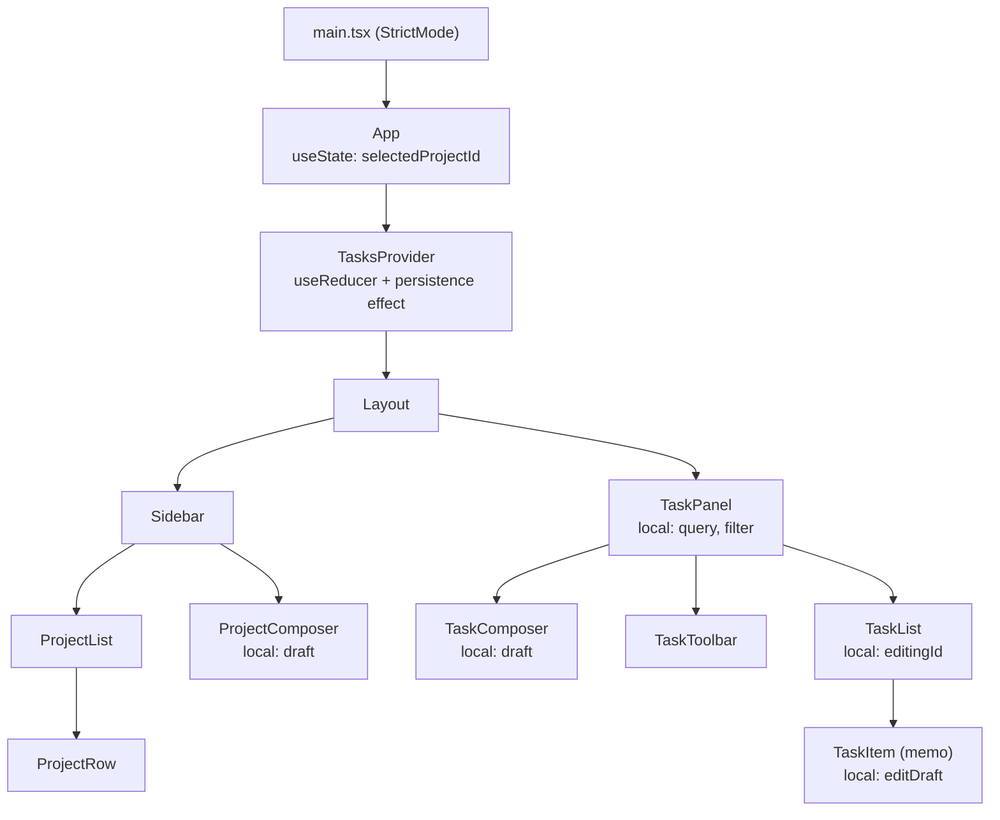
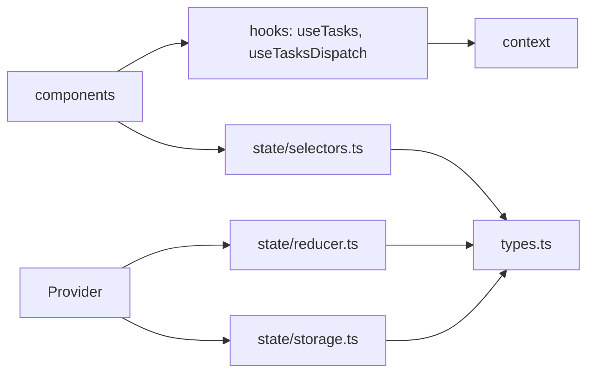

# Project 2 — Task Manager (State Ownership and Rendering Behavior)

| | |
|---|---|
| **Phase gate** | After [Phase 3 — State and Hooks](../03-react-state-and-hooks/24-phase-assessment.md) |
| **Architectural focus** | State ownership, reducer architecture, context split, rendering behavior, effects for synchronization |
| **Estimated effort** | 14–20 hours |
| **Stack** | React 19.x, TypeScript 5.x, Vite, Vitest + React Testing Library |
| **Allowed** | All React built-in hooks. No state libraries (no Redux, Zustand, Jotai), no server-state library, no router. |
| **Prerequisite project** | [Project 1 — Interactive fundamentals app](./01-interactive-fundamentals-app.md) (recommended) |

Project 1 forbade effects, reducers, and context. This project allows them and tests whether you can use them **with restraint**. The central question is not "can you build a task manager" but **"for every piece of state, who owns it, why there, and what re-renders when it changes?"** A correct app with the wrong ownership is a failed submission; a modest app with every ownership decision defended is a success.

> Version note: React 19.x (verified 2026-10-22 against React 19.3: the reducer, selectors, storage, provider, `TaskItem`/`TaskList`/`TaskComposer`, `RenderLog` and all test files in §8-§9 typecheck under `strict` and the tests pass, once the elided `seed.ts`, `Sidebar` and `TaskPanel` are supplied). `<Context value={...}>` is used directly as a provider (React 19); `<Context.Provider>` still works and is what you will meet in older code. `use(Context)` is available in React 19 as an alternative to `useContext`. See <https://react.dev/reference/react>.

---

## 1. Product description

**Taskboard** is a local-first task manager.

- Tasks belong to a **project** (a built-in "Inbox" project always exists and cannot be deleted).
- The user can add, rename, complete, prioritize, move, and delete tasks.
- The user can add and delete projects (deleting a project moves its tasks to Inbox).
- A sidebar lists projects with **open task counts**.
- The task panel shows tasks of the selected project, with a text search, a completion filter (all / open / done), and "Clear completed".
- Everything persists to `localStorage` and survives reload. State is versioned and validated on load.
- A dev-only "render log" shows which components re-rendered per interaction.

No backend. Server-state concerns arrive in [Phase 6](../06-data-fetching-and-state-ecosystems/01-fetch-lifecycle.md) and [Project 6](../ROADMAP.md).

---

## 2. Requirements

### 2.1 Functional requirements

| ID | Requirement |
|---|---|
| F1 | Add a task to the selected project (Enter submits, empty/whitespace title rejected with feedback) |
| F2 | Toggle complete via checkbox; completed tasks render struck-through |
| F3 | Inline rename: double-click or "Edit" button enters edit mode; Enter saves, Escape cancels, blur saves. Only **one** task can be in edit mode at a time |
| F4 | Set priority (`low` / `normal` / `high`) via a `<select>`; priority is shown as a badge |
| F5 | Move a task to another project |
| F6 | Delete a task |
| F7 | "Clear completed" removes all completed tasks **in the selected project** |
| F8 | Create a project; delete a non-Inbox project (tasks move to Inbox) |
| F9 | Sidebar shows each project's open-task count and highlights the selection |
| F10 | Search filters the visible list by title substring (case-insensitive); filter chips filter by completion |
| F11 | If the selected project is deleted, selection falls back to Inbox **without** an effect |
| F12 | State persists across reloads; corrupted or older-schema storage degrades safely to seed data |
| F13 | Dev-only render log (using `<Profiler>`) that records which subtree committed and why you triggered it |

### 2.2 State ownership requirements (the heart of the project)

Create `OWNERSHIP.md` in the repository root with a table that classifies **every** piece of state:

| Column | Meaning |
|---|---|
| State | name and type |
| Category | UI / domain / URL-like / derived / persisted |
| Owner | component or provider that calls `useState`/`useReducer` |
| Readers | components that read it |
| Writers | components/handlers that cause changes |
| Rationale | why it lives there and not higher/lower |
| Re-render blast radius | which components re-render when it changes |

The table must contain no row for derived data (derived data is not state), and every row must be falsifiable by the Profiler.

### 2.3 Non-functional requirements

- Reducer is **pure** (no `Date.now()`, `crypto.randomUUID()`, `localStorage`, or logging inside). IDs and timestamps are created in action creators/handlers and passed as payload. StrictMode invokes reducers twice in development; an impure reducer will visibly misbehave ([StrictMode behavior](../02-react-rendering-and-internals/28-strict-mode-behavior.md), [Why rendering must be pure](../02-react-rendering-and-internals/12-why-rendering-must-be-pure.md)).
- All effects are for **synchronizing with an external system** only (localStorage, `document.title`). No effect may exist to derive state from state ([You might not need an effect](../03-react-state-and-hooks/07-you-might-not-need-an-effect.md)).
- Strict TypeScript; discriminated-union actions with an exhaustive `switch` (`never` check).
- Unchanged tasks keep **object identity** across reducer updates.
- Accessibility baseline: labelled controls, keyboard operability, live-region feedback for add/delete, visible focus.
- ESLint (`react-hooks` rules) clean.

---

## 3. Learning objectives

1. **Assign ownership** using colocation first and lifting second ([State colocation and lifting](../03-react-state-and-hooks/18-state-colocation-and-lifting.md), [UI, server, URL and shared state](../03-react-state-and-hooks/19-ui-server-url-and-shared-state.md)).
2. **Design a reducer** whose action vocabulary describes *what happened* (events), not *how to set fields* ([`useReducer` and reducer architecture](../03-react-state-and-hooks/03-usereducer-and-reducer-architecture.md)).
3. **Split context** into state and dispatch to control propagation, and measure the effect ([`useContext` and propagation](../03-react-state-and-hooks/13-usecontext-and-propagation.md), [Context performance](../03-react-state-and-hooks/14-context-performance.md)).
4. **Derive** instead of sync: selection fallback, counts, visible list ([Derived state](../03-react-state-and-hooks/17-derived-state.md)).
5. **Use effects correctly** for persistence with cleanup, and know when to use lazy initialization instead ([`useEffect` synchronization](../03-react-state-and-hooks/04-useeffect-synchronization.md), [Effect cleanup](../03-react-state-and-hooks/06-effect-cleanup.md)).
6. **Control rendering** with identity-preserving updates plus `React.memo` where justified and measured ([`React.memo`](../03-react-state-and-hooks/12-react-memo.md), [Memoization trade-offs](../07-performance/04-memoization-trade-offs.md) if you have studied it).
7. **Predict and verify re-renders** using the Profiler ([React Developer Tools Profiler](../02-react-rendering-and-internals/30-react-devtools-profiler.md), [Reasoning about unnecessary renders](../02-react-rendering-and-internals/29-reasoning-about-unnecessary-renders.md)).
8. **Write custom hooks** that encapsulate persistence and context access ([Custom hooks](../03-react-state-and-hooks/15-custom-hooks.md), [Rules of hooks and composition](../03-react-state-and-hooks/16-rules-of-hooks-and-composition.md)).
9. **Recognize anti-patterns** in your own code ([Hooks anti-patterns](../03-react-state-and-hooks/23-hooks-anti-patterns.md)).

---

## 4. Recommended architecture

### 4.1 Component and provider tree



Where the providers sit is a design decision. `TasksProvider` wraps the layout, but `selectedProjectId` is owned **above** it in `App` because both `Sidebar` and `TaskPanel` need it, and neither is the other's ancestor. Is that the lowest common ancestor? Almost: `Layout` is. Moving `selectedProjectId` into `Layout` is arguably better; defend whichever you choose.

### 4.2 State inventory (reference answer; yours may differ if justified)

| State | Category | Owner | Notes |
|---|---|---|---|
| `tasks`, `projects` | Domain, persisted | `TasksProvider` (`useReducer`) | Multiple writers, multiple readers, interdependent updates (project deletion moves tasks) justify a reducer |
| `selectedProjectId` | UI | `Layout` (or `App`) | Shared by `Sidebar` and `TaskPanel`. Can be invalid after deletion; **read through a derivation** |
| `query`, `filter` | UI | `TaskPanel` | Only the toolbar and list need them; not sidebar |
| `editingId` | UI | `TaskList` | "Only one at a time" is an invariant across siblings, so the parent owns it. If each row owned its own `isEditing`, the invariant would require coordination |
| `editDraft` (text while editing) | UI | `TaskItem` | Transient; discarded on cancel |
| `draft` (new task / project title) | UI | respective composer | Never needs to leave |
| Visible tasks | **Derived** | — | `selectVisibleTasks(state, projectId, filter, query)` |
| Open counts | **Derived** | — | `selectOpenCounts(state)` |
| Effective selected project | **Derived** | — | `projects.some(p => p.id === selected) ? selected : INBOX_ID` |

### 4.3 Dependency direction



`reducer.ts`, `selectors.ts` and `storage.ts` are plain TypeScript with **no React imports**. They are unit-testable and portable. Components depend on them; they never depend on components. This is a miniature of the dependency direction taught in [Composition and dependency direction](../04-react-architecture/05-composition-and-dependency-direction.md).

---

## 5. Folder structure

```
taskboard/
├── OWNERSHIP.md                    # required deliverable
├── README.md                       # decisions, render report
├── index.html
├── package.json
├── vite.config.ts
├── src/
│   ├── main.tsx
│   ├── App.tsx
│   ├── types.ts
│   ├── state/
│   │   ├── reducer.ts              # pure
│   │   ├── reducer.test.ts
│   │   ├── actions.ts              # action creators (impure helpers: id, time)
│   │   ├── selectors.ts            # pure derivations
│   │   ├── selectors.test.ts
│   │   ├── storage.ts              # load/save, schema guard, versioning
│   │   ├── storage.test.ts
│   │   ├── seed.ts
│   │   ├── TasksContext.tsx        # contexts + provider + hooks
│   │   └── index.ts                # public surface of the module
│   ├── components/
│   │   ├── Layout.tsx
│   │   ├── Sidebar/
│   │   │   ├── Sidebar.tsx
│   │   │   ├── ProjectList.tsx
│   │   │   ├── ProjectRow.tsx
│   │   │   └── ProjectComposer.tsx
│   │   └── TaskPanel/
│   │       ├── TaskPanel.tsx
│   │       ├── TaskComposer.tsx
│   │       ├── TaskToolbar.tsx
│   │       ├── TaskList.tsx
│   │       └── TaskItem.tsx
│   ├── dev/
│   │   └── RenderLog.tsx           # <Profiler> wrapper, dev only
│   ├── styles.css
│   └── test/
│       ├── setup.ts
│       ├── renderApp.tsx
│       └── app.test.tsx
```

`state/index.ts` re-exports only what the rest of the app may use (`TasksProvider`, `useTasks`, `useTasksDispatch`, action creators, selectors, types). Treat it as a module boundary: components must not import `reducer.ts` directly.

---

## 6. Milestones

### M0 — Setup and domain model (1 h)
Vite + TS + Vitest. Write `types.ts`, `seed.ts`. **Exit:** `types.ts` compiles in strict mode; seed has Inbox plus two projects with ~8 tasks.

### M1 — Pure core (2–3 h)
`reducer.ts`, `actions.ts`, `selectors.ts` with full unit tests **before any UI**. **Exit:** all reducer actions tested including identity preservation and project-deletion cascade; test run takes under a second and imports no React.

### M2 — Context and a minimal UI (2 h)
`TasksProvider` with split contexts; a flat `TaskList` that lists and toggles tasks. **Exit:** toggling a task works; Profiler shows `TaskList` re-rendering.

### M3 — Full task interactions (3 h)
Composer, rename with `editingId`, priority, move, delete, clear completed, toolbar. **Exit:** F1–F7, F10 pass manual script.

### M4 — Projects and derivations (2 h)
Sidebar, counts, project create/delete, derived selection fallback. **Exit:** F8, F9, F11 pass; no `useEffect` fixes the selection.

### M5 — Persistence (2 h)
Lazy initializer + guarded load + write effect + versioning. **Exit:** F12 passes, including manual corruption (edit `localStorage` by hand to invalid JSON, wrong version, wrong shape).

### M6 — Rendering audit (2–3 h)
Add `RenderLog`/`<Profiler>`. Predict, then measure, re-renders for six interactions. Introduce `React.memo` on `TaskItem` **only if** measurement justifies it; document before/after numbers. **Exit:** README render report with predictions vs observations.

### M7 — Hardening (2 h)
Integration tests, a11y pass, StrictMode verification, review checklist.

---

## 7. Design decisions you must make and document

| Decision | Options | Guidance |
|---|---|---|
| `useState` vs `useReducer` for domain state | Several `useState`s vs one reducer | Updates like "delete project and re-home its tasks" touch two collections atomically. A reducer makes that one action and one testable function. Counter-case: `query` and `filter` are independent scalar values; a reducer would be ceremony. |
| Single context vs split | One `{state, dispatch}` value vs two contexts | `dispatch` is referentially stable; state changes often. Splitting lets components that only dispatch (`TaskItem`, composers) skip re-rendering when state changes, **if** their parents don't re-render them anyway. Verify that claim in the Profiler; it is a common source of cargo-culting. |
| Context value shape | `{ tasks, projects }` object vs separate contexts per slice | The `state` object changes identity on every action; every consumer re-renders even if the slice they use did not change. Fine here. Be able to explain at what size you would change it ([Context vs external stores](../06-data-fetching-and-state-ecosystems/11-context-vs-external-stores.md)). |
| Where IDs/timestamps are made | In reducer vs in action creator | Action creator. The reducer must be a pure function of `(state, action)`. |
| Normalized vs nested | `Project { tasks: Task[] }` vs flat `tasks` with `projectId` | Flat. Moving a task between projects is a one-field change; counts and filters are one pass. ([API normalization](../06-data-fetching-and-state-ecosystems/04-api-normalization.md)) |
| Persistence strategy | Effect on every state change vs debounce vs `useSyncExternalStore` over storage | The simple effect is fine for hundreds of tasks. Document the threshold at which you'd debounce. `useSyncExternalStore` is the correct tool if you add cross-tab sync ([`useSyncExternalStore` and external stores](../03-react-state-and-hooks/20-usesyncexternalstore-and-external-stores.md)). |
| Initial load | Lazy `useReducer` init vs effect that loads | Lazy init: the first render already has the right data; no flash of seed content, no extra render. Effect-based loading is an anti-pattern here. |
| Where `editingId` lives | Row vs list | List (see 4.2). |
| Memoization | None / `memo` on row / `memo` + `useCallback` | Start with none. Measure. `TaskItem` takes `task` plus stable callbacks created from `dispatch`; if callbacks are created inline in the parent they defeat `memo`. |

---

## 8. Reference solution guidance

### 8.1 Types

```ts
// src/types.ts
export type Priority = "low" | "normal" | "high";
export type CompletionFilter = "all" | "open" | "done";

export const INBOX_ID = "inbox" as const;

export interface Task {
  readonly id: string;
  readonly title: string;
  readonly done: boolean;
  readonly priority: Priority;
  readonly projectId: string;
  readonly createdAt: number; // epoch ms, supplied by the action creator
}

export interface Project {
  readonly id: string;
  readonly name: string;
}

export interface TasksState {
  readonly tasks: readonly Task[];
  readonly projects: readonly Project[];
}
```

### 8.2 Actions and creators

```ts
// src/state/actions.ts
import type { Priority, Task } from "../types";

export type TasksAction =
  | { type: "task/added"; task: Task }
  | { type: "task/toggled"; id: string }
  | { type: "task/renamed"; id: string; title: string }
  | { type: "task/prioritized"; id: string; priority: Priority }
  | { type: "task/moved"; id: string; projectId: string }
  | { type: "task/removed"; id: string }
  | { type: "tasks/completedCleared"; projectId: string }
  | { type: "project/added"; id: string; name: string }
  | { type: "project/removed"; id: string };

// Impure helpers live OUTSIDE the reducer. They are called from event handlers.
export function newTask(projectId: string, title: string): TasksAction {
  return {
    type: "task/added",
    task: {
      id: crypto.randomUUID(),
      title: title.trim(),
      done: false,
      priority: "normal",
      projectId,
      createdAt: Date.now(),
    },
  };
}

export function newProject(name: string): TasksAction {
  return { type: "project/added", id: crypto.randomUUID(), name: name.trim() };
}
```

Action names describe events (`task/toggled`), not setters (`SET_DONE`). That keeps the reducer the single place that knows what toggling means.

### 8.3 Reducer (pure, identity-preserving, exhaustive)

```ts
// src/state/reducer.ts
import { INBOX_ID, type Task, type TasksState } from "../types";
import type { TasksAction } from "./actions";

/** Apply `change` to the task with `id`; return the SAME array if nothing changed. */
function updateTask(
  tasks: readonly Task[],
  id: string,
  change: (t: Task) => Task,
): readonly Task[] {
  let changed = false;
  const next = tasks.map((t) => {
    if (t.id !== id) return t; // identity preserved
    const updated = change(t);
    if (updated !== t) changed = true;
    return updated;
  });
  return changed ? next : tasks;
}

export function tasksReducer(state: TasksState, action: TasksAction): TasksState {
  switch (action.type) {
    case "task/added":
      return { ...state, tasks: [action.task, ...state.tasks] };

    case "task/toggled": {
      const tasks = updateTask(state.tasks, action.id, (t) => ({ ...t, done: !t.done }));
      return tasks === state.tasks ? state : { ...state, tasks };
    }

    case "task/renamed": {
      const title = action.title.trim();
      if (title === "") return state; // reject: invalid rename is a no-op
      const tasks = updateTask(state.tasks, action.id, (t) =>
        t.title === title ? t : { ...t, title },
      );
      return tasks === state.tasks ? state : { ...state, tasks };
    }

    case "task/prioritized": {
      const tasks = updateTask(state.tasks, action.id, (t) =>
        t.priority === action.priority ? t : { ...t, priority: action.priority },
      );
      return tasks === state.tasks ? state : { ...state, tasks };
    }

    case "task/moved": {
      if (!state.projects.some((p) => p.id === action.projectId)) return state;
      const tasks = updateTask(state.tasks, action.id, (t) =>
        t.projectId === action.projectId ? t : { ...t, projectId: action.projectId },
      );
      return tasks === state.tasks ? state : { ...state, tasks };
    }

    case "task/removed": {
      const tasks = state.tasks.filter((t) => t.id !== action.id);
      return tasks.length === state.tasks.length ? state : { ...state, tasks };
    }

    case "tasks/completedCleared": {
      const tasks = state.tasks.filter((t) => !(t.projectId === action.projectId && t.done));
      return tasks.length === state.tasks.length ? state : { ...state, tasks };
    }

    case "project/added": {
      const name = action.name.trim();
      if (name === "") return state;
      return { ...state, projects: [...state.projects, { id: action.id, name }] };
    }

    case "project/removed": {
      if (action.id === INBOX_ID) return state; // invariant: Inbox is permanent
      if (!state.projects.some((p) => p.id === action.id)) return state;
      return {
        projects: state.projects.filter((p) => p.id !== action.id),
        // atomic cascade: re-home tasks in the same transition
        tasks: state.tasks.map((t) => (t.projectId === action.id ? { ...t, projectId: INBOX_ID } : t)),
      };
    }

    default: {
      const _exhaustive: never = action;
      return _exhaustive;
    }
  }
}
```

Code notes:

- **Returning the same `state` reference when nothing changed** lets React bail out of re-rendering consumers for no-op dispatches (`useReducer` compares with `Object.is`). The exact bail-out mechanics (including the "eager state" optimization and the occasional extra render of the component itself before bailing) are implementation details; the guarantee is that React will not re-render **children** or fire effects if the result is identical. See [`useState` internals and update semantics](../03-react-state-and-hooks/01-usestate-internals-and-update-semantics.md).
- `task/moved` validates the target project **inside the reducer** because the reducer owns invariants; the UI hiding invalid options is a convenience, not a guarantee.
- The `default` branch with `never` makes adding an action without handling it a compile error.
- Because the reducer is pure, StrictMode calling it twice is harmless. Try adding `Date.now()` to `task/added` and watch two different timestamps, then discard the second: you will see the bug only in subtle ways, which is why you keep impurity out.

### 8.4 Selectors

```ts
// src/state/selectors.ts
import { INBOX_ID, type CompletionFilter, type Task, type TasksState } from "../types";

export function resolveSelectedProjectId(state: TasksState, selectedId: string): string {
  return state.projects.some((p) => p.id === selectedId) ? selectedId : INBOX_ID;
}

export function selectVisibleTasks(
  state: TasksState,
  projectId: string,
  filter: CompletionFilter,
  query: string,
): Task[] {
  const q = query.trim().toLowerCase();
  return state.tasks.filter((t) => {
    if (t.projectId !== projectId) return false;
    if (filter === "open" && t.done) return false;
    if (filter === "done" && !t.done) return false;
    return q === "" || t.title.toLowerCase().includes(q);
  });
}

export function selectOpenCounts(state: TasksState): ReadonlyMap<string, number> {
  const counts = new Map<string, number>();
  for (const p of state.projects) counts.set(p.id, 0);
  for (const t of state.tasks) {
    if (!t.done) counts.set(t.projectId, (counts.get(t.projectId) ?? 0) + 1);
  }
  return counts;
}
```

Selectors return new arrays/maps on each call. That is fine for rendering; it matters only when the result is passed to a memoized child or used as an effect dependency. Decide where (if anywhere) `useMemo` is justified ([`useMemo` and `useCallback`](../03-react-state-and-hooks/11-usememo-and-usecallback.md)); a few hundred tasks do not justify it.

### 8.5 Storage with versioning and validation

```ts
// src/state/storage.ts
import { INBOX_ID, type Priority, type Project, type Task, type TasksState } from "../types";
import { seedState } from "./seed";

const STORAGE_KEY = "taskboard:v1";
const SCHEMA_VERSION = 1;

interface Persisted {
  version: number;
  state: TasksState;
}

const PRIORITIES: readonly Priority[] = ["low", "normal", "high"];

function isRecord(v: unknown): v is Record<string, unknown> {
  return typeof v === "object" && v !== null;
}

function isTask(v: unknown): v is Task {
  return (
    isRecord(v) &&
    typeof v.id === "string" &&
    typeof v.title === "string" &&
    typeof v.done === "boolean" &&
    typeof v.projectId === "string" &&
    typeof v.createdAt === "number" &&
    PRIORITIES.includes(v.priority as Priority)
  );
}

function isProject(v: unknown): v is Project {
  return isRecord(v) && typeof v.id === "string" && typeof v.name === "string";
}

function parse(raw: string): TasksState | null {
  let data: unknown;
  try {
    data = JSON.parse(raw);
  } catch {
    return null;
  }
  if (!isRecord(data) || data.version !== SCHEMA_VERSION || !isRecord(data.state)) return null;
  const { tasks, projects } = data.state;
  if (!Array.isArray(tasks) || !Array.isArray(projects)) return null;
  if (!tasks.every(isTask) || !projects.every(isProject)) return null;
  if (!projects.some((p) => p.id === INBOX_ID)) return null; // invariant
  // Orphan tasks (unknown project) are repaired rather than rejected.
  const ids = new Set(projects.map((p) => p.id));
  return {
    projects,
    tasks: tasks.map((t) => (ids.has(t.projectId) ? t : { ...t, projectId: INBOX_ID })),
  };
}

export function loadState(storage: Pick<Storage, "getItem"> = localStorage): TasksState {
  try {
    const raw = storage.getItem(STORAGE_KEY);
    if (raw === null) return seedState;
    return parse(raw) ?? seedState;
  } catch {
    // Storage can throw (privacy mode, disabled storage). Degrade to seed.
    return seedState;
  }
}

export function saveState(state: TasksState, storage: Pick<Storage, "setItem"> = localStorage): void {
  try {
    const payload: Persisted = { version: SCHEMA_VERSION, state };
    storage.setItem(STORAGE_KEY, JSON.stringify(payload));
  } catch {
    // Quota exceeded or storage unavailable. Persistence is best-effort.
  }
}
```

Notes: `JSON.parse` returns `unknown`-ish data; the **type guards are the validation boundary** and the only place the app trusts external data. Never `as TasksState` a parsed blob. Real schema libraries (Zod, Valibot) are an acceptable substitution; keep the guard-based version first so you understand what they automate. The **orphan repair** policy (repair vs reject) is a decision worth documenting.

### 8.6 Provider with split contexts and persistence

```tsx
// src/state/TasksContext.tsx
import {
  createContext,
  useContext,
  useEffect,
  useReducer,
  type Dispatch,
  type ReactNode,
} from "react";
import type { TasksState } from "../types";
import type { TasksAction } from "./actions";
import { tasksReducer } from "./reducer";
import { loadState, saveState } from "./storage";

const TasksStateContext = createContext<TasksState | null>(null);
const TasksDispatchContext = createContext<Dispatch<TasksAction> | null>(null);

export function TasksProvider({ children }: { children: ReactNode }) {
  // Lazy initializer: `loadState` is passed as a function and runs on mount
  // (twice in StrictMode dev, which is harmless because it is a pure read).
  const [state, dispatch] = useReducer(tasksReducer, undefined, loadState);

  // Synchronization with an EXTERNAL system. Not derived state.
  useEffect(() => {
    saveState(state);
  }, [state]);

  return (
    <TasksStateContext value={state}>
      <TasksDispatchContext value={dispatch}>{children}</TasksDispatchContext>
    </TasksStateContext>
  );
}

export function useTasks(): TasksState {
  const value = useContext(TasksStateContext);
  if (value === null) throw new Error("useTasks must be used inside <TasksProvider>");
  return value;
}

export function useTasksDispatch(): Dispatch<TasksAction> {
  const value = useContext(TasksDispatchContext);
  if (value === null) throw new Error("useTasksDispatch must be used inside <TasksProvider>");
  return value;
}
```

Code notes:

- `useReducer(reducer, undefined, init)`: the third argument is the lazy initializer; the second (`initialArg`) is passed to it. `loadState` has an optional parameter, so passing `undefined` yields the default `localStorage`. Be careful: **if you passed `loadState()` (the call), it would read storage on every render**, discarding the result after the first. Predict how many `getItem` calls occur in dev with StrictMode for each form.
- `<TasksStateContext value={state}>` is React 19 syntax. In React 18 you must write `<TasksStateContext.Provider value={state}>`.
- The effect runs after every committed state change, including the first (writing the just-loaded state back). That is redundant but harmless; you may skip it, but be careful that skipping the first write via a ref flag is more code than it saves.
- The effect has no cleanup because saving is idempotent. If you debounce, the cleanup must cancel the timer ([Effect cleanup](../03-react-state-and-hooks/06-effect-cleanup.md)).
- Throwing in the hooks when the context is `null` makes misuse fail fast at the call site instead of as a confusing `undefined` error later.

### 8.7 Layout and derived selection

```tsx
// src/components/Layout.tsx
import { useState } from "react";
import { INBOX_ID } from "../types";
import { resolveSelectedProjectId, useTasks } from "../state";
import { Sidebar } from "./Sidebar/Sidebar";
import { TaskPanel } from "./TaskPanel/TaskPanel";

export function Layout() {
  const state = useTasks();
  const [selectedProjectId, setSelectedProjectId] = useState<string>(INBOX_ID);

  // DERIVED: if the stored selection no longer exists, fall back. No effect.
  const projectId = resolveSelectedProjectId(state, selectedProjectId);

  return (
    <div className="layout">
      <Sidebar selectedProjectId={projectId} onSelect={setSelectedProjectId} />
      <TaskPanel projectId={projectId} />
    </div>
  );
}
```

**Trade-off to analyze:** `Layout` now reads `useTasks()`, so it re-renders on every task change and therefore re-renders `Sidebar` and `TaskPanel` (children re-render with their parent unless memoized). That is exactly the kind of accidental broad subscription the Profiler should reveal. Alternatives: (a) have `Sidebar` and `TaskPanel` each call `resolveSelectedProjectId` themselves from the raw selected id, keeping `Layout` state-free; (b) a small `useSelectedProject` hook. Pick one, justify, and measure.

### 8.8 `TaskList`, `TaskItem`

```tsx
// src/components/TaskPanel/TaskList.tsx
import { useState } from "react";
import type { CompletionFilter } from "../../types";
import { selectVisibleTasks, useTasks } from "../../state";
import { TaskItem } from "./TaskItem";

interface TaskListProps {
  projectId: string;
  filter: CompletionFilter;
  query: string;
}

export function TaskList({ projectId, filter, query }: TaskListProps) {
  const state = useTasks();
  const [editingId, setEditingId] = useState<string | null>(null);

  const visible = selectVisibleTasks(state, projectId, filter, query);
  const projects = state.projects; // for the "move" select

  if (visible.length === 0) {
    return <p className="empty">No tasks to show.</p>;
  }

  return (
    <ul className="task-list" aria-label="Tasks">
      {visible.map((task) => (
        <TaskItem
          key={task.id}
          task={task}
          projects={projects}
          editing={editingId === task.id}
          onStartEdit={setEditingId}
          onStopEdit={() => setEditingId(null)}
        />
      ))}
    </ul>
  );
}
```

```tsx
// src/components/TaskPanel/TaskItem.tsx
import { memo, useState, type KeyboardEvent } from "react";
import type { Priority, Project, Task } from "../../types";
import { useTasksDispatch } from "../../state";

interface TaskItemProps {
  task: Task;
  projects: readonly Project[];
  editing: boolean;
  onStartEdit: (id: string) => void;
  onStopEdit: () => void;
}

export const TaskItem = memo(function TaskItem({
  task,
  projects,
  editing,
  onStartEdit,
  onStopEdit,
}: TaskItemProps) {
  const dispatch = useTasksDispatch();

  return (
    <li className={task.done ? "task task--done" : "task"}>
      <input
        type="checkbox"
        checked={task.done}
        onChange={() => dispatch({ type: "task/toggled", id: task.id })}
        aria-label={`Complete ${task.title}`}
      />

      {editing ? (
        // `key` on the editor is unnecessary here: it unmounts when `editing` flips to false,
        // so its local draft resets naturally.
        <TitleEditor
          initial={task.title}
          onSave={(title) => {
            dispatch({ type: "task/renamed", id: task.id, title });
            onStopEdit();
          }}
          onCancel={onStopEdit}
        />
      ) : (
        <span onDoubleClick={() => onStartEdit(task.id)}>{task.title}</span>
      )}

      <select
        aria-label={`Priority for ${task.title}`}
        value={task.priority}
        onChange={(e) =>
          dispatch({ type: "task/prioritized", id: task.id, priority: e.target.value as Priority })
        }
      >
        <option value="low">Low</option>
        <option value="normal">Normal</option>
        <option value="high">High</option>
      </select>

      <select
        aria-label={`Move ${task.title} to project`}
        value={task.projectId}
        onChange={(e) => dispatch({ type: "task/moved", id: task.id, projectId: e.target.value })}
      >
        {projects.map((p) => (
          <option key={p.id} value={p.id}>
            {p.name}
          </option>
        ))}
      </select>

      <button type="button" onClick={() => onStartEdit(task.id)}>
        Edit
      </button>
      <button type="button" onClick={() => dispatch({ type: "task/removed", id: task.id })}>
        Delete
      </button>
    </li>
  );
});

function TitleEditor({
  initial,
  onSave,
  onCancel,
}: {
  initial: string;
  onSave: (title: string) => void;
  onCancel: () => void;
}) {
  const [draft, setDraft] = useState(initial);

  function handleKeyDown(e: KeyboardEvent<HTMLInputElement>) {
    if (e.key === "Enter") onSave(draft);
    else if (e.key === "Escape") onCancel();
  }

  return (
    <input
      autoFocus
      value={draft}
      onChange={(e) => setDraft(e.target.value)}
      onKeyDown={handleKeyDown}
      onBlur={() => onSave(draft)}
      aria-label="Task title"
    />
  );
}
```

**What does `memo` actually buy here? Analyze, don't assume.**

| Prop | Stable across unrelated updates? | Why |
|---|---|---|
| `task` | Yes for unchanged tasks | Reducer preserves object identity |
| `projects` | Yes unless projects change | Same array reference from state |
| `editing` | Yes (boolean) | Primitive |
| `onStartEdit` | Yes | `setEditingId` from `useState` is stable |
| `onStopEdit` | **No** | Inline arrow recreated every `TaskList` render |

`onStopEdit` defeats the memo. Fix with `useCallback(() => setEditingId(null), [])` or pass `setEditingId` and let the row call `onEdit(null)`. This is a deliberate trap in the reference; reproduce it, observe in the Profiler that every row re-renders, fix it, observe again. If your build uses the React Compiler, memoization may be applied automatically and this manual exercise behaves differently; verify against current docs and disable the compiler for this experiment ([React Compiler](../09-advanced-rendering-and-ecosystem/08-react-compiler.md)).

Also notice `onBlur` + `Enter` both calling `onSave`: pressing Enter unmounts the input, and React does not reliably fire blur on removal in a way you should depend on across browsers. Test the behavior and ensure a rename dispatches **once**. If double dispatch appears, guard it (the reducer's `t.title === title ? t : ...` no-op makes this idempotent, which is the kind of defense-in-depth the reducer's design provides).

`autoFocus` on an element rendered conditionally works in React (React calls `focus()` on mount for host elements with `autoFocus`), but you should confirm focus **returns** to a sensible element after save for keyboard users; managing that is part of the a11y pass.

### 8.9 Composer and toolbar (local state)

```tsx
// src/components/TaskPanel/TaskComposer.tsx
import { useState, type FormEvent } from "react";
import { newTask, useTasksDispatch } from "../../state";

export function TaskComposer({ projectId }: { projectId: string }) {
  const dispatch = useTasksDispatch();
  const [title, setTitle] = useState("");
  const [error, setError] = useState<string | null>(null);

  function handleSubmit(e: FormEvent) {
    e.preventDefault();
    if (title.trim() === "") {
      setError("Enter a task title.");
      return;
    }
    dispatch(newTask(projectId, title));
    setTitle("");
    setError(null);
  }

  return (
    <form onSubmit={handleSubmit} aria-label="Add task">
      <label>
        New task
        <input value={title} onChange={(e) => setTitle(e.target.value)} />
      </label>
      <button type="submit">Add</button>
      {error && <p role="alert">{error}</p>}
    </form>
  );
}
```

`TaskComposer` uses **only** `useTasksDispatch`. Because it does not consume the state context, typing in it (local state) re-renders only itself, and domain changes do not re-render it unless its parent re-renders it. Confirm in the Profiler: when `TaskPanel` re-renders because it consumes state or because its parent did, `TaskComposer` re-renders as well, since it is not memoized. That is the honest truth about context splitting: it prevents re-renders caused by **context**, not those propagated by **parents**.

### 8.10 Dev render log

```tsx
// src/dev/RenderLog.tsx
import { Profiler, type ProfilerOnRenderCallback, type ReactNode } from "react";

const onRender: ProfilerOnRenderCallback = (id, phase, actualDuration) => {
  // phase: "mount" | "update" | "nested-update"
  console.log(`[render] ${id} ${phase} ${actualDuration.toFixed(2)}ms`);
};

export function RenderLog({ id, children }: { id: string; children: ReactNode }) {
  if (import.meta.env.PROD) return children;
  return (
    <Profiler id={id} onRender={onRender}>
      {children}
    </Profiler>
  );
}
```

Wrap `Sidebar`, `TaskList`, and `TaskComposer` in `<RenderLog id="...">`. `<Profiler>` reports when a **component in the wrapped subtree committed an update**; it is not per-component render counting, and it is disabled in standard production builds (a special profiling build is required). Returning `children` directly from a component is valid in React 19 and TS typing for `ReactNode` return is accepted with current `@types/react`; if your types complain, wrap in a fragment. Because `Profiler` reports per subtree, nest several to localize.

### 8.11 `main.tsx`

```tsx
import { StrictMode } from "react";
import { createRoot } from "react-dom/client";
import { TasksProvider } from "./state";
import { Layout } from "./components/Layout";
import "./styles.css";

const container = document.getElementById("root");
if (container === null) throw new Error("Missing #root element");

createRoot(container).render(
  <StrictMode>
    <TasksProvider>
      <Layout />
    </TasksProvider>
  </StrictMode>,
);
```

---

## 9. Testing expectations

See [Unit testing with Vitest](../08-testing-and-quality/02-unit-testing-with-vitest.md), [React Testing Library](../08-testing-and-quality/03-react-testing-library.md), [Testing custom hooks](../08-testing-and-quality/05-testing-custom-hooks.md) for theory.

### 9.1 Reducer unit tests (no React)

```ts
// src/state/reducer.test.ts
import { describe, expect, it } from "vitest";
import { tasksReducer } from "./reducer";
import { INBOX_ID, type TasksState } from "../types";

const base: TasksState = {
  projects: [{ id: INBOX_ID, name: "Inbox" }, { id: "p1", name: "Work" }],
  tasks: [
    { id: "a", title: "A", done: false, priority: "normal", projectId: "p1", createdAt: 1 },
    { id: "b", title: "B", done: true, priority: "low", projectId: "p1", createdAt: 2 },
    { id: "c", title: "C", done: false, priority: "high", projectId: INBOX_ID, createdAt: 3 },
  ],
};

describe("tasksReducer", () => {
  it("toggle preserves identity of untouched tasks", () => {
    const next = tasksReducer(base, { type: "task/toggled", id: "a" });
    expect(next.tasks[0]).not.toBe(base.tasks[0]);
    expect(next.tasks[1]).toBe(base.tasks[1]);
    expect(next.tasks[2]).toBe(base.tasks[2]);
  });

  it("returns the same state object for a no-op", () => {
    expect(tasksReducer(base, { type: "task/toggled", id: "missing" })).toBe(base);
    expect(tasksReducer(base, { type: "task/renamed", id: "a", title: "  " })).toBe(base);
  });

  it("deleting a project re-homes its tasks to Inbox atomically", () => {
    const next = tasksReducer(base, { type: "project/removed", id: "p1" });
    expect(next.projects.map((p) => p.id)).toEqual([INBOX_ID]);
    expect(next.tasks.every((t) => t.projectId === INBOX_ID)).toBe(true);
    expect(next.tasks).toHaveLength(3);
  });

  it("refuses to delete Inbox", () => {
    expect(tasksReducer(base, { type: "project/removed", id: INBOX_ID })).toBe(base);
  });

  it("does not mutate its input", () => {
    const frozen = structuredClone(base);
    Object.freeze(frozen.tasks);
    Object.freeze(frozen.projects);
    expect(() => tasksReducer(frozen, { type: "task/removed", id: "a" })).not.toThrow();
  });

  it("is deterministic (same input, same output)", () => {
    const action = { type: "task/prioritized", id: "a", priority: "high" } as const;
    expect(tasksReducer(base, action)).toEqual(tasksReducer(base, action));
  });
});
```

Add selector tests (counts, filter combinations, selection fallback) and storage tests (invalid JSON, wrong version, wrong shape, orphan repair, storage that throws).

### 9.2 Integration tests

```tsx
// src/test/renderApp.tsx
import { render } from "@testing-library/react";
import { TasksProvider } from "../state";
import { Layout } from "../components/Layout";

export function renderApp() {
  return render(
    <TasksProvider>
      <Layout />
    </TasksProvider>,
  );
}
```

```tsx
// src/test/app.test.tsx
import { beforeEach, describe, expect, it } from "vitest";
import { screen, within } from "@testing-library/react";
import userEvent from "@testing-library/user-event";
import { renderApp } from "./renderApp";

beforeEach(() => localStorage.clear());

describe("Taskboard", () => {
  it("adds a task, completes it, and persists across a remount", async () => {
    const user = userEvent.setup();
    const first = renderApp();

    await user.type(screen.getByLabelText(/new task/i), "Write tests");
    await user.click(screen.getByRole("button", { name: /^add$/i }));
    await user.click(screen.getByRole("checkbox", { name: /complete write tests/i }));

    first.unmount();
    renderApp();

    expect(screen.getByRole("checkbox", { name: /complete write tests/i })).toBeChecked();
  });

  it("falls back to Inbox when the selected project is deleted", async () => {
    const user = userEvent.setup();
    renderApp();
    await user.click(screen.getByRole("button", { name: /^work$/i })); // anchored: "Delete project Work" also matches /work/i
    await user.click(screen.getByRole("button", { name: /delete project work/i }));
    expect(screen.getByRole("heading", { name: /inbox/i })).toBeInTheDocument();
  });

  it("only one task can be in edit mode at a time", async () => {
    const user = userEvent.setup();
    renderApp();
    const [first, second] = screen.getAllByRole("button", { name: /^edit$/i });
    await user.click(first!);
    await user.click(second!);
    expect(screen.getAllByRole("textbox", { name: /task title/i })).toHaveLength(1);
  });

  it("recovers from corrupted storage", () => {
    localStorage.setItem("taskboard:v1", "{not json");
    renderApp();
    expect(screen.getByRole("list", { name: /tasks/i })).toBeInTheDocument();
  });
});
```

Adjust queries to your markup (these assume a project button named "Work" and a "Delete project Work" button). Tests wait on nothing asynchronous because every update is synchronous; `userEvent` already wraps interactions in `act`.

### 9.3 Test for the render behavior itself

A render-count test is legitimate here because rendering behavior **is the product** of this project. Use `<Profiler>` or a spy prop inside a test-only wrapper:

```tsx
// src/test/rendering.test.tsx
import { Profiler } from "react";
import { render, screen } from "@testing-library/react";
import userEvent from "@testing-library/user-event";
import { expect, it, vi } from "vitest";
import { TasksProvider } from "../state";
import { TaskComposer } from "../components/TaskPanel/TaskComposer";
import { TaskList } from "../components/TaskPanel/TaskList";
import { INBOX_ID } from "../types";

it("typing in the composer does not commit anything inside the task list subtree", async () => {
  localStorage.clear();
  const user = userEvent.setup();
  const onRender = vi.fn();

  render(
    <TasksProvider>
      <TaskComposer projectId={INBOX_ID} />
      <Profiler id="list" onRender={onRender}>
        <TaskList projectId={INBOX_ID} filter="all" query="" />
      </Profiler>
    </TasksProvider>,
  );

  onRender.mockClear(); // ignore the mount commit
  await user.type(screen.getByLabelText(/new task/i), "abc");

  // Composer state is local; TaskList is a sibling, not a descendant of the composer.
  expect(onRender).not.toHaveBeenCalled();
});
```

Why this is a legitimate render test: `<Profiler>` reports commits of updates **inside its subtree**, so "no calls" asserts that the update never reached the list. It does not count renders of individual components, and `onRender` is only active in development/profiling builds, which Vitest uses. Keep exactly one or two tests of this kind and comment why they exist ([Avoiding brittle tests](../08-testing-and-quality/16-avoiding-brittle-tests.md)). A per-row assertion ("toggling one task re-renders only that row") is better done manually in DevTools than in an automated test.

---

## 10. Performance expectations

Run with a seed of 8 tasks **and** a generated dataset of 2,000 tasks (a dev-only "Generate 2,000" button is allowed). With 2,000 tasks in one project, naive rendering will be slow-ish; this is on purpose. Windowing is Project 5's topic ([Windowing and virtualization](../07-performance/09-windowing-and-virtualization.md)); here you only measure.

| Interaction | Expectation | Verify |
|---|---|---|
| Type in search box | `TaskPanel` subtree re-renders; `Sidebar` does not re-render **because of the query** | Profiler; if `Sidebar` re-renders, find which ancestor re-render caused it and decide whether it is acceptable |
| Type in `TaskComposer` | Only `TaskComposer` commits | Profiler flame graph |
| Toggle one task (with memoized rows, stable callbacks) | `TaskList` re-renders; only the toggled `TaskItem` body re-renders; other rows bail out | Profiler "Why did this render?" with "Record why each component rendered" enabled |
| Rename one task | Same as above | Profiler |
| Switch selected project | `TaskPanel` list rows remount or update appropriately; explain whether rows from the old project unmount (different keys) | Profiler + DOM inspection |
| Delete project | Sidebar, TaskPanel; counts updated; selection falls back with **one** commit, not two | Profiler commit count (an effect-based fix would produce two commits; this is the test of F11) |
| No-op dispatch (rename to same title) | No commit of children | Profiler |
| Persistence | `saveState` called once per state change, not per render | Console counter in dev |

Budget (guidance, hardware-dependent): with 2,000 tasks, a toggle should commit in well under one frame (~16 ms) on a developer laptop when rows are memoized, and noticeably worse without memoization. Record your actual numbers and CPU throttle setting; do not copy mine. If you cannot reach the budget, that is a documented finding, not a failure. See [Measure before optimizing](../07-performance/01-measure-before-optimizing.md) and [Profiler workflows](../07-performance/02-profiler-workflows.md).

Questions you must answer in the README with evidence:

1. Does splitting state/dispatch contexts reduce any re-render **in this app**? Which ones, and which remain because of parent propagation?
2. Is `React.memo` on `TaskItem` worth it at 8 tasks? At 2,000? What did you measure?
3. What is the commit-count difference between derived selection fallback and the (incorrect) effect-based version? (Implement the effect version in a throwaway branch to measure it.)

---

## 11. Common implementation mistakes

| Mistake | Symptom | Cause / Fix |
|---|---|---|
| `crypto.randomUUID()` or `Date.now()` in the reducer | Different IDs in dev double invocation; flaky tests; time-travel impossible | Reducer must be pure: generate in action creators |
| Mutating in the reducer (`state.tasks.push`) | UI not updating, or updating in dev only/in some paths | Return new arrays/objects; add a freeze-based test |
| Reducer always returns a new `state` object, even for no-ops | Every dispatch re-renders all consumers | Return the same reference when nothing changed |
| One context holding `{state, dispatch}` created inline: `value={{ state, dispatch }}` | All consumers re-render on every provider render even if state did not change | Split contexts, or memoize the value ([`useMemo`](../03-react-state-and-hooks/11-usememo-and-usecallback.md)) |
| `useEffect(() => setSelected(INBOX), [projects])` to fix selection | Extra commit; flash of invalid UI; effect loops | Derive during render |
| `useEffect` to load from storage on mount | Flash of seed data; extra render; persistence effect may overwrite saved data with seed before load completes | Lazy initializer |
| `useReducer(reducer, undefined, loadState())` | Storage read each render | Pass the function, not its result |
| Persist effect without guarding `JSON.parse` failures on load | White screen after corrupted storage | `try/catch` plus type guards, fall back to seed |
| `as TasksState` on parsed JSON | Crashes deep in render on older data | Validate; version the schema |
| Per-row `isEditing` in `useState` | Several rows editable simultaneously, invariants broken | Own it in the parent |
| `key={index}` in task list | Edit draft or focus jumps to the wrong row after delete | Stable `task.id` |
| `memo` with inline callbacks | No bail-outs; developer concludes "memo doesn't work" | Stabilize callbacks or pass `dispatch` |
| `useMemo` everywhere "for performance" | More code, no measurable effect | Measure first |
| Storing derived `visibleTasks` or `counts` in state | Out-of-sync UI | Derive |
| Storing the selected `Project` object instead of its ID | Stale name after rename | Store the ID, derive the object |
| Dispatching in render | Infinite loop or warnings | Dispatch only from handlers/effects |
| Not handling `onBlur` + `Enter` double-save | Double dispatch or lost edits | Idempotent reducer; verify in test |
| Treating the Profiler's `<Profiler>` output as a "render counter" for single components | Misinterpretation | It reports commits of a subtree; use DevTools "why did this render" for components |

---

## 12. Review checklist

**Ownership**
- [ ] `OWNERSHIP.md` complete; each row lists readers/writers/blast radius; derived data absent from state.
- [ ] No state lives higher than its lowest common reader/writer without justification.
- [ ] `editingId` invariant ("one editor") enforced structurally.

**Reducer and domain**
- [ ] Reducer is pure and exhaustive; no impure calls; action names are events.
- [ ] Invariants (Inbox permanent, tasks always belong to an existing project) enforced inside the reducer.
- [ ] No-ops return the same reference; unchanged entities keep identity.
- [ ] Reducer, selectors, and storage import no React and have unit tests.

**Context**
- [ ] State and dispatch contexts are split; hooks throw when used outside the provider.
- [ ] You can explain exactly which re-renders the split prevents and which it cannot.

**Effects**
- [ ] Every `useEffect` synchronizes with an external system; each has a documented reason and correct dependencies.
- [ ] No effect sets state derived from other state.
- [ ] Storage reads are guarded and validated; storage writes are best-effort.

**Rendering**
- [ ] Render report includes predictions, observations, and an explanation for each mismatch.
- [ ] `memo`/`useCallback` appear only with measured justification, and callbacks passed to memoized children are stable.
- [ ] StrictMode enabled; no behavior depends on effects running once.

**Quality**
- [ ] Strict TS, no `any`, no unexplained assertions.
- [ ] Integration tests cover add/complete/persist, selection fallback, single-editor invariant, corrupted storage.
- [ ] Accessible names for all controls; keyboard operation verified; live feedback for destructive actions.
- [ ] `lint`, `build`, `test` pass from a clean checkout.

---

## 13. Optional extensions

| # | Extension | What it teaches | Related lessons |
|---|---|---|---|
| E1 | **Undo/redo** via a history wrapper reducer (`past`, `present`, `future`) | Reducer composition; why purity enables time travel | [Reducer architecture](../03-react-state-and-hooks/03-usereducer-and-reducer-architecture.md), [Reducer pattern](../05-design-patterns/12-reducer-pattern.md) |
| E2 | **Cross-tab sync** using the `storage` event through `useSyncExternalStore` | External stores, tearing-free subscriptions | [`useSyncExternalStore`](../03-react-state-and-hooks/20-usesyncexternalstore-and-external-stores.md) |
| E3 | **URL-based selection** (`?project=work`) with `history.pushState` and `popstate`, no router | URL as state; compare to Project 3 | [UI, server, URL and shared state](../03-react-state-and-hooks/19-ui-server-url-and-shared-state.md), [URL state management](../06-data-fetching-and-state-ecosystems/18-url-state-management.md) |
| E4 | **Optimistic UI** over a fake async API (`useOptimistic`, `useTransition`) | Async actions, rollback | [Modern hooks and APIs](../03-react-state-and-hooks/22-modern-hooks-and-apis.md), [Optimistic updates](../06-data-fetching-and-state-ecosystems/05-optimistic-updates.md) |
| E5 | Replace context with **Zustand** and compare re-render behavior and code size | State ecosystem trade-offs | [Zustand](../06-data-fetching-and-state-ecosystems/10-zustand.md), [Context vs external stores](../06-data-fetching-and-state-ecosystems/11-context-vs-external-stores.md) |
| E6 | **Drag-and-drop ordering** with a persisted `order` field | Identity under reorder; fractional indexing | [Scenario C: list reorder](../02-react-rendering-and-internals/34-scenario-c-list-reorder.md) |
| E7 | **Keyboard command palette** (`Cmd/Ctrl+K`) with a global listener | Effects with cleanup and `useEffectEvent` (stable since React 19.2; exported by React 19.3) | [Effect cleanup](../03-react-state-and-hooks/06-effect-cleanup.md), [Modern hooks and APIs](../03-react-state-and-hooks/22-modern-hooks-and-apis.md) |
| E8 | **Virtualize** the 2,000-task list and re-run the performance table | Rendering large collections | [Windowing and virtualization](../07-performance/09-windowing-and-virtualization.md), then Project 5 |
| E9 | Re-implement `TasksProvider` with `useSyncExternalStore` and selector subscriptions to eliminate context-wide re-renders | How libraries solve the context problem | [Context performance](../03-react-state-and-hooks/14-context-performance.md) |

---

## 14. Completion criteria

You are done when you can, **with the Profiler open and no prior preparation**, take any interaction a reviewer names and: (1) state which state changed and who owns it, (2) predict which components render and which bail out, (3) show it, and (4) explain any surprise using the vocabulary of [render and commit phases](../02-react-rendering-and-internals/11-render-phase-and-commit-phase.md).

Next: [Project 4 — Complex form system](./04-complex-form-system.md) (reducers and validation under heavier load) and, after Phase 4, [Project 3 — Multi-page dashboard](./03-multi-page-dashboard.md).
