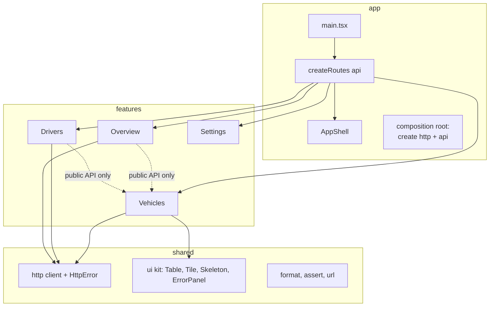
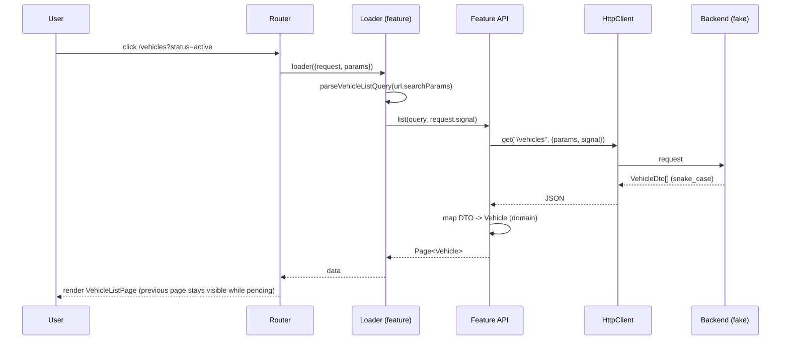

# Project 3 — Multi-Page Dashboard (Routing, API Boundary, Feature Folders)

| | |
|---|---|
| **Phase gate** | After [Phase 4 — Architecture](../04-react-architecture/26-phase-assessment.md) |
| **Architectural focus** | Routing architecture, API boundary and data mapping, feature-based folder structure, error and loading states at route level, URL as state |
| **Estimated effort** | 20–30 hours |
| **Stack** | React 19.x, TypeScript 5.x, Vite, React Router (data router APIs), Vitest + React Testing Library |
| **Not allowed** | Server-state libraries (TanStack Query, SWR), global state libraries. They are the point of [Phase 6](../06-data-fetching-and-state-ecosystems/08-tanstack-query.md) and [Project 6](../ROADMAP.md). Here you build the plain-React baseline so you can later quantify what those libraries buy you. |
| **Prerequisite projects** | [Project 1](./01-interactive-fundamentals-app.md), [Project 2](./02-task-manager-state-ownership.md) |

> **Version note: routing library (verified 2026-10-22).** This project uses React Router's *data router* API (`createBrowserRouter`, route `loader`s, `useSearchParams`, `useNavigation`, route-level error boundaries). React Router 7 merged Remix into the library and changed import paths: hooks and `createBrowserRouter` come from `react-router`, the DOM-specific `RouterProvider` lives at `react-router/dom`, and `react-router-dom` is only a compatibility re-export (its latest published version is 7.18.x). **React Router 8 is now current (8.5 at the time of checking; it requires Node 22.22+ and React 19.2.7+, is ESM-only, and has no `react-router-dom` release).** All the data-mode code and tests in this document typecheck and pass unchanged against both 7.18.4 and 8.5.0 (`lazy` function form, `ErrorBoundary`, `useLoaderData<...>()`, `useRevalidator`, `router.navigate(-1)`, `RouterProvider` from `react-router/dom`); consult the [v7 to v8 upgrade guide](https://reactrouter.com/upgrading/v7) for the future-flag opt-ins. `defer` no longer exists (v7 removed it; return promises inside the loader result and use `<Await>`). The architecture below is router-agnostic; only the glue code is version-sensitive. [Routing architecture](../04-react-architecture/18-routing-architecture.md) discusses the same concepts at a library-neutral level.

---

## 1. Product description

**Fleet Console** is an internal dashboard for a fictional transport operator. Operators monitor vehicles, drivers, and fuel spend.

| Route | Page | Purpose |
|---|---|---|
| `/` | Overview | KPI tiles: vehicles by status, 30-day fuel spend, vehicles needing attention |
| `/vehicles` | Vehicle list | Search, status filter, sort, pagination, all **in the URL** |
| `/vehicles/:vehicleId` | Vehicle detail (layout) | Header + tab navigation |
| `/vehicles/:vehicleId` (index) | Summary tab | Vehicle facts, assigned driver |
| `/vehicles/:vehicleId/transactions` | Transactions tab | Fuel transactions for this vehicle |
| `/drivers` | Driver list | Searchable list; links to assigned vehicle |
| `/settings` | Settings | Display preferences (density, date format), persisted locally |
| `*` | Not found | 404 page inside the shell |

There is no real backend. A **fake backend** in the repository implements the same HTTP-shaped interface that a real client would, returning *wire-format DTOs* (snake_case fields, ISO date strings) with configurable latency and failure injection. The application must treat it exactly as it would a remote service.

---

## 2. Requirements

### 2.1 Functional requirements

| ID | Requirement |
|---|---|
| F1 | An **app shell** (header, side navigation, `<Outlet>`) wraps all pages. Navigation highlights the active section (`NavLink`) including for nested routes |
| F2 | Overview shows three tiles; each tile loads independently enough that one failing tile does not blank the page (decision: see 7) |
| F3 | Vehicle list state (`q`, `status`, `sort`, `dir`, `page`) lives **in the URL query string**. Reloading, sharing the link, and the browser Back button all restore the exact view |
| F4 | Invalid or hostile query params (`page=-3`, `sort=<script>`, `status=banana`) are **normalized to defaults**, never crash, never reach the API unvalidated |
| F5 | Changing filters resets `page` to 1; typing in search uses `replace` navigation so Back does not step through every keystroke |
| F6 | Vehicle detail is a **nested route** with tabs as child routes; the header does not reload when switching tabs |
| F7 | Unknown vehicle ID shows a route-level 404 (not a blank page, not a generic crash) |
| F8 | A failed request shows a route-level error with a retry action; one broken route must not take down the shell |
| F9 | While navigating (loader pending), the shell shows a non-blocking progress indicator and keeps the previous page visible |
| F10 | Route code is **lazy-loaded** per feature (separate chunks per feature route) |
| F11 | Dates and numbers are formatted in the UI layer from domain values (`Date`, `number`), never stored pre-formatted |
| F12 | Settings persist locally and apply immediately across the app |
| F13 | Document title updates per route (`useEffect` is acceptable here, or React 19 `<title>` support) |
| F14 | Keyboard and screen-reader basics: skip link, landmark roles (`header`, `nav`, `main`), focus moved to the page heading (or `main`) after navigation, `aria-current="page"` on the active link |

### 2.2 Architectural requirements (graded as strictly as the features)

| ID | Requirement |
|---|---|
| A1 | **API boundary.** Components never see DTOs. DTO → domain mapping happens in one place per feature (`api/`), is unit-tested, and is the only code that knows wire field names |
| A2 | **Dependency direction.** `shared` ← `features/*` ← `app`. Features never import from `app`; a feature never reaches into another feature's internals (only its public `index.ts`) |
| A3 | **Public API per feature.** Each feature has an `index.ts`; imports across features go through it. Enforced by ESLint (`no-restricted-imports` or a boundaries plugin; use the flat `eslint.config.js` format and check the plugin's current docs for its config shape) |
| A4 | **Injection of the API.** The router is created by `createRoutes(api)`; production passes the HTTP-backed API, tests pass the fake. No module-level singleton imported by loaders |
| A5 | **Cancellation.** Every request accepts an `AbortSignal` (supplied from the loader's `request.signal`); the fake backend honors it |
| A6 | **URL is validated at the boundary.** A pure `parseVehicleListQuery(URLSearchParams)` returns a typed, normalized query object; its inverse `toSearchParams(query)` omits defaults |
| A7 | **No server data in React state you manage yourself.** Loader data is the source; components render it. Derived UI state (e.g. a controlled search input draft) is local |
| A8 | **Errors are typed.** `HttpError` carries `status`; route boundaries distinguish 404 / 4xx / 5xx / network |

### 2.3 Non-functional requirements

- Strict TypeScript. DTO types and domain types are **different types** even where fields coincide today.
- Initial JS (entry chunk) under a budget you set and justify (guidance: < 150 kB gzipped for the entry; verify with `vite build` output or a visualizer). See [Code splitting and lazy loading](../07-performance/15-code-splitting-and-lazy-loading.md).
- No layout shift for route fallbacks (skeletons match final size).
- StrictMode on; no effect depends on running once.

---

## 3. Learning objectives

1. **Design route structure** as architecture: nested layouts, index routes, route-level error and pending boundaries ([Routing architecture](../04-react-architecture/18-routing-architecture.md)).
2. **Draw an API boundary** that isolates wire formats from the domain, and explain why mapping at the edge reduces the blast radius of backend changes ([API boundaries and data access](../04-react-architecture/14-api-boundaries-and-data-access.md), [Application services and adapters](../04-react-architecture/13-application-services-and-adapters.md)).
3. **Organize by feature** with explicit public APIs and enforced dependency rules ([Feature vs layer structure](../04-react-architecture/06-feature-vs-layer-structure.md), [Modular architecture](../04-react-architecture/07-modular-architecture.md), [Architectural fitness and enforcement](../04-react-architecture/25-architectural-fitness-and-enforcement.md)).
4. **Separate server state from client state** in practice, even before adopting a library ([Server vs client state](../04-react-architecture/16-server-vs-client-state.md)).
5. **Use the URL as state** with validation and normalization ([UI, server, URL and shared state](../03-react-state-and-hooks/19-ui-server-url-and-shared-state.md)).
6. **Apply dependency inversion** by injecting the API into routes ([Dependency inversion](../04-react-architecture/11-dependency-inversion.md)).
7. **Handle errors** at the right boundary ([Error boundaries](../04-react-architecture/19-error-boundaries.md)).
8. **Reason about request waterfalls** and cancellation ([Fetch lifecycle](../06-data-fetching-and-state-ecosystems/01-fetch-lifecycle.md), [Cancellation and race conditions](../06-data-fetching-and-state-ecosystems/02-cancellation-and-race-conditions.md), [Network waterfalls](../07-performance/17-network-waterfalls.md)) as far as you have studied them.
9. **Keep domain logic out of UI** ([Domain logic vs UI logic](../04-react-architecture/12-domain-logic-vs-ui-logic.md)).
10. **Document decisions** in short ADRs ([Architecture decision records](../10-production-engineering/16-architecture-decision-records.md) for the format).

---

## 4. Recommended architecture

### 4.1 Layers and dependency direction



Rules (A2/A3): arrows may only point downward/toward `shared`. A dotted arrow means "through the target's `index.ts`". `Overview` needs vehicle statistics and uses `Vehicles`' public API; it must never import `features/vehicles/api/vehicleMapper.ts`.

### 4.2 Request flow (one navigation)



Understand which steps are the router's responsibility (race handling, interrupted navigations: a newer navigation abandons the older loader's result and aborts its `request.signal`; verified on 7.18 and 8.5 with an interrupted `router.navigate`) and which are yours (validation, mapping, error classification).

### 4.3 Where each kind of state lives

| State | Where | Why |
|---|---|---|
| Vehicle list data | Route loader data | Server state, tied to a URL |
| Filters, sort, page | URL | Shareable, restorable, Back-friendly |
| Search input text while typing | `useState` in `VehicleFilters`, initialized from URL | Controlled input needs immediate feedback; URL update is the commit |
| Navigation pending | Router (`useNavigation`) | Owned by router |
| Display settings (density, date format) | Context + `localStorage` (`SettingsProvider`) | Cross-cutting client state, small |
| Sort/column hover, tab focus | Local/DOM | Not shared |

---

## 5. Folder structure

```
fleet-console/
├── docs/adr/
│   ├── 0001-loaders-for-server-data.md
│   ├── 0002-url-as-list-state.md
│   └── 0003-feature-boundaries.md
├── eslint.config.js                 # boundary rules
├── src/
│   ├── main.tsx                     # composition root: creates api, router, providers
│   ├── app/
│   │   ├── routes.tsx               # createRoutes(api): RouteObject[]
│   │   ├── AppShell.tsx             # header, nav, <Outlet/>, pending indicator
│   │   ├── RouteErrorBoundary.tsx
│   │   ├── NotFoundPage.tsx
│   │   └── api.ts                   # type FleetApi = { vehicles, drivers, overview }
│   ├── shared/
│   │   ├── http/
│   │   │   ├── httpClient.ts        # HttpClient interface, createFetchClient
│   │   │   └── httpError.ts
│   │   ├── ui/                      # Table, Tile, Skeleton, ErrorPanel, Pagination
│   │   └── lib/
│   │       ├── format.ts            # formatDate, formatNumber (pure)
│   │       └── assert.ts
│   ├── features/
│   │   ├── vehicles/
│   │   │   ├── index.ts             # public API
│   │   │   ├── model/
│   │   │   │   ├── vehicle.ts       # domain types
│   │   │   │   └── listQuery.ts     # parse/serialize URL query (pure)
│   │   │   ├── api/
│   │   │   │   ├── vehicleDto.ts
│   │   │   │   ├── vehicleMapper.ts
│   │   │   │   ├── vehicleApi.ts
│   │   │   │   └── vehicleMapper.test.ts
│   │   │   ├── routes/
│   │   │   │   ├── vehicleListRoute.tsx    # exports loader factory + Component
│   │   │   │   ├── vehicleDetailRoute.tsx  # layout route
│   │   │   │   ├── vehicleSummaryRoute.tsx
│   │   │   │   └── vehicleTransactionsRoute.tsx
│   │   │   └── ui/
│   │   │       ├── VehicleTable.tsx
│   │   │       ├── VehicleFilters.tsx
│   │   │       └── StatusBadge.tsx
│   │   ├── drivers/ ...
│   │   ├── overview/ ...
│   │   └── settings/
│   │       ├── index.ts
│   │       ├── SettingsProvider.tsx
│   │       └── SettingsPage.tsx
│   ├── mocks/
│   │   ├── fakeBackend.ts           # in-memory HttpClient implementation + failure injection
│   │   └── seed.ts                  # generated deterministic dataset
│   └── test/
│       ├── setup.ts
│       └── renderRoute.tsx          # createMemoryRouter + fake api
```

Notes:

- `features/*/routes` are the **only** place where React Router types appear for a feature. The `model` and `api` folders are router-free and React-free; test them with plain Vitest.
- `app/` is the only layer allowed to know about all features. It is the *composition root* ([Dependency inversion](../04-react-architecture/11-dependency-inversion.md)).
- The fake backend lives in `mocks/` and is imported only by `main.tsx` (dev mode) and tests, never by features.
- This is feature-first structure with a thin layer split **inside** each feature. Compare with [Feature-Sliced Design](../04-react-architecture/09-feature-sliced-design.md) and decide whether the extra rigor is warranted at this size; record the decision.

---

## 6. Milestones

| M | Deliverable | Exit criteria | Time |
|---|---|---|---|
| **M0** | Project scaffold, strict TS, ESLint boundary rules, ADR 0001–0003 drafts | `lint`, `build`, `test` pass on an empty shell. Boundary rule demonstrably fails when a deliberate illegal import is added (then removed) | 2 h |
| **M1** | Shared HTTP layer + fake backend + `HttpError` | Unit tests: success, 404, 500, latency, abort. Backend returns DTOs only | 3 h |
| **M2** | Vehicles API: DTO, mapper, repository | Mapper tests cover optional/null fields, invalid dates, unknown status. No React imported | 3 h |
| **M3** | Router + shell + lazy routes (Overview stub, Vehicles list static) | Navigation works; each feature is a separate chunk (verify in build output) | 3 h |
| **M4** | Vehicle list with URL state | F3–F5 pass; tests for `parseVehicleListQuery` incl. hostile input; Back/forward restores view | 4–5 h |
| **M5** | Vehicle detail nested routes, 404 handling | F6, F7 pass; header persists across tabs (verify DOM node identity does not change) | 3 h |
| **M6** | Overview + drivers; cross-feature access via public API | A3 enforced; Overview uses Vehicles' public API only | 3 h |
| **M7** | Error, pending, and a11y polish | F8, F9, F14 pass; failure injection toggles in a dev panel | 3 h |
| **M8** | Settings + tests + ADR finalization + README | Full checklist (Section 12) | 3 h |

---

## 7. Design decisions you must make and document (ADRs)

| Decision | Options | Notes |
|---|---|---|
| **How is server data loaded?** | (a) Route loaders; (b) `useEffect` + local state hook; (c) `use(promise)` with Suspense | Loaders give you cancellation and race handling for free and remove the "fetch in effect" pitfalls; they couple data loading to routes (data needed outside routes, e.g. a global badge count, doesn't fit). `useEffect` fetching is the baseline most legacy apps use; you must be able to describe its failure modes (races, missing cleanup, waterfalls). Record why you chose (a) and what would make you switch ([Server-side data loading](../06-data-fetching-and-state-ecosystems/14-server-side-data-loading.md), [Suspense data loading](../06-data-fetching-and-state-ecosystems/13-suspense-data-loading.md)). |
| **Overview: one loader or three?** | Single `Promise.all` loader vs independent tiles | A single loader is simple but all-or-nothing: one failure shows the route error. Independent tiles require deferred/streamed data or per-tile fetching. Decide on the UX requirement in F2 and implement accordingly; document the cost. |
| **List filtering location** | Backend (fake) vs client-side after fetching all | Backend: realistic for big data, URL maps to API params. Client: simpler, but unviable beyond a few thousand rows. Requirement: **backend-style** (paged), so pagination is real. |
| **Search commit strategy** | Every keystroke (`replace`) vs debounced vs on submit | Per-keystroke triggers a loader per key; the router abandons stale ones, but the backend still sees traffic. Decide; [Debounce and throttle](../07-performance/14-debounce-and-throttle.md) gives tools. |
| **DTO vs domain divergence** | Reuse DTO types in UI vs separate domain | Separate. Justify with a concrete example (e.g. `last_seen_at: string \| null` → `lastSeenAt: Date \| null`, `status` string → union with `"unknown"` fallback). |
| **Error taxonomy** | Treat all errors alike vs classify | Classify: `not-found`, `client`, `server`, `network`, `aborted`. Aborted errors must **not** render an error UI. |
| **Where settings live** | Context vs URL vs module singleton | Context + storage. Settings are cross-cutting, not server state, not URL-worthy. |
| **Route-level vs component-level error boundaries** | Router `errorElement` vs custom boundary | Use router-level for navigation errors; add a component boundary around risky widgets only if justified. |
| **How strictly to enforce boundaries** | Convention vs lint vs TS project references | Lint at minimum. |

---

## 8. Reference solution guidance

### 8.1 HTTP layer and typed errors

```ts
// src/shared/http/httpError.ts
export type HttpErrorKind = "not-found" | "client" | "server" | "network" | "aborted";

export class HttpError extends Error {
  readonly kind: HttpErrorKind;
  readonly status: number | null;

  constructor(kind: HttpErrorKind, message: string, status: number | null = null, options?: ErrorOptions) {
    super(message, options);
    this.name = "HttpError";
    this.kind = kind;
    this.status = status;
  }
}

export function kindFromStatus(status: number): HttpErrorKind {
  if (status === 404) return "not-found";
  if (status >= 500) return "server";
  return "client";
}
```

```ts
// src/shared/http/httpClient.ts
import { HttpError, kindFromStatus } from "./httpError";

export interface RequestOptions {
  params?: Record<string, string | number | undefined>;
  signal?: AbortSignal;
}

export interface HttpClient {
  get<T>(path: string, options?: RequestOptions): Promise<T>;
}

export function createFetchClient(baseUrl: string): HttpClient {
  return {
    async get<T>(path: string, { params, signal }: RequestOptions = {}): Promise<T> {
      const url = new URL(path, baseUrl);
      for (const [key, value] of Object.entries(params ?? {})) {
        if (value !== undefined) url.searchParams.set(key, String(value));
      }
      let response: Response;
      try {
        response = await fetch(url, { signal, headers: { Accept: "application/json" } });
      } catch (cause) {
        if (signal?.aborted) throw new HttpError("aborted", "Request aborted", null, { cause });
        throw new HttpError("network", "Network error", null, { cause });
      }
      if (!response.ok) {
        throw new HttpError(kindFromStatus(response.status), `HTTP ${response.status}`, response.status);
      }
      return (await response.json()) as T; // the boundary: callers must map/validate
    },
  };
}
```

Code notes: the unchecked `as T` is a deliberate, **single** trust point; the feature API immediately maps and validates. In production code, add runtime validation (Zod/Valibot or hand-written guards as in [Project 2](./02-task-manager-state-ownership.md)) in the mapper. `ErrorOptions`/`cause` requires `lib` ES2022 in `tsconfig`.

### 8.2 DTOs, domain model, mapper

```ts
// src/features/vehicles/api/vehicleDto.ts  (wire format; never exported from the feature)
export interface VehicleDto {
  id: string;
  registration_number: string;
  status: string; // backend may add values; we cannot trust the union
  odometer_km: number | null;
  last_seen_at: string | null; // ISO 8601
  driver_id: string | null;
}

export interface PageDto<T> {
  items: T[];
  total: number;
  page: number;
  page_size: number;
}
```

```ts
// src/features/vehicles/model/vehicle.ts  (domain; what the UI sees)
export type VehicleStatus = "active" | "maintenance" | "offline" | "unknown";

export interface Vehicle {
  readonly id: string;
  readonly registration: string;
  readonly status: VehicleStatus;
  readonly odometerKm: number | null;
  readonly lastSeenAt: Date | null;
  readonly driverId: string | null;
}

export interface Page<T> {
  readonly items: readonly T[];
  readonly total: number;
  readonly page: number;
  readonly pageSize: number;
  readonly pageCount: number;
}
```

```ts
// src/features/vehicles/api/vehicleMapper.ts
import type { Page, Vehicle, VehicleStatus } from "../model/vehicle";
import type { PageDto, VehicleDto } from "./vehicleDto";

const KNOWN: ReadonlySet<string> = new Set<VehicleStatus>(["active", "maintenance", "offline"]);

function toStatus(raw: string): VehicleStatus {
  return KNOWN.has(raw) ? (raw as VehicleStatus) : "unknown";
}

function toDate(raw: string | null): Date | null {
  if (raw === null) return null;
  const d = new Date(raw);
  return Number.isNaN(d.getTime()) ? null : d; // bad data degrades, doesn't crash
}

export function toVehicle(dto: VehicleDto): Vehicle {
  return {
    id: dto.id,
    registration: dto.registration_number,
    status: toStatus(dto.status),
    odometerKm: dto.odometer_km,
    lastSeenAt: toDate(dto.last_seen_at),
    driverId: dto.driver_id,
  };
}

export function toVehiclePage(dto: PageDto<VehicleDto>): Page<Vehicle> {
  return {
    items: dto.items.map(toVehicle),
    total: dto.total,
    page: dto.page,
    pageSize: dto.page_size,
    pageCount: Math.max(1, Math.ceil(dto.total / dto.page_size)),
  };
}
```

The mapper is where "the backend added a new status" becomes a non-event (`"unknown"` renders a neutral badge) instead of a production crash. The **unknown fallback is a design decision**; the alternative is to fail loudly. Document which you chose and why.

### 8.3 URL query as a typed, validated value

```ts
// src/features/vehicles/model/listQuery.ts
import type { VehicleStatus } from "./vehicle";

export const SORT_KEYS = ["registration", "odometer", "lastSeen"] as const;
export type SortKey = (typeof SORT_KEYS)[number];
export type SortDir = "asc" | "desc";
export type StatusFilter = Exclude<VehicleStatus, "unknown"> | "all";

export interface VehicleListQuery {
  q: string;
  status: StatusFilter;
  sort: SortKey;
  dir: SortDir;
  page: number;
}

export const DEFAULT_QUERY: VehicleListQuery = {
  q: "",
  status: "all",
  sort: "registration",
  dir: "asc",
  page: 1,
};

const STATUSES: readonly StatusFilter[] = ["all", "active", "maintenance", "offline"];
const MAX_Q = 100;

function pick<T extends string>(value: string | null, allowed: readonly T[], fallback: T): T {
  return allowed.find((a) => a === value) ?? fallback;
}

export function parseVehicleListQuery(params: URLSearchParams): VehicleListQuery {
  const rawPage = Number.parseInt(params.get("page") ?? "", 10);
  return {
    q: (params.get("q") ?? "").slice(0, MAX_Q).trim(),
    status: pick(params.get("status"), STATUSES, DEFAULT_QUERY.status),
    sort: pick(params.get("sort"), SORT_KEYS, DEFAULT_QUERY.sort),
    dir: pick(params.get("dir"), ["asc", "desc"] as const, DEFAULT_QUERY.dir),
    page: Number.isFinite(rawPage) && rawPage >= 1 ? rawPage : 1,
  };
}

/** Inverse of parse; omits defaults so URLs stay short and canonical. */
export function toSearchParams(query: VehicleListQuery): URLSearchParams {
  const params = new URLSearchParams();
  if (query.q !== "") params.set("q", query.q);
  if (query.status !== DEFAULT_QUERY.status) params.set("status", query.status);
  if (query.sort !== DEFAULT_QUERY.sort) params.set("sort", query.sort);
  if (query.dir !== DEFAULT_QUERY.dir) params.set("dir", query.dir);
  if (query.page !== DEFAULT_QUERY.page) params.set("page", String(query.page));
  return params;
}
```

Property to test: `parse(toSearchParams(parse(x))) deep-equals parse(x)` for any input (round-trip idempotence). Hostile inputs (`page=1e9`, `page=0x10`, `sort=__proto__`, 10 kB `q`) must produce valid queries. `pick` compares by equality against an allow-list; never index an object with a user-controlled key.

### 8.4 Feature API (the only code that talks to the HTTP client)

```ts
// src/features/vehicles/api/vehicleApi.ts
import type { HttpClient } from "../../../shared/http/httpClient";
import type { Page, Vehicle } from "../model/vehicle";
import type { VehicleListQuery } from "../model/listQuery";
import { toVehicle, toVehiclePage } from "./vehicleMapper";
import type { PageDto, VehicleDto } from "./vehicleDto";

export interface VehicleApi {
  list(query: VehicleListQuery, signal?: AbortSignal): Promise<Page<Vehicle>>;
  get(id: string, signal?: AbortSignal): Promise<Vehicle>;
}

export function createVehicleApi(http: HttpClient): VehicleApi {
  return {
    async list(query, signal) {
      const dto = await http.get<PageDto<VehicleDto>>("/vehicles", {
        signal,
        params: {
          q: query.q || undefined,
          status: query.status === "all" ? undefined : query.status,
          sort: query.sort,
          dir: query.dir,
          page: query.page,
          page_size: 20,
        },
      });
      return toVehiclePage(dto);
    },
    async get(id, signal) {
      return toVehicle(await http.get<VehicleDto>(`/vehicles/${encodeURIComponent(id)}`, { signal }));
    },
  };
}
```

`encodeURIComponent` on path segments is part of the boundary's responsibility; route params come from the URL and are user-controlled.

### 8.5 Routes: lazy, injected, with loaders

```tsx
// src/app/api.ts
import type { VehicleApi } from "../features/vehicles";
import type { DriverApi } from "../features/drivers";
import type { OverviewApi } from "../features/overview";

export interface FleetApi {
  vehicles: VehicleApi;
  drivers: DriverApi;
  overview: OverviewApi;
}
```

```tsx
// src/app/routes.tsx
import type { RouteObject } from "react-router";
import type { FleetApi } from "./api";
import { AppShell } from "./AppShell";
import { RouteErrorBoundary } from "./RouteErrorBoundary";
import { NotFoundPage } from "./NotFoundPage";

export function createRoutes(api: FleetApi): RouteObject[] {
  return [
    {
      path: "/",
      Component: AppShell,
      children: [
        {
          // Pathless layout route INSIDE the shell: an error from any child route below replaces only the
          // <Outlet> content, so the header and navigation stay on screen (see §8.9).
          ErrorBoundary: RouteErrorBoundary,
          children: [
            {
              index: true,
              lazy: async () => {
                const m = await import("../features/overview/routes/overviewRoute");
                return { Component: m.OverviewPage, loader: m.createOverviewLoader(api.overview) };
              },
            },
            {
              path: "vehicles",
              lazy: async () => {
                const m = await import("../features/vehicles/routes/vehicleListRoute");
                return { Component: m.VehicleListPage, loader: m.createVehicleListLoader(api.vehicles) };
              },
            },
            {
              path: "vehicles/:vehicleId",
              lazy: async () => {
                const m = await import("../features/vehicles/routes/vehicleDetailRoute");
                return { Component: m.VehicleDetailLayout, loader: m.createVehicleDetailLoader(api.vehicles) };
              },
              children: [
                {
                  index: true,
                  lazy: async () => ({
                    Component: (await import("../features/vehicles/routes/vehicleSummaryRoute")).VehicleSummaryTab,
                  }),
                },
                {
                  path: "transactions",
                  lazy: async () => {
                    const m = await import("../features/vehicles/routes/vehicleTransactionsRoute");
                    return { Component: m.VehicleTransactionsTab, loader: m.createTransactionsLoader(api.vehicles) };
                  },
                },
              ],
            },
            // drivers, settings similarly
            { path: "*", Component: NotFoundPage },
          ],
        },
      ],
    },
  ];
}
```

```tsx
// src/main.tsx
import { StrictMode } from "react";
import { createRoot } from "react-dom/client";
import { createBrowserRouter } from "react-router";
import { RouterProvider } from "react-router/dom"; // v7/v8 path; in v6 it was "react-router-dom"
import { createRoutes } from "./app/routes";
import { createFleetApi } from "./app/createFleetApi";
import { SettingsProvider } from "./features/settings";

const api = createFleetApi(); // composition root: picks fake or real HttpClient from config
const router = createBrowserRouter(createRoutes(api));

createRoot(document.getElementById("root")!).render(
  <StrictMode>
    <SettingsProvider>
      <RouterProvider router={router} />
    </SettingsProvider>
  </StrictMode>,
);
```

(The `!` on `getElementById` is acceptable in a composition root where failure is unrecoverable; Project 2 shows the guarded form.) The router is created **outside** React, at module scope, once. Creating it inside a component would recreate it on every render and reset navigation state.

> Route `lazy` semantics (verified on 7.18 and 8.5): the function form used above returns route-object properties (`Component`, `loader`, `ErrorBoundary`, ...). Newer 7.x releases also accept an object form whose properties are individually lazy, so a loader can start without waiting for the component chunk; see the `lazy` section of the [route object docs](https://reactrouter.com/start/data/route-object). `lazy` does not run for a route until navigation matches it, which creates a **code-load then data-load waterfall** you should measure ([Network waterfalls](../07-performance/17-network-waterfalls.md)). Mitigations: preload by calling the `import()` yourself on link hover/focus; `<Link prefetch="intent">` is documented as a framework-mode feature, so it does not apply to this data-mode setup.

### 8.6 A loader with validation and typed data

```tsx
// src/features/vehicles/routes/vehicleListRoute.tsx
import { useLoaderData, useNavigation, type LoaderFunctionArgs } from "react-router";
import type { VehicleApi } from "../api/vehicleApi";
import { parseVehicleListQuery } from "../model/listQuery";
import { VehicleFilters } from "../ui/VehicleFilters";
import { VehicleTable } from "../ui/VehicleTable";
import { Pagination } from "../../../shared/ui/Pagination";

export function createVehicleListLoader(api: VehicleApi) {
  return async ({ request }: LoaderFunctionArgs) => {
    const url = new URL(request.url);
    const query = parseVehicleListQuery(url.searchParams); // validate at the boundary
    const page = await api.list(query, request.signal); // cancellation: A5
    return { query, page };
  };
}

export function VehicleListPage() {
  // The generic derives the data type from the loader factory (no cast; Date fields stay Date).
  const { query, page } = useLoaderData<ReturnType<typeof createVehicleListLoader>>();
  const navigation = useNavigation();
  const isPending = navigation.state === "loading";

  return (
    <section aria-labelledby="vehicles-heading" aria-busy={isPending}>
      <h1 id="vehicles-heading" tabIndex={-1}>Vehicles</h1>
      <VehicleFilters query={query} />
      <div className={isPending ? "dim" : undefined}>
        <VehicleTable vehicles={page.items} sort={{ key: query.sort, dir: query.dir }} />
      </div>
      <Pagination page={page.page} pageCount={page.pageCount} />
    </section>
  );
}
```

Notes:

- The loader returns **both** the normalized `query` and the data. The UI renders from the *normalized* query, so a hostile URL (`?status=banana`) displays the actual applied state, not the raw junk. Consider redirecting to the canonical URL (`redirect`) when the normalized form differs, as a stricter alternative.
- `isPending` keeps the old table visible and dimmed while the next page loads (F9). Contrast with showing a spinner that wipes content: the former avoids flashing and preserves scroll.
- `useLoaderData<ReturnType<typeof createVehicleListLoader>>()`: in data mode the generic argument is the loader *function type* and the hook returns its (awaited) result type. Verified on 7.18 and 8.5 that `Date` fields stay `Date` and a wrong assignment fails to compile. It is still a compile-time claim only: nothing checks at runtime that this component is rendered by that route, so keep the loader and component in the same file.
- The loader is a **factory** receiving `api`. That is dependency inversion in one line: routes depend on the `VehicleApi` interface, not on `fetch` or the fake.

### 8.7 URL-driven filters

```tsx
// src/features/vehicles/ui/VehicleFilters.tsx
import { useState } from "react";
import { useSearchParams } from "react-router";
import { toSearchParams, type StatusFilter, type VehicleListQuery } from "../model/listQuery";

const STATUS_OPTIONS: readonly { value: StatusFilter; label: string }[] = [
  { value: "all", label: "All statuses" },
  { value: "active", label: "Active" },
  { value: "maintenance", label: "In maintenance" },
  { value: "offline", label: "Offline" },
];

export function VehicleFilters({ query }: { query: VehicleListQuery }) {
  const [, setSearchParams] = useSearchParams();
  // Draft keeps the input responsive between URL commits. Initialized from the URL;
  // re-synchronized by remounting via `key` on the parent (see below), not by an effect.
  const [draft, setDraft] = useState(query.q);

  function commit(next: Partial<VehicleListQuery>, { replace }: { replace: boolean }) {
    setSearchParams(toSearchParams({ ...query, page: 1, ...next }), { replace });
  }

  return (
    <form role="search" onSubmit={(e) => e.preventDefault()}>
      <label>
        Search
        <input
          type="search"
          value={draft}
          onChange={(e) => {
            setDraft(e.target.value);
            commit({ q: e.target.value.trim() }, { replace: true }); // F5: no history spam
          }}
        />
      </label>
      <label>
        Status
        <select
          value={query.status}
          onChange={(e) => commit({ status: e.target.value as StatusFilter }, { replace: false })}
        >
          {STATUS_OPTIONS.map((o) => (
            <option key={o.value} value={o.value}>{o.label}</option>
          ))}
        </select>
      </label>
    </form>
  );
}
```

Design challenges you must resolve (this is deliberately incomplete):

1. **URL → draft sync.** When the user presses Back, `query.q` changes but `draft` does not. Rather than `useEffect(() => setDraft(query.q), [query.q])` (an anti-pattern: [You might not need an effect](../03-react-state-and-hooks/07-you-might-not-need-an-effect.md)), reset by giving the component a `key` tied to the URL-committed value *when it changes from outside*, or store the draft with the "adjust state during render" pattern. Compare both and choose; note that keying on `query.q` itself would remount (and blur) the input on every keystroke, which is **wrong**. Think about which signal distinguishes "URL changed by me" from "URL changed by Back".
2. **Every keystroke is a navigation**, so a loader per key. The router discards superseded results; confirm in the Network panel that aborted requests show as cancelled.
3. `e.target.value as StatusFilter` is an assertion; replace with a guard function from the model.

### 8.8 Nested detail route with 404

```tsx
// src/features/vehicles/routes/vehicleDetailRoute.tsx
import { NavLink, Outlet, useLoaderData, type LoaderFunctionArgs } from "react-router";
import type { VehicleApi } from "../api/vehicleApi";
import { HttpError } from "../../../shared/http/httpError";

export function createVehicleDetailLoader(api: VehicleApi) {
  return async ({ params, request }: LoaderFunctionArgs) => {
    const id = params.vehicleId;
    if (id === undefined) throw new Response("Missing vehicle id", { status: 400 });
    try {
      return await api.get(id, request.signal);
    } catch (error) {
      if (error instanceof HttpError && error.kind === "not-found") {
        throw new Response("Vehicle not found", { status: 404 }); // surfaces as a route error response
      }
      throw error; // everything else reaches the route error boundary as-is
    }
  };
}

export function VehicleDetailLayout() {
  const vehicle = useLoaderData<ReturnType<typeof createVehicleDetailLoader>>();
  return (
    <article>
      <header>
        <h1 tabIndex={-1}>{vehicle.registration}</h1>
        <nav aria-label="Vehicle sections">
          <NavLink to="." end>Summary</NavLink>
          <NavLink to="transactions">Transactions</NavLink>
        </nav>
      </header>
      <Outlet context={vehicle} />
    </article>
  );
}
```

The layout loader runs **in parallel** with the active child's loader (router behavior; verified on 7.18 and 8.5: both loaders start within the same tick) so the header and tab content do not form a waterfall; confirm in the Network panel. A child can read the parent's data through `<Outlet context>`/`useOutletContext` or `useRouteLoaderData(routeId)`. Choose and justify; each creates a coupling between child and parent.

### 8.9 Error boundary with a typed taxonomy

```tsx
// src/app/RouteErrorBoundary.tsx
import { isRouteErrorResponse, useNavigate, useRevalidator, useRouteError } from "react-router";
import { HttpError } from "../shared/http/httpError";

export function RouteErrorBoundary() {
  const error = useRouteError();
  const revalidator = useRevalidator();
  const navigate = useNavigate();

  if (isRouteErrorResponse(error) && error.status === 404) {
    return (
      <div role="alert">
        <h1>Not found</h1>
        <p>We could not find that page or record.</p>
        <button type="button" onClick={() => navigate("/")}>Go to overview</button>
      </div>
    );
  }

  if (error instanceof HttpError) {
    if (error.kind === "aborted") return null; // superseded navigation: not an error to the user
    const retryable = error.kind === "network" || error.kind === "server";
    return (
      <div role="alert">
        <h1>{error.kind === "network" ? "You appear to be offline" : "Something went wrong"}</h1>
        {retryable && (
          <button type="button" onClick={() => revalidator.revalidate()}>Try again</button>
        )}
      </div>
    );
  }

  console.error(error); // unexpected: log and show generic fallback
  return <div role="alert"><h1>Unexpected error</h1></div>;
}
```

Placement matters: an `ErrorBoundary` on the route that renders `AppShell` replaces the **whole shell** when a child fails with no nearer boundary (an error boundary renders *in place of* the route that owns it). That is why `createRoutes` in §8.5 attaches the boundary to a **pathless layout route inside the shell**, so errors replace only the `<Outlet>`'s content. Verified: with the boundary on the shell route itself, the "keeps the shell" test in §9.2 fails (no navigation landmark); with the pathless route it passes. This is the single most important routing-architecture decision in the project; write it up. `useRevalidator().revalidate()` does re-run the loader of a route that is currently showing its error boundary (verified on 7.18 and 8.5: the second call succeeded and the page recovered), so no `navigate(0)` workaround is needed.

### 8.10 The fake backend (HttpClient implementation)

```ts
// src/mocks/fakeBackend.ts
import type { HttpClient, RequestOptions } from "../shared/http/httpClient";
import { HttpError } from "../shared/http/httpError";
import { vehicles as seedVehicles } from "./seed";
import type { PageDto, VehicleDto } from "../features/vehicles/api/vehicleDto"; // mocks MAY import DTOs

export interface FakeBackendOptions {
  latencyMs?: number;
  /** return a status code to simulate failure for a given path, else undefined */
  failure?: (path: string) => number | "network" | undefined;
}

function sleep(ms: number, signal?: AbortSignal): Promise<void> {
  return new Promise((resolve, reject) => {
    if (signal?.aborted) return reject(new HttpError("aborted", "Request aborted"));
    const id = setTimeout(resolve, ms);
    signal?.addEventListener("abort", () => {
      clearTimeout(id);
      reject(new HttpError("aborted", "Request aborted"));
    }, { once: true });
  });
}

export function createFakeBackend({ latencyMs = 250, failure }: FakeBackendOptions = {}): HttpClient {
  return {
    async get<T>(path: string, { params = {}, signal }: RequestOptions = {}): Promise<T> {
      await sleep(latencyMs, signal);
      const fail = failure?.(path);
      if (fail === "network") throw new HttpError("network", "Network error");
      if (typeof fail === "number") throw new HttpError(fail >= 500 ? "server" : "client", `HTTP ${fail}`, fail);

      if (path === "/vehicles") return listVehicles(params) as T;
      const match = /^\/vehicles\/([^/]+)$/.exec(path);
      if (match) {
        const found = seedVehicles.find((v) => v.id === decodeURIComponent(match[1]!));
        if (!found) throw new HttpError("not-found", "HTTP 404", 404);
        return found as T;
      }
      throw new HttpError("not-found", "HTTP 404", 404);
    },
  };
}

function listVehicles(params: NonNullable<RequestOptions["params"]>): PageDto<VehicleDto> {
  const q = String(params.q ?? "").toLowerCase();
  const status = params.status === undefined ? null : String(params.status);
  const pageSize = Number(params.page_size ?? 20);
  const page = Math.max(1, Number(params.page ?? 1));
  let rows = seedVehicles.filter(
    (v) => (q === "" || v.registration_number.toLowerCase().includes(q)) && (status === null || v.status === status),
  );
  // sorting by params.sort / params.dir omitted for brevity: implement it
  const total = rows.length;
  rows = rows.slice((page - 1) * pageSize, page * pageSize);
  return { items: rows, total, page, page_size: pageSize };
}
```

The fake backend returns **DTO-shaped** data, honors `AbortSignal`, and can inject failures. Keep it dumb; if it grows logic, you are building a second application. For higher fidelity (real `fetch` calls, headers, status codes), replace it with MSW in tests ([Mocking strategies and MSW](../08-testing-and-quality/06-mocking-strategies-and-msw.md)).

### 8.11 Settings context (client state, kept small)

```tsx
// src/features/settings/SettingsProvider.tsx
import { createContext, useContext, useEffect, useMemo, useState, type ReactNode } from "react";

export interface Settings {
  density: "comfortable" | "compact";
  dateStyle: "short" | "long";
}
const DEFAULTS: Settings = { density: "comfortable", dateStyle: "short" };
const KEY = "fleet-console:settings:v1";

interface SettingsApi { settings: Settings; update(patch: Partial<Settings>): void }
const SettingsContext = createContext<SettingsApi | null>(null);

function load(): Settings {
  try {
    const raw = localStorage.getItem(KEY);
    return raw ? { ...DEFAULTS, ...(JSON.parse(raw) as Partial<Settings>) } : DEFAULTS;
  } catch {
    return DEFAULTS;
  }
}

export function SettingsProvider({ children }: { children: ReactNode }) {
  const [settings, setSettings] = useState<Settings>(load);

  useEffect(() => {
    try { localStorage.setItem(KEY, JSON.stringify(settings)); } catch { /* best effort */ }
  }, [settings]);

  const api = useMemo<SettingsApi>(
    () => ({ settings, update: (patch) => setSettings((s) => ({ ...s, ...patch })) }),
    [settings],
  );
  return <SettingsContext value={api}>{children}</SettingsContext>;
}

export function useSettings(): SettingsApi {
  const ctx = useContext(SettingsContext);
  if (ctx === null) throw new Error("useSettings must be used within SettingsProvider");
  return ctx;
}
```

The merged `JSON.parse` here trusts stored shape more than [Project 2's](./02-task-manager-state-ownership.md) guard-based loader; tighten it (validate the two fields) as part of M8 and note why. `useMemo` is justified because the context value is an object recreated per render and many consumers exist; measure rather than assume.

### 8.12 Accessibility on navigation

Client-side navigation does not move focus or announce the new page. A minimal solution in the shell:

```tsx
// inside AppShell
const location = useLocation();
const mainRef = useRef<HTMLElement>(null);
useEffect(() => {
  mainRef.current?.querySelector<HTMLElement>("h1")?.focus();
  // document.title updated per route via route `handle` + useMatches, or React 19 <title>
}, [location.pathname]);
```

This is a legitimate effect (synchronizing focus, an imperative DOM concern, with a route change). The `h1` needs `tabIndex={-1}` to be focusable programmatically (as in the examples above). Decide whether to run it on search-param changes (probably not; it would steal focus from the search input while typing, a bug to avoid by depending on `pathname` only).

---

## 9. Testing expectations

See [Integration testing](../08-testing-and-quality/08-integration-testing.md), [Testing API interactions](../08-testing-and-quality/07-testing-api-interactions.md), and [Testing async updates](../08-testing-and-quality/04-testing-async-updates.md).

### 9.1 Pure unit tests (fast, no React)

| Module | Required cases |
|---|---|
| `listQuery.ts` | defaults; each param valid/invalid; hostile values (`page=-1`, `page=NaN`, `sort=__proto__`, overlong `q`); round trip `parse(toSearchParams(parse(x)))` equals `parse(x)`; omission of defaults |
| `vehicleMapper.ts` | full DTO; `null` odometer/date; invalid date string -> `null`; unknown status -> `"unknown"`; `pageCount` for `total = 0` is 1 |
| `httpClient`/`fakeBackend` | success, 404 -> `not-found`, 500 -> `server`, abort rejects with `aborted`, no resolution after abort |
| `format.ts` | locale-dependent output uses explicit locale/timezone options so tests are deterministic |

### 9.2 Route-level integration tests

```tsx
// src/test/renderRoute.tsx
import { render } from "@testing-library/react";
import { createMemoryRouter } from "react-router";
import { RouterProvider } from "react-router/dom";
import { createRoutes } from "../app/routes";
import { createFleetApiFromHttp } from "../app/createFleetApi";
import { createFakeBackend, type FakeBackendOptions } from "../mocks/fakeBackend";
import { SettingsProvider } from "../features/settings";

export function renderRoute(initialEntry: string, backend: FakeBackendOptions = { latencyMs: 0 }) {
  const api = createFleetApiFromHttp(createFakeBackend(backend));
  const router = createMemoryRouter(createRoutes(api), { initialEntries: [initialEntry] });
  const utils = render(
    <SettingsProvider>
      <RouterProvider router={router} />
    </SettingsProvider>,
  );
  return { router, api, ...utils };
}
```

```tsx
// src/test/vehicles.test.tsx
import { expect, it } from "vitest";
import { screen } from "@testing-library/react";
import userEvent from "@testing-library/user-event";
import { renderRoute } from "./renderRoute";

it("restores filters from the URL and normalizes hostile params", async () => {
  renderRoute("/vehicles?status=banana&page=-5&sort=__proto__");
  expect(await screen.findByRole("heading", { name: "Vehicles" })).toBeInTheDocument();
  expect(screen.getByRole("combobox", { name: /status/i })).toHaveValue("all");
});

it("filters via the URL and keeps Back working", async () => {
  const user = userEvent.setup();
  const { router } = renderRoute("/vehicles");
  await screen.findByRole("table");
  await user.selectOptions(screen.getByRole("combobox", { name: /status/i }), "active");
  expect(router.state.location.search).toBe("?status=active");
  await router.navigate(-1);
  expect(router.state.location.search).toBe("");
});

it("shows a route-level 404 for an unknown vehicle but keeps the shell", async () => {
  renderRoute("/vehicles/does-not-exist");
  expect(await screen.findByRole("heading", { name: /not found/i })).toBeInTheDocument();
  expect(screen.getByRole("navigation", { name: /main/i })).toBeInTheDocument(); // shell survived
});

it("shows a retryable error for server failures", async () => {
  renderRoute("/vehicles", { latencyMs: 0, failure: () => 503 });
  expect(await screen.findByRole("button", { name: /try again/i })).toBeInTheDocument();
});
```

Test-environment gotchas (reproduced with Vitest 3, jsdom 30, Node 24, React Router 7.18.4 and 8.5.0):

- **jsdom `AbortSignal` vs Node `Request`.** React Router builds a `Request` with a `signal` for each loader call. Under Vitest's jsdom environment this throws `TypeError: RequestInit: Expected signal ("AbortSignal {}") to be an instance of AbortSignal` and every route renders its error boundary or nothing. Either use `// @vitest-environment node` for router-only tests, or wrap the global `Request` in `src/test/setup.ts` so a rejected signal is dropped (cancellation then cannot be asserted in that test; assert it in a node-environment test instead).
- **Two copies of the router (7.x only).** If tests fail with `useRouteError must be used within a data router`, the `react-router` and `react-router/dom` entry points resolved to different module formats. Import `RouterProvider` from `react-router` in tests (verified), or alias both to the `.mjs` builds. React Router 8 is ESM-only and does not show this.

Notes: the first loader call is async so use `findBy*`; do not sprinkle `waitFor` around synchronous assertions. `router.navigate(-1)` is the data-router API for history traversal in a memory router (verified on 7.18 and 8.5).

### 9.3 Architectural tests

- **Boundary lint test:** keep a script `npm run lint:arch` that lints a fixture file importing `features/vehicles/api/vehicleMapper` from `features/overview` and expects the rule to fail (a "negative test" for your own architecture).
- **No DTO leakage:** a test (or TS-level check) that `features/vehicles/index.ts` exports no symbol matching `/Dto$/`. A simple `import * as vehicles` + `Object.keys` check works for runtime exports; types require a type-level test such as Vitest's `expectTypeOf`.
- **Chunking:** a build-time assertion script that `dist/assets` contains at least one chunk per lazy feature route.

### 9.4 E2E (optional but recommended)

One Playwright test per core journey (list → filter → detail → transactions → Back). See [E2E with Playwright](../08-testing-and-quality/09-e2e-with-playwright.md).

---

## 10. Performance expectations

| Area | Expectation | How to verify |
|---|---|---|
| Entry bundle | Within your stated budget; each feature route in its own chunk | `vite build` output; a bundle visualizer ([Bundle analysis](../07-performance/16-bundle-analysis.md)) |
| Route transitions | Previous page remains visible while the next loads; no blank flash for loads under ~300 ms | Manual with 250 ms and 1500 ms fake latency; Performance panel |
| Request waterfalls | Parent and child loaders run in parallel; no component-triggered fetch after render for data the route already knows it needs | Network panel waterfall; write down the critical path per route |
| Lazy route waterfall | You have measured the code-load → data-load sequence for first navigation to `/vehicles` and chosen a mitigation or documented the cost | Network panel; consider hover preloading |
| Typing in search | No dropped keystrokes; superseded requests cancelled | Network panel shows cancelled requests; input remains responsive at 1500 ms latency |
| List rendering | 20 rows per page requires no virtualization; confirm rows do not re-render on unrelated changes (e.g. settings toggle re-renders all rows because of context; decide whether acceptable) | React DevTools Profiler |
| Rendering after navigation | Switching tabs does not remount the detail header (same DOM node) | Elements panel, "flash" a node, or a test keeping a reference |
| Memory | No leaked listeners/timers on route unmount (the fake backend's abort listener is `once` and cleared) | Heap snapshot comparison after 50 navigations ([Memory leaks](../07-performance/19-memory-leaks.md)) |

Record a short performance note in the README: first-load JS, route chunk sizes, and the time-to-visible-content under 250 ms and 1500 ms fake latency.

---

## 11. Common implementation mistakes

| Mistake | Consequence | Fix |
|---|---|---|
| Components import DTO types or use `snake_case` fields | Backend rename ripples through the UI | Map at the edge; DTO types are not exported from the feature |
| Fetching in `useEffect` inside list/detail components "because it's easier" | Races, missing cleanup, request waterfalls after render, loading flags duplicated per component | Loaders (or a server-state library later) |
| Router created inside a component | State resets on every render; infinite navigation loops | Create once at module scope |
| Storing URL-derived state in `useState` and syncing with effects | Double sources of truth; Back button broken | URL is the source; local draft only for in-flight input |
| Trusting query params (`Number(params.get("page"))` with no validation) | `NaN` or negative pages reach the API; crashes | `parseVehicleListQuery` |
| Pushing history entry per keystroke | Back must be pressed 20 times | `replace: true` for incremental input |
| Resetting `page` only sometimes | User lands on a page that no longer exists after filtering | Reset to 1 on any filter/sort change |
| Treating `aborted` as an error | Error flashes during fast navigation | Ignore/skip in boundary |
| Putting the error boundary only at the root | A failing child wipes the shell | Boundary under the shell, around `<Outlet>` |
| Catch-all `catch (e) { return null }` in loaders | Silent failures, empty pages with no explanation | Classify and rethrow |
| Cross-feature deep imports | Hidden coupling; refactors become risky | Public `index.ts`, lint rule |
| Shared `types.ts` dumping ground | Everything depends on everything | Types live with the feature that owns them |
| Putting the fake backend import in feature code | Production bundle includes mocks | Only composition root/tests import `mocks/` |
| Formatting dates/numbers in the mapper | Locale/timezone fixed at fetch time; untestable | Format in UI from `Date`/`number` |
| Focusing `h1` on every location change including search params | Focus stolen while typing | Depend on `pathname` only |
| Using `<a href>` instead of `<Link>` | Full page reloads | Router links |
| Relying on `index` as a key in table rows | Row state/focus mismatches after sorting | Entity `id` |
| Over-abstracting a generic `useFetch` or `Repository<T>` early | Premature abstraction | Wait for three real duplicates ([DRY, KISS, YAGNI](../05-design-patterns/02-dry-kiss-yagni.md)) |

---

## 12. Review checklist

**Routing**
- [ ] Route tree matches the table in Section 1; nested layouts are used instead of conditional rendering.
- [ ] `NavLink` highlights correctly for nested routes; `end` used where needed; `aria-current` present.
- [ ] Error boundary placement keeps the shell alive; 404 and 5xx are distinct.
- [ ] Pending UI keeps previous content visible; no layout shift.
- [ ] Focus and document title updated on navigation without stealing focus on search-param changes.

**API boundary**
- [ ] DTOs exist only inside `api/`; mapper unit-tested; domain types contain `Date`/union types rather than raw strings.
- [ ] Every request takes an `AbortSignal`; aborted requests are not shown as errors.
- [ ] Error classification (`HttpError.kind`) is used by the UI; no string matching on messages.
- [ ] Unknown enum values and invalid dates degrade gracefully (documented policy).

**Architecture**
- [ ] Dependency directions verified by lint; negative test proves it can fail.
- [ ] Each feature exposes only `index.ts`; no cross-feature deep imports.
- [ ] `createRoutes(api)` injects the API; no module-level API singleton in features.
- [ ] No server data copied into `useState`/context.
- [ ] ADRs exist for: loaders, URL state, boundaries; each lists alternatives and consequences.

**URL state**
- [ ] `parse`/`toSearchParams` are pure, tested, and round-trip.
- [ ] Back/forward and reload restore the same view; defaults omitted from URLs.

**Quality**
- [ ] Strict TS; `as` casts are listed and justified (loader data, JSON boundary).
- [ ] Integration tests cover list filtering via URL, 404, 5xx, nested tab navigation.
- [ ] Bundle: entry and per-route chunks documented.
- [ ] `lint`, `lint:arch`, `build`, `test` pass on a clean clone; README explains how to run with latency/failure injection.

---

## 13. Optional extensions

| # | Extension | What it teaches | Related lessons |
|---|---|---|---|
| E1 | Replace loader data with **TanStack Query** (loaders prefetch into the query cache) and compare caching, refetch, and code size | Server-state ownership | [Server state management](../06-data-fetching-and-state-ecosystems/07-server-state-management.md), [TanStack Query](../06-data-fetching-and-state-ecosystems/08-tanstack-query.md) |
| E2 | **Streamed overview**: return promises from the loader and render tiles with `<Suspense>`/`<Await>` (in v7 and v8 there is no `defer`: return an object that contains promises) | Independent tile failure, streaming | [Suspense data loading](../06-data-fetching-and-state-ecosystems/13-suspense-data-loading.md), [Suspense architecture](../09-advanced-rendering-and-ecosystem/05-suspense-architecture.md) |
| E3 | **Mutations**: edit vehicle nickname with route `action`s and optimistic UI | Forms, actions, revalidation | [Optimistic updates](../06-data-fetching-and-state-ecosystems/05-optimistic-updates.md), [Forms, actions and mutations](../09-advanced-rendering-and-ecosystem/13-forms-actions-and-mutations.md) |
| E4 | **Role-based routes** (viewer vs admin) with redirect in loaders and hidden nav | Auth boundaries | [Auth boundaries](../09-advanced-rendering-and-ecosystem/12-auth-boundaries.md) |
| E5 | **Generate the DTO types from an OpenAPI/JSON schema** and validate with a schema library | Contract testing | [Component contract testing](../08-testing-and-quality/11-component-contract-testing.md) |
| E6 | **Real-time status updates** (WebSocket or SSE simulated in the fake backend) merged into the list | Subscriptions, cache coherence | [Real-time WebSockets and subscriptions](../06-data-fetching-and-state-ecosystems/17-real-time-websockets-subscriptions.md) |
| E7 | **Enforce architecture** with a dependency-graph tool in CI and a TypeScript path alias strategy | Fitness functions | [Architectural fitness and enforcement](../04-react-architecture/25-architectural-fitness-and-enforcement.md) |
| E8 | **Migrate to a framework** (React Router framework mode or Next.js App Router) and write a migration ADR | Server boundaries | [Framework architecture](../09-advanced-rendering-and-ecosystem/09-framework-architecture.md), [Application migrations](../10-production-engineering/13-application-migrations.md) |
| E9 | **Design system extraction**: move `shared/ui` into a package in a workspace | Component libraries, monorepos | [Design systems](../04-react-architecture/20-design-systems.md), [Monorepos and shared packages](../04-react-architecture/22-monorepos-and-shared-packages.md) |
| E10 | **Internationalization** of dates, numbers and labels | Locale-aware formatting | [Internationalization](../10-production-engineering/09-internationalization.md) |

---

## 14. Completion criteria

You are done when a reviewer can: (1) change a backend field name and see the change contained to one mapper and its test; (2) add a new feature folder following your documented rules without touching existing features; (3) paste a hostile URL and see a sane page; (4) kill the "network" via the failure injector and watch the shell survive with a retryable error; and (5) read your three ADRs and understand not just what you chose but when you would choose differently.

Next: [Project 8 — Enterprise modular app](../ROADMAP.md) extends this with enforced boundaries and heavier testing; [Project 6 — E-commerce with caching](../ROADMAP.md) replaces the hand-built data layer with server-state caching.
