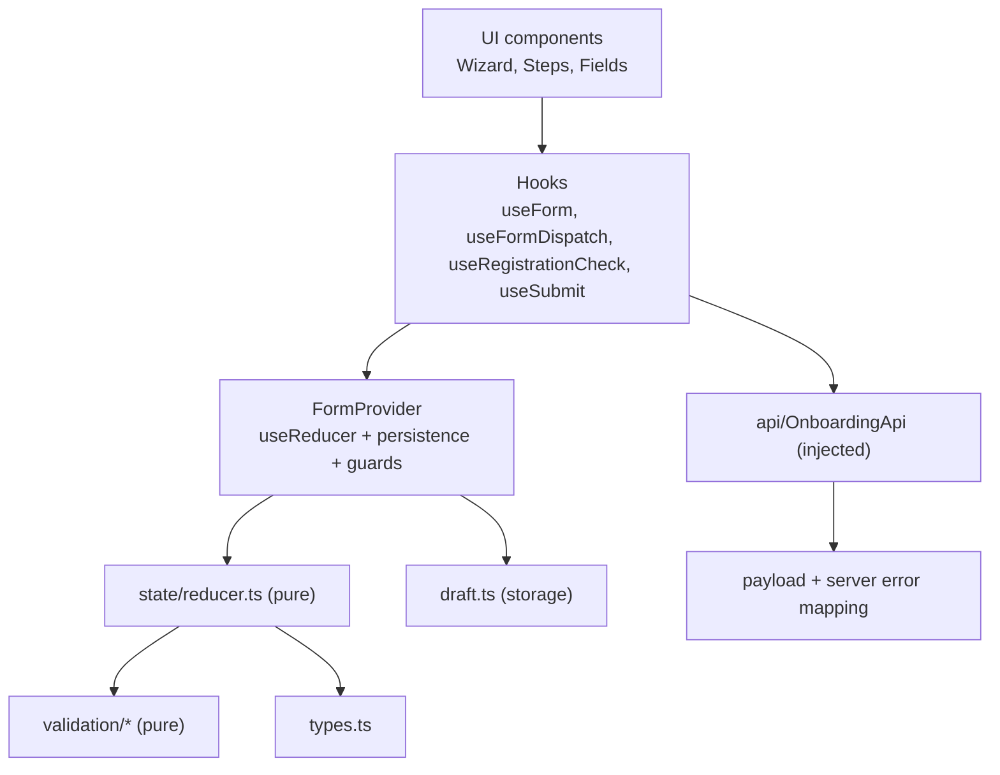
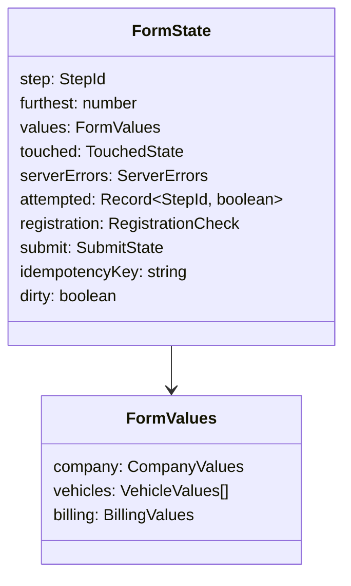
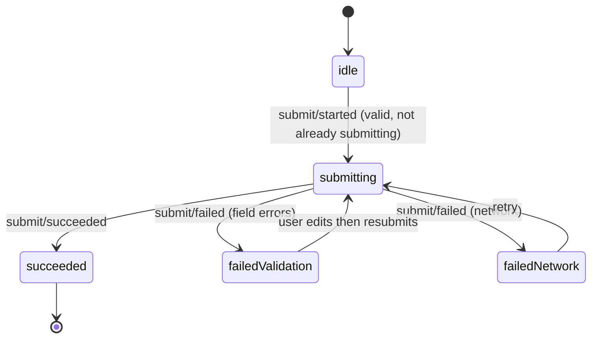

# Project 4 — Complex Form System (Reducers, Validation, Controlled Inputs)

| | |
|---|---|
| **Phase gate** | After Phase 3 (state and hooks) and Phase 5 patterns on reducers/state machines; can be started after Phase 3 and revisited after Phase 5 |
| **Architectural focus** | Reducer-owned form state, derived validation, controlled inputs, dynamic field arrays, async validation with race safety, accessible error handling |
| **Estimated effort** | 18–26 hours |
| **Stack** | React 19.x, TypeScript 5.x, Vite, Vitest + React Testing Library + user-event |
| **Not allowed** | Form libraries (React Hook Form, Formik, TanStack Form) and schema libraries for the core build. You are building the thing those libraries abstract so that you can judge them later. (Adopting one in extension E1 is expected.) |
| **Prerequisite projects** | [Project 1](./01-interactive-fundamentals-app.md), [Project 2](./02-task-manager-state-ownership.md) |

> Version note: React 19.x (verified 2026-10-22 on React 19.3 + TypeScript 5.9 + Vitest 3: every module in §8 typechecks under `strict` and `noUncheckedIndexedAccess` once the two files the text only names, `api/ApiContext.tsx` and `ui/fields/CheckboxField.tsx`, are supplied; the §9.2 reducer tests pass; the IBAN vectors and year boundaries behave as stated). In React 19 `ref` is an ordinary prop on function components, so a `TextField` accepts `ref` without `forwardRef` (legacy). `<Context value>` is a valid provider. React 19 also introduces form Actions, `useActionState`, `useFormStatus`, `useOptimistic`; this project deliberately uses an explicit reducer and `onSubmit` handler, and discusses those APIs as an alternative in Section 7 and extension E4. See <https://react.dev/reference/react-dom/components/form> and [Modern hooks and APIs](../03-react-state-and-hooks/22-modern-hooks-and-apis.md).

---

## 1. Product description

**Fleet Account Onboarding**: a four-step wizard in which a transport company applies for a fuel-card account.

| Step | Content | Notable difficulty |
|---|---|---|
| 1. Company | name, company registration number (**async uniqueness check**), country, contact email, phone | Async validation with races; debounce |
| 2. Vehicles | **dynamic list** (1 to 10) of vehicles: registration plate, type, year, "needs a fuel card" toggle revealing a conditional contact email | Field arrays, stable identity, cross-row validation (duplicate plates), conditional fields |
| 3. Billing | payment method (invoice or direct debit); IBAN (conditional, checksum validated); billing address "same as company" toggle | Conditional/dependent validation, cross-step dependency |
| 4. Review & submit | read-only summary with "Edit" links per section; submit | Whole-form validation, server-side errors mapped back to fields, double-submit protection |

Cross-cutting: the draft is saved locally (except sensitive fields), the user is warned before leaving with unsaved changes, and the whole form is keyboard- and screen-reader-operable.

The backend is a fake, in-memory `OnboardingApi` you write (latency, random failures, uniqueness, server-side validation).

---

## 2. Requirements

### 2.1 Functional requirements

| ID | Requirement |
|---|---|
| F1 | Every input is **controlled**. There is exactly one source of truth for values: the reducer state |
| F2 | Validation rules are **pure functions**; displayed errors are **derived** from values on every render, never stored |
| F3 | Error visibility policy: an error shows for a field if it has been **touched (blurred)** or its step has had a **failed "Next"/submit attempt**. Errors never show on pristine fields |
| F4 | "Next" validates the current step. On failure it stays on the step, reveals all errors, shows an **error summary** and moves focus to it. Summary entries link to (focus) the offending field |
| F5 | Steps already visited can be revisited through the step indicator; unvisited steps cannot be skipped to |
| F6 | **Dynamic vehicles list:** add (max 10), remove (min 1), each row has a stable identity. Removing row 2 must not shift row 3's typed text or focus into the wrong row. Newly added row receives focus |
| F7 | **Duplicate plate detection** across rows (case/whitespace-insensitive); both rows show the error |
| F8 | **Conditional fields:** `contactEmail` for a fuel card appears only when `hasFuelCard` is checked; IBAN only when `direct-debit` is chosen; billing address only when `sameAsCompany` is unchecked. Hidden fields are **not validated and not submitted**; decide (and document) whether hidden values are retained or cleared when re-hidden |
| F9 | **Async validation:** the registration number is checked for availability after a debounce, only when it is syntactically valid. Out-of-order responses must never overwrite a newer result. A "checking..." state is announced politely to assistive tech. A failed check (network) does not block progress; the server re-validates on submit |
| F10 | IBAN validation includes the mod-97 checksum; spaces are allowed on input and ignored in validation; display formatting (groups of four) is optional |
| F11 | Submission: the button is disabled while submitting and **double submission is impossible even via Enter key or double click**. An idempotency key travels with the payload |
| F12 | **Server errors** (field-level, e.g. "registration number already taken" discovered at submit) are mapped to the right field/step, shown until that field is edited, and the user is taken to the first affected step. A network failure shows a retryable, non-destructive error; the user's input is never lost |
| F13 | Draft persistence: values (excluding IBAN and other sensitive fields) are restored on reload; a "Discard draft" action exists; the draft is cleared on successful submit |
| F14 | A `beforeunload` guard is active only while there are unsaved changes and no successful submission |
| F15 | After success, show the reference number and offer "Start a new application" (full reset, including the idempotency key) |

### 2.2 Accessibility requirements

| ID | Requirement |
|---|---|
| A1 | Every field has a visible `<label>`; hints and errors are associated via `aria-describedby`; invalid fields have `aria-invalid="true"` |
| A2 | Required fields indicate requirement in text and with `aria-required`, not just an asterisk or color |
| A3 | Radio groups use `<fieldset>`/`<legend>`; each vehicle row is a `<fieldset>` with a legend like "Vehicle 2" |
| A4 | Error summary: `role="alert"` or focus-moved heading, links to fields; each link target is focusable |
| A5 | Step indicator uses an ordered list and `aria-current="step"`; the step heading receives focus on step change |
| A6 | Async status uses `aria-live="polite"`; not `assertive` |
| A7 | All remove/edit buttons have unique accessible names (e.g. "Remove vehicle AB-123-CD") |
| A8 | No keyboard traps; visible focus; targets large enough; works at 200% zoom |

See [Accessibility testing](../08-testing-and-quality/10-accessibility-testing.md) and [Accessibility as architecture](../10-production-engineering/08-accessibility-as-architecture.md).

### 2.3 Non-functional requirements

- Strict TypeScript. **Form values are strings and booleans** (what inputs produce). Converting to domain types (`year: number`) happens exactly once, in `toPayload`, after validation.
- Reducer is pure; IDs and the idempotency key are created in event handlers or the lazy initializer, never inside reducer cases.
- Unchanged vehicle rows keep object identity across keystrokes in other rows so memoized rows can bail out.
- No `useEffect` is used to derive state. Effects exist only for: the async registration check, draft persistence, the `beforeunload` guard.

---

## 3. Learning objectives

1. **Model form state** as `values` + `touched` + `server errors` + `status`, and justify why `errors` and `isValid` are **derived** ([Forms and complex state](../03-react-state-and-hooks/21-forms-and-complex-state.md), [Derived state](../03-react-state-and-hooks/17-derived-state.md)).
2. **Build a reducer** that enforces invariants (step gating, limits, stale-response rejection) rather than leaving them to UI code ([`useReducer` and reducer architecture](../03-react-state-and-hooks/03-usereducer-and-reducer-architecture.md), [Reducer pattern](../05-design-patterns/12-reducer-pattern.md)).
3. **Apply the controlled-component pattern** end to end and understand its costs (re-render per keystroke) and benefits ([Controlled and uncontrolled inputs](../01-react-fundamentals/11-controlled-and-uncontrolled-inputs.md), [Controlled component pattern](../05-design-patterns/11-controlled-component-pattern.md)).
4. **Handle identity in dynamic lists** with stable keys and per-entity state ([Lists, keys, identity](../01-react-fundamentals/09-lists-keys-and-identity.md), [Identity, keys and reconciliation](../02-react-rendering-and-internals/07-identity-keys-and-reconciliation.md)).
5. **Write async validation without races** using cancellation plus a stale-result check in the reducer ([Effect cleanup](../03-react-state-and-hooks/06-effect-cleanup.md), [Cancellation and race conditions](../06-data-fetching-and-state-ecosystems/02-cancellation-and-race-conditions.md)).
6. **Design reusable field components** with an accessible, typed API; understand `ref` as a prop in React 19 ([Props and one-way data flow](../01-react-fundamentals/06-props-and-one-way-data-flow.md), [Custom hooks](../03-react-state-and-hooks/15-custom-hooks.md)).
7. **Control rendering cost** of a form with many fields: where memoization helps and where it can't ([`React.memo`](../03-react-state-and-hooks/12-react-memo.md), [Context performance](../03-react-state-and-hooks/14-context-performance.md), [State colocation for performance](../07-performance/07-state-colocation-for-perf.md)).
8. **Model flows as states** (idle, submitting, succeeded, failed) rather than boolean flags ([State machine pattern](../05-design-patterns/13-state-machine-pattern.md), [State machines and XState](../06-data-fetching-and-state-ecosystems/12-state-machines-and-xstate.md)).
9. **Separate wire format from form model** and map server errors back to fields ([API boundaries and data access](../04-react-architecture/14-api-boundaries-and-data-access.md)).
10. **Treat sensitive data deliberately** (what is persisted, logged, or exposed) ([Security: XSS, CSRF, CSP](../10-production-engineering/06-security-xss-csrf-csp.md)).

---

## 4. Recommended architecture

### 4.1 Layering



Everything left of the UI is plain TypeScript and testable without React. The `OnboardingApi` is injected through context (or props) so tests supply deterministic fakes (see [Dependency inversion](../04-react-architecture/11-dependency-inversion.md) and [Dependency injection](../05-design-patterns/16-dependency-injection.md)).

### 4.2 State shape



**Principle:** `touched` and `serverErrors` **mirror the shape of `values`**, keyed by entity ID for vehicles. A keystroke in one vehicle therefore replaces only that vehicle's object and that vehicle's `touched` entry. Everything else keeps identity.

### 4.3 What is state, what is derived

| Item | Stored? | Reason |
|---|---|---|
| Field values | State | User input |
| Touched flags | State | History of interaction |
| `attempted[step]` | State | History: a failed Next |
| Server errors | State | Came from outside; cleared on edit |
| Registration check result (+ the value it applies to) | State | Result of an async process |
| Submit status | State | Result of an async process; discriminated union |
| **Sync validation errors** | **Derived** | Pure function of values |
| **Visible errors** | **Derived** | `error && (touched || attempted)` |
| **Step validity, can-proceed** | **Derived** | From errors |
| **Error summary** | **Derived** | From errors of the current step |
| **Dirty flag** | State (boolean set in reducer) | "Ever changed" is history; comparing to initial would answer "differs from initial", a different question. Pick one deliberately |

### 4.4 Submit as a state machine



Model it as a discriminated union (`{ status: "idle" } | { status: "submitting" } | ...`), not `isSubmitting` + `isError` + `isSuccess` booleans that permit impossible combinations.

---

## 5. Folder structure

```
fleet-onboarding/
├── src/
│   ├── main.tsx
│   ├── App.tsx
│   ├── form/
│   │   ├── types.ts                  # values, state, actions, constants
│   │   ├── initialState.ts           # createInitialState(), emptyVehicle()
│   │   ├── reducer.ts                # pure
│   │   ├── reducer.test.ts
│   │   ├── validation/
│   │   │   ├── rules.ts              # small reusable rules (required, email, iban...)
│   │   │   ├── company.ts
│   │   │   ├── vehicle.ts
│   │   │   ├── billing.ts
│   │   │   ├── steps.ts              # collectStepErrors, firstInvalidStep
│   │   │   └── *.test.ts
│   │   ├── payload.ts                # toPayload(values, idempotencyKey)
│   │   ├── draft.ts                  # load/save/clear with sensitive-field stripping
│   │   ├── FormProvider.tsx          # reducer + contexts + persistence + guards
│   │   ├── hooks/
│   │   │   ├── useRegistrationCheck.ts
│   │   │   └── useSubmit.ts
│   ├── api/
│   │   ├── onboardingApi.ts          # interface + types
│   │   ├── fakeOnboardingApi.ts
│   │   └── ApiContext.tsx
│   ├── ui/
│   │   ├── fields/
│   │   │   ├── TextField.tsx
│   │   │   ├── SelectField.tsx
│   │   │   ├── CheckboxField.tsx
│   │   │   ├── RadioGroupField.tsx
│   │   │   └── fieldId.ts
│   │   ├── Wizard.tsx
│   │   ├── StepIndicator.tsx
│   │   ├── ErrorSummary.tsx
│   │   └── steps/
│   │       ├── CompanyStep.tsx
│   │       ├── VehiclesStep.tsx
│   │       ├── VehicleRow.tsx
│   │       ├── BillingStep.tsx
│   │       ├── ReviewStep.tsx
│   │       └── SuccessScreen.tsx
│   └── test/
│       ├── setup.ts
│       ├── fakeApi.ts                # controllable deferred fake for tests
│       └── onboarding.test.tsx
```

---

## 6. Milestones

| M | Deliverable | Exit criteria | Time |
|---|---|---|---|
| **M0** | Scaffold; types for values/state/actions | Compiles under strict; exhaustive `switch` helper exists | 1.5 h |
| **M1** | Validation modules + tests | Rules pure and tested; IBAN checksum cases; duplicate-plate rule; conditional rules | 3 h |
| **M2** | Reducer + tests (no UI) | Step gating, vehicle add/remove limits, stale async rejection, server error clearing, double-submit rejection are tested | 3–4 h |
| **M3** | Field components + Company step | Controlled, accessible, `ref` as prop; error visibility policy implemented once, in one place | 3 h |
| **M4** | Vehicles step | Dynamic rows with stable keys; new-row focus; remove preserves others; duplicates flagged | 3 h |
| **M5** | Billing + Review + Wizard shell | Conditional fields; step indicator; error summary with focus; edit-from-review | 3 h |
| **M6** | Async registration check | Debounce, abort, stale-safe; announced status; network-failure policy | 2 h |
| **M7** | Submit flow + server errors + double-submit protection | Fake API with validation errors and failures; state machine verified by tests | 2–3 h |
| **M8** | Draft, `beforeunload`, reset, polish | Sensitive-field stripping tested; lint/build/tests green | 2 h |
| **M9** | Performance audit + README + decisions | Render report with Profiler evidence | 2 h |

---

## 7. Design decisions you must make and document

| Decision | Options | Guidance |
|---|---|---|
| **Reducer vs per-field `useState`** | One reducer vs many states | With cross-field rules, step gating, list operations, server errors, and async results, one reducer keeps transitions atomic and testable. A 3-field contact form does not warrant it ([Hooks anti-patterns](../03-react-state-and-hooks/23-hooks-anti-patterns.md): don't over-engineer). |
| **Controlled vs uncontrolled** | Controlled everywhere vs uncontrolled + `FormData` on submit | Controlled gives live validation, conditional rendering, and draft persistence at the cost of a render per keystroke. Uncontrolled + native validation + Actions is far lighter for simple forms. State when each is right. |
| **React 19 Actions** (`<form action>`, `useActionState`, `useFormStatus`) | Use vs explicit handler | Actions shine for progressive-enhancement and server-function-backed forms and give pending state for free. A function `action` resets **uncontrolled** fields after it succeeds (react.dev: "all uncontrolled field elements in the form are reset"); fully controlled inputs, as in this project, are not reset by React, so you clear them from state yourself. This project uses an explicit reducer so every transition is visible and unit-testable; extension E4 re-implements the final submit with `useActionState` for comparison ([Forms, actions and mutations](../09-advanced-rendering-and-ecosystem/13-forms-actions-and-mutations.md)). |
| **Where errors live** | Stored vs derived | Derived. Storing errors is the classic stale-error bug source. |
| **Error key scheme** | Path strings (`vehicles.<id>.registration`) vs nested objects | Nested objects mirror values (good for memoization); path strings are good for summaries and DOM ids. This project uses nested objects in state and produces path strings only for the summary/ids. |
| **Hidden-field policy** | Clear on hide vs retain | Retain keeps user work if they toggle accidentally; clearing keeps state honest. Either way, hidden fields must be excluded from validation and from `toPayload`. Pick and test. |
| **Validation timing** | on change / on blur / on submit | Policy F3: blur or failed attempt; additionally re-validate live once an error is showing so it disappears as soon as it is fixed (derived, so this is automatic). |
| **Async check trigger** | Effect on value change (debounced) vs on blur | On blur is an event handler (no effect, no debounce). Debounced-on-change is more immediate but needs an effect with cleanup. This project requires the latter to exercise cancellation; document the alternative. |
| **Async failure policy** | Block vs allow | Allow; the server is the authority. A client check is a convenience. |
| **Field ids** | `useId` vs deterministic path-based ids | The error summary must focus a field it did not render, so deterministic ids (from the path) are simpler. `useId` is the right default for **independent** components; the trade-off is that two forms on one page would collide (prefix with a form id). |
| **Persistence of sensitive data** | Persist all vs allow-list | Allow-list. Never persist IBAN or similar to `localStorage`. |
| **Rows: derived errors location** | Parent computes all vs each row derives its own with `useMemo` | Row-level derive keyed on the row's `vehicle` object lets memoized rows skip work when other rows change; cross-row rules (duplicates) are passed down as a **primitive boolean** so they don't break memoization. |

---

## 8. Reference solution guidance

### 8.1 Types

```ts
// src/form/types.ts
export const STEPS = ["company", "vehicles", "billing", "review"] as const;
export type StepId = (typeof STEPS)[number];

export const MAX_VEHICLES = 10;

export type VehicleType = "truck" | "van" | "car";
export type PaymentMethod = "invoice" | "direct-debit";

/** Form values are what inputs produce: strings and booleans. */
export interface CompanyValues {
  name: string;
  registrationNumber: string;
  country: string; // "" until chosen
  contactEmail: string;
  phone: string;
}

export interface VehicleValues {
  id: string; // stable identity, created in the handler that adds the row
  registration: string;
  type: VehicleType | "";
  year: string;
  hasFuelCard: boolean;
  cardContactEmail: string;
}

export interface BillingValues {
  method: PaymentMethod | "";
  iban: string;
  sameAsCompany: boolean;
  billingAddress: string;
}

export interface FormValues {
  company: CompanyValues;
  vehicles: VehicleValues[];
  billing: BillingValues;
}

/** Map of field -> something, mirroring an entity's shape. */
export type FieldMap<T, V> = { [K in keyof T]?: V };
export type FieldChange<T> = { [K in keyof T]: { field: K; value: T[K] } }[keyof T];

export interface TouchedState {
  company: FieldMap<CompanyValues, true>;
  vehicles: Record<string, FieldMap<VehicleValues, true> | undefined>;
  billing: FieldMap<BillingValues, true>;
}

export interface ServerErrors {
  company: FieldMap<CompanyValues, string>;
  vehicles: Record<string, FieldMap<VehicleValues, string> | undefined>;
  billing: FieldMap<BillingValues, string>;
  form?: string; // non-field message
}

export type RegistrationCheck =
  | { status: "idle"; value: string }
  | { status: "checking"; value: string }
  | { status: "available"; value: string }
  | { status: "taken"; value: string }
  | { status: "error"; value: string }; // network failure: non-blocking

export type SubmitState =
  | { status: "idle" }
  | { status: "submitting" }
  | { status: "succeeded"; reference: string }
  | { status: "failed"; kind: "validation" | "network"; message: string };

export interface FormState {
  readonly step: StepId;
  readonly furthest: number;
  readonly values: FormValues;
  readonly touched: TouchedState;
  readonly serverErrors: ServerErrors;
  readonly attempted: Readonly<Record<StepId, boolean>>;
  readonly registration: RegistrationCheck;
  readonly submit: SubmitState;
  readonly idempotencyKey: string;
  readonly dirty: boolean;
}

export type FormAction =
  | ({ type: "company/changed" } & FieldChange<CompanyValues>)
  | ({ type: "billing/changed" } & FieldChange<BillingValues>)
  | ({ type: "vehicle/changed"; id: string } & FieldChange<VehicleValues>)
  | { type: "vehicle/added"; vehicle: VehicleValues }
  | { type: "vehicle/removed"; id: string }
  | { type: "company/blurred"; field: keyof CompanyValues }
  | { type: "billing/blurred"; field: keyof BillingValues }
  | { type: "vehicle/blurred"; id: string; field: keyof VehicleValues }
  | { type: "step/next" }
  | { type: "step/back" }
  | { type: "step/goto"; step: StepId }
  | { type: "step/blocked"; step: StepId }
  | { type: "registration/checking"; value: string }
  | { type: "registration/checked"; value: string; result: "available" | "taken" | "error" }
  | { type: "submit/started" }
  | { type: "submit/succeeded"; reference: string }
  | { type: "submit/failed"; kind: "validation" | "network"; message: string; serverErrors?: ServerErrors }
  | { type: "form/reset"; state: FormState };
```

Notes: `FieldChange<T>` is a distributed union so `{ type: "company/changed", field: "name", value: 3 }` is a **compile error**. Discriminated unions give this typing for free, and a mapped type removes the need to write one action per field. A `value: string` for `hasFuelCard` fails to compile as well, which is the point.

### 8.2 Validation: small, pure, composable

```ts
// src/form/validation/rules.ts
export type Rule = (value: string) => string | undefined;

export const required =
  (message: string): Rule =>
  (v) => (v.trim() === "" ? message : undefined);

export const maxLength =
  (n: number, message: string): Rule =>
  (v) => (v.trim().length > n ? message : undefined);

export const matches =
  (re: RegExp, message: string): Rule =>
  (v) => (re.test(v.trim()) ? undefined : message);

/** First failing rule wins, so users see one actionable message at a time. */
export function firstError(value: string, ...rules: Rule[]): string | undefined {
  for (const rule of rules) {
    const message = rule(value);
    if (message !== undefined) return message;
  }
  return undefined;
}

// Pragmatic email check: not RFC-complete on purpose; the server/mailer is the authority.
export const EMAIL_RE = /^[^\s@]+@[^\s@]+\.[^\s@]+$/;

export function isValidIban(input: string): boolean {
  const iban = input.replace(/\s+/g, "").toUpperCase();
  if (!/^[A-Z]{2}\d{2}[A-Z0-9]{11,30}$/.test(iban)) return false;
  const rearranged = iban.slice(4) + iban.slice(0, 4);
  let remainder = 0;
  for (const ch of rearranged) {
    // A=10 ... Z=35; digits unchanged. Process digit-by-digit to avoid BigInt.
    const digits = ch >= "A" && ch <= "Z" ? String(ch.charCodeAt(0) - 55) : ch;
    for (const d of digits) remainder = (remainder * 10 + Number(d)) % 97;
  }
  return remainder === 1;
}
```

`isValidIban` does not enforce per-country lengths (a known simplification; document it). Test vectors you can use: `GB82 WEST 1234 5698 7654 32` and `DE89 3704 0044 0532 0130 00` are widely published valid examples; altering one digit must fail. Verify them yourself in the unit tests rather than trusting this document.

```ts
// src/form/validation/vehicle.ts
import type { FieldMap, VehicleValues } from "../types";
import { EMAIL_RE, firstError, matches, required } from "./rules";

export type Errors<T> = FieldMap<T, string>;

export const normalizePlate = (s: string) => s.replace(/\s+/g, "").toUpperCase();

export function validateVehicle(
  v: VehicleValues,
  { currentYear, isDuplicate }: { currentYear: number; isDuplicate: boolean },
): Errors<VehicleValues> {
  const errors: Errors<VehicleValues> = {};

  errors.registration = isDuplicate
    ? "This plate is already in the list."
    : firstError(
        v.registration,
        required("Enter the registration plate."),
        matches(/^[A-Za-z0-9 -]{2,12}$/, "Use 2 to 12 letters, digits, spaces or hyphens."),
      );

  if (v.type === "") errors.type = "Choose a vehicle type.";

  const year = Number(v.year);
  if (v.year.trim() === "") errors.year = "Enter the year of first registration.";
  else if (!Number.isInteger(year) || year < 1980 || year > currentYear) {
    errors.year = `Enter a year between 1980 and ${currentYear}.`;
  }

  if (v.hasFuelCard) {
    errors.cardContactEmail = firstError(
      v.cardContactEmail,
      required("Enter an email for the fuel card."),
      matches(EMAIL_RE, "Enter a valid email address."),
    );
  }
  return stripUndefined(errors);
}

export function stripUndefined<T extends object>(obj: T): T {
  return Object.fromEntries(Object.entries(obj).filter(([, v]) => v !== undefined)) as T;
}

/** Cross-row rule, computed once per render by the parent. */
export function findDuplicatePlateIds(vehicles: readonly VehicleValues[]): ReadonlySet<string> {
  const byPlate = new Map<string, string[]>();
  for (const v of vehicles) {
    const key = normalizePlate(v.registration);
    if (key === "") continue;
    byPlate.set(key, [...(byPlate.get(key) ?? []), v.id]);
  }
  const dupes = new Set<string>();
  for (const ids of byPlate.values()) if (ids.length > 1) ids.forEach((id) => dupes.add(id));
  return dupes;
}
```

Conditional rule demonstrated: `cardContactEmail` is only validated when `hasFuelCard`. Notice the **semantic** question for F8: if the user checks the box, types an email, unchecks it, and re-checks, is the email still there? With the "retain" policy yes. Whichever you choose, test it.

```ts
// src/form/validation/steps.ts
import type { FormValues, RegistrationCheck, StepId } from "../types";
import { validateCompany } from "./company";
import { validateBilling } from "./billing";
import { findDuplicatePlateIds, validateVehicle } from "./vehicle";

export interface SummaryItem {
  path: string; // e.g. "company.name" or "vehicles.<id>.registration"
  message: string;
  step: StepId;
}

export const CURRENT_YEAR = new Date().getFullYear();

export function collectStepErrors(
  values: FormValues,
  step: StepId,
  registration: RegistrationCheck,
  currentYear: number = CURRENT_YEAR,
): SummaryItem[] {
  const items: SummaryItem[] = [];
  const push = (path: string, message: string | undefined) => {
    if (message !== undefined) items.push({ path, message, step });
  };

  if (step === "company") {
    const errors = validateCompany(values.company);
    for (const [field, message] of Object.entries(errors)) push(`company.${field}`, message);

    if (errors.registrationNumber === undefined) {
      const current = registration.value === values.company.registrationNumber;
      if (current && registration.status === "taken") {
        push("company.registrationNumber", "This registration number is already registered.");
      } else if (!current || registration.status === "idle" || registration.status === "checking") {
        push("company.registrationNumber", "Still verifying the registration number. Try again in a moment.");
      }
      // "available" and "error" (network) do not block.
    }
  }

  if (step === "vehicles") {
    const dupes = findDuplicatePlateIds(values.vehicles);
    values.vehicles.forEach((v, index) => {
      const errors = validateVehicle(v, { currentYear, isDuplicate: dupes.has(v.id) });
      for (const [field, message] of Object.entries(errors)) {
        push(`vehicles.${v.id}.${field}`, `Vehicle ${index + 1}: ${message}`);
      }
    });
  }

  if (step === "billing") {
    const errors = validateBilling(values.billing);
    for (const [field, message] of Object.entries(errors)) push(`billing.${field}`, message);
  }
  return items;
}

/** The first step (in order) that currently has errors, or null. */
export function firstInvalidStep(
  values: FormValues,
  registration: RegistrationCheck,
): StepId | null {
  for (const step of ["company", "vehicles", "billing"] as const) {
    if (collectStepErrors(values, step, registration).length > 0) return step;
  }
  return null;
}
```

```ts
// src/form/validation/company.ts
import type { CompanyValues } from "../types";
import { EMAIL_RE, firstError, matches, maxLength, required } from "./rules";
import { stripUndefined, type Errors } from "./vehicle";

export function validateCompany(c: CompanyValues): Errors<CompanyValues> {
  return stripUndefined({
    name: firstError(c.name, required("Enter the company name."), maxLength(120, "Use 120 characters or fewer.")),
    registrationNumber: firstError(
      c.registrationNumber,
      required("Enter the company registration number."),
      matches(/^[A-Za-z0-9]{6,12}$/, "Use 6 to 12 letters or digits, no spaces."),
    ),
    country: c.country === "" ? "Choose a country." : undefined,
    contactEmail: firstError(c.contactEmail, required("Enter a contact email."), matches(EMAIL_RE, "Enter a valid email address.")),
    phone: firstError(c.phone, required("Enter a phone number."), matches(/^[+()\d\s-]{7,20}$/, "Enter a valid phone number.")),
  });
}
```

```ts
// src/form/validation/billing.ts
import type { BillingValues } from "../types";
import { firstError, required } from "./rules";
import { isValidIban } from "./rules";
import { stripUndefined, type Errors } from "./vehicle";

export function validateBilling(b: BillingValues): Errors<BillingValues> {
  return stripUndefined({
    method: b.method === "" ? "Choose a payment method." : undefined,
    // Conditional: only when direct debit is chosen.
    iban:
      b.method === "direct-debit"
        ? firstError(
            b.iban,
            required("Enter the IBAN."),
            (v) => (isValidIban(v) ? undefined : "This IBAN is not valid. Check for typos."),
          )
        : undefined,
    // Conditional: only when the address differs from the company's.
    billingAddress: b.sameAsCompany ? undefined : firstError(b.billingAddress, required("Enter the billing address.")),
  });
}
```

The same `collectStepErrors` powers: the error summary, the step gate in the reducer, the final submit check, and the step indicator's check marks. One function, one truth.

### 8.3 Reducer

```ts
// src/form/reducer.ts
import {
  STEPS, MAX_VEHICLES,
  type FieldChange, type FormAction, type FormState, type StepId,
} from "./types";
import { collectStepErrors } from "./validation/steps";

function setField<T extends object>(obj: T, change: FieldChange<T>): T {
  return { ...obj, [change.field]: change.value };
}

function omit<V>(record: Record<string, V>, key: string): Record<string, V> {
  const { [key]: _removed, ...rest } = record;
  return rest;
}

/** Remove one key from a FieldMap, returning the same object if absent. */
function withoutKey<T extends object>(map: T, key: keyof T): T {
  if (!(key in map)) return map;
  const { [key]: _removed, ...rest } = map;
  return rest as T;
}

export function formReducer(state: FormState, action: FormAction): FormState {
  switch (action.type) {
    case "company/changed": {
      const { field, value } = action;
      if (state.values.company[field] === value) return state; // no actual change
      const company = setField(state.values.company, action);
      return {
        ...state,
        dirty: true,
        values: { ...state.values, company },
        serverErrors: {
          ...state.serverErrors,
          company: withoutKey(state.serverErrors.company, field), // editing clears that field's server error
        },
        // A changed registration number invalidates the previous async result.
        registration:
          field === "registrationNumber"
            ? { status: "idle", value: String(value) }
            : state.registration,
        submit: state.submit.status === "failed" ? { status: "idle" } : state.submit,
      };
    }

    case "billing/changed": {
      return {
        ...state,
        dirty: true,
        values: { ...state.values, billing: setField(state.values.billing, action) },
        serverErrors: {
          ...state.serverErrors,
          billing: withoutKey(state.serverErrors.billing, action.field),
        },
        submit: state.submit.status === "failed" ? { status: "idle" } : state.submit,
      };
    }

    case "vehicle/changed": {
      let found = false;
      const vehicles = state.values.vehicles.map((v) => {
        if (v.id !== action.id) return v; // identity preserved for every other row
        found = true;
        return setField(v, action);
      });
      if (!found) return state;
      const rowServer = state.serverErrors.vehicles[action.id];
      return {
        ...state,
        dirty: true,
        values: { ...state.values, vehicles },
        serverErrors: rowServer
          ? {
              ...state.serverErrors,
              vehicles: { ...state.serverErrors.vehicles, [action.id]: withoutKey(rowServer, action.field) },
            }
          : state.serverErrors,
      };
    }

    case "vehicle/added": {
      if (state.values.vehicles.length >= MAX_VEHICLES) return state;
      return {
        ...state,
        dirty: true,
        values: { ...state.values, vehicles: [...state.values.vehicles, action.vehicle] },
      };
    }

    case "vehicle/removed": {
      if (state.values.vehicles.length <= 1) return state; // invariant: at least one
      return {
        ...state,
        dirty: true,
        values: { ...state.values, vehicles: state.values.vehicles.filter((v) => v.id !== action.id) },
        touched: { ...state.touched, vehicles: omit(state.touched.vehicles, action.id) },
        serverErrors: { ...state.serverErrors, vehicles: omit(state.serverErrors.vehicles, action.id) },
      };
    }

    case "company/blurred":
      if (state.touched.company[action.field]) return state;
      return { ...state, touched: { ...state.touched, company: { ...state.touched.company, [action.field]: true } } };

    case "billing/blurred":
      if (state.touched.billing[action.field]) return state;
      return { ...state, touched: { ...state.touched, billing: { ...state.touched.billing, [action.field]: true } } };

    case "vehicle/blurred": {
      const row = state.touched.vehicles[action.id];
      if (row?.[action.field]) return state;
      return {
        ...state,
        touched: {
          ...state.touched,
          vehicles: { ...state.touched.vehicles, [action.id]: { ...row, [action.field]: true } },
        },
      };
    }

    case "step/next": {
      const items = collectStepErrors(state.values, state.step, state.registration);
      if (items.length > 0) {
        return { ...state, attempted: { ...state.attempted, [state.step]: true } };
      }
      const nextIndex = Math.min(STEPS.indexOf(state.step) + 1, STEPS.length - 1);
      return {
        ...state,
        step: STEPS[nextIndex] ?? state.step,
        furthest: Math.max(state.furthest, nextIndex),
      };
    }

    case "step/back": {
      const prev = Math.max(STEPS.indexOf(state.step) - 1, 0);
      return { ...state, step: STEPS[prev] ?? state.step };
    }

    case "step/goto": {
      const target = STEPS.indexOf(action.step);
      if (target > state.furthest) return state; // F5: cannot skip ahead
      return { ...state, step: action.step };
    }

    case "step/blocked":
      return {
        ...state,
        step: action.step,
        attempted: { ...state.attempted, [action.step]: true },
      };

    case "registration/checking": {
      if (action.value !== state.values.company.registrationNumber) return state; // stale
      return { ...state, registration: { status: "checking", value: action.value } };
    }

    case "registration/checked": {
      // The invariant that makes out-of-order responses harmless:
      if (action.value !== state.values.company.registrationNumber) return state;
      return { ...state, registration: { status: action.result, value: action.value } };
    }

    case "submit/started": {
      if (state.submit.status === "submitting" || state.submit.status === "succeeded") return state; // F11, defense in depth
      return { ...state, submit: { status: "submitting" } };
    }

    case "submit/succeeded":
      return { ...state, submit: { status: "succeeded", reference: action.reference }, dirty: false };

    case "submit/failed": {
      const serverErrors = action.serverErrors ?? state.serverErrors;
      return {
        ...state,
        serverErrors,
        submit: { status: "failed", kind: action.kind, message: action.message },
      };
    }

    case "form/reset":
      return action.state;

    default: {
      const _exhaustive: never = action;
      return _exhaustive;
    }
  }
}

export type { StepId };
```

Code notes, including the traps:

- Cheap no-op detection (`state.values.company[field] === value`) comes first, before building anything: a reducer that reads clearly beats a clever one. Apply the same early return to the billing and vehicle cases as an exercise.
- `registration/checked` rejects results whose `value` does not equal the *current* input. This is the **single source of race safety**: even if an effect fails to cancel a request, a stale response cannot win. Abort is an optimization (saves bandwidth); this check is the correctness guarantee. Demonstrate both in tests.
- `step/next` calls `collectStepErrors` inside the reducer. Validation is pure, so this is legitimate and keeps "can't leave an invalid step" an invariant of the state machine, rather than something every button must remember.
- `submit/started` re-checks status in the reducer: a double-click that dispatches twice in one event batch results in a single submitting state (and the handler must also guard; see below).
- `omit` and `withoutKey` use destructuring with an unused binding (`_removed`); configure ESLint's `no-unused-vars` to ignore `_`-prefixed names for rest siblings, or use `Object.fromEntries(Object.entries(...).filter(...))`.
- ⚠ Reading `state.touched.vehicles[action.id]` with `noUncheckedIndexedAccess` returns `T | undefined`; the types above model that explicitly.

### 8.4 Initial state, lazy init, and ids

```ts
// src/form/initialState.ts
import type { FormState, VehicleValues } from "./types";

export function emptyVehicle(): VehicleValues {
  return {
    id: crypto.randomUUID(),
    registration: "",
    type: "",
    year: "",
    hasFuelCard: false,
    cardContactEmail: "",
  };
}

export function createInitialState(): FormState {
  return {
    step: "company",
    furthest: 0,
    values: {
      company: { name: "", registrationNumber: "", country: "", contactEmail: "", phone: "" },
      vehicles: [emptyVehicle()],
      billing: { method: "", iban: "", sameAsCompany: true, billingAddress: "" },
    },
    touched: { company: {}, vehicles: {}, billing: {} },
    serverErrors: { company: {}, vehicles: {}, billing: {} },
    attempted: { company: false, vehicles: false, billing: false, review: false },
    registration: { status: "idle", value: "" },
    submit: { status: "idle" },
    idempotencyKey: crypto.randomUUID(),
    dirty: false,
  };
}
```

`crypto.randomUUID()` appears here, **outside the reducer**, in a lazy initializer (run once per mount; StrictMode may run it twice in development and discard one result, harmless because nothing observes the discarded one). `emptyVehicle()` is called from the "Add vehicle" click handler, not from the reducer.

### 8.5 Provider: reducer, contexts, persistence, guard

```tsx
// src/form/FormProvider.tsx
import { createContext, useContext, useEffect, useReducer, type Dispatch, type ReactNode } from "react";
import { formReducer } from "./reducer";
import { createInitialState } from "./initialState";
import { clearDraft, loadDraft, saveDraft } from "./draft";
import type { FormAction, FormState } from "./types";

const StateContext = createContext<FormState | null>(null);
const DispatchContext = createContext<Dispatch<FormAction> | null>(null);

function init(): FormState {
  const base = createInitialState();
  const draft = loadDraft();
  return draft ? { ...base, values: draft, dirty: true } : base;
}

export function FormProvider({ children }: { children: ReactNode }) {
  const [state, dispatch] = useReducer(formReducer, undefined, init);

  // External system #1: storage (debounced; sensitive fields stripped inside saveDraft).
  useEffect(() => {
    if (!state.dirty || state.submit.status === "succeeded") return;
    const id = setTimeout(() => saveDraft(state.values), 500);
    return () => clearTimeout(id);
  }, [state.values, state.dirty, state.submit.status]);

  useEffect(() => {
    if (state.submit.status === "succeeded") clearDraft();
  }, [state.submit.status]);

  // External system #2: the browser's unload confirmation.
  const guardActive = state.dirty && state.submit.status !== "succeeded";
  useEffect(() => {
    if (!guardActive) return;
    const handler = (event: BeforeUnloadEvent) => {
      event.preventDefault(); // modern browsers show a generic message; custom text is ignored
    };
    window.addEventListener("beforeunload", handler);
    return () => window.removeEventListener("beforeunload", handler);
  }, [guardActive]);

  return (
    <StateContext value={state}>
      <DispatchContext value={dispatch}>{children}</DispatchContext>
    </StateContext>
  );
}

export function useForm(): FormState {
  const v = useContext(StateContext);
  if (v === null) throw new Error("useForm must be used within <FormProvider>");
  return v;
}

export function useFormDispatch(): Dispatch<FormAction> {
  const v = useContext(DispatchContext);
  if (v === null) throw new Error("useFormDispatch must be used within <FormProvider>");
  return v;
}
```

Notes:

- The persistence effect has **cleanup that cancels the pending timer**; without it every keystroke would schedule an uncancelled save, and a save from an old snapshot could run after a newer one (fine here because later saves overwrite, but a bug pattern for non-idempotent work).
- `beforeunload` is an external-system subscription: attach/detach tied to `guardActive`, cleanup removes the listener.
- ⚠ Browsers restrict the `beforeunload` prompt (typically only if the page has had user interaction) and ignore custom messages. Describe this limit in the README; do not claim the guard is reliable.

```ts
// src/form/draft.ts
import type { FormValues } from "./types";

const KEY = "fleet-onboarding:draft:v1";

/** Allow-list: what we are willing to write to disk. IBAN is deliberately absent. */
function toPersistable(values: FormValues): FormValues {
  return { ...values, billing: { ...values.billing, iban: "" } };
}

export function saveDraft(values: FormValues): void {
  try {
    localStorage.setItem(KEY, JSON.stringify({ v: 1, values: toPersistable(values) }));
  } catch {
    /* best effort */
  }
}

export function clearDraft(): void {
  try { localStorage.removeItem(KEY); } catch { /* ignore */ }
}

export function loadDraft(): FormValues | null {
  try {
    const raw = localStorage.getItem(KEY);
    if (raw === null) return null;
    const data: unknown = JSON.parse(raw);
    return isDraft(data) ? data.values : null;
  } catch {
    return null;
  }
}

function isRecord(v: unknown): v is Record<string, unknown> {
  return typeof v === "object" && v !== null;
}

const isString = (v: unknown): v is string => typeof v === "string";

function isVehicle(v: unknown): boolean {
  return (
    isRecord(v) &&
    isString(v.id) && v.id !== "" &&
    isString(v.registration) &&
    (v.type === "" || v.type === "truck" || v.type === "van" || v.type === "car") &&
    isString(v.year) &&
    typeof v.hasFuelCard === "boolean" &&
    isString(v.cardContactEmail)
  );
}

function isDraft(data: unknown): data is { v: 1; values: FormValues } {
  if (!isRecord(data) || data.v !== 1 || !isRecord(data.values)) return false;
  const { company, vehicles, billing } = data.values;
  if (!isRecord(company) || !isRecord(billing) || !Array.isArray(vehicles)) return false;
  if (!["name", "registrationNumber", "country", "contactEmail", "phone"].every((k) => isString(company[k]))) return false;
  if (!(isString(billing.method) && isString(billing.iban) && isString(billing.billingAddress) && typeof billing.sameAsCompany === "boolean")) return false;
  if (vehicles.length < 1 || vehicles.length > 10 || !vehicles.every(isVehicle)) return false; // invariant: 1..10 rows
  const ids = vehicles.map((x) => (x as { id: string }).id);
  return new Set(ids).size === ids.length; // unique ids, or the keys would collide
}
```

The guard rejects (rather than repairs) a draft that violates the 1 to 10 vehicles invariant or has duplicate ids; discarding a bad draft is safer than guessing. Tests must include a draft with `vehicles: []`, duplicate vehicle ids, and wrong types. (Also check `billing.method` is one of the allowed values if you want it stricter.)

### 8.6 Field components with a single error-visibility policy

```tsx
// src/ui/fields/fieldId.ts
export const fieldId = (path: string) => `f-${path.replace(/[^A-Za-z0-9_-]/g, "-")}`;
```

```tsx
// src/ui/fields/TextField.tsx
import type { ComponentProps } from "react";
import { fieldId } from "./fieldId";

interface TextFieldProps
  extends Omit<ComponentProps<"input">, "id" | "value" | "onChange" | "onBlur" | "aria-invalid" | "aria-describedby"> {
  path: string; // used to derive deterministic ids
  label: string;
  value: string;
  onValueChange: (value: string) => void;
  onBlur?: () => void;
  error?: string; // already gated by the visibility policy
  hint?: string;
  required?: boolean;
  // `ref` is part of ComponentProps<"input"> in React 19: no forwardRef needed
}

export function TextField({
  path, label, value, onValueChange, onBlur, error, hint, required, ...inputProps
}: TextFieldProps) {
  const id = fieldId(path);
  const hintId = hint ? `${id}-hint` : undefined;
  const errorId = error ? `${id}-error` : undefined;
  const describedBy = [hintId, errorId].filter(Boolean).join(" ") || undefined;

  return (
    <div className="field">
      <label htmlFor={id}>
        {label}
        {required ? <span> (required)</span> : null}
      </label>
      {hint ? <p id={hintId} className="hint">{hint}</p> : null}
      <input
        {...inputProps} // includes `ref`
        id={id}
        value={value}
        onChange={(e) => onValueChange(e.target.value)}
        onBlur={onBlur}
        aria-required={required || undefined}
        aria-invalid={error ? true : undefined}
        aria-describedby={describedBy}
      />
      {error ? <p id={errorId} className="error">{error}</p> : null}
    </div>
  );
}
```

```ts
// src/ui/fields/visibility.ts  — the ONE place that implements F3
export function visibleError(
  error: string | undefined,
  { touched, attempted }: { touched: boolean | undefined; attempted: boolean },
  serverError?: string,
): string | undefined {
  if (serverError) return serverError; // server errors are always shown until the field is edited
  return touched || attempted ? error : undefined;
}
```

Because `error` is a prop and `visibleError` is a pure function, every field component gets identical behavior and the policy is changeable in one file.

### 8.7 Company step with the async check

```tsx
// src/ui/steps/CompanyStep.tsx
import { useForm, useFormDispatch } from "../../form/FormProvider";
import { validateCompany } from "../../form/validation/company";
import { useRegistrationCheck } from "../../form/hooks/useRegistrationCheck";
import { TextField } from "../fields/TextField";
import { visibleError } from "../fields/visibility";

export function CompanyStep() {
  const { values, touched, serverErrors, attempted, registration } = useForm();
  const dispatch = useFormDispatch();
  const c = values.company;
  const errors = validateCompany(c); // derived on every render

  useRegistrationCheck(c.registrationNumber, errors.registrationNumber);

  const gate = (field: keyof typeof c) => ({
    touched: touched.company[field],
    attempted: attempted.company,
  });

  const registrationStatus =
    registration.value === c.registrationNumber
      ? registration.status === "checking" ? "Checking availability..."
      : registration.status === "available" ? "Registration number is available."
      : registration.status === "taken" ? "" /* shown as an error */
      : registration.status === "error" ? "Could not verify right now; we will check again when you submit."
      : ""
      : "";

  return (
    <>
      <TextField
        path="company.name" label="Company name" required
        value={c.name}
        onValueChange={(value) => dispatch({ type: "company/changed", field: "name", value })}
        onBlur={() => dispatch({ type: "company/blurred", field: "name" })}
        error={visibleError(errors.name, gate("name"), serverErrors.company.name)}
        autoComplete="organization"
      />

      <TextField
        path="company.registrationNumber" label="Company registration number" required
        hint="Letters and digits, 6 to 12 characters."
        value={c.registrationNumber}
        onValueChange={(value) => dispatch({ type: "company/changed", field: "registrationNumber", value })}
        onBlur={() => dispatch({ type: "company/blurred", field: "registrationNumber" })}
        error={visibleError(
          errors.registrationNumber ??
            (registration.value === c.registrationNumber && registration.status === "taken"
              ? "This registration number is already registered."
              : undefined),
          gate("registrationNumber"),
          serverErrors.company.registrationNumber,
        )}
      />
      <p aria-live="polite" className="status">{registrationStatus}</p>

      {/* country (select), contactEmail, phone follow the same pattern */}
    </>
  );
}
```

The `aria-live` region exists in the DOM **before** its content changes (live regions announce changes, not initial mount). That's why it is always rendered, even when empty.

```ts
// src/form/hooks/useRegistrationCheck.ts
import { useEffect } from "react";
import { useFormDispatch } from "../FormProvider";
import { useOnboardingApi } from "../../api/ApiContext";

const DEBOUNCE_MS = 400;

export function useRegistrationCheck(value: string, syncError: string | undefined): void {
  const dispatch = useFormDispatch();
  const api = useOnboardingApi();

  useEffect(() => {
    if (value === "" || syncError !== undefined) return; // only check syntactically valid values

    const controller = new AbortController();
    const timer = setTimeout(async () => {
      dispatch({ type: "registration/checking", value });
      try {
        const available = await api.isRegistrationAvailable(value, controller.signal);
        dispatch({ type: "registration/checked", value, result: available ? "available" : "taken" });
      } catch {
        if (controller.signal.aborted) return; // superseded: say nothing
        dispatch({ type: "registration/checked", value, result: "error" });
      }
    }, DEBOUNCE_MS);

    return () => {
      clearTimeout(timer); // cancel pending debounce
      controller.abort(); // cancel in-flight request
    };
  }, [value, syncError, api, dispatch]);
}
```

**Predict:** The user types `ABC123`, pauses 400 ms (request A starts), types `4` (new value `ABC1234`). Which cleanup runs, and what happens if A's response arrives afterwards? (Cleanup runs before the new effect: timer already fired, so `clearTimeout` is a no-op; `abort()` aborts A; A's promise rejects, `controller.signal.aborted` is true, nothing dispatched. If your fake API ignores the signal and resolves anyway, the reducer rejects it because `action.value !== current`.) Write a test for **each** of the two layers separately by temporarily disabling the other.

In StrictMode (development) every effect mounts, cleans up, and mounts again on first mount. Here that only clears and restarts the pending 400 ms debounce timer (no request has been sent yet, and the check runs only once its value is valid), so exactly one request is sent; verified in a test. Your code must be correct under that; it is, because cleanup aborts and the reducer is stale-safe.

### 8.8 Dynamic vehicles list

```tsx
// src/ui/steps/VehiclesStep.tsx
import { useState } from "react";
import { MAX_VEHICLES } from "../../form/types";
import { useForm, useFormDispatch } from "../../form/FormProvider";
import { emptyVehicle } from "../../form/initialState";
import { findDuplicatePlateIds } from "../../form/validation/vehicle";
import { VehicleRow } from "./VehicleRow";

export function VehiclesStep() {
  const { values, touched, serverErrors, attempted } = useForm();
  const dispatch = useFormDispatch();
  const [newestId, setNewestId] = useState<string | null>(null);

  const duplicates = findDuplicatePlateIds(values.vehicles);
  const canAdd = values.vehicles.length < MAX_VEHICLES;
  const canRemove = values.vehicles.length > 1;

  function handleAdd() {
    const vehicle = emptyVehicle(); // impure: in the handler
    setNewestId(vehicle.id);
    dispatch({ type: "vehicle/added", vehicle });
  }

  return (
    <>
      {values.vehicles.map((vehicle, index) => (
        <VehicleRow
          key={vehicle.id} // stable identity, NOT the index
          vehicle={vehicle}
          index={index}
          touched={touched.vehicles[vehicle.id]}
          serverErrors={serverErrors.vehicles[vehicle.id]}
          attempted={attempted.vehicles}
          isDuplicate={duplicates.has(vehicle.id)} // primitive: keeps memo effective
          canRemove={canRemove}
          autoFocus={vehicle.id === newestId}
        />
      ))}
      <button type="button" onClick={handleAdd} disabled={!canAdd}>
        Add another vehicle
      </button>
      {!canAdd && <p>You can add up to {MAX_VEHICLES} vehicles.</p>}
    </>
  );
}
```

```tsx
// src/ui/steps/VehicleRow.tsx
import { memo, useMemo } from "react";
import type { FieldMap, VehicleValues } from "../../form/types";
import { CURRENT_YEAR } from "../../form/validation/steps";
import { validateVehicle } from "../../form/validation/vehicle";
import { useFormDispatch } from "../../form/FormProvider";
import { TextField } from "../fields/TextField";
import { CheckboxField } from "../fields/CheckboxField";
import { visibleError } from "../fields/visibility";

interface VehicleRowProps {
  vehicle: VehicleValues;
  index: number;
  touched: FieldMap<VehicleValues, true> | undefined;
  serverErrors: FieldMap<VehicleValues, string> | undefined;
  attempted: boolean;
  isDuplicate: boolean;
  canRemove: boolean;
  autoFocus: boolean;
}

export const VehicleRow = memo(function VehicleRow({
  vehicle, index, touched, serverErrors, attempted, isDuplicate, canRemove, autoFocus,
}: VehicleRowProps) {
  const dispatch = useFormDispatch(); // stable; the row does not subscribe to form STATE
  const errors = useMemo(
    () => validateVehicle(vehicle, { currentYear: CURRENT_YEAR, isDuplicate }),
    [vehicle, isDuplicate],
  );
  const gate = (field: keyof VehicleValues) => ({ touched: touched?.[field], attempted });
  const change = <K extends keyof VehicleValues>(field: K) => (value: VehicleValues[K]) =>
    dispatch({ type: "vehicle/changed", id: vehicle.id, field, value } as never);
  // ^ `as never` is a smell: see the note below.
  const blur = (field: keyof VehicleValues) => () =>
    dispatch({ type: "vehicle/blurred", id: vehicle.id, field });

  const label = vehicle.registration.trim() || `vehicle ${index + 1}`;

  return (
    <fieldset>
      <legend>Vehicle {index + 1}</legend>

      <TextField
        path={`vehicles.${vehicle.id}.registration`} label="Registration plate" required
        value={vehicle.registration}
        autoFocus={autoFocus}
        onValueChange={change("registration")}
        onBlur={blur("registration")}
        error={visibleError(errors.registration, gate("registration"), serverErrors?.registration)}
      />

      {/* type (select), year (text, inputMode numeric) */}

      <CheckboxField
        path={`vehicles.${vehicle.id}.hasFuelCard`} label="This vehicle needs a fuel card"
        checked={vehicle.hasFuelCard}
        onCheckedChange={change("hasFuelCard")}
      />

      {vehicle.hasFuelCard && (
        <TextField
          path={`vehicles.${vehicle.id}.cardContactEmail`} label="Fuel card contact email" required
          type="email"
          value={vehicle.cardContactEmail}
          onValueChange={change("cardContactEmail")}
          onBlur={blur("cardContactEmail")}
          error={visibleError(errors.cardContactEmail, gate("cardContactEmail"), serverErrors?.cardContactEmail)}
        />
      )}

      {canRemove && (
        <button
          type="button"
          onClick={() => dispatch({ type: "vehicle/removed", id: vehicle.id })}
        >
          Remove {label}
        </button>
      )}
    </fieldset>
  );
});
```

Discussion points and traps:

1. **`as never` is a smell.** The generic `change<K>` creates a correlated-union problem: TypeScript cannot prove `{ field: K; value: VehicleValues[K] }` satisfies the distributed `FieldChange<VehicleValues>`. Options: (a) a helper `makeVehicleChange(id, field, value)` typed with an overload per field; (b) accept the assertion in one well-commented place; (c) generate per-field callbacks. Choose one, isolate it, and test. Do **not** sprinkle `as` through components.
2. **Why `memo` works here:** the `vehicle` object is replaced only when *that* row changes (reducer preserves identity), `touched`/`serverErrors` entries are replaced only for that row, `attempted` and the booleans are primitives, and the `dispatch` is read from context inside the row (not passed as a prop that changes). Everything in the prop list is stable for untouched rows. `index` changes for rows after a removed row, which correctly re-renders those (their legend text changes).
3. The row calls `useFormDispatch()` only; it does **not** call `useForm()`. If it did, every state change would re-render it regardless of `memo` (context updates bypass `memo`). Verify in the Profiler.
4. `autoFocus={autoFocus}` only matters at mount. `newestId` stays set after the add; rows mounted later via other paths (draft restore) are unaffected because their IDs differ. If `newestId` stayed pointing at a removed row nothing breaks (no row matches).
5. The delete button label (`Remove AB-123-CD`) is dynamic accessible naming (A7); test it.
6. **Index keys** would make row 3's typed text appear in row 2 after removal, because `<input>` DOM state and `touched` follow position. Reproduce this once on purpose ([Scenario C: list reorder](../02-react-rendering-and-internals/34-scenario-c-list-reorder.md)).

### 8.9 Error summary and focus management

```tsx
// src/ui/ErrorSummary.tsx
import type { Ref } from "react";
import type { SummaryItem } from "../form/validation/steps";
import { fieldId } from "./fields/fieldId";

export function ErrorSummary({ items, ref }: { items: SummaryItem[]; ref?: Ref<HTMLDivElement> }) {
  if (items.length === 0) return null;
  return (
    <div ref={ref} tabIndex={-1} role="alert" className="error-summary" aria-labelledby="error-summary-title">
      <h2 id="error-summary-title">There {items.length === 1 ? "is 1 problem" : `are ${items.length} problems`}</h2>
      <ul>
        {items.map((item) => (
          <li key={item.path}>
            <a
              href={`#${fieldId(item.path)}`}
              onClick={(e) => {
                e.preventDefault();
                document.getElementById(fieldId(item.path))?.focus();
              }}
            >
              {item.message}
            </a>
          </li>
        ))}
      </ul>
    </div>
  );
}
```

```tsx
// src/ui/Wizard.tsx (excerpt)
import { useEffect, useRef } from "react";
import { collectStepErrors } from "../form/validation/steps";
import { useForm, useFormDispatch } from "../form/FormProvider";
import { ErrorSummary } from "./ErrorSummary";

export function Wizard() {
  const state = useForm();
  const dispatch = useFormDispatch();
  const summaryRef = useRef<HTMLDivElement>(null);
  const headingRef = useRef<HTMLHeadingElement>(null);

  // Derived: summary shows only after a failed attempt on THIS step.
  const items = state.attempted[state.step]
    ? collectStepErrors(state.values, state.step, state.registration)
    : [];

  // Focus the summary when a failed attempt happens. Event-driven: track the attempt count via a ref
  // or compare previous `attempted` to avoid stealing focus on every keystroke.
  const attemptedThisStep = state.attempted[state.step];
  const prevAttempted = useRef(false);
  useEffect(() => {
    if (attemptedThisStep && !prevAttempted.current) summaryRef.current?.focus();
    prevAttempted.current = attemptedThisStep;
  }, [attemptedThisStep]);

  // On step change, move focus to the step heading.
  useEffect(() => {
    headingRef.current?.focus();
  }, [state.step]);
  /* ... render StepIndicator, <h2 ref={headingRef} tabIndex={-1}>, ErrorSummary, current step, Back/Next */
}
```

⚠ **Known weakness of the snippet above, left for you to resolve:** focusing on the *transition* of `attempted` from false to true works for the first failed attempt but not for a **second** failed "Next" press on the same step (the flag stays true). A robust solution counts attempts (`attemptCount` in state, incremented on each failed `step/next`) and focuses when the count changes. Implement that. Also ensure focus effects don't run on first mount if you don't want the page to jump on load, and decide how focusing interacts with the live region (an `alert` plus programmatic focus can double-announce in some screen readers; test with one).

### 8.10 Submit: state machine, double-submit protection, server errors

```ts
// src/api/onboardingApi.ts
import type { ServerErrors } from "../form/types";

export interface ApplicationPayload {
  idempotencyKey: string;
  company: { name: string; registrationNumber: string; country: string; contactEmail: string; phone: string };
  vehicles: { registration: string; type: "truck" | "van" | "car"; year: number; fuelCardContactEmail: string | null }[];
  billing:
    | { method: "invoice"; address: string | null }
    | { method: "direct-debit"; iban: string; address: string | null };
}

export type SubmitResult =
  | { ok: true; reference: string }
  | { ok: false; kind: "validation"; message: string; serverErrors: ServerErrors };

export interface OnboardingApi {
  isRegistrationAvailable(value: string, signal: AbortSignal): Promise<boolean>;
  /** Throws on network failure; returns `ok:false` for business-rule rejections. */
  submitApplication(payload: ApplicationPayload, signal: AbortSignal): Promise<SubmitResult>;
}
```

`ApplicationPayload` is a **different shape** from `FormValues`: `year` is a number, hidden fields are absent (`fuelCardContactEmail: null` when unused), and `billing` is a discriminated union where `iban` exists only for direct debit. Making impossible payloads unrepresentable is the whole reason for `toPayload`:

```ts
// src/form/payload.ts
import type { ApplicationPayload } from "../api/onboardingApi";
import type { FormValues } from "./types";

export function toPayload(values: FormValues, idempotencyKey: string): ApplicationPayload {
  const { company, vehicles, billing } = values;
  const address = billing.sameAsCompany ? null : billing.billingAddress.trim();
  return {
    idempotencyKey,
    company: {
      name: company.name.trim(),
      registrationNumber: company.registrationNumber.trim().toUpperCase(),
      country: company.country,
      contactEmail: company.contactEmail.trim(),
      phone: company.phone.trim(),
    },
    vehicles: vehicles.map((v) => {
      if (v.type === "") throw new Error("invariant: vehicle type validated before toPayload");
      return {
        registration: v.registration.replace(/\s+/g, "").toUpperCase(),
        type: v.type,
        year: Number(v.year),
        fuelCardContactEmail: v.hasFuelCard ? v.cardContactEmail.trim() : null,
      };
    }),
    billing:
      billing.method === "direct-debit"
        ? { method: "direct-debit", iban: billing.iban.replace(/\s+/g, "").toUpperCase(), address }
        : { method: "invoice", address },
  };
}
```

The `throw new Error("invariant ...")` is a runtime assertion at a narrowing point: validation guarantees it can't fire, TypeScript can't know that. Keep these few and loud rather than silencing with `as`.

```ts
// src/form/hooks/useSubmit.ts
import { useEffect, useRef } from "react";
import { useForm, useFormDispatch } from "../FormProvider";
import { useOnboardingApi } from "../../api/ApiContext";
import { firstInvalidStep } from "../validation/steps";
import { toPayload } from "../payload";

export function useSubmit() {
  const state = useForm();
  const dispatch = useFormDispatch();
  const api = useOnboardingApi();
  const inFlight = useRef<AbortController | null>(null);

  useEffect(() => () => inFlight.current?.abort(), []); // abort on unmount

  return async function submit() {
    if (inFlight.current !== null) return; // handler-level guard: survives double click/Enter in the same tick
    const invalidStep = firstInvalidStep(state.values, state.registration);
    if (invalidStep !== null) {
      dispatch({ type: "step/blocked", step: invalidStep });
      return;
    }

    const controller = new AbortController();
    inFlight.current = controller;
    dispatch({ type: "submit/started" });
    try {
      const result = await api.submitApplication(toPayload(state.values, state.idempotencyKey), controller.signal);
      if (controller.signal.aborted) return;
      if (result.ok) {
        dispatch({ type: "submit/succeeded", reference: result.reference });
      } else {
        dispatch({ type: "submit/failed", kind: "validation", message: result.message, serverErrors: result.serverErrors });
        // Take the user to the first step that has a server error (mapping function is yours to write).
      }
    } catch {
      if (controller.signal.aborted) return;
      dispatch({ type: "submit/failed", kind: "network", message: "We could not reach the server. Your answers are saved; try again." });
    } finally {
      inFlight.current = null;
    }
  };
}
```

Why **both** the ref guard and the reducer guard? The ref guard prevents a second network request; the reducer guard keeps the *state machine* consistent. Disabling the button is a third, UI-level layer that is not reliable alone (Enter in a field submits the form without clicking the button; assistive tech and tests can invoke it directly). The **idempotency key** is the fourth: if a retry after a timeout reaches a server that already processed the first, the server can deduplicate. The server is the only layer that can truly guarantee at-most-once.

⚠ `state` is captured from the render in which `submit` was created. That is correct for an event handler invoked from the same snapshot, but make sure the handler reads the **latest** values after a late state change (e.g. a pending async check resolving a moment before click): since the function is recreated each render and the click happens on the committed render, this is normally fine. Think about what could go wrong with a handler that is **memoized** with `useCallback` and stale dependencies ([Effect dependencies and stale closures](../03-react-state-and-hooks/05-effect-dependencies-and-stale-closures.md)).

### 8.11 Fake API for development

```ts
// src/api/fakeOnboardingApi.ts (excerpt)
import type { OnboardingApi } from "./onboardingApi";

const TAKEN = new Set(["TAKEN123", "ACME0001"]);

function delay(ms: number, signal: AbortSignal): Promise<void> {
  return new Promise((resolve, reject) => {
    if (signal.aborted) return reject(new DOMException("Aborted", "AbortError"));
    const t = setTimeout(resolve, ms);
    signal.addEventListener("abort", () => { clearTimeout(t); reject(new DOMException("Aborted", "AbortError")); }, { once: true });
  });
}

export function createFakeOnboardingApi({ latency = 400 } = {}): OnboardingApi {
  const seenKeys = new Map<string, string>(); // idempotency: key -> reference
  return {
    async isRegistrationAvailable(value, signal) {
      await delay(latency + Math.random() * 600, signal); // random latency provokes out-of-order responses
      return !TAKEN.has(value.toUpperCase());
    },
    async submitApplication(payload, signal) {
      await delay(latency, signal);
      const existing = seenKeys.get(payload.idempotencyKey);
      if (existing) return { ok: true, reference: existing };
      if (TAKEN.has(payload.company.registrationNumber)) {
        return {
          ok: false, kind: "validation", message: "Some answers need attention.",
          serverErrors: { company: { registrationNumber: "This registration number was just registered." }, vehicles: {}, billing: {} },
        };
      }
      const reference = `FA-${Math.random().toString(36).slice(2, 8).toUpperCase()}`;
      seenKeys.set(payload.idempotencyKey, reference);
      return { ok: true, reference };
    },
  };
}
```

The deliberately random latency on `isRegistrationAvailable` makes the race **reproducible in practice**, not just in theory: type quickly and watch (with logging) a later request finish before an earlier one.

---

## 9. Testing expectations

See [Unit testing with Vitest](../08-testing-and-quality/02-unit-testing-with-vitest.md), [React Testing Library](../08-testing-and-quality/03-react-testing-library.md), [Testing async updates](../08-testing-and-quality/04-testing-async-updates.md), [Accessibility testing](../08-testing-and-quality/10-accessibility-testing.md).

### 9.1 Pure unit tests (most of the value, least of the cost)

| Area | Cases |
|---|---|
| Rules | `required` with whitespace-only; `firstError` ordering; email accept/reject table |
| IBAN | known valid vectors (with/without spaces, lowercase); one-digit mutation fails; wrong length; non-alphanumerics |
| Vehicle | year boundary (1979, 1980, current year, current year + 1, `"19.5"`, `"abc"`); fuel-card email required only when `hasFuelCard`; duplicate detection ignores case and spaces; empty plates are not "duplicates" of each other |
| Billing | IBAN skipped for invoice; address skipped when `sameAsCompany`; required when not |
| `toPayload` | hidden fields omitted; `year` numeric; IBAN normalized; invariant throw is reachable only with unvalidated input |
| Draft | IBAN never persisted; corrupted/hand-edited drafts rejected |

### 9.2 Reducer tests

```ts
// src/form/reducer.test.ts
import { describe, expect, it } from "vitest";
import { formReducer } from "./reducer";
import { createInitialState, emptyVehicle } from "./initialState";
import type { FormState } from "./types";

const base = (): FormState => createInitialState();

describe("formReducer", () => {
  it("keystroke in one vehicle preserves identity of the other vehicles", () => {
    let s = base();
    const second = emptyVehicle();
    s = formReducer(s, { type: "vehicle/added", vehicle: second });
    const [first] = s.values.vehicles;
    const next = formReducer(s, { type: "vehicle/changed", id: second.id, field: "registration", value: "AB 123" });
    expect(next.values.vehicles[0]).toBe(first);
    expect(next.values.vehicles[1]).not.toBe(s.values.vehicles[1]);
  });

  it("enforces vehicle limits as invariants", () => {
    let s = base();
    expect(formReducer(s, { type: "vehicle/removed", id: s.values.vehicles[0]!.id })).toBe(s); // min 1
    for (let i = 0; i < 20; i++) s = formReducer(s, { type: "vehicle/added", vehicle: emptyVehicle() });
    expect(s.values.vehicles).toHaveLength(10); // max 10
  });

  it("refuses to leave an invalid step and reveals errors instead", () => {
    const s = formReducer(base(), { type: "step/next" });
    expect(s.step).toBe("company");
    expect(s.attempted.company).toBe(true);
  });

  it("refuses to skip ahead via goto", () => {
    expect(formReducer(base(), { type: "step/goto", step: "billing" }).step).toBe("company");
  });

  it("ignores stale registration results", () => {
    let s = base();
    s = formReducer(s, { type: "company/changed", field: "registrationNumber", value: "ABC1234" });
    const afterStale = formReducer(s, { type: "registration/checked", value: "ABC123", result: "taken" });
    expect(afterStale).toBe(s);
    const afterCurrent = formReducer(s, { type: "registration/checked", value: "ABC1234", result: "available" });
    expect(afterCurrent.registration).toEqual({ status: "available", value: "ABC1234" });
  });

  it("editing a field invalidates the previous async result", () => {
    let s = base();
    s = formReducer(s, { type: "company/changed", field: "registrationNumber", value: "ABC1234" });
    s = formReducer(s, { type: "registration/checked", value: "ABC1234", result: "available" });
    s = formReducer(s, { type: "company/changed", field: "registrationNumber", value: "ABC12345" });
    expect(s.registration.status).toBe("idle");
  });

  it("rejects a second submit/started while submitting", () => {
    const once = formReducer(base(), { type: "submit/started" });
    expect(formReducer(once, { type: "submit/started" })).toBe(once);
  });

  it("clears the server error for a field when that field is edited", () => {
    let s = base();
    s = formReducer(s, {
      type: "submit/failed", kind: "validation", message: "x",
      serverErrors: { company: { name: "Taken" }, vehicles: {}, billing: {} },
    });
    s = formReducer(s, { type: "company/changed", field: "name", value: "New" });
    expect(s.serverErrors.company.name).toBeUndefined();
  });
});
```

### 9.3 Integration tests

Use a **controllable fake API** (deferred promises) to test async behavior deterministically instead of sleeping.

```ts
// src/test/fakeApi.ts
import type { ApplicationPayload, OnboardingApi, SubmitResult } from "../api/onboardingApi";

export interface Deferred<T> { promise: Promise<T>; resolve(v: T): void; reject(e: unknown): void }
export function deferred<T>(): Deferred<T> {
  let resolve!: (v: T) => void;
  let reject!: (e: unknown) => void;
  const promise = new Promise<T>((res, rej) => { resolve = res; reject = rej; });
  return { promise, resolve, reject };
}

export function createControllableApi() {
  const checks: { value: string; result: Deferred<boolean>; signal: AbortSignal }[] = [];
  const submits: { payload: ApplicationPayload; result: Deferred<SubmitResult> }[] = [];
  const api: OnboardingApi = {
    isRegistrationAvailable(value, signal) {
      const result = deferred<boolean>();
      checks.push({ value, result, signal });
      return result.promise;
    },
    submitApplication(payload) {
      const result = deferred<SubmitResult>();
      submits.push({ payload, result });
      return result.promise;
    },
  };
  return { api, checks, submits };
}
```

Required integration scenarios:

1. **Happy path** through all four steps with the controllable API; assert the **exact payload** (numeric year, normalized plate, no IBAN for invoice).
2. **Error visibility policy:** pristine fields show no errors; blur shows one; "Next" with errors shows summary, focus lands on the summary, and activating a summary link focuses the field.
3. **Out-of-order async responses:** type `A`, then `AB`; resolve the *second* check as `available` then the *first* as `taken`; assert the UI shows "available" for `AB` and Next is allowed. Use `vi.useFakeTimers({ shouldAdvanceTime: true })` with `userEvent.setup({ advanceTimers: vi.advanceTimersByTime })` and advance past the debounce with `await act(async () => { await vi.advanceTimersByTimeAsync(450); })`. Verified trap: with plain `vi.useFakeTimers()` (Vitest 3, React Testing Library 16) `user.type(...)` never resolves and the test times out, because RTL's async wrapper only drains its internal timer when it detects *Jest* fake timers; `shouldAdvanceTime: true` (or defining a `jest.advanceTimersByTime` shim) avoids it. With that setup the scenario passes as described (the first request's signal is aborted, the second result wins).
4. **Abort:** assert `checks[0].signal.aborted === true` after the value changes.
5. **Vehicles:** add two rows, type distinct plates, remove the first; the second row's text and focus are intact; duplicate plates flag both rows; the remove buttons' accessible names include the plate.
6. **Double submit:** click the submit button twice (and press Enter in a field); assert `submits.length === 1`.
7. **Server validation error:** resolve submit with `ok:false`; assert navigation to the Company step, the field error visible, and cleared after editing that field.
8. **Network failure on submit:** reject; input intact; retry creates a second request **with the same idempotency key**.
9. **Draft:** type, remount the app, values restored except IBAN; success clears the draft.
10. **Unload guard:** `beforeunload` listener present only when dirty and not succeeded (spy on `window.addEventListener`).

Each should be written with accessible queries (`getByRole`, `getByLabelText`). A test that selects by CSS class or test id is a smell in this project because accessibility is a requirement ([Avoiding brittle tests](../08-testing-and-quality/16-avoiding-brittle-tests.md)).

### 9.4 Optional automated accessibility and E2E

Run an automated a11y scan (e.g. axe via `jest-axe` 11, calling `axe-core` directly, or `@axe-core/playwright`; the `vitest-axe` package exists but is at 0.1.0 and little maintained, so check its status before depending on it) on each step and on the error state. Automated tools catch only a subset of issues; also do a keyboard-only pass and one screen-reader pass and record findings. One Playwright journey test (happy path + one server error) is recommended ([E2E with Playwright](../08-testing-and-quality/09-e2e-with-playwright.md)).

---

## 10. Performance expectations

Controlled forms re-render on every keystroke by design. The goal is to ensure the **cost per keystroke stays proportional to the field being edited**, not to the size of the form.

| Scenario | Expectation | How to verify |
|---|---|---|
| Typing in the registration plate of vehicle 1 with 10 vehicles | Re-renders: `Wizard`/`VehiclesStep` (they read state) and **`VehicleRow` #1 only**. Rows 2 to 10 bail out (`memo`) | React DevTools Profiler with "Record why each component rendered" ([Profiler workflows](../07-performance/02-profiler-workflows.md)) |
| Typing in a Company field | Company step re-renders; no vehicle rows exist (different step) | Profiler |
| Removing a vehicle | Rows after it re-render (index/legend changed); rows before do not | Profiler |
| Toggling `hasFuelCard` | Only that row re-renders and mounts one input | Profiler |
| Async check resolves | Only components reading `registration` re-render, not vehicle rows | Profiler |
| Persisting draft | At most one `localStorage` write per 500 ms burst; none during pure navigation | Count in dev |
| Keystroke latency | Under one frame (~16 ms) on a mid-range laptop at 4x CPU throttle with 10 vehicles. If not, measure before changing anything | Performance panel ([Measure before optimizing](../07-performance/01-measure-before-optimizing.md)) |
| Validation cost | Validating a step is O(fields). `findDuplicatePlateIds` is O(vehicles) per render of `VehiclesStep` | Reason about it; no `useMemo` unless measured |

Required README section **"Why the rows don't re-render"**: list each prop of `VehicleRow`, say why it is referentially stable for untouched rows, and demonstrate what happens (Profiler screenshot or notes) when you deliberately break one (for example, pass `onRemove={() => dispatch(...)}` inline, or compute `touched` as `{...}` each render). Optionally disable the memo and show the difference with 10 and with 100 rows (you can raise `MAX_VEHICLES` temporarily). ⚠ If you enable the React Compiler, many of these manual measurements change; disable it for the experiment ([React Compiler](../09-advanced-rendering-and-ecosystem/08-react-compiler.md), verify against current docs).

Also write down the cost-benefit of context here: because `Wizard`/steps call `useForm()`, **every** state change re-renders them. That is acceptable for a form of this size. Explain at what point you'd reach for field-level subscriptions (`useSyncExternalStore` with selectors, or a form library) ([Context performance](../03-react-state-and-hooks/14-context-performance.md), [`useSyncExternalStore` and external stores](../03-react-state-and-hooks/20-usesyncexternalstore-and-external-stores.md)).

---

## 11. Common implementation mistakes

| Mistake | Symptom | Fix |
|---|---|---|
| **Storing errors in state** | Error persists after the user fixes the field or lags one keystroke | Derive errors from values on render |
| **Validating in `onChange` and writing to state** | Same, plus extra renders | Same |
| **`useEffect` to "re-validate when values change"** | Extra render; flicker; stale intermediate states | Derive |
| **Using array index as key for vehicles** | Typed text, focus, `touched` follow position after removal | Stable `id` created in the add handler |
| **`crypto.randomUUID()` in the reducer or in render** | Double IDs in StrictMode; rows remount each render | Create in handler / lazy init |
| **Controlled input with `value={undefined}`** | "uncontrolled to controlled" warning | Always strings; `""` for empty |
| **Numeric input stored as `number` in state** | Cannot represent `""`, `"1."`, `"-"`; caret jumps; `NaN` | Store text; parse at the boundary |
| **Parsing `Number(v.year)` for `""`** | `0` passes naive range checks | Check emptiness explicitly (done in `validateVehicle`) |
| **Async check without stale protection** | Slow earlier response overwrites newer result | Reducer compares value; abort in cleanup |
| **Cleanup missing in the async-check effect** | Timer fires after unmount/new value; dispatch to old values | `clearTimeout` + `abort()` |
| **Treating `AbortError` as failure** | Spurious "could not verify" messages | Check `signal.aborted` |
| **Checking server availability for syntactically invalid values** | Wasted requests, confusing messages | Gate on sync validity |
| **Disabling the submit button as the only double-submit protection** | Double requests via Enter or programmatic submit | Ref guard + reducer guard + idempotency key |
| **Boolean flags `isSubmitting/isError/isSuccess`** | Impossible combinations (loading and error at once) | Discriminated union |
| **Errors shown on pristine fields at first paint** | Hostile UX, a11y noise | Touched/attempted gate |
| **Clearing server error only on submit** | Field stays red after the user fixed it | Clear per field on change |
| **Persisting everything to `localStorage`** | Sensitive data (IBAN) at rest in plain text | Allow-list; strip sensitive |
| **Not validating the draft on load** | White screen from corrupted draft | Structural guard |
| **Hidden fields still validated/submitted** | User blocked by an error on a field they cannot see | Validate/payload by visibility rules |
| **`aria-live` region that mounts with its content** | Status never announced | Keep the region mounted; change its text |
| **Error summary links as `href="#id"` only** | Router/hash handling, focus doesn't move | Click handler focusing the element |
| **Passing inline closures to a memoized row** | Memo useless | Read dispatch inside the row, or stabilize |
| **Using `useForm()` (state context) inside `VehicleRow`** | Every row re-renders on every keystroke | Rows read dispatch only |
| **Over-asserting types (`as never` everywhere)** | Compiler no longer protects actions | Isolate the one correlated-union assertion |
| **`type="number"` for year or phone** | Wheel changes value, locale decimal issues, no leading zeros | `type="text"` with `inputMode="numeric"` and validation |
| **Autofocus on step mount without announcing** | Screen-reader users lose context | Focus the step heading; let it announce |

---

## 12. Review checklist

**State model**
- [ ] One source of truth for values (reducer). No field-level `useState` mirroring form values.
- [ ] `touched`, `attempted`, `serverErrors`, async result, and submit status are state; sync errors, visible errors, step validity, summary are derived.
- [ ] Submit status is a discriminated union; impossible combinations are unrepresentable.

**Reducer**
- [ ] Pure; exhaustive `switch`; no IDs/time/random/storage inside.
- [ ] Invariants enforced: min/max vehicles, step gating, no skip-ahead, one in-flight submit, stale async rejection.
- [ ] No-ops return the same state object; untouched rows keep identity (tested).

**Validation**
- [ ] Rules pure and composable; one place implements the visibility policy.
- [ ] Cross-field/cross-row rules (duplicates, billing dependencies) tested.
- [ ] Conditional/hidden fields neither validated nor submitted; policy on retained values documented and tested.
- [ ] `toPayload` is the only place that converts strings to domain types.

**Async and submit**
- [ ] Debounce + abort + stale-check, each independently tested.
- [ ] Network failure of the *check* does not block; failure of *submit* preserves input and is retryable.
- [ ] Double-submit protected at handler, reducer, and server (idempotency key) layers.
- [ ] Server errors mapped to fields/steps and cleared on edit.

**Accessibility**
- [ ] Labels, hints, errors programmatically associated; `aria-invalid` and `aria-required` correct.
- [ ] Fieldsets/legends for groups; unique accessible names for repeated buttons.
- [ ] Error summary focusable with working links; step heading focus; live region mounted early and polite.
- [ ] Keyboard-only and screen-reader pass documented in the README.

**Performance**
- [ ] Profiler evidence that only the edited vehicle row re-renders.
- [ ] README explains each memoization-related prop's stability and what breaks it.
- [ ] No `useMemo`/`useCallback` without a stated reason.

**Security and privacy**
- [ ] Sensitive fields never written to storage or logs; draft allow-list tested.
- [ ] No `dangerouslySetInnerHTML`; user input rendered only as text.
- [ ] Draft loading treats storage as untrusted input.

**Quality**
- [ ] Strict TS with `as` usages listed and justified.
- [ ] Tests: unit (rules, payload, draft), reducer, integration scenarios 1 to 10.
- [ ] StrictMode on; no behavior depends on single effect execution.
- [ ] `lint`, `build`, `test` pass on a clean clone.

---

## 13. Optional extensions

| # | Extension | What it teaches | Related lessons |
|---|---|---|---|
| E1 | **Re-implement the form with React Hook Form** (or TanStack Form) plus a schema library; compare lines of code, renders per keystroke, testability, and where each abstraction leaks | Library trade-offs; uncontrolled-by-default designs | [Forms and complex state](../03-react-state-and-hooks/21-forms-and-complex-state.md), [Technology selection matrix](../06-data-fetching-and-state-ecosystems/19-technology-selection-matrix.md) |
| E2 | **Schema-driven validation:** replace hand-written validators with a Zod/Valibot schema; derive the TypeScript types from it | Single definition for types + validation | [TypeScript correctness](../08-testing-and-quality/13-typescript-correctness.md) |
| E3 | **XState machine** for the wizard + submit flow; keep the reducer for values | Explicit state machines; model checking transitions | [State machine pattern](../05-design-patterns/13-state-machine-pattern.md), [State machines and XState](../06-data-fetching-and-state-ecosystems/12-state-machines-and-xstate.md) |
| E4 | **React 19 Actions:** implement final submit with `<form action>` + `useActionState` + `useFormStatus` + `useOptimistic` for a "submitting..." summary, keep controlled state and compare behavior (including form reset semantics ⚠ verify) | Modern form APIs, progressive enhancement | [Modern hooks and APIs](../03-react-state-and-hooks/22-modern-hooks-and-apis.md), [Forms, actions and mutations](../09-advanced-rendering-and-ecosystem/13-forms-actions-and-mutations.md), [Progressive enhancement](../09-advanced-rendering-and-ecosystem/11-progressive-enhancement.md) |
| E5 | **Field-level subscriptions** via `useSyncExternalStore` with selector hooks so each field re-renders only when its value changes | How form libraries achieve per-field rendering | [`useSyncExternalStore` and external stores](../03-react-state-and-hooks/20-usesyncexternalstore-and-external-stores.md) |
| E6 | **Undo/redo** for vehicle edits via a history wrapper reducer | Reducer composition | [Reducer pattern](../05-design-patterns/12-reducer-pattern.md) |
| E7 | **Internationalized validation messages and number/date formats** | i18n architecture | [Internationalization](../10-production-engineering/09-internationalization.md) |
| E8 | **Multi-tab draft safety:** detect the same draft open in two tabs using the `storage` event and warn | External store synchronization | [Offline considerations](../06-data-fetching-and-state-ecosystems/16-offline-considerations.md) |
| E9 | **File upload step** (vehicle registration documents) with progress, cancellation, and size/type validation | Cancellation, progress state, security | [Cancellation and race conditions](../06-data-fetching-and-state-ecosystems/02-cancellation-and-race-conditions.md) |
| E10 | **Extract a reusable field kit** (`TextField`, `SelectField`, `CheckboxField`, `RadioGroupField`) into a headless + styled package with documented a11y contracts | Component library API design | [Headless components](../05-design-patterns/07-headless-components.md), [Patterns for reusable libraries](../05-design-patterns/22-patterns-for-reusable-libraries.md), Project 7 |

---

## 14. Completion criteria

You are finished when, without referring to the code, you can explain: (1) why `errors` is not in the state and what bug that prevents; (2) the exact sequence by which a stale registration response is neutralized, at both the effect and reducer layers; (3) why `VehicleRow` re-renders when `index` changes but not when a sibling's text changes, and what single change would break that; (4) how a double-click on "Submit" is stopped at four layers and which layer is authoritative; and (5) which form-handling approach (this one, an uncontrolled `FormData` approach, React 19 Actions, or a library) you would choose for three different product forms, and why.

Related next steps: [Project 7 — Reusable component library](../ROADMAP.md) (extract the field kit with accessibility contracts), and [Project 6 — E-commerce with server-state caching](../ROADMAP.md) (checkout form + optimistic mutations).
