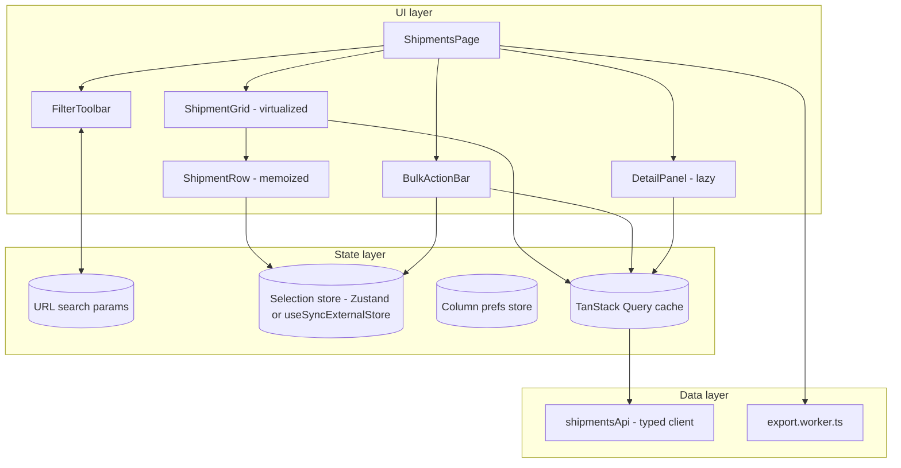

# Project 5 — Data-heavy management UI

**Gate:** after Phase 7 (Performance). **Architectural focus:** virtualization, transitions, URL-driven state, measured performance.
**Estimated effort:** 25–35 h. **Stack:** React 19, TypeScript 5, Vite, TanStack Query v5, TanStack Virtual (or an equivalent windowing library), Vitest, React Testing Library, Playwright, MSW.

> Library APIs (TanStack Query, TanStack Virtual, TanStack Table) evolve. Treat the code here as the *shape* of a solution. Verified 2026-10-22 by typechecking and running the model, store, grid and query code against TanStack Query 5.104, TanStack Virtual 3.14, Zod 4 and React 19.3 (strict TypeScript, jsdom), with the corrections noted inline.

---

## 1. Project brief

You are building the internal "Fleet Operations" console: a management UI over **50,000 shipment records** (id, reference, customer, status, origin, destination, weight, price, createdAt, updatedAt, assignee). Operators filter, sort, search, select rows in bulk, edit a record in a side panel, and export the current view. The UI must stay responsive on a mid-range laptop with 4x CPU throttling in DevTools.

This is not a "make it pretty" project. It is a **measure, change, re-measure** project. Every optimization you keep must be justified by a Profiler or Performance-panel observation recorded in your `PERF_LOG.md`.

### Functional requirements

| ID | Requirement |
|---|---|
| F1 | A table showing shipments; a dataset of 50k rows is generated by a mock API (MSW in dev, a seeded generator for tests). |
| F2 | Server-side **pagination by cursor** *and* an "all loaded rows" virtualized view (user toggles "Browse mode: Paged / Continuous"). Continuous mode loads pages of 500 via infinite query. |
| F3 | Sort by any column (single column, asc/desc). |
| F4 | Filters: status (multi-select), date range, free-text search over reference/customer. Search input must feel instant while the result list updates at lower priority. |
| F5 | Filter, sort, search, and selected-row-for-panel are **in the URL**. Reloading or sharing the link reproduces the view. |
| F6 | Row selection: click, shift-click range, select-all-in-view, with a "N selected" bar. Selection survives scroll (virtualized rows unmount) and is stored by id. |
| F7 | Bulk action "Assign to…" on selection with optimistic update and rollback on failure. |
| F8 | Detail side panel for one record, opened from a row, editable via a form using a React Action. |
| F9 | Column visibility and column width, persisted in `localStorage`. Resizing a column must not re-render every row (see Section 9). |
| F10 | Keyboard navigation: arrow keys move row focus, Space toggles selection, Enter opens the panel. |
| F11 | CSV export of the *current filtered view* (not just loaded pages), streamed from a Worker so the main thread is not blocked. |
| F12 | Loading, empty, error, and "stale data refreshing" states for every async surface. |

### Non-functional requirements

| ID | Requirement | Budget |
|---|---|---|
| N1 | Scroll of the virtualized list | No long task > 50 ms during a continuous scroll trace; main-thread scripting < 8 ms per frame median |
| N2 | Typing in search with 20k rows in memory | Input latency (keydown to paint) < 100 ms at 4x throttle |
| N3 | Changing a filter | Old results remain visible and dimmed until new ones arrive (no blank flash) |
| N4 | Row component renders per sort-direction toggle | ≤ (visible rows + overscan) — never the full dataset |
| N5 | Initial JS | < 200 KB gzip for the route chunk (excluding lazy-loaded export Worker and detail panel) |
| N6 | DOM node count in table | < 1,500 regardless of dataset size |
| N7 | Accessibility | Table semantics preserved (`role="grid"` or table roles with `aria-rowcount`/`aria-rowindex`), keyboard operable, WCAG 2.2 AA contrast |

---

## 2. Learning objectives

By completing this project you will be able to:

1. Choose between pagination, infinite loading, and windowing for a given dataset and explain the cost model of each ([Rendering large collections](../07-performance/08-rendering-large-collections.md), [Windowing and virtualization](../07-performance/09-windowing-and-virtualization.md)).
2. Use `useTransition` and `useDeferredValue` to separate urgent input from non-urgent rendering, and know when *not* to ([useTransition in practice](../07-performance/12-usetransition-in-practice.md), [useDeferredValue in practice](../07-performance/13-usedeferredvalue-in-practice.md)).
3. Locate the real bottleneck with the Profiler and Performance panel before changing code ([Measure before optimizing](../07-performance/01-measure-before-optimizing.md), [Profiler workflows](../07-performance/02-profiler-workflows.md)).
4. Keep referential equality where it matters and *only* there ([Referential equality](../07-performance/05-referential-equality.md), [Memoization trade-offs](../07-performance/04-memoization-trade-offs.md)).
5. Model URL state as the source of truth for view parameters ([URL state management](../06-data-fetching-and-state-ecosystems/18-url-state-management.md), [UI, server, URL and shared state](../03-react-state-and-hooks/19-ui-server-url-and-shared-state.md)).
6. Move heavy work off the main thread ([Long tasks and the main thread](../07-performance/20-long-tasks-and-main-thread.md), [Expensive computations](../07-performance/10-expensive-computations.md)).
7. Defend a performance budget with automated checks ([Web Vitals and budgets](../07-performance/21-web-vitals-and-budgets.md), [Bundle analysis](../07-performance/16-bundle-analysis.md)).
8. Recognize optimizations that make things worse ([Counterproductive optimizations](../07-performance/23-counterproductive-optimizations.md)).

Supporting lessons: [Why components re-render](../07-performance/03-why-components-rerender.md), [State colocation for performance](../07-performance/07-state-colocation-for-perf.md), [Debounce and throttle](../07-performance/14-debounce-and-throttle.md), [Scheduling and perceived responsiveness](../07-performance/11-scheduling-and-perceived-responsiveness.md), [Optimistic updates](../06-data-fetching-and-state-ecosystems/05-optimistic-updates.md), [TanStack Query](../06-data-fetching-and-state-ecosystems/08-tanstack-query.md), [Memory leaks](../07-performance/19-memory-leaks.md).

---

## 3. Recommended architecture

### 3.1 Layers



### 3.2 State ownership (decide *before* coding)

| State | Owner | Why |
|---|---|---|
| Filters, sort, search term, open record id | URL (`useSearchParams`-style) | Shareable, back/forward, survives reload |
| Search input *text* (as typed) | Local `useState` in `SearchBox` | Must update synchronously per keystroke; URL is updated with the transition-deferred value |
| Shipments pages | TanStack Query | Server state: caching, dedupe, refetch, optimistic patching |
| Selected ids | External store with per-id subscriptions | Row `i` must re-render only when *its* selected flag changes |
| Column widths during drag | CSS variable written imperatively on the container | Avoids React renders at pointer-move frequency |
| Column widths at rest, visibility | Store + `localStorage` | Preference, persisted |
| Scroll offset | Virtualizer internals | Never lift scroll position into React state yourself |

### 3.3 The core performance idea

With 50k records, the work splits into four independent costs:

1. **Network/parse** — fetch pages of 500, parse JSON off the render path.
2. **Render** — mount only visible rows (windowing). Cost is O(visible), not O(total).
3. **Derive** — filtering/sorting. Do it **on the server** for the paged dataset. For client-side search over already-loaded rows, do it in a `useDeferredValue` consumer or a Worker, never inside the keystroke handler.
4. **Update fan-out** — an interaction (select a row, resize a column) must touch O(1) rows, not O(visible).

Most failed submissions optimize (2) and ignore (4), then discover that selecting one row re-renders 40 rows, each doing a `Set.has` and re-creating handlers. Design (4) in from day one.

---

## 4. Folder structure

Feature-first, with a thin shared layer (see [Feature vs layer structure](../04-react-architecture/06-feature-vs-layer-structure.md)).

```
fleet-ops/
├─ index.html
├─ vite.config.ts
├─ PERF_LOG.md                      # measurements: before/after, trace screenshots, decisions
├─ src/
│  ├─ main.tsx
│  ├─ app/
│  │  ├─ App.tsx
│  │  ├─ queryClient.ts
│  │  └─ routes.tsx
│  ├─ shared/
│  │  ├─ ui/                        # Button, Checkbox, Spinner, VisuallyHidden
│  │  ├─ hooks/
│  │  │  ├─ useUrlState.ts
│  │  │  └─ usePersistentState.ts
│  │  └─ lib/
│  │     ├─ csv.ts
│  │     └─ perfMarks.ts
│  ├─ features/
│  │  └─ shipments/
│  │     ├─ api/
│  │     │  ├─ shipmentsApi.ts
│  │     │  ├─ queries.ts           # queryOptions factories + keys
│  │     │  └─ types.ts
│  │     ├─ model/
│  │     │  ├─ filters.ts           # parse/serialize search params, zod schema
│  │     │  ├─ selectionStore.ts
│  │     │  └─ columnsStore.ts
│  │     ├─ ui/
│  │     │  ├─ ShipmentsPage.tsx
│  │     │  ├─ FilterToolbar.tsx
│  │     │  ├─ SearchBox.tsx
│  │     │  ├─ ShipmentGrid.tsx
│  │     │  ├─ ShipmentRow.tsx
│  │     │  ├─ BulkActionBar.tsx
│  │     │  └─ DetailPanel.tsx      # lazy
│  │     └─ export/
│  │        ├─ export.worker.ts
│  │        └─ useCsvExport.ts
│  └─ mocks/
│     ├─ handlers.ts
│     ├─ generate.ts                # seeded generator (same seed => same 50k rows)
│     └─ browser.ts
├─ tests/
│  ├─ unit/
│  ├─ component/
│  └─ e2e/
└─ playwright.config.ts
```

---

## 5. Milestones

Each milestone ends with a **commit tagged `mN`** and an entry in `PERF_LOG.md`.

| # | Milestone | Deliverable | Exit criterion |
|---|---|---|---|
| M0 | Baseline (deliberately naive) | Render all 5,000 rows (reduced set) in a plain `<table>` with `useState` filters | Record Profiler flame graph and Performance trace of typing in search and toggling a checkbox. This is your "before". |
| M1 | Data layer | MSW handlers with cursor pagination, filter, sort; typed client; `queryOptions` factories | Contract tests pass; 50k generator is deterministic |
| M2 | URL state | Filters/sort/search/open-id in URL with schema validation | Reload and back/forward reproduce view; invalid params fall back to defaults |
| M3 | Virtualized grid | Windowed rows, sticky header, `aria-rowcount`/`aria-rowindex` | DOM nodes < 1,500; scroll trace has no long tasks |
| M4 | Selection fan-out | Per-id subscription store, shift-range, select-all-in-view | Toggling one checkbox renders exactly 1 row (verified by a render-count test) |
| M5 | Responsive input | `useDeferredValue`/`useTransition` for filters/search; stale dimming | Typing latency < 100 ms at 4x throttle |
| M6 | Mutations | Bulk assign with optimistic update + rollback; detail panel with Action | Failure injection test proves rollback |
| M7 | Columns | Resize via CSS variables; visibility; persistence | Resize drag renders 0 rows (profile it) |
| M8 | Export | Worker CSV export, progress, cancel | No long task > 50 ms during export of 50k rows |
| M9 | Budgets | Bundle analysis, lazy panel, CI checks (size limit, Lighthouse CI or Playwright trace assertions) | CI fails when a budget is exceeded |
| M10 | Review | Write the retrospective: what each optimization bought, what you removed | At least one optimization *removed* because it measured as neutral |

---

## 6. Recommended implementation

### 6.1 Typed filters and URL as source of truth

Validate at the boundary. A hand-edited URL must never crash the page.

```ts
// features/shipments/model/filters.ts
import { z } from 'zod'

export const STATUSES = ['pending', 'in_transit', 'delivered', 'exception'] as const
export type Status = (typeof STATUSES)[number]

export const SORT_FIELDS = ['reference', 'customer', 'status', 'weight', 'price', 'createdAt'] as const
export type SortField = (typeof SORT_FIELDS)[number]

const filtersSchema = z.object({
  q: z.string().trim().max(100).default(''),
  status: z.array(z.enum(STATUSES)).default([]),
  from: z.string().date().optional(),
  to: z.string().date().optional(),
  sort: z.enum(SORT_FIELDS).default('createdAt'),
  dir: z.enum(['asc', 'desc']).default('desc'),
  open: z.string().optional(), // record id shown in the panel
})

export type ShipmentFilters = z.infer<typeof filtersSchema>

export function parseFilters(params: URLSearchParams): ShipmentFilters {
  const raw = {
    q: params.get('q') ?? undefined,
    status: params.getAll('status'),
    from: params.get('from') ?? undefined,
    to: params.get('to') ?? undefined,
    sort: params.get('sort') ?? undefined,
    dir: params.get('dir') ?? undefined,
    open: params.get('open') ?? undefined,
  }
  const result = filtersSchema.safeParse(raw)
  // Invalid input => defaults, never an exception in render.
  // Note: ONE invalid parameter makes the whole parse fail, so valid siblings are dropped too
  // (`?q=abc&status=banana` yields q = ''). To keep the valid parts, validate field by field.
  return result.success ? result.data : filtersSchema.parse({})
}

export function serializeFilters(f: ShipmentFilters): URLSearchParams {
  const p = new URLSearchParams()
  if (f.q) p.set('q', f.q)
  f.status.forEach((s) => p.append('status', s))
  if (f.from) p.set('from', f.from)
  if (f.to) p.set('to', f.to)
  if (f.sort !== 'createdAt') p.set('sort', f.sort)
  if (f.dir !== 'desc') p.set('dir', f.dir)
  if (f.open) p.set('open', f.open)
  return p
}
```

Design note: `parseFilters` returns a **new object every call**. Memoize by the *string* of the search params (`useMemo(() => parseFilters(params), [params.toString()])`), or your query keys will be structurally equal but your downstream `useMemo`s keyed by object identity will thrash. See [Referential equality](../07-performance/05-referential-equality.md).

### 6.2 Query options and infinite pages

```ts
// features/shipments/api/queries.ts
import { infiniteQueryOptions, keepPreviousData, queryOptions } from '@tanstack/react-query'
import { shipmentsApi } from './shipmentsApi'
import type { ShipmentFilters } from '../model/filters'

export const shipmentKeys = {
  all: ['shipments'] as const,
  list: (f: Omit<ShipmentFilters, 'open'>) => [...shipmentKeys.all, 'list', f] as const,
  detail: (id: string) => [...shipmentKeys.all, 'detail', id] as const,
}

export function shipmentsInfiniteOptions(filters: ShipmentFilters) {
  const { open: _open, ...listFilters } = filters // opening a panel must not refetch the list
  return infiniteQueryOptions({
    queryKey: shipmentKeys.list(listFilters),
    queryFn: ({ pageParam, signal }) =>
      shipmentsApi.list({ ...listFilters, cursor: pageParam, limit: 500 }, signal),
    initialPageParam: null as string | null,
    getNextPageParam: (last) => last.nextCursor,
    getPreviousPageParam: (first) => first.prevCursor ?? undefined, // required in practice by maxPages (see below)
    placeholderData: keepPreviousData, // N3: keep old rows visible while the new filter loads
    staleTime: 30_000,
    maxPages: 40, // bound memory in continuous mode: 40 * 500 = 20k rows retained
  })
}

export const shipmentDetailOptions = (id: string) =>
  queryOptions({
    queryKey: shipmentKeys.detail(id),
    queryFn: ({ signal }) => shipmentsApi.get(id, signal),
  })
```

Notes:
- `signal` is forwarded to `fetch`, so superseded requests are aborted ([Cancellation and race conditions](../06-data-fetching-and-state-ecosystems/02-cancellation-and-race-conditions.md)).
- `maxPages` is a deliberate memory bound; with it, scrolling far up requires refetching earlier pages. Decide whether that trade-off suits your UX and document it. The TanStack Query infinite-query guide documents `maxPages` "in conjunction with `getNextPageParam` and `getPreviousPageParam` to allow fetching pages when needed in both directions", so the options above define both (the page type therefore needs a `prevCursor`). Without `getPreviousPageParam`, `hasPreviousPage` is `false` and pages dropped from the start cannot be loaded again by scrolling back up.

### 6.3 Search: urgent input, deferred results

```tsx
// features/shipments/ui/SearchBox.tsx
import { useEffect, useState, useTransition } from 'react'

interface Props {
  value: string // committed value from the URL
  onCommit: (next: string) => void
}

export function SearchBox({ value, onCommit }: Props) {
  const [text, setText] = useState(value)
  const [isPending, startTransition] = useTransition()

  // Reflect external changes (back/forward, "clear filters") into the input.
  useEffect(() => setText(value), [value])

  return (
    <div role="search">
      <label htmlFor="shipment-search">Search shipments</label>
      <input
        id="shipment-search"
        value={text}
        onChange={(e) => {
          const next = e.target.value
          setText(next) // urgent: the keystroke must paint immediately
          startTransition(() => onCommit(next)) // non-urgent: URL + results
        }}
        aria-busy={isPending}
      />
      {isPending && <span aria-live="polite">Updating…</span>}
    </div>
  )
}
```

Line notes:
- `setText` outside the transition keeps typing synchronous. Wrapping *both* updates in the transition is the classic mistake: the input becomes laggy.
- A transition does not cancel network requests nor debounce them. If every keystroke commits to the URL and creates a new query key, you will fire many requests. Combine with a short debounce (150–250 ms) on `onCommit` *or* rely on query cancellation; measure which one you need ([Debounce and throttle](../07-performance/14-debounce-and-throttle.md)).
- Updating the URL inside a transition depends on your router: confirm that its navigate function participates in transitions (React Router and TanStack Router both document their behavior). If not, keep a local `committed` state in the transition and sync the URL in an effect.

For *client-side* filtering of in-memory rows (the "quick filter" over loaded pages), use `useDeferredValue`:

```tsx
function useQuickFilter(rows: readonly Shipment[], text: string) {
  const deferred = useDeferredValue(text)
  const result = useMemo(() => filterRows(rows, deferred), [rows, deferred])
  return { rows: result, isStale: deferred !== text }
}
```

`isStale` drives the dimming style (`opacity: .6`) so users know the list lags the input ([N3](#non-functional-requirements)).

### 6.4 The virtualized grid

```tsx
// features/shipments/ui/ShipmentGrid.tsx
import { useRef, useMemo, useEffect } from 'react'
import { useVirtualizer } from '@tanstack/react-virtual'
import { useInfiniteQuery } from '@tanstack/react-query'
import { shipmentsInfiniteOptions } from '../api/queries'
import { ShipmentRow } from './ShipmentRow'
import type { ShipmentFilters } from '../model/filters'

const ROW_HEIGHT = 44
const OVERSCAN = 8

export function ShipmentGrid({ filters }: { filters: ShipmentFilters }) {
  const { data, fetchNextPage, hasNextPage, isFetchingNextPage, isPlaceholderData } =
    useInfiniteQuery(shipmentsInfiniteOptions(filters))

  const rows = useMemo(() => data?.pages.flatMap((p) => p.items) ?? [], [data])
  const total = data?.pages[0]?.total ?? 0

  const parentRef = useRef<HTMLDivElement>(null)
  const virtualizer = useVirtualizer({
    count: hasNextPage ? rows.length + 1 : rows.length, // +1 = loader row
    getScrollElement: () => parentRef.current,
    estimateSize: () => ROW_HEIGHT,
    overscan: OVERSCAN,
    getItemKey: (index) => rows[index]?.id ?? `loader-${index}`, // stable keys across sorts
  })

  const items = virtualizer.getVirtualItems()
  const lastIndex = items.at(-1)?.index ?? -1

  useEffect(() => {
    if (lastIndex >= rows.length - 1 && hasNextPage && !isFetchingNextPage) {
      void fetchNextPage()
    }
  }, [lastIndex, rows.length, hasNextPage, isFetchingNextPage, fetchNextPage])

  return (
    <div
      ref={parentRef}
      role="grid"
      aria-rowcount={total + 1 /* header */}
      aria-busy={isPlaceholderData}
      className={isPlaceholderData ? 'grid grid--stale' : 'grid'}
      style={{ height: '100%', overflow: 'auto', contain: 'strict' }}
    >
      <div style={{ height: virtualizer.getTotalSize(), position: 'relative' }}>
        {items.map((vi) => {
          const row = rows[vi.index]
          return (
            <div
              key={vi.key}
              role="row"
              aria-rowindex={vi.index + 2}
              style={{
                position: 'absolute',
                top: 0,
                left: 0,
                width: '100%',
                height: vi.size,
                transform: `translateY(${vi.start}px)`,
              }}
            >
              {row ? <ShipmentRow shipment={row} /> : <RowSkeleton />}
            </div>
          )
        })}
      </div>
    </div>
  )
}
function RowSkeleton() { return <div className="row row--skeleton" aria-hidden /> }
```

Key points:
- Position with `transform: translateY` so scroll updates are compositor-friendly; changing `top` for every row triggers layout.
- The scroll container has a fixed height. A virtualizer inside an auto-height parent renders everything. This is the most common first bug.
- `contain: 'strict'` isolates layout. Verify it does not clip your sticky header or focus rings.
- `rows` is memoized on `data`; `getItemKey` uses record id, so after a re-sort React moves existing row components rather than re-mounting by index ([Lists, keys, identity](../01-react-fundamentals/09-lists-keys-and-identity.md)).
- Dynamic row heights (expanding rows) require `measureElement`. If you add expandable rows as an extension, budget extra work for scroll-anchoring.
- Keyboard focus: a focused row that scrolls out of the window is unmounted and focus is lost. Track `activeIndex` in the grid and re-focus after the virtualizer scrolls it into view (`virtualizer.scrollToIndex`). This is a real accessibility defect in naive implementations.

### 6.5 Selection with per-row subscriptions

This is where [`useSyncExternalStore`](../03-react-state-and-hooks/20-usesyncexternalstore-and-external-stores.md) earns its keep. A `Set<string>` in React state forces all subscribers to re-render on any change.

```ts
// features/shipments/model/selectionStore.ts
type Listener = () => void

export class SelectionStore {
  private selected = new Set<string>()
  private perId = new Map<string, Set<Listener>>()
  private global = new Set<Listener>()
  private snapshotCount = 0
  private anchor: string | null = null

  // --- subscription surface -------------------------------------------------
  subscribeId = (id: string, l: Listener) => {
    let set = this.perId.get(id)
    if (!set) this.perId.set(id, (set = new Set()))
    set.add(l)
    return () => {
      set!.delete(l)
      if (set!.size === 0) this.perId.delete(id)
    }
  }
  subscribeCount = (l: Listener) => {
    this.global.add(l)
    return () => void this.global.delete(l)
  }

  // --- snapshots (must be referentially stable between changes) -------------
  isSelected = (id: string) => this.selected.has(id)
  getCount = () => this.snapshotCount

  // --- mutations -------------------------------------------------------------
  toggle(id: string) {
    this.selected.has(id) ? this.selected.delete(id) : this.selected.add(id)
    this.anchor = id
    this.emit([id])
  }
  selectRange(orderedIds: readonly string[], toId: string) {
    const from = this.anchor ? orderedIds.indexOf(this.anchor) : -1
    const to = orderedIds.indexOf(toId)
    if (to === -1) return
    const [a, b] = from === -1 ? [to, to] : [Math.min(from, to), Math.max(from, to)]
    const changed: string[] = []
    for (let i = a; i <= b; i++) {
      const id = orderedIds[i]
      if (id !== undefined && !this.selected.has(id)) { this.selected.add(id); changed.push(id) } // `id` is `string | undefined` under noUncheckedIndexedAccess
    }
    this.emit(changed)
  }
  clear() {
    const changed = [...this.selected]
    this.selected.clear()
    this.anchor = null
    this.emit(changed)
  }
  ids = () => [...this.selected]

  private emit(changedIds: readonly string[]) {
    this.snapshotCount = this.selected.size
    // Only rows whose flag actually changed are notified.
    for (const id of changedIds) this.perId.get(id)?.forEach((l) => l())
    this.global.forEach((l) => l())
  }
}

export const selectionStore = new SelectionStore()
```

```tsx
// features/shipments/ui/ShipmentRow.tsx
import { memo, useSyncExternalStore } from 'react'
import { selectionStore } from '../model/selectionStore'
import type { Shipment } from '../api/types'

export const ShipmentRow = memo(function ShipmentRow({ shipment }: { shipment: Shipment }) {
  const selected = useSyncExternalStore(
    (l) => selectionStore.subscribeId(shipment.id, l),
    () => selectionStore.isSelected(shipment.id),
  )
  return (
    <div className={selected ? 'row row--selected' : 'row'} role="presentation">
      <input
        type="checkbox"
        checked={selected}
        aria-label={`Select ${shipment.reference}`}
        onChange={() => selectionStore.toggle(shipment.id)}
      />
      <span role="gridcell">{shipment.reference}</span>
      <span role="gridcell">{shipment.customer}</span>
      <span role="gridcell">{shipment.status}</span>
      {/* ... */}
    </div>
  )
})
```

Why this works: the subscribe function is recreated every render (inline arrow). React resubscribes when its identity changes, which is correct but wasteful; hoist with `useCallback` keyed on `shipment.id` if the profile shows subscription churn. The `memo` wrapper plus the stable `shipment` object (from the query cache's structural sharing) means a sort toggle that does not change record data does not re-render rows whose props are identical. Note: React does not guarantee that `memo` prevents rendering in all cases; treat it as an optimization, not a semantic guarantee ([React.memo](../03-react-state-and-hooks/12-react-memo.md)).

Selection by id (not index) is what makes selection survive virtualization, sorting, and refetching.

### 6.6 Column resize without re-rendering rows

```tsx
function ColumnResizer({ colKey, containerRef }: { colKey: string; containerRef: React.RefObject<HTMLElement | null> }) {
  const onPointerDown = (e: React.PointerEvent) => {
    const startX = e.clientX
    const el = containerRef.current!
    const startWidth = parseFloat(getComputedStyle(el).getPropertyValue(`--col-${colKey}`)) || 120
    const move = (ev: PointerEvent) => {
      const w = Math.max(60, startWidth + ev.clientX - startX)
      el.style.setProperty(`--col-${colKey}`, `${w}px`) // no React render
    }
    const up = (ev: PointerEvent) => {
      window.removeEventListener('pointermove', move)
      window.removeEventListener('pointerup', up)
      columnsStore.setWidth(colKey, parseFloat(el.style.getPropertyValue(`--col-${colKey}`))) // commit once
    }
    window.addEventListener('pointermove', move)
    window.addEventListener('pointerup', up)
    ;(e.target as Element).setPointerCapture(e.pointerId)
  }
  return <div className="resizer" onPointerDown={onPointerDown} role="separator" aria-orientation="vertical" />
}
```

Cells use `width: var(--col-reference)`. During drag React renders nothing; on release one store update persists the width. Imperative DOM writes to styles React does not control are safe provided React never sets that same property.

### 6.7 Optimistic bulk assign with rollback

```ts
export function useBulkAssign(filters: ShipmentFilters) {
  const qc = useQueryClient()
  const key = shipmentKeys.list(omitOpen(filters))
  return useMutation({
    mutationFn: ({ ids, assignee }: { ids: string[]; assignee: string }) =>
      shipmentsApi.bulkAssign(ids, assignee),
    onMutate: async ({ ids, assignee }) => {
      await qc.cancelQueries({ queryKey: shipmentKeys.all }) // avoid refetch overwriting the optimistic write
      const previous = qc.getQueryData<InfiniteData<ShipmentPage>>(key)
      const idSet = new Set(ids)
      qc.setQueryData<InfiniteData<ShipmentPage>>(key, (old) =>
        old && {
          ...old,
          pages: old.pages.map((p) => ({
            ...p,
            // Preserve identity of untouched records so memoized rows skip rendering.
            items: p.items.map((s) => (idSet.has(s.id) ? { ...s, assignee } : s)),
          })),
        },
      )
      return { previous }
    },
    onError: (_e, _v, ctx) => ctx && qc.setQueryData(key, ctx.previous),
    onSettled: () => qc.invalidateQueries({ queryKey: shipmentKeys.all }),
  })
}
```

Gotchas: (a) `pages.map` creates new page objects, but untouched `s` items keep identity — that is intentional; (b) the rollback restores a snapshot, which also reverts concurrent unrelated edits made between `onMutate` and `onError` — acceptable here, but document it; (c) `invalidateQueries` on all shipment keys can trigger multiple refetches of 500-row pages; scope it if you measure that cost ([Cache consistency and invalidation](../06-data-fetching-and-state-ecosystems/06-cache-consistency-and-invalidation.md)).

### 6.8 Export in a Worker

```ts
// features/shipments/export/export.worker.ts
/// <reference lib="webworker" />
interface StartMsg { type: 'start'; url: string; params: string }
interface CancelMsg { type: 'cancel' }
let controller: AbortController | null = null

self.onmessage = async (e: MessageEvent<StartMsg | CancelMsg>) => {
  if (e.data.type === 'cancel') return controller?.abort()
  controller = new AbortController()
  const chunks: string[] = ['reference,customer,status,price\n']
  let cursor: string | null = null, done = 0
  try {
    do {
      const res: Response = await fetch(`${e.data.url}?${e.data.params}&limit=2000${cursor ? `&cursor=${cursor}` : ''}`, { signal: controller.signal })
      const page: { items: CsvRow[]; nextCursor: string | null; total: number } = await res.json() // annotated: otherwise TS7022 (circular inference through `cursor`)
      chunks.push(page.items.map(toCsvLine).join('\n') + '\n')
      cursor = page.nextCursor
      done += page.items.length
      self.postMessage({ type: 'progress', done, total: page.total })
    } while (cursor)
    self.postMessage({ type: 'done', blob: new Blob(chunks, { type: 'text/csv' }) })
  } catch (err) {
    self.postMessage({ type: (err as Error).name === 'AbortError' ? 'cancelled' : 'error' })
  }
}
interface CsvRow { reference: string; customer: string; status: string; price: number }
function toCsvLine(s: CsvRow) {
  const esc = (v: string) => `"${v.replaceAll('"', '""')}"`
  return [esc(s.reference), esc(s.customer), s.status, s.price].join(',')
}
```

```ts
// useCsvExport.ts: Vite bundles workers with this syntax
const worker = new Worker(new URL('./export.worker.ts', import.meta.url), { type: 'module' })
```

CSV injection: values beginning with `=`, `+`, `-`, `@` can execute as formulas in spreadsheet apps. Prefix with `'` or a tab when exporting user-controlled strings. This is a security requirement, not an extra ([Security: XSS, CSRF, CSP](../10-production-engineering/06-security-xss-csrf-csp.md)).

### 6.9 Lazy detail panel

```tsx
const DetailPanel = lazy(() => import('./DetailPanel'))
// In the page:
{filters.open && (
  <Suspense fallback={<PanelSkeleton />}>
    <DetailPanel id={filters.open} onClose={() => update({ open: undefined })} />
  </Suspense>
)}
```

Prefetch on row `onPointerEnter`/`onFocus` via `queryClient.prefetchQuery(shipmentDetailOptions(id))` and preload the chunk with `import('./DetailPanel')` ([Code splitting and lazy loading](../07-performance/15-code-splitting-and-lazy-loading.md)).

---

## 7. Design decisions to document (ADR-style)

Write a short decision record for each ([Architecture decision records](../10-production-engineering/16-architecture-decision-records.md)).

| Decision | Options | What to weigh |
|---|---|---|
| Paged vs continuous | Pagination only; infinite + windowing; both | Pagination gives bounded DOM and linkable positions; continuous gives scan-ability but needs memory bounds (`maxPages`) and scroll restoration. Both are required here, so document how filter changes reset each. |
| Server vs client sort/filter | Server for all; client for loaded rows | Client sort of 50k records is feasible (tens of ms) but only correct if *all* rows are loaded. Partial data + client sort = wrong order. |
| Selection store | `useState<Set>`; Context; Zustand; custom `useSyncExternalStore` | Measure fan-out. Zustand with selectors by id also works; choose by team convention but verify with a render-count test. |
| Fixed vs dynamic row height | Fixed; measured | Fixed height is faster and simpler; dynamic needs `measureElement` and can cause scroll jumps. |
| Search commit strategy | Debounce; transition; both | Transitions prioritize rendering, they do not reduce requests. |
| Where CSV is built | Main thread; Worker; server | Server-side export scales best for large data; Worker is the client-only option. State when you would switch. |
| Memoization policy | Everywhere; nowhere; measured | Allowed only where PERF_LOG shows a render-count or time win. |

---

## 8. Testing expectations

See [Test strategy and pyramid](../08-testing-and-quality/01-test-strategy-and-pyramid.md), [React Testing Library](../08-testing-and-quality/03-react-testing-library.md), [Mocking strategies and MSW](../08-testing-and-quality/06-mocking-strategies-and-msw.md), [E2E with Playwright](../08-testing-and-quality/09-e2e-with-playwright.md), [Accessibility testing](../08-testing-and-quality/10-accessibility-testing.md).

| Level | What | Examples |
|---|---|---|
| Unit | Pure model code | `parseFilters`/`serializeFilters` round trip; invalid params fall back; `SelectionStore.selectRange` with anchor, reverse ranges, ids missing from list; CSV escaping and formula-injection guard |
| Component | Grid in jsdom | jsdom has no layout, so virtualizers render nothing unless you mock sizes. Stub `clientHeight`/`clientWidth` on `HTMLElement.prototype` (what `@tanstack/react-virtual` 3.14 reads; verified: about 18 rows render for a 440 px viewport) or inject `initialRect` and `observeElementRect` options; assert that with 50k rows, fewer than ~40 row elements exist |
| Render-count | Fan-out guard | Wrap `ShipmentRow` content with a counter (a test-only `onRender` prop or `<Profiler>`); toggle one checkbox; assert exactly 1 row commit |
| Integration | Page + MSW | Typing in search eventually shows filtered rows; stale dimming appears while the response is delayed; bulk assign failure rolls back and shows an error |
| E2E | Playwright | Scroll to bottom of continuous mode loads next page; reload preserves URL state; keyboard-only flow (arrows, Space, Enter); axe scan on the page; export download contains N rows |
| Performance | Playwright + trace | Programmatic scroll while collecting `PerformanceObserver` `longtask` entries; assert count = 0 above the 50 ms threshold. The Long Tasks API is Chromium-only (not available in Firefox or Safari), so run this check in Chromium |

Test the **behavior**, not that `useVirtualizer` was called.

Failure-injection example (MSW):

```ts
http.post('/api/shipments/bulk-assign', async () => {
  await delay(300)
  return HttpResponse.json({ message: 'conflict' }, { status: 409 })
})
// expect: rows show new assignee immediately, then revert, and a toast with role="alert" appears
```

---

## 9. Performance expectations and how to prove them

1. **Baseline first (M0).** Record: Profiler commit durations for typing a character; Performance panel at 4x CPU throttle; DOM node count; React DevTools "highlight updates".
2. **Per-interaction budget:**

| Interaction | Target |
|---|---|
| Keystroke in search | Input paints < 100 ms (INP-style); no long task > 50 ms from your code |
| Toggle one row checkbox | 1 row commit; < 8 ms scripting |
| Resize column | 0 row commits during drag |
| Sort toggle | Old data visible until new arrives; ≤ visible + overscan row renders afterward |
| Scroll | Median frame scripting < 8 ms; no long tasks |
| Select-all-in-view (500 rows) | Single commit for the count bar; rows update via per-id notifications; < 100 ms total |

3. **Memory:** In a 10-minute scripted scroll/filter session, heap snapshot growth should plateau (bounded by `maxPages`). Detached DOM nodes after closing the panel indicate leaks ([Memory leaks](../07-performance/19-memory-leaks.md)).
4. **Bundle:** `rollup-plugin-visualizer` report committed; panel, export worker, and date picker must be separate chunks.
5. **Report in PERF_LOG.md:** each entry = hypothesis, measurement method, result, decision (kept/reverted). Reverting is a valid outcome ([Counterproductive optimizations](../07-performance/23-counterproductive-optimizations.md)).

Remember dev-mode numbers are misleading: StrictMode double-invokes render and effects, and the dev build is much slower. Profile a production build (`vite build && vite preview`), with the profiling build of React DOM aliased if you need Profiler data in production. `react-dom/profiling` is a real export of `react-dom` 19.3; alias `react-dom/client` to it in `resolve.alias` for a profiling production build and check that your React DevTools version shows the Profiler tab.

---

## 10. Common implementation mistakes

| Mistake | Symptom | Fix |
|---|---|---|
| Virtualizer inside an auto-height container | All 50k rows render; browser hangs | Fixed/flex-constrained scroll element height |
| Row key = array index | Selection checkbox "jumps" after sort; input state in rows bleeds | Key by record id (`getItemKey`) |
| Selection stored as `Set` in parent state | Every checkbox click re-renders all visible rows | Per-id subscriptions or selector-based store |
| Whole input update inside `startTransition` | Typing feels laggy | Controlled value updated urgently; only the expensive update deferred |
| `useDeferredValue` on a value consumed by a component that is not memoized or does heavy work in a child that re-renders anyway | No improvement | Deferred value must feed a subtree whose render is skipped while stale; memoize that subtree |
| `useMemo` everywhere "just in case" | More code, no measurable win; hides real issue | Delete; keep only measured ones |
| Inline arrow handlers passed to memoized rows | `memo` never skips | Pass stable callbacks (`useCallback`) or read from stores inside the row |
| Reading the whole list in the row to compute index | O(n) per row | Pass the index/identifier down; avoid `rows.indexOf` in render |
| Lifting scroll position into React state | A commit per scroll event | Let the virtualizer own scrolling |
| `transform`/`top` on every cell | Layout thrash | One transform per row container |
| Debounced URL writes but non-debounced query key | Request storm | Key from the committed value |
| `invalidateQueries()` on everything after a bulk edit | Dozens of 500-row refetches | Scope invalidation or patch cache |
| Ignoring focus loss on unmount | Keyboard users lose place | Track active index; scroll and refocus |
| Client sort over partial data | Rows out of order as pages arrive | Sort on server |
| Fetching all 50k up front "to make search easy" | Memory + parse long task | Server search; Worker for client work |
| Trusting dev-mode timings | Chasing nonexistent issues | Profile production build |

---

## 11. Review checklist

**Correctness**
- [ ] Invalid URL params never throw; defaults apply.
- [ ] Changing a filter resets cursor/selection policy as documented.
- [ ] Optimistic update rolls back on failure and reconciles on success.
- [ ] Race: type quickly, only the latest query result is shown; earlier requests aborted.
- [ ] Selection by id survives scroll, sort, and refetch.

**Performance**
- [ ] PERF_LOG has baseline and after measurements for each kept optimization.
- [ ] Render-count tests exist for selection and sort.
- [ ] No long tasks > 50 ms in the scripted scroll trace.
- [ ] DOM nodes < 1,500 with 50k rows.
- [ ] Each `memo`/`useMemo`/`useCallback` has a justification.
- [ ] Export runs off the main thread and is cancellable.

**Architecture**
- [ ] Server state in Query, URL state in URL, ephemeral state local.
- [ ] No feature imports another feature's internals.
- [ ] Heavy components lazy-loaded; chunks verified.

**Accessibility**
- [ ] Table/grid semantics with `aria-rowcount`/`aria-rowindex`.
- [ ] Keyboard-only flow works; focus is never lost on scroll.
- [ ] Status and busy states announced (`aria-live`, `aria-busy`).
- [ ] Contrast and focus indicators pass; axe has no serious violations.

**Security**
- [ ] CSV export neutralizes formula injection.
- [ ] No `dangerouslySetInnerHTML` on record fields.

---

## 12. Reference solution guidance

1. **Start by building the naive version and breaking it.** The baseline teaches what to measure.
2. **Order of attack:** data layer, URL state, windowing, selection fan-out, input responsiveness, everything else. Windowing delivers ~90% of the win; selection and input are where subtle defects live.
3. **Keep the row dumb.** `ShipmentRow` takes a stable record and subscribes to exactly one fine-grained thing. No context reads, no `useQuery` per row.
4. **Pure model modules** (`filters.ts`, `selectionStore.ts`) are framework-light and unit-testable without a DOM. That is where most test value is.
5. **Compare two transition strategies** in `PERF_LOG.md`: (a) transition + debounce, (b) deferred value only. Record request counts and input latency.
6. **Example render-count test** (reference approach):

```tsx
it('toggling one row commits exactly one row', async () => {
  const commits: string[] = []
  render(
    <Profiler id="grid" onRender={() => {}}>
      <ShipmentGrid filters={defaultFilters} onRowRender={(id) => commits.push(id)} />
    </Profiler>,
    { wrapper: TestProviders },
  )
  await screen.findAllByRole('row')
  commits.length = 0
  await userEvent.click(screen.getByRole('checkbox', { name: /select SHP-000001/i }))
  expect(commits).toEqual(['SHP-000001'])
})
```

`onRowRender` is a test seam, invoked in the row body (accept that calling it during render is a test-only impurity; gate it behind `import.meta.env.MODE === 'test'`). StrictMode double-invokes render in development; do not wrap this test in `StrictMode`, or assert on a Set of ids.

7. **Mock data generator:** use a seeded PRNG (e.g., mulberry32) so tests are deterministic; keep the generator out of the production bundle.
8. **CI budgets:** `size-limit` or equivalent on the route chunk; a Playwright test that fails if long tasks > N during scripted scroll. Make budgets configurable, and avoid flaky thresholds by testing relative to a baseline run rather than absolute milliseconds on shared CI hardware ([CI checks](../08-testing-and-quality/15-ci-checks.md)).

---

## 13. Optional extensions

- **Dynamic row heights** with expandable rows and scroll anchoring.
- **Column pinning and grouping** (sticky columns with virtualization on both axes).
- **Server-sent updates:** live status changes via WebSocket merged into the cache with `setQueryData`, without re-rendering unaffected rows ([Real-time](../06-data-fetching-and-state-ecosystems/17-real-time-websockets-subscriptions.md)).
- **Saved views:** persist filter sets server-side and reconcile with URL state.
- **Offline-tolerant edits** ([Offline considerations](../06-data-fetching-and-state-ecosystems/16-offline-considerations.md)).
- **Compare libraries:** rebuild the grid with TanStack Table + Virtual vs. a headless hand-rolled version; compare bundle and code size.
- **React Compiler experiment:** enable the compiler (`babel-plugin-react-compiler` is at 1.0; with Vite 8 and `@vitejs/plugin-react` 6 the documented route is `reactCompilerPreset()` plus `@rolldown/plugin-babel`, see [react.dev installation](https://react.dev/learn/react-compiler/installation); note that components calling `useVirtualizer` are skipped by the compiler as known-incompatible), remove manual memoization in rows, and compare profiles ([React Compiler](../09-advanced-rendering-and-ecosystem/08-react-compiler.md)).
- **Broken app companion:** hand your M0 baseline to a peer as input for Project 11 diagnosis.
