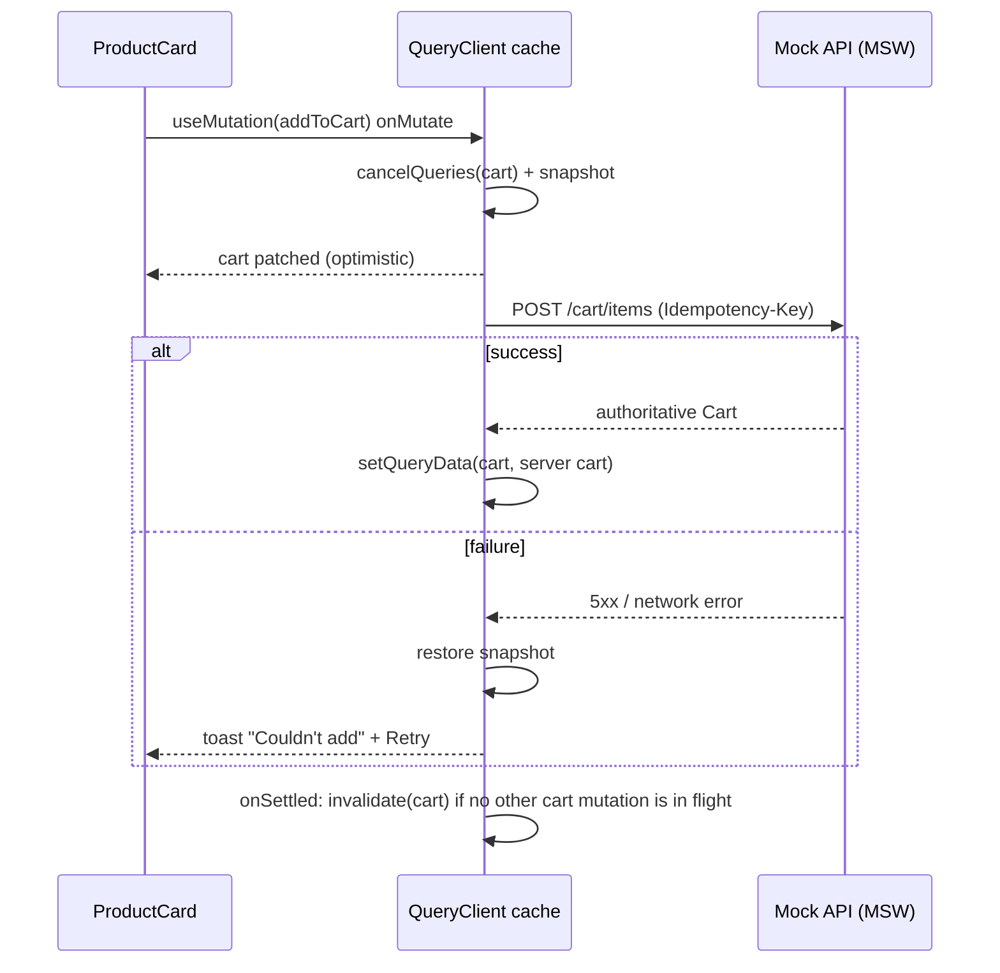

# Project 6 — E-commerce with server-state caching

**Gate:** after Phase 6 (Data fetching and state ecosystems). **Architectural focus:** server-state cache design, optimistic updates, invalidation, normalization decisions, resilience.
**Estimated effort:** 30–40 h. **Stack:** React 19, TypeScript 5, Vite, TanStack Query v5, a router (React Router or TanStack Router), Zustand 5 (client-only state), Zod, Vitest, React Testing Library, MSW, Playwright.

> TanStack Query and router APIs change between minors. Code here shows the design. Verified 2026-10-22: the HTTP layer, query client, key factories, seeding, cart mutations and checkout action typecheck under strict TypeScript against TanStack Query 5.104 / React 19.3 / Zod 4 (with the imports and domain types the text omits supplied), and the cart serialization and cache-policy claims below were run in jsdom.

---

## 1. Project brief

Build "Parcelmart", a storefront with catalog browsing, product detail, cart, wishlist, and checkout. The backend is a mock (MSW) that you control — **and that you will make hostile**: latency, random failures, stale reads, out-of-order responses, and price changes between page views. The point is not shopping UI; it is a cache that stays *correct* under those conditions while feeling instant.

### Functional requirements

| ID | Requirement |
|---|---|
| F1 | Catalog list with category filter, sort, search, and pagination (URL-driven). |
| F2 | Product detail with variants (size/color) and live stock indication. |
| F3 | Cart: add, change quantity, remove. Cart is **server state** for signed-in users (the server computes totals, discounts, tax) and shown optimistically. |
| F4 | Wishlist toggle (heart) on cards and detail; instant feedback with rollback on failure. |
| F5 | Product list to detail transition shows the list's partial data immediately (seeded cache), then fills in the full record. |
| F6 | Prefetch detail on hover/focus intent and next catalog page on scroll proximity. |
| F7 | Checkout: address, shipping method, payment stub. Submit uses an idempotency key; double-click or retry must not create two orders. |
| F8 | After order success: cart emptied, order visible in "My orders" without a manual refresh, product stock figures refreshed. |
| F9 | Mock auth: sign in / out. Sign-out must clear all user-scoped cache entries. |
| F10 | Offline/slow-network behavior: show cached data with a stale banner; mutations in flight display pending state; failed mutations offer retry. |
| F11 | A developer "Network chaos" panel (dev only) controlling latency, failure rate, and a "price changed" trigger. |

### Non-functional requirements

| ID | Requirement |
|---|---|
| N1 | No request waterfalls on first load of product detail (product, reviews, recommendations load in parallel or are prefetched by the route). |
| N2 | Cart interactions feel instant (< 100 ms UI response) regardless of server latency. |
| N3 | The UI never shows an *inconsistent* cart (e.g., badge says 3, drawer shows 2) after any sequence of rapid clicks. |
| N4 | Duplicate in-flight requests for the same key are deduplicated (verify in the network panel). |
| N5 | All server data is parsed/validated at the boundary; unknown shapes surface as typed errors, not undefined renders. |
| N6 | Accessible: cart updates announced, errors announced, focus managed after remove/undo. |

---

## 2. Learning objectives

1. Design **query keys** as an API: hierarchical, serializable, and invalidation-friendly ([Server state management](../06-data-fetching-and-state-ecosystems/07-server-state-management.md), [TanStack Query](../06-data-fetching-and-state-ecosystems/08-tanstack-query.md)).
2. Implement optimistic updates with correct cancel/snapshot/rollback/settle ordering ([Optimistic updates](../06-data-fetching-and-state-ecosystems/05-optimistic-updates.md)).
3. Choose between invalidation, direct cache writes, and normalization for each data shape ([Cache consistency and invalidation](../06-data-fetching-and-state-ecosystems/06-cache-consistency-and-invalidation.md), [API normalization](../06-data-fetching-and-state-ecosystems/04-api-normalization.md)).
4. Eliminate races and stale overwrites ([Cancellation and race conditions](../06-data-fetching-and-state-ecosystems/02-cancellation-and-race-conditions.md), [Fetch lifecycle](../06-data-fetching-and-state-ecosystems/01-fetch-lifecycle.md)).
5. Model loading, error, empty, and refetching states distinctly ([Loading and error states](../06-data-fetching-and-state-ecosystems/03-loading-and-error-states.md)).
6. Apply retries, backoff, and error recovery with idempotency ([Error recovery and retries](../06-data-fetching-and-state-ecosystems/15-error-recovery-and-retries.md)).
7. Separate server, client, URL, and form state ([Server vs client state](../04-react-architecture/16-server-vs-client-state.md), [UI, server, URL and shared state](../03-react-state-and-hooks/19-ui-server-url-and-shared-state.md), [URL state management](../06-data-fetching-and-state-ecosystems/18-url-state-management.md)).
8. Use Suspense data loading deliberately ([Suspense data loading](../06-data-fetching-and-state-ecosystems/13-suspense-data-loading.md)).
9. Justify the stack with a decision matrix ([Technology selection matrix](../06-data-fetching-and-state-ecosystems/19-technology-selection-matrix.md)).
10. Test async behavior and API interactions without brittle mocks ([Testing async updates](../08-testing-and-quality/04-testing-async-updates.md), [Testing API interactions](../08-testing-and-quality/07-testing-api-interactions.md)).

Also relevant: [Offline considerations](../06-data-fetching-and-state-ecosystems/16-offline-considerations.md), [Context vs external stores](../06-data-fetching-and-state-ecosystems/11-context-vs-external-stores.md), [Zustand](../06-data-fetching-and-state-ecosystems/10-zustand.md), [Forms and complex state](../03-react-state-and-hooks/21-forms-and-complex-state.md), [Modern hooks and APIs](../03-react-state-and-hooks/22-modern-hooks-and-apis.md).

---

## 3. Recommended architecture

### 3.1 State map

| Data | Kind | Owner | Notes |
|---|---|---|---|
| Products (list pages, detail) | Server | TanStack Query | Public, long `staleTime` (minutes) |
| Reviews, recommendations | Server | TanStack Query | Independent keys; may use Suspense |
| Cart | Server (user-scoped) | TanStack Query, single key | Server is the pricing authority; optimistic patch for quantities only |
| Wishlist | Server (user-scoped) | TanStack Query | Set of product ids; per-product selector |
| Orders | Server | TanStack Query | Invalidated after checkout |
| Catalog filters, page | URL | Router search params | Part of query key |
| Selected variant on detail page | URL or local | `useState` / search param | Choose; document it |
| Cart drawer open, toasts | Client UI | Zustand or local state | Never in Query |
| Checkout form draft | Form | Local state + Action | Not in global store |
| Auth session | Client (token) + server | Context for identity, Query for profile | Sign-out clears cache |

### 3.2 Data flow



### 3.3 Layers

```
UI components  ->  feature hooks (useCart, useProduct)  ->  query/mutation options  ->  api client  ->  fetch
                                                                  ^
                                                       schemas (zod) at the boundary
```

UI never builds query keys or calls `fetch`. Hooks wrap options; options own keys; the API client owns URLs and parsing ([API boundaries and data access](../04-react-architecture/14-api-boundaries-and-data-access.md)).

---

## 4. Folder structure

```
parcelmart/
├─ src/
│  ├─ app/
│  │  ├─ App.tsx
│  │  ├─ providers.tsx               # QueryClientProvider, AuthProvider, Router
│  │  ├─ queryClient.ts              # defaults, global error handling, persister (extension)
│  │  └─ routes.tsx
│  ├─ shared/
│  │  ├─ api/
│  │  │  ├─ http.ts                  # fetch wrapper: base URL, JSON, ApiError, abort, idempotency key
│  │  │  └─ errors.ts
│  │  ├─ ui/                         # Button, Toast, Spinner, StaleBanner
│  │  └─ lib/ money.ts, ids.ts
│  ├─ features/
│  │  ├─ catalog/
│  │  │  ├─ api/ schemas.ts, catalogApi.ts, queries.ts
│  │  │  ├─ ui/ CatalogPage.tsx, ProductCard.tsx, Filters.tsx
│  │  │  └─ model/ catalogSearch.ts   # URL <-> filters
│  │  ├─ product/
│  │  │  ├─ api/ productApi.ts, queries.ts
│  │  │  └─ ui/ ProductPage.tsx, VariantPicker.tsx, Reviews.tsx
│  │  ├─ cart/
│  │  │  ├─ api/ cartApi.ts, queries.ts, mutations.ts
│  │  │  ├─ model/ cartMath.ts        # pure optimistic recompute (display only)
│  │  │  └─ ui/ CartDrawer.tsx, CartBadge.tsx, QuantityStepper.tsx
│  │  ├─ wishlist/
│  │  ├─ checkout/
│  │  │  ├─ api/ checkoutApi.ts
│  │  │  ├─ model/ checkoutSchema.ts
│  │  │  └─ ui/ CheckoutPage.tsx
│  │  ├─ orders/
│  │  └─ auth/
│  ├─ mocks/
│  │  ├─ db.ts                       # in-memory database, resettable
│  │  ├─ handlers/ catalog.ts, cart.ts, checkout.ts, ...
│  │  ├─ chaos.ts                    # latency/failure/price-change controls
│  │  └─ browser.ts, server.ts
│  └─ devtools/ ChaosPanel.tsx
├─ tests/ unit/, integration/, e2e/
└─ DECISIONS.md                       # cache policy table + ADRs
```

Dependency rule: `features/*` may import `shared/*`; features import each other only through a small public `index.ts` (e.g., `checkout` uses `cart`'s `cartQueryOptions`, never its internals) ([Modular architecture](../04-react-architecture/07-modular-architecture.md)).

---

## 5. Milestones

| # | Milestone | Deliverable | Exit criterion |
|---|---|---|---|
| M0 | Hostile mock backend | In-memory db, handlers, chaos controls, deterministic seeding | Can force: 800 ms latency, 30% failures, out-of-order responses, price change |
| M1 | API boundary | `http.ts`, zod schemas, typed `ApiError` | Malformed response yields a typed error; unit tests |
| M2 | Catalog + keys | `queryOptions` factories, URL-driven filters, `keepPreviousData` paging | Back/forward restore; no flash of empty list |
| M3 | Detail + seeding | Initial data from list cache, prefetch on intent, parallel loads | No waterfall in network trace; detail renders instantly from seed |
| M4 | Cart mutations | Optimistic add/update/remove with rollback, serialized mutation scope | Property test: any click sequence ends consistent with server |
| M5 | Wishlist | Per-item optimistic toggle with selectors | Heart flips instantly; rollback test |
| M6 | Checkout | Idempotency key, action-based submit, post-success cache updates | Double submit creates one order |
| M7 | Auth + cache hygiene | Sign-out clears user data; user-scoped keys | Sign out/in as another user shows no leakage |
| M8 | Resilience | Retry/backoff policy, stale banner, offline behavior, error boundaries | Chaos scenarios pass E2E |
| M9 | Cache policy doc | `DECISIONS.md` with a table of every key: staleTime, gcTime, invalidation triggers | Reviewer can predict network activity from the table |
| M10 | Test hardening | Integration + E2E + a11y | See Section 8 |

---

## 6. Recommended implementation

### 6.1 HTTP boundary

```ts
// shared/api/http.ts
import type { ZodType } from 'zod'

export class ApiError extends Error {
  constructor(
    public readonly status: number,
    public readonly code: string,
    message: string,
    public readonly retryable: boolean,
  ) { super(message) }
}

interface RequestOptions<T> {
  method?: 'GET' | 'POST' | 'PUT' | 'PATCH' | 'DELETE'
  body?: unknown
  signal?: AbortSignal
  schema: ZodType<T>
  idempotencyKey?: string
}

export async function http<T>(path: string, opts: RequestOptions<T>): Promise<T> {
  let res: Response
  try {
    res = await fetch(`/api${path}`, {
      method: opts.method ?? 'GET',
      headers: {
        'Content-Type': 'application/json',
        ...(opts.idempotencyKey && { 'Idempotency-Key': opts.idempotencyKey }),
      },
      body: opts.body === undefined ? undefined : JSON.stringify(opts.body),
      signal: opts.signal,
      credentials: 'include',
    })
  } catch (e) {
    if (e instanceof DOMException && e.name === 'AbortError') throw e // let Query treat as cancellation
    throw new ApiError(0, 'network', 'Network error', true)
  }
  if (!res.ok) {
    const problem = await res.json().catch(() => ({}))
    throw new ApiError(res.status, problem.code ?? 'unknown', problem.message ?? res.statusText, res.status >= 500 || res.status === 429)
  }
  const json = res.status === 204 ? undefined : await res.json()
  return opts.schema.parse(json) // ZodError => treated as non-retryable bug
}
```

`fetch` does not reject on HTTP error statuses; the `res.ok` check is required ([Fetch lifecycle](../06-data-fetching-and-state-ecosystems/01-fetch-lifecycle.md)). The `retryable` flag drives the Query `retry` function.

### 6.2 Query client defaults and retry policy

```ts
// app/queryClient.ts
import { QueryClient, MutationCache, QueryCache } from '@tanstack/react-query'
import { ApiError } from '../shared/api/http'
import { toast } from '../shared/ui/toast'

export const queryClient = new QueryClient({
  defaultOptions: {
    queries: {
      staleTime: 60_000,
      gcTime: 10 * 60_000,
      retry: (count, err) => err instanceof ApiError && err.retryable && count < 3,
      retryDelay: (attempt) => Math.min(1000 * 2 ** attempt, 8000) + Math.random() * 250, // jitter
      refetchOnWindowFocus: true,
    },
    mutations: {
      retry: 0, // mutations are retried by explicit user action, with the same idempotency key
    },
  },
  queryCache: new QueryCache({
    onError: (error, query) => {
      // Only surface background-refetch errors; initial-load errors render in the UI.
      if (query.state.data !== undefined) toast.error('Showing saved data. Refresh failed.')
    },
  }),
  mutationCache: new MutationCache({
    onError: (error, _v, _ctx, mutation) => {
      if (mutation.meta?.silent) return
      toast.error(error instanceof ApiError ? error.message : 'Something went wrong')
    },
  }),
})
```

Why `retry: 0` for mutations by default: automatically replaying a non-idempotent POST can duplicate orders. The exception is requests carrying an idempotency key the server honors. Document which mutations are safe to auto-retry.

### 6.3 Query keys as an API

```ts
// features/catalog/api/queries.ts
export const catalogKeys = {
  all: ['catalog'] as const,
  lists: () => [...catalogKeys.all, 'list'] as const,
  list: (f: CatalogFilters) => [...catalogKeys.lists(), f] as const,
  details: () => [...catalogKeys.all, 'detail'] as const,
  detail: (id: string) => [...catalogKeys.details(), id] as const,
  reviews: (id: string) => [...catalogKeys.detail(id), 'reviews'] as const,
}

export const catalogListOptions = (f: CatalogFilters) =>
  queryOptions({
    queryKey: catalogKeys.list(f),
    queryFn: ({ signal }) => catalogApi.list(f, signal),
    placeholderData: keepPreviousData,
    staleTime: 5 * 60_000,
  })

export const productOptions = (id: string) =>
  queryOptions({
    queryKey: catalogKeys.detail(id),
    queryFn: ({ signal }) => catalogApi.get(id, signal),
    staleTime: 60_000, // price/stock are volatile; shorter than list metadata
  })
```

Key rules:
- Anything the `queryFn` reads from closure must be in the key. Filters are objects: Query hashes them deterministically (key order in plain objects does not matter), but array order does.
- `['catalog','detail',id,'reviews']` is a *child* of `detail`: `invalidateQueries({queryKey: catalogKeys.detail(id)})` refreshes both. Decide deliberately whether that is desired.
- User-scoped data includes the user id in the key (`['cart', userId]`) so a user switch cannot read another user's cache even before sign-out cleanup runs.

### 6.4 Seeding detail from the list

```ts
// features/product/api/queries.ts
export function useProduct(id: string) {
  const qc = useQueryClient()
  return useQuery({
    ...productOptions(id),
    // Partial seed: placeholderData is never written to the cache and never counts as "fresh".
    placeholderData: () => {
      for (const [, page] of qc.getQueriesData<CatalogPage>({ queryKey: catalogKeys.lists() })) {
        const hit = page?.items.find((p) => p.id === id)
        if (hit) return toProductDetailSeed(hit) // typed as ProductDetail with optional fields, or a union
      }
      return undefined
    },
  })
}
```

If the list item were a *complete* record, use `initialData` together with `initialDataUpdatedAt` (read from `qc.getQueryState(listKey)?.dataUpdatedAt` of the list that supplied the item) so freshness is judged by the list's age, not by "now".

Trade-off: `initialData` is treated as *real, fresh-as-of `initialDataUpdatedAt`* data and typed as the full detail shape; if the seed is partial (no description, no variants), type it as `ProductDetail | ProductSummary` or use `placeholderData` instead, which is *not* persisted to the cache and always triggers a fetch. For partial data, `placeholderData` is usually the correct tool: it cannot masquerade as complete data. Pick one and record why in DECISIONS.md.

### 6.5 Parallel loading and prefetching

```tsx
// route loader (React Router style; adapt to your router)
export const productLoader = (qc: QueryClient) => async ({ params }: LoaderFunctionArgs) => {
  const id = params.id!
  // Kick off all; await only what the shell needs.
  void qc.prefetchQuery(reviewsOptions(id))
  void qc.prefetchQuery(recommendationsOptions(id))
  await qc.ensureQueryData(productOptions(id)) // returns cached if fresh
  return null
}

// ProductCard.tsx: intent prefetch
<Link
  to={`/p/${p.id}`}
  onPointerEnter={() => qc.prefetchQuery(productOptions(p.id))}
  onFocus={() => qc.prefetchQuery(productOptions(p.id))}
/>
```

`prefetchQuery` respects `staleTime`: a fresh entry is not refetched. Without a non-zero `staleTime` every hover refetches. ⚠ `ensureQueryData` returns whatever is cached regardless of staleness (verified: no fetch for an entry 10 minutes old with a 60 s `staleTime`); pass `revalidateIfStale: true` to also refetch stale data in the background. `prefetchQuery` does fetch a stale entry and skips a fresh one (verified).

Avoid the waterfall: component-level `useQuery(reviews)` that only mounts after `Product` renders after `useQuery(product)` resolves is a render-then-fetch waterfall ([Network waterfalls](../07-performance/17-network-waterfalls.md)).

### 6.6 Cart: optimistic mutations with serialization

Cart is the hard case: server returns the authoritative cart (prices, discounts), the UI predicts a subset (quantities, line count), and the user clicks faster than the server answers.

```ts
// features/cart/api/queries.ts
export const cartKeys = { cart: (userId: string) => ['cart', userId] as const }
export const cartOptions = (userId: string) =>
  queryOptions({
    queryKey: cartKeys.cart(userId),
    queryFn: ({ signal }) => cartApi.get(signal),
    staleTime: 30_000,
  })
```

```ts
// features/cart/api/mutations.ts
interface SetQtyVars { productId: string; variantId: string; quantity: number }

export function useSetCartQuantity(userId: string) {
  const qc = useQueryClient()
  const key = cartKeys.cart(userId)

  return useMutation({
    // Same scope id => mutations run serially, in click order.
    scope: { id: `cart:${userId}` },
    mutationFn: (v: SetQtyVars) => cartApi.setQuantity(v),

    onMutate: async (v) => {
      await qc.cancelQueries({ queryKey: key }) // a refetch landing now would overwrite our patch
      const previous = qc.getQueryData<Cart>(key)
      qc.setQueryData<Cart>(key, (old) => (old ? applyQuantity(old, v) : old))
      return { previous }
    },

    onError: (_err, _v, ctx) => {
      // With serialized mutations, only roll back if no newer optimistic patch exists;
      // simplest correct strategy: refetch the authoritative cart instead of restoring a snapshot.
      if (ctx?.previous) qc.setQueryData(key, ctx.previous)
    },

    onSuccess: (serverCart) => {
      // Authoritative response wins, but only if this is the last in-flight cart mutation.
      if (qc.isMutating({ mutationKey: ['cart'] }) <= 1) qc.setQueryData(key, serverCart)
    },

    onSettled: () => {
      if (qc.isMutating({ mutationKey: ['cart'] }) <= 1) void qc.invalidateQueries({ queryKey: key })
    },
    mutationKey: ['cart', 'set-quantity'],
  })
}
```

Explanations:
- **`scope`** (TanStack Query v5: mutations sharing a scope id run serially). Verified on 5.104: three rapid `setQuantity` calls (2, 3, 4) reached the server one at a time in click order (never more than one in flight), the displayed count only moved forward (2, 3, 4) and ended at 4. Note the verification used a fake server whose GET reflects the last write; with a static GET the `onSettled` refetch would snap the UI back.
- **`cancelQueries`** before patching prevents an in-flight GET (issued before your click) from resolving after and replacing your optimistic data with stale data.
- **The "last mutation wins" guard** exists because with three rapid clicks (qty 1 to 2 to 3 to 4), the response to click 1 must not overwrite the optimistic display of click 3. Writing the server cart only when no further cart mutations are pending maintains N3.
- **Snapshot rollback is lossy** with overlapping mutations: restoring `previous` from click 2 discards click 3's optimistic patch. If you need exactness, prefer `invalidateQueries` on error (let the server be the truth) at the cost of a visible snap-back. Document your choice; test both.

Pure helper (display only; the server still prices):

```ts
// features/cart/model/cartMath.ts
export function applyQuantity(cart: Cart, v: SetQtyVars): Cart {
  const lines = v.quantity === 0
    ? cart.lines.filter((l) => !(l.productId === v.productId && l.variantId === v.variantId))
    : cart.lines.map((l) => (l.productId === v.productId && l.variantId === v.variantId ? { ...l, quantity: v.quantity } : l))
  return {
    ...cart,
    lines,
    itemCount: lines.reduce((n, l) => n + l.quantity, 0),
    // Totals are marked provisional until the server answers.
    totals: { ...cart.totals, provisional: true },
  }
}
```

Never compute tax/discount client-side and present them as final. Mark provisional values visually (e.g., "Estimated").

Derive the badge with `select` so it re-renders only when the count changes:

```ts
export const useCartCount = (userId: string) =>
  useQuery({ ...cartOptions(userId), select: (c) => c.itemCount })
```

### 6.7 Wishlist with per-product selection

```ts
export function useIsWishlisted(userId: string, productId: string) {
  return useQuery({ ...wishlistOptions(userId), select: (ids) => ids.includes(productId) })
}
```

`select` output is structurally compared; a boolean only notifies on flip, so 40 product cards do not re-render when one heart toggles. For large wishlists, store a `Set` or object map in the `select` and measure.

```ts
export function useToggleWishlist(userId: string) {
  const qc = useQueryClient()
  const key = wishlistKeys.list(userId)
  return useMutation({
    mutationFn: ({ productId, on }: { productId: string; on: boolean }) => wishlistApi.set(productId, on),
    onMutate: async ({ productId, on }) => {
      await qc.cancelQueries({ queryKey: key })
      const previous = qc.getQueryData<string[]>(key)
      qc.setQueryData<string[]>(key, (old = []) =>
        on ? [...new Set([...old, productId])] : old.filter((id) => id !== productId))
      return { previous }
    },
    onError: (_e, _v, ctx) => ctx && qc.setQueryData(key, ctx.previous),
    onSettled: () => qc.invalidateQueries({ queryKey: key }),
  })
}
```

### 6.8 Checkout: Actions, idempotency, post-success cache policy

```tsx
// features/checkout/ui/CheckoutPage.tsx
function CheckoutForm({ userId }: { userId: string }) {
  const qc = useQueryClient()
  // One key per checkout attempt, reused on retry. Lazy-init the ref: `useRef(crypto.randomUUID())` would call
  // randomUUID on every render (the argument is evaluated each time, only the first is kept), which is impure render work.
  const idempotencyKey = useRef<string | null>(null)
  idempotencyKey.current ??= crypto.randomUUID()

  const [state, submit, isPending] = useActionState(
    async (_prev: CheckoutState, formData: FormData): Promise<CheckoutState> => {
      const parsed = checkoutSchema.safeParse(Object.fromEntries(formData))
      if (!parsed.success) return { status: 'invalid', errors: parsed.error.flatten().fieldErrors }
      try {
        const order = await checkoutApi.placeOrder(parsed.data, idempotencyKey.current ?? crypto.randomUUID())
        // Cache policy after success:
        qc.setQueryData(cartKeys.cart(userId), emptyCart())             // known outcome: write
        qc.setQueryData(orderKeys.detail(order.id), order)               // seed detail
        void qc.invalidateQueries({ queryKey: orderKeys.list(userId) })  // list membership: refetch
        void qc.invalidateQueries({ queryKey: catalogKeys.details() })   // stock changed: refetch lazily
        idempotencyKey.current = crypto.randomUUID()                      // next order, next key
        return { status: 'success', orderId: order.id }
      } catch (e) {
        return { status: 'error', message: e instanceof ApiError ? e.message : 'Payment failed', retryable: !(e instanceof ApiError) || e.retryable }
      }
    },
    { status: 'idle' },
  )

  return (
    <form action={submit} noValidate>
      {/* fields with aria-describedby to state.errors */}
      <SubmitButton /> {/* uses useFormStatus() */}
      <p role="status">{state.status === 'error' && state.message}</p>
    </form>
  )
}
```

Notes:
- The idempotency key is created once and **reused** if the user retries after a timeout; the server returns the original order instead of creating another. Re-rendering must not change it, hence `useRef` (not recreated in the action).
- The three cache strategies are intentional: *write* when the outcome is known and complete (empty cart, new order), *invalidate* when only the server knows the result (order list, stock).
- `useActionState` needs the action to be passed to `<form action>`; React resets uncontrolled fields after a successful action — usually wanted, but on validation errors you may need to return the submitted values to repopulate ([Forms, actions and mutations](../09-advanced-rendering-and-ecosystem/13-forms-actions-and-mutations.md), [Modern hooks and APIs](../03-react-state-and-hooks/22-modern-hooks-and-apis.md)).

### 6.9 Auth boundary and cache hygiene

```ts
export function signOut() {
  authApi.logout().finally(() => {
    queryClient.cancelQueries()
    queryClient.removeQueries({ predicate: (q) => isUserScoped(q.queryKey) }) // ['cart', ...], ['wishlist', ...], ['orders', ...]
    useUiStore.getState().reset()
  })
}
const isUserScoped = (key: readonly unknown[]) => ['cart', 'wishlist', 'orders', 'profile'].includes(key[0] as string)
```

`queryClient.clear()` is the blunt version; it also drops public catalog data you could keep. Test: sign in as A, add items, sign out, sign in as B: B's cart must never flash A's data.

### 6.10 Suspense, optionally

```tsx
function Reviews({ id }: { id: string }) {
  const { data } = useSuspenseQuery(reviewsOptions(id))
  return <ReviewList reviews={data} />
}
// Parent
<ErrorBoundary FallbackComponent={ReviewsError}>
  <Suspense fallback={<ReviewsSkeleton />}>
    <Reviews id={id} />
  </Suspense>
</ErrorBoundary>
```

Reviews are non-critical, so isolating them behind their own boundary prevents them from blocking the product shell. `useSuspenseQuery` removes the `undefined` branches from `data`'s type. Pair the boundary with `QueryErrorResetBoundary` so "Retry" actually refetches ([Error boundaries](../04-react-architecture/19-error-boundaries.md), [Suspense data loading](../06-data-fetching-and-state-ecosystems/13-suspense-data-loading.md)).

### 6.11 The hostile backend

```ts
// mocks/chaos.ts
export const chaos = { latencyMs: 0, failureRate: 0, jitterMs: 0, reorder: false }

export async function applyChaos() {
  const wait = chaos.latencyMs + Math.random() * chaos.jitterMs
  await delay(wait)
  if (Math.random() < chaos.failureRate) throw HttpResponse.json({ code: 'upstream', message: 'Temporarily unavailable' }, { status: 503 })
}

// mocks/handlers/cart.ts
http.post('/api/cart/items', async ({ request }) => {
  await applyChaos()
  const key = request.headers.get('Idempotency-Key')
  // db remembers results per key
  ...
})
```

Make failures **deterministic in tests** (set `failureRate = 1` for one call, using `server.use` one-time handlers) and random only in the manual panel. Flaky tests from random chaos are an anti-pattern ([Avoiding brittle tests](../08-testing-and-quality/16-avoiding-brittle-tests.md)).

---

## 7. Design decisions to document

| Decision | Options | Guidance |
|---|---|---|
| Normalize or not | Normalized entity cache (Redux/RTK entity adapter, normy) vs. document cache (Query default) | Query's per-key documents are simpler; product appears in lists and detail, so edits require patching both or invalidating. Normalize only if the same entity is edited from many places and invalidation cost is unacceptable ([API normalization](../06-data-fetching-and-state-ecosystems/04-api-normalization.md)). |
| `initialData` vs `placeholderData` | See 6.4 | Partial seeds: placeholder. |
| Optimistic vs pessimistic per mutation | Cart qty: optimistic. Checkout: **pessimistic** (money, irreversible). Wishlist: optimistic. | Optimism is for cheap, reversible, likely-to-succeed actions. |
| Rollback by snapshot vs by invalidation | Snapshot restore vs refetch | Snapshot is instant but lossy under concurrency. |
| Invalidate vs `setQueryData` on success | Write when you have the full authoritative object; invalidate when membership/ordering/aggregates are server-computed | |
| `staleTime` per key | Catalog list: minutes; detail: ~1 min; cart: 30 s; orders: 0-30 s | The numbers matter less than writing down *why*. |
| Client store | Zustand for UI-only state; **not** a copy of server data | Copying server data into a store creates two sources of truth ([Server vs client state](../04-react-architecture/16-server-vs-client-state.md)). |
| Persisted cache | None, `localStorage`, IndexedDB | Persisting user-scoped data raises privacy concerns; clear on sign-out. See extensions. |
| Router loaders vs component `useQuery` | Loaders prefetch earlier, avoid waterfalls | Component queries are simpler; prefetch in loaders + read in components is the common hybrid. |

---

## 8. Testing expectations

| Level | Required tests |
|---|---|
| Unit | `applyQuantity` (including to 0, unknown line); `http` error mapping (network, 4xx, 5xx, bad JSON, schema failure); retry predicate; query key factories (stable shape); `checkoutSchema` |
| Hook/integration (RTL + MSW) | `useSetCartQuantity`: optimistic value appears before response; failure restores; three rapid clicks end at the server's final quantity; a stale GET resolved after click does not overwrite optimistic state. Wishlist rollback. Detail seeding shows list data synchronously. Sign-out removes user-scoped keys |
| Race tests | Control response ordering manually (deferred promises in MSW handlers) to force "response 1 arrives after response 2" ([Testing async updates](../08-testing-and-quality/04-testing-async-updates.md)) |
| Checkout | Double-click submit sends two requests with the **same** idempotency key; server mock returns one order; UI shows one confirmation |
| E2E (Playwright) | Happy path purchase; offline mid-session (`context.setOffline`) shows stale banner and recovers; chaos scenarios with route interception; user switch leakage test |
| Accessibility | axe on catalog, product, cart drawer, checkout; focus returns to a sensible element after removing a cart line; live region announces "Added to cart" |
| Contract | MSW handlers and zod schemas share types so mock drift fails compilation ([Component contract testing](../08-testing-and-quality/11-component-contract-testing.md)) |

Test setup essentials: create a **fresh `QueryClient` per test** with `retry: false` and `gcTime: Infinity`-style settings so caches do not leak between tests and failures are not delayed by backoff. Assert on user-visible outcomes (text, roles) instead of on `useQuery` internals ([React Testing Library](../08-testing-and-quality/03-react-testing-library.md), [Mocking strategies and MSW](../08-testing-and-quality/06-mocking-strategies-and-msw.md)).

```tsx
export function renderWithClient(ui: ReactElement) {
  const client = new QueryClient({
    defaultOptions: { queries: { retry: false, gcTime: Infinity }, mutations: { retry: false } },
  })
  return { client, ...render(<QueryClientProvider client={client}>{ui}</QueryClientProvider>) }
}
```

---

## 9. Performance expectations

| Metric | Target |
|---|---|
| Duplicate requests | Navigating list to detail to list issues 0 refetches for fresh data; hovering the same card repeatedly issues at most 1 request per `staleTime` window |
| Detail navigation | First paint of detail shell from seed < 50 ms after click (no network); full data within one RTT |
| Waterfalls | Product, reviews, recommendations requested concurrently (verify in Network panel waterfall) |
| Re-renders | Toggling one wishlist heart re-renders that card only (React DevTools highlight / render-count test) |
| Cart badge | Re-renders only when `itemCount` changes (via `select`) |
| Cache size | `gcTime` bounded; list pages do not accumulate unbounded (check Query devtools after 50 filter changes) |
| Bundle | Checkout and orders routes lazy-loaded; devtools/chaos panel excluded from production build |
| Resilience | With 30% failure rate, no screen stuck in a permanent spinner; every failure state has a recovery action |

Use TanStack Query Devtools (dev only) to confirm key structure, fetch status, and observers.

---

## 10. Common implementation mistakes

| Mistake | Consequence | Fix |
|---|---|---|
| Copying query data into `useState`/Zustand | Stale second source of truth; edits never appear | Read from the query; derive with `select` |
| Query key missing a `queryFn` input | Stale or wrong data shown for different inputs | Everything the function reads is in the key |
| Forgetting `cancelQueries` in `onMutate` | Optimistic value flickers back to old value | Cancel, then patch |
| Mutating cached data in place (`old.lines.push(...)`) | No re-render; corrupted cache | Always return new objects |
| `onSuccess` overwriting newer optimistic state | UI jumps backwards during rapid clicks | Guard by pending mutation count, or serialize with `scope` |
| Optimistic update for checkout | Order shows "success" and then fails | Pessimistic for irreversible, payment-bearing actions |
| Auto-retrying a non-idempotent POST | Duplicate orders | Idempotency key; `retry: 0` by default |
| Treating `isLoading` and `isFetching` as the same | Spinner flashes on every background refetch; or no indicator during refresh | `isPending` for no-data; `isFetching` for background indicator |
| Using `initialData` for partial seeds | Component believes it has full data; never fetches | `placeholderData` |
| `staleTime: 0` default everywhere | Refetch on every mount; network noise | Set intentional staleness per key |
| Global spinner on any `isFetching` | Whole UI flickers | Local, scoped indicators |
| Not scoping keys by user | Cross-user leakage on shared device | Include userId; remove on sign-out |
| `invalidateQueries()` with no key after every mutation | Refetch storm | Narrow keys |
| Throwing in `queryFn` on non-2xx incorrectly (fetch resolves on 404) | Error UI never shown | Check `res.ok` |
| Swallowing errors in `onError` | Silent failures | Surface or rethrow; log |
| Putting `QueryClient` creation inside a component without `useState`/module scope | New cache on each render | Module-level or `useState(() => new QueryClient())` |
| Prefetch on hover with zero `staleTime` | Request on every hover | Non-zero staleness |
| Chaos tests with real randomness | Flaky CI | Deterministic scenarios |

---

## 11. Review checklist

**Cache design**
- [ ] `DECISIONS.md` lists every key family with `staleTime`, `gcTime`, and invalidation triggers.
- [ ] Keys include all inputs and user scope; factories are the only place keys are built.
- [ ] No server data duplicated into client stores.
- [ ] Each mutation documents optimistic/pessimistic and rollback strategy.

**Correctness under stress**
- [ ] Rapid clicks on quantity end consistent with the server (tested).
- [ ] Out-of-order responses cannot produce stale UI (tested).
- [ ] Double submit creates one order (tested).
- [ ] Sign-out/in leaves no previous user's data (tested).
- [ ] Zod validation at the boundary; schema failures are not retried.

**UX**
- [ ] Distinct loading, empty, error, refetching, and stale states.
- [ ] Failed optimistic actions explain what happened and offer retry.
- [ ] No full-screen spinners for background refetch.

**Performance**
- [ ] No waterfalls; duplicate requests deduplicated.
- [ ] Targeted re-renders via `select`.
- [ ] Devtools and mocks excluded from the production bundle.

**Accessibility and code quality**
- [ ] Live regions for cart changes and errors; focus management after removals.
- [ ] No `any` at boundaries; strict TS.
- [ ] Tests use a fresh `QueryClient` per test.

---

## 12. Reference solution guidance

1. **Build the hostile backend first.** It turns correctness claims into testable ones; without it, optimistic code always "works".
2. **Write the cache policy table before the hooks.** If you cannot say when `['cart', userId]` becomes stale or who invalidates it, the hook will encode accidental behavior.
3. **Start cart with pessimistic updates** (await server, then set cache). Verify correctness. Then add optimism and use the same tests to prove nothing regressed. This ordering exposes exactly what optimism costs.
4. **Treat the server cart as authoritative.** Optimistic state predicts quantities and counts; prices, discounts, and tax always come from the server and are labeled provisional meanwhile.
5. **Keep UI components cache-ignorant.** `useCart()` returns `{ lines, itemCount, setQuantity, isUpdating }`; components do not see `QueryClient`.

```ts
// features/cart/index.ts (public surface)
export function useCart() {
  const userId = useUserId()
  const cart = useQuery(cartOptions(userId))
  const setQty = useSetCartQuantity(userId)
  return {
    cart: cart.data,
    isLoading: cart.isPending,
    isRefreshing: cart.isFetching && !cart.isPending,
    error: cart.error,
    setQuantity: setQty.mutate,
    isUpdating: setQty.isPending,
  }
}
```

6. **Race test pattern** (deferred responses to force ordering):

```ts
it('does not let a slow stale GET overwrite an optimistic update', async () => {
  const getGate = deferred<Cart>()
  server.use(http.get('/api/cart', async () => HttpResponse.json(await getGate.promise)))
  renderWithClient(<CartDrawer />)               // issues GET (pending)
  await userEvent.click(screen.getByRole('button', { name: /increase quantity/i }))
  expect(await screen.findByText('Qty 2')).toBeInTheDocument()   // optimistic
  getGate.resolve(cartWithQty(1))                // stale response arrives late
  await waitFor(() => expect(screen.getByText('Qty 2')).toBeInTheDocument())
})
```

This passes only if `cancelQueries` (or equivalent) is in `onMutate`, which is the point: delete it and watch the test fail.

7. **Dev-only chaos panel** is mounted conditionally on `import.meta.env.DEV` and lazy-loaded so it is tree-shaken out of production.
8. **Add the persistence extension last**, because it multiplies cache-correctness concerns (versioning, privacy, hydration timing).

---

## 13. Optional extensions

- **Persisted cache** with `PersistQueryClientProvider` and an IndexedDB persister; define `buster` versioning and sign-out purge ([Offline considerations](../06-data-fetching-and-state-ecosystems/16-offline-considerations.md)). ⚠ Verify persister package names and APIs.
- **Offline mutation queue**: paused mutations that resume on reconnect, with idempotency keys.
- **Real-time stock** via WebSocket/SSE writing to `catalogKeys.detail(id)` ([Real-time](../06-data-fetching-and-state-ecosystems/17-real-time-websockets-subscriptions.md)).
- **Normalization experiment**: reimplement product storage with an entity adapter in Redux Toolkit and compare edit-propagation code and bundle size against the Query-only version ([Redux Toolkit](../06-data-fetching-and-state-ecosystems/09-redux-toolkit.md)).
- **SSR/streaming port** of the catalog and product pages (see Project 9) with dehydrated query state ([Server-side data loading](../06-data-fetching-and-state-ecosystems/14-server-side-data-loading.md)).
- **Checkout as a state machine** with XState: address, shipping, payment, review, with guards and retry states ([State machines and XState](../06-data-fetching-and-state-ecosystems/12-state-machines-and-xstate.md)).
- **`useOptimistic`** variant: reimplement wishlist/cart quantity using React's `useOptimistic` plus an Action and compare to cache-level optimism. Where does each break down (multiple components reading the same cart, navigation away mid-mutation)? ([Modern hooks and APIs](../03-react-state-and-hooks/22-modern-hooks-and-apis.md))
- **Technology matrix write-up** comparing your Query-based design to RTK Query / SWR / plain `use` + Suspense ([Technology selection matrix](../06-data-fetching-and-state-ecosystems/19-technology-selection-matrix.md)).
