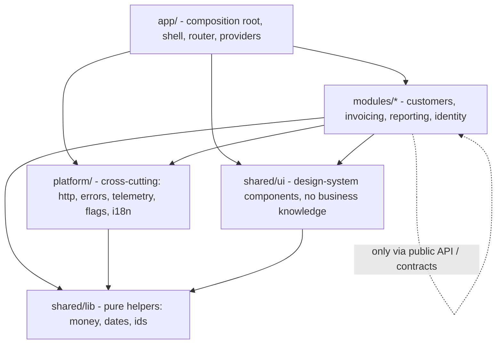
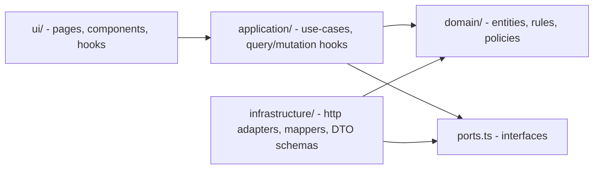
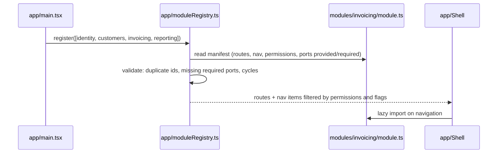

# Project 8 — Enterprise modular app

**Gate:** after Phase 4 (Architecture) and Phase 8 (Testing and quality). **Architectural focus:** module boundaries, dependency rules enforced by tooling, domain/UI separation, ports and adapters, testability, multi-team ownership.
**Estimated effort:** 40–55 h. **Stack:** React 19, TypeScript 5 (strict), Vite, a router (React Router or TanStack Router), TanStack Query v5, Zod, ESLint with import-boundary rules (e.g., `eslint-plugin-boundaries` or `no-restricted-imports`) and/or `dependency-cruiser`, Vitest, React Testing Library, MSW, Playwright, an npm/pnpm workspace (optional).

> Tooling configuration (boundary lint plugins, workspace features) changes between versions. The *rules* below are the point. Verified 2026-10-22: the manifest/port/registry/domain code typechecks under strict TypeScript 5.9 (with `Result`, `ok`, `err` and a `module-kit` index supplied), the pricing examples are arithmetically correct, and the ESLint `no-restricted-imports` rules and the `dependency-cruiser` programmatic call were run against fixtures on ESLint 10.13 and dependency-cruiser 18.7 (one real defect in the original ESLint excerpt is corrected in §6.8).

---

## 1. Project brief

You are the founding team of **"Meridian Ops"**, an internal enterprise platform that three product teams will grow for years. Initial scope covers four business modules:

| Module | Owning team (simulated) | Responsibility |
|---|---|---|
| **Identity & Access** | Platform | Sign-in, session, roles, permissions, feature flags |
| **Customers** | CRM team | Customer list/detail, notes, contacts |
| **Invoicing** | Finance team | Invoices, line items, status workflow (draft, sent, paid, void), PDF-ish preview |
| **Reporting** | Data team | Read-only dashboards combining data from Customers and Invoicing |

The product is intentionally modest in UI. The deliverable is the **architecture**: structure that allows teams to work in parallel, evolve independently, be tested in isolation, and *be prevented by machines from violating the rules*.

### Functional requirements

| ID | Requirement |
|---|---|
| F1 | App shell with navigation generated from **module registrations** (each module declares its routes, nav items, required permissions). Adding a module must not require editing the shell's source. |
| F2 | Authentication via a mock identity provider; session available app-wide through a narrow interface (`useSession`), not a raw token. |
| F3 | Authorization: role-based permissions evaluated by a central policy; route guards, UI affordance gating (hide/disable), and API-layer checks. Missing permission shows a 403 page, not a blank screen. |
| F4 | Customers: searchable paginated list, detail page, create/edit form with validation. |
| F5 | Invoicing: list with status filter, invoice editor (line items with computed totals), status transitions governed by domain rules (e.g., cannot edit a `paid` invoice; `void` is terminal). |
| F6 | Cross-module features through **published contracts only**: Invoicing displays a customer name/picker; Reporting aggregates both. Neither imports the other's internals. |
| F7 | Feature flags: a flag service that can disable a module or a feature within one, evaluated at runtime. |
| F8 | Error handling: per-route error boundaries, a global fallback, typed API errors mapped to user-facing messages, structured error reporting through an adapter (console implementation + a stub for a monitoring service). |
| F9 | Each module is lazy-loaded (route-level code splitting) and loads independently. |
| F10 | An **architecture test** suite that fails the build on any boundary violation (see Section 7). |
| F11 | A documented "how to add a module" guide verified by actually adding a fifth module (`Support Tickets`) as the final milestone without modifying existing module code. |

### Non-functional requirements

| ID | Requirement |
|---|---|
| N1 | Dependency rules enforced in CI; violations fail the pipeline. |
| N2 | Domain logic (pricing, status workflow, permission policy) has no imports from `react`, the router, or `fetch`. |
| N3 | Every module can be rendered and tested **in isolation** with fake adapters (no real network, no other module present). |
| N4 | Test pyramid: many fast domain unit tests, integration tests per module, a few E2E journeys ([Test strategy and pyramid](../08-testing-and-quality/01-test-strategy-and-pyramid.md)). |
| N5 | Route chunks per module; shell initial JS stays under an agreed budget (record it). |
| N6 | Accessibility: landmarks, skip link, focus management on route change, keyboard-complete forms. |
| N7 | CODEOWNERS file maps directories to teams; changes outside your module require the owning team's review. |

---

## 2. Learning objectives

1. Choose and justify a module structure: feature-based vs layer-based vs FSD-style ([Feature vs layer structure](../04-react-architecture/06-feature-vs-layer-structure.md), [Modular architecture](../04-react-architecture/07-modular-architecture.md), [Feature-sliced design](../04-react-architecture/09-feature-sliced-design.md), [Domain-driven frontend](../04-react-architecture/08-domain-driven-frontend.md)).
2. Separate domain logic from UI logic and keep the domain framework-free ([Domain logic vs UI logic](../04-react-architecture/12-domain-logic-vs-ui-logic.md), [Separation of concerns](../04-react-architecture/02-separation-of-concerns.md), [Component responsibility](../04-react-architecture/03-component-responsibility.md)).
3. Apply dependency direction and inversion with ports and adapters ([Composition and dependency direction](../04-react-architecture/05-composition-and-dependency-direction.md), [Dependency inversion](../04-react-architecture/11-dependency-inversion.md), [Clean and hexagonal architecture](../04-react-architecture/10-clean-and-hexagonal-architecture.md), [Application services and adapters](../04-react-architecture/13-application-services-and-adapters.md), [Dependency injection pattern](../05-design-patterns/16-dependency-injection.md)).
4. Define API boundaries and data access contracts ([API boundaries and data access](../04-react-architecture/14-api-boundaries-and-data-access.md), [Data flow architecture](../04-react-architecture/17-data-flow-architecture.md)).
5. Assign state ownership deliberately ([State ownership](../04-react-architecture/15-state-ownership.md), [Server vs client state](../04-react-architecture/16-server-vs-client-state.md)).
6. Architect routing and error handling per module ([Routing architecture](../04-react-architecture/18-routing-architecture.md), [Error boundaries](../04-react-architecture/19-error-boundaries.md)).
7. Make architecture **testable and enforceable** ([Architectural fitness and enforcement](../04-react-architecture/25-architectural-fitness-and-enforcement.md), [Designing for testability](../11-senior-and-architect-mastery/10-designing-for-testability.md), [Linting and static analysis](../08-testing-and-quality/14-linting-and-static-analysis.md), [CI checks](../08-testing-and-quality/15-ci-checks.md)).
8. Model multi-team ownership and cross-cutting concerns ([Multi-team ownership](../04-react-architecture/23-multi-team-ownership.md), [Cross-cutting concerns](../11-senior-and-architect-mastery/06-cross-cutting-concerns.md), [Application boundaries](../11-senior-and-architect-mastery/05-application-boundaries.md)).
9. Test at the right level with the right doubles ([Integration testing](../08-testing-and-quality/08-integration-testing.md), [Unit testing with Vitest](../08-testing-and-quality/02-unit-testing-with-vitest.md), [TypeScript correctness](../08-testing-and-quality/13-typescript-correctness.md), [E2E with Playwright](../08-testing-and-quality/09-e2e-with-playwright.md)).
10. Write the decision trail ([Architecture decision records](../10-production-engineering/16-architecture-decision-records.md), [Technical design documents](../11-senior-and-architect-mastery/02-technical-design-documents.md), [Trade-off analysis](../11-senior-and-architect-mastery/01-trade-off-analysis.md)).

Related: [Architecture fundamentals](../04-react-architecture/01-architecture-fundamentals.md), [Presentational vs container](../04-react-architecture/04-presentational-vs-container.md), [Monorepos and shared packages](../04-react-architecture/22-monorepos-and-shared-packages.md), [Auth boundaries](../09-advanced-rendering-and-ecosystem/12-auth-boundaries.md), [Resilience and degradation](../10-production-engineering/10-resilience-and-degradation.md), [Choosing abstraction level](../11-senior-and-architect-mastery/04-choosing-abstraction-level.md).

---

## 3. Recommended architecture

### 3.1 Layers and the dependency rule



Rules (these become lint and architecture tests):

| # | Rule |
|---|---|
| R1 | `shared/*` and `platform/*` never import from `modules/*` or `app/*`. |
| R2 | A module may import another module **only through its public entry** (`modules/x/index.ts` or `modules/x/contracts.ts`), never deep paths. |
| R3 | Only `app/` (the composition root) knows *all* modules and wires adapters to ports. |
| R4 | Inside a module: `ui -> application -> domain`; `infrastructure -> application/domain` (implements ports). `domain` imports nothing from the module's other layers, nor `react`, router, or network libraries. |
| R5 | No import cycles anywhere (dependency-cruiser or equivalent). |
| R6 | Cross-module data/behavior travels as **contracts**: TypeScript interfaces plus a runtime adapter registered at the composition root. |
| R7 | Tests may import anything within their own module; test utilities live in `shared/testing/`. |

### 3.2 Inside a module (hexagonal-flavored)



- **Domain:** pure TypeScript: types, invariants, state transitions, calculations. 100% unit-testable without a DOM.
- **Application:** orchestration: "send invoice" = check policy, call port, update cache. Exposes React-friendly hooks but contains no JSX.
- **Ports:** interfaces the module needs from the outside (`InvoiceRepository`, `CustomerDirectory`, `Clock`).
- **Infrastructure:** adapters (HTTP implementation of `InvoiceRepository`), DTO-to-domain mappers, zod schemas for wire formats.
- **UI:** components and route pages. Reads application hooks; knows nothing about HTTP or DTO shapes.

This is a *teaching structure*, not dogma. For a trivial CRUD module (Customers), collapsing `application` into `ui/hooks` may be justified; write that exception down ([Choosing abstraction level](../11-senior-and-architect-mastery/04-choosing-abstraction-level.md)).

### 3.3 Cross-module collaboration

Invoicing needs customer names. Three options:

| Option | Mechanism | Coupling | Verdict here |
|---|---|---|---|
| A. Deep import | `import { useCustomer } from '../customers/application/useCustomer'` | High: Invoicing depends on Customers' internals | Forbidden (R2) |
| B. Public API import | `import { CustomerPicker } from '@/modules/customers'` | Medium: explicit, versionable surface | Allowed for UI the owning team publishes |
| C. Port + adapter | Invoicing declares `CustomerDirectory` port; `app/` wires an adapter that uses Customers' public API | Low: Invoicing is testable alone | **Preferred for data**; B for shared UI |

Reporting then consumes both modules' *published read models* the same way (C), never their caches or store internals.

### 3.4 Module registration



---

## 4. Folder structure

```
meridian/
├─ package.json
├─ vite.config.ts
├─ tsconfig.json                     # strict, path alias @/ -> src/
├─ eslint.config.js                  # boundary rules
├─ .dependency-cruiser.cjs           # cycles + layer rules
├─ CODEOWNERS
├─ docs/
│  ├─ architecture.md                # rules R1..R7, diagrams
│  ├─ adr/0001-module-structure.md ...
│  └─ how-to-add-a-module.md
├─ src/
│  ├─ app/                           # COMPOSITION ROOT
│  │  ├─ main.tsx
│  │  ├─ App.tsx
│  │  ├─ providers.tsx               # QueryClient, Session, Flags, Adapters
│  │  ├─ moduleRegistry.ts
│  │  ├─ adapters.ts                 # wires ports to implementations
│  │  ├─ Shell.tsx, Nav.tsx, ErrorFallback.tsx, NotFound.tsx, Forbidden.tsx
│  │  └─ router.tsx
│  ├─ platform/                      # cross-cutting, module-agnostic
│  │  ├─ http/ client.ts, errors.ts
│  │  ├─ session/ SessionContext.tsx, types.ts
│  │  ├─ authz/ policy.ts, usePermission.ts, Can.tsx
│  │  ├─ flags/ FlagProvider.tsx, useFlag.ts
│  │  ├─ telemetry/ errorReporter.ts (port) + consoleReporter.ts
│  │  └─ module-kit/ defineModule.ts, types.ts (the manifest contract)
│  ├─ shared/
│  │  ├─ ui/                         # Button, Table, Field, Dialog (no domain knowledge)
│  │  ├─ lib/ money.ts, dates.ts, result.ts
│  │  └─ testing/ renderWithProviders.tsx, fakes/, msw/
│  └─ modules/
│     ├─ identity/
│     │  ├─ module.ts                # manifest
│     │  ├─ index.ts                 # PUBLIC API (the only importable file)
│     │  └─ (domain|application|infrastructure|ui)/
│     ├─ customers/
│     │  ├─ module.ts
│     │  ├─ index.ts                 # exports: CustomerPicker, customerDirectoryAdapter
│     │  ├─ contracts.ts             # types for other modules: CustomerSummary, etc.
│     │  ├─ domain/ customer.ts, customer.test.ts
│     │  ├─ application/ useCustomers.ts, useSaveCustomer.ts
│     │  ├─ infrastructure/ customerApi.ts, customerSchemas.ts, mappers.ts
│     │  └─ ui/ routes.tsx, CustomerListPage.tsx, CustomerForm.tsx, CustomerPicker.tsx
│     ├─ invoicing/
│     │  ├─ module.ts, index.ts, contracts.ts
│     │  ├─ ports.ts                 # CustomerDirectory, InvoiceRepository, Clock
│     │  ├─ domain/ invoice.ts, pricing.ts, transitions.ts (+ tests)
│     │  ├─ application/ ...
│     │  ├─ infrastructure/ ...
│     │  └─ ui/ ...
│     └─ reporting/
├─ tests/
│  ├─ architecture/ boundaries.test.ts
│  └─ e2e/
└─ mocks/ (MSW handlers per module)
```

Notes: `module.ts` is the manifest consumed by `app/`; `index.ts` is the public API for *other modules*. They are distinct because the app shell needs lazy loading of UI while other modules should not statically import a whole module. Public contracts live in `contracts.ts` so cross-module imports pull types, not code.

---

## 5. Milestones

| # | Milestone | Deliverable | Exit criterion |
|---|---|---|---|
| M0 | Architecture doc + ADRs | Rules R1-R7, diagrams, ADR-0001 (structure), ADR-0002 (cross-module strategy) | Reviewed by a peer who tries to break the rules on paper |
| M1 | Skeleton and enforcement first | Empty modules, `app/` shell, ESLint boundary config, dependency-cruiser, `boundaries.test.ts` | A deliberately bad import fails lint **and** the architecture test; CI wired |
| M2 | Platform kit | `defineModule`, registry with validation, session, authz policy, flags, telemetry port, HTTP client | Unit tests for registry validation (duplicate id, missing port, cycle) |
| M3 | Identity module | Mock IdP, session provider, login page, role mapping | Route guard test: unauthorized -> 403 page |
| M4 | Customers module | Domain, application, infra, UI; MSW handlers; picker published | Module renders in isolation with fake repository (no MSW) |
| M5 | Invoicing domain first | `pricing.ts`, `transitions.ts` fully tested **before any UI** | Property-based or table tests for totals/rounding/transitions |
| M6 | Invoicing app + UI | Ports, adapters, editor, status workflow, permission gating | Integration tests with fake `CustomerDirectory` |
| M7 | Reporting module | Consumes published read models via ports; lazy chunk | Reporting works with both modules' fakes; no deep imports |
| M8 | Cross-cutting | Error boundaries per route, error reporter adapter, flags disabling a module | Kill-switch test: flag off removes nav item and route (404/disabled page) |
| M9 | E2E + budgets | 3 Playwright journeys; shell bundle budget; a11y checks | CI green; budgets recorded |
| M10 | Add module #5 | `support-tickets` added following `how-to-add-a-module.md` with **zero** edits to existing module folders (edits permitted only in `app/adapters.ts` and the module list) | Diff review confirms; guide corrected where reality differed |
| M11 | Retrospective | ADR updates, list of rules you relaxed and why | Honest account of friction |

Start with enforcement (M1), not features. Rules introduced after code exists are expensive to retrofit ([Refactoring legacy React](../04-react-architecture/24-refactoring-legacy-react.md)).

---

## 6. Recommended implementation

### 6.1 The module manifest

```ts
// platform/module-kit/types.ts
import type { ComponentType, LazyExoticComponent } from 'react'
import type { RouteObject } from 'react-router'

export type PermissionKey = `${string}:${'read' | 'write' | 'approve' | 'admin'}`

export interface NavItem {
  label: string
  to: string
  requires?: PermissionKey
  flag?: string
  order?: number
}

export interface ModuleManifest {
  id: string
  /** Routes are lazily loaded; the manifest itself must be cheap to import. */
  routes: () => RouteObject[]
  nav: NavItem[]
  /** Ports this module needs the composition root to provide. */
  requires?: readonly PortKey[]
  /** Ports this module can provide to others. */
  provides?: readonly PortKey[]
  /** Flag that, when false, disables the whole module. */
  killSwitchFlag?: string
}

declare const portBrand: unique symbol
export type PortKey<T = unknown> = string & { readonly [portBrand]?: T }

export const defineModule = <M extends ModuleManifest>(m: M) => m
```

```ts
// modules/invoicing/module.ts
import { defineModule } from '@/platform/module-kit'
import { CUSTOMER_DIRECTORY, INVOICE_REPOSITORY, CLOCK } from './ports'

export default defineModule({
  id: 'invoicing',
  killSwitchFlag: 'module.invoicing',
  requires: [CUSTOMER_DIRECTORY, INVOICE_REPOSITORY, CLOCK],
  nav: [{ label: 'Invoices', to: '/invoices', requires: 'invoices:read', order: 20 }],
  routes: () => [
    {
      path: 'invoices',
      // Route-level code splitting: the module UI loads on first navigation.
      lazy: () => import('./ui/routes'),
      errorElement: undefined, // set by the shell so every module gets a consistent boundary
    },
  ],
})
```

Router APIs (`lazy`, route object shapes) differ by router and version. The `lazy: () => import('./ui/routes')` form (the module exports `Component`/`loader`/...) works in React Router 7 and 8 data mode (verified on 7.18 and 8.5 in Project 3); adapt this to your choice and check its docs ([Routing architecture](../04-react-architecture/18-routing-architecture.md)).

### 6.2 Ports and a typed registry (dependency injection without a container library)

```ts
// modules/invoicing/ports.ts
import type { PortKey } from '@/platform/module-kit'
import type { Invoice, InvoiceDraft, InvoiceId } from './domain/invoice'
import type { CustomerSummary } from '@/modules/customers/contracts' // contracts only: types, no code

export interface InvoiceRepository {
  list(q: { status?: string; page: number }, signal?: AbortSignal): Promise<{ items: Invoice[]; total: number }>
  get(id: InvoiceId, signal?: AbortSignal): Promise<Invoice>
  save(draft: InvoiceDraft): Promise<Invoice>
  transition(id: InvoiceId, to: Invoice['status']): Promise<Invoice>
}
export interface CustomerDirectory {
  search(text: string, signal?: AbortSignal): Promise<CustomerSummary[]>
  getName(id: string): Promise<string>
}
export interface Clock { now(): Date }

export const INVOICE_REPOSITORY = 'invoicing/InvoiceRepository' as PortKey<InvoiceRepository>
export const CUSTOMER_DIRECTORY = 'invoicing/CustomerDirectory' as PortKey<CustomerDirectory>
export const CLOCK = 'invoicing/Clock' as PortKey<Clock>
```

Importing `@/modules/customers/contracts` for **types** is allowed by rule R2 only if `contracts.ts` is the module's declared public contract file. Use `import type` so no runtime dependency is created.

```tsx
// platform/module-kit/AdapterContext.tsx
import { createContext, use, type ReactNode } from 'react'
import type { PortKey } from './types'

type Registry = ReadonlyMap<string, unknown>
const AdapterContext = createContext<Registry | null>(null)

export function AdapterProvider({ adapters, children }: { adapters: Registry; children: ReactNode }) {
  return <AdapterContext value={adapters}>{children}</AdapterContext>
}

export function usePort<T>(key: PortKey<T>): T {
  const reg = use(AdapterContext)
  if (!reg) throw new Error('usePort must be used inside <AdapterProvider>')
  const impl = reg.get(key)
  if (!impl) throw new Error(`No adapter registered for port "${key}"`)
  return impl as T
}
```

```ts
// app/adapters.ts: the ONLY place that knows concrete implementations
export function createAdapters(http: HttpClient): Map<string, unknown> {
  const customersApi = createCustomersApi(http)                  // from modules/customers (public API)
  return new Map<string, unknown>([
    [INVOICE_REPOSITORY, createInvoiceHttpRepository(http)],
    [CUSTOMER_DIRECTORY, adaptCustomersToDirectory(customersApi)], // translation layer
    [CLOCK, { now: () => new Date() } satisfies Clock],
  ])
}
```

Why context-based DI instead of module-level singletons: tests can provide fakes per test with no module mocking (`vi.mock`), and Storybook/isolated rendering works. The trade-off is indirection and a runtime failure if a port is unregistered, which is why the **registry validates `requires` at startup** (6.3), and why the map is typed through `PortKey<T>` at the call sites.

Casting `impl as T` is a trust boundary: the brand makes `usePort(INVOICE_REPOSITORY)` return the right type (verified: a mismatched annotation fails to compile) but the Map is not checked, and because the brand property is optional a raw `string` key is also accepted (it yields `unknown`). Strengthen it with a typed `registerPort(map, key, impl)` helper if you want compile-time checking at registration too.

### 6.3 Registry validation (fail at startup, not at runtime)

```ts
// app/moduleRegistry.ts
export function buildRegistry(modules: ModuleManifest[], adapters: ReadonlyMap<string, unknown>) {
  const ids = new Set<string>()
  const errors: string[] = []
  for (const m of modules) {
    if (ids.has(m.id)) errors.push(`Duplicate module id "${m.id}"`)
    ids.add(m.id)
    for (const port of m.requires ?? []) {
      if (!adapters.has(port)) errors.push(`Module "${m.id}" requires port "${port}" but no adapter is registered`)
    }
  }
  if (errors.length) throw new Error(`Module registry invalid:\n- ${errors.join('\n- ')}`)

  return {
    modules,
    navFor(can: (p: PermissionKey) => boolean, flag: (f: string) => boolean) {
      return modules
        .filter((m) => !m.killSwitchFlag || flag(m.killSwitchFlag))
        .flatMap((m) => m.nav)
        .filter((n) => (!n.requires || can(n.requires)) && (!n.flag || flag(n.flag)))
        .sort((a, b) => (a.order ?? 100) - (b.order ?? 100))
    },
  }
}
```

Hiding a nav item is **not** security. Route guards and server-side checks enforce authorization; nav filtering is UX.

### 6.4 Domain: pure, rich, and tested

```ts
// modules/invoicing/domain/invoice.ts
export type InvoiceId = string & { readonly __brand: 'InvoiceId' }
export type InvoiceStatus = 'draft' | 'sent' | 'paid' | 'void'

export interface LineItem { id: string; description: string; quantityMilli: number; unitPriceCents: number; taxRateBp: number }
export interface Invoice { id: InvoiceId; customerId: string; status: InvoiceStatus; lines: LineItem[]; currency: 'EUR' | 'USD'; issuedAt?: string }

// modules/invoicing/domain/transitions.ts
const ALLOWED: Record<InvoiceStatus, readonly InvoiceStatus[]> = {
  draft: ['sent', 'void'],
  sent: ['paid', 'void'],
  paid: [],
  void: [],
}
export const canTransition = (from: InvoiceStatus, to: InvoiceStatus) => ALLOWED[from].includes(to)
export const isEditable = (s: InvoiceStatus) => s === 'draft'

export function transition(inv: Invoice, to: InvoiceStatus, now: Date): Result<Invoice, 'illegal_transition' | 'empty_invoice'> {
  if (!canTransition(inv.status, to)) return err('illegal_transition')
  if (to === 'sent' && inv.lines.length === 0) return err('empty_invoice')
  return ok({ ...inv, status: to, issuedAt: to === 'sent' ? now.toISOString() : inv.issuedAt })
}
```

```ts
// modules/invoicing/domain/pricing.ts
// Money in integer minor units; rates in basis points; quantities in milli-units. No floating point.
export function lineNet(l: LineItem): number {
  return Math.round((l.quantityMilli * l.unitPriceCents) / 1000)
}
export function lineTax(l: LineItem): number {
  return Math.round((lineNet(l) * l.taxRateBp) / 10_000)
}
export function totals(lines: readonly LineItem[]) {
  const net = lines.reduce((s, l) => s + lineNet(l), 0)
  const tax = lines.reduce((s, l) => s + lineTax(l), 0)
  return { net, tax, gross: net + tax }
}
```

The domain has no `Date.now()`, no `fetch`, no React: time arrives as a parameter, which is what makes `transition` deterministic in tests. Rounding rule (per line vs on total) is a **business decision**: document it in the domain file and test it explicitly, since per-line and per-total rounding can differ by cents.

```ts
// pricing.test.ts
it.each([
  [{ quantityMilli: 1000, unitPriceCents: 1999, taxRateBp: 2100 }, 1999, 420],
  [{ quantityMilli: 333,  unitPriceCents: 1000, taxRateBp: 2100 }, 333, 70],
])('rounds per line: %j', (line, net, tax) => {
  const l = { id: 'x', description: '', ...line }
  expect(lineNet(l)).toBe(net)
  expect(lineTax(l)).toBe(tax)
})

it('void is terminal', () => {
  for (const to of ['draft', 'sent', 'paid', 'void'] as const)
    expect(canTransition('void', to)).toBe(false)
})
```

(Check the sample numbers yourself: `1999*0.21 = 419.79 -> 420`; `333*0.21 = 69.93 -> 70`. Do this arithmetic in your own tests; do not copy blindly.)

### 6.5 Application layer: use-cases as hooks, policy as a parameter

```ts
// modules/invoicing/application/useTransitionInvoice.ts
export function useTransitionInvoice() {
  const repo = usePort(INVOICE_REPOSITORY)
  const clock = usePort(CLOCK)
  const { can } = usePermission()
  const qc = useQueryClient()

  return useMutation({
    mutationFn: async ({ invoice, to }: { invoice: Invoice; to: InvoiceStatus }) => {
      if (!can('invoices:write')) throw new AppError('forbidden', 'You cannot change invoices.')
      const result = transition(invoice, to, clock.now())          // domain decides legality
      if (!result.ok) throw new AppError(result.error, messageFor(result.error))
      return repo.transition(invoice.id, to)                        // server remains the authority
    },
    onSuccess: (saved) => {
      qc.setQueryData(invoiceKeys.detail(saved.id), saved)
      void qc.invalidateQueries({ queryKey: invoiceKeys.lists() })
    },
  })
}
```

Double enforcement is intentional: the client domain check gives instant feedback; the server remains authoritative. Both the UI affordance (`<Can>` hides the button) and the use-case check exist; none replaces the server check ([Auth boundaries](../09-advanced-rendering-and-ecosystem/12-auth-boundaries.md)).

### 6.6 Authorization policy (pure) and its React bindings

```ts
// platform/authz/policy.ts
export type Role = 'viewer' | 'accountant' | 'manager' | 'admin'
const GRANTS: Record<Role, readonly PermissionKey[]> = {
  viewer: ['customers:read', 'invoices:read', 'reports:read'],
  accountant: ['customers:read', 'invoices:read', 'invoices:write', 'reports:read'],
  manager: ['customers:read', 'customers:write', 'invoices:read', 'invoices:write', 'invoices:approve', 'reports:read'],
  admin: [/* all */],
}
export function permissionsFor(roles: readonly Role[]): ReadonlySet<PermissionKey> {
  return new Set(roles.flatMap((r) => GRANTS[r]))
}
```

```tsx
// platform/authz/Can.tsx
export function Can({ permission, children, fallback = null }: { permission: PermissionKey; children: ReactNode; fallback?: ReactNode }) {
  const { can } = usePermission()
  return can(permission) ? children : fallback
}

// route guard
export function RequirePermission({ permission, children }: { permission: PermissionKey; children: ReactNode }) {
  const { can } = usePermission()
  return can(permission) ? children : <Forbidden />
}
```

Permissions are derived from roles in **one** pure function so the policy is testable as a table and changeable without touching components.

### 6.7 Shell: consistent boundaries around every module

```tsx
// app/Shell.tsx (abridged)
export function Shell() {
  const location = useLocation()
  const registry = useRegistry()
  const { can } = usePermission()
  const flag = useFlag()
  const nav = registry.navFor(can, flag)

  return (
    <>
      <a className="skip-link" href="#main">Skip to content</a>
      <header><Nav items={nav} /></header>
      <main id="main" tabIndex={-1} ref={focusOnRouteChange(location.pathname)}>
        <ErrorBoundary
          resetKeys={[location.pathname]}
          FallbackComponent={ModuleError}
          onError={(error, info) => reporter.capture(error, { componentStack: info.componentStack, module: moduleOf(location.pathname) })}
        >
          <Suspense fallback={<RouteSkeleton />}>
            <Outlet />
          </Suspense>
        </ErrorBoundary>
      </main>
    </>
  )
}
```

A render error in Invoicing must leave the nav and other modules functional. Per-module boundaries mean a crash is contained and reported with the module name attached ([Error boundaries](../04-react-architecture/19-error-boundaries.md), [Error handling patterns](../05-design-patterns/21-error-handling-patterns.md)). Error boundaries do not catch errors in event handlers or async code; those must be handled explicitly (typed `AppError`, toasts, `reporter.capture`).

### 6.8 Enforcement

ESLint (conceptual; adapt to the plugin you choose):

```js
// eslint.config.js (excerpt)
export default [
  {
    files: ['src/shared/**', 'src/platform/**'],
    rules: {
      'no-restricted-imports': ['error', { patterns: [
        { group: ['@/modules/*', '@/app/*'], message: 'shared/platform must not depend on modules or app (R1).' },
      ] }],
    },
  },
  {
    files: ['src/modules/*/**'],
    rules: {
      'no-restricted-imports': ['error', { patterns: [
        // Deep imports into another module are forbidden; only the public entry/contracts are allowed.
        { group: ['@/modules/*/*', '!@/modules/*/contracts', '!@/modules/*/index'], message: 'Import other modules via their public API only (R2).' },
      ] }],
    },
  },
  {
    files: ['src/modules/*/domain/**'],
    rules: {
      'no-restricted-imports': ['error', {
        paths: ['react', 'react-dom', 'react-router', '@tanstack/react-query'],
        // Flat config REPLACES (does not merge) the options of the same rule from earlier blocks, so the R2 group
        // must be repeated here, otherwise domain files silently escape the deep-import ban (verified).
        // `patterns` must be all strings or all objects, not a mix.
        patterns: [
          { group: ['@/modules/*/*', '!@/modules/*/contracts', '!@/modules/*/index'], message: 'Import other modules via their public API only (R2).' },
          { group: ['../application/*', '../ui/*', '../infrastructure/*'], message: 'The domain layer must not depend on outer layers.' },
        ],
      }],
    },
  },
]
```

Glob negation inside `no-restricted-imports` `patterns` follows gitignore semantics and can be subtle (the negations used above were verified to allow `@/modules/x/contracts`, `@/modules/x` and `@/modules/x/index` while rejecting `@/modules/x/domain/...`); also, a module importing *itself* via the alias (`@/modules/invoicing/domain/...`) will match the deep-import pattern. Many teams use relative imports inside a module and the alias for cross-module imports, or use a dedicated boundaries plugin. Test your rules with deliberately failing fixtures.

An **architecture test** gives you rules that survive a lint config rewrite and reads as documentation:

```ts
// tests/architecture/boundaries.test.ts
import { cruise } from 'dependency-cruiser'

describe('architecture', () => {
  it('has no circular dependencies', async () => {
    const { output } = await cruise(['src'], { validate: true, ruleSet: rules })
    expect(output.summary.violations.filter((v) => v.rule.name === 'no-circular')).toEqual([])
  })

  it('domain layers are framework-free', async () => {
    const { output } = await cruise(['src/modules'], { validate: true, ruleSet: rules })
    expect(output.summary.violations.filter((v) => v.rule.name === 'domain-is-pure')).toEqual([])
  })
})
```

The `dependency-cruiser` programmatic call used above (`await cruise(files, { validate: true, ruleSet })`, then `output.summary.violations[].rule.name`) was verified on 18.7 with a circular-dependency fixture; `exitCode` stays 0 in this API, so assert on the violations as the test does. Many teams run the CLI in CI instead. Whichever you use, prove the rule works by committing a negative test (a fixture or a documented step: "add this import, expect failure").

A lightweight, tool-independent alternative for the architecture test is a script that parses import specifiers with the TypeScript compiler API and asserts the rules, which also makes the rules explicit in code you own ([Architectural fitness and enforcement](../04-react-architecture/25-architectural-fitness-and-enforcement.md)).

### 6.9 Testing a module in isolation

```tsx
// shared/testing/renderWithProviders.tsx
export function renderModule(ui: ReactElement, opts: { adapters?: Record<string, unknown>; permissions?: PermissionKey[]; flags?: Record<string, boolean>; route?: string } = {}) {
  const client = new QueryClient({ defaultOptions: { queries: { retry: false } } })
  const adapters = new Map(Object.entries(opts.adapters ?? {}))
  return render(
    <QueryClientProvider client={client}>
      <AdapterProvider adapters={adapters}>
        <TestSession permissions={opts.permissions ?? []}>
          <TestFlags flags={opts.flags ?? {}}>
            <MemoryRouter initialEntries={[opts.route ?? '/']}>{ui}</MemoryRouter>
          </TestFlags>
        </TestSession>
      </AdapterProvider>
    </QueryClientProvider>,
  )
}
```

```tsx
it('hides send button without write permission and blocks illegal transition', async () => {
  const repo = fakeInvoiceRepo([invoice({ status: 'paid' })])
  renderModule(<InvoiceDetailPage id="inv_1" />, {
    permissions: ['invoices:read'],
    adapters: { [INVOICE_REPOSITORY]: repo, [CUSTOMER_DIRECTORY]: fakeDirectory(), [CLOCK]: fixedClock('2026-01-01') },
  })
  expect(await screen.findByRole('heading', { name: /INV-0001/ })).toBeVisible()
  expect(screen.queryByRole('button', { name: /send/i })).not.toBeInTheDocument()
})
```

Fakes (in-memory implementations of ports) beat `vi.mock` of modules: they exercise real application code, survive refactors, and double as Storybook/dev adapters. Keep a small **contract test** that runs the same assertions against the fake and the real HTTP adapter (with MSW) so the fake cannot drift ([Component contract testing](../08-testing-and-quality/11-component-contract-testing.md), [Mocking strategies and MSW](../08-testing-and-quality/06-mocking-strategies-and-msw.md)).

---

## 7. Design decisions to document (ADRs)

| ADR | Question | Options and trade-offs |
|---|---|---|
| 0001 | Folder structure | Feature-based modules with internal layers (chosen here) vs pure layer folders (`components/`, `hooks/`, `services/`) vs full FSD. Layer folders scatter a feature across the tree and let every feature import everything; FSD adds more layers and strict slices, with a learning cost ([Feature-sliced design](../04-react-architecture/09-feature-sliced-design.md)). |
| 0002 | Cross-module integration | Deep import / public API / ports / events. Ports give testability at the cost of ceremony; use public UI exports for shared widgets. |
| 0003 | Monorepo packages or single package with folders | Packages give hard boundaries enforced by the package manager (import of an unexported file fails) at the cost of tooling overhead; folders are lighter but rely on lint ([Monorepos and shared packages](../04-react-architecture/22-monorepos-and-shared-packages.md), [Monorepo vs multirepo](../11-senior-and-architect-mastery/13-monorepo-vs-multirepo.md)). Choose by team count and release independence. |
| 0004 | DI mechanism | Context ports (chosen) vs module singletons vs a DI container library. |
| 0005 | Domain model richness | Anemic types + functions (chosen) vs classes. Plain data is serializable and plays well with Query caches and Redux-style tools. Classes with behavior are fine if never put into caches that structurally clone. |
| 0006 | Server state ownership | Query per module, keys namespaced by module id; modules never read other modules' query keys ([Server vs client state](../04-react-architecture/16-server-vs-client-state.md)). |
| 0007 | Authorization layering | Policy as pure function; route guard + UI gating + use-case check + server. |
| 0008 | Where DTO mapping happens | Infrastructure only; UI never sees wire shapes. Mapping costs code, buys freedom to change the API without touching UI. |
| 0009 | Microfrontends: not now | Record why module federation/microfrontends were rejected (build/runtime complexity, shared dependency versions, UX consistency) and what would change the decision ([Microfrontends](../11-senior-and-architect-mastery/12-microfrontends.md)). |
| 0010 | Flags | Build-time vs runtime; kill-switches must not require deploys. |

For each ADR write: context, options, decision, consequences, and **the signal that would make you revisit it** ([Architecture decision records](../10-production-engineering/16-architecture-decision-records.md)).

---

## 8. Testing expectations

| Level | Scope | Examples | Rough share |
|---|---|---|---|
| Architecture | Whole repo | No cycles; layer rules; domain purity; modules import others only via public entry; each module's `requires` satisfied by `app/adapters.ts` | A handful, run in CI always |
| Domain unit | Pure functions | Pricing/rounding tables, status transitions, permission policy matrix, money helpers, `Result` utilities | Majority; milliseconds each |
| Application/hook | Use-cases with fake ports | Transition forbidden without permission; failure maps to typed `AppError`; cache updates on success | Moderate |
| Module integration | Pages with fake adapters | Customers list search/pagination; invoice editor totals update as lines change; 403 rendering; error boundary shows module-scoped fallback | Moderate |
| Adapter contract | Real adapter vs MSW | DTO mapping, error mapping (401/403/404/409/422/5xx), schema failure surfaces as a typed error | Few but important |
| Registry/platform | App wiring | Missing adapter fails at startup; kill-switch flag removes nav + route; nav filtered by permission | Few |
| E2E (Playwright) | 3 journeys | (1) viewer cannot edit; accountant creates and sends invoice; (2) flag disables Reporting; (3) error in a module is contained and shell stays usable | Few |
| Accessibility | Pages and flows | axe on each module's main page; keyboard-only creation of an invoice; focus moves to `main` on route change | Per module |

Specific expectations:
- **No test imports another module's internals.** The architecture test applies to test files too, except explicitly allowed test utilities.
- **Test names read as business rules** ("a paid invoice cannot be edited"), not implementation.
- **Mutation-testing mindset:** break `ALLOWED` (e.g., allow `paid -> draft`) and verify that at least one test fails. If not, add one.
- **Type tests:** `usePort(INVOICE_REPOSITORY)` infers `InvoiceRepository`; mismatched fake fails compilation ([TypeScript correctness](../08-testing-and-quality/13-typescript-correctness.md)).
- **Coverage is a signal, not a goal.** Require meaningful branch coverage for `domain/` (e.g., 95%+), and none enforced for presentational components beyond behavior tests.

---

## 9. Performance expectations

| Area | Expectation |
|---|---|
| Initial load | Shell chunk contains shell, platform, shared UI, and router only; each module in its own lazy chunk. Record sizes (gzip) in `docs/budgets.md`. |
| Navigation | Prefetch a module's chunk on nav hover/focus; navigation to an already loaded module shows no skeleton flash. |
| Shared dependencies | One copy of React, Query, router (verify with bundle analysis) ([Bundle analysis](../07-performance/16-bundle-analysis.md)). |
| Modularity cost | Boundaries must not add runtime cost: no deep re-export barrels that defeat tree-shaking. Barrel files (`index.ts`) can cause an entire module to be included by accident; keep public entries small and type-heavy, and lazy-load UI via `module.ts`. |
| Re-renders | Session, flag, and adapter contexts change rarely; confirm via Profiler that a flag or permission change does not re-render unrelated trees; split context if `session` includes frequently changing fields ([Context performance](../03-react-state-and-hooks/14-context-performance.md)). |
| Data fetching | No waterfalls between module chunk load and first data request: start the query in the route loader or prefetch on intent ([Network waterfalls](../07-performance/17-network-waterfalls.md)). |
| Reporting | Aggregations computed once (memoized selectors or server-side), and large tables virtualized if > ~1,000 rows ([Windowing and virtualization](../07-performance/09-windowing-and-virtualization.md)). |
| Budget enforcement | CI fails when the shell chunk exceeds the recorded budget by more than a set tolerance ([Web Vitals and budgets](../07-performance/21-web-vitals-and-budgets.md)). |

---

## 10. Common implementation mistakes

| Mistake | Consequence | Fix |
|---|---|---|
| Rules written in a wiki but not enforced | Erosion within weeks | Lint + architecture tests in CI from day one |
| `shared/` becomes a dumping ground (domain types, business helpers) | Hidden coupling; everything depends on it | `shared` has *no business knowledge*; move domain concepts to the owning module or `contracts` |
| Barrel files re-exporting everything (`modules/customers/index.ts` exports internals) | Public API leaks; bundle bloat; cycles | Curate the public surface; contracts file; no `export *` |
| Cross-module imports of hooks/stores | Tight coupling; cannot test in isolation | Ports + adapters in `app/` |
| Domain code calling `fetch`, `Date.now()`, or `localStorage` | Untestable, nondeterministic | Inject time/IO via ports and parameters |
| DTOs used as domain types in UI | Backend changes ripple everywhere; nullability confusion | Map at the infrastructure boundary |
| Business rules in components (`if (status === 'paid' && ...)` scattered) | Duplicated, inconsistent, untested | One domain function; components call it |
| Authorization only in the UI | Bypassable | Policy + route guard + use-case + server check |
| Global Redux/Zustand store holding every module's server data | One team's change breaks others; implicit coupling | Per-module Query keys; client store only for truly global UI state ([State ownership](../04-react-architecture/15-state-ownership.md)) |
| Over-abstracting a simple CRUD module (full hexagon for a form) | Ceremony without benefit | Collapse layers where complexity is low; record the exception |
| Under-abstracting a complex module (invoicing logic in components) | Untestable | Invest in domain layer where rules live |
| One giant `AppContext` | Re-render storms; unclear ownership | Narrow contexts per concern |
| `vi.mock` of internals everywhere | Tests encode implementation; break on refactor | Fakes for ports |
| Circular dependency masked by lazy loading | Runtime surprises | Cycle detection in CI |
| Mixing module registration and implementation (shell edited for every module) | Merge conflicts, single-team bottleneck | Manifest-driven registry |
| Treating folders as boundaries without alias/lint support | Developers deep import for convenience | Make the wrong thing hard (lint) and the right thing easy (public API + docs) |
| Premature microfrontends or packages | Operational overhead | Start modular monolith; split on evidence ([Application boundaries](../11-senior-and-architect-mastery/05-application-boundaries.md)) |
| No ownership map | Reviews are everyone's and no one's | CODEOWNERS + ADR for boundaries |

---

## 11. Review checklist

**Boundaries**
- [ ] R1-R7 documented, enforced by lint and an architecture test, and demonstrated failing on a negative fixture.
- [ ] `shared/` and `platform/` contain no business concepts and import nothing from `modules/` or `app/`.
- [ ] Each module exposes one small public entry and a contracts file; nothing else is importable.
- [ ] No import cycles.

**Domain and layering**
- [ ] `domain/` has no React, router, fetch, storage, or timers; time and IO enter as parameters or ports.
- [ ] Business rules live in the domain; components contain no status-transition or pricing logic.
- [ ] DTOs stop at infrastructure; UI uses domain types.
- [ ] Complexity-appropriate: simple modules are not over-layered, and the exceptions are written down.

**Composition and DI**
- [ ] `app/` is the only composition root; the registry validates `requires` at startup.
- [ ] Modules are renderable and testable with fake adapters and no other module.
- [ ] Adding module #5 required no change to existing module folders.

**Security and errors**
- [ ] Authorization enforced at four layers (policy, route, use-case, server contract) with the server as the final authority.
- [ ] Per-route error boundaries contain failures and report with module context.
- [ ] Typed errors map to user-facing messages; no raw error strings leak.

**Quality**
- [ ] Test pyramid shape is visible: lots of domain tests, few E2E.
- [ ] Contract tests keep fakes and real adapters aligned.
- [ ] Accessibility checks and focus management on route change.
- [ ] Bundle budgets recorded and enforced.

**Team scale**
- [ ] CODEOWNERS maps directories to teams.
- [ ] ADRs record the rejected alternatives and the revisit signal.
- [ ] `how-to-add-a-module.md` was validated by someone who did not write the architecture.

---

## 12. Reference solution guidance

1. **Enforcement before features.** Spend the first day on M1: the folder skeleton, aliases, lint rules, dependency-cruiser config, and a failing-on-purpose fixture. Every later PR benefits.
2. **Walk the vertical slice once** (Customers list through every layer) to settle conventions, then replicate. Cement naming (`useXxx` in application, `xxxApi` in infrastructure, `xxxSchemas` for zod).
3. **Domain first for Invoicing.** If you cannot write the transition table and pricing tests without thinking about React, you are in the wrong layer. Only then add the application hooks and UI.
4. **Decide the cross-module rule per data direction.** UI widgets owned by another team: import the published component. Data: port + adapter in `app/`. Events (e.g., "invoice sent" should refresh Reporting): prefer cache invalidation through a narrow, published event/invalidations contract over reaching into another module's query keys. Example:

```ts
// platform/module-kit/events.ts: tiny typed event bus, for cross-module notifications only
type Events = { 'invoice.statusChanged': { id: string; status: string } }
type Handler<K extends keyof Events> = (p: Events[K]) => void
const handlers = new Map<keyof Events, Set<Handler<any>>>()
export const bus = {
  on<K extends keyof Events>(k: K, h: Handler<K>) {
    ;(handlers.get(k) ?? handlers.set(k, new Set()).get(k)!).add(h)
    return () => void handlers.get(k)?.delete(h)
  },
  emit<K extends keyof Events>(k: K, p: Events[K]) { handlers.get(k)?.forEach((h) => h(p)) },
}
```

   Weigh this against direct invalidation: events reduce coupling but make flow harder to trace. Use sparingly and document each event as a contract.

5. **Keep `app/adapters.ts` boring.** If it contains logic, you have a missing application service. It should only construct and translate.
6. **Test adapters at the boundary with MSW**, applications with fakes, domain with tables, shell with the registry. Each layer is tested where its risk lives.
7. **Prove the architecture with module #5.** Write `how-to-add-a-module.md` *after* adding `support-tickets`, from your actual diff, then have someone else follow it. Every place they get stuck is an architecture defect or a documentation defect.
8. **Hold a boundary-violation drill:** each reviewer tries to introduce three violations (deep import, domain importing React, cyclic dependency). All must be caught automatically; anything caught only by human review becomes a new rule.
9. **Retrospective questions:** Which rules did you bend, and what did that reveal? Which layers added cost without value? What would force you to split into packages or microfrontends?

---

## 13. Optional extensions

- **Package-level boundaries:** convert `modules/*` into workspace packages with `exports` maps, so unexported files are unreachable by the package manager ([Monorepos and shared packages](../04-react-architecture/22-monorepos-and-shared-packages.md)).
- **Module Federation / microfrontend spike:** load Reporting as a remote and document shared-dependency, versioning, and failure-mode costs ([Microfrontends](../11-senior-and-architect-mastery/12-microfrontends.md)).
- **Role/attribute-based policy** (ABAC: "managers can approve invoices under their approval limit") evaluated in the domain with test tables.
- **Optimistic concurrency:** invoice `version`/ETag handling with conflict resolution UI for `409` ([Cache consistency and invalidation](../06-data-fetching-and-state-ecosystems/06-cache-consistency-and-invalidation.md)).
- **Internationalization and multi-currency formatting** ([Internationalization](../10-production-engineering/09-internationalization.md)).
- **Observability:** replace the console reporter with an OpenTelemetry-style adapter and attach module/route/session context to spans ([Observability and logging](../10-production-engineering/04-observability-and-logging.md), [Error monitoring](../10-production-engineering/05-error-monitoring.md)).
- **Feature-sliced comparison:** reimplement Customers using FSD layers (`entities`, `features`, `widgets`, `pages`) and write a comparison ADR ([Feature-sliced design](../04-react-architecture/09-feature-sliced-design.md)).
- **Migration exercise:** take a deliberately tangled version of the app (cross-imports, domain in components) and refactor it to this architecture in reviewed steps, keeping tests green ([Refactoring legacy React](../04-react-architecture/24-refactoring-legacy-react.md), [Large-scale refactoring](../11-senior-and-architect-mastery/03-large-scale-refactoring.md)).
- **Server-side authorization contract tests:** generate tests from the policy matrix and run them against the mock API to verify the server honors the same permissions.
- **Link to the capstone:** the module registry, ADR trail, and boundary tests carry directly into Project 10.
