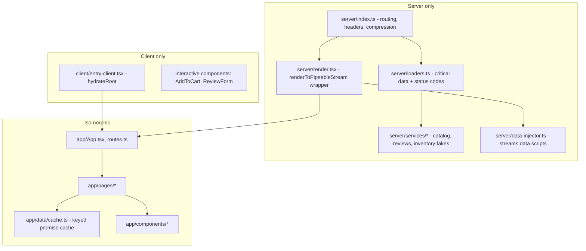

# Project 09 — SSR + Streaming App ("Trailhead Gear" storefront)

| | |
|---|---|
| **Gate** | After Phase 9 (see [ROADMAP §4](../ROADMAP.md)) |
| **Architectural focus** | Server/client boundary, streaming HTML, selective hydration, progressive enhancement |
| **Estimated effort** | 25–35 hours |
| **Stack** | React 19.x, TypeScript 5.x, Vite (SSR mode), Node.js `http`, `react-dom/server` (`renderToPipeableStream`), `hydrateRoot`, Vitest, Playwright |

> **Verified 2026-10-22 (React 19.3, Vite 8.3, `@vitejs/plugin-react` 6, Node 24).** The reference skeleton was typechecked under strict TypeScript (with the small files the text only names supplied) and exercised in-process: shell-then-reviews streaming, bot path, rejected boundary, abort, serializer, hoisted `<title>`/`<link precedence>`, and the `use()` + pre-marked promise behavior all behave as described below, with corrections noted inline. The Vite integration points were checked against the current [Vite SSR](https://vite.dev/guide/ssr) and [backend integration](https://vite.dev/guide/backend-integration) guides and the installed plugin: middleware-mode `createServer({ appType: 'custom' })`, the `/@react-refresh` dev preamble, and `dist/client/.vite/manifest.json` (written when the client build runs with `build.manifest` / `--manifest`) are all current in Vite 8. Vite is also moving SSR toward its Environment API; for a hand-rolled server the middleware-mode approach here remains the documented low-level route. See also <https://react.dev/reference/react-dom/server/renderToPipeableStream> and <https://react.dev/reference/react-dom/client/hydrateRoot>.

This project deliberately builds the SSR pipeline **by hand**, without Next.js or another framework. Frameworks hide exactly the seams this curriculum wants you to understand: where the shell flushes, how data crosses the wire, why hydration can mismatch, how status codes interact with streaming. After finishing it, re-read [framework architecture](../09-advanced-rendering-and-ecosystem/09-framework-architecture.md) and you will recognise every responsibility a framework takes over. (Optional extension E1 ports the result to a framework.)

---

## 1. Context and requirements

You are building the public storefront for a fictional outdoor-gear retailer. The business problem: product pages currently render client-side; on mid-range phones over 4G, users see a blank page for 2–4 s, search crawlers see empty HTML, and the reviews service (slow, occasionally failing) delays the *entire* page because the SPA waits for all data before showing content.

### 1.1 Functional requirements

| ID | Requirement |
|---|---|
| F1 | `GET /` renders a product grid (name, price, image, link). Data source: `catalog` service (fast, ~30–80 ms). |
| F2 | `GET /products/:slug` renders the product header (title, price, description, hero image) from `catalog`. Unknown slug returns **HTTP 404** with a real not-found page. |
| F3 | The same page shows **reviews** (slow service, 300–2500 ms, fails ~5% of the time) and **stock/availability** (slower still, 500–4000 ms). Neither may block the product header. |
| F4 | An "Add to cart" widget and a "Write a review" form are interactive after hydration. |
| F5 | The review form **works without JavaScript** (standard `POST` → `303` redirect → `GET`) and is progressively enhanced when JavaScript loads (no full page reload, pending state, optimistic review row). |
| F6 | `GET /search?q=` is a plain `<form method="get">`; results are server-rendered (no client JS required). |
| F7 | `<title>`, meta description, canonical link, and Open Graph tags are present in the **initial HTML** of every route. |
| F8 | Crawlers/bots (User-Agent heuristic) receive the **complete** HTML in one response (all Suspense content resolved). Humans receive streamed HTML. |
| F9 | Relative times ("posted 3 days ago") never cause hydration mismatches. |

### 1.2 Non-functional requirements

| ID | Requirement |
|---|---|
| N1 | Time to first byte of the HTML shell is independent of the slowest backing service (reviews/stock). |
| N2 | No React hydration warnings or recoverable-error logs in the browser console (Playwright test enforces). |
| N3 | A strict CSP with per-request nonces; no `unsafe-inline` for scripts. |
| N4 | Server errors inside a Suspense boundary degrade that region only; the response remains useful. |
| N5 | Request abort/timeouts: a hung backend must not leak a rendering request past 10 s. |
| N6 | Client JS for `/` (a page with almost no interactivity) stays under a budget you define in M6 and enforce in CI. |
| N7 | Gzip/Brotli compression must **not** destroy streaming (chunks must still arrive progressively). |

### 1.3 Explicitly out of scope

Authentication, payments, a real database (use in-memory fixtures with injectable latency), React Server Components. (RSC is the subject of [server components in depth](../09-advanced-rendering-and-ecosystem/03-server-components-in-depth.md); this project is the **non-RSC** SSR baseline you should be able to contrast against in the capstone design review.)

---

## 2. Learning objectives

By the end you can, without notes:

1. Explain what `renderToPipeableStream` guarantees at `onShellReady` vs `onAllReady`, and choose correctly for humans vs crawlers. → [SPA, SSR, SSG, and streaming](../09-advanced-rendering-and-ecosystem/01-spa-ssr-ssg-streaming.md)
2. Draw the byte-level timeline of a streamed response: shell, fallbacks, boundary content swaps, bootstrap scripts, and data scripts. → [Hydration internals deep dive](../09-advanced-rendering-and-ecosystem/02-hydration-internals-deep-dive.md), [Hydration and selective hydration](../02-react-rendering-and-internals/25-hydration-and-selective-hydration.md)
3. Architect Suspense boundaries around **data dependencies and failure domains**, not around components. → [Suspense architecture](../09-advanced-rendering-and-ecosystem/05-suspense-architecture.md)
4. Transfer server-fetched data to the client safely (serialization, escaping, ordering) so hydration does not refetch or mismatch. → [Client/server boundaries and serialization](../09-advanced-rendering-and-ecosystem/04-client-server-boundaries-and-serialization.md)
5. Diagnose and prevent hydration mismatches. → [Scenario F: hydration mismatch](../02-react-rendering-and-internals/37-scenario-f-hydration-mismatch.md)
6. Build a feature that works with JavaScript disabled and upgrade it. → [Progressive enhancement](../09-advanced-rendering-and-ecosystem/11-progressive-enhancement.md), [Forms, actions, and mutations](../09-advanced-rendering-and-ecosystem/13-forms-actions-and-mutations.md)
7. Use `use`, `useTransition`, `useFormStatus`, `useOptimistic`, document metadata hoisting correctly. → [Modern React APIs](../09-advanced-rendering-and-ecosystem/07-modern-react-apis.md), [Modern hooks and APIs](../03-react-state-and-hooks/22-modern-hooks-and-apis.md)
8. Reason about SEO and accessibility consequences of streaming. → [Accessibility and SEO](../09-advanced-rendering-and-ecosystem/14-accessibility-and-seo.md)
9. Measure rather than assume: TTFB, shell flush, LCP, hydration cost, INP. → [Web Vitals and budgets](../07-performance/21-web-vitals-and-budgets.md), [Network waterfalls](../07-performance/17-network-waterfalls.md)
10. Keep the server/client boundary enforceable in code structure. → [State ownership](../04-react-architecture/15-state-ownership.md), [Server vs client state](../04-react-architecture/16-server-vs-client-state.md)

---

## 3. Recommended architecture

### 3.1 Request lifecycle

```mermaid
sequenceDiagram
  participant B as Browser
  participant S as Node server
  participant C as catalog (fast)
  participant R as reviews (slow)
  participant I as inventory (slowest)
  B->>S: GET /products/tent-x (Accept: text/html)
  S->>C: getProduct(slug)  (critical - awaited BEFORE render)
  C-->>S: product | null
  alt null
    S-->>B: 404 + not-found page (full HTML)
  else found
    S->>S: renderToPipeableStream(<App/>)
    Note over S: render starts. use(reviews) and use(stock) suspend.
    S-->>B: 200 + shell HTML (header, skeletons, bootstrap script)
    Note over B: parse + paint skeletons; JS downloads in parallel
    S->>R: getReviews (started on first read, cached by key)
    R-->>S: reviews
    S-->>B: data script for reviews + boundary content + swap script
    Note over B: reviews appear; no JS needed for the swap
    I-->>S: stock
    S-->>B: data script for stock + boundary content
    B->>B: hydrateRoot - hydrates boundaries as they arrive (selective)
  end
```

### 3.2 Layering



**Dependency rules (enforce with lint, see [architectural fitness and enforcement](../04-react-architecture/25-architectural-fitness-and-enforcement.md)):**

- `app/**` (isomorphic) must not import from `server/**` or `client/**`, nor Node built-ins.
- `client/**` must not import `server/**`.
- `server/**` may import `app/**` (it renders it).
- Services are injected into the isomorphic layer through a **context-provided data cache/fetcher**, not imported directly. This is dependency inversion ([dependency inversion](../04-react-architecture/11-dependency-inversion.md)): the same page component runs on the server (calling in-process services) and the client (calling `fetch('/api/...')`).

### 3.3 Critical vs deferred data

| Class | Examples | Where fetched | Effect |
|---|---|---|---|
| **Critical** (changes status code, `<title>`, or the LCP element) | product record | `await` in the loader **before** `renderToPipeableStream` | Allows a correct `404`, correct `<title>` in the first bytes. Blocks TTFB, so it must be fast and cached. |
| **Deferred** | reviews, stock | `use(cache.get(...))` inside a Suspense boundary | Streams after the shell. Failure confined to the boundary. |

This split is the central design decision of the project. HTTP status and headers are sent *once*, before the first byte of HTML; after `onShellReady` you can no longer change them. Anything that must influence them must be known before.

---

## 4. Folder structure

```text
trailhead/
├─ package.json
├─ tsconfig.json
├─ vite.config.ts
├─ eslint.config.js                  # boundary rules (no-restricted-imports)
├─ server/
│  ├─ index.ts                       # http server, dev/prod switch
│  ├─ render.tsx                     # streaming wrapper (bots vs humans, abort, errors)
│  ├─ loaders.ts                     # route -> {status, critical data}
│  ├─ data-injector.ts               # <script> chunks for streamed data
│  ├─ security.ts                    # nonce + CSP header builder
│  ├─ compress.ts                    # flush-friendly gzip
│  └─ services/
│     ├─ catalog.ts                  # fixtures
│     ├─ reviews.ts                  # fixtures + injectable latency/failure
│     └─ inventory.ts
├─ src/
│  ├─ client/
│  │  └─ entry-client.tsx            # hydrateRoot + recoverable error reporting
│  ├─ app/
│  │  ├─ App.tsx
│  │  ├─ Document.tsx                # <html>…</html> rendered by React
│  │  ├─ routes.ts                   # tiny route matcher (shared)
│  │  ├─ data/
│  │  │  ├─ cache.ts                 # keyed promise cache (isomorphic)
│  │  │  ├─ serialize.ts             # safe JSON-in-script
│  │  │  └─ context.tsx
│  │  ├─ pages/
│  │  │  ├─ HomePage.tsx
│  │  │  ├─ ProductPage.tsx
│  │  │  ├─ SearchPage.tsx
│  │  │  └─ NotFoundPage.tsx
│  │  └─ components/
│  │     ├─ ProductCard.tsx
│  │     ├─ Reviews.tsx              # uses use()
│  │     ├─ Inventory.tsx            # uses use()
│  │     ├─ ReviewForm.tsx           # progressive enhancement
│  │     ├─ AddToCart.tsx
│  │     ├─ RelativeTime.tsx         # hydration-safe
│  │     ├─ RegionBoundary.tsx       # ErrorBoundary + Suspense pairing
│  │     └─ skeletons.tsx
│  └─ styles/app.css
├─ tests/
│  ├─ unit/ (cache, serialize, routes)
│  ├─ stream/ (ordering, bots, 404, abort)
│  └─ e2e/ (js-disabled, hydration-clean, a11y)
└─ docs/
   ├─ adr-0001-hand-rolled-ssr.md
   └─ streaming-timeline.md          # your measured timeline (deliverable)
```

---

## 5. Milestones

Each milestone ends with a demonstrable, tested increment. Do not skip the measurement step at the end of each.

### M0 — Skeleton and boundaries (2 h)
Vite config with client and SSR builds, TS strict, the folder structure, and the lint rules from §3.2. A "hello" page rendered by `renderToString`-equivalent streaming. **Done when:** `pnpm build && pnpm start` serves HTML containing the app text with JS disabled, and an intentional forbidden import fails lint.

### M1 — Shell streaming + hydration (4 h)
Switch to `renderToPipeableStream`; implement `hydrateRoot`; React renders the whole document (`<html>`). Add abort timeout and `onShellError` fallback. **Done when:** `/` hydrates with a clean console; a `curl --no-buffer` shows one chunk burst.

### M2 — Critical data, status codes, metadata (3 h)
Loader awaiting `catalog`; 404 route; `<title>`/`<meta>`/`<link rel="canonical">` rendered in components (React 19 hoists them into `<head>`). **Done when:** unknown slug returns 404 *status*, not a 200 with a "not found" message.

### M3 — Deferred data with Suspense + `use` (5 h)
Keyed promise cache; `Reviews` and `Inventory` behind separate `RegionBoundary`s; injectable latency in the fake services. **Done when:** a stream test proves the shell chunk contains the product header **before** reviews resolve, and that content arrives in resolution order (stock may finish before reviews).

### M4 — Data transfer to the client (4 h)
Streaming data injector with a hardened serializer (escape `<`, U+2028/2029); client cache that reads `window.__DATA__`. **Done when:** the browser makes **zero** reviews/stock network requests on load (verify in DevTools Network) and no hydration warnings appear.

### M5 — Progressive enhancement (4 h)
No-JS review form (POST/303/GET), then enhancement: `useTransition` submit, `useFormStatus` button, `useOptimistic` row. **Done when:** the Playwright test passes with `javaScriptEnabled: false` *and* with it enabled.

### M6 — Hardening and budgets (4 h)
Bot path (`onAllReady`), CSP nonces, flush-friendly compression, Brotli/gzip static assets, caching headers, JS budget check script in CI. **Done when:** `curl -A Googlebot` returns the full page in one response; CSP report is clean; gzip doesn't buffer the stream.

### M7 — Measure and write up (3 h)
Record WebPageTest/Lighthouse and DevTools Performance traces for three latency scenarios (all fast, reviews slow, reviews failing). Write `docs/streaming-timeline.md` with annotated waterfall and the numbers against §9 budgets.

---

## 6. Design decisions (and the alternatives you must consider in the ADR)

| Decision | Chosen | Alternatives | Why / when the alternative wins |
|---|---|---|---|
| Rendering strategy | Streaming SSR per request | Full SSG; SPA; RSC framework | SSG wins if the catalog is small and changes hourly (CDN-cacheable, no render cost). RSC wins when you want to ship less client JS and colocate data access. Streaming SSR wins here because reviews/stock are per-request-fresh and slow. |
| Who writes `<html>` | React (`Document.tsx`) | HTML template string with `<!--ssr-outlet-->` | A template makes streaming awkward (you must split it around the stream) and loses React 19 head hoisting. React-owned document is simpler; template wins when integrating with legacy server-rendered shells. |
| Data → UI | `use(promise)` + keyed cache | `useEffect` fetch; TanStack Query `useSuspenseQuery` with dehydration | Effects do not run on the server — the HTML would contain skeletons only (no SEO). TanStack Query's streaming hydration is the production-grade choice in a real app; hand-rolling teaches the mechanism. See [suspense data loading](../06-data-fetching-and-state-ecosystems/13-suspense-data-loading.md), [server-side data loading](../06-data-fetching-and-state-ecosystems/14-server-side-data-loading.md). |
| Suspense granularity | One boundary per independent failure/latency domain | One page-wide boundary; one per component | Page-wide boundary = reviews delay everything. Per-component boundaries = layout shifts and "popcorn" loading. |
| Bots | Wait for `onAllReady` | Always stream | Some crawlers do not execute scripts that apply the late swaps; whether a given crawler handles streamed content is not something to assume. Always-stream is acceptable only if you verified your target crawlers. |
| Mutations | Plain form POST + enhancement | Client-only `fetch` | Client-only breaks F5 (no-JS). |
| Time rendering | Server-provided "now" + fixed locale | `new Date()` in render | See §8, mistake 3. |
| Router | Tiny shared matcher | React Router / TanStack Router | A router library wins as soon as you have nested layouts and client-side navigation (extension E2). |
| Compression | Per-chunk `Z_SYNC_FLUSH` gzip | Terminate at CDN/reverse proxy | Proxy compression is preferable operationally **if** the proxy supports streaming responses (verify its buffering settings). |

Write your own ADR (`docs/adr-0001-hand-rolled-ssr.md`) using the format from [architecture decision records](../10-production-engineering/16-architecture-decision-records.md).

---

## 7. Reference solution guidance

> The code below is the **reference skeleton**: complete enough to be correct, trimmed of cosmetics. Type-check it; do not copy blindly. Items flagged below are implementation details that may change.

### 7.1 Route matching (isomorphic)

```ts
// src/app/routes.ts
export type Route =
  | { name: 'home' }
  | { name: 'product'; slug: string }
  | { name: 'search'; q: string }
  | { name: 'not-found' };

export function matchRoute(url: URL): Route {
  const { pathname, searchParams } = url;
  if (pathname === '/') return { name: 'home' };
  if (pathname === '/search') return { name: 'search', q: searchParams.get('q') ?? '' };
  const m = /^\/products\/([a-z0-9-]+)\/?$/.exec(pathname);
  if (m) return { name: 'product', slug: m[1]! };
  return { name: 'not-found' };
}
```

### 7.2 Keyed promise cache (isomorphic)

The cache must return the **same promise instance** for the same key so that `use()` sees a stable thenable across render retries (React re-invokes the component after the promise settles; creating a new promise each render would suspend forever). See [Suspense and thrown thenables](../02-react-rendering-and-internals/24-suspense-conceptual-internals.md).

```ts
// src/app/data/cache.ts
export type Fetcher<T> = () => Promise<T>;

export interface DataCache {
  read<T>(key: string, fetcher: Fetcher<T>): Promise<T>;
}

type Tracked<T> = Promise<T> & {
  status?: 'pending' | 'fulfilled' | 'rejected';
  value?: T;
  reason?: unknown;
};

function track<T>(p: Promise<T>): Tracked<T> {
  const t = p as Tracked<T>;
  t.status = 'pending';
  t.then(
    (v) => { t.status = 'fulfilled'; t.value = v; },
    (e) => { t.status = 'rejected'; t.reason = e; },
  );
  return t;
}

/** Fulfilled-at-creation promise used for data that arrived with the HTML. */
export function fulfilled<T>(value: T): Tracked<T> {
  const p = Promise.resolve(value) as Tracked<T>;
  p.status = 'fulfilled'; // React's `use` reads `status`/`value` as an optimization; not documented API (verified to work in 19.3).
  p.value = value;
  return p;
}

export function createMapCache(
  onResolve?: (key: string, value: unknown) => void,
): DataCache & { entries: Map<string, Tracked<unknown>> } {
  const entries = new Map<string, Tracked<unknown>>();
  return {
    entries,
    read<T>(key: string, fetcher: Fetcher<T>): Promise<T> {
      let hit = entries.get(key) as Tracked<T> | undefined;
      if (!hit) {
        hit = track(fetcher());
        // Register BEFORE React attaches its own listener (it attaches when `use` suspends),
        // so our data <script> is written before React flushes the boundary content.
        if (onResolve) hit.then((v) => onResolve(key, v), () => {});
        entries.set(key, hit);
      }
      return hit;
    },
  };
}
```

Why track `status`? On the client, hydrating a boundary whose data was embedded in the page should render **synchronously** from the embedded value. If `use()` receives an unknown, already-resolved `Promise.resolve(v)` it suspends once (React cannot know it is resolved without a microtask). Verified on React 19.3 with a synchronous client render inside `<Suspense>`: a promise pre-marked via `fulfilled()` renders its content immediately (`<p>DATA</p>`), while a plain `Promise.resolve('DATA')` first shows the fallback. Pre-setting `status`/`value` is a widely used userland convention that React's `use` honors, but it is **not documented public API**; the fallback if it stopped working is a single extra microtask of suspension during hydration, which is correct but slower. Re-check it when you upgrade React.

### 7.3 Safe serialization

```ts
// src/app/data/serialize.ts
const ESCAPES: Record<string, string> = {
  '<': '\\u003c',
  '>': '\\u003e',
  '&': '\\u0026',
  '\u2028': '\\u2028',
  '\u2029': '\\u2029',
};

export function serializeForScript(value: unknown): string {
  return JSON.stringify(value).replace(/[<>&\u2028\u2029]/g, (c) => ESCAPES[c]!);
}

export function dataScript(key: string, value: unknown, nonce?: string): string {
  const n = nonce ? ` nonce="${nonce}"` : '';
  return `<script${n}>(self.__DATA__=self.__DATA__||[]).push([${serializeForScript(key)},${serializeForScript(value)}])</script>`;
}
```

`JSON.stringify` alone is **not** safe inside `<script>`: a review body containing `</script><script>alert(1)` terminates the tag. Escaping `<` fixes this class; the line-separator escapes matter for pre-ES2019 parsers and are cheap insurance. Test this with the exact payload above. See [security: XSS, CSRF, CSP](../10-production-engineering/06-security-xss-csrf-csp.md).

### 7.4 Context and consumption

```tsx
// src/app/data/context.tsx
import { createContext, use } from 'react';
import type { DataCache } from './cache';
import type { Services } from '../services-types';

export interface AppData {
  cache: DataCache;
  services: Services;      // server: in-process functions; client: fetch-based implementations
  now: number;             // epoch ms captured ONCE per request (see RelativeTime)
}

const Ctx = createContext<AppData | null>(null);
export const DataProvider = Ctx;           // React 19: <Ctx value={...}> works as provider

export function useAppData(): AppData {
  const v = use(Ctx);                      // `use` can read context conditionally too
  if (!v) throw new Error('DataProvider missing');
  return v;
}
```

```tsx
// src/app/components/Reviews.tsx
import { use } from 'react';
import { useAppData } from '../data/context';
import { RelativeTime } from './RelativeTime';

export function Reviews({ slug }: { slug: string }) {
  const { cache, services } = useAppData();
  // Stable key => stable promise. The fetch starts on first render, on the server in-process.
  const reviews = use(cache.read(`reviews:${slug}`, () => services.getReviews(slug)));
  if (reviews.length === 0) return <p>No reviews yet. Be the first.</p>;
  return (
    <ol aria-label="Customer reviews">
      {reviews.map((r) => (
        <li key={r.id}>
          <strong>{r.author}</strong> <span aria-label={`${r.rating} out of 5`}>{'★'.repeat(r.rating)}</span>
          <p>{r.body}</p>
          <RelativeTime iso={r.createdAt} />
        </li>
      ))}
    </ol>
  );
}
```

### 7.5 Region boundary: failure domain + latency domain

```tsx
// src/app/components/RegionBoundary.tsx
import { Component, Suspense, type ReactNode } from 'react';

interface Props { fallback: ReactNode; errorFallback: ReactNode; children: ReactNode }

class Catcher extends Component<{ fallback: ReactNode; children: ReactNode }, { failed: boolean }> {
  state = { failed: false };
  static getDerivedStateFromError() { return { failed: true }; }
  render() { return this.state.failed ? this.props.fallback : this.props.children; }
}
// A class is still required for error boundaries in React 19 (no hook equivalent);
// react-error-boundary is the common library alternative.

export function RegionBoundary({ fallback, errorFallback, children }: Props) {
  return (
    <Catcher fallback={errorFallback}>
      <Suspense fallback={fallback}>{children}</Suspense>
    </Catcher>
  );
}
```

On the **server**, when a component inside a Suspense boundary throws, React does not abort the response: it emits the fallback, calls `onError`, and instructs the client to retry rendering that boundary client-side. In this project the client cache is empty for that key (the server rejected, so nothing was embedded) → the client refetches and may succeed (transient failure) or hit the `Catcher`. Document this behavior in your ADR and test both outcomes.

### 7.6 Product page

```tsx
// src/app/pages/ProductPage.tsx
import type { Product } from '../types';
import { RegionBoundary } from '../components/RegionBoundary';
import { Reviews } from '../components/Reviews';
import { Inventory } from '../components/Inventory';
import { ReviewForm } from '../components/ReviewForm';
import { AddToCart } from '../components/AddToCart';
import { ReviewsSkeleton, InventorySkeleton } from '../components/skeletons';

export function ProductPage({ product }: { product: Product }) {
  return (
    <main>
      {/* React 19 hoists these into <head>, also during streaming SSR */}
      <title>{`${product.name} | Trailhead Gear`}</title>
      <meta name="description" content={product.summary} />
      <link rel="canonical" href={`https://example.test/products/${product.slug}`} />

      <h1>{product.name}</h1>
      
      <p>{product.description}</p>

      <section aria-labelledby="stock-h">
        <h2 id="stock-h">Availability</h2>
        <RegionBoundary fallback={<InventorySkeleton />} errorFallback={<p>Availability unavailable. Check in store.</p>}>
          <Inventory slug={product.slug} />
        </RegionBoundary>
        <AddToCart productId={product.id} />
      </section>

      <section aria-labelledby="rev-h">
        <h2 id="rev-h">Reviews</h2>
        <RegionBoundary fallback={<ReviewsSkeleton />} errorFallback={<p>Reviews are temporarily unavailable.</p>}>
          <Reviews slug={product.slug} />
        </RegionBoundary>
        <ReviewForm slug={product.slug} />
      </section>
    </main>
  );
}
```

Notes: `width`/`height` prevent layout shift (CLS). `fetchPriority="high"` on the LCP image. Skeleton height must match final content within reason, otherwise streamed content causes layout shift when it swaps in. `AddToCart` and `ReviewForm` are **outside** the data boundaries so they hydrate (selectively) without waiting for reviews.

### 7.7 Hydration-safe relative time

```tsx
// src/app/components/RelativeTime.tsx
import { useAppData } from '../data/context';

const rtf = new Intl.RelativeTimeFormat('en', { numeric: 'auto' });

export function RelativeTime({ iso }: { iso: string }) {
  const { now } = useAppData();                 // same value on server and client (embedded)
  const days = Math.round((Date.parse(iso) - now) / 86_400_000);
  return <time dateTime={iso}>{rtf.format(days, 'day')}</time>;
}
```

`now` is captured once on the server, and embedded in the page (`window.__NOW__`, rendered by `Document` as part of the bootstrap data), so the client's first render matches the server's byte-for-byte. A live-updating clock then starts in an effect, **after** hydration. `Intl` output also depends on the runtime's ICU data and time zone; pin locale and use `timeZone: 'UTC'` for absolute dates. Node and browsers can differ for obscure locales.

### 7.8 Document (React renders `<html>`)

```tsx
// src/app/Document.tsx
import type { ReactNode } from 'react';

export function Document({ children, now, nonce, devPreamble }: {
  children: ReactNode; now: number; nonce?: string; devPreamble?: boolean;
}) {
  return (
    <html lang="en">
      <head>
        <meta charSet="utf-8" />
        <meta name="viewport" content="width=device-width, initial-scale=1" />
        {/* precedence => React dedupes, orders, and (during SSR) blocks reveal until loaded */}
        <link rel="stylesheet" href="/assets/app.css" precedence="default" />
        {devPreamble && (
          <script type="module" nonce={nonce} dangerouslySetInnerHTML={{ __html: `
            import RefreshRuntime from "/@react-refresh";
            RefreshRuntime.injectIntoGlobalHook(window);
            window.$RefreshReg$ = () => {};
            window.$RefreshSig$ = () => (type) => type;
            window.__vite_plugin_react_preamble_installed__ = true;` }} />
        )}
      </head>
      <body>
        {children}
        <script nonce={nonce} dangerouslySetInnerHTML={{ __html: `self.__NOW__=${Math.trunc(now)}` }} />
      </body>
    </html>
  );
}
```

The dev preamble is Vite/plugin-react specific; it matches the current Vite backend-integration guide, and `/@react-refresh` is still served by `@vitejs/plugin-react` 6 (which also offers `import '@vitejs/plugin-react/preamble'` from the client entry as an alternative).  Because React owns `<html>`, the client calls `hydrateRoot(document, <App/>)` (as in §7.11), with children directly in `<body>` and no `#root` wrapper. The server and client trees must be identical, including this document shell; a mismatch here is the classic M1 bug. (`App` renders `<Document>` around the routed page on both sides.)

### 7.9 Server: render wrapper

```tsx
// server/render.tsx
import type { IncomingMessage, ServerResponse } from 'node:http';
import { PassThrough } from 'node:stream';
import { renderToPipeableStream } from 'react-dom/server';
import { App } from '../src/app/App';
import { createMapCache, fulfilled } from '../src/app/data/cache';
import { dataScript } from '../src/app/data/serialize';
import { createServices } from './services';
import type { Route } from '../src/app/routes';

const BOT = /bot|crawler|spider|googlebot|bingbot|duckduckbot|slurp|facebookexternalhit|linkedinbot/i;
const ABORT_AFTER_MS = 10_000;

export interface RenderInput {
  req: IncomingMessage; res: ServerResponse;
  route: Route; status: number; critical: Record<string, unknown>;
  bootstrapModules: string[]; nonce: string; dev: boolean;
}

export function renderStream(input: RenderInput): void {
  const { req, res, route, status, critical, bootstrapModules, nonce, dev } = input;
  const isBot = BOT.test(req.headers['user-agent'] ?? '');
  const now = Date.now();

  const out = new PassThrough();               // single funnel: React output AND our data scripts
  let shellFlushed = false;
  const queued: string[] = [];
  const emitted = new Set<string>();

  const cache = createMapCache((key, value) => {
    if (emitted.has(key)) return;
    emitted.add(key);
    const script = dataScript(key, value, nonce);
    if (shellFlushed) out.write(script); else queued.push(script);
  });

  // Critical data goes into the cache already-fulfilled so components `use()` it synchronously.
  // They are embedded by <Document> (part of the shell), so mark them emitted: never streamed twice.
  for (const [k, v] of Object.entries(critical)) {
    cache.entries.set(k, fulfilled(v));
    emitted.add(k);
  }

  let didError = false;
  const { pipe, abort } = renderToPipeableStream(
    <App route={route} data={{ cache, services: createServices(), now }} now={now} nonce={nonce} devPreamble={dev} />,
    {
      nonce,
      bootstrapModules,
      onShellReady() {
        if (isBot) return;                      // bots wait for onAllReady
        start();
      },
      onAllReady() {
        if (isBot) start();
      },
      onShellError(err) {
        console.error('shell error', err);
        res.statusCode = 500;
        res.setHeader('content-type', 'text/html; charset=utf-8');
        res.end('<!doctype html><title>Error</title><h1>Something went wrong</h1>');
      },
      onError(err) {
        didError = true;                        // boundary-level failure; response still streams
        console.error('render error', err);
      },
    },
  );

  function start() {
    res.statusCode = status;                    // 404 decided BEFORE render; boundary errors keep 200
    res.setHeader('content-type', 'text/html; charset=utf-8');
    res.setHeader('content-security-policy', `script-src 'nonce-${nonce}' 'strict-dynamic'; object-src 'none'; base-uri 'none'`);
    pipe(out);
    out.pipe(res);
    shellFlushed = true;
    for (const s of queued.splice(0)) out.write(s);
  }

  res.on('close', () => abort());               // client went away: stop rendering
  const timer = setTimeout(() => abort(), ABORT_AFTER_MS);
  res.on('finish', () => clearTimeout(timer));
  void didError;
}
```

**Review this code critically — it contains two deliberate rough edges you must fix in M3/M4:**

1. `<Document>` must actually embed `critical` for the client (extend its props and render a `<script>` containing `dataScript(...)` entries, or `serializeForScript(critical)` assigned to `self.__DATA__`). The snippet in §7.8 shows only `__NOW__`; adding this is part of M4. Being in the shell, it is available before any bundle executes.
2. Writing to `out` outside React's `pipe` can land between React chunks. This is generally valid HTML (a `<script>` between sibling elements), but would break if React were mid-element inside a context where scripts are not allowed (e.g. directly inside `<table>`). Keep suspense boundaries out of such contexts, or switch to React's own mechanism (`bootstrapScriptContent` only covers the initial script; for streamed data frameworks inject via a transform that only writes at flush boundaries). Document your choice. Whether and how React lets userland interleave at chunk boundaries is not a documented guarantee; treat this as pattern, not contract (in the stream test below the data `<script>` did arrive as a separate chunk after the shell and before the boundary content, and its payload was safely escaped).

**Status codes:** `onShellReady` fires when the shell (everything outside Suspense boundaries) is complete. Errors inside boundaries do not change the status. If you need a 500 when a *critical* region fails, it must not be inside a boundary.

### 7.10 Server: HTTP entry

```ts
// server/index.ts
import http from 'node:http';
import { randomBytes } from 'node:crypto';
import { matchRoute } from '../src/app/routes';
import { loadRoute } from './loaders';
import { renderStream } from './render';

const dev = process.env.NODE_ENV !== 'production';

async function main() {
  let vite: import('vite').ViteDevServer | undefined;
  let bootstrap = ['/assets/entry-client.js'];       // prod: read from the client manifest

  if (dev) {
    const { createServer } = await import('vite');
    vite = await createServer({ server: { middlewareMode: true }, appType: 'custom' });
    bootstrap = ['/@vite/client', '/src/client/entry-client.tsx'];
  } else {
    // Vite 5 to 8: the client build writes dist/client/.vite/manifest.json when built with `--manifest` (or `build.manifest: true`);
    // the entry is keyed by its source path, as below (verified on Vite 8.3).
    const manifest = JSON.parse(await (await import('node:fs/promises')).readFile('dist/client/.vite/manifest.json', 'utf8'));
    bootstrap = ['/' + manifest['src/client/entry-client.tsx'].file];
  }

  const server = http.createServer((req, res) => {
    const handle = async () => {
      const url = new URL(req.url ?? '/', `http://${req.headers.host}`);
      if (req.method === 'POST' && /^\/products\/[a-z0-9-]+\/reviews$/.test(url.pathname)) {
        return handleReviewPost(req, res, url);     // see §7.12
      }
      const route = matchRoute(url);
      const { status, critical } = await loadRoute(route);
      renderStream({ req, res, route, status, critical, bootstrapModules: bootstrap,
                     nonce: randomBytes(16).toString('base64'), dev });
    };
    const run = () => handle().catch((e) => { console.error(e); if (!res.headersSent) { res.statusCode = 500; } res.end(); });
    if (vite) vite.middlewares(req, res, run); else servePublicOr(req, res, run);
  });
  server.listen(3000);
}
void main();
declare function handleReviewPost(...a: unknown[]): Promise<void>;
declare function servePublicOr(...a: unknown[]): void;
```

In dev, the Vite instance in middleware mode also serves modules (`/src/...`) to the browser. The server code itself imports `.tsx` files from `src/`, which plain Node cannot run (Node's built-in type stripping handles `.ts` but does not transform JSX), so start the server with a TS/JSX runner such as `tsx`, or load the server entry through `vite.ssrLoadModule` so Vite transforms it. In prod, `servePublicOr` serves `dist/client` with `Cache-Control: public, max-age=31536000, immutable` for hashed files and a short TTL for HTML (which should usually be `no-store` or `private` for per-request nonces; a nonce'd page cannot be shared from a CDN cache — a real trade-off with nonces).

### 7.11 Client entry and hydration error reporting

```tsx
// src/client/entry-client.tsx
import { hydrateRoot } from 'react-dom/client';
import { App } from '../app/App';
import { createMapCache, fulfilled } from '../app/data/cache';
import { createClientServices } from './services';
import { matchRoute } from '../app/routes';

declare global { interface Window { __DATA__?: Array<[string, unknown]>; __NOW__?: number } }

const cache = createMapCache();
const seed = () => {
  for (const [k, v] of window.__DATA__ ?? []) if (!cache.entries.has(k)) cache.entries.set(k, fulfilled(v));
};
seed();

// Data scripts that arrive after bootstrap: pick them up lazily at read time.
const baseRead = cache.read.bind(cache);
cache.read = <T,>(key: string, f: () => Promise<T>) => { seed(); return baseRead(key, f); };

hydrateRoot(
  document,
  <App
    route={matchRoute(new URL(location.href))}
    data={{ cache, services: createClientServices(), now: window.__NOW__ ?? Date.now() }}
    now={window.__NOW__ ?? Date.now()}
  />,
  {
    onRecoverableError(error, info) {
      // Hydration mismatches that React recovered from by client-rendering end up here.
      console.error('[recoverable]', error, info.componentStack);
      navigator.sendBeacon?.('/__rum', JSON.stringify({ type: 'recoverable', message: String(error) }));
    },
  },
);
```

`onRecoverableError` is a documented `hydrateRoot` option. Treat **every** call as a defect to fix, not noise: it means the server HTML was discarded and re-rendered on the client for some region, which costs performance and can flash content.

### 7.12 Progressive enhancement: review form

```tsx
// src/app/components/ReviewForm.tsx
'use client'; // marker only; harmless in a non-RSC app, documents the intent
import { useId, useOptimistic, useState, useTransition } from 'react';
import { useFormStatus } from 'react-dom';

function Submit() {
  const { pending } = useFormStatus();           // must be rendered INSIDE the <form>
  return <button type="submit" disabled={pending}>{pending ? 'Posting…' : 'Post review'}</button>;
}

export function ReviewForm({ slug }: { slug: string }) {
  const id = useId();                             // hydration-safe ids
  const [error, setError] = useState<string | null>(null);
  const [posted, setPosted] = useState<string[]>([]);
  const [optimistic, addOptimistic] = useOptimistic(posted, (cur, body: string) => [...cur, body]);
  const [, startTransition] = useTransition();

  function onSubmit(e: React.FormEvent<HTMLFormElement>) {
    e.preventDefault();                           // only runs when JS is present
    const form = e.currentTarget;
    const data = new FormData(form);
    startTransition(async () => {
      addOptimistic(String(data.get('body')));
      const res = await fetch(form.action, { method: 'POST', body: data, headers: { 'x-enhanced': '1' } });
      if (!res.ok) { setError('Could not post. Try again.'); return; }
      setError(null);
      setPosted((p) => [...p, String(data.get('body'))]);
      form.reset();
    });
  }

  return (
    <form method="post" action={`/products/${slug}/reviews`} onSubmit={onSubmit} aria-describedby={error ? `${id}-err` : undefined}>
      <label htmlFor={`${id}-body`}>Your review</label>
      <textarea id={`${id}-body`} name="body" required minLength={10} />
      <label htmlFor={`${id}-rating`}>Rating</label>
      <select id={`${id}-rating`} name="rating" defaultValue="5">{[5, 4, 3, 2, 1].map((n) => <option key={n}>{n}</option>)}</select>
      <Submit />
      {error && <p id={`${id}-err`} role="alert">{error}</p>}
      <ul aria-live="polite">{optimistic.map((b, i) => <li key={i}>{b} (pending)</li>)}</ul>
    </form>
  );
}
```

Why not `<form action={fn}>`? In React 19, a *function* `action` is a client-side feature; when SSR'd without a server-function framework, React cannot emit a working no-JS `action` URL for it. A string `action` + `method="post"` gives the browser a real fallback, and `onSubmit` upgrades it. (Server Functions in RSC frameworks solve this differently; see [forms, actions, and mutations](../09-advanced-rendering-and-ecosystem/13-forms-actions-and-mutations.md).) Verified on React 19.3: server-rendering `<form action={fn}>` emits `action="javascript:throw new Error('React form unexpectedly submitted.')"` plus a small inline script that queues submissions made before hydration and replays them afterwards, so a function action survives slow hydration but not a JS-off browser. React also warns if you pass `method` or `encType` together with a function action.

Server side:

```ts
// server/reviews-post.ts (sketch)
export async function handleReviewPost(req: IncomingMessage, res: ServerResponse, url: URL) {
  const body = new URLSearchParams(await readBody(req, 16_384));   // cap size!
  const text = (body.get('body') ?? '').trim();
  const slug = url.pathname.split('/')[2]!;
  if (text.length < 10) { res.statusCode = 422; return res.end('Review too short'); }
  await addReview(slug, { body: text, rating: Number(body.get('rating')) || 5 });
  if (req.headers['x-enhanced']) { res.statusCode = 201; return res.end(); }
  res.statusCode = 303;                                // Post/Redirect/Get
  res.setHeader('location', `/products/${slug}#reviews`);
  res.end();
}
```

CSRF: this endpoint needs protection (SameSite cookies, an Origin check, or a token). See [security lesson](../10-production-engineering/06-security-xss-csrf-csp.md). Doing it is part of the review checklist.

### 7.13 Flush-friendly compression

```ts
// server/compress.ts
import zlib from 'node:zlib';
export function gzipStream() {
  // Without Z_SYNC_FLUSH, zlib buffers until its internal block fills, and the browser sees nothing for seconds.
  return zlib.createGzip({ flush: zlib.constants.Z_SYNC_FLUSH });
}
```
Wire as `out.pipe(gzipStream()).pipe(res)` with `Content-Encoding: gzip`, `Vary: Accept-Encoding`, only when the client sends `Accept-Encoding: gzip`. Prove it works by watching the response in DevTools "Timing" or with `curl --no-buffer --compressed -w '%{time_starttransfer}'`.

---

## 8. Common implementation mistakes

| # | Mistake | Symptom | Fix |
|---|---|---|---|
| 1 | Fetching in `useEffect` | SSR HTML has only skeletons; crawlers see nothing | Read data during render (`use` + cache) |
| 2 | Creating the promise inside the component without a stable cache | Infinite suspend loop / repeated requests | Keyed cache returning the same promise |
| 3 | `new Date()`, `Math.random()`, `window.*`, `localStorage` in render | Hydration mismatch warning; text flashes | Server-provided `now`, `useId`, read browser-only state in effects, or `useSyncExternalStore` with `getServerSnapshot`. `suppressHydrationWarning` only for a single leaf text node and only when justified. |
| 4 | One Suspense boundary around the whole page | TTFB-after-shell equals slowest service; no benefit from streaming | Boundary per latency/failure domain |
| 5 | Boundaries everywhere | "Popcorn" UI and layout shift | Group content that should appear together; size skeletons |
| 6 | Deciding 404 inside a streamed component | 200 status with "not found" body (soft 404, bad for SEO) | Resolve critical data before rendering |
| 7 | Always using `onShellReady`, even for bots | Crawler indexes skeletons | Branch on bot/`onAllReady` (and verify target crawlers) |
| 8 | Inlining `JSON.stringify(data)` into `<script>` | XSS via `</script>` in data | `serializeForScript` + test |
| 9 | gzip without sync flush; proxy buffering | "Streaming" page arrives all at once | `Z_SYNC_FLUSH`; configure proxy (`X-Accel-Buffering: no` for nginx, etc.) |
| 10 | No abort | Slow backend pins connections/memory | `abort()` on `res.close` and timeout |
| 11 | Server and client trees differ (extra provider, `#root` wrapper, different `Document`) | Whole-document hydration errors | Share the same `App` module; diff HTML by test |
| 12 | Hydrating with different route than rendered (e.g. trailing slash normalization) | Mismatch | Normalize in one shared function |
| 13 | Skeleton sizes differ from content | CLS spikes when boundary swaps | Reserve space (`min-height`, aspect ratio) |
| 14 | Treating `onRecoverableError` as noise | Silent performance regressions | Fail CI e2e on any recoverable error |
| 15 | Shipping server-only secrets/types to client via shared modules | Leak / bundle bloat | Dependency lint rules; separate `services` types |
| 16 | Forgetting `Vary`/cache headers with per-request nonce | CDN serves one user's nonce to others (broken CSP) | `Cache-Control: private/no-store` for HTML, or hash-based CSP |

---

## 9. Testing expectations

| Layer | Tool | What to test | Notes |
|---|---|---|---|
| Unit | Vitest | `matchRoute`; `serializeForScript` (payload `</script><script>alert(1)</script>` and U+2028); cache returns same promise per key; `fulfilled` reads sync | See [unit testing with Vitest](../08-testing-and-quality/02-unit-testing-with-vitest.md) |
| Component | Vitest + RTL | `ReviewForm` enhancement states; `RelativeTime` pure given `now` | Use [async testing](../08-testing-and-quality/04-testing-async-updates.md) patterns |
| **Stream test** | Vitest, in-process | Call `renderStream` with a fake `req/res` (a `PassThrough` plus header recording). Inject services with controllable deferred promises. Assert (a) first chunk contains `<h1>` and the skeleton markup but not review text; (b) after resolving reviews, a later chunk contains review text and the data script; (c) bot UA yields no output until everything has resolved, and then the content (review text, no skeleton) with no later swaps (verified; the output can still be split into more than one write, so do not assert on a literal chunk count); (d) unknown slug yields `404`; (e) `abort` on `close` stops rendering | The most valuable tests in this project; model latency with deferreds, not `setTimeout`. |
| Failure | Vitest | Reviews rejects: response is 200, the server HTML contains the **Suspense** fallback (the skeleton) plus React's client-render marker, and `onError` was called; shell throws: 500. The `errorFallback` text ("Reviews are temporarily unavailable") is only produced by the client-side `Catcher` after the client retry fails, so it will not be in the streamed HTML (verified) | |
| E2E | Playwright | (1) `javaScriptEnabled: false`: product page shows header and (after load completes) reviews; review POST works via redirect. (2) JS enabled: no `console.error`/warnings, `onRecoverableError` beacon not fired. (3) Network: no request to reviews/stock endpoints during initial load. (4) Axe scan; keyboard flow through the form. | See [E2E with Playwright](../08-testing-and-quality/09-e2e-with-playwright.md), [accessibility testing](../08-testing-and-quality/10-accessibility-testing.md) |
| Security | Vitest/Playwright | CSP header present; inline script without nonce is blocked; XSS payload in a review renders as text | |
| Perf regression | Script in CI | Client JS size per route under budget; fail the build otherwise | See [CI checks](../08-testing-and-quality/15-ci-checks.md) |

Do not assert exact HTML snapshots of the entire stream — React's markup details (comment markers, ids, script text for swaps) are implementation details and brittle ([avoiding brittle tests](../08-testing-and-quality/16-avoiding-brittle-tests.md)). Assert on content ordering and on observable behavior.

---

## 10. Performance expectations

Establish budgets from your own measurements (M7), but defend numbers like these; adjust and justify.

| Metric | Target (4x CPU throttle, "Fast 4G") | How to measure |
|---|---|---|
| TTFB (shell) | Independent of reviews/stock latency; within +20 ms of catalog latency | `curl -w %{time_starttransfer}` with reviews delayed 3 s: must not change |
| Shell flush → first review paint | ≈ reviews latency + network; **no extra RTT** | Waterfall: no separate JSON request |
| LCP (product hero) | ≤ 2.5 s (Web Vitals "good") | Lighthouse/WebPageTest |
| CLS | ≤ 0.1 | Skeleton sizing check |
| INP on product page | ≤ 200 ms | Playwright + Performance trace; see [long tasks](../07-performance/20-long-tasks-and-main-thread.md) |
| JS on `/` | Your measured budget (e.g. ≤ 60 kB gzip) | Bundle analysis; see [bundle analysis](../07-performance/16-bundle-analysis.md) |
| Hydration cost | No single long task > 50 ms attributable to hydration on mid-tier mobile profile | Performance panel; consider splitting islands (`lazy`) if violated |
| Server | p95 shell render CPU time; memory flat under 200 concurrent streams | Autocannon/k6 *(tooling choice yours)* |

Experiments that must appear in your write-up: (1) delay reviews by 0/1/3/10 s and chart TTFB, shell paint, reviews paint; (2) disable streaming (`onAllReady` for everyone) and compare; (3) enable/disable gzip sync flush; (4) lazy-load `ReviewForm` code with `React.lazy` and observe hydration impact ([code splitting](../07-performance/15-code-splitting-and-lazy-loading.md)).

---

## 11. Review checklist

**Correctness**
- [ ] Unknown routes/slugs: correct 404 status and body.
- [ ] Same `App` tree rendered on server and client; the only differences are injected dependencies.
- [ ] Critical data awaited before render; deferred data inside boundaries; each boundary is one failure+latency domain.
- [ ] No `useEffect` fetching for data needed in initial HTML.
- [ ] Console clean; zero `onRecoverableError` calls in e2e.

**Streaming**
- [ ] `onShellReady` for humans, `onAllReady` for bots; bot detection documented and its limits acknowledged.
- [ ] `abort()` on client disconnect and on timeout; timers cleared.
- [ ] Compression and proxies do not buffer the stream (proved by measurement).
- [ ] Skeleton dimensions prevent layout shift.

**Data transfer**
- [ ] Serializer escapes `<`, `>`, `&`, U+2028/2029; tested with hostile payload.
- [ ] Data is not sent twice (critical + stream) and not refetched by the client on load.
- [ ] No secrets/PII in embedded data; only fields the UI needs.

**Progressive enhancement and a11y**
- [ ] Form works with JS off; enhanced path has pending, error (`role="alert"`) and success feedback.
- [ ] Labels, focus order, live regions for streamed content that needs announcing; headings hierarchy intact as content streams in.
- [ ] Skip link and landmarks present.

**Security**
- [ ] CSP with nonces; nonce per request; HTML not shared-cached.
- [ ] POST endpoint size-limited and CSRF-protected; output escaped.

**Maintainability**
- [ ] Boundary lint rules enforced in CI; ADR written; timeline document with measured numbers.

---

## 12. Optional extensions

| # | Extension | Skills exercised |
|---|---|---|
| E1 | Port to a framework (Next.js App Router **or** React Router framework mode / TanStack Start) and write a comparison: what disappeared from your code, what new constraints appeared. Check the current framework docs. | [Framework architecture](../09-advanced-rendering-and-ecosystem/09-framework-architecture.md), [Server components in depth](../09-advanced-rendering-and-ecosystem/03-server-components-in-depth.md) |
| E2 | Client-side navigation with nested layouts and route-level code splitting; keep streaming on first load | [Routing and nested layouts](../09-advanced-rendering-and-ecosystem/10-routing-and-nested-layouts.md) |
| E3 | Replace the hand-made cache with TanStack Query dehydration/streaming hydration; compare bytes and complexity | [TanStack Query](../06-data-fetching-and-state-ecosystems/08-tanstack-query.md) |
| E4 | Auth boundary: personalized header (cart count) rendered per user while the rest is cacheable; discuss where the cache key splits | [Auth boundaries](../09-advanced-rendering-and-ecosystem/12-auth-boundaries.md) |
| E5 | Full-page caching of shell with edge cache + deferred personalized holes | [Deployment workflows](../10-production-engineering/02-deployment-workflows.md) |
| E6 | Real User Monitoring: beacon web-vitals + `onRecoverableError` + server render timings; build a dashboard | [Observability and logging](../10-production-engineering/04-observability-and-logging.md) |
| E7 | Try the React Compiler on the client bundle and measure hydration/INP changes (React Compiler 1.0 is stable) | [React Compiler](../09-advanced-rendering-and-ecosystem/08-react-compiler.md) |
| E8 | Resilience: per-service circuit breaker and stale-while-revalidate cache for reviews; chaos-test with 50% failures | [Resilience and degradation](../10-production-engineering/10-resilience-and-degradation.md) |

---

## 13. Evaluation rubric

| Area | Weight | Excellent | Passing | Failing |
|---|---|---|---|---|
| Streaming correctness | 25% | Stream tests prove ordering, bots, abort, 404; no buffering proven by measurement | Streams; tests partial | Whole page waits on slowest service |
| Hydration health | 20% | Zero recoverable errors; deliberate mismatch test written and fixed | Clean on happy path | Warnings ignored |
| Data transfer | 15% | Hardened serializer, no refetch, no double send | Works, minor duplication | Unsafe inlining |
| Progressive enhancement | 15% | JS-off e2e passes; enhancement polished and accessible | Works with JS only | Breaks without JS |
| Architecture and boundaries | 10% | Lint-enforced layers, ADR with alternatives | Layers by convention | Server code leaks to client bundle |
| Performance evidence | 10% | Measured timeline, budgets in CI | Some measurements | Claims without data |
| Security/a11y | 5% | CSP, CSRF, axe clean | Partial | Absent |

Pass at ≥ 80% overall and no area below 60%, consistent with the curriculum's assessment policy ([ROADMAP §5](../ROADMAP.md)).
