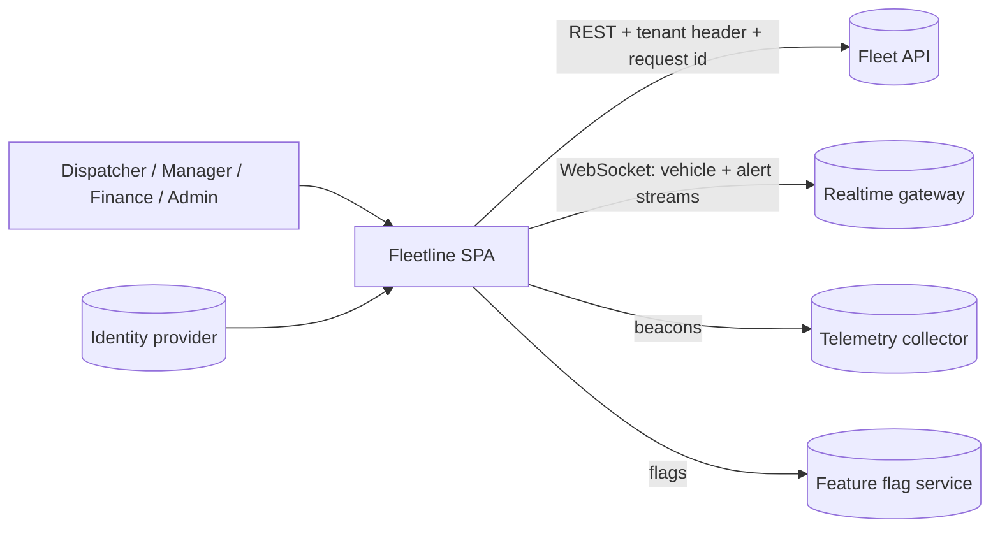
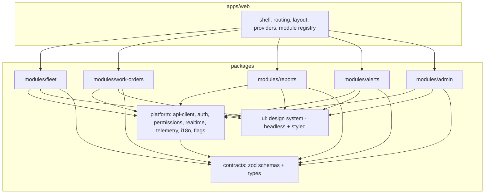

# Project 10 — Capstone: "Fleetline" Operations Console

| | |
|---|---|
| **Gate** | After Phase 11 (see [ROADMAP §4](../ROADMAP.md)) |
| **Architectural focus** | Full production constraints: multi-tenancy, permissions, realtime, data scale, resilience, accessibility, i18n, observability, delivery, and the written reasoning behind each choice |
| **Estimated effort** | 80–120 hours (single learner, 8–10 weeks) or a 3-person team over 4–5 weeks |
| **Stack (reference)** | React 19.x, TypeScript 5.x strict, Vite, React Router (data router), TanStack Query v5, Zustand 5.x (UI state only), Zod, Vitest, React Testing Library, MSW, Playwright, pnpm workspaces, GitHub Actions *(or equivalent CI)* |

> Library APIs named here (TanStack Query v5, Zustand 5, React Router, Zod, `web-vitals`) are stable at the time of writing but evolve. Verified 2026-10-22: the registry, API client, retry policy, vehicle store, socket, permission, URL-state and live-region code in §7 typecheck under strict TypeScript 5.9 (with the small context/contract files supplied) and the behaviors described were run in jsdom against TanStack Query 5.104, React Router 7.18 / 8.5, Zod 4 and React 19.3; the router glue in §7.1 was **wrong** and has been replaced. React Router 8 is the current major (8.5; Node 22.22+, React 19.2.7+); the data-mode APIs used here work on both 7.18 and 8.5. Verify against current documentation before coding. The architecture is the graded artifact; the library choices are defensible defaults, and you may substitute any option as long as an ADR justifies it.

The capstone is different from Projects 1–9. Those isolate a skill. This one forces **trade-offs between skills**: performance versus accessibility versus delivery speed versus testability, under constraints you must write down first. You are graded as much on your documents (design doc, ADRs, runbook) as on the code.

---

## 1. Problem statement

**Fleetline** is a web console used by dispatchers, fleet managers, and finance staff at logistics companies (tenants). It must be productive for eight-hour shifts on mixed hardware and unreliable networks.

### 1.1 Personas

| Persona | Primary jobs | Constraints |
|---|---|---|
| Dispatcher | Watch live vehicle status; assign and reassign work orders; react to alerts within seconds | Keyboard-first; large monitors and low-end laptops; long sessions (memory leaks matter) |
| Fleet manager | Review vehicle history, maintenance, driver compliance; approve work orders | Moderate data volume; cares about accuracy and audit trail |
| Finance analyst | Browse and export cost reports over large date ranges | Heavy tables (10^5 rows), CSV export, precise numbers (currency, locale) |
| Tenant admin | Manage users, roles, feature settings | Security-sensitive; must never see another tenant's data |
| Support engineer (internal) | Reproduce tenant issues | Needs request ids, diagnostics, impersonation with audit |

### 1.2 Functional scope (modules)

| Module | Capabilities | Interesting engineering |
|---|---|---|
| **Live Fleet** | Table + map-less "board" of up to 5,000 vehicles with realtime status (WebSocket), filters, saved views | Realtime store, windowing, subscription batching, reconnect |
| **Work Orders** | CRUD, assignment, status transitions with business rules, comments, attachments (metadata only) | Optimistic updates with rollback, form architecture, state machine, conflict handling |
| **Reports** | Cost/consumption reports with date ranges, grouping, sort; CSV export | Large-table virtualization, URL as state, export without freezing UI (worker/streaming) |
| **Alerts** | Realtime feed, acknowledge/snooze, notification preferences | Live-region accessibility, rate limiting, dedupe |
| **Admin** | Users, roles, per-tenant feature flags | Permission model, audit log, destructive-action UX |
| **Shell** | Navigation, tenant switch, locale switch, theme, command palette, error/offline banners | Cross-cutting concerns, module registry |

You may reduce Reports or Alerts to a vertical slice, but at least **four modules** must be fully implemented, including Live Fleet and Work Orders.

### 1.3 Non-functional requirements (the contract)

| ID | Requirement | Verification |
|---|---|---|
| NFR-1 | **Multi-tenancy**: every request carries tenant id; cache keys include tenant; switching tenant resets all tenant-scoped client state | Unit + e2e (no data from tenant A visible after switch) |
| NFR-2 | **Authorization**: UI gating is a convenience; the API is the authority. UI must degrade gracefully on `403` | e2e with role matrix |
| NFR-3 | **Accessibility**: WCAG 2.2 AA for all implemented flows; full keyboard operation; screen-reader tested on at least one flow | axe in CI + manual script in `docs/a11y-report.md` |
| NFR-4 | **Internationalization**: `en` and at least one more locale (one RTL or a long-text language such as German recommended); locale-aware dates, numbers, currency; no string concatenation for sentences | Tests with pseudo-locale |
| NFR-5 | **Performance budgets**: initial route JS ≤ budget you set in the design doc (suggested 170 kB gzip); INP ≤ 200 ms (p75, lab proxy); Live Fleet remains responsive with 5,000 rows updating 20 msgs/s | CI budget script + Profiler evidence |
| NFR-6 | **Resilience**: API 5xx/timeouts retried with backoff for idempotent calls only; realtime reconnects with jitter; offline banner; no unhandled crash screens | Chaos tests via MSW + Playwright network emulation |
| NFR-7 | **Observability**: structured client logs, error reporting with release/tenant/route/request id, web-vitals, a "diagnostics" panel | Tests assert telemetry payload shape |
| NFR-8 | **Security**: CSP-compatible (no inline script), no secrets in bundle, XSS-safe rendering of user content, dependency audit in CI, CSRF handled per auth design | Checklist + automated audit |
| NFR-9 | **Maintainability**: enforced module boundaries (lint), strict TypeScript, ≥ 70% meaningful coverage on domain logic (coverage is a smell detector, not a goal) | CI |
| NFR-10 | **Delivery**: trunk-based, PR checks < 10 min, preview deploys, feature flags, rollback < 5 min | Pipeline definition + runbook |
| NFR-11 | **Long sessions**: 8-hour soak without heap growth beyond a stated bound | Heap snapshot comparison documented |
| NFR-12 | **Browser support**: evergreen last 2 versions; no layout/behavior reliance on unsupported APIs without fallback | Playwright projects |

### 1.4 What you are given

- An OpenAPI-like contract you write yourself in `packages/contracts` (Zod schemas are the source of truth).
- A **mock backend** you also write: MSW handlers for REST plus a small in-memory WebSocket server script (`tools/mock-ws.ts`) that emits vehicle updates. The mock backend must support injected latency, failure rates, and out-of-order messages, because NFR-6 cannot be tested otherwise.

---

## 2. Learning objectives

This project is a synthesis. After it you can produce, defend, and operate a non-trivial React system:

| Objective | Curriculum anchors |
|---|---|
| Write a technical design document with options, trade-offs, risks, rollout | [Technical design documents](../11-senior-and-architect-mastery/02-technical-design-documents.md), [Trade-off analysis](../11-senior-and-architect-mastery/01-trade-off-analysis.md) |
| Choose abstraction level deliberately; avoid premature framework-building | [Choosing abstraction level](../11-senior-and-architect-mastery/04-choosing-abstraction-level.md), [DRY, KISS, YAGNI](../05-design-patterns/02-dry-kiss-yagni.md) |
| Define application boundaries and a module contract | [Application boundaries](../11-senior-and-architect-mastery/05-application-boundaries.md), [Modular architecture](../04-react-architecture/07-modular-architecture.md), [Feature vs layer structure](../04-react-architecture/06-feature-vs-layer-structure.md) |
| Own state at scale: server/client/URL/ephemeral separation | [State architecture at scale](../11-senior-and-architect-mastery/08-state-architecture-at-scale.md), [UI, server, URL and shared state](../03-react-state-and-hooks/19-ui-server-url-and-shared-state.md), [Server state management](../06-data-fetching-and-state-ecosystems/07-server-state-management.md) |
| Handle cross-cutting concerns once, not per component | [Cross-cutting concerns](../11-senior-and-architect-mastery/06-cross-cutting-concerns.md) |
| Design for testability and accessibility from day one | [Designing for testability](../11-senior-and-architect-mastery/10-designing-for-testability.md), [Designing for accessibility](../11-senior-and-architect-mastery/11-designing-for-accessibility.md) |
| Set and enforce performance budgets | [Performance budgets at scale](../11-senior-and-architect-mastery/09-performance-budgets-at-scale.md), [Web Vitals and budgets](../07-performance/21-web-vitals-and-budgets.md) |
| Operate: telemetry, incidents, releases | [Observability and logging](../10-production-engineering/04-observability-and-logging.md), [Error monitoring](../10-production-engineering/05-error-monitoring.md), [Incident debugging](../10-production-engineering/19-incident-debugging.md), [Continuous delivery](../10-production-engineering/18-continuous-delivery.md) |
| Justify build-versus-buy and framework choice | [Build vs buy](../11-senior-and-architect-mastery/14-build-vs-buy.md), [Framework selection](../11-senior-and-architect-mastery/15-framework-selection.md) |
| Plan evolution and migration | [Long-term evolution](../11-senior-and-architect-mastery/22-long-term-evolution.md), [Application migrations](../10-production-engineering/13-application-migrations.md) |
| Communicate decisions | [Architecture decision records](../10-production-engineering/16-architecture-decision-records.md), [Documentation](../10-production-engineering/17-documentation.md) |

---

## 3. Recommended architecture

### 3.1 System context



### 3.2 Why an SPA here (and when you would not)

A logged-in, long-session, realtime, keyboard-heavy console is the strongest case for a client-rendered SPA: no SEO need, state continuity across navigations, rich interaction. SSR/RSC would add server complexity without user benefit **for this app**; the login page and any marketing pages would be a separate (SSR/SSG) deployable. Document this reasoning and the conditions under which you would reverse it (e.g. cold-start LCP on low-end devices becomes a measured problem; then consider server-rendered shell + streaming from [Project 09](./09-ssr-streaming-app.md)). This is the "scenario where the recommended approach is not best" you must state in ADR-0001.

### 3.3 Layered module architecture



Rules (enforced by lint/CI, see [architectural fitness and enforcement](../04-react-architecture/25-architectural-fitness-and-enforcement.md)):

1. A module may import `platform`, `ui`, `contracts`. **Never** another module. Cross-module needs go through the shell via the **module registry** (routes, nav entries, command-palette actions, dashboard widgets) or through events defined in `platform`.
2. `platform` and `ui` never import modules or the shell.
3. `contracts` imports nothing app-specific.
4. Server state lives in TanStack Query; **no** server data is copied into Zustand/Redux. Zustand holds only UI preferences and ephemeral cross-component UI state. URL holds shareable view state (filters, sort, selected id, date range). Component state holds ephemeral local state. See [server vs client state](../04-react-architecture/16-server-vs-client-state.md), [URL state management](../06-data-fetching-and-state-ecosystems/18-url-state-management.md).
5. Realtime data is a **separate external store** (`useSyncExternalStore`), reconciled with the Query cache only where the product requires (e.g. a vehicle detail that merges latest stream status with fetched history). See [useSyncExternalStore and external stores](../03-react-state-and-hooks/20-usesyncexternalstore-and-external-stores.md), [real-time subscriptions](../06-data-fetching-and-state-ecosystems/17-real-time-websockets-subscriptions.md).

### 3.4 Hexagonal seam for the API

Each module defines **ports** (interfaces for what it needs from the world), and `platform` provides **adapters** (HTTP). Components call hooks that call application services; they never call `fetch`. See [clean and hexagonal architecture](../04-react-architecture/10-clean-and-hexagonal-architecture.md), [application services and adapters](../04-react-architecture/13-application-services-and-adapters.md), [API boundaries and data access](../04-react-architecture/14-api-boundaries-and-data-access.md). In tests the adapter is swapped for an in-memory implementation or MSW handlers.

### 3.5 Technology decisions you must record as ADRs

| ADR | Decision | Minimum alternatives to evaluate |
|---|---|---|
| 0001 | SPA vs SSR/RSC framework | Vite SPA, Next.js App Router, React Router framework mode |
| 0002 | Server-state library | TanStack Query, RTK Query, SWR, hand-rolled |
| 0003 | Client/UI state | Zustand, Redux Toolkit, Context+reducer, Jotai |
| 0004 | Realtime transport + store design | WebSocket, SSE, polling; store in Query cache vs external store |
| 0005 | Table/virtualization | TanStack Table + TanStack Virtual, AG Grid (build vs buy), custom |
| 0006 | Monorepo tooling | pnpm workspaces + Turborepo/Nx, single package with folders |
| 0007 | Styling / design system | CSS Modules + tokens, Tailwind, vanilla-extract, headless lib + custom |
| 0008 | i18n library | `react-intl` / FormatJS, i18next, platform `Intl` only |
| 0009 | Permission model | RBAC, ABAC, policy engine; client contract with server |
| 0010 | Testing strategy | Test pyramid ratios, what is NOT tested and why |

Use the format and honesty standards from [architecture decision records](../10-production-engineering/16-architecture-decision-records.md); each ADR must name at least one condition under which it should be revisited ("revisit when…").

---

## 4. Repository and folder structure

```text
fleetline/
├─ package.json                      # workspaces, scripts: dev, build, test, lint, typecheck, e2e, budget
├─ pnpm-workspace.yaml
├─ turbo.json                        # (or equivalent task graph)
├─ .github/workflows/ci.yml
├─ eslint.config.js                  # boundary rules + a11y + react-hooks
├─ tsconfig.base.json                # strict, noUncheckedIndexedAccess, exactOptionalPropertyTypes
├─ docs/
│  ├─ design-doc.md                  # §5.1 deliverable
│  ├─ adr/0001-… 0010-….md
│  ├─ runbook.md                     # alerts -> diagnosis -> mitigation
│  ├─ a11y-report.md
│  ├─ perf-report.md                 # budgets, baselines, regressions found
│  ├─ threat-model.md
│  └─ evolution-plan.md              # 12-month plan, migration paths
├─ tools/
│  ├─ mock-ws.ts                     # realtime simulator (latency, loss, reorder)
│  ├─ check-bundle-budget.mjs
│  └─ seed.ts
├─ packages/
│  ├─ contracts/src/{vehicle,work-order,report,alert,user,errors}.ts
│  ├─ ui/src/{button,dialog,combobox,data-grid,live-region,...}/
│  ├─ platform/src/
│  │  ├─ api/{client.ts,errors.ts,retry.ts,query-keys.ts}
│  │  ├─ auth/{session.tsx,permissions.ts,can.tsx}
│  │  ├─ realtime/{socket.ts,store.ts,use-vehicle-status.ts}
│  │  ├─ telemetry/{logger.ts,report-error.ts,vitals.ts}
│  │  ├─ i18n/{provider.tsx,messages/{en,de}.json}
│  │  ├─ flags/{provider.tsx,use-flag.ts}
│  │  └─ module-registry/{define-module.ts,registry.ts}
│  └─ modules/
│     ├─ fleet/src/{index.ts,routes.tsx,api/,model/,ui/,state/}
│     ├─ work-orders/src/{index.ts,routes.tsx,api/,model/,ui/,machine/}
│     ├─ reports/src/…
│     ├─ alerts/src/…
│     └─ admin/src/…
└─ apps/
   └─ web/
      ├─ index.html
      ├─ src/{main.tsx,App.tsx,shell/,providers/,routes.tsx}
      └─ e2e/{fleet.spec.ts,work-orders.spec.ts,tenant-isolation.spec.ts,a11y.spec.ts,resilience.spec.ts}
```

Each module exposes **only** `index.ts` (its `defineModule` result and public types). Importing `modules/fleet/src/ui/...` from outside the package is a lint error (use `exports` in each package's `package.json` to make this structural, not just conventional).

---

## 5. Milestones

Deliverables are cumulative. Each milestone includes a **review gate**: someone (peer, mentor, or your future self a week later with the checklist) reviews against §10 before you continue.

| M | Weeks | Name | Deliverables | Gate |
|---|---|---|---|---|
| **M0** | 1 | Design before code | `design-doc.md` (problem, personas, NFRs, options, chosen architecture, risks, rollout, success metrics), ADR-0001..0004 drafts, threat model v1, data model in `contracts`, mock backend skeleton | Design doc reviewed; every NFR has a verification method |
| **M1** | 1 | Platform foundation | Monorepo, CI (typecheck, lint, unit, build), boundary lint rules (prove they fail on a violation), API client with error taxonomy, auth/session, permissions, i18n provider, telemetry logger, module registry, shell with two stub modules | CI green in < 10 min; telemetry captured in a test |
| **M2** | 1.5 | Work Orders slice (CRUD + rules) | List with URL-driven filters, detail, create/edit form architecture, status machine, optimistic transitions with rollback, conflict (`409`) handling, audit comments | e2e happy + failure paths; a11y scan clean |
| **M3** | 2 | Live Fleet (realtime + scale) | Socket manager (backoff + jitter, resubscribe, heartbeat), vehicle store with batching, virtualized board/table, filter/sort at 5,000 rows, saved views (URL + server), degraded mode | Profiler evidence: no row re-renders for unchanged vehicles; soak test script |
| **M4** | 1 | Alerts + Admin | Alert feed with live-region strategy, ack/snooze with optimistic UI, roles/users admin with destructive confirmation, tenant feature flags | Permission matrix tests pass; screen-reader walkthrough recorded |
| **M5** | 1 | Reports (scale) | Date-range + grouping in URL, virtualized 10^5-row table, CSV export in a Web Worker or streamed, number/currency formatting per locale | INP under budget during sort/filter; export doesn't block UI |
| **M6** | 1 | Hardening | CSP, dependency audit gate, error boundaries per module and per route, offline/degraded UX, chaos tests, pseudo-locale + RTL checks, heap-soak report | NFR-5..NFR-11 each have evidence in `docs/` |
| **M7** | 0.5–1 | Release and operate | Preview deploys, feature-flagged rollout of one module, rollback drill, runbook, incident drill (inject a defect, diagnose from telemetry only), `evolution-plan.md`, retrospective | Incident drill write-up |

**Staying honest about scope:** if you are behind, cut breadth (Reports, Admin) before cutting design docs, tests, or accessibility. A smaller, fully verified system beats a larger unverified one, and the grading rubric (§11) says so.

---

## 6. Design decisions and the reasoning expected

The reference solution makes the choices below. You may choose differently; you must justify with the same rigor.

### 6.1 State taxonomy

| State kind | Examples | Home | Why |
|---|---|---|---|
| Server state | work orders, vehicles (REST), reports, users | TanStack Query, keys prefixed with tenant | Caching, dedupe, invalidation, background refetch are solved problems |
| Realtime state | vehicle live status, alert stream | Dedicated external store with `useSyncExternalStore` | High frequency, needs batching and per-key subscriptions; Query cache re-notification per message would thrash |
| URL state | filters, sort, page/range, selected id, active tab | Router search params (typed codec) | Shareable, back-button correct, survives reload |
| UI state | sidebar collapsed, density, theme, command palette open | Zustand slice (persisted selectively) | Cross-component but not server- or URL-worthy |
| Form state | draft work order | Component-local reducer (+ autosaved draft in IndexedDB/localStorage, tenant-scoped) | Isolated lifecycle; see [forms and complex state](../03-react-state-and-hooks/21-forms-and-complex-state.md) |
| Ephemeral | hover, focus, popover open | Local `useState` | [State colocation](../03-react-state-and-hooks/18-state-colocation-and-lifting.md) |

### 6.2 The module contract

A module declares **what it contributes** and nothing else. The shell composes. This inversion keeps modules independent and makes lazy-loading and feature-flagging uniform.

### 6.3 Permissions

Server is the authority; the client holds a `PermissionSet` returned at session start and evaluates `can(action, resource)` for UX only. Every gated UI element has a corresponding server check; every mutation handles `403` by refreshing the permission set and showing a non-leaky message. Never gate by role name in components (`role === 'admin'`); gate by capability (`can('user:invite')`) so roles can change without touching UI code.

### 6.4 Error taxonomy

Errors are data, not strings: `NetworkError`, `TimeoutError`, `AuthError(401)`, `ForbiddenError(403)`, `NotFoundError`, `ConflictError(409)`, `ValidationError(422, fieldErrors)`, `ServerError(5xx)`, `SchemaMismatchError` (response failed Zod parse — a contract bug, reported loudly). UI maps taxonomy → presentation in one place. Retry policy keys off the taxonomy and method idempotency.

### 6.5 Realtime strategy

Messages arrive faster than frames. The store accumulates updates in a map and flushes at most once per animation frame (or 100 ms) to subscribers; each row subscribes to *its own vehicle id* with `useSyncExternalStore` so unrelated updates cause no render. Out-of-order messages are discarded with a per-vehicle monotonically increasing `seq`. On reconnect the client refetches a snapshot, then replays buffered deltas with `seq` greater than the snapshot's.

### 6.6 Optimistic updates

Only for operations where (a) failure is rare, (b) rollback is comprehensible to the user, and (c) the server is idempotent or versioned. Work-order status transitions qualify; payment-like operations do not. The reference uses version numbers (`If-Match`/`version` field) to detect conflicts.

### 6.7 Performance posture

Measure first ([measure before optimizing](../07-performance/01-measure-before-optimizing.md)). Defaults: route-level code splitting per module; virtualization for >200 rows; per-row subscriptions for realtime; derived data computed in selectors with stable inputs; `useTransition` for expensive filters; no blanket `memo`. Every optimization in the repo must reference a profile in `perf-report.md` ([counterproductive optimizations](../07-performance/23-counterproductive-optimizations.md)).

---

## 7. Reference solution guidance (key code)

### 7.1 Module registry

```ts
// packages/platform/src/module-registry/define-module.ts
import type { ComponentType, LazyExoticComponent } from 'react';
import type { RouteObject } from 'react-router';

export type Capability = `${string}:${string}`;           // e.g. 'workorder:assign'

export interface NavEntry {
  id: string;
  labelKey: string;                                       // i18n message id, never a raw string
  to: string;
  icon: string;
  requires?: Capability;
  flag?: string;
}

export interface CommandEntry {
  id: string;
  labelKey: string;
  requires?: Capability;
  run: (ctx: { navigate: (to: string) => void }) => void;
}

export interface FleetModule {
  id: string;
  /** Lazily loaded; the shell never imports module internals statically. */
  routes: () => Promise<RouteObject[]>;
  nav: NavEntry[];
  commands?: CommandEntry[];
  widgets?: Array<{ id: string; slot: 'dashboard'; component: LazyExoticComponent<ComponentType> }>;
  /** Called on tenant switch; the module must drop ALL tenant-scoped client state. */
  resetTenantState?: () => void;
}

export function defineModule<M extends FleetModule>(m: M): M { return m; }
```

```ts
// packages/modules/work-orders/src/index.ts  (the module's ONLY public entry)
import { defineModule } from '@fleetline/platform/module-registry';
import { resetWorkOrderUiState } from './state/ui-store';

export default defineModule({
  id: 'work-orders',
  routes: () => import('./routes').then((m) => m.routes),
  nav: [{ id: 'wo', labelKey: 'nav.workOrders', to: '/work-orders', icon: 'wrench', requires: 'workorder:read' }],
  commands: [{
    id: 'wo.create', labelKey: 'cmd.createWorkOrder', requires: 'workorder:create',
    run: ({ navigate }) => navigate('/work-orders/new'),
  }],
  resetTenantState: resetWorkOrderUiState,
});
```

```tsx
// apps/web/src/shell/build-router.tsx
import { createBrowserRouter, Outlet, type RouteObject } from 'react-router';
import type { FleetModule } from '@fleetline/platform';
import { Shell, NotFoundPage, ModuleErrorBoundary } from './components';   // yours
import modules from './modules';             // array of imported default exports (manifests only, cheap)

export function buildRouter(can: (c: string) => boolean, flag: (f: string) => boolean) {
  const enabled = modules.filter((m) => m.nav.every((n) => (!n.requires || can(n.requires)) && (!n.flag || flag(n.flag))));
  const base = (m: FleetModule) => m.nav[0]!.to;                           // e.g. '/work-orders'

  return createBrowserRouter(
    [{ id: 'root', path: '/', Component: Shell, children: [
      // The splat is what triggers discovery: a URL no known route matches asks patchRoutesOnNavigation first.
      { path: '*', Component: NotFoundPage },
    ] }],
    {
      // "Fog of war" route discovery: a module's routes are fetched on first navigation into its URL space.
      async patchRoutesOnNavigation({ path, patch }) {
        const m = enabled.find((m) => path === base(m) || path.startsWith(base(m) + '/'));
        if (!m) return;                                                       // disabled or unknown: falls through to NotFoundPage
        const children = await m.routes();                                    // dynamic import of the module
        patch('root', [{
          path: base(m).slice(1),
          Component: () => <ModuleErrorBoundary id={m.id}><Outlet /></ModuleErrorBoundary>,
          children,
        }]);
      },
    },
  );
}
```

> **Do not** return `children` from a route's `lazy` function: React Router does not allow `lazy` to supply `path`, `index`, `children`, `caseSensitive` or `id` (route matching must be known up front). The original sketch of this section did exactly that; verified on 7.18 and 8.5, the module URL then 404s. `patchRoutesOnNavigation` (above) is the mechanism designed for module-sized lazy route trees. Verified on both versions: a first visit to `/work-orders/new` loads the module and renders its nested route inside the module boundary, and `/nope` still reaches `NotFoundPage`. Module-level `lazy` on individual leaf routes is fine for code-splitting a single screen. The point under test is the **inversion** (the shell never imports module internals), not the router API ([routing architecture](../04-react-architecture/18-routing-architecture.md)). If your tests run React Router 7.x under Vitest, see the dual-module and `AbortSignal` notes in [Project 3 §9.2](./03-multi-page-dashboard.md).

### 7.2 API client: tenant, request id, error taxonomy, schema validation

```ts
// packages/platform/src/api/errors.ts
export abstract class AppError extends Error {
  abstract readonly kind: string;
  constructor(message: string, readonly requestId?: string, options?: ErrorOptions) { super(message, options); }
}
export class NetworkError extends AppError { readonly kind = 'network'; }
export class TimeoutError extends AppError { readonly kind = 'timeout'; }
export class AuthError extends AppError { readonly kind = 'auth'; }
export class ForbiddenError extends AppError { readonly kind = 'forbidden'; }
export class NotFoundError extends AppError { readonly kind = 'not-found'; }
export class ConflictError extends AppError { readonly kind = 'conflict'; }
export class ServerError extends AppError { readonly kind = 'server'; }
export class SchemaMismatchError extends AppError { readonly kind = 'schema'; }
export class ValidationError extends AppError {
  readonly kind = 'validation';
  constructor(message: string, readonly fields: Record<string, string[]>, requestId?: string) { super(message, requestId); }
}
export const isAppError = (e: unknown): e is AppError => e instanceof AppError;
```

```ts
// packages/platform/src/api/client.ts
import type { ZodType } from 'zod';
import * as E from './errors';

export interface ApiContext {
  baseUrl: string;
  getTenantId: () => string;
  getAuthHeader: () => string | undefined;
  onUnauthorized: () => void;
  onTelemetry: (e: { method: string; path: string; status: number; ms: number; requestId: string }) => void;
}

export interface RequestOptions<T> {
  method?: 'GET' | 'POST' | 'PUT' | 'PATCH' | 'DELETE';
  body?: unknown;
  schema: ZodType<T>;
  signal?: AbortSignal;
  timeoutMs?: number;
  headers?: Record<string, string>;
}

export function createApi(ctx: ApiContext) {
  return async function request<T>(path: string, opts: RequestOptions<T>): Promise<T> {
    const requestId = crypto.randomUUID();
    const started = performance.now();

    // Combine caller's signal (React Query's cancellation) with our timeout.
    const timeout = AbortSignal.timeout(opts.timeoutMs ?? 15_000);
    const signal = opts.signal ? AbortSignal.any([opts.signal, timeout]) : timeout;

    let res: Response;
    try {
      res = await fetch(ctx.baseUrl + path, {
        method: opts.method ?? 'GET',
        signal,
        headers: {
          'content-type': 'application/json',
          'x-request-id': requestId,
          'x-tenant-id': ctx.getTenantId(),
          ...(ctx.getAuthHeader() ? { authorization: ctx.getAuthHeader()! } : {}),
          ...opts.headers,
        },
        body: opts.body === undefined ? undefined : JSON.stringify(opts.body),
        credentials: 'include',
      });
    } catch (cause) {
      if (opts.signal?.aborted) throw cause;                     // caller cancelled: not an error to report
      if (timeout.aborted) throw new E.TimeoutError('Request timed out', requestId, { cause });
      throw new E.NetworkError('Network failure', requestId, { cause });
    }

    ctx.onTelemetry({ method: opts.method ?? 'GET', path, status: res.status, ms: performance.now() - started, requestId });

    if (res.ok) {
      const json: unknown = res.status === 204 ? null : await res.json();
      const parsed = opts.schema.safeParse(json);
      if (!parsed.success) throw new E.SchemaMismatchError(parsed.error.message, requestId);
      return parsed.data;
    }

    const problem = await res.json().catch(() => ({} as Record<string, unknown>));
    const message = typeof problem.message === 'string' ? problem.message : res.statusText;
    switch (res.status) {
      case 401: ctx.onUnauthorized(); throw new E.AuthError(message, requestId);
      case 403: throw new E.ForbiddenError(message, requestId);
      case 404: throw new E.NotFoundError(message, requestId);
      case 409: throw new E.ConflictError(message, requestId);
      case 422: throw new E.ValidationError(message, (problem.fields as Record<string, string[]>) ?? {}, requestId);
      default:  throw new E.ServerError(message, requestId);
    }
  };
}
```

Discussion points graded in review: `AbortSignal.any`/`AbortSignal.timeout` availability (check your browser matrix, NFR-12; provide a fallback if needed); why `SchemaMismatchError` is separate from `ServerError` (a contract break is a deploy-coordination incident, not a retryable blip); why caller-aborted requests are rethrown untouched (React Query uses abort to cancel; reporting them as errors pollutes telemetry) — see [cancellation and race conditions](../06-data-fetching-and-state-ecosystems/02-cancellation-and-race-conditions.md).

### 7.3 Query keys and retry policy

```ts
// packages/platform/src/api/query-keys.ts
// Tenant first: switching tenant can drop an entire subtree with one call.
export const qk = {
  tenant: (t: string) => ['tenant', t] as const,
  workOrders: {
    all: (t: string) => [...qk.tenant(t), 'work-orders'] as const,
    list: (t: string, filters: WorkOrderFilters) => [...qk.workOrders.all(t), 'list', filters] as const,
    detail: (t: string, id: string) => [...qk.workOrders.all(t), 'detail', id] as const,
  },
  reports: {
    cost: (t: string, range: DateRange, groupBy: string) => [...qk.tenant(t), 'reports', 'cost', range, groupBy] as const,
  },
};
export interface WorkOrderFilters { status?: string[]; assignee?: string; q?: string; page?: number }
export interface DateRange { from: string; to: string }
```

```ts
// packages/platform/src/api/retry.ts
import { AppError } from './errors';

const RETRYABLE = new Set(['network', 'timeout', 'server']);

/** React Query `retry` option. Reads are retried; mutations are NOT unless declared idempotent. */
export function shouldRetry(failureCount: number, error: unknown): boolean {
  if (failureCount >= 3) return false;
  return error instanceof AppError && RETRYABLE.has(error.kind);
}

export const retryDelay = (attempt: number) =>
  Math.min(30_000, 2 ** attempt * 500) * (0.5 + Math.random() * 0.5);   // exponential backoff with jitter
```

Why jitter: after an outage thousands of clients retrying on the same schedule create a thundering herd ([error recovery and retries](../06-data-fetching-and-state-ecosystems/15-error-recovery-and-retries.md)).

### 7.4 Optimistic work-order transition with rollback and conflict handling

```tsx
// packages/modules/work-orders/src/api/use-transition-work-order.ts
import { useMutation, useQueryClient } from '@tanstack/react-query';
import { qk } from '@fleetline/platform/api/query-keys';
import { useApi, useTenantId, useToast } from '@fleetline/platform';
import { ConflictError } from '@fleetline/platform/api/errors';
import { WorkOrder, type WorkOrderStatus } from '@fleetline/contracts';
import { canTransition } from '../model/status-machine';

interface Vars { id: string; to: WorkOrderStatus; expectedVersion: number }

export function useTransitionWorkOrder() {
  const api = useApi();
  const tenant = useTenantId();
  const qc = useQueryClient();
  const toast = useToast();

  return useMutation({
    mutationFn: ({ id, to, expectedVersion }: Vars) =>
      api(`/work-orders/${id}/transition`, {
        method: 'POST', body: { to },
        headers: { 'if-match': String(expectedVersion) },
        schema: WorkOrder,
      }),

    onMutate: async ({ id, to }) => {
      const key = qk.workOrders.detail(tenant, id);
      await qc.cancelQueries({ queryKey: key });                   // avoid in-flight fetch overwriting the optimistic value
      const previous = qc.getQueryData<WorkOrder>(key);
      if (!previous || !canTransition(previous.status, to)) throw new Error('Illegal transition'); // domain rule on the client too
      qc.setQueryData<WorkOrder>(key, { ...previous, status: to });
      return { previous, key };
    },

    onError: (err, { id }, ctx) => {
      if (ctx) qc.setQueryData(ctx.key, ctx.previous);              // rollback
      if (err instanceof ConflictError) {
        toast({ kind: 'warning', messageKey: 'wo.conflict' });      // someone else changed it
        void qc.invalidateQueries({ queryKey: qk.workOrders.detail(tenant, id) });
      } else {
        toast({ kind: 'error', messageKey: 'wo.transitionFailed' });
      }
    },

    onSettled: (_d, _e, { id }) => {
      // Server truth wins eventually, regardless of success/failure.
      void qc.invalidateQueries({ queryKey: qk.workOrders.detail(tenant, id) });
      void qc.invalidateQueries({ queryKey: qk.workOrders.all(tenant), refetchType: 'active' });
    },
  });
}
```

```ts
// packages/modules/work-orders/src/model/status-machine.ts  (pure domain logic: no React)
import type { WorkOrderStatus as S } from '@fleetline/contracts';

const allowed: Record<S, readonly S[]> = {
  draft: ['open', 'cancelled'],
  open: ['assigned', 'cancelled'],
  assigned: ['in_progress', 'open', 'cancelled'],
  in_progress: ['blocked', 'done'],
  blocked: ['in_progress', 'cancelled'],
  done: [],
  cancelled: [],
};
export const canTransition = (from: S, to: S) => allowed[from].includes(to);
export const nextStates = (from: S) => allowed[from];
```

Testing this file exhaustively with table-driven tests is cheap and is the best-value test in the module ([designing for testability](../11-senior-and-architect-mastery/10-designing-for-testability.md)). A transition that is allowed by the client but rejected by the server is a *contract* bug; keep the table in `contracts` if both sides share TypeScript.

### 7.5 Realtime store: batching, per-key subscription, ordering

```ts
// packages/platform/src/realtime/store.ts
export interface VehicleLive { id: string; seq: number; lat: number; lng: number; status: 'moving' | 'idle' | 'offline'; speedKph: number; at: number }

type Listener = () => void;

export class VehicleStore {
  private data = new Map<string, VehicleLive>();
  private pending = new Map<string, VehicleLive>();
  private keyListeners = new Map<string, Set<Listener>>();
  private allListeners = new Set<Listener>();
  private scheduled = false;
  private version = 0;

  /** Called from the socket, many times per frame. Cheap: only buffers. */
  push(update: VehicleLive): void {
    const current = this.pending.get(update.id) ?? this.data.get(update.id);
    if (current && update.seq <= current.seq) return;               // stale or duplicate: drop
    this.pending.set(update.id, update);
    if (!this.scheduled) {
      this.scheduled = true;
      requestAnimationFrame(() => this.flush());                     // at most one notification wave per frame
    }
  }

  private flush(): void {
    this.scheduled = false;
    if (this.pending.size === 0) return;
    const changedIds: string[] = [];
    for (const [id, v] of this.pending) { this.data.set(id, v); changedIds.push(id); }
    this.pending.clear();
    this.version++;
    for (const id of changedIds) this.keyListeners.get(id)?.forEach((l) => l());
    this.allListeners.forEach((l) => l());
  }

  /** Replace everything from a REST snapshot, then keep only buffered deltas newer than it. */
  resetFromSnapshot(snapshot: VehicleLive[]): void {
    const buffered = new Map(this.pending);
    this.data = new Map(snapshot.map((v) => [v.id, v]));
    this.pending.clear();
    for (const v of buffered.values()) this.push(v);                 // seq filter drops older ones
    this.version++;
    this.keyListeners.forEach((ls) => ls.forEach((l) => l()));
    this.allListeners.forEach((l) => l());
  }

  // useSyncExternalStore contract: snapshots must be referentially stable between changes.
  getVehicle = (id: string): VehicleLive | undefined => this.data.get(id);
  getVersion = (): number => this.version;
  getIds = (() => { let cacheV = -1; let cache: string[] = []; return () => { if (cacheV !== this.version) { cache = [...this.data.keys()]; cacheV = this.version; } return cache; }; })();

  subscribeKey = (id: string, l: Listener) => {
    let set = this.keyListeners.get(id);
    if (!set) this.keyListeners.set(id, (set = new Set()));
    set.add(l);
    return () => { set!.delete(l); if (set!.size === 0) this.keyListeners.delete(id); };
  };
  subscribeAll = (l: Listener) => { this.allListeners.add(l); return () => { this.allListeners.delete(l); }; };
}
```

```tsx
// packages/platform/src/realtime/use-vehicle-status.ts
import { useCallback, useSyncExternalStore } from 'react';
import { useVehicleStore } from './context';

export function useVehicleLive(id: string) {
  const store = useVehicleStore();
  return useSyncExternalStore(
    useCallback((l) => store.subscribeKey(id, l), [store, id]),     // stable per (store,id) => no resubscribe churn
    () => store.getVehicle(id),
    () => undefined,                                                 // server snapshot (unused in SPA, harmless)
  );
}

export function useVehicleIds() {
  const store = useVehicleStore();
  return useSyncExternalStore(store.subscribeAll, store.getIds);
}
```

```tsx
// modules/fleet: a virtualized row subscribes ONLY to its own vehicle
import { memo } from 'react';
const VehicleRow = memo(function VehicleRow({ id, style }: { id: string; style: React.CSSProperties }) {
  const live = useVehicleLive(id);       // re-renders only when THIS vehicle changes
  return <div role="row" style={style}>{/* cells */ live?.status}</div>;
});
```

Why `memo` is justified here and `useVehicleIds` doesn't re-render rows: the ids array identity changes only when the version changes; if rows are keyed by id and `memo`d, the parent re-render on version bump re-renders nothing but the visible window's reconciliation. Verify with the Profiler ([profiler workflows](../07-performance/02-profiler-workflows.md)) and record the screenshot. If adding/removing vehicles is rare, consider making `getIds` change only on membership change, not on every flush — a measurable improvement left as an exercise.

```ts
// packages/platform/src/realtime/socket.ts  (reconnect with backoff + jitter + resync)
export function createSocket(opts: {
  url: () => string; onMessage: (m: unknown) => void; onStatus: (s: 'connecting' | 'open' | 'degraded') => void; resync: () => Promise<void>;
}) {
  let ws: WebSocket | null = null; let attempt = 0; let closed = false; let timer: ReturnType<typeof setTimeout>;

  const connect = () => {
    opts.onStatus(attempt === 0 ? 'connecting' : 'degraded');
    ws = new WebSocket(opts.url());
    ws.onopen = async () => { attempt = 0; await opts.resync(); opts.onStatus('open'); };   // snapshot THEN trust deltas
    ws.onmessage = (e) => { try { opts.onMessage(JSON.parse(e.data as string)); } catch { /* count + report, never crash */ } };
    ws.onclose = () => { if (closed) return; schedule(); };
    ws.onerror = () => ws?.close();
  };
  const schedule = () => {
    const base = Math.min(30_000, 500 * 2 ** attempt++);
    timer = setTimeout(connect, base * (0.5 + Math.random() * 0.5));
  };
  connect();
  return { close() { closed = true; clearTimeout(timer); ws?.close(); } };          // cleanup is part of the contract
}
```

Pair this with an app-lifecycle hook that creates the socket in an effect and calls `close()` in cleanup — Strict Mode will mount/unmount/mount it in development, which is a free test that your cleanup works ([effect cleanup](../03-react-state-and-hooks/06-effect-cleanup.md)). Also handle `document.visibilityState` (pause/reduce work for hidden tabs) and measure heap during soak ([memory leaks](../07-performance/19-memory-leaks.md)).

### 7.6 Permissions

```tsx
// packages/platform/src/auth/permissions.ts
import type { Capability } from '../module-registry/define-module';

export interface PermissionSet { has(c: Capability): boolean; version: string }
export const createPermissions = (caps: readonly Capability[], version: string): PermissionSet => {
  const set = new Set(caps);
  return { has: (c) => set.has(c), version };
};
```

```tsx
// packages/platform/src/auth/can.tsx
import type { ReactNode } from 'react';
import { use } from 'react';
import { PermissionContext } from './context';
import type { Capability } from '../module-registry/define-module';

export function useCan(c: Capability): boolean { return use(PermissionContext).has(c); }

export function Can({ I, children, fallback = null }: { I: Capability; children: ReactNode; fallback?: ReactNode }) {
  return useCan(I) ? <>{children}</> : <>{fallback}</>;
}
```

Notes: `use(Context)` is React 19's context read ([modern hooks and APIs](../03-react-state-and-hooks/22-modern-hooks-and-apis.md)); `useContext` is equally valid. For disabled-vs-hidden: hide actions the user can never perform; **disable with an explanation** actions that are unavailable *now* (state/rule-dependent), because hidden controls are undiscoverable ([designing for accessibility](../11-senior-and-architect-mastery/11-designing-for-accessibility.md)).

### 7.7 Tenant isolation

```tsx
// apps/web/src/providers/TenantBoundary.tsx
import { QueryClient, QueryClientProvider } from '@tanstack/react-query';
import { useState, type ReactNode } from 'react';
import { shouldRetry, retryDelay } from '@fleetline/platform/api/retry';
import modules from '../shell/modules';

export function TenantBoundary({ tenantId, children }: { tenantId: string; children: ReactNode }) {
  // `key={tenantId}` on this component (at the call site) remounts the subtree on tenant change:
  // every piece of component state, every store created below, every socket is torn down. Isolation by construction.
  const [client] = useState(() => new QueryClient({
    defaultOptions: { queries: { retry: shouldRetry, retryDelay, staleTime: 30_000, refetchOnWindowFocus: true } },
  }));
  return <QueryClientProvider client={client}>{children}</QueryClientProvider>;
}

// call site
// <TenantBoundary key={session.tenantId} tenantId={session.tenantId}> ... </TenantBoundary>
// On switch: module-level singletons (Zustand stores created at import time) are NOT reset by remount.
// Hence FleetModule.resetTenantState(): call every module's reset in the tenant-switch handler.
```

This design uses **remount-by-key** ([state preservation and reset](../01-react-fundamentals/16-state-preservation-and-reset.md)) as the primary guard and treats module-level singletons as the known hole, closed by `resetTenantState` and tested by an e2e that switches tenants mid-session and asserts nothing from tenant A remains (DOM, caches, localStorage keys, sockets).

### 7.8 Error boundaries per module + telemetry

```tsx
// packages/platform/src/telemetry/report-error.ts
export interface ErrorContext { release: string; tenantId?: string; route: string; requestId?: string; moduleId?: string; componentStack?: string }

export function reportError(error: unknown, ctx: ErrorContext): void {
  const payload = {
    message: error instanceof Error ? error.message : String(error),
    name: error instanceof Error ? error.name : 'NonError',
    stack: error instanceof Error ? error.stack : undefined,
    kind: (error as { kind?: string }).kind,
    ...ctx,
    ts: Date.now(),
    ua: navigator.userAgent,
  };
  // sendBeacon survives page unload; fall back to fetch keepalive
  const body = JSON.stringify(payload);
  if (!navigator.sendBeacon?.('/telemetry/errors', body)) void fetch('/telemetry/errors', { method: 'POST', body, keepalive: true }).catch(() => {});
}
```

```tsx
// React 19 root-level hooks: caught, uncaught, and recoverable errors
import { createRoot } from 'react-dom/client';
createRoot(document.getElementById('root')!, {
  onCaughtError: (error, info) => reportError(error, { ...baseCtx(), componentStack: info.componentStack ?? undefined }),
  onUncaughtError: (error, info) => reportError(error, { ...baseCtx(), componentStack: info.componentStack ?? undefined }),
  onRecoverableError: (error) => reportError(error, baseCtx()),
}).render(<App />);
```

`onCaughtError`/`onUncaughtError`/`onRecoverableError` are React 19 root options (verified: the code above typechecks against the 19.3 types, and `info.componentStack` is optional, hence `?? undefined`). Never include PII or tokens in payloads; sanitize URLs (strip query values) — part of the threat model. See [error monitoring](../10-production-engineering/05-error-monitoring.md), [error boundaries](../04-react-architecture/19-error-boundaries.md), [error handling patterns](../05-design-patterns/21-error-handling-patterns.md).

### 7.9 URL as state (typed codec)

```ts
// packages/platform/src/url/use-search-state.ts
import { useSearchParams } from 'react-router';
import { useCallback, useMemo } from 'react';
import type { ZodType } from 'zod';

export function useSearchState<T extends Record<string, unknown>>(schema: ZodType<T>, defaults: T) {
  const [params, setParams] = useSearchParams();
  const value = useMemo(() => {
    const raw = Object.fromEntries(params.entries());
    const parsed = schema.safeParse({ ...defaults, ...raw });
    return parsed.success ? parsed.data : defaults;           // invalid URL never crashes the page
  }, [params, schema, defaults]);
  const set = useCallback((patch: Partial<T>) => {
    setParams((prev) => {
      const next = new URLSearchParams(prev);
      for (const [k, v] of Object.entries(patch)) (v === undefined || v === '' ? next.delete(k) : next.set(k, String(v)));
      return next;
    }, { replace: true });                                     // filters shouldn't spam history
  }, [setParams]);
  return [value, set] as const;
}
```

Zod coercion (`z.coerce.number()`) is needed for numeric params; pass a `defaults` object with a stable identity (module constant) to avoid recomputation every render.

### 7.10 Performance budget gate

```js
// tools/check-bundle-budget.mjs  (run after `vite build` with manifest enabled)
import { readFileSync, statSync } from 'node:fs';
import { gzipSync } from 'node:zlib';
import { join } from 'node:path';

const dist = 'apps/web/dist';
const manifest = JSON.parse(readFileSync(join(dist, '.vite/manifest.json'), 'utf8')); // Vite 5 to 8 write .vite/manifest.json (needs `build.manifest: true`)
const budgets = { 'index.html': 170 * 1024 };           // gzip bytes for the INITIAL graph; per-module chunks have own budgets

function initialGraph(entryKey) {
  const seen = new Set(); const files = new Set();
  const visit = (k) => { if (seen.has(k)) return; seen.add(k); const c = manifest[k]; files.add(c.file); (c.imports ?? []).forEach(visit); };
  visit(entryKey); return [...files];
}
const entry = Object.keys(manifest).find((k) => manifest[k].isEntry);
const size = initialGraph(entry).filter((f) => f.endsWith('.js')).reduce((n, f) => n + gzipSync(readFileSync(join(dist, f))).length, 0);
if (size > budgets['index.html']) { console.error(`Initial JS ${size} > budget ${budgets['index.html']}`); process.exit(1); }
console.log(`Initial JS gzip: ${(size / 1024).toFixed(1)} kB`);
```

Note `imports` (static) vs `dynamicImports` (lazy): only the static graph counts toward initial load. Add per-module budgets and a PR comment with the delta ([bundle analysis](../07-performance/16-bundle-analysis.md), [CI checks](../08-testing-and-quality/15-ci-checks.md)). Report real-user vitals as well:

```ts
// packages/platform/src/telemetry/vitals.ts
import { onCLS, onINP, onLCP, type Metric } from 'web-vitals';
export function startVitals(send: (m: { name: string; value: number; id: string; route: string }) => void) {
  const report = (m: Metric) => send({ name: m.name, value: m.value, id: m.id, route: location.pathname });
  onCLS(report); onINP(report); onLCP(report);
}
```

### 7.11 Dependency-boundary enforcement

```js
// eslint.config.js (excerpt) - structural rule: modules cannot import each other
const modules = ['fleet', 'work-orders', 'reports', 'alerts', 'admin'];
export default [
  ...modules.map((m) => ({
    files: [`packages/modules/${m}/**/*.{ts,tsx}`],
    rules: {
      'no-restricted-imports': ['error', {
        patterns: [
          ...modules.filter((x) => x !== m).map((x) => ({ group: [`@fleetline/modules-${x}`, `@fleetline/modules-${x}/*`], message: 'Modules must not import each other; use the registry or platform events.' })),
          { group: ['@fleetline/web', '@fleetline/web/*'], message: 'Modules must not import the shell.' },
        ],
      }],
    },
  })),
  {
    files: ['packages/platform/**/*.{ts,tsx}', 'packages/ui/**/*.{ts,tsx}'],
    rules: { 'no-restricted-imports': ['error', { patterns: [{ group: ['@fleetline/modules-*', '@fleetline/web'], message: 'Lower layers cannot import higher layers.' }] }] },
  },
];
```

Dedicated tools (dependency-cruiser, Nx module boundaries) express the same rules with graphs and reports; evaluate in ADR-0006 ([monorepos and shared packages](../04-react-architecture/22-monorepos-and-shared-packages.md)). A rule that is not tested is a rumor: commit a deliberately failing fixture file excluded from the normal lint run and assert in CI that linting it fails.

### 7.12 Accessible live alerts

```tsx
// packages/ui/src/live-region/LiveRegion.tsx
import { useEffect, useRef, useState } from 'react';

/** Polite announcements, rate-limited: never read 20 alerts/second to a screen-reader user. */
export function useAnnouncer(minIntervalMs = 2000) {
  const [text, setText] = useState('');
  const last = useRef(0);
  const queue = useRef<string[]>([]);
  useEffect(() => {
    const id = setInterval(() => {
      if (queue.current.length && Date.now() - last.current >= minIntervalMs) {
        const n = queue.current.length;
        setText(n === 1 ? queue.current[0]! : `${n} new alerts. Latest: ${queue.current.at(-1)}`);   // digest, don't flood
        queue.current = []; last.current = Date.now();
      }
    }, 500);
    return () => clearInterval(id);
  }, [minIntervalMs]);
  return { announce: (m: string) => { queue.current.push(m); }, region: <div role="status" aria-live="polite" className="sr-only">{text}</div> };
}
```

(The digest string must come from i18n with pluralization in the real build — a hard-coded English sentence here violates NFR-4. Leave a failing test for it first.) Live-region behavior varies across screen readers: test on at least one real reader and record the result.

---

## 8. Testing expectations

| Layer | Focus | Tooling | Target |
|---|---|---|---|
| Pure domain | status machine, permission evaluation, URL codecs, store ordering (`seq`), retry policy | Vitest | Exhaustive/table-driven; mutation-minded assertions |
| Platform | API client error mapping (every status), timeout vs caller abort, schema mismatch, telemetry payload | Vitest + MSW | Each taxonomy branch has a test |
| Hooks | optimistic mutation: success, rollback, conflict; realtime hook subscribes/unsubscribes | RTL `renderHook` + QueryClient test wrapper ([testing custom hooks](../08-testing-and-quality/05-testing-custom-hooks.md)) | Fake timers for rAF batching |
| Component | forms (validation, a11y names), data grid keyboard model, permission gating | RTL + `user-event` | Query by role/name ([React Testing Library](../08-testing-and-quality/03-react-testing-library.md)) |
| Integration | a module with real routes + MSW backend; tenant switch | Vitest + MSW ([integration testing](../08-testing-and-quality/08-integration-testing.md)) | Module-level vertical slices |
| Contract | frontend schemas vs backend examples | Zod fixtures; consumer-driven checks | Break the build when fixtures drift ([component contract testing](../08-testing-and-quality/11-component-contract-testing.md)) |
| E2E | 6–10 critical journeys: login → assign work order; realtime update appears; offline banner; tenant isolation; role matrix; CSV export | Playwright ([E2E](../08-testing-and-quality/09-e2e-with-playwright.md)) | Deterministic via mock WS with seeded scenarios |
| Accessibility | axe on every route + keyboard-only journey + manual SR script | axe-core/Playwright | Zero serious/critical violations |
| Visual | Design-system components only | Playwright screenshots or Storybook-based tool ([visual regression](../08-testing-and-quality/12-visual-regression.md)) | Not on data-heavy pages |
| Resilience | 500s, timeouts, dropped socket, out-of-order messages, slow network | MSW + mock-ws chaos knobs | Each NFR-6 behavior has a test |
| Performance | bundle budget; component render-count assertions for Live Fleet (a test harness that counts renders for unchanged rows) | CI script, Profiler API in test | No row renders when another vehicle updates |
| Static | strict TS, lint, boundary rules, dependency audit | CI ([TypeScript correctness](../08-testing-and-quality/13-typescript-correctness.md), [linting](../08-testing-and-quality/14-linting-and-static-analysis.md)) | Zero warnings policy |

State in `docs/test-strategy.md` what you deliberately do **not** test and why ([test strategy and pyramid](../08-testing-and-quality/01-test-strategy-and-pyramid.md)), and which tests were found brittle and rewritten ([avoiding brittle tests](../08-testing-and-quality/16-avoiding-brittle-tests.md)).

---

## 9. Performance expectations

| Scenario | Expectation | Evidence |
|---|---|---|
| Cold load, 4x CPU throttle, Fast 4G | Initial JS within budget; LCP ≤ 2.5 s on the dashboard; no request waterfall deeper than 2 levels for the first meaningful view ([network waterfalls](../07-performance/17-network-waterfalls.md)) | Lighthouse + trace screenshots |
| Live Fleet, 5,000 vehicles, 20 msgs/s | Scripting per frame < 8 ms average; zero renders for unaffected rows; DOM nodes bounded (< ~1,500) | Performance trace + render-count test |
| Typing in a filter over 5,000 rows | INP ≤ 200 ms; input remains responsive (`useDeferredValue`/`useTransition` or filtering in a selector with debounced URL write) | Interaction trace ([`useTransition` in practice](../07-performance/12-usetransition-in-practice.md)) |
| Reports 10^5 rows | Sorting off main thread or chunked; scroll 60 fps; export of 10^5 rows doesn't block input > 50 ms | Long-task trace ([long tasks](../07-performance/20-long-tasks-and-main-thread.md)) |
| 8-hour soak | JS heap after forced GC grows < a bound you declare (e.g. 10%) | Two heap snapshots, diffed |
| Route transitions | Module chunk prefetch on intent (hover/focus); skeletons sized to content | Trace + CLS ≤ 0.1 |

Write the budgets **before** implementing (design doc), then report actuals. A budget you cannot measure is not a budget. A budget you exceed with an explained exception is acceptable; one exceeded silently is a failed review ([production performance investigations](../07-performance/22-production-performance-investigations.md)).

---

## 10. Common implementation mistakes

| # | Mistake | Why it hurts | Remedy |
|---|---|---|---|
| 1 | Starting with code and "deciding architecture as we go" | Boundaries emerge from convenience; rewrite at week 6 | M0 design doc and ADRs first |
| 2 | Copying server data into a client store (Redux/Zustand) | Two sources of truth; stale data; hand-written invalidation | Server state in Query only; derive in selectors |
| 3 | One global context for session + tenant + theme + flags + permissions | Every consumer re-renders on any change | Split by change frequency; stable value identities ([context performance](../03-react-state-and-hooks/14-context-performance.md)) |
| 4 | Pushing every WebSocket message through React state | 20 msgs/s × 5,000 rows = frame drops | Buffer, flush per frame, per-key subscriptions |
| 5 | No `seq`/version on realtime messages | Out-of-order updates display stale status | Monotonic sequence per entity; snapshot + replay on reconnect |
| 6 | Optimistic update without `cancelQueries` and rollback | Flicker; permanent wrong state after failure | Pattern in §7.4 |
| 7 | Gating by role names in components | Role changes require UI changes; privilege bugs | Capability checks; server enforcement |
| 8 | Cache keys without tenant | Cross-tenant data leak after switching | Tenant-first keys + remount-by-key + e2e test |
| 9 | Module singletons (stores created at import) not reset on tenant switch | State from tenant A visible in B | `resetTenantState` or per-tenant store factories |
| 10 | Retrying non-idempotent mutations | Duplicate side effects | Retry only idempotent operations; idempotency keys |
| 11 | `console.log` as observability | Nothing in production | Structured logger + report pipeline + request ids |
| 12 | Accessibility as a final polish | Structural rework (focus, semantics, announcements) | axe in CI from M1; keyboard acceptance criteria per story |
| 13 | i18n by string concatenation / hard-coded `toLocaleString()` without locale | Broken grammar/currency; untranslatable | ICU messages with plurals; `Intl` with explicit locale |
| 14 | Memoizing everywhere "just in case" | Complexity without benefit; stale-closure bugs | Profile first; memoize where evidence points |
| 15 | Over-abstracting the module system (plugin framework, DI container) | Tooling becomes the product | The registry stays ~100 lines; add features when a second module needs them ([choosing abstraction level](../11-senior-and-architect-mastery/04-choosing-abstraction-level.md)) |
| 16 | Tests that assert implementation (state shape, hook call counts) | Refactors break tests | Assert user-visible behavior and contract boundaries |
| 17 | No rollback/runbook until after the first incident | Panic debugging | Rollback drill in M7 |
| 18 | Ignoring Strict Mode double effects | Hidden leaks (sockets, intervals) ship | Develop under Strict Mode permanently ([Strict Mode behavior](../02-react-rendering-and-internals/28-strict-mode-behavior.md)) |

---

## 11. Review checklist

Use for peer review at each gate and for final grading.

**Design and documentation**
- [ ] Design doc states problem, non-goals, personas, measurable NFRs, options considered, risks, rollout plan, and success metrics.
- [ ] Each ADR lists alternatives, the deciding criteria, consequences, and a "revisit when" trigger.
- [ ] Threat model covers XSS, CSRF/session, tenant isolation, dependency supply chain, telemetry privacy.
- [ ] Runbook maps each alert to diagnosis and mitigation; incident drill write-up exists.

**Architecture**
- [ ] Module boundaries enforced by lint **and** package `exports`; an intentional violation fails CI.
- [ ] State taxonomy (§6.1) followed; no server data in client stores.
- [ ] Domain logic (status machine, permissions, codecs) lives in framework-free files with tests.
- [ ] Cross-cutting concerns (auth, tenant, errors, telemetry, i18n, flags) implemented once in `platform`.
- [ ] Tenant switch tested end-to-end including module singletons and sockets.

**React quality**
- [ ] Effects only for synchronization with external systems; all have cleanup ([you might not need an effect](../03-react-state-and-hooks/07-you-might-not-need-an-effect.md)).
- [ ] Keys are stable identities; no index keys on mutable lists.
- [ ] No derived state stored; no prop-to-state copies without reset strategy.
- [ ] Error boundaries at app, route, and module level with recovery actions.
- [ ] Suspense boundaries placed deliberately ([Suspense architecture](../09-advanced-rendering-and-ecosystem/05-suspense-architecture.md)).
- [ ] Strict Mode on in dev; no console warnings.

**Performance**
- [ ] Budgets declared up-front; CI enforces bundle budget.
- [ ] Every memoization/virtualization/transition has a profile justifying it.
- [ ] Live Fleet render-count test passes; soak report attached.
- [ ] No long task > 50 ms in key interactions (trace attached).

**Accessibility and i18n**
- [ ] axe clean in CI; keyboard-only journeys pass; focus management on route change and dialogs.
- [ ] Live regions rate-limited; reduced-motion honored; contrast verified in both themes.
- [ ] Pseudo-locale shows no truncation/overflow; RTL or long-text locale verified; dates/numbers/currency via `Intl`.

**Security and operations**
- [ ] CSP-compatible build; no secrets in bundle; `npm audit`/equivalent gate with documented exceptions.
- [ ] Telemetry contains no tokens/PII; request id correlates client and server logs.
- [ ] Feature-flagged rollout and tested rollback.

---

## 12. Grading rubric

Total 100 points. **Pass: ≥ 80 overall and ≥ 70% in each of the four categories** (design/reasoning, implementation, verification, operations), consistent with the curriculum's promotion policy ([ROADMAP §5](../ROADMAP.md)).

| Category | Criterion | Points |
|---|---|---|
| **Design and reasoning (25)** | Design doc quality: measurable NFRs, options, risks | 8 |
| | ADRs show real trade-offs and revisit triggers (not post-hoc rationalization) | 8 |
| | State/boundary model coherent and consistently applied | 6 |
| | Honest scope management; documented cuts and debts | 3 |
| **Implementation (30)** | Module system, platform layer, API client/error taxonomy | 8 |
| | Work Orders: forms, state machine, optimistic + conflict | 7 |
| | Live Fleet: realtime store, virtualization, resync | 8 |
| | Second/third module breadth (Alerts/Reports/Admin) | 4 |
| | Code quality: strict TS, no unjustified `any`/casts, readable | 3 |
| **Verification (25)** | Test strategy matches risk; domain logic exhaustively tested | 7 |
| | Integration/e2e/resilience tests deterministic and meaningful | 8 |
| | Accessibility evidence (automated + manual) | 5 |
| | Performance evidence (budgets, traces, soak) | 5 |
| **Operations (20)** | CI/CD, previews, budget gate, boundary enforcement proven | 6 |
| | Telemetry, error reporting, correlation ids | 5 |
| | Security: CSP, dependency gate, tenant isolation proof | 5 |
| | Runbook + incident drill + rollback drill | 4 |

**Score bands:** 90+ ready to lead design of a production React system; 80–89 pass with named gaps; 70–79 repeat the weakest category via the targeted project (Project 8 for architecture, 5 for performance, 4 for forms, 9 for rendering); below 70 revisit Phase 11 lessons identified by the checklist items you failed.

**Auto-fail conditions:** cross-tenant data visible after switch; permission enforced only in the UI with no stated server dependency; secrets or tokens in telemetry/bundle; no accessibility testing at all.

---

## 13. Optional extensions

| # | Extension | Anchors |
|---|---|---|
| E1 | **Microfrontend experiment**: expose Reports as an independently deployed remote (Module Federation or native ESM + import maps); write a decision memo on whether it was worth it | [Microfrontends](../11-senior-and-architect-mastery/12-microfrontends.md), [Monorepo vs multirepo](../11-senior-and-architect-mastery/13-monorepo-vs-multirepo.md) |
| E2 | **Offline-first work orders**: queue mutations in IndexedDB, replay with idempotency keys, conflict resolution UI | [Offline considerations](../06-data-fetching-and-state-ecosystems/16-offline-considerations.md) |
| E3 | **Server-rendered shell** for the login and a marketing area, sharing the design system; compare cold-load metrics | [Project 09](./09-ssr-streaming-app.md) |
| E4 | **React Compiler** adoption: enable on one module, measure, document removals of manual memoization (React Compiler 1.0 is stable) | [React Compiler](../09-advanced-rendering-and-ecosystem/08-react-compiler.md) |
| E5 | **Design system packaging**: publish `ui` with semver, Storybook, visual regression, deprecation policy | [Design system architecture](../11-senior-and-architect-mastery/07-design-system-architecture.md), [Design system governance](../10-production-engineering/11-design-system-governance.md) |
| E6 | **State machine for the whole Alerts lifecycle** with XState and model-based tests | [State machines and XState](../06-data-fetching-and-state-ecosystems/12-state-machines-and-xstate.md) |
| E7 | **Migration exercise**: replace the UI-state library or router with a compatibility layer and a staged rollout | [Large-scale refactoring](../11-senior-and-architect-mastery/03-large-scale-refactoring.md), [Backward compatibility](../10-production-engineering/12-backward-compatibility.md) |
| E8 | **System-design interview rehearsal**: present the architecture in 45 minutes, defend three decisions against a skeptical reviewer, record and critique | [System design interviews](../11-senior-and-architect-mastery/23-system-design-interviews.md), [Technical leadership](../11-senior-and-architect-mastery/18-technical-leadership.md) |
| E9 | **Internationalized, accessible data grid** as a reusable package with a public API review | [Patterns for reusable libraries](../05-design-patterns/22-patterns-for-reusable-libraries.md), [Headless components](../05-design-patterns/07-headless-components.md) |
| E10 | **Evaluate an emerging feature** (e.g. a new React API or framework capability) against your architecture with a written adoption/no-adoption recommendation | [Evaluating emerging features](../11-senior-and-architect-mastery/20-evaluating-emerging-features.md) |
