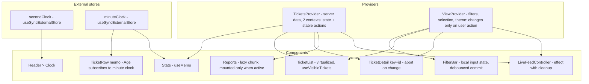

# Project 11 — Broken App: Diagnose and Refactor ("Ticketdesk")

| | |
|---|---|
| **Gate** | After Phase 7 (see [ROADMAP §4](../ROADMAP.md)) |
| **Architectural focus** | Diagnosing real defects: state ownership, rendering cost, async correctness, resource lifetime, bundle weight |
| **Estimated effort** | 12–20 hours |
| **Stack** | React 19.x, TypeScript 5.x (strict), Vite, `lodash` and `moment` (deliberately), Vitest + React Testing Library for regression tests |
| **Mode** | You are handed a working-looking app with **hidden, unlisted defects**. You must find, prove, fix, and verify them, in that order. |

> **Read this before opening the spoiler section.** The last section of this file ("SPOILERS") contains the full defect list, the intended diagnosis for each, and the fixed code. Reading it first turns this project from a debugging exercise into a copy-paste exercise and wastes the one thing this project teaches: how to *find* problems with evidence. Work through §1–§12 first, produce your own report, and only then compare.

---

## 1. Scenario

You have joined a team that owns **Ticketdesk**, an internal support dashboard. Support agents browse up to 5,000 tickets, search, filter, open a ticket to read comments, change its status, and watch a "live feed" of new tickets arrive. It "works", but:

- support complains it is **laggy**, especially while typing in search;
- the page gets **slower the longer it stays open**, and fans spin up on laptops;
- agents occasionally see **the wrong ticket's details**;
- a product manager notes the first load is **heavy** on slow connections;
- the previous maintainer left; there are **no tests** and no notes.

Your tech lead's instructions: *"Do not rewrite it. Find out what is actually wrong, with evidence, fix the causes rather than the symptoms, and prove each fix. I expect a written report."*

The app's behavior must remain the same: the same screens, features, and (visible) results. Only structure, correctness, and performance may change.

---

## 2. Learning objectives

1. Use a **measure-first** workflow: baseline, hypothesis, experiment, measurement, conclusion. → [Measure before optimizing](../07-performance/01-measure-before-optimizing.md), [Profiler workflows](../07-performance/02-profiler-workflows.md)
2. Recognize and name architectural anti-patterns in unfamiliar code: state hoisted too high, context churn, effect-derived state, unstable identity, mutation. → [State colocation and lifting](../03-react-state-and-hooks/18-state-colocation-and-lifting.md), [Context performance](../03-react-state-and-hooks/14-context-performance.md), [Derived state](../03-react-state-and-hooks/17-derived-state.md), [You might not need an effect](../03-react-state-and-hooks/07-you-might-not-need-an-effect.md), [Hooks anti-patterns](../03-react-state-and-hooks/23-hooks-anti-patterns.md)
3. Diagnose async correctness defects (races, missing cancellation) and resource-lifetime defects (missing cleanup, leaks). → [Cancellation and race conditions](../06-data-fetching-and-state-ecosystems/02-cancellation-and-race-conditions.md), [Effect cleanup](../03-react-state-and-hooks/06-effect-cleanup.md), [Memory leaks](../07-performance/19-memory-leaks.md)
4. Explain why renders happen, using DevTools evidence ("why did this render?"). → [Why components rerender](../07-performance/03-why-components-rerender.md), [Reasoning about unnecessary renders](../02-react-rendering-and-internals/29-reasoning-about-unnecessary-renders.md), [DevTools Profiler](../02-react-rendering-and-internals/30-react-devtools-profiler.md)
5. Choose the *right* remedy: colocate, split, derive, virtualize, defer, split code, rather than sprinkling `memo`. → [Memoization trade-offs](../07-performance/04-memoization-trade-offs.md), [Referential equality](../07-performance/05-referential-equality.md), [Counterproductive optimizations](../07-performance/23-counterproductive-optimizations.md)
6. Large collections and bundle weight. → [Rendering large collections](../07-performance/08-rendering-large-collections.md), [Windowing and virtualization](../07-performance/09-windowing-and-virtualization.md), [Code splitting](../07-performance/15-code-splitting-and-lazy-loading.md), [Bundle analysis](../07-performance/16-bundle-analysis.md)
7. Keys and identity. → [Lists, keys, identity](../01-react-fundamentals/09-lists-keys-and-identity.md), [Scenario C: list reorder](../02-react-rendering-and-internals/34-scenario-c-list-reorder.md), [State preservation and reset](../01-react-fundamentals/16-state-preservation-and-reset.md)
8. Communicate findings and write regression tests that lock the fixes in. → [Production performance investigations](../07-performance/22-production-performance-investigations.md), [Refactoring legacy React](../04-react-architecture/24-refactoring-legacy-react.md), [Testing async updates](../08-testing-and-quality/04-testing-async-updates.md)

---

## 3. Requirements

### 3.1 Deliverables

| # | Deliverable | Description |
|---|---|---|
| D1 | **Baseline measurements** | Before changing anything: bundle size (gzip) and composition, Profiler recording of 10 s idle, Performance trace of typing `abcde` in search, heap snapshot after the leak scenario, DOM node count. Stored in `report/baseline/`. |
| D2 | **Defect register** | One entry per defect you find: id, location (file:line), category, observable symptom, **evidence** (screenshot/trace/measurement), root cause, severity, proposed fix. |
| D3 | **Fixes** | One commit (or clearly separated change) per defect, each with before/after measurements where applicable. |
| D4 | **Regression tests** | At least one automated test per *correctness* defect (race, mutation, stale state, keys, cleanup) and a bundle-budget/render-count check for performance defects where practical. |
| D5 | **Report** | `report/REPORT.md`: summary, defect register, method, before/after table, what you chose *not* to change and why, remaining risks. |

### 3.2 Constraints

- **No rewrite.** Keep the component set and the user-visible behavior. You may add files and change the state architecture.
- **One defect, one change.** Re-measure after each. You will often discover that fixing A reveals B (this happens in this app).
- **No blanket memoization.** Every `memo`/`useMemo`/`useCallback` you add must be justified by a measurement or by a correctness need.
- **Keep Strict Mode on.** It is a diagnostic instrument here.
- Allowed new dependency: `@tanstack/react-virtual` (or a virtualization approach you implement and justify). Anything else needs justification in the report.
- You may **remove** `lodash` and `moment` if you can show equivalent behavior.

### 3.3 Acceptance criteria (target state)

| Area | Criterion |
|---|---|
| Idle behavior | With the tab idle (live feed off), the React Profiler shows no commits except the header clock element once per second. |
| Typing | Typing 5 characters quickly into search never drops keystrokes visually, no long task > 50 ms on a 4x CPU slowdown profile attributable to list rendering. Final results always match the final query text. |
| Detail panel | Selecting tickets in any order and at any speed always shows the data of the **last selected** ticket. |
| List | DOM node count of the list region is bounded by the viewport, independent of ticket count. |
| Lifetime | Toggling the live feed off stops new tickets; toggling on/off repeatedly never stacks timers; opening/closing the detail panel 50 times leaves a constant number of `resize` listeners on `window`. |
| Bundle | Initial JS contains neither `moment` nor `lodash`; the Reports code is a separate chunk loaded on demand. |
| Correctness | Changing a ticket's status updates the list row and statistics immediately. A ticket's "starred" state stays with that ticket when the list re-sorts or new tickets arrive. |

---

## 4. Recommended architecture (target of the refactor)

You are not required to reproduce this exactly, but your result should have the same properties.



Principles to extract (the lessons, stated as rules):

1. **Own state at the lowest component that needs it.** Ephemeral UI state (text in an input, a clock, "is open") does not belong in an app-wide provider.
2. **Split by rate of change.** Data that changes every second must not share a context value with data that changes on clicks.
3. **Derive; don't synchronize.** If a value is a pure function of other state, compute it during render (memoize only if measured).
4. **Identity is a contract.** Keys express identity; they never come from position when order can change, and never from randomness.
5. **Every effect is a subscription with a lifetime.** If it starts something, it stops it. If it starts a request, it can cancel it.
6. **Pay for what is on screen.** Virtualize large lists; load rarely used code on demand.
7. **Never mutate state.** Return new objects; mutation hides behind accidental re-renders until you remove the accident.

---

## 5. Folder structure

### 5.1 As handed to you (the broken app)

```text
ticketdesk/
├─ index.html
├─ package.json
├─ tsconfig.json
├─ vite.config.ts
└─ src/
   ├─ main.tsx
   ├─ App.tsx
   ├─ AppContext.tsx
   ├─ types.ts
   ├─ mockApi.ts
   ├─ format.ts
   ├─ hooks.ts
   ├─ styles.css
   └─ components/
      ├─ Header.tsx
      ├─ Stats.tsx
      ├─ FilterBar.tsx
      ├─ TicketList.tsx
      ├─ TicketRow.tsx
      ├─ TicketDetail.tsx
      └─ Reports.tsx
```

### 5.2 Suggested target (you may differ)

```text
src/
├─ main.tsx · App.tsx · types.ts · mockApi.ts · styles.css
├─ state/        tickets.tsx · view.tsx · clock.ts
├─ lib/          format.ts · errors.ts
├─ hooks/        useVisibleTickets.ts · useWindowWidth.ts
└─ components/   Header · Clock · Stats · FilterBar · TicketList · TicketRow · Age · TicketDetail · Reports(lazy) · LiveFeedController
report/          baseline/ · after/ · REPORT.md
tests/           race.test.tsx · mutation.test.tsx · keys.test.tsx · cleanup.test.tsx · budget.test.ts
```

---

## 6. The broken application (complete source)

Create a Vite React-TS project and replace/add these files exactly. The app compiles under `strict` TypeScript and runs; there are no console errors in a normal session. (Versions are illustrative: align React, Vite, and plugin versions with the baseline in [ROADMAP §0](../ROADMAP.md) and your lockfile. Verified 2026-10-22: both the broken and the fixed source typecheck under `strict` and `noUncheckedIndexedAccess` with TypeScript 5.9, and build with Vite 8.3 + `@vitejs/plugin-react` 6 (Vite 8 needs Node 20.19+ or 22.12+; `@vitejs/plugin-react` 6 requires Vite 8). `rollup-plugin-visualizer` 7 works with the Vite 8 build, and the regression-test approach in §F (jsdom, fake timers, mocked virtualizer size) runs unchanged on Vitest 5.0 and 3.2. TypeScript 7 has since been released; this project was not re-run against it.)

### 6.1 Config and entry files

`package.json`

```json
{
  "name": "ticketdesk",
  "private": true,
  "type": "module",
  "scripts": {
    "dev": "vite",
    "build": "tsc --noEmit && vite build",
    "preview": "vite preview",
    "analyze": "vite build --mode analyze",
    "test": "vitest"
  },
  "dependencies": {
    "lodash": "^4.17.21",
    "moment": "^2.30.1",
    "react": "^19.0.0",
    "react-dom": "^19.0.0"
  },
  "devDependencies": {
    "@testing-library/react": "^16.0.0",
    "@testing-library/user-event": "^14.5.0",
    "@types/lodash": "^4.17.0",
    "@types/react": "^19.0.0",
    "@types/react-dom": "^19.0.0",
    "@vitejs/plugin-react": "^6.0.0",
    "jsdom": "^30.0.0",
    "rollup-plugin-visualizer": "^7.0.0",
    "typescript": "^5.9.0",
    "vite": "^8.0.0",
    "vitest": "^5.0.0"
  }
}
```

`vite.config.ts`

```ts
/// <reference types="vitest/config" />
import { defineConfig } from 'vite';
import react from '@vitejs/plugin-react';
import { visualizer } from 'rollup-plugin-visualizer';

export default defineConfig(({ mode }) => ({
  plugins: [react(), mode === 'analyze' && visualizer({ filename: 'dist/stats.html', gzipSize: true })],
  build: { sourcemap: true },
  test: { environment: 'jsdom', globals: true },
}));
```

`tsconfig.json`

```json
{
  "compilerOptions": {
    "target": "ES2022",
    "lib": ["ES2022", "DOM", "DOM.Iterable"],
    "module": "ESNext",
    "moduleResolution": "bundler",
    "jsx": "react-jsx",
    "strict": true,
    "noUncheckedIndexedAccess": true,
    "esModuleInterop": true,
    "skipLibCheck": true,
    "noEmit": true,
    "types": ["vite/client"]
  },
  "include": ["src", "tests", "vite.config.ts"]
}
```

`index.html`

```html
<!doctype html>
<html lang="en">
  <head>
    <meta charset="UTF-8" />
    <meta name="viewport" content="width=device-width, initial-scale=1.0" />
    <title>Ticketdesk</title>
  </head>
  <body>
    <div id="root"></div>
    <script type="module" src="/src/main.tsx"></script>
  </body>
</html>
```

`src/main.tsx`

```tsx
import { StrictMode } from 'react';
import { createRoot } from 'react-dom/client';
import { App } from './App';
import { AppProvider } from './AppContext';
import './styles.css';

createRoot(document.getElementById('root')!).render(
  <StrictMode>
    <AppProvider>
      <App />
    </AppProvider>
  </StrictMode>,
);
```

`src/styles.css`

```css
:root { --bg: #fff; --fg: #1a1a1a; --muted: #666; --line: #ddd; --accent: #2457d6; }
[data-theme='dark'] { --bg: #14161a; --fg: #eee; --muted: #9aa; --line: #333; --accent: #7aa2ff; }
* { box-sizing: border-box; }
body { margin: 0; font: 14px/1.4 system-ui, sans-serif; background: var(--bg); color: var(--fg); }
[hidden] { display: none !important; }
.app { max-width: 1100px; margin: 0 auto; padding: 12px; }
.header { display: flex; justify-content: space-between; align-items: center; padding: 8px 0; border-bottom: 1px solid var(--line); }
.tabs button { margin-right: 4px; }
.tabs button[aria-pressed='true'] { background: var(--accent); color: #fff; }
.stats { display: flex; gap: 16px; padding: 8px 0; color: var(--muted); flex-wrap: wrap; }
.filters { display: flex; gap: 8px; padding: 8px 0; flex-wrap: wrap; align-items: center; }
.filters input[type='search'] { min-width: 220px; }
.split { display: flex; gap: 12px; }
.ticket-list { list-style: none; margin: 0; padding: 0; height: 60vh; overflow: auto; flex: 1; border: 1px solid var(--line); position: relative; }
.row { display: flex; gap: 8px; align-items: center; height: 44px; padding: 0 8px; border-bottom: 1px solid var(--line); cursor: pointer; }
.row.selected { background: color-mix(in srgb, var(--accent) 15%, transparent); }
.row .title { flex: 1; overflow: hidden; text-overflow: ellipsis; white-space: nowrap; }
.badge { padding: 1px 6px; border-radius: 8px; border: 1px solid var(--line); font-size: 12px; }
.age { color: var(--muted); width: 90px; text-align: right; }
.detail { width: 340px; border: 1px solid var(--line); padding: 12px; height: 60vh; overflow: auto; }
.detail.compact { width: 240px; }
.detail textarea { width: 100%; min-height: 70px; }
.bars { display: grid; gap: 4px; }
.bar { background: var(--accent); height: 16px; color: #fff; font-size: 11px; padding-left: 4px; }
```

### 6.2 Domain types and fake backend

`src/types.ts`

```ts
export type Status = 'open' | 'pending' | 'resolved';
export type Priority = 'low' | 'medium' | 'high' | 'urgent';
export type SortKey = 'createdAt' | 'priority' | 'title';

export interface Ticket {
  id: number;
  title: string;
  requester: string;
  status: Status;
  priority: Priority;
  createdAt: string; // ISO
  assignee: string | null;
}

export interface Comment {
  id: number;
  author: string;
  body: string;
  createdAt: string;
}

export interface TicketDetailData {
  id: number;
  description: string;
  comments: Comment[];
}

export interface Stats {
  total: number;
  byStatus: Record<string, number>;
  byPriority: Record<string, number>;
  avgAgeDays: number;
}
```

`src/mockApi.ts` (the "server"; it correctly supports cancellation; whether callers use it is another matter)

```ts
import type { Comment, Priority, Status, Ticket, TicketDetailData } from './types';

function mulberry32(seed: number): () => number {
  let a = seed;
  return () => {
    a |= 0; a = (a + 0x6d2b79f5) | 0;
    let t = Math.imul(a ^ (a >>> 15), 1 | a);
    t = (t + Math.imul(t ^ (t >>> 7), 61 | t)) ^ t;
    return ((t ^ (t >>> 14)) >>> 0) / 4294967296;
  };
}

const rand = mulberry32(42);
const pick = <T,>(xs: readonly T[]): T => xs[Math.floor(rand() * xs.length)]!;

const SUBJECTS = ['Login', 'Invoice', 'Export', 'Dashboard', 'Password', 'Billing', 'Sync', 'Upload', 'Webhook', 'Permissions'];
const PROBLEMS = ['fails', 'is slow', 'shows wrong total', 'crashes', 'returns 500', 'does not load', 'is missing'];
const PEOPLE = ['Ada', 'Grace', 'Linus', 'Margaret', 'Dennis', 'Barbara', 'Ken', 'Radia'];
const STATUSES: readonly Status[] = ['open', 'pending', 'resolved'];
const PRIORITIES: readonly Priority[] = ['low', 'medium', 'high', 'urgent'];
const DAY = 86_400_000;
const BASE = Date.now();

function makeTicket(id: number): Ticket {
  return {
    id,
    title: `${pick(SUBJECTS)} ${pick(PROBLEMS)} (#${id})`,
    requester: pick(PEOPLE),
    status: pick(STATUSES),
    priority: pick(PRIORITIES),
    createdAt: new Date(BASE - Math.floor(rand() * 60 * DAY)).toISOString(),
    assignee: rand() > 0.5 ? pick(PEOPLE) : null,
  };
}

const DB: Ticket[] = Array.from({ length: 5000 }, (_, i) => makeTicket(i + 1));

export function sleep(ms: number, signal?: AbortSignal): Promise<void> {
  return new Promise((resolve, reject) => {
    if (signal?.aborted) return reject(new DOMException('Aborted', 'AbortError'));
    const t = setTimeout(resolve, ms);
    signal?.addEventListener(
      'abort',
      () => { clearTimeout(t); reject(new DOMException('Aborted', 'AbortError')); },
      { once: true },
    );
  });
}

export async function fetchTickets(signal?: AbortSignal): Promise<Ticket[]> {
  await sleep(400, signal);
  return DB.map((t) => ({ ...t }));
}

/** Longer queries are answered FASTER (shorter queries scan "more"), as often happens with real search backends. */
export async function searchTickets(query: string, signal?: AbortSignal): Promise<Ticket[]> {
  await sleep(Math.max(100, 1200 - query.length * 250), signal);
  const needle = query.toLowerCase();
  return DB.filter((t) => t.title.toLowerCase().includes(needle) || t.requester.toLowerCase().includes(needle)).map((t) => ({ ...t }));
}

/** Even ids are slow, odd ids are fast. */
export async function fetchTicketDetail(id: number, signal?: AbortSignal): Promise<TicketDetailData> {
  await sleep(id % 2 === 0 ? 900 : 100, signal);
  const r = mulberry32(id);
  const n = 3 + Math.floor(r() * 4);
  const comments: Comment[] = Array.from({ length: n }, (_, i) => ({
    id: id * 100 + i,
    author: PEOPLE[Math.floor(r() * PEOPLE.length)]!,
    body: `Comment ${i + 1} on ticket #${id}.`,
    createdAt: new Date(BASE - Math.floor(r() * 5 * DAY)).toISOString(),
  }));
  return { id, description: `Detailed description for ticket #${id}.`, comments };
}

let liveId = 100_000;
export function nextLiveTicket(): Ticket {
  liveId += 1;
  return {
    id: liveId,
    title: `Live: ${pick(SUBJECTS)} ${pick(PROBLEMS)} (#${liveId})`,
    requester: pick(PEOPLE),
    status: 'open',
    priority: pick(PRIORITIES),
    createdAt: new Date().toISOString(),
    assignee: null,
  };
}
```

### 6.3 Helpers and hooks

`src/format.ts`

```ts
import _ from 'lodash';
import moment from 'moment';
import type { Priority, SortKey, Stats, Ticket } from './types';

export function formatAge(iso: string, now: number): string {
  return moment(iso).from(now, true);
}

export function computeStats(tickets: Ticket[]): Stats {
  return {
    total: tickets.length,
    byStatus: _.countBy(tickets, 'status'),
    byPriority: _.countBy(tickets, 'priority'),
    avgAgeDays: _.meanBy(tickets, (t) => moment().diff(moment(t.createdAt), 'days', true)),
  };
}

export function ticketsPerDay(tickets: Ticket[]): { day: string; count: number }[] {
  const grouped = _.groupBy(tickets, (t) => moment(t.createdAt).format('YYYY-MM-DD'));
  return _.sortBy(
    Object.entries(grouped).map(([day, items]) => ({ day, count: items.length })),
    'day',
  ).slice(-14);
}

const PRIORITY_RANK: Record<Priority, number> = { urgent: 0, high: 1, medium: 2, low: 3 };

export function compareTickets(key: SortKey): (a: Ticket, b: Ticket) => number {
  return (a, b) => {
    switch (key) {
      case 'createdAt':
        return moment(b.createdAt).valueOf() - moment(a.createdAt).valueOf();
      case 'priority':
        return PRIORITY_RANK[a.priority] - PRIORITY_RANK[b.priority];
      case 'title':
        return a.title.localeCompare(b.title);
    }
  };
}
```

`src/hooks.ts`

```ts
import { useEffect, useState } from 'react';

export function useWindowWidth(): number {
  const [width, setWidth] = useState(window.innerWidth);
  useEffect(() => {
    window.addEventListener('resize', () => setWidth(window.innerWidth));
  }, []);
  return width;
}
```

### 6.4 The application state provider

`src/AppContext.tsx`

```tsx
import { createContext, useContext, useEffect, useState, type ReactNode } from 'react';
import { fetchTickets, nextLiveTicket, searchTickets } from './mockApi';
import { compareTickets, computeStats } from './format';
import type { Priority, SortKey, Stats, Status, Ticket } from './types';

interface AppState {
  tickets: Ticket[];
  visible: Ticket[];
  stats: Stats;
  now: number;
  query: string;
  setQuery: (q: string) => void;
  status: Status | 'all';
  setStatus: (s: Status | 'all') => void;
  priority: Priority | 'all';
  setPriority: (p: Priority | 'all') => void;
  sortKey: SortKey;
  setSortKey: (k: SortKey) => void;
  selectedId: number | null;
  setSelectedId: (id: number | null) => void;
  liveEnabled: boolean;
  setLiveEnabled: (on: boolean) => void;
  theme: 'light' | 'dark';
  setTheme: (t: 'light' | 'dark') => void;
  updateStatus: (id: number, status: Status) => void;
}

const emptyStats: Stats = { total: 0, byStatus: {}, byPriority: {}, avgAgeDays: 0 };

const AppContext = createContext<AppState | null>(null);

export function useApp(): AppState {
  const ctx = useContext(AppContext);
  if (!ctx) throw new Error('useApp must be used inside AppProvider');
  return ctx;
}

export function AppProvider({ children }: { children: ReactNode }) {
  const [tickets, setTickets] = useState<Ticket[]>([]);
  const [searchResults, setSearchResults] = useState<Ticket[] | null>(null);
  const [visible, setVisible] = useState<Ticket[]>([]);
  const [stats, setStats] = useState<Stats>(emptyStats);
  const [now, setNow] = useState(Date.now());
  const [query, setQuery] = useState('');
  const [status, setStatus] = useState<Status | 'all'>('all');
  const [priority, setPriority] = useState<Priority | 'all'>('all');
  const [sortKey, setSortKey] = useState<SortKey>('createdAt');
  const [selectedId, setSelectedId] = useState<number | null>(null);
  const [liveEnabled, setLiveEnabled] = useState(false);
  const [theme, setTheme] = useState<'light' | 'dark'>('light');

  // initial load
  useEffect(() => {
    fetchTickets().then(setTickets);
  }, []);

  // clock
  useEffect(() => {
    const id = setInterval(() => setNow(Date.now()), 1000);
    return () => clearInterval(id);
  }, []);

  // server-side search
  useEffect(() => {
    if (!query) {
      setSearchResults(null);
      return;
    }
    searchTickets(query).then(setSearchResults);
  }, [query]);

  // filtered + sorted list
  useEffect(() => {
    const source = searchResults ?? tickets;
    const next = source.filter(
      (t) => (status === 'all' || t.status === status) && (priority === 'all' || t.priority === priority),
    );
    next.sort(compareTickets(sortKey));
    setVisible(next);
  }, [tickets, searchResults, status, priority, sortKey]);

  // statistics
  useEffect(() => {
    setStats(computeStats(tickets));
  }, [tickets]);

  // live feed
  useEffect(() => {
    if (!liveEnabled) return;
    setInterval(() => {
      setTickets((prev) => [nextLiveTicket(), ...prev]);
    }, 2000);
  }, [liveEnabled]);

  // theme
  useEffect(() => {
    document.documentElement.dataset.theme = theme;
  }, [theme]);

  function updateStatus(id: number, newStatus: Status) {
    const ticket = tickets.find((t) => t.id === id);
    if (!ticket) return;
    ticket.status = newStatus;
    setTickets(tickets);
  }

  const value = {
    tickets, visible, stats, now,
    query, setQuery, status, setStatus, priority, setPriority, sortKey, setSortKey,
    selectedId, setSelectedId, liveEnabled, setLiveEnabled, theme, setTheme, updateStatus,
  };

  return <AppContext.Provider value={value}>{children}</AppContext.Provider>;
}
```

### 6.5 Components

`src/App.tsx`

```tsx
import { useState } from 'react';
import { useApp } from './AppContext';
import { Header } from './components/Header';
import { Stats } from './components/Stats';
import { FilterBar } from './components/FilterBar';
import { TicketList } from './components/TicketList';
import { TicketDetail } from './components/TicketDetail';
import { Reports } from './components/Reports';

export function App() {
  const [tab, setTab] = useState<'tickets' | 'reports'>('tickets');
  const { selectedId } = useApp();

  return (
    <div className="app">
      <Header />
      <div className="tabs" role="group" aria-label="Views">
        <button aria-pressed={tab === 'tickets'} onClick={() => setTab('tickets')}>Tickets</button>
        <button aria-pressed={tab === 'reports'} onClick={() => setTab('reports')}>Reports</button>
      </div>
      <Stats />
      <div hidden={tab !== 'tickets'}>
        <FilterBar />
        <div className="split">
          <TicketList />
          {selectedId != null && <TicketDetail />}
        </div>
      </div>
      <div hidden={tab !== 'reports'}>
        <Reports />
      </div>
    </div>
  );
}
```

`src/components/Header.tsx`

```tsx
import { useApp } from '../AppContext';

export function Header() {
  const { now, theme, setTheme } = useApp();
  return (
    <header className="header">
      <h1>Ticketdesk</h1>
      <div>
        <time dateTime={new Date(now).toISOString()}>{new Date(now).toLocaleTimeString()}</time>{' '}
        <button onClick={() => setTheme(theme === 'light' ? 'dark' : 'light')}>
          {theme === 'light' ? 'Dark' : 'Light'} theme
        </button>
      </div>
    </header>
  );
}
```

`src/components/Stats.tsx`

```tsx
import { useApp } from '../AppContext';

export function Stats() {
  const { stats } = useApp();
  return (
    <section className="stats" aria-label="Statistics">
      <span>Total: {stats.total}</span>
      <span>Open: {stats.byStatus.open ?? 0}</span>
      <span>Pending: {stats.byStatus.pending ?? 0}</span>
      <span>Resolved: {stats.byStatus.resolved ?? 0}</span>
      <span>Urgent: {stats.byPriority.urgent ?? 0}</span>
      <span>Avg age: {stats.avgAgeDays.toFixed(1)} d</span>
    </section>
  );
}
```

`src/components/FilterBar.tsx`

```tsx
import { useApp } from '../AppContext';
import type { Priority, SortKey, Status } from '../types';

export function FilterBar() {
  const {
    query, setQuery, status, setStatus, priority, setPriority,
    sortKey, setSortKey, liveEnabled, setLiveEnabled,
  } = useApp();

  return (
    <div className="filters">
      <input
        type="search"
        placeholder="Search title or requester"
        aria-label="Search"
        value={query}
        onChange={(e) => setQuery(e.target.value)}
      />
      <select aria-label="Status" value={status} onChange={(e) => setStatus(e.target.value as Status | 'all')}>
        <option value="all">All statuses</option>
        <option value="open">Open</option>
        <option value="pending">Pending</option>
        <option value="resolved">Resolved</option>
      </select>
      <select aria-label="Priority" value={priority} onChange={(e) => setPriority(e.target.value as Priority | 'all')}>
        <option value="all">All priorities</option>
        <option value="urgent">Urgent</option>
        <option value="high">High</option>
        <option value="medium">Medium</option>
        <option value="low">Low</option>
      </select>
      <select aria-label="Sort" value={sortKey} onChange={(e) => setSortKey(e.target.value as SortKey)}>
        <option value="createdAt">Newest</option>
        <option value="priority">Priority</option>
        <option value="title">Title</option>
      </select>
      <label>
        <input type="checkbox" checked={liveEnabled} onChange={(e) => setLiveEnabled(e.target.checked)} /> Live feed
      </label>
    </div>
  );
}
```

`src/components/TicketList.tsx`

```tsx
import { useApp } from '../AppContext';
import { TicketRow } from './TicketRow';

export function TicketList() {
  const { visible, selectedId, setSelectedId } = useApp();

  if (visible.length === 0) return <p>No tickets.</p>;

  return (
    <ul className="ticket-list">
      {visible.map((ticket, index) => (
        <TicketRow
          key={index}
          ticket={ticket}
          selected={ticket.id === selectedId}
          onSelect={() => setSelectedId(ticket.id)}
        />
      ))}
    </ul>
  );
}
```

`src/components/TicketRow.tsx`

```tsx
import { memo, useState } from 'react';
import { useApp } from '../AppContext';
import { formatAge } from '../format';
import type { Ticket } from '../types';

interface Props {
  ticket: Ticket;
  selected: boolean;
  onSelect: () => void;
}

export const TicketRow = memo(function TicketRow({ ticket, selected, onSelect }: Props) {
  const { now } = useApp();
  const [starred, setStarred] = useState(false);

  return (
    <li className={selected ? 'row selected' : 'row'} onClick={onSelect}>
      <button
        aria-label={starred ? 'Unstar' : 'Star'}
        aria-pressed={starred}
        onClick={(e) => { e.stopPropagation(); setStarred((s) => !s); }}
      >
        {starred ? '★' : '☆'}
      </button>
      <span className="title">{ticket.title}</span>
      <span className="badge">{ticket.priority}</span>
      <span className="badge">{ticket.status}</span>
      <span className="age">{formatAge(ticket.createdAt, now)}</span>
    </li>
  );
});
```

`src/components/TicketDetail.tsx`

```tsx
import { useEffect, useState } from 'react';
import { useApp } from '../AppContext';
import { fetchTicketDetail } from '../mockApi';
import { useWindowWidth } from '../hooks';
import type { Status, TicketDetailData } from '../types';

export function TicketDetail() {
  const { selectedId, setSelectedId, tickets, updateStatus } = useApp();
  const [data, setData] = useState<TicketDetailData | null>(null);
  const [loading, setLoading] = useState(false);
  const [reply, setReply] = useState('');
  const width = useWindowWidth();

  useEffect(() => {
    if (selectedId == null) return;
    setLoading(true);
    fetchTicketDetail(selectedId).then((d) => {
      setData(d);
      setLoading(false);
    });
  }, [selectedId]);

  const ticket = tickets.find((t) => t.id === selectedId);

  return (
    <aside className={width < 900 ? 'detail compact' : 'detail'} aria-label="Ticket detail">
      <button onClick={() => setSelectedId(null)}>Close</button>
      <h2>{ticket ? ticket.title : 'Ticket'}</h2>
      {ticket && (
        <label>
          Status{' '}
          <select
            value={ticket.status}
            onChange={(e) => updateStatus(ticket.id, e.target.value as Status)}
          >
            <option value="open">Open</option>
            <option value="pending">Pending</option>
            <option value="resolved">Resolved</option>
          </select>
        </label>
      )}
      {loading && <p>Loading…</p>}
      {data && (
        <>
          <p>{data.description}</p>
          <ul>
            {data.comments.map((c) => (
              <li key={Math.random()}>
                <strong>{c.author}</strong>: {c.body}
              </li>
            ))}
          </ul>
        </>
      )}
      <label>
        Reply
        <textarea value={reply} onChange={(e) => setReply(e.target.value)} />
      </label>
    </aside>
  );
}
```

`src/components/Reports.tsx`

```tsx
import _ from 'lodash';
import { useApp } from '../AppContext';
import { ticketsPerDay } from '../format';

export function Reports() {
  const { tickets, now } = useApp();
  const rows = ticketsPerDay(tickets);
  const max = _.maxBy(rows, 'count')?.count ?? 1;

  return (
    <section aria-label="Reports">
      <h2>Tickets per day (last 14 days with data)</h2>
      <p>As of {new Date(now).toLocaleTimeString()}</p>
      <div className="bars">
        {rows.map((r) => (
          <div key={r.day} className="bar" style={{ width: `${(r.count / max) * 100}%` }}>
            {r.day}: {r.count}
          </div>
        ))}
      </div>
    </section>
  );
}
```

---

## 7. Reproduction scenarios (your instruments)

Run `npm run dev` and, separately, `npm run build && npm run preview` (profile **production** builds for timings; use dev builds for Strict Mode behavior). Use Chrome DevTools + React DevTools. Throttle CPU 4x for performance scenarios.

| Scenario | Steps | What to record |
|---|---|---|
| **S1 Cold load** | Hard reload with network "Fast 4G", cache disabled | Transferred JS (gzip), time to list visible, bundle composition via `npm run analyze` |
| **S2 Idle** | Load, do nothing for 10 s with Profiler recording ("Record why each component rendered" on) | Commits per second; which components rendered; why |
| **S3 Type** | Type `abcde` quickly into Search; Performance panel recording | Long tasks, input latency, rendered rows per keystroke, **final list vs final query text** |
| **S4 Select** | Find one ticket with an **even** id and one with an **odd** id. Click the even one, then the odd one within 300 ms. Wait 2 s. | Which ticket's description is displayed vs the heading |
| **S5 Identity** | Star a row. Tick "Live feed" and wait 6 s. Also change sort order | Which row is starred now? |
| **S6 Mutation** | Open a ticket, change its status in the detail panel | Does the list row's status badge and the header stats update? Within how long? |
| **S7 Lifetime** | Tick "Live feed", untick it, tick again. Observe list growth; take heap snapshots | Tickets per second after each toggle; timers |
| **S8 Listeners** | In DevTools console run `getEventListeners(window).resize?.length` (Chrome console utility). Open and close a ticket 20 times, run again | Listener count growth; heap growth |
| **S9 Tabs** | Switch to Reports and back; record Profiler while on Tickets tab | Is Reports rendering while hidden? |
| **S10 Cold interaction** | After load, scroll the list; inspect Elements panel | DOM node count; style/layout cost during scroll |

Record numbers and screenshots in `report/baseline/`. You will compare after each fix.

---

## 8. Milestones

| M | Name | Output | Time |
|---|---|---|---|
| **M0** | Orient | Run the app, read all source once without changing anything; list suspicions as *hypotheses* with the code that triggered them (not conclusions) | 1 h |
| **M1** | Baseline | Complete S1–S10 and store artifacts. Write the **initial defect register** from observed *symptoms* only | 2 h |
| **M2** | Diagnose | For each symptom, identify the **root cause** with evidence (DevTools "why did this render", heap/listener counts, flame chart, Network, bundle treemap). Add suspected defects you can see in code but cannot yet reproduce; mark them "unverified" until you can | 3–4 h |
| **M3** | Characterization tests | Write failing tests (or minimal reproductions) for each correctness defect *before* fixing | 2–3 h |
| **M4** | Fix in dependency order | One defect per change; re-run the scenario and the test; note interactions (some fixes expose latent defects) | 4–6 h |
| **M5** | Verify | Re-run S1–S10; fill the before/after table; run the production build; confirm acceptance criteria §3.3 | 1–2 h |
| **M6** | Report | `REPORT.md` per §3.1; include what you left unchanged and why; compare with the answer key afterward | 1–2 h |

**Order matters.** A good heuristic: fix correctness before performance, remove sources of *global* re-rendering before tuning *local* components, and measure again between steps. If you add `memo` to rows before removing the cause of their re-renders, you will often change nothing or mask a bug.

---

## 9. Diagnosis method (general playbook)

Use this for any unfamiliar React codebase, not just this one.

1. **Reproduce and quantify.** A symptom without a number is an opinion. Commits/second, ms per interaction, bytes shipped, DOM nodes, listener count, heap size.
2. **Locate the layer** before the line. Is it network (waterfall), main-thread scripting (flame chart), rendering (React Profiler), layout/paint (Performance panel), memory (heap snapshots), or correctness (state history)? See [React vs browser bottlenecks](../07-performance/18-react-vs-browser-bottlenecks.md).
3. **React Profiler:** enable "Record why each component rendered". For each unexpected render, the reason is one of: state changed, props changed (which prop?), context changed, parent rendered. That reason points at an architectural cause.
4. **Highlight updates** (DevTools settings) gives a fast visual for churn. Typing or idling should not flash unrelated regions.
5. **Performance panel:** look for long tasks, and for repeated "Recalculate style/Layout" with many nodes. Use bottom-up and call-tree views to attribute scripting time to functions. Check whether time is in *your* code (`compareTickets`), a library (`moment`), or React's reconciliation.
6. **Memory panel:** two heap snapshots separated by a repeated action; compare "objects allocated between snapshots", and look for detached DOM nodes and listener counts.
7. **Network and bundle:** treemap (`npm run analyze`) answers "what is in my JS". Compare against what the first screen *needs*.
8. **Read the code with the symptom as a lens.** For each `useEffect`, ask: *what external system does this synchronize with?* If the answer is "another piece of state", it is derived state. For each `key`, ask what identity it expresses. For each `setInterval`/`addEventListener`/`fetch`, ask who stops it.
9. **Form a falsifiable hypothesis,** make the smallest change that would falsify it, re-measure, and record the result — including hypotheses that were wrong.
10. **Beware of interacting defects.** One defect can mask another (here, at least one pair does). When a fix "breaks" something, suspect a latent defect revealed rather than a bad fix.

---

## 10. Design decisions you must make (and justify in the report)

| Decision | Options | Considerations |
|---|---|---|
| How to split app-wide state | Multiple contexts; context + reducer; external store (Zustand, `useSyncExternalStore`); URL state | Rate of change, number of consumers, testability. For filters/selection, URL state is also reasonable ([URL state management](../06-data-fetching-and-state-ecosystems/18-url-state-management.md)). |
| Where server data lives | Provider with `useState`; TanStack Query; `use` + cache | A server-state library removes the race/abort/stale logic you hand-write ([TanStack Query](../06-data-fetching-and-state-ecosystems/08-tanstack-query.md)). Using it is legitimate; then re-justify each fix (races vanish for different reasons). |
| Clock updates | Per-second store consumed by the header only; per-minute store for relative ages | Granularity: relative ages that read "5 minutes" need no per-second updates. |
| Search | Debounce; `useDeferredValue`; `useTransition`; server-side cancellation | Debounce limits requests; deferral keeps typing responsive but still fires requests. Choose by what is expensive ([debounce and throttle](../07-performance/14-debounce-and-throttle.md), [`useDeferredValue` in practice](../07-performance/13-usedeferredvalue-in-practice.md)). |
| Virtualization | `@tanstack/react-virtual`; `react-window`; CSS `content-visibility`; pagination | Pagination changes UX; `content-visibility: auto` is cheap but still creates all nodes. |
| Date/number formatting | `Intl` APIs; `date-fns`; keep `moment` | Bundle cost vs feature need. |
| Lazy loading granularity | Route/tab-level; component-level | Reports is behind a tab: tab-level is natural. |
| Memoization | Compiler (verify status), manual, none | Prefer structural fixes; add manual memoization only with evidence ([React Compiler](../09-advanced-rendering-and-ecosystem/08-react-compiler.md) lessons for context). |

---

## 11. Testing expectations

| Defect class | Test technique |
|---|---|
| Fetch race | Mock `fetchTicketDetail` with **deferred promises** you resolve out of order; click ticket A then B; resolve B then A; assert the panel shows B. Also assert the aborted request's signal is `aborted`. Avoid `setTimeout`-based tests. |
| Mutation | Render list + detail; change status; assert the row's badge changes *without* any other re-render trigger (do not advance timers). |
| Stale state | Select A, type a reply; select B; assert the reply box is empty and no A comments are visible while B loads. |
| Keys / identity | Star a row, prepend a ticket (simulate live feed through the provider action), assert the **same ticket** is still starred. |
| Cleanup | Use fake timers; enable the live feed, disable it, advance 10 s, assert no new tickets; mount/unmount the detail component N times and spy on `window.addEventListener`/`removeEventListener` for `resize` (counts must balance). Strict Mode double effects must also balance. |
| Derived state | A test that changes `status` filter and asserts the list is correct in the **same commit** (use `act` and assert no intermediate render with stale data via a render-spy `Profiler`/counter). |
| Render counts | `<Profiler onRender>` or a counting wrapper around `TicketRow`: typing in the search box or letting the clock tick must not re-render rows. |
| Virtualization | jsdom has no layout; either mock element sizes (`clientWidth`/`clientHeight`, which is what `@tanstack/react-virtual` 3.14 reads; see the testing note in §C.8) or verify in Playwright that the DOM contains fewer than N `[role=listitem]`. State this limitation in the report. |
| Bundle | A script that parses `dist` and fails if `moment` or `lodash` appear in the entry chunk (e.g. check the Rollup manifest/stats or grep the entry chunk for known signatures). |

See [React Testing Library](../08-testing-and-quality/03-react-testing-library.md), [testing custom hooks](../08-testing-and-quality/05-testing-custom-hooks.md), [avoiding brittle tests](../08-testing-and-quality/16-avoiding-brittle-tests.md). Tests must fail on the broken code and pass on your fix; demonstrate both.

---

## 12. Performance expectations

Absolute numbers depend on hardware; state them relative to **your baseline** and report both.

| Metric | Expectation after refactor |
|---|---|
| Idle commits (S2) | One commit per second, containing only the clock element; zero otherwise |
| Rows rendered on keystroke | Only rows whose data changed (≈ visible window) — never 5,000 |
| Typing (S3) | No long task > 50 ms from list rendering at 4x CPU slowdown; final results correspond to the final query |
| DOM nodes in list (S10) | Roughly (viewport rows + overscan) × nodes per row, independent of data size |
| JS shipped for first screen (S1) | `moment` and `lodash` absent; Reports in its own chunk; document the byte delta |
| Heap after repeated open/close (S8) | Flat after GC; listener count constant |
| Live feed (S7) | Exactly one timer while on; none while off |

---

## 13. Common mistakes when fixing (grader's watch-list)

| Mistake | Why it is wrong |
|---|---|
| Wrapping everything in `memo`/`useMemo`/`useCallback` first | Treats symptoms, hides causes, adds dependency bugs ([counterproductive optimizations](../07-performance/23-counterproductive-optimizations.md)) |
| Memoizing the context `value` and calling context churn "fixed" | Value changes every second anyway because the clock is *inside* it; the structural problem is mixing rates of change |
| Debouncing the input but leaving the effect-derived state chain | Still renders twice per change (render with stale `visible`, then effect, then render again) |
| "Fixing" the race with an `ignore` flag only for one of the two places | Search and detail both race; verify each separately |
| Using `index` keys "because items have no id" (they do) or generating ids in render | Identity must come from data; generating in render is `Math.random()` again |
| Adding `useEffect` to reset detail state on id change | Prefer remounting via `key`, or derive; an effect resets *after* a stale render |
| Fixing the mutation but not noticing it was masked by another defect | After removing the churn, the symptom appears; verify with a test, not by eye |
| Replacing `lodash` with a different "full" import or `moment` with a larger library | Measure the bundle after every dependency change |
| Virtualizing with fixed `height` mismatch (row height ≠ CSS) | Visible gaps/overlap; the estimate must match styles or rows measured |
| Declaring victory from the dev build | Dev builds include Strict Mode double-invocation and unminified code; verify with a production build |
| Changing behavior (e.g., removing the live feed's 2 s cadence) to "improve" performance | Violates the no-behavior-change constraint |

---

## 14. Review checklist (self-review before comparing with the answer key)

- [ ] Every defect in my register has: location, category, symptom, evidence, root cause, fix, verification.
- [ ] I fixed causes (state placement, identity, lifetime), not symptoms (extra memo).
- [ ] No effect remains that only copies one piece of state into another.
- [ ] Every `setInterval`, `addEventListener`, subscription, and request has cleanup/cancellation, and Strict Mode double-invoke leaves exactly one live instance.
- [ ] All lists use data-derived stable keys; no `Math.random()`/index keys for reorderable data.
- [ ] No state is mutated anywhere (search the code for assignments to properties of state objects and for in-place `sort`/`push`/`splice` on state).
- [ ] Context values are either stable or contain data that changes at one rate.
- [ ] The first-screen bundle contains only what the first screen needs; I verified with a treemap.
- [ ] Each fix has a regression test that failed before and passes after.
- [ ] My report lists residual risks (e.g. accessibility of clickable rows, error states not handled, no pagination fallback).
- [ ] Behavior parity: I compared screens before/after for each scenario.

---

## 15. Grading rubric

Total **100 points**. **Pass: ≥ 80 points and ≥ 8 of the 12 planted defects fully resolved** (found, evidenced, root-caused, fixed, tested). The per-defect scoring table is in the answer key (spoiler section); defects are equally weighted at 4 points each (48 points).

| Category | Points | Criteria |
|---|---|---|
| **Diagnosis (per defect)** | 48 | For each planted defect: 1 pt detected, 1 pt evidence from tooling (not code reading alone), 1 pt correct root cause (names the mechanism, not just the line), 1 pt fix that removes the cause without regressions |
| **Verification** | 20 | Baseline and after measurements for S1–S10 (8); regression tests that fail-before/pass-after (8); production-build confirmation of acceptance criteria (4) |
| **Process discipline** | 12 | One change at a time with re-measurement (4); ordered fixes with noted interactions (4); no behavior change, no gratuitous rewrites (4) |
| **Report quality** | 12 | Clear defect register, honest account of dead ends, trade-offs and rejected options, residual risk list, comparison with the answer key after the fact |
| **Judgment and restraint** | 8 | Memoization only where justified; findings beyond the planted list (real issues, such as accessibility of clickable rows) noted but triaged rather than blindly fixed; recommendations for preventing recurrence (lint rules, budgets, tests, code review checklist) |

Bands: **90+** staff-level diagnosis; **80–89** pass; **65–79** repeat with a different codebase (try the broken variant of your own Project 2 or 5); **< 65** revisit Phase 7 lessons indicated by the defects you missed.

**Deductions:** −5 for claims without evidence; −5 for any fix that changes visible behavior; −10 if the answer key was read before the report was written (honor system, but the report's dead-ends section should make it evident).

---

## 16. Optional extensions

| # | Extension | Anchors |
|---|---|---|
| E1 | Replace the hand-written server-state logic with TanStack Query; compare code size and the defects that disappear by construction | [TanStack Query](../06-data-fetching-and-state-ecosystems/08-tanstack-query.md), [Server state management](../06-data-fetching-and-state-ecosystems/07-server-state-management.md) |
| E2 | Move filters, sort, and selection into the URL; add back/forward correctness tests | [URL state management](../06-data-fetching-and-state-ecosystems/18-url-state-management.md) |
| E3 | Make rows keyboard accessible (the clickable `<li>` is an accessibility defect not in the planted list): roving tabindex or buttons, `aria-selected`, announce loading | [Accessibility testing](../08-testing-and-quality/10-accessibility-testing.md) |
| E4 | Add an error boundary and error/empty states for the failing-request path; inject failures with MSW | [Error boundaries](../04-react-architecture/19-error-boundaries.md), [Loading and error states](../06-data-fetching-and-state-ecosystems/03-loading-and-error-states.md) |
| E5 | Add performance budgets to CI (bundle size, render-count test) and a PR template item "attach profiler evidence" | [Web Vitals and budgets](../07-performance/21-web-vitals-and-budgets.md), [CI checks](../08-testing-and-quality/15-ci-checks.md) |
| E6 | Try the React Compiler on the fixed code; document which manual optimizations (if any) are redundant and which libraries are incompatible (verify current status) | [React Compiler](../09-advanced-rendering-and-ecosystem/08-react-compiler.md) |
| E7 | Use `useTransition`/`useDeferredValue` instead of debounce; compare INP traces | [`useTransition` in practice](../07-performance/12-usetransition-in-practice.md) |
| E8 | Write a one-page "Ticketdesk engineering guide" encoding the principles of §4 as review rules | [Code review and standards](../11-senior-and-architect-mastery/17-code-review-and-standards.md), [Technical debt](../10-production-engineering/15-technical-debt.md) |
| E9 | Pair exercise: swap broken apps with another learner who plants **new** defects in a copy of your fixed app; diagnose theirs | [Debugging with incomplete information](../11-senior-and-architect-mastery/19-debugging-with-incomplete-information.md) |

---
---
---

# ⛔ SPOILERS — ANSWER KEY BELOW ⛔

**Stop.** If you have not produced your own defect register and report, close this file now. Everything below reveals the planted defects, the diagnosis path for each, and the fixed code. Using it before attempting the exercise forfeits the learning (and the −10 deduction in §15).

---
---
---

## A. Defect catalog (12 planted defects)

| ID | Defect | Category | Where | Primary scenario | Points |
|---|---|---|---|---|---|
| **D1** | App-wide provider owns everything: server data, derived data, ephemeral UI state (search text, clock, theme, selection) | State too high | `AppContext.tsx` | S2, S3 | 4 |
| **D2** | Context churn: unmemoized `value`, a 1 Hz clock inside the same context, every row subscribes, hidden Reports tab still mounted | Context/render churn | `AppContext.tsx`, `TicketRow.tsx`, `App.tsx`, `Reports.tsx` | S2, S9 | 4 |
| **D3** | Unstable keys: `key={index}` on a re-sortable/prependable list with per-row state; `key={Math.random()}` on comments | Identity | `TicketList.tsx`, `TicketDetail.tsx` | S5 | 4 |
| **D4** | Effect-derived state: `visible` and `stats` are state synchronized from other state via effects | Derived state | `AppContext.tsx` | S2/S3 (double renders), S6 | 4 |
| **D5** | Fetch races with no cancellation in search and detail | Async correctness | `AppContext.tsx`, `TicketDetail.tsx` | S3, S4 | 4 |
| **D6** | 5,000 rows rendered at once | Unvirtualized list | `TicketList.tsx` | S10, S3 | 4 |
| **D7** | Missing cleanup: live-feed `setInterval` never cleared (stacks on toggle, survives disable); `resize` listener never removed (leaks per detail open) | Resource lifetime | `AppContext.tsx`, `hooks.ts` | S7, S8 | 4 |
| **D8** | Giant bundle: full `lodash` + `moment` (with locales) for trivial work; Reports eagerly imported | Bundle | `format.ts`, `Reports.tsx`, `App.tsx` | S1 | 4 |
| **D9** | State mutation: `updateStatus` mutates a ticket object and calls `setTickets` with the same array reference | Correctness | `AppContext.tsx` | S6 | 4 |
| **D10** | Hot-path cost per keystroke/sort: no debounce for server search; comparator parses dates with `moment` O(n log n) times; recomputation for all consumers | Expensive work | `FilterBar.tsx`, `format.ts` | S3 | 4 |
| **D11** | `memo` defeated: `onSelect={() => ...}` is a new function each render and each row reads context | Referential equality | `TicketList.tsx`, `TicketRow.tsx` | S2 | 4 |
| **D12** | Stale/leaked detail state: no reset on selection change (previous ticket's comments and reply draft remain; `loading` can end early due to races) | State preservation | `TicketDetail.tsx` | S4 | 4 |

Scoring: see §15 (1 pt detect, 1 pt evidence, 1 pt root cause, 1 pt fix).

Findings beyond the list that good reports often add (not scored as defects, scored under "Judgment"): clickable `<li>` rows are not keyboard-accessible; no error state if requests fail; `moment` is in maintenance mode so replacing it is a long-term improvement beyond bundle size; `fetchTickets().then(setTickets)` lacks error handling; theme is not persisted; no list virtualization accessibility semantics.

---

## B. Diagnosis walkthrough per defect

### D1 — State too high

**Symptom:** Everything re-renders for any change; typing in the search box re-renders the header, stats, filter bar and list.
**Evidence:** React Profiler with "why did this render" shows `Header`, `Stats`, `FilterBar`, `TicketList`, `TicketRow` ×5,000 rendering with reason "Context changed" or "parent rendered" on each keystroke. `console.count` inside `Header` confirms.
**Root cause:** The provider holds unrelated concerns of different change rates (server data; derived data; user input text; a clock; theme; selection). Because they travel in one context object, the weakest link determines the render rate. See [state colocation and lifting](../03-react-state-and-hooks/18-state-colocation-and-lifting.md), [state ownership](../04-react-architecture/15-state-ownership.md).
**Fix:** Split by owner and rate: server data provider (data + stable actions), view-state provider (filters, selection, theme), local state for the input text, external stores for clocks. Derived data (`visible`, `stats`) leaves state entirely (D4). See §C.

### D2 — Context churn

**Symptom:** With the app idle, the Profiler shows a commit every second that re-renders all rows and the hidden Reports component.
**Evidence:** Idle recording (S2). Each commit's flame graph is wide; "Context changed" on each row; `Reports` renders even though its tab is hidden (S9) and recomputes `ticketsPerDay` with `moment` formatting over 5,000 tickets each second.
**Root cause (four contributing causes):**
1. `value` is a fresh object literal every provider render (breaks `memo` of consumers, even if `now` were not changing);
2. `now` ticks at 1 Hz and lives in the same context as everything else;
3. each `TicketRow` calls `useApp()` only to read `now` for an age label that changes at minute granularity;
4. Reports is rendered inside a `hidden` container, so it is mounted and subscribed.
**Fix:** Clock moves to `useSyncExternalStore` stores; header subscribes to the 1 s store; ages subscribe to a 1-minute store (and only the ~20 visible rows exist after D6); context values are memoized and split into state/actions; Reports is conditionally rendered (and lazy, D8). Note that memoizing `value` alone would not help while `now` is in it. See [context performance](../03-react-state-and-hooks/14-context-performance.md), [context propagation cost](../07-performance/06-context-propagation-cost.md), [`useSyncExternalStore` and external stores](../03-react-state-and-hooks/20-usesyncexternalstore-and-external-stores.md).

### D3 — Unstable keys

**Symptom (S5):** Star a row; enable the live feed; after 2 s the star is on a different ticket (the row at the same position). Changing sort order does the same.
**Evidence:** Star row #1, observe the title; after a tick the star stays at position 0 but the title differs. In React DevTools the row component instances persist while props change, which is the key-by-index signature.
**Root cause:** `key={index}` identifies rows by position. When a new ticket is prepended, position 0 now holds a different ticket, but React reuses the instance (with its `starred` state) because the key matches. For comments, `key={Math.random()}` gives a different key every render, so React unmounts and remounts every comment on every render (typing into the reply box recreates all DOM nodes, loses text selection, and defeats reconciliation). See [lists, keys, identity](../01-react-fundamentals/09-lists-keys-and-identity.md), [Scenario C](../02-react-rendering-and-internals/34-scenario-c-list-reorder.md).
**Fix:** `key={ticket.id}`, `key={comment.id}`.

### D4 — Effect-derived state

**Symptom:** Each filter change renders twice: once with the old `visible` and new filter controls, then again after the effect. Stats lag one commit behind `tickets`. Combined with D9, it also causes the "update shows up late" effect.
**Evidence:** `console.log` in `TicketList` render during a filter change shows two renders with different `visible`; the Profiler shows two commits per click; ESLint/inspection shows effects whose only job is `setX(f(y))`.
**Root cause:** `visible` and `stats` are pure functions of other state, stored as state and synchronized in effects. Each causes an extra render pass and a window where UI is inconsistent. See [derived state](../03-react-state-and-hooks/17-derived-state.md), [you might not need an effect](../03-react-state-and-hooks/07-you-might-not-need-an-effect.md).
**Fix:** Compute during render (`useMemo` here is justified by measured cost over 5,000 items; see §C).

### D5 — Fetch races without cancellation

**Symptom (S3):** Type `abcde` quickly; after ~1 s the list shows results for `a` (or a shorter prefix) while the input says `abcde`. (S4): click an even-id ticket, then an odd-id ticket quickly: after ~1 s the heading shows the odd ticket but the description/comments are the even ticket's.
**Evidence:** Network panel waterfall shows requests completing out of order (the mock API makes short queries slow and even ids slow); `console.log` in `.then` shows the order of arrival.
**Root cause:** Responses are applied in arrival order, not request order; there is no cancellation or "latest wins" guard, and the effect has no cleanup. Two independent instances (search effect in the provider, detail effect in `TicketDetail`). See [cancellation and race conditions](../06-data-fetching-and-state-ecosystems/02-cancellation-and-race-conditions.md).
**Fix:** `AbortController` per effect run with cleanup that aborts; ignore `AbortError`; (the mock API honors the signal). A boolean `ignore` flag is also acceptable but does not stop the work on the server.

### D6 — Unvirtualized list

**Symptom:** Initial list render takes a long time, scrolling is heavy, every update touches thousands of nodes.
**Evidence:** Elements panel / `document.querySelectorAll('.row').length === 5000`; Performance trace shows long "Recalculate style" + "Layout" and a long React commit; heap is large.
**Root cause:** All rows exist in the DOM although ~15 are visible. See [windowing and virtualization](../07-performance/09-windowing-and-virtualization.md).
**Fix:** Window the list (`@tanstack/react-virtual`) with a fixed row height matching CSS (44px).

### D7 — Missing cleanup

**Symptom (S7):** Tick live feed, untick: tickets keep arriving. Tick again: twice as fast. Note that Strict Mode does **not** double the interval on a checkbox tick: Strict Mode's extra mount/unmount/mount cycle happens only when a component first mounts (where `liveEnabled` is `false` and the effect returns early), not when a dependency changes. A single tick creates exactly one interval (measured by spying on `setInterval`: 1 call); it is the missing cleanup that makes un-ticking ineffective and re-ticking double the rate. (S8): `getEventListeners(window).resize.length` grows by one per detail open in a production build, and by **two** per open in development under Strict Mode (the mount-time effect runs twice with no cleanup); the closures retain component state.
**Evidence:** List growth rate; `setInterval` handle count via Performance panel timers or a patched `setInterval` logger; listener count; heap snapshot "Detached"/retained closures referencing old fibers.
**Root cause:** Effects that start a subscription/timer without returning a cleanup function. Because the effect's closure (`setWidth`) keeps the unmounted component's state hook reachable, memory is retained as well. See [effect cleanup](../03-react-state-and-hooks/06-effect-cleanup.md), [memory leaks](../07-performance/19-memory-leaks.md), [Strict Mode behavior](../02-react-rendering-and-internals/28-strict-mode-behavior.md).
**Fix:** `return () => clearInterval(id)`; `removeEventListener` with the same function reference.

### D8 — Giant bundle

**Symptom:** Large first load for a screen that shows a list.
**Evidence:** `npm run analyze` treemap: `moment` (including its locale machinery) and `lodash` are in the entry chunk; the Reports code is in the entry chunk though hidden by default. Lighthouse "reduce unused JavaScript".
**Root cause:** (a) `import _ from 'lodash'` brings the whole library into the graph (the CommonJS build is not tree-shakable); (b) `moment` is large and used only for `from`, `format`, and `diff`; (c) Reports is statically imported although it is behind a tab. See [bundle analysis](../07-performance/16-bundle-analysis.md), [code splitting and lazy loading](../07-performance/15-code-splitting-and-lazy-loading.md), [ES modules and tree shaking](../00-web-and-javascript-foundations/10-modules-and-dependency-graphs.md).
**Fix:** Replace both libraries with a few lines of native code and `Intl.RelativeTimeFormat`; `React.lazy` for Reports and mount only when active. Always compare sizes before/after rather than trusting rules of thumb.

### D9 — State mutation (masked by D2)

**Symptom (S6):** In the *original* app, changing a status appears to work, but only after up to one second (when the clock tick re-renders everything): immediately after the change the detail `<select>` snaps back to the old value and the row badge is unchanged, then both flip at the next 1 Hz tick. The header **stats never update** at all (the stats effect depends on the `tickets` array reference, which did not change), so the counts silently drift from the list. After you fix D2/D11, status changes no longer update the list either. (Reproduced with Vitest + jsdom: row badge old at +0 ms, new after the 1 s tick; `Open`/`Resolved` counts unchanged even after 6 s.)
**Evidence:** Add a log in `updateStatus`: `setTickets(tickets)` passes the identical array reference, so React bails out (`Object.is` equal); only the object inside changed. The row updates only because *something else* re-rendered the tree.
**Root cause:** Mutating state in place. See [objects, references, immutability](../00-web-and-javascript-foundations/08-objects-references-immutability.md), [state as a snapshot](../01-react-fundamentals/14-state-as-a-snapshot.md).
**Fix:** `setTickets(prev => prev.map(t => t.id === id ? { ...t, status } : t))`.
**Lesson:** The order of fixes matters; a correctness bug can be hidden by a performance bug.

### D10 — Hot-path costs

**Symptom (S3):** Each keystroke fires a network request immediately (5 requests for 5 characters); changing sort to "Newest" with 5,000 tickets takes noticeably long.
**Evidence:** Performance bottom-up view shows `moment` parsing (`createLocal`/`configFromString`) under `compareTickets`: with ~5,000 items the comparator is invoked on the order of 60,000 times, each call parsing two ISO strings.
**Root cause:** (a) no debounce/transition, so each keystroke triggers global state change + filtering + network call; (b) an expensive operation (date parsing) inside a comparator; ISO-8601 timestamps in a uniform format sort correctly as strings. See [expensive computations](../07-performance/10-expensive-computations.md), [debounce and throttle](../07-performance/14-debounce-and-throttle.md).
**Fix:** Local input state with debounced commit; compare ISO strings directly (or parse once into a `number` field).

### D11 — Defeated memoization

**Symptom:** `TicketRow` is wrapped in `memo`, yet every row re-renders on every list render.
**Evidence:** Profiler: "Props changed: `onSelect`" (function identity). Additionally "Context changed" because `useApp()` is used inside.
**Root cause:** `onSelect={() => setSelectedId(ticket.id)}` is a new closure per render; and context subscription bypasses `memo`. `memo` is only effective when all inputs (props, context) are stable. See [React.memo](../03-react-state-and-hooks/12-react-memo.md), [referential equality](../07-performance/05-referential-equality.md), [functions and referential identity](../00-web-and-javascript-foundations/07-functions-and-referential-identity.md).
**Fix:** Stable `onSelect(id)` callback (`dispatch` from a reducer is stable), row calls `onSelect(ticket.id)`; row subscribes to nothing global (the `Age` leaf subscribes to the minute clock).

### D12 — Stale detail state

**Symptom (S4):** Switch tickets: the old ticket's description and comments remain visible under the new heading until the new fetch completes; text typed in "Reply" for ticket A is still there on ticket B (sending it would reply to the wrong ticket).
**Evidence:** Switch tickets while "Reply" has text; DevTools shows the same `TicketDetail` fiber retained (state preserved because the component type and position are unchanged). See [state preservation and reset](../01-react-fundamentals/16-state-preservation-and-reset.md).
**Root cause:** Per-ticket state (loaded data, draft) lives in a component whose identity does not change when the selected ticket changes; there is no reset.
**Fix:** `key={selectedId}` on the panel body so React remounts it: state resets by construction, and the data fetch effect starts from a clean "loading" state without calling `setLoading(true)` inside an effect.

---

## C. Complete fixed source

Unchanged files: `index.html`, `package.json` (add `"@tanstack/react-virtual": "^3.10.0"`, remove `lodash`, `moment`, `@types/lodash`), `tsconfig.json`, `vite.config.ts`, `types.ts`, `mockApi.ts`, `styles.css` (add the rule at the end: `.ticket-list > .virtual-inner { position: relative; width: 100%; } .row { position: absolute; left: 0; right: 0; top: 0; }`).

Layout note: the virtualized rows are absolutely positioned inside a sized inner element; the `.row` rule above replaces flow layout, and the `ul` of the original becomes a `div` with `role="list"`.

### C.1 `src/lib/errors.ts`

```ts
export function isAbortError(e: unknown): boolean {
  return e instanceof DOMException && e.name === 'AbortError';
}
```

### C.2 `src/lib/format.ts` (no lodash, no moment)

```ts
import type { Priority, SortKey, Stats, Ticket } from '../types';

const rtf = new Intl.RelativeTimeFormat('en', { numeric: 'auto' });
const MINUTE = 60_000;
const DAY = 86_400_000;

/** Relative age ("3 hours ago"). `now` is injected so callers control the update rate. */
export function formatAge(iso: string, now: number): string {
  // Clamp to the past: `now` comes from a 1-minute clock and can be up to a minute stale, so a ticket created
  // just now (the live feed) would otherwise read "in 1 minute" (verified).
  const minutes = Math.min(0, Math.round((Date.parse(iso) - now) / MINUTE));
  if (Math.abs(minutes) < 60) return rtf.format(minutes, 'minute');
  const hours = Math.round(minutes / 60);
  if (Math.abs(hours) < 48) return rtf.format(hours, 'hour');
  return rtf.format(Math.round(hours / 24), 'day');
}

export function computeStats(tickets: readonly Ticket[], now: number): Stats {
  const byStatus: Record<string, number> = { open: 0, pending: 0, resolved: 0 };
  const byPriority: Record<string, number> = { low: 0, medium: 0, high: 0, urgent: 0 };
  let ageSum = 0;
  for (const t of tickets) {
    byStatus[t.status] = (byStatus[t.status] ?? 0) + 1;
    byPriority[t.priority] = (byPriority[t.priority] ?? 0) + 1;
    ageSum += now - Date.parse(t.createdAt);
  }
  return {
    total: tickets.length,
    byStatus,
    byPriority,
    avgAgeDays: tickets.length ? ageSum / tickets.length / DAY : 0,
  };
}

/** Groups by UTC day (ISO prefix). The original used local-time days; document or restore with Intl if that matters. */
export function ticketsPerDay(tickets: readonly Ticket[]): { day: string; count: number }[] {
  const counts = new Map<string, number>();
  for (const t of tickets) {
    const day = t.createdAt.slice(0, 10);
    counts.set(day, (counts.get(day) ?? 0) + 1);
  }
  return [...counts.entries()]
    .map(([day, count]) => ({ day, count }))
    .sort((a, b) => (a.day < b.day ? -1 : a.day > b.day ? 1 : 0))
    .slice(-14);
}

const PRIORITY_RANK: Record<Priority, number> = { urgent: 0, high: 1, medium: 2, low: 3 };

export function compareTickets(key: SortKey): (a: Ticket, b: Ticket) => number {
  return (a, b) => {
    switch (key) {
      case 'createdAt': // ISO-8601 strings in a uniform format sort chronologically; newest first
        return a.createdAt < b.createdAt ? 1 : a.createdAt > b.createdAt ? -1 : 0;
      case 'priority':
        return PRIORITY_RANK[a.priority] - PRIORITY_RANK[b.priority];
      case 'title':
        return a.title.localeCompare(b.title);
    }
  };
}
```

Behavior note: the original `moment().from(now, true)` yields "a few seconds", "an hour", "2 days"; `Intl.RelativeTimeFormat` with `numeric: 'auto'` yields "this minute" for 0, "1 minute ago", "3 hours ago". Because `createdAt` is in the past the output is "N units ago" (the original had suppressed suffix: "3 hours"). State this difference explicitly in your report (parity trade-off) or add `.replace(/ ago$/, '')` to keep text identical. This is the kind of silent behavior change graders look for.

### C.3 `src/state/clock.ts`

```ts
import { useSyncExternalStore } from 'react';

/** A shared ticking clock. The interval runs only while at least one component is subscribed. */
function createClock(intervalMs: number) {
  const listeners = new Set<() => void>();
  let now = Date.now();
  let timer: ReturnType<typeof setInterval> | undefined;

  const tick = () => {
    now = Date.now();
    listeners.forEach((l) => l());
  };

  return {
    subscribe(listener: () => void) {
      listeners.add(listener);
      if (listeners.size === 1) {
        now = Date.now();
        timer = setInterval(tick, intervalMs);
      }
      return () => {
        listeners.delete(listener);
        if (listeners.size === 0 && timer !== undefined) {
          clearInterval(timer);
          timer = undefined;
        }
      };
    },
    getSnapshot: () => now,
  };
}

const secondClock = createClock(1000);
const minuteClock = createClock(60_000);

export const useSecondClock = () => useSyncExternalStore(secondClock.subscribe, secondClock.getSnapshot);
export const useMinuteClock = () => useSyncExternalStore(minuteClock.subscribe, minuteClock.getSnapshot);
```

(`getSnapshot` must return a cached, stable value between changes: it does, because `now` only changes in `tick`/first-subscribe.)

### C.4 `src/state/tickets.tsx` (server data: state context + stable actions context)

```tsx
import { createContext, useContext, useEffect, useMemo, useState, type ReactNode } from 'react';
import { fetchTickets } from '../mockApi';
import { isAbortError } from '../lib/errors';
import type { Status, Ticket } from '../types';

interface TicketsState {
  tickets: readonly Ticket[];
  loaded: boolean;
  loadError: string | null;
}
interface TicketsActions {
  updateStatus: (id: number, status: Status) => void;
  prepend: (ticket: Ticket) => void;
}

const StateCtx = createContext<TicketsState | null>(null);
const ActionsCtx = createContext<TicketsActions | null>(null);

export function useTickets(): TicketsState {
  const v = useContext(StateCtx);
  if (!v) throw new Error('TicketsProvider missing');
  return v;
}
export function useTicketActions(): TicketsActions {
  const v = useContext(ActionsCtx);
  if (!v) throw new Error('TicketsProvider missing');
  return v;
}

export function TicketsProvider({ children }: { children: ReactNode }) {
  const [tickets, setTickets] = useState<readonly Ticket[]>([]);
  const [loaded, setLoaded] = useState(false);
  const [loadError, setLoadError] = useState<string | null>(null);

  useEffect(() => {
    const controller = new AbortController();
    fetchTickets(controller.signal)
      .then((data) => { setTickets(data); setLoaded(true); })
      .catch((e: unknown) => { if (!isAbortError(e)) setLoadError(String(e)); });
    return () => controller.abort();
  }, []);

  const state = useMemo(() => ({ tickets, loaded, loadError }), [tickets, loaded, loadError]);

  // setTickets is stable, so these actions never change identity.
  const actions = useMemo<TicketsActions>(
    () => ({
      updateStatus: (id, status) =>
        setTickets((prev) => prev.map((t) => (t.id === id ? { ...t, status } : t))),
      prepend: (ticket) => setTickets((prev) => [ticket, ...prev]),
    }),
    [],
  );

  return (
    <ActionsCtx value={actions}>
      <StateCtx value={state}>{children}</StateCtx>
    </ActionsCtx>
  );
}
```

React 19 allows `<Context value={...}>` directly as a provider; `<Context.Provider>` continues to work.

### C.5 `src/state/view.tsx` (user-driven view state; changes only on user action)

```tsx
import { createContext, useContext, useEffect, useReducer, type Dispatch, type ReactNode } from 'react';
import type { Priority, SortKey, Status } from '../types';

export interface View {
  query: string;
  status: Status | 'all';
  priority: Priority | 'all';
  sortKey: SortKey;
  selectedId: number | null;
  liveEnabled: boolean;
  theme: 'light' | 'dark';
}

const initialView: View = {
  query: '', status: 'all', priority: 'all', sortKey: 'createdAt',
  selectedId: null, liveEnabled: false, theme: 'light',
};

const reducer = (state: View, patch: Partial<View>): View => ({ ...state, ...patch });

const ViewCtx = createContext<View | null>(null);
const SetViewCtx = createContext<Dispatch<Partial<View>> | null>(null);

export function useView(): View {
  const v = useContext(ViewCtx);
  if (!v) throw new Error('ViewProvider missing');
  return v;
}
export function useSetView(): Dispatch<Partial<View>> {
  const v = useContext(SetViewCtx);
  if (!v) throw new Error('ViewProvider missing');
  return v;
}

export function ViewProvider({ children }: { children: ReactNode }) {
  const [view, setView] = useReducer(reducer, initialView);

  useEffect(() => {
    document.documentElement.dataset.theme = view.theme; // synchronizing with an external system (the DOM outside React)
  }, [view.theme]);

  return (
    <SetViewCtx value={setView}>
      <ViewCtx value={view}>{children}</ViewCtx>
    </SetViewCtx>
  );
}
```

### C.6 `src/hooks/useWindowWidth.ts`

```ts
import { useSyncExternalStore } from 'react';

function subscribe(onChange: () => void) {
  window.addEventListener('resize', onChange);
  return () => window.removeEventListener('resize', onChange); // same function reference
}
export function useWindowWidth(): number {
  return useSyncExternalStore(subscribe, () => window.innerWidth, () => 1024);
}
```

(`useEffect` + `addEventListener` + cleanup is equally correct; `useSyncExternalStore` also avoids tearing. Either removes D7's listener leak.)

### C.7 `src/hooks/useVisibleTickets.ts` (derived, not stored; race-free search)

```ts
import { useEffect, useMemo, useState } from 'react';
import { searchTickets } from '../mockApi';
import { compareTickets } from '../lib/format';
import { isAbortError } from '../lib/errors';
import { useTickets } from '../state/tickets';
import { useView } from '../state/view';
import type { Ticket } from '../types';

function useServerSearch(query: string) {
  const [state, setState] = useState<{ query: string; results: Ticket[] } | null>(null);

  useEffect(() => {
    if (!query) return;
    const controller = new AbortController();
    searchTickets(query, controller.signal)
      .then((results) => setState({ query, results }))
      .catch((e: unknown) => { if (!isAbortError(e)) console.error(e); });
    return () => controller.abort(); // a newer query (or unmount) cancels this one
  }, [query]);

  return {
    results: query ? (state?.results ?? null) : null,   // no setState-in-effect to clear: derived from `query`
    pending: query !== '' && state?.query !== query,
  };
}

export function useVisibleTickets() {
  const { tickets } = useTickets();
  const { query, status, priority, sortKey } = useView();
  const { results, pending } = useServerSearch(query);

  const visible = useMemo(() => {
    const source = results ?? tickets;
    const filtered = source.filter(
      (t) => (status === 'all' || t.status === status) && (priority === 'all' || t.priority === priority),
    );
    return filtered.sort(compareTickets(sortKey)); // `filter` produced a new array, so sorting it in place is safe
  }, [results, tickets, status, priority, sortKey]);

  return { visible, pending };
}
```

Note: while a new query is pending, the previous results stay visible (`pending` is exposed for an `aria-busy` hint). Whether that is the desired UX is a product decision; the fix guarantees only that stale results never overwrite newer ones and the final list corresponds to the final query.

### C.8 Components

`src/components/Clock.tsx`

```tsx
import { useSecondClock } from '../state/clock';

export function Clock() {
  const now = useSecondClock();
  return <time dateTime={new Date(now).toISOString()}>{new Date(now).toLocaleTimeString()}</time>;
}
```

`src/components/Header.tsx`

```tsx
import { Clock } from './Clock';
import { useSetView, useView } from '../state/view';

export function Header() {
  const { theme } = useView();
  const setView = useSetView();
  return (
    <header className="header">
      <h1>Ticketdesk</h1>
      <div>
        <Clock />{' '}
        <button onClick={() => setView({ theme: theme === 'light' ? 'dark' : 'light' })}>
          {theme === 'light' ? 'Dark' : 'Light'} theme
        </button>
      </div>
    </header>
  );
}
```

`src/components/Stats.tsx`

```tsx
import { useMemo } from 'react';
import { computeStats } from '../lib/format';
import { useTickets } from '../state/tickets';
import { useMinuteClock } from '../state/clock';

export function Stats() {
  const { tickets } = useTickets();
  const now = useMinuteClock();
  const stats = useMemo(() => computeStats(tickets, now), [tickets, now]); // measured: single O(n) pass; memo avoids repeats on unrelated parent renders
  return (
    <section className="stats" aria-label="Statistics">
      <span>Total: {stats.total}</span>
      <span>Open: {stats.byStatus.open ?? 0}</span>
      <span>Pending: {stats.byStatus.pending ?? 0}</span>
      <span>Resolved: {stats.byStatus.resolved ?? 0}</span>
      <span>Urgent: {stats.byPriority.urgent ?? 0}</span>
      <span>Avg age: {stats.avgAgeDays.toFixed(1)} d</span>
    </section>
  );
}
```

`src/components/FilterBar.tsx` (input text is local; committed to view state after a pause)

```tsx
import { useEffect, useRef, useState, type ChangeEvent } from 'react';
import { useSetView, useView } from '../state/view';
import type { Priority, SortKey, Status } from '../types';

export function FilterBar() {
  const { status, priority, sortKey, liveEnabled } = useView();
  const setView = useSetView();

  const [text, setText] = useState('');                       // keystroke-rate state stays local
  const timer = useRef<ReturnType<typeof setTimeout> | undefined>(undefined);
  useEffect(() => () => clearTimeout(timer.current), []);     // no timer outlives the component

  function onSearchChange(e: ChangeEvent<HTMLInputElement>) {
    const value = e.target.value;
    setText(value);
    clearTimeout(timer.current);
    timer.current = setTimeout(() => setView({ query: value.trim() }), 250);
  }

  return (
    <div className="filters">
      <input type="search" placeholder="Search title or requester" aria-label="Search" value={text} onChange={onSearchChange} />
      <select aria-label="Status" value={status} onChange={(e) => setView({ status: e.target.value as Status | 'all' })}>
        <option value="all">All statuses</option>
        <option value="open">Open</option>
        <option value="pending">Pending</option>
        <option value="resolved">Resolved</option>
      </select>
      <select aria-label="Priority" value={priority} onChange={(e) => setView({ priority: e.target.value as Priority | 'all' })}>
        <option value="all">All priorities</option>
        <option value="urgent">Urgent</option>
        <option value="high">High</option>
        <option value="medium">Medium</option>
        <option value="low">Low</option>
      </select>
      <select aria-label="Sort" value={sortKey} onChange={(e) => setView({ sortKey: e.target.value as SortKey })}>
        <option value="createdAt">Newest</option>
        <option value="priority">Priority</option>
        <option value="title">Title</option>
      </select>
      <label>
        <input type="checkbox" checked={liveEnabled} onChange={(e) => setView({ liveEnabled: e.target.checked })} /> Live feed
      </label>
    </div>
  );
}
```

`src/components/Age.tsx`

```tsx
import { formatAge } from '../lib/format';
import { useMinuteClock } from '../state/clock';

export function Age({ iso }: { iso: string }) {
  const now = useMinuteClock();
  return <span className="age">{formatAge(iso, now)}</span>;
}
```

`src/components/TicketRow.tsx`

```tsx
import { memo, useState } from 'react';
import { Age } from './Age';
import type { Ticket } from '../types';

interface Props {
  ticket: Ticket;
  selected: boolean;
  top: number;
  onSelect: (id: number) => void; // stable identity supplied by the parent
}

export const TicketRow = memo(function TicketRow({ ticket, selected, top, onSelect }: Props) {
  const [starred, setStarred] = useState(false);
  return (
    <div
      role="listitem"
      className={selected ? 'row selected' : 'row'}
      style={{ transform: `translateY(${top}px)` }}
      onClick={() => onSelect(ticket.id)}
    >
      <button
        aria-label={starred ? 'Unstar' : 'Star'}
        aria-pressed={starred}
        onClick={(e) => { e.stopPropagation(); setStarred((s) => !s); }}
      >
        {starred ? '★' : '☆'}
      </button>
      <span className="title">{ticket.title}</span>
      <span className="badge">{ticket.priority}</span>
      <span className="badge">{ticket.status}</span>
      <Age iso={ticket.createdAt} />
    </div>
  );
});
```

`src/components/TicketList.tsx`

```tsx
import { useCallback, useRef } from 'react';
import { useVirtualizer } from '@tanstack/react-virtual';
import { TicketRow } from './TicketRow';
import { useVisibleTickets } from '../hooks/useVisibleTickets';
import { useSetView, useView } from '../state/view';

const ROW_HEIGHT = 44; // must equal .row height in CSS

export function TicketList() {
  const { visible, pending } = useVisibleTickets();
  const { selectedId } = useView();
  const setView = useSetView();
  const onSelect = useCallback((id: number) => setView({ selectedId: id }), [setView]); // setView (dispatch) is stable

  const scrollRef = useRef<HTMLDivElement>(null);
  const virtualizer = useVirtualizer({
    count: visible.length,
    getScrollElement: () => scrollRef.current,
    estimateSize: () => ROW_HEIGHT,
    overscan: 8,
  });

  return (
    <div ref={scrollRef} className="ticket-list" aria-busy={pending}>
      {visible.length === 0 ? (
        <p>No tickets.</p>
      ) : (
        <div role="list" className="virtual-inner" style={{ height: virtualizer.getTotalSize() }}>
          {virtualizer.getVirtualItems().map((item) => {
            const ticket = visible[item.index]!;
            return (
              <TicketRow
                key={ticket.id}
                ticket={ticket}
                selected={ticket.id === selectedId}
                top={item.start}
                onSelect={onSelect}
              />
            );
          })}
        </div>
      )}
    </div>
  );
}
```

`useVirtualizer` returns functions that the React Compiler cannot safely memoize: the compiler's built-in module type provider marks `@tanstack/react-virtual`'s `useVirtualizer` (and `useWindowVirtualizer`) as known-incompatible, so components that call it are skipped by the compiler rather than miscompiled. The API used here (`useVirtualizer`, `getVirtualItems`, `getTotalSize`, `estimateSize`, `overscan`, `getScrollElement`) was verified by running this component against `@tanstack/react-virtual` 3.14.

Testing note (verified): jsdom has no layout, so the virtualizer sees a 0x0 scroll element and renders no rows. `@tanstack/react-virtual` 3.14 reads `clientWidth`/`clientHeight` of the scroll element, so a test setup like this makes it render a window (about 23 rows with a 660 px viewport, 44 px rows and overscan 8):

```ts
for (const [k, v] of [['clientHeight', 660], ['clientWidth', 800], ['offsetHeight', 660], ['offsetWidth', 800]] as const)
  Object.defineProperty(HTMLElement.prototype, k, { configurable: true, get: () => v });
```

(The property it reads is an implementation detail and has changed between versions; if no rows render, check the version's `getRect`/`observeElementRect`.)

`src/components/TicketDetail.tsx`

```tsx
import { useEffect, useState } from 'react';
import { fetchTicketDetail } from '../mockApi';
import { isAbortError } from '../lib/errors';
import { useWindowWidth } from '../hooks/useWindowWidth';
import { useTicketActions, useTickets } from '../state/tickets';
import { useSetView, useView } from '../state/view';
import type { Status, TicketDetailData } from '../types';

type Load =
  | { phase: 'loading' }
  | { phase: 'ready'; data: TicketDetailData }
  | { phase: 'error' };

/** Outer component picks the identity; inner component owns per-ticket state. `key` makes switching a remount. */
export function TicketDetail() {
  const { selectedId } = useView();
  if (selectedId == null) return null;
  return <DetailBody key={selectedId} id={selectedId} />;
}

function DetailBody({ id }: { id: number }) {
  const { tickets } = useTickets();
  const { updateStatus } = useTicketActions();
  const setView = useSetView();
  const width = useWindowWidth();
  const [load, setLoad] = useState<Load>({ phase: 'loading' }); // fresh per ticket thanks to key
  const [reply, setReply] = useState('');

  useEffect(() => {
    const controller = new AbortController();
    fetchTicketDetail(id, controller.signal)
      .then((data) => setLoad({ phase: 'ready', data }))
      .catch((e: unknown) => { if (!isAbortError(e)) setLoad({ phase: 'error' }); });
    return () => controller.abort();
  }, [id]);

  const ticket = tickets.find((t) => t.id === id);

  return (
    <aside className={width < 900 ? 'detail compact' : 'detail'} aria-label="Ticket detail">
      <button onClick={() => setView({ selectedId: null })}>Close</button>
      <h2>{ticket ? ticket.title : 'Ticket'}</h2>
      {ticket && (
        <label>
          Status{' '}
          <select value={ticket.status} onChange={(e) => updateStatus(ticket.id, e.target.value as Status)}>
            <option value="open">Open</option>
            <option value="pending">Pending</option>
            <option value="resolved">Resolved</option>
          </select>
        </label>
      )}
      {load.phase === 'loading' && <p>Loading…</p>}
      {load.phase === 'error' && <p role="alert">Could not load this ticket.</p>}
      {load.phase === 'ready' && (
        <>
          <p>{load.data.description}</p>
          <ul>
            {load.data.comments.map((c) => (
              <li key={c.id}><strong>{c.author}</strong>: {c.body}</li>
            ))}
          </ul>
        </>
      )}
      <label>
        Reply
        <textarea value={reply} onChange={(e) => setReply(e.target.value)} />
      </label>
    </aside>
  );
}
```

`src/components/LiveFeedController.tsx`

```tsx
import { useEffect } from 'react';
import { nextLiveTicket } from '../mockApi';
import { useTicketActions } from '../state/tickets';
import { useView } from '../state/view';

export function LiveFeedController() {
  const { liveEnabled } = useView();
  const { prepend } = useTicketActions();

  useEffect(() => {
    if (!liveEnabled) return;
    const id = setInterval(() => prepend(nextLiveTicket()), 2000);
    return () => clearInterval(id); // Strict Mode: mount, cleanup, mount leaves exactly one interval
  }, [liveEnabled, prepend]);

  return null;
}
```

`src/components/Reports.tsx` (default export for `React.lazy`)

```tsx
import { useMemo } from 'react';
import { useTickets } from '../state/tickets';
import { ticketsPerDay } from '../lib/format';

export default function Reports() {
  const { tickets } = useTickets();
  const rows = useMemo(() => ticketsPerDay(tickets), [tickets]);
  const max = rows.reduce((m, r) => Math.max(m, r.count), 1);

  return (
    <section aria-label="Reports">
      <h2>Tickets per day (last 14 days with data)</h2>
      <div className="bars">
        {rows.map((r) => (
          <div key={r.day} className="bar" style={{ width: `${(r.count / max) * 100}%` }}>
            {r.day}: {r.count}
          </div>
        ))}
      </div>
    </section>
  );
}
```

(The "As of {time}" line from the original was dropped because it was the only reason Reports depended on the clock; if product wants it, render it from `useMinuteClock`. Mention this in the report: a visible-behavior change must be deliberate.)

`src/App.tsx`

```tsx
import { lazy, Suspense, useState } from 'react';
import { Header } from './components/Header';
import { Stats } from './components/Stats';
import { FilterBar } from './components/FilterBar';
import { TicketList } from './components/TicketList';
import { TicketDetail } from './components/TicketDetail';
import { LiveFeedController } from './components/LiveFeedController';

const Reports = lazy(() => import('./components/Reports')); // separate chunk, fetched on first visit

export function App() {
  const [tab, setTab] = useState<'tickets' | 'reports'>('tickets'); // local UI state stays local

  return (
    <div className="app">
      <LiveFeedController />
      <Header />
      <div className="tabs" role="group" aria-label="Views">
        <button aria-pressed={tab === 'tickets'} onClick={() => setTab('tickets')}>Tickets</button>
        <button aria-pressed={tab === 'reports'} onClick={() => setTab('reports')}>Reports</button>
      </div>
      <Stats />
      {tab === 'tickets' ? (
        <>
          <FilterBar />
          <div className="split">
            <TicketList />
            <TicketDetail />
          </div>
        </>
      ) : (
        <Suspense fallback={<p>Loading reports…</p>}>
          <Reports />
        </Suspense>
      )}
    </div>
  );
}
```

Trade-off: unmounting the Tickets tab discards `FilterBar`'s local text and the list's scroll position when switching tabs (previously preserved by `hidden`). If that matters, lift the text into view state at the cost of keystroke-rate updates, or keep the tickets tab mounted and only conditionally mount Reports. Both are defensible; the report should state which was chosen and why.

`src/main.tsx`

```tsx
import { StrictMode } from 'react';
import { createRoot } from 'react-dom/client';
import { App } from './App';
import { TicketsProvider } from './state/tickets';
import { ViewProvider } from './state/view';
import './styles.css';

createRoot(document.getElementById('root')!).render(
  <StrictMode>
    <TicketsProvider>
      <ViewProvider>
        <App />
      </ViewProvider>
    </TicketsProvider>
  </StrictMode>,
);
```

Delete `src/AppContext.tsx`, `src/format.ts`, `src/hooks.ts` (replaced by `state/`, `lib/`, `hooks/`).

---

## D. Fix order, interactions, and what to expect

Recommended order and why:

| Step | Fix | Reason / expected observation |
|---|---|---|
| 1 | **D5** (races) and **D12** (key reset) | Correctness first. Independent of everything else. Tests are easy (deferred promises). |
| 2 | **D7** (cleanup) | Correctness/lifetime; removes timer stacking that distorts every later measurement. |
| 3 | **D3** (keys) | Cheap, independent, restores per-row state identity before list changes. |
| 4 | **D9** (mutation) *before* removing churn | Write the failing test now. If you skip this and do D2 first, the symptom appears "suddenly" and may be misattributed. |
| 5 | **D4** (derived state) | Removes double renders and the stale-window; prerequisite for the state split. |
| 6 | **D1/D2** (split state; clocks to external stores; memoized/split contexts; unmount hidden tab) | The largest structural change; re-measure idle commits (expected: one per second, only `Clock`). |
| 7 | **D11** (stable props) | Only now does `memo` start to pay off, because the context cause has been removed. Verify with the Profiler's "Props changed" reasons going to zero. |
| 8 | **D6** (virtualization) | Largest single performance win for list updates; reduces rows from 5,000 to ~25. |
| 9 | **D10** (debounce, comparator) | With virtualization in place, measure again; the comparator fix matters at 5,000 items, the debounce reduces requests. |
| 10 | **D8** (bundle) | Independent; measure with the treemap before and after. |

Known interactions:

- **D9 is masked by D2/D11.** In the original, the 1 Hz context change re-renders every non-memoized-in-effect row, so the mutated object is displayed within a second. Remove the churn and mutation becomes visibly broken. This is the project's central lesson about ordering.
- **D4 amplifies D2:** each context change triggers effect chains that set more state, multiplying commits.
- **D3 interacts with D6:** with virtualization, row components mount/unmount as the user scrolls; per-row `starred` state is lost on scroll-out (the row component unmounts). This is a **new** product-level issue created by a correct fix; the proper solution is to store `starred` ids in state owned above the list (e.g. a `Set<number>` in view state) — a good E-level extension and a talking point for the report.
- **Search results are a snapshot (latent in both versions).** `searchTickets` returns copies, and `useVisibleTickets` renders `results ?? tickets`. With a search active, `updateStatus` updates `tickets` (so the detail panel and the stats change) but the row, which comes from the stale `results`, keeps the old badge (verified with a jsdom test). Live-feed tickets likewise never appear in an active search. Fixing it (re-filter `tickets` client-side, or invalidate the search after a mutation) is a good extension and shows why a server-state library helps.
- **D12 and D5 overlap in S4:** fixing only the abort leaves stale content during loading; fixing only the key leaves the race (a late response from a previous remount cannot apply because that component is gone, so the `key` fix alone happens to remove the visible symptom, but the request still runs; keep the abort for resource reasons).

---

## E. Expected before/after (illustrative, hardware-dependent)

Do not compare your numbers to these; compare your before to your after. They illustrate the *shape* of the improvement.

| Metric | Before | After |
|---|---|---|
| Idle commits per second | 1, rendering the whole tree (5,000 rows) | 1, rendering only `Clock` |
| Rows rendered per keystroke | ~5,000 (twice, because of D4) | 0 on keystroke; ≈ window size when results commit |
| `.row` DOM nodes | 5,000 | ~25 |
| Search requests for `abcde` typed fast | 5 | 1 |
| Detail correctness (S4) | wrong ticket content | always last selected |
| Live feed after on/off/on | 2 timers, continues when off | 1 timer; none when off |
| `resize` listeners after 20 open/close | +20 | +0 |
| First-screen JS | includes moment + lodash + Reports | none of these; Reports on demand |

---

## F. Regression test sketches

```tsx
// tests/race.test.tsx — detail panel shows the LAST selected ticket even when responses arrive out of order
import { render, screen, act } from '@testing-library/react';
import userEvent from '@testing-library/user-event';
import { vi } from 'vitest';
import * as api from '../src/mockApi';
import { TicketsProvider } from '../src/state/tickets';
import { ViewProvider } from '../src/state/view';
import { App } from '../src/App';

function deferred<T>() {
  let resolve!: (v: T) => void;
  const promise = new Promise<T>((r) => { resolve = r; });
  return { promise, resolve };
}

test('late response for an older selection is ignored', async () => {
  const tickets = [/* two small fixtures: id 2 and id 1 */] as import('../src/types').Ticket[];
  vi.spyOn(api, 'fetchTickets').mockResolvedValue(tickets);
  const d2 = deferred<import('../src/types').TicketDetailData>();
  const d1 = deferred<import('../src/types').TicketDetailData>();
  const spy = vi.spyOn(api, 'fetchTicketDetail').mockImplementation((id) => (id === 2 ? d2.promise : d1.promise));

  render(<TicketsProvider><ViewProvider><App /></ViewProvider></TicketsProvider>);
  // jsdom has no layout: mock the virtualizer's scroll element size, or select via a test-only seam (see §11)
  // ... select ticket 2, then ticket 1 ...
  await act(async () => { d1.resolve({ id: 1, description: 'ONE', comments: [] }); });
  await act(async () => { d2.resolve({ id: 2, description: 'TWO', comments: [] }); }); // arrives late
  expect(screen.getByText('ONE')).toBeInTheDocument();
  expect(screen.queryByText('TWO')).not.toBeInTheDocument();
  expect(spy.mock.calls[0]?.[1]?.aborted).toBe(true); // the superseded request was cancelled
});
```

```tsx
// tests/cleanup.test.tsx — live feed stops, no timer stacking (Strict Mode double effects included)
import { render, act } from '@testing-library/react';
import { StrictMode } from 'react';
import { vi } from 'vitest';
// ... render <LiveFeedController/> with providers inside <StrictMode>, toggle liveEnabled via a test harness ...
test('exactly one interval while enabled; none after disable', () => {
  vi.useFakeTimers();
  const set = vi.spyOn(globalThis, 'setInterval');
  const clear = vi.spyOn(globalThis, 'clearInterval');
  // enable -> expect(set.mock.calls.length - clear.mock.calls.length).toBe(1)
  // disable -> expect(set.mock.calls.length - clear.mock.calls.length).toBe(0)
  vi.useRealTimers();
});
```

```ts
// tests/budget.test.ts — fail the build if heavy libs reach the entry chunk
import { readFileSync, readdirSync } from 'node:fs';
import { join } from 'node:path';

test('entry chunk contains neither moment nor lodash', () => {
  const dir = 'dist/assets';
  const entry = readdirSync(dir).find((f) => /^index-.*\.js$/.test(f));
  expect(entry).toBeDefined();
  const code = readFileSync(join(dir, entry!), 'utf8');
  expect(code).not.toMatch(/Invalid date|__lodash_hash_undefined__/); // string literals that survive minification; verified: present in the broken build's entry chunk, absent from the fixed one
});
```

Treat these as sketches: the `mockApi` module is imported by name from the components, so `vi.spyOn` on ES module exports may require `vi.mock('../src/mockApi', ...)` instead depending on your Vitest/ESM settings. Make your tests robust and deterministic ([testing async updates](../08-testing-and-quality/04-testing-async-updates.md), [mocking strategies and MSW](../08-testing-and-quality/06-mocking-strategies-and-msw.md)).

---

## G. Debrief questions (for self-assessment or mentor review)

1. Why did memoizing `value` in the original provider not remove the idle commits? What is the minimal structural change that does?
2. Explain precisely why the mutation bug was invisible in the broken app. What would you have to look for in a code review to catch it without running the app?
3. `key={index}` is "fine" in some lists. State the exact conditions under which it is safe, and show that `TicketList` violates them.
4. The fixed list unmounts rows that scroll out of view and loses `starred` state. Where should that state live, and why was it acceptable as local state originally?
5. Compare `AbortController` per effect with an `ignore` flag and with TanStack Query. What does each protect (UI correctness, network cost, server work)?
6. Which of the 12 defects would an ESLint ruleset (`react-hooks`, a custom `no-math-random-in-key` rule) catch automatically? Which need profiling? Which need review or tests?
7. Which fixes changed user-visible behavior (even slightly)? How would you roll them out safely (flags, A/B, screenshots, changelog)?
8. How would you encode these lessons as guardrails (budgets, render-count tests, lint, PR checklist) so the next maintainer cannot reintroduce them?
